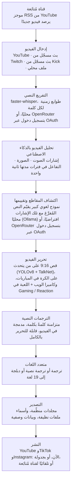

<div align="center">

[English](../../README.md) · [简体中文](README_zh.md) · [日本語](README_ja.md) · [한국어](README_ko.md) · [Türkçe](README_tr.md) · [Русский](README_ru.md) · [Tiếng Việt](README_vi.md) · [ไทย](README_th.md) · [Deutsch](README_de.md) · [Español](README_es.md) · [Français](README_fr.md) · [Português (Brasil)](README_pt-BR.md) · **العربية** · [Bahasa Indonesia](README_id.md) · [Italiano](README_it.md) · [हिन्दी](README_hi.md) · [বাংলা](README_bn.md) · [Filipino](README_tl.md) · [اردو](README_ur.md)

</div>

<div dir="rtl">

<a id="clips-kitty-the-free-open-source-opus-clip-alternative-for-chatting-gaming-and-sports-on-your-own-pc"></a>

# Clips Kitty: البديل المجاني مفتوح المصدر لـ Opus Clip لمحتوى الدردشة والألعاب والرياضة، يعمل على حاسوبك الشخصي

> تُرجم ملف README هذا بالذكاء الاصطناعي من [ملف README الإنجليزي](../../README.md)، وهو
> المرجع ويُحدَّث أولًا. نرحّب كثيرًا بتصحيحات المتحدثين الأصليين للغة.
>
> 🌐 [صفحة الموقع بالعربية](https://colingpt9.github.io/clips-studio/ar.html)

<a href="https://apps.microsoft.com/detail/9NB6XT7DSQZZ">
  <picture>
    <source media="(prefers-color-scheme: dark)" srcset="https://get.microsoft.com/images/en-us%20dark.svg">
    
  </picture>
</a>

[](https://github.com/ColinGPT9/clips-studio/releases)
[](https://github.com/ColinGPT9/clips-studio/releases)
[](../../LICENSE)
[](https://github.com/ColinGPT9/clips-studio/stargazers)
[](https://github.com/ColinGPT9/clips-studio)
[](../../CONTRIBUTING.md)
[](../../docs/DOCKER.md)

<a href="https://youtu.be/g1dMqrq-YaI"></a>

<a id="star-and-share-clips-kitty--goal-150"></a>

### امنح Clips Kitty نجمة وشاركه ⭐ الهدف: 150

[](https://github.com/ColinGPT9/clips-studio/stargazers) **من 150**

**أرجوك امنح المستودع نجمة وشاركه.** لن يكلّفك ذلك شيئًا، ولا توجد ميزانية تسويق
خلف هذا المشروع، لذا فإن التوصية الشفهية هي الطريقة الوحيدة التي سيعرف بها صانع
المحتوى الصغير التالي على YouTube أو صاحب البث المباشر أن هناك خيارًا مجانيًا.

**صنعته لصنّاع المحتوى الصغار على YouTube وأصحاب البث المباشر** الذين لا يستطيعون
تحمّل تكلفة الخيارات الأخرى أو أجر محرّر فيديو. إنه بديل مجاني لـ Opus Clip وVizard
وKlap يشغّل **Google Gemma** على حاسوبك الشخصي: بلا تكلفة خوادم، وبلا رسوم لكل مقطع،
وبلا رسوم لاستخدام الذكاء الاصطناعي.

> **كان اسم Clips Kitty هو Clips Studio حتى الإصدار 1.1.3**، وتغيّر الاسم لتلبية
> متطلبات التسمية في Microsoft Store. التطبيق نفسه، والمستودع نفسه، والبيانات نفسها.


**حوّل البثوث المباشرة والفيديوهات الطويلة إلى Shorts وReels وTikToks جاهزة للنشر،
بالكامل على جهازك.** Clips Kitty أداة مجانية مفتوحة المصدر لتوليد المقاطع بالذكاء
الاصطناعي وتحرير الفيديو لصنّاع المحتوى: الصق رابطًا من YouTube أو Twitch أو Kick
فيجد أفضل اللحظات، ويقصّها بنسبة 9:16 مع إبقاء المتحدث في المنتصف، ويدمج ترجمات
نصية متزامنة كلمةً بكلمة، ويكتب العناوين والأوصاف والوسوم.

لا ذكاء اصطناعي سحابي افتراضيًا. لا اشتراك. لا رسوم لكل مقطع. لقطاتك لا تغادر حاسوبك
أبدًا، إلا إذا طلبت منه نشر مقطع على قناتك الخاصة في YouTube.

محلي أولًا، والسحابة عند الحاجة: إذا كان حاسوبك أقدم من أن يشغّل الذكاء الاصطناعي،
يتولّى تشغيله مزوّد سحابي بدلًا منه، وتُحتسب التكلفة على حسابك أنت.
**OpenRouter هو المسار السحابي الموصى به**: سجّل الدخول بحسابك في OpenRouter
(عبر OAuth، بلا مفتاح تنسخه) للوصول إلى نماذج كثيرة (Claude وGPT وGemini وMuse Spark وغيرها).
في تجاربي، كلّف فيديو مدته ساعتان نحو 11 سنتًا على OpenRouter، مع Gemma
(Gemma 4 26B-A4B) لاختيار المقاطع وWhisper (large-v3-turbo) للتفريغ النصي؛ وما تدفعه
يعتمد على النماذج التي تختارها وطول الفيديو.
كما تعمل OpenAI وClaude وGemini وxAI وMeta وDeepSeek وQwen مباشرةً، بمفتاح API
الخاص بك.
راجع [docs/AI-BACKENDS.md](../../docs/AI-BACKENDS.md).

**لماذا وُجد:** معظم صنّاع المحتوى الذين يبنون قنواتهم يقومون بكل شيء بأنفسهم:
التصوير، والبث، والتحرير، والنشر. المقاطع القصيرة هي الطريقة التي يكتشفك بها الناس،
وهي عادةً أول ما يُهمَل: فالمحرّر تكلفة لا تستطيع معظم القنوات تبريرها بعد، وأدوات
المقاطع تتقاضى رسومًا لكل فيديو أو كل شهر، وقصّها يدويًا يستهلك يومًا كنت تحتاجه
لشيء آخر. هذا التطبيق يعمل على عتاد تملكه أصلًا، فلا يكلّفك استخدامه شيئًا ولا حدّ
لعدد المقاطع التي تصنعها.


<sub>38 مقطعًا من فيديو واحد في 19 دقيقة، على حاسوب واحد، دون رفع أي شيء.</sub>

---

<a id="contents"></a>

## المحتويات

- [ماذا يفعل](#what-it-does)
- [مقارنته بـ Opus Clip وKlap وVizard وCapCut](#how-it-compares-to-opus-clip-klap-vizard-and-capcut)
- [كيف يعمل](#how-it-works)
- [الميزات](#features)
- [لماذا صُمّم](#what-its-built-for)
- [المتطلبات](#requirements)
- [التثبيت والتشغيل](#install-and-run)
- [اختر نموذج الذكاء الاصطناعي](#pick-your-ai-model)
- [العتاد المُختبَر والأداء](#tested-hardware-and-performance)
- [المنصات المدعومة](#supported-platforms)
- [اللغات المدعومة](#supported-languages)
- [النشر على YouTube](#publish-to-youtube)
- [النشر على كل المنصات دفعة واحدة](#publish-to-every-platform-at-once)
- [التسريع بالمعالج الرسومي](#gpu-acceleration)
- [الاستخدام من سطر الأوامر](#command-line-use)
- [اكتب إضافة](#write-a-plugin)
- [ابنِ عليه](#build-on-it)
- [البنية](#architecture)
- [المساهمة](#contributing)
- [خارطة الطريق](#roadmap-detail)
- [الترخيص](#license)

---

<a id="what-it-does"></a>

## ماذا يفعل

تعطي Clips Kitty فيديو طويلًا، فيعيد إليك مجلدًا من المقاطع العمودية الجاهزة للنشر،
إضافةً إلى استوديو تراجعها فيه وتصلحها قبل أن تنشرها.

صُمّم للمحتوى الذي تتعامل معه معظم أدوات المقاطع بأسوأ شكل: **البثوث المباشرة، ومحتوى
IRL والمتحدثين أمام الكاميرا، والبودكاست، ومحتوى النوادي الرياضية واللياقة**: فيديوهات
طويلة وقليلة التنظيم تختبئ فيها اللحظات الجيدة، ولا يكفي النص المُفرَّغ وحده للعثور عليها.

<a id="how-it-compares-to-opus-clip-klap-vizard-and-capcut"></a>

## مقارنته بـ Opus Clip وKlap وVizard وCapCut

Clips Kitty بديل مفتوح المصدر لأدوات المقاطع السحابية. الفرق المهم هو مكان إنجاز العمل:
فيديوك لا يُرفع أبدًا، لذا لا يوجد ما يُقاس ولا ما تُحتسب عليه رسوم.

| الأداة | السعر، بفوترة شهرية | الخطة المجانية | يجد المقاطع نيابةً عنك | العلامة المائية | يرفع فيديوك | مفتوح المصدر |
| ---- | --------------------- | --------- | ----------------------- | --------- | ------------------ | ----------- |
| **Clips Kitty** | مجاني، بلا خطة مدفوعة | التطبيق بأكمله | نعم | أبدًا | لا، يعمل على حاسوبك | نعم، AGPL-3.0 |
| Opus Clip | 15$ لخطة Starter، و29$ لخطة Pro | 1080p، بعلامة مائية، تنتهي صلاحيتها خلال 3 أيام | نعم | في الخطة المجانية | نعم | لا |
| Klap | 29$ لخطة Pro، و14$ لخطة Basic بفوترة سنوية | فيديو واحد | نعم | غير مذكور | نعم | لا |
| Vizard | 29$ لخطة Creator، و14.50$ بفوترة سنوية | 60 رصيدًا شهريًا، 720p | نعم | في الخطة المجانية | نعم | لا |
| quso.ai | من 29$ إلى 49$ | 75 رصيدًا شهريًا، 720p | نعم | غير مذكور | نعم | لا |
| Ssemble | من 15$ إلى 60$، ومن 6$ إلى 24$ بفوترة سنوية | لا شيء مذكور | نعم | غير مذكور | نعم | لا |
| Descript | 16$ و24$ و50$ | 60 دقيقة شهريًا، 720p | جزئيًا، فهو محرّر للنصوص المُفرَّغة | في خطتَي Free وHobbyist | نعم | لا |
| CapCut | مجاني الاستخدام، وخطط مدفوعة على capcut.com | المحرّر بأكمله | **لا، أنت تقصّ يدويًا** | يختلف حسب الميزة | لا في تطبيق سطح المكتب | لا |

**CapCut هو الجدير بالفهم**، لأنه الإجابة المجانية التي يقدّمها الجميع. إنه محرّر جيد ولا
يكلّف شيئًا، لكنك أنت من يجد كل لحظة ويقصّ كل مقطع. Clips Kitty مجاني أيضًا، وتلك
المرحلة الأولى بالذات هي ما يقوم به نيابةً عنك.

**Opus Clip أو Klap أو Vizard هي الخيار الأفضل** إذا لم يكن لديك حاسوب يعمل بنظام Windows
مع بطاقة رسومات، أو كنت تصنع المقاطع من حين لآخر، أو تحتاج إلى العمل من الهاتف. أما
Clips Kitty فمصمّم لصناعة المقاطع بكميات كبيرة على عتاد تملكه أصلًا.

**[المقارنة الكاملة بين الأدوات السبع، مع ما تتفوّق فيه كل واحدة](https://colingpt9.github.io/clips-studio/alternatives.html)**

<sub>تم التحقق من الأسعار في صفحة الأسعار الخاصة بكل شركة بتاريخ 17 سبتمبر 2026. لا تنشر
CapCut صفحة أسعار تمكّنا من قراءتها، لذا لم يُذكر لها سعر. الخطط تتغيّر، وهذا الجدول
لن يُحدّث نفسه.</sub>

<a id="how-it-works"></a>

## كيف يعمل



**كل مرحلة تعمل على حاسوبك ما لم تختر غير ذلك:** OpenRouter، بعد تسجيل الدخول بحسابك،
للذكاء الاصطناعي أو التفريغ النصي، والنشر، الذي لا يرفع إلا المقاطع التي ترسلها. وفيما
عدا ذلك، الشيء الوحيد الذي يستخدم الشبكة في التشغيل العادي هو تنزيل الفيديو المصدر.

<a id="the-stages-in-detail"></a>

### المراحل بالتفصيل

**التفريغ النصي: faster-whisper.** طوابع زمنية لكل كلمة، يعمل على CUDA حيث يتوفر ويعود
إلى المعالج المركزي عند عدم توفره. توقيت الكلمات هو ما يجعل الترجمات النصية تقع على
المقطع الصوتي الصحيح، ويجعل المقاطع تبدأ عند حدّ جملة حقيقي.

**تقييم المقاطع بالذكاء الاصطناعي.** النص المُفرَّغ إشارة واحدة من خمس. يقدّم الصوت قفزات
الارتفاع، وكثافة الدفقات (وهي هيئة الضحك والتصفيق)، وأنماط الصمت←الانفجار التي تصنع
الذروة. وتقدّم الصورة تغيّرات المشهد، والحركة، والتغيّرات في مساحة الوجه. وتدمج إشارة
التفاعل كل ذلك. تُطبَّع كل إشارة *داخل ذلك الفيديو نفسه*، فيُنتج البودكاست الهادئ والبث
الصاخب كلاهما ذروات ذات معنى. وحيث توجد بيانات حقيقية عن الجمهور (إعادة تشغيل دردشة
Twitch مقيسة بعدد المشاركين الفريدين، وخريطة "الأكثر إعادة للمشاهدة" الحرارية في YouTube)،
فإنها تضيف مكافأة صغيرة محدودة السقف.

يرى النموذج اللغوي المحلي النص المُفرَّغ **مع خط زمني لتلك الأحداث**، فيستطيع أن يقدّر
بشكل صحيح أن "الكلمات هادئة لكن المكان انفجر". ولأن النماذج الصغيرة تمنح كل شيء
درجات في نطاق ضيق، تُقارَن المقاطع المتأهلة بعد ذلك وجهًا لوجه في استدعاء واحد لإعادة
الترتيب: فالحكم النسبي أسهل بكثير على نموذج بحجم 7B من التقييم المطلق.

**ملفات صنّاع المحتوى.** يبني التطبيق قاعدة معرفة لكل صانع محتوى عبر فيديوهاته: المواضيع
المتكررة، والسلاسل، والمتعاونون، والنكات المتداولة، والقصص المستمرة. يساعده هذا السياق
على كتابة عناوين دقيقة والتقاط الإشارات إلى لحظات سابقة. وهو متحفّظ عن قصد: يجب أن
تتكرر العبارة المميزة فعلًا قبل أن تُحتسب، والمعرفة التي يتوقف ذكرها تصبح خاملة، وكل
مساهمة منها في التقييم إضافية ومحدودة السقف ويمكن إيقافها.

**محرّر الفيديو.** غير إتلافي: القص من الأطراف، والقص الداخلي، وكتم الصوت، والكلمات
المكتومة، ومستوى الصوت، والتلاشي، والسرعة، ونص الجذب، والموسيقى، والعلامة المائية، كلها
تُحفظ كعمليات وتُطبَّق وقت التصيير. وهناك أيضًا محادثة تحرير بالذكاء الاصطناعي
(*"اجعله أطول بخمس ثوانٍ"*، *"الترجمة مكتوب فيها شبخ، والصحيح شبح"*)، حيث يقترح النموذج
وتطبّق شيفرة مُتحقَّق منها.

**معالجة المحتوى الطويل.** مسار اختياري بنسبة 16:9 يستخدم التحليل نفسه: مقاطع أفقية،
ومقاطع بطول يناسب X/Twitter، وفيديو تجميعي لأفضل اللحظات، أو البث كاملًا مع حذف
فترات الصمت.

**مسار متعدد اللغات ودبلجة بالذكاء الاصطناعي.** تُترجَم الترجمات النصية وتُعرض للمراجعة
*قبل* كتابة أي شيء أو دمجه في الفيديو، فيُصلَح السطر السيئ ما دام إصلاحه ممكنًا. ويحمي
مسرد مصطلحات أسماء القنوات والرعاة والنكات الداخلية من الترجمة. وتستخدم الدبلجة تحويل
النص إلى كلام محليًا بأصوات يمكنك الاستماع إليها مسبقًا.

**التسريع المحلي بالمعالج الرسومي.** CUDA للاكتشاف والتفريغ النصي، وترميز الفيديو بالعتاد
عبر NVENC/AMF/QSV (يُكتشف تلقائيًا، مع الرجوع إلى المعالج المركزي)، والنموذج اللغوي على
المعالج الرسومي عبر Ollama.

<a id="features"></a>

## الميزات

- **اكتشاف المقاطع متعدد الوسائط**: لحظات تُقيَّم من 0 إلى 100 بدمج ما يُقال، وحماس
  الصوت، والنشاط البصري، وردود الفعل على الشاشة، وقوة الجذب/الذروة. كل مقطع يتجاوز حدّ
  الجودة يُحتفَظ به، بلا سقف اعتباطي.
- **تتبّع الوجوه بحسب المتحدث**: يُبقي اكتشاف الوضعيات في YOLOv8 الشخص في المنتصف، وفي
  اللقطات الجماعية تتبع الكاميرا **من يتحدث فعلًا**، ويحدّد ذلك اكتشافُ المتحدث النشط
  في TalkNet من الوجه والصوت معًا وليس من الحركة. وعندما يتغيّر المتحدث **ينتقل** الإطار
  إليه مباشرةً بدلًا من التحريك عبر المشهد، كما يفعل المحرّر. تأطير بالقص فقط: لا تمطيط
  أبدًا، ولا تشويه أبدًا.
- **وضع البودكاست**: في اللقطات متعددة الكاميرات، تحصل كل لقطة على قصّ ثابت خاص بها على
  شخص واحد، فتقع الانتقالات على وجه دون تحريك. وداخل اللقطة يُختار الشخص بحسب حركة الفم،
  مع الرجوع إلى الوجه الأبرز.
- **Vertical Live** (البث العمودي): لبثّ مباشر كان عموديًا أصلًا وقت بثّه (بث عمودي على
  YouTube، أو Twitch Dual Format، أو Streamlabs Dual Output، أو بث مباشر من Instagram أو
  TikTok تم تنزيله). يحتفظ بتخطيط البث نفسه بنسبة 9:16، ويتخطّى تتبّع الوجوه، ويواصل
  اختيار اللحظات بالطريقة المعتادة. راجع [docs/VERTICAL-LIVE.md](../../docs/VERTICAL-LIVE.md).
- **الرياضة: كرة القدم وكرة السلة**: كل لحظة كبيرة من المباراة في مقطع خاص بها، مع بناء
  الهجمة وردّ الفعل.
  - **كرة القدم**: الأهداف والتصديات والبطاقات والفرص الكبيرة. تُقرأ الأهداف من لوحة النتيجة
    على الشاشة ويُحدَّد توقيتها من هتاف الجمهور، ويتبع القص بنسبة 9:16 الكرة. اختر All goals
    (كل الأهداف) أو Best saves (أفضل التصديات) أو Cards (البطاقات) وغيرها، واجمع اللحظات في
    ملخص للمباراة وفي مقاطع تجميعية للفريق أو اللاعب.
  - **كرة السلة**: السلات الساحقة والرميات الثلاثية والصدّات وقطع الكرة والسلات الحاسمة. تؤكد لوحة
    النتيجة على الشاشة كل سلة ونقاطها، ويمنح الربعُ والوقتُ المتبقي السلةَ الحاسمة وزنًا أكبر بكثير
    من سلة في الربع الأول. وتُرصد أيضًا ردود فعل الجمهور ودكة البدلاء والجالسين بجانب الملعب.
    يُخطَّط القص بنسبة 9:16 لكل مقطع حول لعبته: الكرة ومن يحملها، ومستلم التمريرة، والتسديدة
    متبوعةً حتى السلة مع بقاء الحلقة واللوحة الخلفية في الصورة. يتحرك القص مع اللعب ولا يقرّب
    الصورة أبدًا. تُكتشف الكرة بواسطة نموذج الكشف [E-BARD](https://github.com/GabrieleGiudic/E-BARD#readme) (مع ذكر مصدره في [الترخيص](#license)).

  راجع [docs/SPORTS.md](../../docs/SPORTS.md).
- **ترجمات نصية مدمجة قابلة للتحرير**: متزامنة كلمةً بكلمة، وبالأسلوب الذي تحبه (اللون،
  والحجم، والموضع، وعدد الكلمات في السطر، وحالة الأحرف، أو إيقافها). أصلح خطأ التفريغ
  سطرًا بسطر قبل التصدير. وعند حديث شخصين، يمكن أن تأخذ ترجمات المتحدث الثاني لونًا آخر،
  ويمكن تبديل السطر الذي ينسبه خطأً يدويًا.
- **محادثة التحرير بالذكاء الاصطناعي**: صِف المشكلة بلغة بسيطة فيعيد التحرير.
- **Ask Clips Kitty** (اسأل Clips Kitty): مربع النص في أسفل لوحة التحكم. قل ما تريده في
  جملة، مثل *"اصنع مقاطع من هذا البث، وتأكد من تضمين اللحظة التي متّ فيها أمام الزعيم،
  مع ترجمات نصية صفراء كبيرة"*، فيضع الفيديو في قائمة الانتظار، ويخبر أداة اختيار المقاطع
  بما تبحث عنه، ويضبط الخيارات التي ذكرتها. **يحتاج إلى نموذج Gemma 4**: راجع
  [مربع النص في الأسفل يحتاج إلى Gemma 4](#the-text-box-at-the-bottom-needs-gemma-4).
- **عناوين وأوصاف ووسوم بالذكاء الاصطناعي**، كلها قابلة للتحرير قبل التصدير.
- **ملفات صنّاع المحتوى**: يتعلّم التطبيق مع الوقت عن كل صانع محتوى ليختار المقاطع ويضع
  لها عناوين أفضل. يبقى كل شيء على حاسوبك، ويمكنك فحصه أو تصحيحه أو مسحه.
- **النشر متعدد اللغات**: 19 لغة، مع مراجعة قبل دمج أي شيء في الفيديو.
- **الدبلجة بالذكاء الاصطناعي**: تحويل النص إلى كلام محليًا مع تجربة الأصوات لكل لغة.
- **تصدير المحتوى الطويل**: مقاطع 16:9، أو فيديوهات تجميعية لأفضل اللحظات، أو نسخة محرّرة
  من البث بلا تكرار. يحمل وصف الفيديو التجميعي **طوابع زمنية للفصول**، ليتنقّل المشاهدون
  بين اللحظات على YouTube.
- **ملفات العلامة المائية والهوية البصرية**: إعدادات افتراضية لكل صانع محتوى تُطبَّق تلقائيًا.
- **مدير النماذج**: بدّل عقل الذكاء الاصطناعي من داخل التطبيق؛ نزّل النماذج واحذفها وبدّل
  بينها مع أشرطة تقدّم ودون أي طرفية.
- **النشر على YouTube من المحرّر مباشرةً**: العنوان، والوصف، والوسوم، والصورة المصغّرة،
  وقائمة التشغيل، والجمهور، ومستوى الظهور، ثم Upload now (ارفع الآن) أو الجدولة. ميزة
  اختيارية، متوقفة افتراضيًا، وتستخدم مفتاح Google API الخاص بك.
- **الملاحظات من داخل التطبيق**: تقارير أخطاء مع معلومات تشخيصية تُجمع تلقائيًا، دون الحاجة
  إلى حساب.
- **واجهة سهلة الوصول**: تركيز لوحة المفاتيح، ودعم تقليل الحركة، وخط وحجم قابلان للضبط.

<a id="what-its-built-for"></a>

## لماذا صُمّم

كل شيء يعمل على أي فيديو تعطيه إياه. هذه هي الحالات التي يفكّر فيها أكثر أو أقل مما توحي
به قائمة الميزات، كي لا يفاجئك شيء:

| المحتوى | كيف يؤدّي |
|---|---|
| **IRL، والدردشة المباشرة (just chatting)، والبودكاست، والمدوّنات المرئية، والمقابلات** | هذا ما ضُبط من أجله، وما يُختبر على بثوث حقيقية قبل كل إصدار |
| **الألعاب وفيديوهات ردود الفعل** | مع تفعيل **Gaming / Reaction**: كاميرا الويب في نصف، واللعبة أو الفيديو الذي يُتفاعَل معه في النصف الآخر، مع التحقق من ذلك على إطارات الفيديو نفسه قبل المعالجة ([docs/GAMING.md](../../docs/GAMING.md)). صاحب البث هو من يتحدث، وليس أكبر وجه أبدًا. ومن دون هذا الخيار قد يتبع التأطير شخصية داخل اللعبة. للأشخاص أمام الكاميرا فقط، لا لشخصيات VTuber |
| **المباريات الرياضية** | مع تفعيل **Sports**: مصمّم للبثوث التلفزيونية التي فيها لوحة نتيجة وتعليق، حيث تكون الأهداف والسلات مؤكدة. لقطات الأندية أو الهواتف لا تحتوي عادةً على أيٍّ منهما: مقاطعها تتبع الكرة، وأهدافها تأتي من أحداث المباراة التي تلصقها، مثل وسوم الأهداف في تطبيق النادي ([docs/SPORTS.md](../../docs/SPORTS.md)) |
| **ما يتفاعل معه فيديو رد الفعل** | تُختار المقاطع دائمًا مما *يُقال*، لذا فإن لحظة في الفيديو المُشاهَد لا يعلّق عليها أحد تبقى غير مرئية له |

يعتمد اختيار المقاطع على النص المُفرَّغ والإشارات. فعندما يكون الموقف المضحك *بصريًا فقط*
ولا يعلّق عليه أحد، توقّع أن تجده بنفسك في المحرّر.

<a id="requirements"></a>

## المتطلبات

|             | الحد الأدنى                                  | الموصى به                       |
| ----------- | -------------------------------------------- | ------------------------------- |
| **المعالج الرسومي (GPU)** | NVIDIA RTX 2060 (6 GB)         | RTX 3060 12 GB أو أفضل          |
| **المعالج (CPU)** | Intel Core i3-9100 / AMD Ryzen 3 3200G (2019)| 6 أنوية أو أكثر          |
| **الذاكرة (RAM)** | 16 GB                                  | 16 GB أو أكثر                   |
| **القرص**   | نحو 20 GB، إضافةً إلى مساحة للفيديوهات التي تقصّها |                           |
| **نظام التشغيل** | Windows 10 أو 11                        |                                 |

**قد يعمل تحت الحد الأدنى، لكنه غير مدعوم وسيكون بطيئًا.** صناعة مقاطع من بث تعني ساعات من
فك ترميز الفيديو والتفريغ النصي والترميز؛ والعتاد الأقدم من عام 2019 تقريبًا سيستغرق وقتًا
طويلًا لدرجة أن التطبيق يبدو معطّلًا حتى وهو يعمل بشكل صحيح.

اثنان من هذه المتطلبات يستحقان التوضيح:

- **16 GB من الذاكرة ليست مجرد اقتراح.** مع 8 GB سيحلّل فيديو كاملًا ثم لا يصيّر شيئًا،
  وهو ما يبدو كأنه انهيار لا حدّ للذاكرة.
- **المعالج الرسومي اختياري، وليس ضروريًا.** من دونه يعمل كل شيء على المعالج المركزي، بشكل
  أبطأ لكن كامل. وبطاقة RTX 2060 هي النقطة التي يبدأ عندها مسار المعالج الرسومي بالعمل؛
  راجع [التسريع بالمعالج الرسومي](#gpu-acceleration).

**التطبيق لـ Windows فقط.** يُفترض أن يعمل محرّك Python على Linux/macOS، لكن لا توجد نسخة
لـ Mac، ولا يملك المشرف جهاز Mac ليختبر عليه. راجع
[#62](https://github.com/ColinGPT9/clips-studio/issues/62) إن كان لديك واحد وتريد المساعدة.

التشغيل من الشيفرة المصدرية يحتاج إلى ما كان المثبّت سيجلبه لك:

- **Python 3.10+** و<strong>Node.js 18+</strong>
- **[FFmpeg](https://ffmpeg.org/download.html)** في متغيّر PATH
- **[Ollama](https://ollama.com)** مع نموذج منزَّل: `ollama pull gemma:7b`

<a id="install-and-run"></a>

## التثبيت والتشغيل

**أسهل طريقة هي [Microsoft Store](https://apps.microsoft.com/detail/9NB6XT7DSQZZ).**
نقرة واحدة، ويحدّث نفسه، ولا يُظهر Windows أي تحذير أمني. لقد اعتمدت Microsoft الحزمة
ووقّعتها، فلا يظهر تحذير SmartScreen الموصوف أدناه إطلاقًا. يثبّت المتجر الإصدارات الجديدة
عندما يصل دورها؛ وللحصول على إصدار فورًا، افتح صفحة Clips Kitty في Microsoft Store واضغط
**Update** (تحديث).

**أو نزّل المثبّت.** نزّل أحدث **Web Setup** من
[Releases](https://github.com/ColinGPT9/clips-studio/releases) وشغّله. يحمل التطبيق، ومحرّك Python، وكل
المكتبات، وFFmpeg، وبيئة تشغيل الذكاء الاصطناعي، وكل أوزان الاكتشاف والتفريغ النصي: لا
Python، ولا PATH، ولا طرفية، ولا برنامج ثانٍ للتثبيت.

**أو استخدم winget.** الأمر `winget install ColinGPT9.ClipsKitty` يثبّت Web Setup نفسه
من الطرفية.

الشيء الوحيد الذي لا يحمله هو النموذج اللغوي نفسه، لأن هذه النماذج تأتي بتراخيص يجب أن
يوافق عليها الشخص الذي ينزّلها، وليست شيئًا يمكن الموافقة عليه نيابةً عنك. يبدأ معالج
الإعداد ذلك التنزيل من تلقاء نفسه، ويختار الحجم المناسب لبطاقة الرسومات لديك، ويعرض شريط
تقدّم. إذن: تنزيل واحد، ونقرة مزدوجة واحدة، وشريط تقدّم واحد. بعد ذلك يعمل دون اتصال.

> سيحذّرك Windows من أن التطبيق غير موقّع في أول مرة تشغّله. انقر
> *More info → Run anyway* (مزيد من المعلومات ← التشغيل على أي حال). شهادة التوقيع على قائمة المهام.

<a id="from-source"></a>

### من الشيفرة المصدرية

```bash
git clone https://github.com/ColinGPT9/clips-studio
cd clips-studio
pip install -r requirements.txt

cd ui
npm install
npm run dev        # opens the Clips Kitty desktop app
```

يشغّل التطبيق محرّك Python الخاص به تلقائيًا. الصق رابطًا في **Clip Editor** (محرّر
المقاطع)، واضغط *Generate clips* (توليد المقاطع)، وتابع التقدّم مباشرةً.

بناء المثبّت بنفسك أمر واحد. راجع
[CONTRIBUTING.md](../../CONTRIBUTING.md#building-the-windows-installer).

<a id="with-docker-nothing-else-to-install"></a>

### باستخدام Docker: لا شيء آخر لتثبيته

للمساهمين. تحتاج إلى [Docker Desktop](https://docs.docker.com/get-started/get-docker/)
ولا شيء غيره: لا Python، ولا Node، ولا FFmpeg، ولا PyTorch.

```bash
git clone https://github.com/ColinGPT9/clips-studio
cd clips-studio
docker compose up
```

تعمل ثلاث خدمات معًا:

| | |
|---|---|
| **<http://localhost:5173>** | الواجهة، في متصفحك |
| **<http://localhost:8765>** | المحرّك وواجهة API الخاصة به |
| Ollama | الذكاء الاصطناعي المحلي، على المنفذ :11434 |

ثم نزّل نموذجًا (`docker compose exec ollama ollama pull gemma3:4b`) فتصبح لديك
نسخة عمل جاهزة.

شغّل الفحوصات بالطريقة نفسها:

```bash
docker compose run --rm engine pytest
docker compose run --rm ui npm run typecheck
```

> **تخطَّ البناء الأول الذي يستغرق عشر دقائق:** الأمر `docker compose pull` يجلب صورة
> محرّك مبنية مسبقًا بدلًا من تصريف PyTorch وOpenCV محليًا.

غلاف سطح المكتب نفسه لا يزال يعمل على جهازك المضيف، لأن Electron يحتاج إلى شاشة، أما كل
ما عداه فيعمل في حاويات. التفاصيل، وما لا يمكن لهذا أن يخبرك به، في
[docs/DOCKER.md](../../docs/DOCKER.md).

<a id="pick-your-ai-model"></a>

## اختر نموذج الذكاء الاصطناعي

افتح صفحة **Models** (النماذج) لترى ما هو مثبّت وما يستطيع معالجك الرسومي تحمّله:

معيار واحد فقط: مقدار ذاكرة الفيديو (VRAM) لديك. هذه هي الصفوف نفسها التي يعرضها التطبيق،
من `RECOMMENDATIONS` في [`llm/manager.py`](../../llm/manager.py). يقرأ المعالج وصفحة Models
هذا الجدول نفسه، فلا يمكن أن يختلفا فيما بينهما، ولا مع هذا النص.

| عتادك | النموذج الموصى به | |
|---|---|---|
| معالج مركزي / رسوميات مدمجة، بلا بطاقة رسومات | `gemma3:4b` | مُختبَر |
| أقل من 6 GB من VRAM، أو حاسوب أقدم | `gemma4:e2b` | |
| 6 GB من VRAM | `gemma4:e4b` | |
| 8 GB من VRAM | **`gemma:7b`** | مُختبَر · الافتراضي المرفق |
| من 10 إلى 12 GB من VRAM | `gemma3:12b` | مُختبَر |
| من 16 إلى 24 GB من VRAM | `gemma3:27b` | |

والنماذج التي تستحق الاختيار لسبب غير ذاكرة الفيديو:

| السبب | النموذج |
|---|---|
| الترجمة / تعدد اللغات | `qwen3:8b` أو `qwen3:14b` |
| ترخيص متساهل | `mistral-nemo:12b` (Apache-2.0) · `phi4:14b` (MIT) |

**النماذج الثلاثة المعلَّمة بـ "مُختبَر" هي وحدها التي جُرّبت على بثوث حقيقية**، و`gemma:7b`
هو صاحب أكثر ساعات الاستخدام؛ وهو ما يأتي به `config/settings.yaml`. كل النماذج الأخرى مدرجة
لأن حجمها معقول واستخدامها التجاري مجاني، لا لأن جودة المقاطع قيست بها. كلها تعمل، لأن
التطبيق يتعامل مع كل النماذج بالطريقة نفسها عبر Ollama، لكن لم يتحقق أحد مما إذا كانت تختار
لحظات أفضل. سدّ هذه الفجوة هو موضوع [#38](https://github.com/ColinGPT9/clips-studio/issues/38).

أي نموذج يقدّمه Ollama يعمل، والتبديل بنقرة واحدة. يمكن للترجمة أن تستخدم نموذجًا *مختلفًا*
عن نموذج صناعة المقاطع. اضبط `llm.translation_model`.

<a id="the-text-box-at-the-bottom-needs-gemma-4"></a>

### مربع النص في الأسفل يحتاج إلى Gemma 4

**Ask Clips Kitty**، مربع النص في أسفل لوحة التحكم، لا يعمل إلا مع نموذج قادر على استخدام
أدوات التطبيق. Gemma 4 قادر على ذلك. أما `gemma:7b` ونماذج Gemma 3 فليست قادرة، ويثبّت
الإعداد أحدها على حاسوب بلا بطاقة رسومات أو بذاكرة فيديو 8 GB أو أكثر. هناك لن يعمل المربع
حتى تضيف نموذج Gemma 4: يقول الإصدار 2.0 *"No installed model can use tools"* (لا يوجد
نموذج مثبّت يمكنه استخدام الأدوات)، وتعرض الإصدارات اللاحقة التنزيل داخل المربع نفسه.

أيًّا كان النموذج الذي يختار مقاطعك، ثبّت بجانبه نموذج Gemma 4 من صفحة **Models**:
`gemma4:e4b` على بطاقة رسومات بذاكرة 6 GB أو أكثر، و`gemma4:e2b` لما هو أقل. لا داعي للتبديل
إليه. المربع يجده بنفسه، وتظل مقاطعك تُختار بالنموذج الذي اخترته. وإن كنت تشغّل الذكاء
الاصطناعي عبر OpenRouter بدلًا من ذلك، يستخدم المربع ذلك النموذج ولا يحتاج إلى تثبيت أي شيء.

<a id="tested-hardware-and-performance"></a>

## العتاد المُختبَر والأداء

يُطوَّر Clips Kitty ويُختبر يوميًا على هذا الجهاز، لذا فهو نقطة مرجعية مفيدة إذا كنت تقارن
نتائجك:

| | |
|---|---|
| **المعالج الرسومي (GPU)** | NVIDIA GeForce RTX 3060، ذاكرة فيديو 12 GB |
| **المعالج (CPU)** | AMD Ryzen 5 5600X (6 أنوية / 12 خيط معالجة) |
| **الذاكرة (RAM)** | 16 GB |
| **نظام التشغيل** | Windows 10 |
| **نموذج صناعة المقاطع** | `gemma:7b` عبر Ollama |
| **التفريغ النصي** | faster-whisper `large-v3-turbo` على CUDA |

كل ما في هذا المستودع (الإعدادات الافتراضية، و`parallel_renders: 3`، وحجم مقطع التحليل البالغ
5 دقائق) مضبوط لهذه الفئة من الأجهزة تقريبًا. على معالج رسومي أكبر، ارفع `llm.num_ctx`
و`analysis.chunk_seconds` معًا وانتقل إلى حجم نموذج أكبر؛ وعلى معالج أصغر، انزل إلى `gemma3:4b`.

إذا قست أداء Clips Kitty على عتاد مختلف، فأرجو أن تنشر النتائج في
[Discussions](https://github.com/ColinGPT9/clips-studio/discussions). الأرقام الحقيقية من أجهزة حقيقية تساعد الجميع على
تحديد حجم إعداداتهم.

<a id="supported-platforms"></a>

## المنصات المدعومة

| المصدر | الدعم |
|---|---|
| فيديوهات YouTube | كامل. يُختار H.264 عمدًا (لأن AV1 يضاعف وقت المعالجة تقريبًا) |
| البثوث المسجّلة على Twitch | كامل، بما في ذلك إعادة تشغيل الدردشة كإشارة من الجمهور |
| البثوث المسجّلة على Kick | كامل (تحذف Kick الدردشة بعد انتهاء البث، فلا توجد إشارة من الدردشة) |
| ملفات الفيديو المحلية | كامل. اصنع مقاطع من لقطاتك قبل أن تنشرها |
| البثوث المباشرة | غير مدعومة عن قصد. البثوث المسجّلة فقط |

<a id="supported-languages"></a>

## اللغات المدعومة

يمكن ترجمة المقاطع وإضافة ترجمات نصية إليها ودبلجتها إلى **19 لغة**، كما أن **الواجهة نفسها
مترجمة إلى اللغات الـ19 كلها**، فيمكن استخدام التطبيق باللغات نفسها التي ينشر بها:

الإنجليزية · الإسبانية · البرتغالية (البرازيلية) · الفرنسية · الألمانية · الهندية · الإندونيسية ·
اليابانية · الروسية · العربية · الصينية (المبسّطة) · الفيتنامية · الفلبينية · التركية ·
الأردية · البنغالية · التايلاندية · الكورية · الإيطالية

إضافة لغة تعني سطرًا واحدًا في `multilingual/languages.py` وملف ترجمة في
`ui/src/renderer/src/locales/`. أداة الترجمة وكاتب الترجمات النصية لا يعتمدان على لغة بعينها.

<a id="help-wanted-the-maintainer-only-speaks-english"></a>

### مطلوب مساعدة: المشرف لا يتحدث إلا الإنجليزية

18 من ترجمات الواجهة الـ19 لم يقرأها قط شخص يتحدث تلك اللغة. ونصفها غير مكتمل. لكل لغة
مشكلة (issue) خاصة بها، مكتوبة بالإنجليزية وبتلك اللغة، و**الإبلاغ عن كلمة سيئة مساهمة
كاملة بحد ذاتها**: لا حاجة إلى طلب سحب (pull request). [كيف يعمل ذلك](../../docs/TRANSLATING.md).

**تحتاج إلى إكمال** (نحو 68 نصًا ما زالت بالإنجليزية):
[বাংলা (البنغالية)](https://github.com/ColinGPT9/clips-studio/issues/43) ·
[Italiano (الإيطالية)](https://github.com/ColinGPT9/clips-studio/issues/44) ·
[한국어 (الكورية)](https://github.com/ColinGPT9/clips-studio/issues/45) ·
[ไทย (التايلاندية)](https://github.com/ColinGPT9/clips-studio/issues/46) ·
[Tagalog (الفلبينية)](https://github.com/ColinGPT9/clips-studio/issues/47) ·
[Türkçe (التركية)](https://github.com/ColinGPT9/clips-studio/issues/48) ·
[اردو (الأردية)](https://github.com/ColinGPT9/clips-studio/issues/49) ·
[Tiếng Việt (الفيتنامية)](https://github.com/ColinGPT9/clips-studio/issues/50) ·
[中文 (الصينية)](https://github.com/ColinGPT9/clips-studio/issues/51)

**تحتاج إلى مراجعة** (مكتملة، لكن لم يتحقق أحد من أنها تُقرأ بشكل طبيعي):
[العربية](https://github.com/ColinGPT9/clips-studio/issues/52) ·
[Deutsch (الألمانية)](https://github.com/ColinGPT9/clips-studio/issues/53) ·
[Español (الإسبانية)](https://github.com/ColinGPT9/clips-studio/issues/54) ·
[Français (الفرنسية)](https://github.com/ColinGPT9/clips-studio/issues/55) ·
[हिन्दी (الهندية)](https://github.com/ColinGPT9/clips-studio/issues/56) ·
[Bahasa Indonesia (الإندونيسية)](https://github.com/ColinGPT9/clips-studio/issues/57) ·
[日本語 (اليابانية)](https://github.com/ColinGPT9/clips-studio/issues/58) ·
[Português (البرتغالية)](https://github.com/ColinGPT9/clips-studio/issues/59) ·
[Русский (الروسية)](https://github.com/ColinGPT9/clips-studio/issues/60)

هل تريد لغة غير موجودة هنا؟ [#61](https://github.com/ColinGPT9/clips-studio/issues/61).

<a id="publish-to-youtube"></a>

## النشر على YouTube

متوقف افتراضيًا. فعّله من **Settings → Publish to YouTube** (الإعدادات ← النشر على YouTube)
فيظهر تبويب **YouTube** في المحرّر: املأ العنوان والوصف والوسوم والصورة المصغّرة وقائمة
التشغيل والجمهور ومستوى الظهور، ثم اضغط **Upload now** (ارفع الآن). يصيّر Clips Kitty المقطع
إن كانت لديك تعديلات غير محفوظة، ثم يرفعه مباشرةً إلى قناتك. لا توجد خطوة تصدير ولا صفحة
نشر منفصلة. لن تغادر المحرّر أبدًا.

إذا تركته متوقفًا، فلن يتغيّر شيء في أي مكان من التطبيق.

<a id="scheduling"></a>

### الجدولة

اختيار **Schedule on YouTube** (الجدولة على YouTube) يرفع الفيديو *فورًا*، ويجعله خاصًا،
ويسلّم YouTube موعد النشر. ثم ينشره YouTube في يومه.

**يمكنك إغلاق Clips Kitty وإطفاء حاسوبك.** لا يوجد مؤقّت في هذا التطبيق، ولا خدمة في
الخلفية، ولا شيء يجب تركه قيد التشغيل. بمجرد أن يقبل YouTube الفيديو، تنتهي مهمة Clips Kitty.

<a id="you-need-your-own-google-api-key"></a>

### تحتاج إلى مفتاح Google API خاص بك

لا يأتي Clips Kitty بمفتاح مشترك، وهذا ليس مجرد حذر. حصة الرفع في Google **لكل مشروع
Cloud**: والمفتاح المشترك يعني أن كل مستخدم في العالم سيسحب من الرصيد نفسه البالغ 100 عملية
رفع يوميًا. مشروعك الخاص يمنحك حصتك الخاصة، وبيانات اعتمادك لا تغادر جهازك أبدًا. ولا يوجد
أي خادم لـ Clips Kitty في المسار.

الإعداد مجاني ويستغرق نحو عشر دقائق؛ ويرشدك المعالج في Settings خلاله:

1. أنشئ مشروعًا في [Google Cloud Console](https://console.cloud.google.com/projectcreate).
2. فعّل **YouTube Data API v3** من APIs & Services → Library.
3. املأ شاشة موافقة OAuth، ثم اضغط **Publish app**. هذه الخطوة مهمة: إذا بقيت على
   *Testing*، فإن Google تُنهي تسجيل دخولك كل 7 أيام وستضطر إلى إعادة الاتصال أسبوعيًا.
   و"In production" لا تعني أن التطبيق مُتحقَّق منه، ولا تكلّف شيئًا.
4. Credentials → Create credentials → OAuth client ID → النوع **Desktop app**.
5. الصق client ID وsecret في Settings، ثم اربط قناتك.

سترى تحذير "Google hasn't verified this app" (لم تتحقق Google من هذا التطبيق) عند الربط.
إنه تطبيقك أنت يحذّرك من نفسك. **Advanced → Go to (unsafe)** (خيارات متقدمة ← الانتقال
(غير آمن)) يتجاوزه.

<a id="posting-publicly"></a>

### النشر العام

أمر واحد يجب أن تعرفه قبل أن تعتمد على هذا، لأنه لا يوجد برنامج يستطيع الالتفاف عليه:

> **إلى أن يجتاز مشروعك في Google Cloud تدقيق YouTube API المجاني، يقفل YouTube كل فيديو
> يُرفع من خلاله على وضع "خاص".** القفل دائم. لا يمكنك جعل الفيديو عامًا لاحقًا من Studio،
> ولا يوجد استئناف. الحل الوحيد هو رفعه مجددًا من مشروع اجتاز التدقيق.

يتحقق Clips Kitty بعد كل عملية رفع ويخبرك بوضوح إن حدث ذلك، بدلًا من الإبلاغ عن نجاح
فيديو لا يستطيع أحد مشاهدته. إذا كنت تنوي النشر للعامة، فقدّم أولًا
[نموذج تدقيق YouTube API Services](https://support.google.com/youtube/contact/yt_api_form).
الرفع بوضع **غير مدرج** أو **خاص** لا يتأثر.

<a id="what-it-can-and-cannot-set"></a>

### ما يمكنه ضبطه وما لا يمكنه

كل ما تتيحه الواجهة البرمجية العامة: العنوان، والوصف (تصبح الطوابع الزمنية فيه فصولًا)،
والوسوم، والفئة، واللغة، ومستوى الظهور، وموعد النشر المجدول، وتصنيف "مخصص للأطفال"، والإفصاح
عن المحتوى المعدّل/الاصطناعي، والترخيص، والتضمين، والإحصاءات العامة، والصورة المصغّرة المخصصة،
والإضافة إلى قائمة تشغيل.

بعض ميزات YouTube Studio غير موجودة في الواجهة البرمجية العامة أصلًا، لذا لا يوجد لها عن قصد
أي عنصر تحكم، بدلًا من عنصر لا يفعل شيئًا في صمت: تحقيق الربح وفواصل الإعلانات، والإفصاح عن
الترويج المدفوع، والشاشات النهائية والبطاقات، وإعدادات التعليقات، وقيود العمر، والعروض الأولى
(Premieres)، وأذونات إعادة مزج Shorts. توجّهك اللوحة إلى Studio لهذه الأمور.

لا تحتاج Shorts إلى أي شيء خاص: لا وضع منفصل ولا وسم `#Shorts`. يصنّف YouTube الفيديو
على أنه Short من تلقاء نفسه بحسب أبعاده ومدته.

<a id="publish-to-every-platform-at-once"></a>

## النشر على كل المنصات دفعة واحدة

متوقف افتراضيًا أيضًا. فعّله من **Settings → Publish through WoopSocial** (الإعدادات ← النشر
عبر WoopSocial) فيظهر تبويب **Publish** (نشر) في المحرّر: اختر منصاتك — أو اضغط
**Everywhere** (في كل مكان) — واكتب العنوان والوصف مرة واحدة، فيذهب رفع واحد إلى YouTube
وTikTok وInstagram وFacebook وX وThreads وLinkedIn وPinterest وBluesky معًا. أما
**Publish all** (نشر الكل) في Clip Editor فينشر دفعة كاملة، موزّعة على فترات كي لا تصل
دزينة من المقاطع في الثانية نفسها.

هذه الميزة **ليست محلية**. يُرسَل المقطع وتفاصيله إلى خدمة نشر، تتولى إيصالها وتحتفظ
بالاتصالات بحساباتك على مواقع التواصل، فلا يطلب Clips Kitty أبدًا كلمة مرور لأي حساب
تواصل اجتماعي. وكل ما عدا ذلك في التطبيق ما زال يعمل على حاسوبك.

خدمتان مدعومتان: **[WoopSocial](https://woopsocial.com/?via=clipskitty)**، التي تربط خطتها
المجانية حسابين وتسمح بنحو 5 منشورات على YouTube يوميًا، وترفع الخطط المدفوعة كلا الحدّين،
و<strong>[Upload-Post](https://www.upload-post.com/)</strong>، التي تصل إلى وجهات أكثر وتضيف الصور
المصغّرة والتعليقات الأولى وقائمة انتظار للنشر. فعّل أيًّا منهما، أو كلتيهما.

<sub>رابط إحالة - قد يحصل Clips Kitty على عمولة إذا سجّلت من خلاله، دون أي تكلفة إضافية
عليك.</sub>

**استخدم مفتاحك الخاص.** أنت تنشئ الحساب، وتربط حساباتك على مواقع التواصل، وتستخدم حصتك
الخاصة. لا يتقاضى Clips Kitty شيئًا، ولا يحتفظ بأي مفتاح مشترك، ولا يدفع ثمن أي شيء —
الترتيب نفسه المتّبع في التكامل مع YouTube، وللسبب نفسه.

الشرح الكامل، والدعم لكل منصة، والحدود:
**[docs/UPLOAD-POST.md](../../docs/UPLOAD-POST.md)**.

<a id="gpu-acceleration"></a>

## التسريع بالمعالج الرسومي

**ترميز الفيديو** مُسرَّع بالعتاد تلقائيًا لدى الشركات الثلاث: NVIDIA (NVENC) وAMD (AMF)
وIntel (QSV). عند بدء التشغيل يرمّز المحرّك إطارًا تجريبيًا بكل منها ويستخدم أول واحد
يعمل فعلًا، مع الرجوع إلى المعالج المركزي. يمكنك فرض خيار معيّن عبر `video.encoder` في
`config/settings.yaml`.

**الاكتشاف والتفريغ النصي** أسرع ما يكونان مع CUDA. افتراضيًا يمنحك `pip install
torch` النسخة **المخصصة للمعالج المركزي فقط**. لبطاقات NVIDIA:

```bash
pip uninstall torch torchvision -y
pip install torch torchvision --index-url https://download.pytorch.org/whl/cu130
```

**البطاقات التي تستخدم المعالج الرسومي:** سلسلة GTX 16، وسلسلة RTX 20، وكل ما هو أحدث بما
في ذلك سلسلة RTX 50.

**التفريغ النصي على المعالج الرسومي** يحتاج أيضًا إلى cuBLAS 12 من NVIDIA: فمحرّك Whisper
(CTranslate2) مبني لـ CUDA 12، ونسخة PyTorch لـ CUDA 13 المذكورة أعلاه لا تحتوي إلا على
cuBLAS 13. الأمر `pip install -r requirements.txt` يثبّته (`nvidia-cublas-cu12`)، والتطبيق
المثبّت يحمله، فلا حاجة إلى CUDA toolkit. ومن دونه يعمل التفريغ النصي على المعالج المركزي
ويوضّح السجل السبب.

**سلسلة GTX 10 وما هو أقدم منها تحت الحد الأدنى.** إنها ليست إعدادًا مدعومًا. لا يرفض
التطبيق العمل عليها: يعود الاكتشاف إلى المعالج المركزي ويظل كل شيء يعمل، لكنه سيكون بطيئًا،
وجهاز بهذا القِدم يأتي عادةً مع معالج مركزي يجعل العملية كلها بطيئة، لا مرحلة الاكتشاف وحدها.

استخدم الفهرس `cu130` المذكور أعلاه، لا فهرسًا أقدم. نسخ CUDA الأقدم لا تحتوي على شيفرة
للبطاقات الحديثة، فيعود التطبيق حينها إلى المعالج المركزي على عتاد يُفترض أن يكون سريعًا.

لمالكي معالجات AMD الرسومية: يعمل التتبّع والتفريغ النصي على المعالج المركزي في Windows،
ويظلان يعملان بالكامل، لكن بشكل أبطأ. ويظل معالجك الرسومي مستخدمًا لترميز الفيديو عبر AMF،
وللنموذج اللغوي عبر Ollama، الذي يدعم AMD بنفسه.

**فك ترميز الفيديو** يمرّ عبر FFmpeg مع التسريع بالعتاد بدلًا من OpenCV، في مرحلة التتبّع
وفي التصيير معًا. قراءة الإطارات النموذجية بهذه الطريقة تكلّف نحو عُشر استهلاك المعالج
المركزي الذي كان يتطلبه فك ترميزها في Python، وهذا مهم لأن مرحلة التتبّع تمرّ على كل مقطع.

**تقاسم المعالج المركزي.** يريد كلٌّ من الاكتشاف والتصيير جميع الأنوية، وإذا تُركا وشأنهما
تنازعا فيما بينهما ومع الواجهة. يقسّم المحرّك الأنوية بين عمليات التصيير عند بدء التشغيل،
ويحجز نواتين عن قصد، كي يظل التطبيق مستجيبًا أثناء معالجة دفعة. اضبط ذلك عبر
`video.parallel_renders`.

<a id="command-line-use"></a>

## الاستخدام من سطر الأوامر

كل شيء يعمل دون تطبيق سطح المكتب:

```bash
python main.py process "https://www.youtube.com/watch?v=VIDEO_ID"   # one video
python main.py models                                               # list/switch models
python main.py status                                               # processing state
python main.py serve                                                # just the API engine
```

توجد الإعدادات في [config/settings.yaml](../../config/settings.yaml). أعلى الملف كتلة قصيرة
للإعداد السريع، وكل ما هو متقدم يأتي بعدها. كل موجّه (prompt) للنموذج اللغوي ملف نصي عادي في
[config/prompts/](../../config/prompts/)، فيمكنك ضبط طريقة تقييم المقاطع دون لمس Python.

<a id="write-a-plugin"></a>

## اكتب إضافة

هل تعرف لعبة أو رياضة أو نوعًا من البرامج أفضل مما يعرفه كاشف عام الأغراض؟ اكتب إضافة صغيرة
بلغة Python تجد اللحظات في الفيديو أو تفهمها أو تقيّمها، ويتولى Clips Kitty الباقي. حزمة SDK
مرخّصة بـ MIT، فيمكن لإضافتك أن تستخدم أي ترخيص، ولا حاجة إلى تفريع (fork) أي شيء.

```text
Clips Kitty SDK

Input                      a link or a video file
  ↓
Video                      Clips Kitty downloads it and writes down what is said
  ↓
Your plugin                every step is optional
  ├── find                 picks the moments                  built
  ├── understand           says what happens in each one      built
  ├── rate                 scores each moment                 built
  └── edit                 suggests edits for the creator     built
  ↓
Clips Kitty                does every step no plugin does, then cuts, frames and captions the clips
  ↓
Creator / Social Platform  posts when the creator clicks Publish, or on a schedule or automatic posting the creator switched on
```

- يمكن لإضافة واحدة أن تجد اللحظات في الفيديو؛ وهي تحلّ محل البحث الذي يجريه Clips Kitty بنفسه.
- يمكن لما يصل إلى 3 إضافات أن تفهم، ولما يصل إلى 3 أن تقيّم، بعد أي إضافة باحثة.
- يتحدد دور الإضافة من `inputs` و`outputs` في ملف البيان الخاص بها ([الخطوات](../../docs/developers/steps.md)).
- يمكن لما يصل إلى 3 إضافات أن تقترح تعديلات على المقاطع التي ستُصنع.
- إضافات التحرير تقترح تعديلات تنتظر صانع المحتوى في المحرّر ([الخطوات](../../docs/developers/steps.md#suggest-edits-the-edit-step)).
- النشر ليس خطوة من خطوات الإضافات: يتولى Clips Kitty نشر المقاطع بنفسه، ويمكنه عبر WoopSocial النشر على مواقع كثيرة دفعة واحدة بحساب صانع المحتوى نفسه ([النشر على كل المنصات دفعة واحدة](#publish-to-every-platform-at-once)). `kind: publisher` مرفوض: الإضافات لا تنشر.

ثلاثة أوامر تثبّت حزمة SDK، وتنشئ إضافة من القالب `game-events` (للعبة Quarkbloom Arena، وهي
لعبة خيالية)، وتشغّلها على فيديو تجريبي تصنعه الحزمة. تحتاج إلى Python 3.11 وFFmpeg وGit.

PowerShell (على Windows):

```powershell
py -m pip install "clipskitty-sdk[yaml,test] @ git+https://github.com/ColinGPT9/clips-studio#subdirectory=sdk/python"
py -m clipskitty_sdk new quarkbloom-bursts --template game-events --publisher your-github-name
py -m clipskitty_sdk run quarkbloom-bursts --sample
```

bash (على macOS وLinux):

```bash
python -m pip install "clipskitty-sdk[yaml,test] @ git+https://github.com/ColinGPT9/clips-studio#subdirectory=sdk/python"
python -m clipskitty_sdk new quarkbloom-bursts --template game-events --publisher your-github-name
python -m clipskitty_sdk run quarkbloom-bursts --sample
```

Clips Kitty 2.1.0 هو أول إصدار يشغّل الإضافات، ويأتي مع SDK 1.3.0.

**[أول مسار معالجة للعبتك](../../docs/developers/first-game-pipeline.md)** يكمل من هناك، خطوة
بخطوة، حتى تصل إلى إضافة مثبّتة في Clips Kitty ومدرجة في متجر الإضافات (Marketplace) الخاص به.
يحتوي [دليل وصفات الإشارات](../../docs/developers/signals-cookbook.md) على وصفات لقراءة فيديو
اللعبة، ويحتوي [مرجع SDK](../../docs/developers/sdk.md) على كل أمر واستدعاء، وتحتوي
[وثائق المطوّرين](../../docs/developers/README.md) على كل ما عدا ذلك. وصفحة
[Clips Kitty SDK](https://colingpt9.github.io/clips-studio/developers.html) على الموقع هي النسخة
المختصرة.

<a id="build-on-it"></a>

## ابنِ عليه

تطبيق سطح المكتب نافذة على **واجهة HTTP API محلية**، تعمل كلما كان Clips Kitty مفتوحًا. يمكن
لبوت Discord، أو أداة تشغيل دفعات، أو واجهة ويب، أو تكامل مع OBS أن يقود مسار المعالجة نفسه،
دون الحاجة إلى إضافة أي شيء إلى التطبيق أولًا.

```bash
python main.py serve --port 8765          # the engine on its own, no window

curl -X POST http://127.0.0.1:8765/jobs \
  -H "Content-Type: application/json" \
  -d '{"url": "https://www.youtube.com/watch?v=VIDEO_ID"}'
# {"job_id": 149}
```

تعود المقاطع بصيغة JSON، مع تفصيل الدرجات التي أنتجتها وملف MP4 يمكنك بثّه:

```bash
curl -s http://127.0.0.1:8765/videos/VIDEO_ID/clips \
  | python -c "import json,sys; [print(c['score'], c['title']) for c in json.load(sys.stdin)]"
```

يوثّق **[docs/API.md](../../docs/API.md)** نقاط النهاية التي تستحق البناء عليها، مع أمثلة عاملة
والفخاخ التي كلّفت بعض الناس فترة ما بعد الظهر كاملة. كما تقدّم الخدمة وثائقها التفاعلية
الخاصة على `http://127.0.0.1:8765/docs`.

**لا توجد فيها مصادقة**، ولهذا السبب ترتبط بـ localhost فقط. اقرأ ملاحظة الأمان في وثائق
API قبل أن توجّه أي شيء إليها.

<a id="or-bring-your-own-model"></a>

### أو استخدم نموذجك الخاص

ذلك هو البناء *حول* التطبيق. ويمكنك أيضًا البناء *داخله*، ونقطة البداية هي الإضافة
([اكتب إضافة](#write-a-plugin)). إذا كانت اللقطات التي تهمّك ليست ما ضُبط له التطبيق، سواء
كانت رياضة أو ألعابًا أو ردود فعل أو محاضرات أو شيئًا لم يجرّبه أحد، فبإمكان الإضافة أن تجد
لحظاتها أو تفهمها أو تقيّمها دون تفريع. تعمل الإضافة على Python الخاص بـ Clips Kitty، مع
المكتبة القياسية (باستثناء بضع وحدات يستبعدها التطبيق) وحزمة SDK: لا يستطيع Clips Kitty بعد
تثبيت حزم Python أخرى لإضافة ما.

أما لتغيير التطبيق نفسه: فمسار المعالجة يشغّل **YOLOv8 (ultralytics) وOpenCV وTalkNet-ASD**
محليًا، وما يقرّر أي اللحظات تصبح مقاطع هو مجموعة من الإشارات لكل ثانية، لا فكرة مُثبّتة في
الشيفرة عمّا هو مثير للاهتمام. يمكن إضافة كاشف يُصدر درجة ثقة على امتداد الخط الزمني كإشارة
إضافية، فتصبح ذرواته مقاطع مرشّحة. وإذا احتاج كاشفك إلى حزم Python لا يستطيع Clips Kitty بعد
تثبيتها لإضافة، فافرع المستودع وأدخل كاشفك الخاص.
يحتوي **[docs/EXTENDING.md](../../docs/EXTENDING.md#bring-your-own-model)** على العقد، والملف
الذي تنسخه، وفخ الأداء الذي يستحق أن تعرفه قبل أن تبدأ.

**لا حاجة إلى الاستعلام المتكرر.** أرسل مهمة مع `webhook_url` فيرسل المحرّك طلب POST مرة
واحدة عند انتهائها، موقّعًا بسرّك الخاص إن مرّرت واحدًا، فتستطيع لوحة (dock) أو مسار n8n
البقاء هادئة طوال الأربعين دقيقة التي يستغرقها بث، بدلًا من السؤال كل بضع ثوانٍ. التفاصيل في
[docs/API.md](../../docs/API.md#webhooks-being-told-instead-of-asking).

<a id="ask-an-ai-agent-to-do-it"></a>

### اطلب من وكيل ذكاء اصطناعي أن يقوم بذلك

يأتي Clips Kitty مع **خادم MCP**، فيستطيع Claude أو Cursor أو أي عميل MCP قيادة مسار المعالجة
نفسه بلغة بسيطة: وضع بث في قائمة الانتظار، ومتابعة المهمة، وقراءة المقاطع التي اختارها، وتصدير
أحدها.

```bash
claude mcp add clips-kitty -- python main.py mcp
```

في النسخة المثبّتة، الملف التنفيذي للمحرّك هو `api.exe` (في مجلد `resources\backend` الخاص
بالتطبيق)، فيكون الأمر هناك `api.exe mcp`.

يتواصل مع المحرّك العامل عبر `127.0.0.1:8765`، لذا يجب أن يكون Clips Kitty مفتوحًا، ولا يحتاج
إلى أي نوع من مفاتيح API: النموذج الذي يصنع المقاطع هو الموجود على جهازك (أو، إن اخترت واحدًا
في Settings → AI، نموذج سحابي بمفتاحك الخاص، لا يراه عميل MCP أبدًا). توجد مهارة وكيل (agent
skill) للعملاء الذين يدعمونها في [skills/clips-kitty/](../../skills/clips-kitty/).

<a id="built-with-clips-kitty"></a>

### مبني بـ Clips Kitty

المشاريع التي تعمل على هذه الواجهة البرمجية مدرجة في **[Awesome Clips Kitty](https://github.com/ColinGPT9/awesome-clips-kitty)**،
قائمة مسارات المعالجة والإضافات والتكاملات والتطبيقات والأدوات المبنية بـ Clips Kitty. وأولها
[Clips Kitty OBS Plugin](https://github.com/ColinGPT9/clips-kitty-obs-plugin)، وهو لوحة (dock)
في OBS Studio تسلّم بثك إلى Clips Kitty بعد انتهائه. هل بنيت واحدًا؟ أضفه بطلب سحب
([كيف](https://github.com/ColinGPT9/awesome-clips-kitty/blob/main/CONTRIBUTING.md))، وأعطِ مستودعك
الموضوع `clips-kitty`.

<a id="architecture"></a>

## البنية

راجع **[ARCHITECTURE.md](../../ARCHITECTURE.md)** للتصميم الكامل: مسار المعالجة، ومحرّك التقييم،
والتتبّع، وذكاء صنّاع المحتوى، وواجهة API، وقواعد التصميم التي تُبقيه معياريًا.

<a id="contributing"></a>

## المساهمة

المساهمات مرحّب بها. راجع **[CONTRIBUTING.md](../../CONTRIBUTING.md)** لإعداد بيئة التطوير وما
يُتوقع من طلبات السحب، و<strong>[SECURITY.md](../../SECURITY.md)</strong> للإبلاغ عن ثغرة أمنية. المشكلات
الموسومة بـ [`good-first-issue`](https://github.com/ColinGPT9/clips-studio/labels/good-first-issue) صغيرة
ومحددة النطاق جيدًا إن أردت مكانًا تبدأ منه.

يوجد الموقع في [site/](../../site/) ويُنشر على GitHub Pages وعلى Space في Hugging Face. راجع
[docs/MIRRORS.md](../../docs/MIRRORS.md). **GitHub هو مكان العمل**، ونسخة الموقع المرآة تُدفع
إليها التحديثات قسرًا في اتجاه واحد، لذا فإن أي commit يُجرى عليها سيُستبدل.

وثائق التحزيم والإصدار:

- **[docs/RELEASING.md](../../docs/RELEASING.md)**: بناء مثبّت Windows ونشره، وهو القناة
  الرئيسية
- **[docs/MSSTORE.md](../../docs/MSSTORE.md)**: حزمة Microsoft Store، من إنشاء حساب مطوّر حتى
  الاعتماد
- **[packaging/winget/](../../packaging/winget/)**: ملفات بيان winget، التي تشير إلى المثبّت
  المذكور أعلاه
- **[whop-app/](../../whop-app/)**: تطبيق Whop، الذي يعرض Clips Kitty على أعضاء مجتمعات صناعة
  المقاطع. صفحات تسويقية فقط: لا يعالج الفيديو، ولا يخزّن أي شيء، ولا يتواصل مع تطبيق سطح المكتب
- **[docs/DOCKER.md](../../docs/DOCKER.md)**: تشغيل المحرّك دون تثبيت Python وFFmpeg وPyTorch
  بنفسك
- **[الخصوصية](https://colingpt9.github.io/clips-studio/privacy.html)**: ما يخزّنه التطبيق وما
  يمكن أن يغادر جهازك (الجواب المختصر: لا شيء، إلا إذا أرسلت تقرير خطأ)

<a id="changelog-known-issues-roadmap"></a>

## سجل التغييرات، والمشكلات المعروفة، وخارطة الطريق

- **[CHANGELOG.md](../../CHANGELOG.md)**: ما تغيّر في كل إصدار، بعبارات بسيطة.
- **[KNOWN-ISSUES.md](../../KNOWN-ISSUES.md)**: ما هو معطّل أو ناقص الآن، والحلول البديلة. كل
  ما فيه رُصد فعلًا.
- **[ROADMAP.md](../../ROADMAP.md)**: ما صدر، وما هو قادم، والاتجاه على المدى البعيد.

**تابعنا للحصول على التحديثات:**
[-%40ClipsKitty2-000000?logo=x&logoColor=white)](https://x.com/ClipsKitty2)
[](https://www.instagram.com/clipskitty2/)
[](https://www.youtube.com/@ClipsKitty2)

<a id="roadmap-detail"></a>

## تفاصيل خارطة الطريق

النسخة المختصرة في [ROADMAP.md](../../ROADMAP.md). والمنطق وراء القرارات الأصعب أدناه، لأن
"لماذا ليس بعد" عادةً أكثر فائدة من "ليس بعد".

1. **تطبيق مرافق على Android، لـ Vertical Live فقط**، كي يبقى خفيفًا: البث العمودي مؤطَّر
   أصلًا لشاشة الهاتف، فيحتفظ التطبيق بتخطيط البث نفسه ولا يحتاج إلا إلى إيجاد اللحظات، دون
   تتبّع للوجوه أو إعادة تأطير. Twitch وKick وملفات الفيديو المحلية فقط، للالتزام بسياسة
   متجر Play.
2. **مزيد من الرياضات**: كرة القدم وكرة السلة متاحتان الآن. الكريكيت هي التالية (قائمة Sport
   تُدرجها بالفعل على أنها قادمة قريبًا)، كوحدة مستقلة كما هي الرياضات الأخرى (راجع
   [docs/SPORTS.md](../../docs/SPORTS.md#adding-a-sport)).
3. **رسائل نصية عند اكتمال المهام**: رسالة نصية عندما تجهز مقاطع فيديو ما، وعندما تُنشر،
   وعندما يفشل شيء، كي تعمل القناة المؤتمتة دون أن يراقب أحد التطبيق.
4. **استنساخ الصوت للدبلجة** *(الأخير في هذه القائمة عن قصد)*: تستخدم الدبلجة اليوم صوتًا
   محليًا جاهزًا. أما نطق الترجمات بصوت صانع المحتوى **نفسه** فيحتاج إلى نموذج استنساخ، وكل
   نموذج محلي جدير بالثقة يجلب معه نسخته الخاصة من PyTorch: وعلى جهاز مُعَدّ لصناعة المقاطع،
   يؤدي ذلك إلى تخفيض torch إلى نسخة للمعالج المركزي فقط، وإزالة التسريع بالمعالج الرسومي من
   التتبّع والتفريغ النصي في صمت. وإفساد صناعة المقاطع لإضافة الدبلجة صفقة خاسرة.

   واقعيًا، ينتظر هذا أن يلحق عتاد المستهلكين بالركب، أو يصدر كتثبيت اختياري منفصل ببيئة
   Python خاصة به كي لا تُمسّ بيئة صناعة المقاطع أبدًا. كما يجب التحقق من تراخيص النماذج:
   فعدد من أفضلها صوتًا غير تجاري، ومستخدمو هذا التطبيق يحققون الربح من فيديوهاتهم.

<a id="license"></a>

## الترخيص

**GNU AGPL-3.0-or-later**. راجع [LICENSE](../../LICENSE)، و[NOTICE](../../NOTICE) لمعرفة ما يعنيه
ذلك عمليًا وما يتضمنه المثبّت.

كشف الكرة والحلقة واللاعبين في كرة السلة يقوم به
نموذج الكشف [E-BARD](https://github.com/GabrieleGiudic/E-BARD) (YOLOv8n)، ويُستخدم دون
تعديل بموجب CC BY 4.0. شكرًا على
نشره بشكل مفتوح. كل مكوّن آخر مضمَّن وترخيصه موجود في [NOTICE](../../NOTICE).

ثلاثة أجزاء مرخّصة بشكل منفصل، كي يظل البناء على Clips Kitty سهلًا:

| الجزء | الترخيص |
|---|---|
| Clips Kitty (التطبيق، ومحرّكه، وهذا المستودع) | AGPL-3.0-or-later |
| حزمة SDK للإضافات، [`sdk/python/`](../../sdk/python/) | MIT ([sdk/python/LICENSE](../../sdk/python/LICENSE)) |
| الإضافات النموذجية، [`examples/pipelines/scene-cut-highlights/`](../../examples/pipelines/scene-cut-highlights/) و[`examples/pipelines/keyword-rater/`](../../examples/pipelines/keyword-rater/) | MIT |
| نسخة قائمة Awesome Clips Kitty المرفقة بالتطبيق، `plugins/catalog_index.json` (القائمة [مستودع مستقل](https://github.com/ColinGPT9/awesome-clips-kitty)) | CC0-1.0 |

تحتفظ الإضافات ومسارات المعالجة والتطبيقات التي يصنعها آخرون بالترخيص الذي اختاره مؤلفوها؛
ويعرضه متجر الإضافات (Marketplace) في كل إدراج. واستخدام حزمة SDK لا يضع الإضافة تحت AGPL.

**إذا كنت تستخدم التطبيق، فهذا لا يغيّر شيئًا بالنسبة إليك.** ثبّته، واصنع مقاطع من بثوثك،
وانشرها، واربح منها. تُلزم AGPL من *يوزّع* البرنامج أو يشغّل نسخة *معدّلة* منه كخدمة شبكية،
لا من يستخدمه. لقطاتك ومقاطعك ملك لك.

**إذا عدّلته وشاركته،** تُنشر تعديلاتك بالترخيص نفسه. وهذا هو المقصود: التحسينات على أداة
مصنوعة لصنّاع المحتوى تبقى متاحة لأولئك الصنّاع.

ومع ذلك فهو مصمّم ليُعدَّل: بدّل النماذج، واضبط الموجّهات، وأضف منصات.

<a id="star-history"></a>

## سجل النجوم

شكرًا لكل من يمنح Clips Kitty نجمة، أو يشاركه، أو يبلّغ عن الأخطاء، أو يساعد في ترجمته.

<a href="https://www.star-history.com/#ColinGPT9/clips-studio&amp;Date">
  <picture>
    <source media="(prefers-color-scheme: dark)" srcset="https://api.star-history.com/chart?repos=ColinGPT9/clips-studio&amp;type=date&amp;theme=dark&amp;legend=top-left" />
    <source media="(prefers-color-scheme: light)" srcset="https://api.star-history.com/chart?repos=ColinGPT9/clips-studio&amp;type=date&amp;legend=top-left" />
    
  </picture>
</a>

</div>
