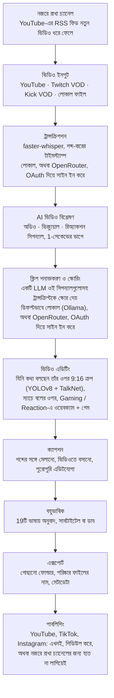

<div align="center">

[English](../../README.md) · [简体中文](README_zh.md) · [日本語](README_ja.md) · [한국어](README_ko.md) · [Türkçe](README_tr.md) · [Русский](README_ru.md) · [Tiếng Việt](README_vi.md) · [ไทย](README_th.md) · [Deutsch](README_de.md) · [Español](README_es.md) · [Français](README_fr.md) · [Português (Brasil)](README_pt-BR.md) · [العربية](README_ar.md) · [Bahasa Indonesia](README_id.md) · [Italiano](README_it.md) · [हिन्दी](README_hi.md) · **বাংলা** · [Filipino](README_tl.md) · [اردو](README_ur.md)

</div>

<a id="clips-kitty-the-free-open-source-opus-clip-alternative-for-chatting-gaming-and-sports-on-your-own-pc"></a>

# Clips Kitty: চ্যাটিং, গেমিং ও স্পোর্টসের জন্য Opus Clip-এর বিনামূল্যের, ওপেন-সোর্স বিকল্প, আপনার নিজের PC-তে

> এই README-টি AI দিয়ে [ইংরেজি README](../../README.md) থেকে অনুবাদ করা হয়েছে; সেটিই মূল
> রেফারেন্স এবং সবার আগে সেটিই আপডেট হয়। বাংলাভাষীদের সংশোধন সাদরে গ্রহণ করা হবে।
>
> 🌐 [ওয়েবসাইটের বাংলা পাতা](https://colingpt9.github.io/clips-studio/bn.html)

<a href="https://apps.microsoft.com/detail/9NB6XT7DSQZZ">
  <picture>
    <source media="(prefers-color-scheme: dark)" srcset="https://get.microsoft.com/images/en-us%20dark.svg">
    
  </picture>
</a>

[](https://github.com/ColinGPT9/clips-studio/releases)
[](https://github.com/ColinGPT9/clips-studio/releases)
[](../../LICENSE)
[](https://github.com/ColinGPT9/clips-studio/stargazers)
[](https://github.com/ColinGPT9/clips-studio)
[](../../CONTRIBUTING.md)
[](../../docs/DOCKER.md)

<a href="https://youtu.be/g1dMqrq-YaI"></a>

<a id="star-and-share-clips-kitty--goal-150"></a>

### Clips Kitty-কে স্টার দিন আর শেয়ার করুন ⭐ লক্ষ্য: 150

[](https://github.com/ColinGPT9/clips-studio/stargazers) **150-এর মধ্যে**

**দয়া করে repo-টিকে স্টার দিন আর শেয়ার করুন।** এতে আপনার কোনো খরচ নেই, আর এর পেছনে
কোনো মার্কেটিং বাজেট নেই, তাই পরের ছোট YouTuber বা স্ট্রিমার যে জানতে পারবেন একটা
বিনামূল্যের বিকল্প আছে, তার একমাত্র উপায় মুখে মুখে ছড়িয়ে পড়া।

**আমি এটা বানিয়েছি ছোট YouTuber আর স্ট্রিমারদের জন্য**, যাঁদের অন্য বিকল্পগুলো বা একজন
এডিটরের খরচ বহন করার সামর্থ্য নেই। এটি Opus Clip, Vizard আর Klap-এর একটি বিনামূল্যের বিকল্প,
যা আপনার নিজের PC-তে **Google Gemma** চালায়: সার্ভারের খরচ নেই, প্রতি ক্লিপে ফি নেই, AI
ব্যবহারের ফি নেই।

> **ভার্সন 1.1.3 পর্যন্ত Clips Kitty-র নাম ছিল Clips Studio**; Microsoft Store-এর নামকরণের
> নিয়ম মানতে নাম বদলানো হয়েছে। একই অ্যাপ, একই রিপোজিটরি, একই ডেটা।


**লম্বা স্ট্রিম আর ভিডিওকে পোস্ট করার জন্য তৈরি Shorts, Reels আর TikTok-এ পরিণত করুন,
পুরোটাই আপনার নিজের মেশিনে।** Clips Kitty হলো ক্রিয়েটরদের জন্য একটি বিনামূল্যের, ওপেন-সোর্স
AI ক্লিপ জেনারেটর আর ভিডিও এডিটর: একটা YouTube, Twitch বা Kick লিংক পেস্ট করুন, আর এটি
সেরা মুহূর্তগুলো খুঁজে বের করে, যিনি কথা বলছেন তাঁকে মাঝখানে রেখে সেগুলোকে 9:16-এ ক্রপ করে,
শব্দের সঙ্গে মিলিয়ে চলা ক্যাপশন ভিডিওতে স্থায়ীভাবে বসিয়ে দেয়, আর টাইটেল, ডেসক্রিপশন ও
হ্যাশট্যাগ লিখে দেয়।

ডিফল্টভাবে কোনো ক্লাউড AI নেই। কোনো সাবস্ক্রিপশন নেই। প্রতি ক্লিপে কোনো ফি নেই। আপনার
ফুটেজ কখনো আপনার কম্পিউটারের বাইরে যায় না, যদি না আপনি নিজে কোনো ক্লিপ আপনার নিজের YouTube
চ্যানেলে পাবলিশ করতে বলেন।

আগে লোকাল, দরকার হলে ক্লাউড: আপনার PC যদি AI চালানোর পক্ষে বেশি পুরনো হয়, তাহলে একটি
ক্লাউড প্রোভাইডার সেটা চালায়, আর বিল আসে আপনার নিজের অ্যাকাউন্টে।
**OpenRouter হলো প্রস্তাবিত ক্লাউড পথ**: আপনার OpenRouter অ্যাকাউন্ট দিয়ে সাইন ইন করুন
(OAuth, কোনো key কপি করতে হয় না), আর পেয়ে যান অনেক মডেল (Claude, GPT, Gemini, Muse Spark
এবং আরও)।
আমার পরীক্ষায় OpenRouter-এ 2 ঘণ্টার একটা ভিডিওর খরচ পড়েছিল প্রায় 11 সেন্ট, যেখানে Gemma
(Gemma 4 26B-A4B) ক্লিপ বেছেছে আর Whisper (large-v3-turbo) ট্রান্সক্রাইব করেছে; আপনার কত
খরচ হবে তা নির্ভর করে আপনার বেছে নেওয়া মডেল আর ভিডিওর দৈর্ঘ্যের ওপর।
OpenAI, Claude, Gemini, xAI, Meta, DeepSeek আর Qwen-ও সরাসরি কাজ করে, আপনার নিজের API
key দিয়ে।
দেখুন [docs/AI-BACKENDS.md](../../docs/AI-BACKENDS.md)।

**কেন এটা তৈরি:** চ্যানেল বড় করার চেষ্টায় থাকা বেশিরভাগ ক্রিয়েটর সব কাজ নিজেই করেন:
শুটিং, স্ট্রিমিং, এডিটিং, পোস্টিং। ক্লিপের মাধ্যমেই মানুষ আপনাকে খুঁজে পায়, আর সাধারণত এই
কাজটাই সবার আগে বাদ পড়ে: একজন এডিটর এমন একটা খরচ যা বেশিরভাগ চ্যানেল এখনো যুক্তিসংগত মনে
করতে পারে না, ক্লিপিং টুলগুলো প্রতি ভিডিও বা প্রতি মাসে টাকা নেয়, আর হাতে কাটতে গেলে এমন
একটা পুরো দিন চলে যায় যেটার দরকার ছিল অন্য কাজে। এটি চলে আপনার আগে থেকেই থাকা হার্ডওয়্যারে,
তাই ব্যবহার করতে কোনো খরচ নেই, আর কতগুলো ক্লিপ বানাবেন তারও কোনো সীমা নেই।


<sub>একটা ভিডিও থেকে 19 মিনিটে 38টি ক্লিপ, একটা PC-তে, কিছুই আপলোড না করে।</sub>

---

<a id="contents"></a>

## সূচিপত্র

- [এটি কী করে](#what-it-does)
- [Opus Clip, Klap, Vizard আর CapCut-এর সঙ্গে তুলনা](#how-it-compares-to-opus-clip-klap-vizard-and-capcut)
- [এটি কীভাবে কাজ করে](#how-it-works)
- [ফিচার](#features)
- [এটি কীসের জন্য তৈরি](#what-its-built-for)
- [প্রয়োজনীয়তা](#requirements)
- [ইনস্টল করুন ও চালান](#install-and-run)
- [আপনার AI মডেল বেছে নিন](#pick-your-ai-model)
- [পরীক্ষিত হার্ডওয়্যার ও পারফরম্যান্স](#tested-hardware-and-performance)
- [সমর্থিত প্ল্যাটফর্ম](#supported-platforms)
- [সমর্থিত ভাষা](#supported-languages)
- [YouTube-এ পাবলিশ করুন](#publish-to-youtube)
- [একসঙ্গে সব প্ল্যাটফর্মে পাবলিশ করুন](#publish-to-every-platform-at-once)
- [GPU অ্যাক্সেলারেশন](#gpu-acceleration)
- [কমান্ড লাইনে ব্যবহার](#command-line-use)
- [প্লাগইন লিখুন](#write-a-plugin)
- [এর ওপর কিছু বানান](#build-on-it)
- [আর্কিটেকচার](#architecture)
- [অবদান রাখুন](#contributing)
- [রোডম্যাপ](#roadmap-detail)
- [লাইসেন্স](#license)

---

<a id="what-it-does"></a>

## এটি কী করে

আপনি Clips Kitty-কে একটা লম্বা ভিডিও দেন। বিনিময়ে এটি আপনাকে পোস্ট করার মতো তৈরি
ভার্টিকাল ক্লিপের একটা ফোল্ডার ফিরিয়ে দেয়, সঙ্গে একটা স্টুডিও, যেখানে পোস্ট করার আগে আপনি
সেগুলো দেখে নিয়ে ঠিক করতে পারেন।

এটি তৈরি সেই ধরনের কনটেন্টের জন্য, যেটা বেশিরভাগ ক্লিপিং টুল সবচেয়ে খারাপভাবে সামলায়:
**লাইভ স্ট্রিম, IRL আর টকিং-হেড ফুটেজ, পডকাস্ট, আর জিম/ফিটনেস কনটেন্ট**: লম্বা, ঢিলেঢালা
কাঠামোর ভিডিও, যেখানে ভালো মুহূর্তগুলো চাপা পড়ে থাকে আর শুধু ট্রান্সক্রিপ্ট দিয়ে সেগুলো
খুঁজে পাওয়া যায় না।

<a id="how-it-compares-to-opus-clip-klap-vizard-and-capcut"></a>

## Opus Clip, Klap, Vizard আর CapCut-এর সঙ্গে তুলনা

Clips Kitty হলো ক্লাউড ক্লিপিং টুলগুলোর একটি ওপেন-সোর্স বিকল্প। আসল পার্থক্যটা হলো কাজটা
কোথায় হয়: আপনার ভিডিও কখনো আপলোড হয় না, তাই মাপার মতো কিছু নেই, টাকা নেওয়ার মতোও কিছু নেই।

| টুল | দাম, মাসিক বিলিং | ফ্রি টিয়ার | আপনার হয়ে ক্লিপ খুঁজে দেয় | ওয়াটারমার্ক | আপনার ভিডিও আপলোড করে | ওপেন সোর্স |
| ---- | --------------------- | --------- | ----------------------- | --------- | ------------------ | ----------- |
| **Clips Kitty** | বিনামূল্যে, কোনো পেইড টিয়ার নেই | পুরো অ্যাপ | হ্যাঁ | কখনো না | না, আপনার PC-তে চলে | হ্যাঁ, AGPL-3.0 |
| Opus Clip | $15 Starter, $29 Pro | 1080p, ওয়াটারমার্কসহ, 3 দিনে মেয়াদ শেষ | হ্যাঁ | ফ্রি টিয়ারে | হ্যাঁ | না |
| Klap | $29 Pro, বার্ষিক বিলিংয়ে $14 Basic | একটি ভিডিও | হ্যাঁ | উল্লেখ নেই | হ্যাঁ | না |
| Vizard | $29 Creator, বার্ষিক বিলিংয়ে $14.50 | মাসে 60 ক্রেডিট, 720p | হ্যাঁ | ফ্রি টিয়ারে | হ্যাঁ | না |
| quso.ai | $29 থেকে $49 | মাসে 75 ক্রেডিট, 720p | হ্যাঁ | উল্লেখ নেই | হ্যাঁ | না |
| Ssemble | $15 থেকে $60, বার্ষিক বিলিংয়ে $6 থেকে $24 | তালিকায় নেই | হ্যাঁ | উল্লেখ নেই | হ্যাঁ | না |
| Descript | $16, $24, $50 | মাসে 60 মিনিট, 720p | আংশিকভাবে, এটি একটি ট্রান্সক্রিপ্ট এডিটর | Free আর Hobbyist-এ | হ্যাঁ | না |
| CapCut | ব্যবহার বিনামূল্যে, পেইড টিয়ার capcut.com-এ | পুরো এডিটর | **না, আপনাকে হাতে কাটতে হয়** | ফিচার অনুযায়ী আলাদা | ডেস্কটপ অ্যাপে না | না |

**CapCut-টা বোঝা সবচেয়ে জরুরি**, কারণ বিনামূল্যের উত্তর হিসেবে সবাই এর নামই বলে। এটি
একটা ভালো এডিটর আর এর কোনো খরচ নেই, কিন্তু প্রতিটা মুহূর্ত আপনাকে নিজেই খুঁজতে হয় আর প্রতিটা
ক্লিপ নিজেই ক্রপ করতে হয়। Clips Kitty-ও বিনামূল্যে, আর ওই প্রথম ধাপটাই হলো সেই অংশ যা এটি
আপনার হয়ে করে দেয়।

**Opus Clip, Klap বা Vizard ভালো পছন্দ** যদি আপনার গ্রাফিক্স কার্ডওয়ালা Windows PC না থাকে,
আপনি মাঝেমধ্যে ক্লিপ বানান, বা আপনাকে ফোন থেকে কাজ করতে হয়। Clips Kitty তৈরি আপনার আগে
থেকে থাকা হার্ডওয়্যারে প্রচুর পরিমাণে ক্লিপ বানানোর জন্য।

**[সাতটি টুলের পূর্ণ তুলনা, আর কোনটা কীসে সেরা](https://colingpt9.github.io/clips-studio/alternatives.html)**

<sub>দাম যাচাই করা হয়েছে প্রতিটি কোম্পানির নিজস্ব প্রাইসিং পেজে, 17 সেপ্টেম্বর 2026 তারিখে।
CapCut এমন কোনো প্রাইসিং পেজ প্রকাশ করে না যা আমরা পড়তে পেরেছি, তাই এর কোনো দাম উল্লেখ
করা হয়নি। প্ল্যান বদলায়; এই টেবিল নিজে থেকে আপডেট হবে না।</sub>

<a id="how-it-works"></a>

## এটি কীভাবে কাজ করে



**আপনি অন্য কিছু বেছে না নিলে প্রতিটি ধাপ আপনার কম্পিউটারেই চলে:** AI বা ট্রান্সক্রিপশনের
জন্য OpenRouter, আপনার অ্যাকাউন্ট দিয়ে সাইন ইন করে, আর পাবলিশিং, যা শুধু আপনার পাঠানো
ক্লিপগুলোই আপলোড করে। এ ছাড়া স্বাভাবিক একটা রানে নেটওয়ার্ক ছোঁয় শুধু একটাই জিনিস: সোর্স
ভিডিওর ডাউনলোড।

<a id="the-stages-in-detail"></a>

### ধাপগুলো বিস্তারিত

**ট্রান্সক্রিপশন: faster-whisper.** শব্দ-স্তরের টাইমস্ট্যাম্প, যেখানে পাওয়া যায় সেখানে CUDA-তে
চলে, নইলে CPU-তে। শব্দের সঠিক টাইমিংয়ের কারণেই ক্যাপশন ঠিক সিলেবলে পড়ে আর ক্লিপ শুরু হয়
একটা আসল বাক্যের শুরু থেকে।

**AI ক্লিপ স্কোরিং.** ট্রান্সক্রিপ্ট পাঁচটি সিগন্যালের মধ্যে মাত্র একটি। অডিও থেকে পাওয়া যায়
আওয়াজের হঠাৎ উচ্চতা, বার্স্ট ডেনসিটি (হাসি আর হাততালি দেখতে এমনই হয়), আর নীরবতা→বিস্ফোরণ
ধাঁচের পে-অফ প্যাটার্ন। ভিজ্যুয়াল থেকে পাওয়া যায় সিন কাট, নড়াচড়া আর মুখের আকারের পরিবর্তন।
একটি রিঅ্যাকশন সিগন্যাল এগুলোকে একসঙ্গে জোড়ে। প্রতিটি সিগন্যাল *সেই ভিডিওর ভেতরেই*
নর্মালাইজ করা হয়, যাতে একটা শান্ত পডকাস্ট আর চিৎকারে ভরা একটা স্ট্রিম, দুটোতেই অর্থবহ
পিক পাওয়া যায়। যেখানে দর্শকদের আসল ডেটা থাকে (Twitch চ্যাট রিপ্লে, যা মাপা হয় আলাদা আলাদা
চ্যাটারের সংখ্যা দিয়ে, আর YouTube-এর most-replayed হিটম্যাপ), সেখানে এটি একটি ছোট, সীমাবদ্ধ
বোনাস যোগ করে।

লোকাল LLM ট্রান্সক্রিপ্টের **সঙ্গে ওই ঘটনাগুলোর একটা টাইমলাইনও** দেখে, যাতে "কথাগুলো
সাধারণ, কিন্তু ঘরজুড়ে হইচই পড়ে গেল" এমন পরিস্থিতিকে ঠিকভাবে বিচার করতে পারে। যেহেতু ছোট
মডেলগুলো সবকিছুকে একটা সরু পরিসরে স্কোর দেয়, তাই চূড়ান্ত প্রার্থীদের একটিমাত্র rerank কলে
মুখোমুখি তুলনা করা হয়: 7B মডেলের পক্ষে আলাদা আলাদা নম্বর দেওয়ার চেয়ে তুলনা করে বিচার করা
অনেক সহজ।

**Creator Profiles (ক্রিয়েটর প্রোফাইল).** অ্যাপটি প্রতিটি ক্রিয়েটরের ভিডিওগুলো থেকে তাঁর জন্য
একটা নলেজ বেস তৈরি করে: বারবার আসা বিষয়, সিরিজ, সহযোগী, চলতে থাকা মজা, আর চলমান গল্প। এই
প্রেক্ষাপট সঠিক টাইটেল লিখতে আর আগের কথার উল্লেখ (callback) চিনতে সাহায্য করে। এটি ইচ্ছে
করেই সাবধানী: কোনো বুলি তখনই গোনা হয় যখন সেটা সত্যিই বারবার আসে, যে তথ্যের উল্লেখ বন্ধ হয়ে
যায় সেটা নিষ্ক্রিয় হয়ে পড়ে, আর এর থেকে স্কোরে আসা প্রতিটি অবদান শুধু যোগ হয়, তার একটা সীমা
আছে, এবং সেটা বন্ধ করে দেওয়া যায়।

**ভিডিও এডিটর.** নন-ডেস্ট্রাকটিভ: ট্রিম, ভেতরের কাট, মিউট, মিউট করা শব্দ, ভলিউম, ফেড,
স্পিড, হুক টেক্সট, মিউজিক আর ওয়াটারমার্ক অপারেশন হিসেবে সংরক্ষিত থাকে আর রেন্ডারের সময়
প্রয়োগ হয়। একটা AI এডিট চ্যাটও আছে (*"এটাকে 5 সেকেন্ড লম্বা করো"*, *"ক্যাপশনে gost লেখা,
ghost হওয়া উচিত"*), যেখানে মডেল প্রস্তাব দেয় আর যাচাই করা কোড সেটা প্রয়োগ করে।

**লং-ফর্ম প্রসেসিং.** একই বিশ্লেষণ ব্যবহার করে একটি ঐচ্ছিক 16:9 পথ, যেটা আপনি নিজে চালু
করেন: হরাইজন্টাল ক্লিপ, X/Twitter-এর দৈর্ঘ্যের কাট, সেরা মুহূর্তের হাইলাইট রিল, অথবা পুরো
স্ট্রিম, যার ফাঁকা নিঃশব্দ অংশগুলো বাদ দেওয়া হয়েছে।

**বহুভাষিক পাইপলাইন আর AI ডাবিং.** ক্যাপশন অনুবাদ করা হয় এবং কিছু লেখা বা ভিডিওতে বসানোর
*আগেই* রিভিউয়ের জন্য দেখানো হয়, যাতে একটা ভুল লাইন ঠিক করা যায় তখনই, যখন সেটা ঠিক করা এখনো
সম্ভব। একটি শব্দতালিকা (glossary) চ্যানেলের নাম, স্পনসর আর ভেতরের মজাগুলোকে অনুবাদ হওয়া থেকে
রক্ষা করে। ডাবিং হয় লোকাল TTS দিয়ে, যার কণ্ঠগুলো আপনি আগে শুনে বেছে নিতে পারেন।

**লোকাল GPU অ্যাক্সেলারেশন.** শনাক্তকরণ আর ট্রান্সক্রিপশনের জন্য CUDA, NVENC/AMF/QSV দিয়ে
হার্ডওয়্যার ভিডিও এনকোডিং (নিজে থেকে শনাক্ত হয়, দরকারে CPU-তে ফিরে যায়), আর Ollama-র মাধ্যমে
GPU-তে LLM।

<a id="features"></a>

## ফিচার

- **মাল্টিমোডাল ক্লিপ শনাক্তকরণ**: মুহূর্তগুলোকে 0–100 স্কোর দেওয়া হয় কী বলা হচ্ছে, অডিওর
  উত্তেজনা, ভিজ্যুয়াল নড়াচড়া, স্ক্রিনে দেখা রিঅ্যাকশন আর হুক/পে-অফের জোর, সব মিলিয়ে।
  মানের মাপকাঠি পার হওয়া প্রতিটি ক্লিপ রেখে দেওয়া হয়, কোনো মনগড়া সংখ্যার সীমা নেই।
- **বক্তা চিনে নেওয়া ফেস ট্র্যাকিং**: YOLOv8 পোজ ডিটেকশন বিষয়কে মাঝখানে রাখে, আর দলের
  ফুটেজে ক্যামেরা অনুসরণ করে **যিনি আসলে কথা বলছেন তাঁকে**, যেটা ঠিক করে TalkNet
  অ্যাক্টিভ-স্পিকার ডিটেকশন, মুখ আর অডিও একসঙ্গে দেখে, নড়াচড়া দেখে নয়। বক্তা বদলালে
  ফ্রেমিং প্যান করে না গিয়ে সরাসরি তাঁর ওপর **কাট** করে, ঠিক যেমন একজন এডিটর করতেন। শুধু
  ক্রপ দিয়ে ফ্রেমিং: ছবি কখনো টানা হয় না, কখনো বিকৃত হয় না।
- **Podcast mode (পডকাস্ট মোড)**: মাল্টি-ক্যামেরা ফুটেজে প্রতিটি শটে একজন মানুষের ওপর নিজস্ব
  স্থির ক্রপ থাকে, যাতে কাটগুলো প্যান ছাড়াই সরাসরি কারও মুখে পড়ে। একটি শটের ভেতরে বিষয়
  বেছে নেওয়া হয় ঠোঁটের নড়াচড়া দেখে, আর সেটা না পেলে সবচেয়ে স্পষ্ট মুখটি।
- **Vertical Live (ভার্টিকাল লাইভ)**: এমন লাইভস্ট্রিমের জন্য, যেটা স্ট্রিম করার সময়েই
  ভার্টিকাল ছিল (YouTube ভার্টিকাল লাইভ, Twitch Dual Format, Streamlabs Dual Output, ডাউনলোড
  করা Instagram বা TikTok লাইভ)। স্ট্রিমের নিজস্ব 9:16 লেআউট রেখে দেয়, ফেস ট্র্যাকিং বাদ দেয়,
  আর তবুও মুহূর্তগুলো স্বাভাবিক নিয়মেই বেছে নেয়। দেখুন [docs/VERTICAL-LIVE.md](../../docs/VERTICAL-LIVE.md)।
- **Sports (স্পোর্টস): Soccer আর Basketball**: একটা ম্যাচ বা গেমের প্রতিটি বড় মুহূর্ত আলাদা
  ক্লিপ হিসেবে, তার বিল্ড-আপ আর প্রতিক্রিয়াসহ।
  - **Soccer**: গোল, সেভ, কার্ড আর বড় সুযোগ। গোল পড়া হয় স্কোর বক্স থেকে আর তার সময় ঠিক হয়
    দর্শকদের গর্জন শুনে, আর 9:16 ক্রপ বলের সঙ্গে চলে। All goals, Best saves, Cards এবং আরও
    অপশন বেছে নিন, আর মুহূর্তগুলো জুড়ে একটা ম্যাচ রিক্যাপ আর দল বা খেলোয়াড়ের রিল বানিয়ে নিন।
  - **Basketball**: ডাঙ্ক, থ্রি-পয়েন্টার, ব্লক, স্টিল আর গেম উইনার। স্কোর বক্স প্রতিটি বাস্কেট আর
    তার পয়েন্ট নিশ্চিত করে, আর কোয়ার্টার আর ঘড়ির কারণে গেম উইনার প্রথম কোয়ার্টারের বাস্কেটের
    চেয়ে অনেক বেশি গুরুত্ব পায়। দর্শক, বেঞ্চ আর কোর্টের ধারে বসা লোকদের প্রতিক্রিয়াও খুঁজে বের
    করা হয়। প্রতিটি ক্লিপের 9:16 ক্রপ তার খেলাটাকে ঘিরে পরিকল্পনা করা হয়: বল আর যার কাছে বল,
    পাস যে ধরছে সে, আর শট যেটা বাস্কেট পর্যন্ত অনুসরণ করা হয়, রিম আর ব্যাকবোর্ড ফ্রেমে রেখে।
    ক্রপ খেলার সঙ্গে প্যান করে আর কখনো জুম করে না। বল খুঁজে বের করে [E-BARD](https://github.com/GabrieleGiudic/E-BARD#readme) ডিটেকশন মডেল
    (এর কৃতিত্ব দেওয়া আছে [লাইসেন্স](#license) অংশে)।

  দেখুন [docs/SPORTS.md](../../docs/SPORTS.md)।
- **এডিটযোগ্য, ভিডিওতে বসানো ক্যাপশন**: শব্দের সঙ্গে মেলানো, আর আপনার পছন্দমতো স্টাইলে
  (রং, সাইজ, অবস্থান, প্রতি লাইনে কতগুলো শব্দ, অক্ষরের কেস, অথবা বন্ধ)। এক্সপোর্টের আগে
  ট্রান্সক্রিপশনের ভুল লাইন ধরে ধরে ঠিক করুন। দুজন কথা বললে দ্বিতীয় বক্তার ক্যাপশন অন্য রঙে
  হতে পারে, আর যে লাইনের বক্তা এটি ভুল চেনে, সেটা হাতে বদলে দেওয়া যায়।
- **AI এডিট চ্যাট**: সহজ ভাষায় বলুন কী ভুল আছে, আর এটি আবার এডিট করে দেয়।
- **Ask Clips Kitty**: ড্যাশবোর্ডের নিচের টেক্সট বক্স। এক বাক্যে বলুন কী চান, যেমন *"এই
  স্ট্রিমের ক্লিপ বানাও, বসের হাতে আমার মরার অংশটা অবশ্যই রাখবে, বড় হলুদ ক্যাপশন দিয়ে"*, আর
  এটি ভিডিওটা সারিতে তোলে, ক্লিপ বাছাই করার অংশকে বলে দেয় কী খুঁজতে হবে, আর আপনার বলা
  অপশনগুলো সেট করে দেয়। **এর জন্য একটি Gemma 4 মডেল দরকার**: দেখুন
  [নিচের টেক্সট বক্সের জন্য Gemma 4 লাগে](#the-text-box-at-the-bottom-needs-gemma-4)।
- **AI টাইটেল, ডেসক্রিপশন আর হ্যাশট্যাগ**, সবই এক্সপোর্টের আগে এডিট করা যায়।
- **Creator Profiles (ক্রিয়েটর প্রোফাইল)**: সময়ের সঙ্গে অ্যাপটি প্রতিটি ক্রিয়েটরকে চিনে নেয়,
  যাতে আরও ভালো ক্লিপ বাছে আর আরও ভালো টাইটেল দেয়। সবকিছু আপনার কম্পিউটারেই থাকে, আর আপনি
  এটা দেখতে, সংশোধন করতে বা মুছে ফেলতে পারেন।
- **বহুভাষিক পাবলিশিং**: 19টি ভাষা, ভিডিওতে কিছু বসানোর আগে রিভিউসহ।
- **AI ডাবিং**: লোকাল টেক্সট-টু-স্পিচ, প্রতিটি ভাষার জন্য কণ্ঠ শুনে বেছে নেওয়ার সুবিধাসহ।
- **লং-ফর্ম এক্সপোর্ট**: 16:9 ক্লিপ, হাইলাইট রিল, অথবা পুনরাবৃত্তি বাদ দেওয়া স্ট্রিম এডিট।
  হাইলাইট রিলের ডেসক্রিপশনে **চ্যাপ্টার টাইমস্ট্যাম্প** থাকে, যাতে দর্শকেরা YouTube-এ এক মুহূর্ত
  থেকে আরেক মুহূর্তে লাফিয়ে যেতে পারেন।
- **ওয়াটারমার্ক আর ব্র্যান্ডিং প্রোফাইল**: প্রতিটি ক্রিয়েটরের ডিফল্ট সেটিং নিজে থেকেই প্রয়োগ হয়।
- **মডেল ম্যানেজার**: অ্যাপের ভেতর থেকেই AI-এর মস্তিষ্ক বদলে নিন; প্রোগ্রেস বারসহ মডেল ডাউনলোড,
  মুছে ফেলা আর বদলানো, কোনো টার্মিনাল ছাড়াই।
- **এডিটর থেকেই YouTube-এ পাবলিশ করুন**: টাইটেল, ডেসক্রিপশন, ট্যাগ, থাম্বনেইল, প্লেলিস্ট,
  অডিয়েন্স আর ভিজিবিলিটি দিন, তারপর এখনই আপলোড করুন বা শিডিউল করুন। এটি ঐচ্ছিক, ডিফল্টভাবে
  বন্ধ, আর আপনার নিজের Google API key ব্যবহার করে।
- **অ্যাপের ভেতরে ফিডব্যাক**: নিজে থেকে সংগ্রহ করা ডায়াগনস্টিক তথ্যসহ বাগ রিপোর্ট, কোনো
  অ্যাকাউন্ট ছাড়াই।
- **সবার জন্য সহজলভ্য UI**: কিবোর্ড ফোকাস, কম অ্যানিমেশনের (reduced motion) সাপোর্ট, আর
  বদলানো যায় এমন ফন্ট ও সাইজ।

<a id="what-its-built-for"></a>

## এটি কীসের জন্য তৈরি

আপনি যে ভিডিওই দিন, সবকিছু তার ওপরই চলে। নিচে সেই ক্ষেত্রগুলো, যেখানে এটি ফিচার তালিকা
দেখে যতটা মনে হয় তার চেয়ে বেশি বা কম ভাবনাচিন্তা করে, যাতে পরে কোনো কিছুতে অবাক হতে না হয়:

| কনটেন্ট | এটি কেমন করে |
|---|---|
| **IRL, just chatting, পডকাস্ট, ভ্লগ, ইন্টারভিউ** | এটি এর জন্যই টিউন করা, আর রিলিজের আগে আসল স্ট্রিমে এটাই পরীক্ষা করা হয় |
| **গেমিং আর রিঅ্যাকশন** | **Gaming / Reaction** চালু থাকলে: একদিকের অর্ধেকে ওয়েবক্যাম, অন্যদিকে গেম বা যে ভিডিওতে রিঅ্যাক্ট করা হচ্ছে সেটা, আর প্রসেসিংয়ের আগে ভিডিওর নিজস্ব ফ্রেমে এটা যাচাই করা হয় ([docs/GAMING.md](../../docs/GAMING.md))। স্ট্রিমার ধরা হয় তাঁকেই যিনি কথা বলছেন, সবচেয়ে বড় মুখটিকে কখনো নয়। সুইচটা বন্ধ থাকলে ফ্রেমিং গেমের ভেতরের কোনো চরিত্রকে অনুসরণ করতে পারে। শুধু ক্যামেরায় দেখা আসল মানুষ, VTuber নয় |
| **খেলার ম্যাচ** | **Sports** চালু থাকলে: স্কোর বক্স আর কমেন্ট্রিওয়ালা সম্প্রচারের জন্য তৈরি, যেখানে গোল আর বাস্কেট নিশ্চিতভাবে বোঝা যায়। ক্লাব বা ফোনের ফুটেজে সাধারণত দুটোর কোনোটাই থাকে না: সেখানে ক্লিপ বলের সঙ্গে চলে, আর গোল আসে আপনার পেস্ট করা ম্যাচ ইভেন্ট থেকে, যেমন কোনো ক্লাব অ্যাপের গোল ট্যাগ ([docs/SPORTS.md](../../docs/SPORTS.md)) |
| **রিঅ্যাকশন যে জিনিসে** | ক্লিপ এখনো বাছা হয় কী *বলা* হয়েছে তা দেখে, তাই দেখা ভিডিওর এমন কোনো মুহূর্ত, যা নিয়ে কেউ কিছু বলে না, সেটা এর চোখেই পড়ে না |

ক্লিপ বাছাই চলে ট্রান্সক্রিপ্ট আর সিগন্যালের ভিত্তিতে। মজার জিনিসটা যদি *শুধু দেখার* হয় আর
তা নিয়ে কেউ কিছু না বলে, তাহলে সেটা এডিটরে নিজেই খুঁজে নিতে হবে, এমনটা ধরে নিন।

<a id="requirements"></a>

## প্রয়োজনীয়তা

|             | ন্যূনতম                                      | প্রস্তাবিত                     |
| ----------- | -------------------------------------------- | ------------------------------- |
| **GPU**     | NVIDIA RTX 2060 (6 GB)                       | RTX 3060 12 GB বা আরও ভালো        |
| **CPU**     | Intel Core i3-9100 / AMD Ryzen 3 3200G (2019)| 6টি বা তার বেশি কোর                 |
| **RAM**     | 16 GB                                        | 16 GB বা তার বেশি                   |
| **ডিস্ক**    | ~20 GB, সঙ্গে যে ভিডিওগুলোর ক্লিপ বানাবেন সেগুলোর জায়গা    |                                 |
| **OS**      | Windows 10 বা 11                             |                                 |

**ন্যূনতমের নিচেও হয়তো চলবে, কিন্তু সেটা সমর্থিত নয় আর খুব ধীর হবে।** একটা স্ট্রিমের
ক্লিপ বানানো মানে ঘণ্টার পর ঘণ্টা ভিডিও ডিকোডিং, ট্রান্সক্রিপশন আর এনকোডিং; মোটামুটি 2019-এর
আগের হার্ডওয়্যারে এত সময় লাগবে যে অ্যাপ ঠিকঠাক কাজ করলেও মনে হবে নষ্ট হয়ে গেছে।

এর মধ্যে দুটো বিষয় একটু খুলে বলা দরকার:

- **16 GB RAM শুধু একটা পরামর্শ নয়।** 8 GB-তে পুরো ভিডিও বিশ্লেষণ হবে, তারপর কিছুই রেন্ডার
  হবে না, যেটা মেমরির সীমার বদলে ক্র্যাশের মতো দেখায়।
- **GPU ঐচ্ছিক, বাধ্যতামূলক নয়।** GPU ছাড়া সবকিছু CPU-তে চলে, ধীরে, কিন্তু পুরোটাই।
  RTX 2060 হলো সেই সীমা যেখান থেকে GPU-র পথ কাজ করতে শুরু করে; দেখুন
  [GPU অ্যাক্সেলারেশন](#gpu-acceleration)।

অ্যাপটি **শুধু Windows**-এর জন্য। Python ইঞ্জিনের Linux/macOS-এ চলার কথা, কিন্তু কোনো Mac
বিল্ড নেই এবং মেইনটেইনারের কাছে সেটা পরীক্ষা করার মতো কোনো Mac নেই। আপনার Mac থাকলে আর
সাহায্য করতে চাইলে [#62](https://github.com/ColinGPT9/clips-studio/issues/62) দেখুন।

সোর্স থেকে চালাতে সেই জিনিসগুলো লাগবে, যেগুলো নইলে ইনস্টলার আপনার জন্য সঙ্গে নিয়ে আসত:

- **Python 3.10+** আর **Node.js 18+**
- আপনার PATH-এ **[FFmpeg](https://ffmpeg.org/download.html)**
- **[Ollama](https://ollama.com)**, তাতে একটা মডেল pull করা: `ollama pull gemma:7b`

<a id="install-and-run"></a>

## ইনস্টল করুন ও চালান

**সবচেয়ে সহজ উপায় হলো [Microsoft Store](https://apps.microsoft.com/detail/9NB6XT7DSQZZ)।**
এক ক্লিক, এটি নিজেই আপডেট হয়, আর Windows কোনো নিরাপত্তা সতর্কবার্তা দেখায় না। Microsoft
প্যাকেজটি সার্টিফাই ও সাইন করেছে, তাই নিচে বলা SmartScreen সতর্কবার্তা একেবারেই আসে না।
Store নতুন ভার্সন ইনস্টল করে যখন তার পালা আসে; সঙ্গে সঙ্গে নতুন ভার্সন পেতে Microsoft
Store-এ Clips Kitty-র পেজ খুলে **Update** চাপুন।

**অথবা ইনস্টলারটি নামিয়ে নিন।** [Releases](https://github.com/ColinGPT9/clips-studio/releases)
থেকে সর্বশেষ **Web Setup** নিয়ে চালান। এতে আছে অ্যাপ, Python ইঞ্জিন, প্রতিটি লাইব্রেরি,
FFmpeg, AI রানটাইম আর শনাক্তকরণ ও ট্রান্সক্রিপশনের সব মডেল ওয়েট: Python লাগবে না, PATH লাগবে
না, টার্মিনাল লাগবে না, আর দ্বিতীয় কোনো প্রোগ্রামও ইনস্টল করতে হবে না।

**অথবা winget ব্যবহার করুন।** `winget install ColinGPT9.ClipsKitty` টার্মিনাল থেকে একই
Web Setup ইনস্টল করে।

শুধু একটা জিনিস এতে থাকে না, সেটা হলো ল্যাঙ্গুয়েজ মডেল নিজেই, কারণ সেগুলো এমন লাইসেন্সে
আসে যা যিনি ডাউনলোড করছেন তাঁকে নিজেকেই মেনে নিতে হয়, আপনার হয়ে কেউ মেনে নিতে পারে না।
সেটআপ উইজার্ড নিজেই সেই ডাউনলোড শুরু করে, আপনার গ্রাফিক্স কার্ডের সঙ্গে মানানসই সাইজ বেছে
নেয়, আর একটা প্রোগ্রেস বার দেখায়। অর্থাৎ: একটা ডাউনলোড, একটা ডাবল-ক্লিক, একটা প্রোগ্রেস বার।
তারপর এটি অফলাইনে চলে।

> প্রথমবার চালানোর সময় Windows সতর্ক করবে যে অ্যাপটি সাইন করা নয়। *More info → Run
> anyway*-তে ক্লিক করুন। সাইনিং সার্টিফিকেট আমাদের কাজের তালিকায় আছে।

<a id="from-source"></a>

### সোর্স থেকে

```bash
git clone https://github.com/ColinGPT9/clips-studio
cd clips-studio
pip install -r requirements.txt

cd ui
npm install
npm run dev        # opens the Clips Kitty desktop app
```

অ্যাপটি নিজের Python ইঞ্জিন নিজে থেকেই চালু করে। **Clip Editor**-এ একটা লিংক পেস্ট করুন,
*Generate clips* চাপুন, আর লাইভ অগ্রগতি দেখুন।

ইনস্টলার নিজে বানানো মাত্র একটা কমান্ডের ব্যাপার। দেখুন
[CONTRIBUTING.md](../../CONTRIBUTING.md#building-the-windows-installer)।

<a id="with-docker-nothing-else-to-install"></a>

### Docker দিয়ে: আর কিছু ইনস্টল করতে হবে না

অবদানকারীদের জন্য। আপনার লাগবে শুধু [Docker Desktop](https://docs.docker.com/get-started/get-docker/),
আর কিছু নয়: Python না, Node না, FFmpeg না, PyTorch না।

```bash
git clone https://github.com/ColinGPT9/clips-studio
cd clips-studio
docker compose up
```

তিনটি সার্ভিস একসঙ্গে চালু হয়:

| | |
|---|---|
| **<http://localhost:5173>** | ইন্টারফেস, আপনার ব্রাউজারে |
| **<http://localhost:8765>** | ইঞ্জিন আর তার API |
| Ollama | লোকাল AI, :11434-এ |

তারপর একটা মডেল pull করুন (`docker compose exec ollama ollama pull gemma3:4b`), আর আপনার
হাতে কাজ করার মতো একটা checkout তৈরি।

চেকগুলোও একইভাবে চালান:

```bash
docker compose run --rm engine pytest
docker compose run --rm ui npm run typecheck
```

> **দশ মিনিটের প্রথম বিল্ড এড়িয়ে যান:** `docker compose pull` লোকালি PyTorch আর OpenCV
> কম্পাইল করার বদলে আগে থেকে তৈরি ইঞ্জিন ইমেজ নিয়ে আসে।

ডেস্কটপ শেল নিজে এখনো আপনার হোস্টে চলে, কারণ Electron-এর একটা ডিসপ্লে দরকার; বাকি সবকিছু
কনটেইনারে। বিস্তারিত, আর এই পদ্ধতি কী জানাতে পারে না, তা আছে
[docs/DOCKER.md](../../docs/DOCKER.md)-এ।

<a id="pick-your-ai-model"></a>

## আপনার AI মডেল বেছে নিন

কী ইনস্টল আছে আর আপনার GPU কী সামলাতে পারবে, দেখতে **Models** পেজ খুলুন:

মাপকাঠি একটাই: আপনার কতটা VRAM আছে। এগুলো সেই একই সারি যা অ্যাপ দেখায়,
[`llm/manager.py`](../../llm/manager.py)-এর `RECOMMENDATIONS` থেকে। উইজার্ড আর Models পেজ
দুটোই এই একটা টেবিল পড়ে, তাই তারা নিজেদের মধ্যে, বা এই টেবিলের সঙ্গে, আলাদা কথা বলতে পারে না।

| আপনার হার্ডওয়্যার | প্রস্তাবিত মডেল | |
|---|---|---|
| CPU / iGPU, গ্রাফিক্স কার্ড নেই | `gemma3:4b` | পরীক্ষিত |
| 6 GB-এর কম VRAM, বা পুরনো PC | `gemma4:e2b` | |
| 6 GB VRAM | `gemma4:e4b` | |
| 8 GB VRAM | **`gemma:7b`** | পরীক্ষিত · ডিফল্ট হিসেবে সঙ্গে আসে |
| 10–12 GB VRAM | `gemma3:12b` | পরীক্ষিত |
| 16–24 GB VRAM | `gemma3:27b` | |

আর যে মডেলগুলো VRAM ছাড়া অন্য কোনো কারণে বেছে নেওয়ার মতো:

| কেন | মডেল |
|---|---|
| অনুবাদ / বহুভাষিক | `qwen3:8b` বা `qwen3:14b` |
| উদার (permissive) লাইসেন্স | `mistral-nemo:12b` (Apache-2.0) · `phi4:14b` (MIT) |

**শুধু "পরীক্ষিত" চিহ্নিত তিনটি মডেল আসল স্ট্রিমে চালানো হয়েছে**, আর `gemma:7b`-এ সবচেয়ে বেশি
ঘণ্টা চলেছে; `config/settings.yaml` এটি নিয়েই আসে। বাকিগুলো তালিকায় আছে কারণ তাদের সাইজ
যুক্তিসংগত আর বাণিজ্যিক ব্যবহারে বিনামূল্যে, এই কারণে নয় যে সেগুলো দিয়ে ক্লিপের মান মাপা
হয়েছে। সবগুলোই কাজ করে, কারণ অ্যাপ Ollama-র মাধ্যমে প্রতিটি মডেলের সঙ্গে একইভাবে কথা বলে,
কিন্তু সেগুলো আরও ভালো মুহূর্ত বাছে কিনা, তা কেউ যাচাই করেনি। এই ফাঁক পূরণের কাজটা হলো
[#38](https://github.com/ColinGPT9/clips-studio/issues/38)।

Ollama যা-ই চালায়, তা-ই কাজ করে, আর মডেল বদলানো এক ক্লিকের ব্যাপার। অনুবাদের জন্য
ক্লিপিংয়ের চেয়ে *আলাদা* মডেল ব্যবহার করা যায়। `llm.translation_model` সেট করুন।

<a id="the-text-box-at-the-bottom-needs-gemma-4"></a>

### নিচের টেক্সট বক্সের জন্য Gemma 4 লাগে

**Ask Clips Kitty**, মানে ড্যাশবোর্ডের নিচের টেক্সট বক্স, শুধু এমন মডেলের সঙ্গে কাজ করে যা
অ্যাপের টুলগুলো ব্যবহার করতে পারে। Gemma 4 পারে। `gemma:7b` আর Gemma 3 মডেলগুলো পারে না,
আর গ্রাফিক্স কার্ড ছাড়া PC-তে, বা 8 GB কিংবা তার বেশি VRAM-ওয়ালা PC-তে, সেটআপ এগুলোরই একটা
ইনস্টল করে। সেখানে বক্সটা কাজ করবে না, যতক্ষণ না আপনি একটা Gemma 4 মডেল যোগ করছেন: ভার্সন
2.0 দেখায় *"No installed model can use tools"*, আর পরের ভার্সনগুলো বক্সের ভেতরেই ডাউনলোডের
প্রস্তাব দেয়।

আপনার ক্লিপ যে মডেলই বাছুক, **Models** পেজে তার পাশাপাশি একটা Gemma 4 মডেলও ইনস্টল করুন:
6 GB বা তার বেশি গ্রাফিক্স কার্ডে `gemma4:e4b`, তার কমে `gemma4:e2b`। আপনাকে সেটাতে বদলে
যেতে হবে না। বক্সটা নিজেই সেটা খুঁজে নেয়, আর আপনার ক্লিপ এখনো আপনার বেছে নেওয়া মডেলই বাছে।
আপনি যদি AI চালান OpenRouter দিয়ে, তাহলে বক্সটা সেই মডেলই ব্যবহার করে, কিছু ইনস্টল করতে হয় না।

<a id="tested-hardware-and-performance"></a>

## পরীক্ষিত হার্ডওয়্যার ও পারফরম্যান্স

Clips Kitty প্রতিদিন এই মেশিনেই ডেভেলপ আর পরীক্ষা করা হয়, তাই নিজের ফলাফল তুলনা করতে চাইলে
এটা একটা কাজের রেফারেন্স:

| | |
|---|---|
| **GPU** | NVIDIA GeForce RTX 3060, 12 GB VRAM |
| **CPU** | AMD Ryzen 5 5600X (6 কোর / 12 থ্রেড) |
| **RAM** | 16 GB |
| **OS** | Windows 10 |
| **ক্লিপিং মডেল** | Ollama-র মাধ্যমে `gemma:7b` |
| **ট্রান্সক্রিপশন** | CUDA-তে faster-whisper `large-v3-turbo` |

এই repo-র সবকিছু (ডিফল্ট সেটিংস, `parallel_renders: 3`, 5 মিনিটের বিশ্লেষণ চাঙ্ক সাইজ)
মোটামুটি এই শ্রেণির মেশিনের জন্য টিউন করা। বড় GPU-তে `llm.num_ctx` আর
`analysis.chunk_seconds` দুটো একসঙ্গে বাড়ান আর এক সাইজ বড় মডেল নিন; ছোট GPU-তে
`gemma3:4b`-এ নেমে আসুন।

অন্য হার্ডওয়্যারে Clips Kitty বেঞ্চমার্ক করলে দয়া করে
[Discussions](https://github.com/ColinGPT9/clips-studio/discussions)-এ পোস্ট করুন। আসল মেশিনের
আসল সংখ্যা সবাইকে নিজের সেটআপ ঠিক করতে সাহায্য করে।

<a id="supported-platforms"></a>

## সমর্থিত প্ল্যাটফর্ম

| সোর্স | সাপোর্ট |
|---|---|
| YouTube ভিডিও | পূর্ণ। H.264 ইচ্ছে করেই বেছে নেওয়া হয় (AV1 প্রসেসিংয়ের সময় প্রায় দ্বিগুণ করে দেয়) |
| Twitch VOD | পূর্ণ, দর্শকদের সিগন্যাল হিসেবে চ্যাট রিপ্লেসহ |
| Kick VOD | পূর্ণ (স্ট্রিম শেষ হলে Kick চ্যাট মুছে ফেলে, তাই কোনো চ্যাট সিগন্যাল নেই) |
| লোকাল ভিডিও ফাইল | পূর্ণ। নিজের ফুটেজ পাবলিশ করার আগেই তার ক্লিপ বানিয়ে নিন |
| লাইভ স্ট্রিম | ইচ্ছে করেই সমর্থিত নয়। শুধু VOD |

<a id="supported-languages"></a>

## সমর্থিত ভাষা

ক্লিপগুলো **19টি ভাষায়** অনুবাদ, সাবটাইটেল আর ডাব করা যায়, আর **ইন্টারফেসও এই 19টি ভাষাতেই
অনুবাদ করা**, যাতে অ্যাপটা সেই একই ভাষাগুলোতে ব্যবহার করা যায় যেগুলোতে এটি পাবলিশ করে:

ইংরেজি · স্প্যানিশ · পর্তুগিজ (ব্রাজিলীয়) · ফরাসি · জার্মান · হিন্দি · ইন্দোনেশীয় ·
জাপানি · রুশ · আরবি · চীনা (সরলীকৃত) · ভিয়েতনামি · ফিলিপিনো · তুর্কি ·
উর্দু · বাংলা · থাই · কোরিয়ান · ইতালীয়

একটা ভাষা যোগ করতে লাগে `multilingual/languages.py`-তে একটা সারি আর
`ui/src/renderer/src/locales/`-এ একটা locale ফাইল। অনুবাদক আর সাবটাইটেল লেখার অংশ কোনো
নির্দিষ্ট ভাষার ওপর নির্ভর করে না।

<a id="help-wanted-the-maintainer-only-speaks-english"></a>

### সাহায্য চাই: মেইনটেইনার শুধু ইংরেজি জানেন

ওই 19টির মধ্যে 18টি ইন্টারফেস অনুবাদ কখনো এমন কেউ পড়েননি যিনি ভাষাটা বলেন। তাদের অর্ধেক
এখনো অসম্পূর্ণ। প্রতিটি ভাষার নিজস্ব issue আছে, ইংরেজিতে আর সেই ভাষায় লেখা, আর **একটা ভুল
শব্দ রিপোর্ট করাই একটা পূর্ণাঙ্গ অবদান**: কোনো pull request লাগবে না।
[এটা কীভাবে কাজ করে](../../docs/TRANSLATING.md)।

**শেষ করা বাকি** (প্রায় 68টি স্ট্রিং এখনো ইংরেজিতে):
[বাংলা](https://github.com/ColinGPT9/clips-studio/issues/43) ·
[Italiano (ইতালীয়)](https://github.com/ColinGPT9/clips-studio/issues/44) ·
[한국어 (কোরিয়ান)](https://github.com/ColinGPT9/clips-studio/issues/45) ·
[ไทย (থাই)](https://github.com/ColinGPT9/clips-studio/issues/46) ·
[Tagalog (ফিলিপিনো)](https://github.com/ColinGPT9/clips-studio/issues/47) ·
[Türkçe (তুর্কি)](https://github.com/ColinGPT9/clips-studio/issues/48) ·
[اردو (উর্দু)](https://github.com/ColinGPT9/clips-studio/issues/49) ·
[Tiếng Việt (ভিয়েতনামি)](https://github.com/ColinGPT9/clips-studio/issues/50) ·
[中文 (চীনা)](https://github.com/ColinGPT9/clips-studio/issues/51)

**যাচাই করা বাকি** (সম্পূর্ণ, কিন্তু স্বাভাবিক শোনায় কিনা কেউ যাচাই করেননি):
[العربية (আরবি)](https://github.com/ColinGPT9/clips-studio/issues/52) ·
[Deutsch (জার্মান)](https://github.com/ColinGPT9/clips-studio/issues/53) ·
[Español (স্প্যানিশ)](https://github.com/ColinGPT9/clips-studio/issues/54) ·
[Français (ফরাসি)](https://github.com/ColinGPT9/clips-studio/issues/55) ·
[हिन्दी (হিন্দি)](https://github.com/ColinGPT9/clips-studio/issues/56) ·
[Bahasa Indonesia (ইন্দোনেশীয়)](https://github.com/ColinGPT9/clips-studio/issues/57) ·
[日本語 (জাপানি)](https://github.com/ColinGPT9/clips-studio/issues/58) ·
[Português (পর্তুগিজ)](https://github.com/ColinGPT9/clips-studio/issues/59) ·
[Русский (রুশ)](https://github.com/ColinGPT9/clips-studio/issues/60)

এখানে নেই এমন কোনো ভাষা চান? [#61](https://github.com/ColinGPT9/clips-studio/issues/61)।

<a id="publish-to-youtube"></a>

## YouTube-এ পাবলিশ করুন

ডিফল্টভাবে বন্ধ। **Settings → Publish to YouTube**-এ এটি চালু করুন, আর এডিটরে একটা
**YouTube** ট্যাব দেখা দেবে: টাইটেল, ডেসক্রিপশন, ট্যাগ, থাম্বনেইল, প্লেলিস্ট, অডিয়েন্স আর
ভিজিবিলিটি পূরণ করুন, তারপর **Upload now** চাপুন। আপনার কোনো এডিট সেভ করা না থাকলে Clips
Kitty ক্লিপটি রেন্ডার করে সরাসরি আপনার চ্যানেলে আপলোড করে দেয়। কোনো এক্সপোর্টের ধাপ নেই, আলাদা
কোনো পাবলিশিং পেজও নেই। আপনাকে এডিটর ছেড়ে কোথাও যেতে হয় না।

এটি বন্ধ রেখে দিলে অ্যাপের কোথাও কিছুই বদলায় না।

<a id="scheduling"></a>

### শিডিউলিং

**Schedule on YouTube** বেছে নিলে ভিডিওটি *সঙ্গে সঙ্গে* আপলোড হয়, private হিসেবে চিহ্নিত
হয়, আর YouTube-এর হাতে একটা পাবলিশের সময় তুলে দেওয়া হয়। নির্দিষ্ট দিনে YouTube সেটা
পাবলিশ করে।

**আপনি Clips Kitty বন্ধ করে কম্পিউটারও বন্ধ করে দিতে পারেন।** এই অ্যাপে কোনো টাইমার নেই, কোনো
ব্যাকগ্রাউন্ড সার্ভিস নেই, চালু রেখে যাওয়ার মতো কিছুই নেই। YouTube ভিডিওটি গ্রহণ করে নিলেই
Clips Kitty-র কাজ শেষ।

<a id="you-need-your-own-google-api-key"></a>

### আপনার নিজের Google API key লাগবে

Clips Kitty কোনো শেয়ার করা key দেয় না, আর এটা শুধু সাবধানতা নয়। Google-এর আপলোড কোটা
**প্রতিটি Cloud project অনুযায়ী**: একটা শেয়ার করা key মানে পৃথিবীর প্রতিটি ইউজার দিনে একই
100টি আপলোড থেকে ভাগ নিচ্ছেন। আপনার নিজের project আপনাকে আপনার নিজের কোটা দেয়, আর আপনার
credentials কখনো আপনার মেশিনের বাইরে যায় না। পথে Clips Kitty-র কোনো সার্ভার নেই।

সেটআপ বিনামূল্যে, আর লাগে প্রায় দশ মিনিট; Settings-এর উইজার্ড প্রতিটি ধাপে আপনাকে দেখিয়ে দেয়:

1. [Google Cloud Console](https://console.cloud.google.com/projectcreate)-এ একটা project তৈরি করুন।
2. APIs & Services → Library-তে গিয়ে **YouTube Data API v3** চালু করুন।
3. OAuth consent screen পূরণ করুন, তারপর **Publish app** চাপুন। এই ধাপটা গুরুত্বপূর্ণ:
   *Testing*-এ রেখে দিলে Google প্রতি 7 দিনে আপনার সাইন-ইনের মেয়াদ শেষ করে দেবে, আর আপনাকে
   প্রতি সপ্তাহে আবার কানেক্ট করতে হবে। "In production" মানে verified নয়, আর এর কোনো খরচ নেই।
4. Credentials → Create credentials → OAuth client ID → টাইপ **Desktop app**।
5. client ID আর secret Settings-এ পেস্ট করুন, তারপর আপনার চ্যানেল কানেক্ট করুন।

কানেক্ট করার সময় "Google hasn't verified this app" সতর্কবার্তা দেখবেন। এটা আপনার নিজের অ্যাপ,
যা আপনাকে আপনার নিজের সম্পর্কেই সতর্ক করছে। **Advanced → Go to (unsafe)** দিয়ে এটা পেরিয়ে
যাওয়া যায়।

<a id="posting-publicly"></a>

### সবার জন্য (public) পোস্ট করা

এর ওপর ভরসা করার আগে একটা কথা জেনে রাখুন, কারণ কোনো সফটওয়্যারই এটা এড়াতে পারে না:

> **যতক্ষণ না আপনার Google Cloud project YouTube-এর বিনামূল্যের API অডিট পাস করছে, ততক্ষণ এর
> মাধ্যমে আপলোড করা প্রতিটি ভিডিও YouTube private-এ লক করে দেয়।** এই লক স্থায়ী। পরে Studio-তে
> গিয়ে ভিডিওটা public করা যায় না, আর কোনো আপিলও নেই। একমাত্র সমাধান হলো অডিট হয়ে যাওয়া একটা
> project থেকে সেটা আবার আপলোড করা।

Clips Kitty প্রতিটি আপলোডের পরে যাচাই করে, আর এমন হলে সেটা আপনাকে স্পষ্ট করে জানায়, এমন
একটা ভিডিওর জন্য সফলতা না দেখিয়ে যেটা কেউ দেখতেই পারবে না। আপনি যদি public পাবলিশ করতে চান,
তাহলে আগে
[YouTube API Services audit form](https://support.google.com/youtube/contact/yt_api_form)
জমা দিন। **unlisted** বা **private** হিসেবে আপলোড করলে এর কোনো প্রভাব নেই।

<a id="what-it-can-and-cannot-set"></a>

### এটি কী সেট করতে পারে আর কী পারে না

public API যা যা দেয় সবই: টাইটেল, ডেসক্রিপশন (এর ভেতরের টাইমস্ট্যাম্প চ্যাপ্টার হয়ে যায়),
ট্যাগ, ক্যাটাগরি, ভাষা, ভিজিবিলিটি, শিডিউল করা পাবলিশের সময়, made-for-kids, পরিবর্তিত/সিন্থেটিক
কনটেন্টের ঘোষণা, লাইসেন্স, এমবেডিং, public পরিসংখ্যান, কাস্টম থাম্বনেইল, আর প্লেলিস্টে যোগ করা।

YouTube Studio-র কিছু ফিচার public API-তে একেবারেই নেই, তাই সেগুলোর জন্য ইচ্ছে করেই কোনো
কন্ট্রোল রাখা হয়নি, চুপচাপ কিছুই না করা কোনো কন্ট্রোলের বদলে: মনিটাইজেশন আর অ্যাড ব্রেক,
পেইড প্রোমোশনের ঘোষণা, এন্ড স্ক্রিন আর কার্ড, কমেন্ট সেটিংস, বয়সের সীমাবদ্ধতা, Premieres,
আর Shorts রিমিক্সের অনুমতি। এগুলোর জন্য প্যানেল আপনাকে Studio-র লিংক দেয়।

Shorts-এর জন্য বিশেষ কিছু লাগে না: আলাদা কোনো মোড নেই, `#Shorts` ট্যাগও না। YouTube নিজেই
ভিডিওর আকার আর দৈর্ঘ্য দেখে ঠিক করে নেয় যে সেটা একটা Short।

<a id="publish-to-every-platform-at-once"></a>

## একসঙ্গে সব প্ল্যাটফর্মে পাবলিশ করুন

এটিও ডিফল্টভাবে বন্ধ। **Settings → Publish through WoopSocial**-এ এটি চালু করুন, আর
এডিটরে একটা **Publish** ট্যাব দেখা দেবে: আপনার প্ল্যাটফর্মগুলো বেছে নিন — অথবা
**Everywhere** (সব জায়গায়) চাপুন — টাইটেল আর ডেসক্রিপশন একবার লিখুন, আর একটা আপলোডই
YouTube, TikTok, Instagram, Facebook, X, Threads, LinkedIn, Pinterest আর Bluesky-তে একসঙ্গে
পৌঁছে যায়। Clip Editor-এর **Publish all** (সব পাবলিশ করুন) পুরো একটা ব্যাচ পাঠায়, মাঝে
মাঝে ফাঁক রেখে, যাতে এক ডজন ক্লিপ একই সেকেন্ডে গিয়ে না পড়ে।

এটা **লোকাল নয়**। ক্লিপ আর তার বিবরণ একটা পাবলিশিং সার্ভিসে পাঠানো হয়, যা সেগুলো পৌঁছে দেয়
আর আপনার সোশ্যাল অ্যাকাউন্টগুলোর সংযোগ নিজের কাছে রাখে, তাই Clips Kitty কখনো কোনো সোশ্যাল
পাসওয়ার্ড চায় না। অ্যাপের বাকি সবকিছু এখনো আপনার PC-তেই চলে।

দুটি সার্ভিস সমর্থিত: **[WoopSocial](https://woopsocial.com/?via=clipskitty)**, যার ফ্রি প্ল্যানে
দুটো অ্যাকাউন্ট যুক্ত করা যায় আর দিনে মোটামুটি 5টি YouTube পোস্ট করা যায়, পেইড প্ল্যানে দুটো
সীমাই বাড়ে; আর
**[Upload-Post](https://www.upload-post.com/)**, যা আরও বেশি জায়গায় পৌঁছায় আর থাম্বনেইল,
প্রথম কমেন্ট ও পোস্টিং সারির সুবিধা যোগ করে। যেকোনো একটা চালু করুন, অথবা দুটোই।

<sub>অ্যাফিলিয়েট লিংক - এর মাধ্যমে সাইন আপ করলে Clips Kitty কমিশন পেতে পারে, আপনার কোনো
বাড়তি খরচ ছাড়াই।</sub>

**নিজের key নিজেই আনুন।** অ্যাকাউন্ট আপনি খোলেন, নিজের সোশ্যাল অ্যাকাউন্ট আপনি যুক্ত করেন, আর
নিজের কোটা আপনিই ব্যবহার করেন। Clips Kitty কোনো টাকা নেয় না, কোনো শেয়ার করা key রাখে না, আর
কোনো কিছুর জন্য টাকাও দেয় না — ঠিক YouTube ইন্টিগ্রেশনের মতোই ব্যবস্থা, আর একই কারণে।

পুরো নির্দেশিকা, প্রতিটি প্ল্যাটফর্মের সাপোর্ট আর সীমা:
**[docs/UPLOAD-POST.md](../../docs/UPLOAD-POST.md)**।

<a id="gpu-acceleration"></a>

## GPU অ্যাক্সেলারেশন

**ভিডিও এনকোডিং** তিনটি কোম্পানির হার্ডওয়্যারেই নিজে থেকে অ্যাক্সেলারেটেড: NVIDIA (NVENC),
AMD (AMF), আর Intel (QSV)। চালু হওয়ার সময় ইঞ্জিন প্রতিটি দিয়ে একটা ফ্রেম টেস্ট-এনকোড করে, আর
যেটা আসলে কাজ করে তার প্রথমটা ব্যবহার করে, নইলে CPU-তে ফিরে যায়। কোনো নির্দিষ্টটা জোর করে
বেছে নিতে `config/settings.yaml`-এ `video.encoder` সেট করুন।

**শনাক্তকরণ আর ট্রান্সক্রিপশন** CUDA দিয়ে সবচেয়ে দ্রুত হয়। কিছু না বদলালে `pip install
torch` আপনাকে দেয় **শুধু-CPU** বিল্ড। NVIDIA-র জন্য:

```bash
pip uninstall torch torchvision -y
pip install torch torchvision --index-url https://download.pytorch.org/whl/cu130
```

**কোন কার্ডগুলো GPU ব্যবহার করে:** GTX 16-series, RTX 20-series, আর তার চেয়ে নতুন সবকিছু,
RTX 50-series সহ।

**GPU-তে ট্রান্সক্রিপশনের** জন্য NVIDIA-র cuBLAS 12-ও লাগে: Whisper-এর ইঞ্জিন (CTranslate2)
একটা CUDA 12 বিল্ড, আর ওপরের CUDA 13 PyTorch-এ আছে শুধু cuBLAS 13।
`pip install -r requirements.txt` এটা ইনস্টল করে (`nvidia-cublas-cu12`), আর ইনস্টল করা অ্যাপে
এটা থাকে, তাই কোনো CUDA toolkit লাগে না। এটা ছাড়া ট্রান্সক্রিপশন CPU-তে চলে, আর লগে তার কারণ
লেখা থাকে।

**GTX 10-series আর তার চেয়ে পুরনো কার্ড ন্যূনতমের নিচে।** এগুলো সমর্থিত কনফিগারেশন নয়।
এগুলোতে অ্যাপ চালু হতে অস্বীকার করে না: শনাক্তকরণ CPU-তে চলে যায় আর সবকিছু তবুও কাজ করে,
কিন্তু ধীর হবে, আর এত পুরনো মেশিনে সাধারণত এমন CPU থাকে যা শুধু শনাক্তকরণের ধাপ নয়, পুরো
কাজটাকেই ধীর করে দেয়।

ওপরের `cu130` ইনডেক্সই ব্যবহার করুন, পুরনো কোনোটা নয়। পুরনো CUDA বিল্ডে নতুন কার্ডের জন্য
কোড থাকে না, আর তখন যে হার্ডওয়্যারে দ্রুত চলার কথা, সেখানেও অ্যাপ CPU-তে ফিরে যায়।

AMD GPU-র মালিকদের জন্য: Windows-এ ট্র্যাকিং আর ট্রান্সক্রিপশন CPU-তে চলে, তবুও পুরোপুরি
কাজ করে, শুধু ধীরে। আপনার GPU এখনো AMF দিয়ে ভিডিও এনকোডিংয়ে আর Ollama-র মাধ্যমে LLM-এর জন্য
ব্যবহার হয়, আর Ollama নিজেই AMD সাপোর্ট করে।

**ভিডিও ডিকোডিং** হয় OpenCV-র বদলে হার্ডওয়্যার অ্যাক্সেলারেশনসহ FFmpeg দিয়ে, ট্র্যাকিং আর
রেন্ডারিং দুটোর জন্যই। এভাবে স্যাম্পল ফ্রেম পড়তে CPU লাগে আগে Python-এ ডিকোড করার তুলনায়
প্রায় দশ ভাগের এক ভাগ, আর এটা জরুরি কারণ ট্র্যাকিং প্রতিটি ক্লিপের ওপর চলে।

**CPU ভাগাভাগি.** শনাক্তকরণ আর রেন্ডারিং দুটোই প্রতিটি কোর চায়, আর এমনি ছেড়ে দিলে তারা
নিজেদের মধ্যে আর ইন্টারফেসের সঙ্গে লড়াই করে। চালু হওয়ার সময় ইঞ্জিন কোরগুলো রেন্ডার ওয়ার্কারদের
মধ্যে ভাগ করে দেয় আর ইচ্ছে করেই দুটো আলাদা রেখে দেয়, যাতে একটা ব্যাচ চলার সময়ও অ্যাপ সাড়া
দিতে থাকে। `video.parallel_renders` দিয়ে এটা টিউন করুন।

<a id="command-line-use"></a>

## কমান্ড লাইনে ব্যবহার

ডেস্কটপ অ্যাপ ছাড়াও সবকিছু কাজ করে:

```bash
python main.py process "https://www.youtube.com/watch?v=VIDEO_ID"   # one video
python main.py models                                               # list/switch models
python main.py status                                               # processing state
python main.py serve                                                # just the API engine
```

সেটিংস থাকে [config/settings.yaml](../../config/settings.yaml)-এ। ফাইলের ওপরে একটা ছোট
কুইক-সেটআপ অংশ, আর অ্যাডভান্সড সবকিছু তার নিচে। প্রতিটি LLM প্রম্পট
[config/prompts/](../../config/prompts/)-এ একটা সাধারণ টেক্সট ফাইল, তাই Python না ছুঁয়েই আপনি
বদলাতে পারেন ক্লিপগুলো কীভাবে স্কোর পাবে।

<a id="write-a-plugin"></a>

## প্লাগইন লিখুন

কোনো গেম, খেলা বা কোনো ধরনের শো কি আপনি একটা সাধারণ ডিটেক্টরের চেয়ে ভালো চেনেন? একটা ছোট
Python প্লাগইন লিখুন, যা ভিডিওর মুহূর্তগুলো খুঁজে বের করে, বোঝে বা রেটিং দেয়, আর বাকিটা Clips
Kitty করে নেয়। SDK MIT লাইসেন্সে, তাই আপনার প্লাগইন যেকোনো লাইসেন্স রাখতে পারে, আর কোনো কিছু
fork করতে হয় না।

```text
Clips Kitty SDK

Input                      a link or a video file
  ↓
Video                      Clips Kitty downloads it and writes down what is said
  ↓
Your plugin                every step is optional
  ├── find                 picks the moments                  built
  ├── understand           says what happens in each one      built
  ├── rate                 scores each moment                 built
  └── edit                 suggests edits for the creator     built
  ↓
Clips Kitty                does every step no plugin does, then cuts, frames and captions the clips
  ↓
Creator / Social Platform  posts when the creator clicks Publish, or on a schedule or automatic posting the creator switched on
```

- একটা প্লাগইন একটা ভিডিওর মুহূর্ত খুঁজে দিতে পারে; সেটা Clips Kitty-র নিজের খোঁজার জায়গা নেয়।
- যেকোনো খোঁজার প্লাগইনের পরে সর্বোচ্চ 3টি প্লাগইন বোঝার কাজ আর সর্বোচ্চ 3টি রেটিংয়ের কাজ করতে পারে।
- একটা প্লাগইনের ভূমিকা ঠিক হয় তার manifest-এর `inputs` আর `outputs` থেকে ([Steps](../../docs/developers/steps.md))।
- সর্বোচ্চ 3টি প্লাগইন যে ক্লিপগুলো তৈরি হবে সেগুলোর জন্য এডিট প্রস্তাব করতে পারে।
- এডিট প্লাগইন এমন এডিট প্রস্তাব করে, যা এডিটরে ক্রিয়েটরের জন্য অপেক্ষা করে ([Steps](../../docs/developers/steps.md#suggest-edits-the-edit-step))।
- পোস্ট করা কোনো প্লাগইনের ধাপ নয়: Clips Kitty নিজেই ক্লিপ পোস্ট করে, আর WoopSocial-এর মাধ্যমে ক্রিয়েটরের নিজের অ্যাকাউন্ট থেকে একসঙ্গে অনেক সাইটে পোস্ট করতে পারে ([একসঙ্গে সব প্ল্যাটফর্মে পাবলিশ করুন](#publish-to-every-platform-at-once))। `kind: publisher` গ্রহণ করা হয় না: প্লাগইন পোস্ট করে না।

তিনটি কমান্ড SDK ইনস্টল করে, `game-events` টেমপ্লেট থেকে একটা প্লাগইন বানায় (Quarkbloom
Arena-র জন্য, যা একটা কাল্পনিক গেম) আর SDK-র বানানো একটা টেস্ট ভিডিওতে সেটা চালায়। এগুলোর
জন্য Python 3.11, FFmpeg আর Git লাগবে।

PowerShell (Windows):

```powershell
py -m pip install "clipskitty-sdk[yaml,test] @ git+https://github.com/ColinGPT9/clips-studio#subdirectory=sdk/python"
py -m clipskitty_sdk new quarkbloom-bursts --template game-events --publisher your-github-name
py -m clipskitty_sdk run quarkbloom-bursts --sample
```

bash (macOS, Linux):

```bash
python -m pip install "clipskitty-sdk[yaml,test] @ git+https://github.com/ColinGPT9/clips-studio#subdirectory=sdk/python"
python -m clipskitty_sdk new quarkbloom-bursts --template game-events --publisher your-github-name
python -m clipskitty_sdk run quarkbloom-bursts --sample
```

Clips Kitty 2.1.0 হলো প্রথম রিলিজ যা প্লাগইন চালায়, আর এর সঙ্গে আসে SDK 1.3.0।

**[আপনার প্রথম গেম পাইপলাইন](../../docs/developers/first-game-pipeline.md)** সেখান থেকে ধাপে
ধাপে এগিয়ে নিয়ে যায় এমন একটা প্লাগইন পর্যন্ত, যা Clips Kitty-তে ইনস্টল হয় আর তার Marketplace-এ
তালিকাভুক্ত থাকে। [Signals cookbook](../../docs/developers/signals-cookbook.md)-এ আছে একটা গেমের
ভিডিও পড়ার রেসিপি, [SDK reference](../../docs/developers/sdk.md)-এ আছে প্রতিটি কমান্ড আর কল,
আর [ডেভেলপার ডকস](../../docs/developers/README.md)-এ বাকি সবকিছু। ওয়েবসাইটের
[Clips Kitty SDK](https://colingpt9.github.io/clips-studio/developers.html) পেজটা এর সংক্ষিপ্ত
রূপ।

<a id="build-on-it"></a>

## এর ওপর কিছু বানান

ডেস্কটপ অ্যাপটি আসলে একটা **লোকাল HTTP API**-এর জানালা, যেটা Clips Kitty খোলা থাকলেই চলতে
থাকে। একটা Discord বট, একটা ব্যাচ রানার, একটা ওয়েব ফ্রন্ট এন্ড বা একটা OBS ইন্টিগ্রেশন একই
পাইপলাইন চালাতে পারে, আর তার জন্য আগে অ্যাপে কিছুই যোগ করতে হয় না।

```bash
python main.py serve --port 8765          # the engine on its own, no window

curl -X POST http://127.0.0.1:8765/jobs \
  -H "Content-Type: application/json" \
  -d '{"url": "https://www.youtube.com/watch?v=VIDEO_ID"}'
# {"job_id": 149}
```

ক্লিপগুলো ফিরে আসে JSON হিসেবে, যে স্কোরের বিশ্লেষণ থেকে সেগুলো তৈরি তার সঙ্গে, আর একটা MP4
সহ, যা আপনি স্ট্রিম করতে পারেন:

```bash
curl -s http://127.0.0.1:8765/videos/VIDEO_ID/clips \
  | python -c "import json,sys; [print(c['score'], c['title']) for c in json.load(sys.stdin)]"
```

**[docs/API.md](../../docs/API.md)**-এ আছে সেই endpoint-গুলোর বিবরণ যেগুলোর ওপর কিছু বানানো
সার্থক, কাজ করা উদাহরণ আর সেই ফাঁদগুলোসহ যেগুলোতে পড়ে মানুষের পুরো একটা বিকেল নষ্ট হয়েছে।
সার্ভিসটা `http://127.0.0.1:8765/docs`-এ নিজের ইন্টারঅ্যাক্টিভ ডকসও দেখায়।

এতে **কোনো authentication নেই**, আর সেই কারণেই এটি শুধু localhost-এ চলে। এর দিকে কিছু
সংযুক্ত করার আগে API ডকসের নিরাপত্তা নোটটা পড়ে নিন।

<a id="or-bring-your-own-model"></a>

### অথবা নিজের মডেল নিজেই আনুন

ওটা হলো অ্যাপের *চারপাশে* কিছু বানানো। আপনি এর *ভেতরেও* বানাতে পারেন, আর শুরু করার জায়গা
হলো একটা প্লাগইন ([প্লাগইন লিখুন](#write-a-plugin))। আপনার কাছে যে ফুটেজ গুরুত্বপূর্ণ, সেটা যদি
এটা যে জিনিসের জন্য টিউন করা তা না হয়, সেটা স্পোর্টস হোক, গেমিং, রিঅ্যাকশন, লেকচার বা এমন
কিছু যা কেউ চেষ্টাই করেনি, তাহলে একটা প্লাগইন কোনো fork ছাড়াই তার মুহূর্তগুলো খুঁজে বের করতে,
বুঝতে বা রেটিং দিতে পারে। এটা চলে Clips Kitty-র নিজের Python-এ, স্ট্যান্ডার্ড লাইব্রেরি
(অ্যাপ বাদ রাখে এমন কয়েকটা মডিউল ছাড়া) আর SDK নিয়ে: Clips Kitty এখনো কোনো প্লাগইনের জন্য
অন্য Python প্যাকেজ ইনস্টল করতে পারে না।

এর বদলে অ্যাপটাকেই বদলাতে চাইলে: পাইপলাইন লোকালি **YOLOv8 (ultralytics), OpenCV আর
TalkNet-ASD** চালায়, আর কোন মুহূর্তগুলো ক্লিপ হবে তা ঠিক করে প্রতি সেকেন্ডের একগুচ্ছ সিগন্যাল,
"কোনটা আকর্ষণীয়" নিয়ে আগে থেকে লিখে রাখা কোনো ধারণা নয়। যে ডিটেক্টর টাইমলাইন জুড়ে একটা
confidence দেয়, তাকে আরেকটা সিগন্যাল হিসেবে যোগ করা যায়, আর তার পিকগুলো সম্ভাব্য ক্লিপ হয়ে
ওঠে। আপনার শনাক্তকরণের জন্য যদি এমন Python প্যাকেজ লাগে যা Clips Kitty এখনো প্লাগইনের জন্য
ইনস্টল করতে পারে না, তাহলে এটা fork করে নিজের শনাক্তকরণ জুড়ে দিন।
**[docs/EXTENDING.md](../../docs/EXTENDING.md#bring-your-own-model)**-এ আছে নিয়মকানুন, কপি
করার ফাইল, আর পারফরম্যান্সের সেই ফাঁদ যেটা শুরু করার আগেই জেনে রাখা ভালো।

**বারবার জিজ্ঞেস (poll) করতে হয় না।** একটা `webhook_url`-সহ একটা job জমা দিন, আর কাজ শেষ হলে
ইঞ্জিন একবার POST করে, আপনি secret দিলে সেটা দিয়ে সাইন করে, যাতে একটা dock বা একটা n8n ফ্লো
প্রতি কয়েক সেকেন্ডে জিজ্ঞেস না করে একটা স্ট্রিমের জন্য লাগা ওই চল্লিশ মিনিট চুপচাপ অপেক্ষা
করতে পারে। বিস্তারিত [docs/API.md](../../docs/API.md#webhooks-being-told-instead-of-asking)-এ।

<a id="ask-an-ai-agent-to-do-it"></a>

### একটা AI এজেন্টকে দিয়ে করান

Clips Kitty-র সঙ্গে একটা **MCP সার্ভার** আসে, তাই Claude, Cursor বা যেকোনো MCP ক্লায়েন্ট সহজ
ভাষায় একই পাইপলাইন চালাতে পারে: একটা স্ট্রিম সারিতে তোলা, job-এর খোঁজ রাখা, বেছে নেওয়া
ক্লিপগুলো পড়া, একটা এক্সপোর্ট করা।

```bash
claude mcp add clips-kitty -- python main.py mcp
```

ইনস্টল করা বিল্ডে ইঞ্জিনের বাইনারি হলো `api.exe` (অ্যাপের `resources\backend` ফোল্ডারে), তাই
সেখানে কমান্ডটা হলো `api.exe mcp`।

এটি চালু থাকা ইঞ্জিনের সঙ্গে `127.0.0.1:8765`-এ কথা বলে, তাই Clips Kitty খোলা থাকতে হবে, আর
এর কোনো ধরনের API key লাগে না: ক্লিপিং যে মডেল করে সেটা আপনার নিজের মেশিনেই (অথবা, যদি আপনি
Settings → AI-তে কোনোটা বেছে নিয়ে থাকেন, আপনার নিজের key-তে একটা ক্লাউড মডেল, যেটা MCP
ক্লায়েন্ট কখনো দেখে না)। যে ক্লায়েন্টগুলো এজেন্ট স্কিল সাপোর্ট করে তাদের জন্য একটা স্কিল আছে
[skills/clips-kitty/](../../skills/clips-kitty/)-এ।

<a id="built-with-clips-kitty"></a>

### Clips Kitty দিয়ে বানানো

এই API-তে চলা প্রজেক্টগুলো তালিকাভুক্ত আছে **[Awesome Clips Kitty](https://github.com/ColinGPT9/awesome-clips-kitty)**-তে,
যা Clips Kitty দিয়ে বানানো পাইপলাইন, প্লাগইন, ইন্টিগ্রেশন, অ্যাপ আর টুলের তালিকা। প্রথমটা হলো
[Clips Kitty OBS Plugin](https://github.com/ColinGPT9/clips-kitty-obs-plugin), একটা OBS Studio
dock যা আপনার স্ট্রিম শেষ হলে সেটা Clips Kitty-র হাতে তুলে দেয়। আপনিও কিছু বানিয়েছেন? একটা
pull request দিয়ে সেটা যোগ করুন ([কীভাবে](https://github.com/ColinGPT9/awesome-clips-kitty/blob/main/CONTRIBUTING.md)),
আর আপনার রিপোজিটরিতে `clips-kitty` টপিক দিন।

<a id="architecture"></a>

## আর্কিটেকচার

পুরো ডিজাইনের জন্য **[ARCHITECTURE.md](../../ARCHITECTURE.md)** দেখুন: পাইপলাইন, স্কোরিং
ইঞ্জিন, ট্র্যাকিং, ক্রিয়েটর ইন্টেলিজেন্স, API, আর সেই ডিজাইন নিয়মগুলো যা এটাকে মডুলার রাখে।

<a id="contributing"></a>

## অবদান রাখুন

অবদান সাদরে গ্রহণ করা হয়। ডেভেলপমেন্ট সেটআপ আর pull request নিয়ে প্রত্যাশার জন্য
**[CONTRIBUTING.md](../../CONTRIBUTING.md)** দেখুন, আর কোনো নিরাপত্তা দুর্বলতা রিপোর্ট করতে
**[SECURITY.md](../../SECURITY.md)**। কোথাও থেকে শুরু করতে চাইলে
[`good-first-issue`](https://github.com/ColinGPT9/clips-studio/labels/good-first-issue) লেবেলের
issue-গুলো ছোট আর পরিষ্কার পরিসরের।

ওয়েবসাইটটা থাকে [site/](../../site/)-এ, আর পাবলিশ হয় GitHub Pages আর একটা Hugging Face
Space-এ। দেখুন [docs/MIRRORS.md](../../docs/MIRRORS.md)। **কাজ হয় GitHub-এ**, আর ওয়েবসাইটের
মিরর একদিকে force-push করা হয়, তাই সেখানে করা কোনো commit ওভাররাইট হয়ে যাবে।

প্যাকেজিং আর রিলিজের ডকুমেন্টেশন:

- **[docs/RELEASING.md](../../docs/RELEASING.md)**: Windows ইনস্টলার বানানো আর পাবলিশ করা,
  যেটা প্রধান চ্যানেল
- **[docs/MSSTORE.md](../../docs/MSSTORE.md)**: Microsoft Store প্যাকেজ, ডেভেলপার অ্যাকাউন্ট
  খোলা থেকে সার্টিফিকেশন পর্যন্ত
- **[packaging/winget/](../../packaging/winget/)**: winget manifest-গুলো, যেগুলো ওপরের
  ইনস্টলারের দিকে নির্দেশ করে
- **[whop-app/](../../whop-app/)**: Whop অ্যাপ, যা Clips Kitty-কে ক্লিপিং কমিউনিটির সদস্যদের
  সামনে নিয়ে আসে। শুধু মার্কেটিং পেজ: এটা ভিডিও প্রসেস করে না, কিছু সংরক্ষণ করে না, ডেস্কটপ
  অ্যাপের সঙ্গে কথাও বলে না
- **[docs/DOCKER.md](../../docs/DOCKER.md)**: Python, FFmpeg আর PyTorch নিজে ইনস্টল না করে
  ইঞ্জিন চালানো
- **[PRIVACY](https://colingpt9.github.io/clips-studio/privacy.html)**: অ্যাপ কী সংরক্ষণ করে
  আর কী আপনার মেশিনের বাইরে যেতে পারে (সংক্ষিপ্ত উত্তর: কিছুই না, যদি না আপনি বাগ রিপোর্ট পাঠান)

<a id="changelog-known-issues-roadmap"></a>

## পরিবর্তনের তালিকা, জানা সমস্যা, রোডম্যাপ

- **[CHANGELOG.md](../../CHANGELOG.md)**: প্রতিটি রিলিজে কী বদলেছে, সহজ ভাষায়।
- **[KNOWN-ISSUES.md](../../KNOWN-ISSUES.md)**: এই মুহূর্তে কী ভাঙা বা অনুপস্থিত, আর তার
  সমাধানের উপায়। এতে লেখা প্রতিটি জিনিস সত্যিই দেখা গেছে।
- **[ROADMAP.md](../../ROADMAP.md)**: কী শিপ হয়েছে, এরপর কী, আর দীর্ঘমেয়াদি দিকনির্দেশ।

**আপডেট পেতে ফলো করুন:**
[-%40ClipsKitty2-000000?logo=x&logoColor=white)](https://x.com/ClipsKitty2)
[](https://www.instagram.com/clipskitty2/)
[](https://www.youtube.com/@ClipsKitty2)

<a id="roadmap-detail"></a>

## রোডম্যাপ বিস্তারিত

সংক্ষিপ্ত রূপ আছে [ROADMAP.md](../../ROADMAP.md)-এ। কঠিন সিদ্ধান্তগুলোর পেছনের যুক্তি নিচে
দেওয়া হলো, কারণ "এখনো কেন নয়" সাধারণত "এখনো নয়"-এর চেয়ে বেশি কাজের।

1. **Android সঙ্গী অ্যাপ, শুধু Vertical Live-এর জন্য**, যাতে এটা হালকা থাকে: ভার্টিকাল লাইভ
   আগে থেকেই ফোনের স্ক্রিনের জন্য ফ্রেম করা, তাই অ্যাপ স্ট্রিমের নিজস্ব লেআউট রেখে দেয় আর
   শুধু মুহূর্তগুলো খুঁজে বের করতে হয়, কোনো ফেস ট্র্যাকিং বা রিফ্রেমিং ছাড়াই। Play Store-এর
   নীতি মেনে চলতে শুধু Twitch, Kick আর লোকাল ভিডিও ফাইল।
2. **আরও খেলা**: Soccer আর Basketball এসে গেছে। এরপর Cricket (Sport মেনুতে এটা আগে থেকেই
   "শীঘ্রই আসছে" হিসেবে আছে), নিজস্ব মডিউল হিসেবে, ঠিক যেমন বাকিগুলো (দেখুন
   [docs/SPORTS.md](../../docs/SPORTS.md#adding-a-sport))।
3. **কাজ শেষ হলে টেক্সট আপডেট**: কোনো ভিডিওর ক্লিপ তৈরি হলে, সেগুলো পোস্ট হলে, আর কিছু ব্যর্থ
   হলে একটা টেক্সট মেসেজ, যাতে হাত না লাগিয়ে চলা একটা চ্যানেল কেউ অ্যাপের দিকে না তাকিয়েও
   চলতে পারে।
4. **ডাবিংয়ের জন্য ভয়েস ক্লোনিং** *(এই তালিকায় ইচ্ছে করেই সবার শেষে)*: আজ ডাবিং হয় আগে থেকে
   ঠিক করা একটা লোকাল কণ্ঠে। অনুবাদ ক্রিয়েটরের **নিজের** কণ্ঠে বলাতে একটা ক্লোনিং মডেল লাগে,
   আর প্রতিটি নির্ভরযোগ্য লোকাল মডেল নিজের আলাদা PyTorch বিল্ড টেনে আনে: ক্লিপিংয়ের জন্য সেট
   করা মেশিনে এতে torch একটা শুধু-CPU বিল্ডে ডাউনগ্রেড হয়ে যায়, আর ট্র্যাকিং ও ট্রান্সক্রিপশন
   থেকে GPU অ্যাক্সেলারেশন চুপচাপ সরে যায়। ডাবিং যোগ করতে গিয়ে ক্লিপিং ভেঙে ফেলা লোকসানের
   সওদা।

   বাস্তবে এটা অপেক্ষা করবে যতক্ষণ না সাধারণ মানুষের হার্ডওয়্যার যথেষ্ট এগোয়, অথবা এটা আসবে
   নিজস্ব Python environment-সহ একটা আলাদা ঐচ্ছিক ইনস্টল হিসেবে, যাতে ক্লিপিংয়ের environment
   কখনো ছোঁয়া না হয়। মডেলের লাইসেন্সও যাচাই করতে হবে: সবচেয়ে ভালো শোনানো বেশ কয়েকটা মডেল
   অবাণিজ্যিক, আর এই অ্যাপের ইউজাররা নিজেদের ভিডিও থেকে আয় করেন।

<a id="license"></a>

## লাইসেন্স

**GNU AGPL-3.0-or-later**। দেখুন [LICENSE](../../LICENSE), আর বাস্তবে এর মানে কী এবং
ইনস্টলারে কী কী থাকে, তার জন্য [NOTICE](../../NOTICE)।

Basketball-এ বল, হুপ আর খেলোয়াড় শনাক্ত করে
[E-BARD](https://github.com/GabrieleGiudic/E-BARD) ডিটেকশন মডেল (YOLOv8n), আর এটা কোনো পরিবর্তন
ছাড়াই CC BY 4.0-এর অধীনে ব্যবহার করা হয়। এটা উন্মুক্তভাবে
প্রকাশ করার জন্য ধন্যবাদ। বাকি প্রতিটি অন্তর্ভুক্ত উপাদান আর তার লাইসেন্স আছে [NOTICE](../../NOTICE)-এ।

তিনটি অংশ আলাদা লাইসেন্সে, যাতে Clips Kitty-র ওপর কিছু বানানো সহজ থাকে:

| অংশ | লাইসেন্স |
|---|---|
| Clips Kitty (অ্যাপ, তার ইঞ্জিন, এই রিপোজিটরি) | AGPL-3.0-or-later |
| প্লাগইন SDK, [`sdk/python/`](../../sdk/python/) | MIT ([sdk/python/LICENSE](../../sdk/python/LICENSE)) |
| উদাহরণ প্লাগইন, [`examples/pipelines/scene-cut-highlights/`](../../examples/pipelines/scene-cut-highlights/) আর [`examples/pipelines/keyword-rater/`](../../examples/pipelines/keyword-rater/) | MIT |
| অ্যাপের সঙ্গে আসা Awesome Clips Kitty তালিকার কপি, `plugins/catalog_index.json` (তালিকাটা [নিজস্ব একটা রিপোজিটরি](https://github.com/ColinGPT9/awesome-clips-kitty)) | CC0-1.0 |

অন্যদের বানানো প্লাগইন, পাইপলাইন আর অ্যাপ তাদের লেখকদের বেছে নেওয়া লাইসেন্সই রাখে;
Marketplace প্রতিটি তালিকায় সেটা দেখায়। SDK ব্যবহার করলে কোনো প্লাগইন AGPL-এর আওতায় চলে
যায় না।

**আপনি যদি অ্যাপটা ব্যবহার করেন, তাহলে আপনার জন্য এতে কিছুই বদলায় না।** এটা ইনস্টল করুন,
নিজের স্ট্রিমের ক্লিপ বানান, ক্লিপ পোস্ট করুন, সেগুলো থেকে আয় করুন। AGPL তাঁদের ওপর প্রযোজ্য
যাঁরা সফটওয়্যারটা *বিতরণ* করেন বা একটা *পরিবর্তিত* কপি নেটওয়ার্ক সার্ভিস হিসেবে চালান, যাঁরা
শুধু ব্যবহার করেন তাঁদের ওপর নয়। আপনার ফুটেজ আর আপনার ক্লিপ আপনারই।

**আপনি যদি এটা বদলে অন্যদের সঙ্গে শেয়ার করেন,** তাহলে আপনার পরিবর্তনও একই লাইসেন্সে যায়।
উদ্দেশ্যটাই এই: ক্রিয়েটরদের জন্য বানানো একটা টুলের উন্নতি সেই ক্রিয়েটরদের কাছেই থাকুক।

তবুও এটা বানানো হয়েছে বদলানোর জন্যই: মডেল বদলান, প্রম্পট টিউন করুন, প্ল্যাটফর্ম যোগ করুন।

<a id="star-history"></a>

## স্টারের ইতিহাস

যাঁরা Clips Kitty-তে স্টার দিয়েছেন, শেয়ার করেছেন, বাগ জানিয়েছেন এবং অনুবাদ করেছেন, সবাইকে ধন্যবাদ।

<a href="https://www.star-history.com/#ColinGPT9/clips-studio&amp;Date">
  <picture>
    <source media="(prefers-color-scheme: dark)" srcset="https://api.star-history.com/chart?repos=ColinGPT9/clips-studio&amp;type=date&amp;theme=dark&amp;legend=top-left" />
    <source media="(prefers-color-scheme: light)" srcset="https://api.star-history.com/chart?repos=ColinGPT9/clips-studio&amp;type=date&amp;legend=top-left" />
    
  </picture>
</a>
