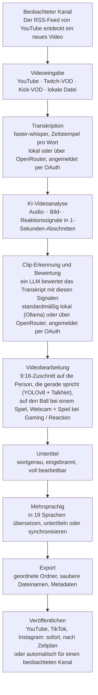

<div align="center">

[English](../../README.md) · [简体中文](README_zh.md) · [日本語](README_ja.md) · [한국어](README_ko.md) · [Türkçe](README_tr.md) · [Русский](README_ru.md) · [Tiếng Việt](README_vi.md) · [ไทย](README_th.md) · **Deutsch** · [Español](README_es.md) · [Français](README_fr.md) · [Português (Brasil)](README_pt-BR.md) · [العربية](README_ar.md) · [Bahasa Indonesia](README_id.md) · [Italiano](README_it.md) · [हिन्दी](README_hi.md) · [বাংলা](README_bn.md) · [Filipino](README_tl.md) · [اردو](README_ur.md)

</div>

<a id="clips-kitty-the-free-open-source-opus-clip-alternative-for-chatting-gaming-and-sports-on-your-own-pc"></a>

# Clips Kitty: die kostenlose Open-Source-Alternative zu Opus Clip für Chatting, Gaming und Sport, auf deinem eigenen PC

> Diese README wurde von einer KI aus der [englischen README](../../README.md) übersetzt. Die englische
> Fassung ist die Referenz und wird zuerst aktualisiert. Korrekturen von Muttersprachlern sind sehr willkommen.
>
> 🌐 [Die Website auf Deutsch](https://colingpt9.github.io/clips-studio/de.html)

<a href="https://apps.microsoft.com/detail/9NB6XT7DSQZZ">
  <picture>
    <source media="(prefers-color-scheme: dark)" srcset="https://get.microsoft.com/images/en-us%20dark.svg">
    
  </picture>
</a>

[](https://github.com/ColinGPT9/clips-studio/releases)
[](https://github.com/ColinGPT9/clips-studio/releases)
[](../../LICENSE)
[](https://github.com/ColinGPT9/clips-studio/stargazers)
[](https://github.com/ColinGPT9/clips-studio)
[](../../CONTRIBUTING.md)
[](../../docs/DOCKER.md)

<a href="https://youtu.be/g1dMqrq-YaI"></a>

<a id="star-and-share-clips-kitty--goal-150"></a>

### Gib Clips Kitty einen Stern und teile es ⭐ Ziel: 150

[](https://github.com/ColinGPT9/clips-studio/stargazers) **von 150**

**Bitte gib dem Repo einen Stern und teile es.** Es kostet dich nichts, und hinter
dem Projekt steht kein Marketingbudget. Mundpropaganda ist also der einzige Weg,
wie der nächste kleine YouTuber oder Streamer erfährt, dass es eine kostenlose Option gibt.

**Ich habe es für kleine YouTuber und Streamer gemacht**, die sich die anderen
Angebote oder einen Cutter nicht leisten können. Es ist eine kostenlose Alternative
zu Opus Clip, Vizard und Klap, die **Google Gemma** auf deinem eigenen PC ausführt:
keine Serverkosten, keine Gebühr pro Clip, keine KI-Nutzungsgebühr.

> **Clips Kitty hieß bis Version 1.1.3 Clips Studio** und wurde umbenannt, um die
> Namensvorgaben des Microsoft Store zu erfüllen. Gleiche App, gleiches Repository, gleiche Daten.


**Mach aus langen Streams und Videos fertige Shorts, Reels und TikToks, komplett
auf deinem eigenen Rechner.** Clips Kitty ist ein kostenloser Open-Source-KI-Clip-Generator
und Videoeditor für Creator: Füge einen Link von YouTube, Twitch oder Kick ein, und es findet
die besten Momente, schneidet sie auf 9:16 zu und hält dabei die sprechende Person in der Mitte,
brennt wortgenaue Untertitel ein und schreibt Titel, Beschreibungen und Hashtags.

Standardmäßig keine Cloud-KI. Kein Abo. Keine Gebühren pro Clip. Dein Material verlässt
deinen Computer nie, außer du lässt einen Clip auf deinem eigenen YouTube-Kanal veröffentlichen.

Lokal zuerst, Cloud, wenn du sie brauchst: Ist dein PC zu alt für die KI, übernimmt
ein Cloud-Anbieter, abgerechnet über dein eigenes Konto.
**OpenRouter ist der empfohlene Cloud-Weg**: Melde dich mit deinem OpenRouter-Konto an
(OAuth, kein Schlüssel zum Kopieren) und nutze viele Modelle (Claude, GPT, Gemini, Muse Spark und mehr).
In meinen Tests hat ein 2-stündiges Video auf OpenRouter etwa 11 Cent gekostet, wobei Gemma
(Gemma 4 26B-A4B) die Clips ausgewählt und Whisper (large-v3-turbo) transkribiert hat. Was du
zahlst, hängt von den gewählten Modellen und der Länge des Videos ab.
OpenAI, Claude, Gemini, xAI, Meta, DeepSeek und Qwen funktionieren auch direkt, mit deinem eigenen
API-Schlüssel.
Siehe [docs/AI-BACKENDS.md](../../docs/AI-BACKENDS.md).

**Warum es das gibt:** Die meisten Creator, die einen Kanal aufbauen, machen alles selbst:
filmen, streamen, schneiden, posten. Über Clips finden dich die Leute, und genau das fällt
meistens als Erstes weg: Ein Cutter ist ein Kostenpunkt, den sich die meisten Kanäle noch nicht
leisten können, Clipping-Tools kosten pro Video oder pro Monat, und von Hand schneiden kostet
einen Tag, den du woanders gebraucht hättest. Das hier läuft auf Hardware, die du schon hast,
also kostet die Nutzung nichts, und es gibt keine Obergrenze, wie viele Clips du machst.


<sub>38 Clips aus einem Video in 19 Minuten, auf einem PC, ohne dass etwas hochgeladen wurde.</sub>

---

<a id="contents"></a>

## Inhalt

- [Was es macht](#what-it-does)
- [Im Vergleich zu Opus Clip, Klap, Vizard und CapCut](#how-it-compares-to-opus-clip-klap-vizard-and-capcut)
- [So funktioniert es](#how-it-works)
- [Funktionen](#features)
- [Wofür es gemacht ist](#what-its-built-for)
- [Voraussetzungen](#requirements)
- [Installieren und starten](#install-and-run)
- [Wähle dein KI-Modell](#pick-your-ai-model)
- [Getestete Hardware und Leistung](#tested-hardware-and-performance)
- [Unterstützte Plattformen](#supported-platforms)
- [Unterstützte Sprachen](#supported-languages)
- [Auf YouTube veröffentlichen](#publish-to-youtube)
- [Auf allen Plattformen gleichzeitig veröffentlichen](#publish-to-every-platform-at-once)
- [GPU-Beschleunigung](#gpu-acceleration)
- [Nutzung über die Kommandozeile](#command-line-use)
- [Ein Plugin schreiben](#write-a-plugin)
- [Darauf aufbauen](#build-on-it)
- [Architektur](#architecture)
- [Mitmachen](#contributing)
- [Roadmap](#roadmap-detail)
- [Lizenz](#license)

---

<a id="what-it-does"></a>

## Was es macht

Du gibst Clips Kitty ein langes Video. Du bekommst einen Ordner mit fertigen vertikalen
Clips zurück, die du posten kannst, plus ein Studio, in dem du sie vorher prüfen und korrigieren kannst.

Es ist für die Inhalte gemacht, mit denen die meisten Clipping-Tools am schlechtesten klarkommen:
**Livestreams, IRL- und Talking-Head-Material, Podcasts sowie Gym-/Fitness-Content**: lange,
locker aufgebaute Videos, in denen die guten Momente versteckt sind und ein Transkript allein sie nicht findet.

<a id="how-it-compares-to-opus-clip-klap-vizard-and-capcut"></a>

## Im Vergleich zu Opus Clip, Klap, Vizard und CapCut

Clips Kitty ist eine Open-Source-Alternative zu Clipping-Tools in der Cloud. Der Unterschied, der
zählt, ist, wo die Arbeit passiert: Dein Video wird nie hochgeladen, also gibt es nichts zu
messen und nichts zu berechnen.

| Tool | Preis bei monatlicher Abrechnung | Kostenlose Stufe | Findet die Clips für dich | Wasserzeichen | Lädt dein Video hoch | Open Source |
| ---- | --------------------- | --------- | ----------------------- | --------- | ------------------ | ----------- |
| **Clips Kitty** | Kostenlos, keine bezahlte Stufe | Die ganze App | Ja | Nie | Nein, läuft auf deinem PC | Ja, AGPL-3.0 |
| Opus Clip | $15 Starter, $29 Pro | 1080p, mit Wasserzeichen, läuft nach 3 Tagen ab | Ja | In der kostenlosen Stufe | Ja | Nein |
| Klap | $29 Pro, $14 Basic bei jährlicher Abrechnung | Ein Video | Ja | Keine Angabe | Ja | Nein |
| Vizard | $29 Creator, $14.50 bei jährlicher Abrechnung | 60 Credits pro Monat, 720p | Ja | In der kostenlosen Stufe | Ja | Nein |
| quso.ai | $29 bis $49 | 75 Credits pro Monat, 720p | Ja | Keine Angabe | Ja | Nein |
| Ssemble | $15 bis $60, $6 bis $24 bei jährlicher Abrechnung | Keine angegeben | Ja | Keine Angabe | Ja | Nein |
| Descript | $16, $24, $50 | 60 Minuten pro Monat, 720p | Teilweise, es ist ein Transkript-Editor | Bei Free und Hobbyist | Ja | Nein |
| CapCut | Kostenlos nutzbar, bezahlte Stufen auf capcut.com | Der ganze Editor | **Nein, du schneidest von Hand** | Je nach Funktion | Nein, in der Desktop-App | Nein |

**CapCut lohnt einen genaueren Blick**, weil es die kostenlose Antwort ist, die alle geben.
Es ist ein guter Editor und kostet nichts, aber jeden Moment findest und jeden Clip schneidest
du selbst. Clips Kitty ist auch kostenlos, und genau diesen ersten Durchgang übernimmt es für dich.

**Opus Clip, Klap oder Vizard sind die bessere Wahl**, wenn du keinen Windows-PC mit
Grafikkarte hast, nur ab und zu clippst oder vom Handy aus arbeiten musst. Clips Kitty ist
dafür gemacht, in großer Menge auf Hardware zu clippen, die du schon hast.

**[Vollständiger Vergleich aller sieben, mit dem, worin jedes am besten ist](https://colingpt9.github.io/clips-studio/alternatives.html)**

<sub>Preise geprüft auf der jeweiligen Preisseite des Unternehmens am 17. September 2026. CapCut
veröffentlicht keine Preisseite, die wir lesen konnten, daher wird dafür kein Preis genannt. Tarife ändern sich;
diese Tabelle aktualisiert sich nicht von selbst.</sub>

<a id="how-it-works"></a>

## So funktioniert es



**Jede Stufe läuft auf deinem Computer, außer du entscheidest dich anders:** für OpenRouter,
angemeldet mit deinem Konto, für die KI oder die Transkription, und fürs Veröffentlichen, bei dem nur
die Clips hochgeladen werden, die du abschickst. Ansonsten ist das Einzige, was bei einem normalen
Durchlauf das Netzwerk nutzt, der Download des Quellvideos.

<a id="the-stages-in-detail"></a>

### Die Stufen im Detail

**Transkription: faster-whisper.** Zeitstempel pro Wort, auf CUDA, wo verfügbar, sonst auf
der CPU. Das Wort-Timing sorgt dafür, dass Untertitel auf der richtigen Silbe landen und Clips
an einer echten Satzgrenze beginnen.

**KI-Bewertung der Clips.** Das Transkript ist ein Signal von fünf. Audio liefert Lautstärkespitzen,
Burst-Dichte (so sehen Lachen und Applaus aus) und Muster von Stille→Explosion. Das Bild liefert
Szenenwechsel, Bewegung und Änderungen der Gesichtsfläche. Ein Reaktionssignal führt diese zusammen.
Jedes wird *innerhalb des jeweiligen Videos* normalisiert, sodass ein ruhiger Podcast und ein
kreischender Stream beide aussagekräftige Spitzen liefern. Wo echte Zuschauerdaten vorhanden sind
(Twitch-Chat-Replay, gemessen an einzelnen Chattern, die Heatmap „Am häufigsten wiedergegeben“ von YouTube),
gibt es einen kleinen, gedeckelten Bonus.

Das lokale LLM sieht das Transkript **plus eine Zeitleiste dieser Ereignisse**, damit es
„die Worte sind harmlos, aber der Raum ist explodiert“ richtig gewichten kann. Weil kleine Modelle
alles in einem engen Bereich bewerten, werden die Finalisten danach in einem einzigen
Rerank-Aufruf direkt miteinander verglichen: Ein relatives Urteil fällt einem 7B-Modell viel leichter
als eine absolute Bewertung.

**Creator-Profile.** Die App baut pro Creator über dessen Videos hinweg eine Wissensbasis auf:
wiederkehrende Themen, Serien, Kollaborationen, Running Gags und laufende Handlungsstränge. Dieser
Kontext hilft ihr, treffende Titel zu schreiben und Anspielungen zu erkennen. Sie ist bewusst
zurückhaltend: Ein Spruch muss sich tatsächlich wiederholen, bevor er zählt, Wissen, das nicht mehr
erwähnt wird, ruht, und jeder Beitrag zur Bewertung daraus ist additiv, gedeckelt und lässt sich
abschalten.

**Videoeditor.** Nicht-destruktiv: Trims, interne Schnitte, Stummschaltungen, stummgeschaltete Wörter,
Lautstärke, Blenden, Geschwindigkeit, Hook-Text, Musik und Wasserzeichen werden als Operationen
gespeichert und beim Rendern angewendet. Es gibt auch einen KI-Bearbeitungschat (*„mach ihn 5 Sekunden
länger“*, *„im Untertitel steht gost, es sollte ghost heißen“*), bei dem das Modell Vorschläge macht
und geprüfter Code sie umsetzt.

**Verarbeitung im Langformat.** Ein optionaler 16:9-Weg mit derselben Analyse: horizontale
Clips, Schnitte in X/Twitter-Länge, ein Best-of-Highlight-Reel oder der komplette Stream ohne
Leerlauf.

**Mehrsprachige Pipeline und KI-Synchronisation.** Untertitel werden übersetzt und zur Prüfung angezeigt,
*bevor* irgendetwas geschrieben oder eingebrannt wird, damit eine schlechte Zeile korrigiert wird,
solange das noch geht. Ein Glossar schützt Kanalnamen, Sponsoren und Insider-Witze vor der
Übersetzung. Die Synchronisation nutzt lokales TTS mit Stimmen, die du vorab anhören kannst.

**Lokale GPU-Beschleunigung.** CUDA für Erkennung und Transkription, Hardware-Videokodierung
über NVENC/AMF/QSV (automatisch erkannt, mit CPU als Rückfall) und das LLM auf der GPU
über Ollama.

<a id="features"></a>

## Funktionen

- **Multimodale Clip-Erkennung**: Momente werden von 0–100 bewertet, indem das Gesagte, die Aufregung im
  Ton, die Aktivität im Bild, Reaktionen auf dem Bildschirm und die Stärke von Hook/Pointe zusammengeführt werden.
  Jeder Clip, der die Qualitätsschwelle überschreitet, bleibt erhalten, ohne willkürliche Obergrenze.
- **Gesichtsverfolgung, die den Sprecher kennt**: Die Pose-Erkennung von YOLOv8 hält die Person in der Mitte,
  und bei Gruppenaufnahmen folgt die Kamera **der Person, die wirklich spricht**. Das entscheidet die
  Active-Speaker-Erkennung von TalkNet anhand von Gesicht und Ton zusammen, nicht anhand von Bewegung.
  Wechselt der Sprecher, **schneidet** der Bildausschnitt zu ihm, statt hinüberzuschwenken, so wie es ein Cutter
  tun würde. Nur Zuschnitt: nie gestreckt, nie verzerrt.
- **Podcast-Modus**: Bei Material mit mehreren Kameras bekommt jede Einstellung ihren eigenen ruhigen Zuschnitt
  auf eine Person, sodass Schnitte ohne Schwenk auf einem Gesicht landen. Innerhalb einer Einstellung wird die
  Person anhand der Mundbewegung gewählt, ersatzweise das auffälligste Gesicht.
- **Vertical Live**: für einen Livestream, der schon beim Streamen vertikal war (ein vertikaler
  YouTube-Livestream, Twitch Dual Format, Streamlabs Dual Output, ein heruntergeladener Instagram- oder
  TikTok-Livestream). Behält das eigene 9:16-Layout des Streams, überspringt die Gesichtsverfolgung und
  wählt die Momente trotzdem wie gewohnt aus. Siehe [docs/VERTICAL-LIVE.md](../../docs/VERTICAL-LIVE.md).
- **Sport: Fußball und Basketball**: jeder große Moment eines Spiels als eigener Clip,
  mit Vorlauf und Reaktion.
  - **Fußball**: Tore, Paraden, Karten und große Chancen. Tore werden aus der Spielstandanzeige gelesen und über das
    Publikum zeitlich eingeordnet, und der 9:16-Zuschnitt folgt dem Ball. Wähle All goals, Best saves, Cards
    und mehr, und lass die Momente zu einer Spielzusammenfassung sowie zu Team- oder Spieler-Reels zusammenfügen.
  - **Basketball**: Dunks, Dreier, Blocks, Steals und Game Winner. Die Spielstandanzeige bestätigt jeden Korb und
    seine Punkte, und durch Viertel und Spieluhr zählt ein Game Winner weit mehr als ein Korb im ersten Viertel.
    Auch die Reaktionen von Publikum, Bank und Spielfeldrand werden gefunden. Der 9:16-Zuschnitt jedes Clips wird um
    seinen Spielzug herum geplant: der Ball und wer ihn hat, der Empfänger eines Passes und der Wurf, verfolgt bis
    zum Korb, mit Ring und Brett im Bild. Er schwenkt mit dem Spiel mit und zoomt nie. Den Ball findet das
    [E-BARD](https://github.com/GabrieleGiudic/E-BARD#readme)-Erkennungsmodell (genannt unter [Lizenz](#license)).

  Siehe [docs/SPORTS.md](../../docs/SPORTS.md).
- **Bearbeitbare eingebrannte Untertitel**: wortgenau und gestaltet, wie du willst (Farbe, Größe,
  Position, Wörter pro Zeile, Groß-/Kleinschreibung oder aus). Korrigiere einen Transkriptionsfehler Zeile für
  Zeile vor dem Export. Wenn zwei Leute reden, können die Untertitel der zweiten Person eine andere Farbe
  bekommen, und eine falsche Zuordnung lässt sich von Hand umstellen.
- **KI-Bearbeitungschat**: Beschreib in einfachen Worten, was nicht passt, und er bearbeitet neu.
- **Ask Clips Kitty**: das Textfeld unten im Dashboard. Sag in einem Satz, was du willst, etwa
  *„clippe diesen Stream, nimm auf jeden Fall rein, wie ich gegen den Boss gestorben bin,
  mit großen gelben Untertiteln“*, und es stellt das Video in die Warteschlange, sagt der Clip-Auswahl, worauf sie
  achten soll, und setzt die Optionen, die du genannt hast. **Es braucht ein Gemma-4-Modell**: siehe
  [Das Textfeld unten braucht Gemma 4](#the-text-box-at-the-bottom-needs-gemma-4).
- **KI-Titel, -Beschreibungen und -Hashtags**, alle vor dem Export bearbeitbar.
- **Creator-Profile**: Die App lernt jeden Creator mit der Zeit kennen, um Clips besser auszuwählen
  und zu betiteln. Alles bleibt auf deinem Computer, und du kannst es einsehen, korrigieren oder löschen.
- **Mehrsprachiges Veröffentlichen**: 19 Sprachen, mit Prüfung, bevor irgendetwas eingebrannt wird.
- **KI-Synchronisation**: lokale Sprachsynthese, bei der du die Stimmen pro Sprache vorab anhören kannst.
- **Export im Langformat**: 16:9-Clips, Highlight-Reels oder ein Stream-Schnitt ohne Wiederholungen.
  Die Beschreibung eines Highlight-Reels enthält **Kapitel-Zeitstempel**, damit Zuschauer auf YouTube
  zwischen den Momenten springen können.
- **Wasserzeichen- und Branding-Profile**: Standards pro Creator, die automatisch angewendet werden.
- **Modellverwaltung**: Tausch das KI-Gehirn direkt in der App aus; Modelle herunterladen, entfernen und
  wechseln, mit Fortschrittsbalken und ohne Terminal.
- **Direkt aus dem Editor auf YouTube veröffentlichen**: Titel, Beschreibung, Tags, Thumbnail,
  Playlist, Zielgruppe und Sichtbarkeit, dann sofort hochladen oder planen. Optional, standardmäßig
  aus, und es nutzt deinen eigenen Google-API-Schlüssel.
- **Feedback in der App**: Fehlerberichte mit automatisch gesammelter Diagnose, kein Konto nötig.
- **Barrierearme Oberfläche**: Tastaturfokus, Unterstützung für reduzierte Bewegung, anpassbare Schriftart und -größe.

<a id="what-its-built-for"></a>

## Wofür es gemacht ist

Alles läuft mit jedem Video, das du ihm gibst. Das hier sind die Fälle, in denen es mehr
oder weniger mitdenkt, als die Funktionsliste vermuten lässt, damit dich nichts überrascht:

| Inhalt | Wie es abschneidet |
|---|---|
| **IRL, Just Chatting, Podcasts, Vlogs, Interviews** | Darauf ist es abgestimmt, und das wird vor jedem Release an echten Streams getestet |
| **Gaming und Reaktionen** | Mit eingeschaltetem **Gaming / Reaction**: die Webcam in der einen Hälfte, das Spiel oder das Video, auf das reagiert wird, in der anderen, vor der Verarbeitung an den eigenen Frames des Videos geprüft ([docs/GAMING.md](../../docs/GAMING.md)). Der Streamer ist, wer gerade spricht, nie das größte Gesicht. Ohne den Schalter kann der Bildausschnitt einer Figur im Spiel folgen. Nur Menschen vor der Kamera, keine VTuber |
| **Sportspiele** | Mit eingeschaltetem **Sports**: gemacht für Übertragungen mit Spielstandanzeige und Kommentar, bei denen Tore und Körbe eindeutig sind. Vereins- oder Handyaufnahmen haben meist beides nicht: Ihre Clips folgen dem Ball, und ihre Tore kommen aus den Spielereignissen, die du einfügst, etwa den Tor-Markierungen einer Vereins-App ([docs/SPORTS.md](../../docs/SPORTS.md)) |
| **Worauf eine Reaktion reagiert** | Clips werden weiterhin anhand dessen ausgewählt, was *gesagt* wird. Ein Moment im angeschauten Video, den niemand kommentiert, bleibt für es unsichtbar |

Die Clip-Auswahl basiert auf Transkript und Signalen. Wenn das Lustige *nur im Bild* passiert
und niemand etwas dazu sagt, musst du es wahrscheinlich selbst im Editor suchen.

<a id="requirements"></a>

## Voraussetzungen

|             | Minimum                                      | Empfohlen                       |
| ----------- | -------------------------------------------- | ------------------------------- |
| **GPU**     | NVIDIA RTX 2060 (6 GB)                       | RTX 3060 12 GB oder besser      |
| **CPU**     | Intel Core i3-9100 / AMD Ryzen 3 3200G (2019)| 6 Kerne oder mehr               |
| **RAM**     | 16 GB                                        | 16 GB oder mehr                 |
| **Festplatte** | ~20 GB, plus Platz für die Videos, die du clippst |                            |
| **OS**      | Windows 10 oder 11                           |                                 |

**Unterhalb des Minimums läuft es vielleicht trotzdem, wird aber nicht unterstützt und ist
langsam.** Einen Stream zu clippen bedeutet stundenlanges Dekodieren, Transkribieren und
Kodieren von Video; mit Hardware von vor etwa 2019 dauert das so lange, dass die App
kaputt wirkt, obwohl sie richtig arbeitet.

Zwei Punkte davon verdienen eine Erklärung:

- **16 GB RAM sind keine Empfehlung.** Mit 8 GB wird ein ganzes Video analysiert und dann
  nichts gerendert, was eher wie ein Absturz aussieht als wie ein Speicherlimit.
- **Eine GPU ist optional, nicht Pflicht.** Ohne läuft alles auf der CPU,
  langsamer, aber vollständig. Ab der RTX 2060 funktioniert der GPU-Weg;
  siehe [GPU-Beschleunigung](#gpu-acceleration).

**Nur Windows** für die App. Die Python-Engine sollte unter Linux/macOS laufen, aber
es gibt keinen Mac-Build, und der Maintainer hat keinen Mac, um einen zu testen. Schau dir
[#62](https://github.com/ColinGPT9/clips-studio/issues/62) an, wenn du einen hast und helfen willst.

Wenn du aus dem Quellcode startest, brauchst du die Dinge, die sonst der Installer für dich mitbringt:

- **Python 3.10+** und **Node.js 18+**
- **[FFmpeg](https://ffmpeg.org/download.html)** in deinem PATH
- **[Ollama](https://ollama.com)** mit einem heruntergeladenen Modell: `ollama pull gemma:7b`

<a id="install-and-run"></a>

## Installieren und starten

**Am einfachsten geht es über den [Microsoft Store](https://apps.microsoft.com/detail/9NB6XT7DSQZZ).**
Ein Klick, es aktualisiert sich selbst, und Windows zeigt keine Sicherheitsabfrage. Microsoft
hat das Paket zertifiziert und signiert, deshalb erscheint die unten beschriebene SmartScreen-Warnung
gar nicht erst. Der Store installiert neue Versionen, wenn er dazu kommt; wenn du eine sofort
haben willst, öffne die Seite von Clips Kitty im Microsoft Store und drück auf **Update**.

**Oder hol dir den Installer.** Lade das neueste **Web Setup** von
[Releases](https://github.com/ColinGPT9/clips-studio/releases) herunter und führ es aus. Es enthält die App, die Python-Engine,
jede Bibliothek, FFmpeg, die KI-Laufzeit und alle Gewichte für Erkennung und Transkription: kein
Python, kein PATH, kein Terminal und kein zweites Programm zu installieren.

**Oder nutze winget.** `winget install ColinGPT9.ClipsKitty` installiert dasselbe Web Setup
aus einem Terminal.

Das Einzige, was es nicht mitbringt, ist das Sprachmodell selbst, weil diese Modelle unter
Lizenzen stehen, die die Person beim Herunterladen selbst akzeptieren muss; das kann nicht
stellvertretend für dich geschehen. Der Einrichtungsassistent startet diesen Download von selbst,
wählt die Größe, die zu deiner Grafikkarte passt, und zeigt einen Fortschrittsbalken. Also: ein Download,
ein Doppelklick, ein Fortschrittsbalken. Danach läuft es offline.

> Windows warnt beim ersten Start, dass die App nicht signiert ist. Klick auf
> *Weitere Informationen → Trotzdem ausführen*. Ein Signaturzertifikat steht auf der Liste.

<a id="from-source"></a>

### Aus dem Quellcode

```bash
git clone https://github.com/ColinGPT9/clips-studio
cd clips-studio
pip install -r requirements.txt

cd ui
npm install
npm run dev        # opens the Clips Kitty desktop app
```

Die App startet ihre eigene Python-Engine automatisch. Füge in **Clip Editor** einen Link ein,
drück auf *Generate clips* (Clips erstellen) und verfolge den Fortschritt live.

Den Installer selbst zu bauen ist ein einziger Befehl. Siehe
[CONTRIBUTING.md](../../CONTRIBUTING.md#building-the-windows-installer).

<a id="with-docker-nothing-else-to-install"></a>

### Mit Docker: sonst nichts zu installieren

Für Mitwirkende. Du brauchst [Docker Desktop](https://docs.docker.com/get-started/get-docker/)
und sonst nichts: kein Python, kein Node, kein FFmpeg, kein PyTorch.

```bash
git clone https://github.com/ColinGPT9/clips-studio
cd clips-studio
docker compose up
```

Drei Dienste starten zusammen:

| | |
|---|---|
| **<http://localhost:5173>** | die Oberfläche, in deinem Browser |
| **<http://localhost:8765>** | die Engine und ihre API |
| Ollama | die lokale KI, auf :11434 |

Dann lade ein Modell herunter (`docker compose exec ollama ollama pull gemma3:4b`), und
du hast eine funktionierende Arbeitskopie.

Die Prüfungen laufen genauso:

```bash
docker compose run --rm engine pytest
docker compose run --rm ui npm run typecheck
```

> **Spar dir den zehnminütigen ersten Build:** `docker compose pull` holt ein fertiges
> Engine-Image, statt PyTorch und OpenCV lokal zu kompilieren.

Die Desktop-Oberfläche selbst läuft weiterhin auf deinem Rechner, weil Electron ein Display braucht;
alles andere läuft in Containern. Details, und was dir das nicht verraten kann, findest du in
[docs/DOCKER.md](../../docs/DOCKER.md).

<a id="pick-your-ai-model"></a>

## Wähle dein KI-Modell

Öffne die Seite **Models** (Modelle), um zu sehen, was installiert ist und was deine GPU schafft:

Es gibt nur eine Achse: wie viel VRAM du hast. Das sind dieselben Zeilen, die die App anzeigt, aus
`RECOMMENDATIONS` in [`llm/manager.py`](../../llm/manager.py). Der Assistent und die Seite Models
lesen genau diese eine Tabelle, damit sie sich weder untereinander noch mit dieser hier widersprechen können.

| Deine Hardware | Empfohlenes Modell | |
|---|---|---|
| CPU / iGPU, keine Grafikkarte | `gemma3:4b` | getestet |
| Unter 6 GB VRAM oder ein älterer PC | `gemma4:e2b` | |
| 6 GB VRAM | `gemma4:e4b` | |
| 8 GB VRAM | **`gemma:7b`** | getestet · Standard bei Auslieferung |
| 10–12 GB VRAM | `gemma3:12b` | getestet |
| 16–24 GB VRAM | `gemma3:27b` | |

Und die Modelle, die sich aus einem anderen Grund als VRAM lohnen:

| Warum | Modell |
|---|---|
| Übersetzung / mehrsprachig | `qwen3:8b` oder `qwen3:14b` |
| Freizügige Lizenz | `mistral-nemo:12b` (Apache-2.0) · `phi4:14b` (MIT) |

**Nur die drei als „getestet“ markierten wurden an echten Streams ausprobiert**, und `gemma:7b`
hat die meisten Stunden auf dem Buckel; es ist das Modell, mit dem `config/settings.yaml` ausgeliefert wird.
Alles andere steht hier, weil es eine sinnvolle Größe hat und kommerziell frei nutzbar ist,
nicht weil die Clip-Qualität damit gemessen wurde. Sie funktionieren alle, weil die App mit
jedem Modell über Ollama gleich spricht, aber niemand hat geprüft, ob sie bessere Momente
auswählen. Diese Lücke zu schließen ist [#38](https://github.com/ColinGPT9/clips-studio/issues/38).

Alles, was Ollama bereitstellt, funktioniert, und der Wechsel ist ein Klick. Für die Übersetzung kann
ein *anderes* Modell als fürs Clippen verwendet werden. Setz dazu `llm.translation_model`.

<a id="the-text-box-at-the-bottom-needs-gemma-4"></a>

### Das Textfeld unten braucht Gemma 4

**Ask Clips Kitty**, das Textfeld unten im Dashboard, funktioniert nur mit einem Modell,
das die Werkzeuge der App nutzen kann. Gemma 4 kann das. `gemma:7b` und die Gemma-3-Modelle nicht, und
die Einrichtung installiert eines davon auf einem PC ohne Grafikkarte oder mit 8 GB VRAM oder mehr.
Dort funktioniert das Feld erst, wenn du ein Gemma-4-Modell hinzufügst: Version 2.0 meldet *„No installed
model can use tools“* (kein installiertes Modell kann Werkzeuge nutzen), und spätere Versionen bieten den Download direkt im Feld an.

Egal, welches Modell deine Clips auswählt: Installiere auf der Seite **Models** ein Gemma-4-Modell
daneben, `gemma4:e4b` bei einer Grafikkarte mit 6 GB oder mehr, `gemma4:e2b` bei weniger. Du musst
nicht darauf umstellen. Das Feld findet es von selbst, und deine Clips werden weiterhin von dem
Modell ausgewählt, das du gewählt hast. Wenn du die KI stattdessen über OpenRouter laufen lässt, nutzt das Feld
dieses Modell und braucht nichts Installiertes.

<a id="tested-hardware-and-performance"></a>

## Getestete Hardware und Leistung

Clips Kitty wird täglich auf diesem Rechner entwickelt und getestet. Er ist also ein guter
Bezugspunkt, wenn du deine eigenen Ergebnisse vergleichst:

| | |
|---|---|
| **GPU** | NVIDIA GeForce RTX 3060, 12 GB VRAM |
| **CPU** | AMD Ryzen 5 5600X (6 Kerne / 12 Threads) |
| **RAM** | 16 GB |
| **OS** | Windows 10 |
| **Clipping-Modell** | `gemma:7b` über Ollama |
| **Transkription** | faster-whisper `large-v3-turbo` auf CUDA |

Alles in diesem Repo (die Standardeinstellungen, `parallel_renders: 3`, die 5-minütigen
Analyse-Abschnitte) ist auf ungefähr diese Rechnerklasse abgestimmt. Mit einer stärkeren GPU
erhöhst du `llm.num_ctx` und `analysis.chunk_seconds` gemeinsam und gehst eine Modellgröße hoch;
mit einer schwächeren gehst du runter auf `gemma3:4b`.

Wenn du Clips Kitty auf anderer Hardware misst, poste die Ergebnisse bitte in den
[Discussions](https://github.com/ColinGPT9/clips-studio/discussions). Echte Zahlen von echten Rechnern helfen allen,
ihr Setup richtig zu dimensionieren.

<a id="supported-platforms"></a>

## Unterstützte Plattformen

| Quelle | Unterstützung |
|---|---|
| YouTube-Videos | Vollständig. H.264 wird bewusst gewählt (AV1 verdoppelt ungefähr die Verarbeitungszeit) |
| Twitch-VODs | Vollständig, einschließlich Chat-Replay als Zuschauersignal |
| Kick-VODs | Vollständig (Kick verwirft den Chat nach dem Ende eines Streams, daher gibt es kein Chat-Signal) |
| Lokale Videodateien | Vollständig. Clippe dein eigenes Material, bevor du es veröffentlichst |
| Livestreams | Bewusst nicht unterstützt. Nur VODs |

<a id="supported-languages"></a>

## Unterstützte Sprachen

Clips lassen sich in **19 Sprachen** übersetzen, untertiteln und synchronisieren, und
**auch die Oberfläche selbst ist in alle 19 übersetzt**, damit du die App in denselben
Sprachen nutzen kannst, in denen sie veröffentlicht:

Englisch · Spanisch · Portugiesisch (brasilianisch) · Französisch · Deutsch · Hindi · Indonesisch ·
Japanisch · Russisch · Arabisch · Chinesisch (vereinfacht) · Vietnamesisch · Filipino · Türkisch ·
Urdu · Bengalisch · Thai · Koreanisch · Italienisch

Eine Sprache hinzuzufügen heißt: eine Zeile in `multilingual/languages.py` plus eine Locale-Datei in
`ui/src/renderer/src/locales/`. Übersetzer und Untertitel-Writer sind
sprachunabhängig.

<a id="help-wanted-the-maintainer-only-speaks-english"></a>

### Hilfe gesucht: Der Maintainer spricht nur Englisch

18 dieser 19 Oberflächen-Übersetzungen hat noch nie jemand gelesen, der die Sprache
spricht. Die Hälfte davon ist nicht fertig. Jede Sprache hat ein eigenes Issue,
geschrieben auf Englisch und in der jeweiligen Sprache, und **ein falsches Wort zu melden ist ein
vollständiger Beitrag**: Kein Pull Request nötig. [So funktioniert es](../../docs/TRANSLATING.md).

**Muss fertiggestellt werden** (etwa 68 Texte noch auf Englisch):
[বাংলা (Bengalisch)](https://github.com/ColinGPT9/clips-studio/issues/43) ·
[Italiano (Italienisch)](https://github.com/ColinGPT9/clips-studio/issues/44) ·
[한국어 (Koreanisch)](https://github.com/ColinGPT9/clips-studio/issues/45) ·
[ไทย (Thai)](https://github.com/ColinGPT9/clips-studio/issues/46) ·
[Tagalog (Filipino)](https://github.com/ColinGPT9/clips-studio/issues/47) ·
[Türkçe (Türkisch)](https://github.com/ColinGPT9/clips-studio/issues/48) ·
[اردو (Urdu)](https://github.com/ColinGPT9/clips-studio/issues/49) ·
[Tiếng Việt (Vietnamesisch)](https://github.com/ColinGPT9/clips-studio/issues/50) ·
[中文 (Chinesisch)](https://github.com/ColinGPT9/clips-studio/issues/51)

**Muss geprüft werden** (vollständig, aber niemand hat bestätigt, dass es sich natürlich liest):
[العربية (Arabisch)](https://github.com/ColinGPT9/clips-studio/issues/52) ·
[Deutsch](https://github.com/ColinGPT9/clips-studio/issues/53) ·
[Español (Spanisch)](https://github.com/ColinGPT9/clips-studio/issues/54) ·
[Français (Französisch)](https://github.com/ColinGPT9/clips-studio/issues/55) ·
[हिन्दी (Hindi)](https://github.com/ColinGPT9/clips-studio/issues/56) ·
[Bahasa Indonesia (Indonesisch)](https://github.com/ColinGPT9/clips-studio/issues/57) ·
[日本語 (Japanisch)](https://github.com/ColinGPT9/clips-studio/issues/58) ·
[Português (Portugiesisch)](https://github.com/ColinGPT9/clips-studio/issues/59) ·
[Русский (Russisch)](https://github.com/ColinGPT9/clips-studio/issues/60)

Du willst eine Sprache, die hier fehlt? [#61](https://github.com/ColinGPT9/clips-studio/issues/61).

<a id="publish-to-youtube"></a>

## Auf YouTube veröffentlichen

Standardmäßig aus. Schalte es unter **Settings → Publish to YouTube** (Einstellungen → Auf YouTube veröffentlichen) ein, und im
Editor erscheint ein Tab **YouTube**: Trag Titel, Beschreibung, Tags, Thumbnail,
Playlist, Zielgruppe und Sichtbarkeit ein und drück dann auf **Upload now** (Jetzt hochladen). Clips Kitty rendert
den Clip, falls du ungespeicherte Änderungen hast, und lädt ihn direkt auf deinen Kanal hoch. Es gibt
keinen Export-Schritt und keine separate Veröffentlichungsseite. Du verlässt den Editor nie.

Wenn du es ausgeschaltet lässt, ändert sich nirgendwo in der App etwas.

<a id="scheduling"></a>

### Planen

Mit **Schedule on YouTube** (Auf YouTube planen) wird das Video *sofort* hochgeladen, als
privat markiert und YouTube eine Veröffentlichungszeit übergeben. YouTube veröffentlicht es dann am Stichtag.

**Du kannst Clips Kitty schließen und deinen Computer ausschalten.** Es gibt keinen Timer in
dieser App, keinen Hintergrunddienst und nichts, was weiterlaufen muss. Sobald YouTube das
Video angenommen hat, ist die Arbeit von Clips Kitty erledigt.

<a id="you-need-your-own-google-api-key"></a>

### Du brauchst deinen eigenen Google-API-Schlüssel

Clips Kitty liefert keinen gemeinsamen Schlüssel mit, und das ist nicht nur Vorsicht. Googles
Upload-Kontingent gilt **pro Cloud-Projekt**: Ein gemeinsamer Schlüssel würde bedeuten, dass sich alle Nutzer
weltweit dieselben 100 Uploads pro Tag teilen. Dein eigenes Projekt gibt dir dein eigenes
Kontingent, und deine Zugangsdaten verlassen deinen Rechner nie. Es gibt keinen Clips-Kitty-Server
dazwischen.

Die Einrichtung ist kostenlos und dauert etwa zehn Minuten; der Assistent in den Einstellungen führt dich durch:

1. Erstelle ein Projekt in der [Google Cloud Console](https://console.cloud.google.com/projectcreate).
2. Aktiviere **YouTube Data API v3** unter APIs & Services → Library.
3. Fülle den OAuth-Zustimmungsbildschirm aus und drück dann auf **Publish app**. Das ist wichtig:
   Bleibt es auf *Testing*, lässt Google deine Anmeldung alle 7 Tage ablaufen, und du müsstest
   dich jede Woche neu verbinden. „In production“ heißt nicht verifiziert und kostet nichts.
4. Credentials → Create credentials → OAuth client ID → Typ **Desktop app**.
5. Füge Client-ID und Secret in die Einstellungen ein und verbinde dann deinen Kanal.

Beim Verbinden siehst du die Warnung „Google hasn't verified this app“ (Google hat diese App nicht überprüft). Das ist
deine eigene App, die dich vor dir selbst warnt. Mit **Advanced → Go to (unsafe)** (Erweitert → Weiter zu … (unsicher)) kommst du
daran vorbei.

<a id="posting-publicly"></a>

### Öffentlich posten

Eine Sache solltest du wissen, bevor du dich darauf verlässt, weil keine Software sie umgehen kann:

> **Solange dein Google-Cloud-Projekt das kostenlose API-Audit von YouTube nicht bestanden hat, sperrt YouTube
> jedes darüber hochgeladene Video auf privat.** Die Sperre ist dauerhaft. Du kannst das Video
> danach in Studio nicht öffentlich machen, und es gibt keinen Einspruch. Die einzige Lösung
> ist, es aus einem geprüften Projekt erneut hochzuladen.

Clips Kitty prüft das nach jedem Upload und sagt dir klar, wenn es passiert ist, statt
Erfolg für ein Video zu melden, das niemand ansehen kann. Wenn du öffentlich veröffentlichen
willst, reich vorher das
[Auditformular für YouTube API Services](https://support.google.com/youtube/contact/yt_api_form)
ein. Uploads als **nicht gelistet** oder **privat** sind nicht betroffen.

<a id="what-it-can-and-cannot-set"></a>

### Was es einstellen kann und was nicht

Alles, was die öffentliche API anbietet: Titel, Beschreibung (Zeitstempel darin werden zu
Kapiteln), Tags, Kategorie, Sprache, Sichtbarkeit, geplante Veröffentlichungszeit, „Speziell für Kinder“,
Kennzeichnung veränderter/synthetischer Inhalte, Lizenz, Einbetten, öffentliche Statistiken, eigenes
Thumbnail und das Hinzufügen zu einer Playlist.

Manche Funktionen von YouTube Studio sind gar nicht in der öffentlichen API, deshalb gibt es dafür
bewusst keine Steuerung, statt einer, die stillschweigend nichts tut:
Monetarisierung und Werbeunterbrechungen, Kennzeichnung bezahlter Werbung, Abspanne und Infokarten,
Kommentareinstellungen, Altersbeschränkung, Premieren und Remix-Berechtigungen für Shorts. Das
Panel verlinkt dich dafür zu Studio.

Shorts brauchen nichts Besonderes: keinen eigenen Modus und kein `#Shorts`-Tag. YouTube
stuft ein Video anhand seines Formats und seiner Länge von selbst als Short ein.

<a id="publish-to-every-platform-at-once"></a>

## Auf allen Plattformen gleichzeitig veröffentlichen

Ebenfalls standardmäßig aus. Schalte es unter **Settings → Publish through WoopSocial** (Einstellungen → Über WoopSocial veröffentlichen) ein,
und im Editor erscheint ein Tab **Publish** (Veröffentlichen): Wähl deine Plattformen aus – oder drück auf
**Everywhere** (Überall) –, schreib Titel und Beschreibung einmal, und ein einziger Upload geht gleichzeitig an
YouTube, TikTok, Instagram, Facebook, X, Threads, LinkedIn, Pinterest und
Bluesky. **Publish all** (Alle veröffentlichen) im Clip Editor erledigt einen ganzen Stapel,
zeitlich verteilt, damit nicht ein Dutzend Clips in derselben Sekunde landen.

Das hier ist **nicht lokal**. Der Clip und seine Angaben werden an einen Veröffentlichungsdienst
geschickt, der sie ausliefert und die Verbindungen zu deinen Social-Media-Konten
hält, sodass Clips Kitty nie nach einem Social-Media-Passwort fragt. Alles andere in
der App läuft weiterhin auf deinem PC.

Zwei Dienste werden unterstützt: **[WoopSocial](https://woopsocial.com/?via=clipskitty)**,
dessen kostenloser Tarif zwei Konten verbindet und etwa 5 YouTube-Posts pro
Tag erlaubt, wobei die bezahlten Tarife beides anheben, und
**[Upload-Post](https://www.upload-post.com/)**, das mehr Ziele erreicht
und Thumbnails, erste Kommentare und eine Posting-Warteschlange mitbringt. Schalte einen
davon ein oder beide.

<sub>Affiliate-Link – Clips Kitty erhält eventuell eine Provision, wenn du dich darüber
anmeldest, ohne Mehrkosten für dich.</sub>

**Bring deinen eigenen Schlüssel mit.** Du legst das Konto an, verbindest deine eigenen Socials und
nutzt dein eigenes Kontingent. Clips Kitty berechnet nichts, hält keinen gemeinsamen Schlüssel und
bezahlt für nichts – dieselbe Regelung wie bei der YouTube-Integration, und aus
demselben Grund.

Vollständige Anleitung, Unterstützung pro Plattform und Limits:
**[docs/UPLOAD-POST.md](../../docs/UPLOAD-POST.md)**.

<a id="gpu-acceleration"></a>

## GPU-Beschleunigung

**Die Videokodierung** wird bei allen drei Herstellern automatisch per Hardware beschleunigt: NVIDIA
(NVENC), AMD (AMF) und Intel (QSV). Die Engine kodiert beim Start testweise ein Frame mit jedem
und nutzt den ersten, der tatsächlich funktioniert, mit der CPU als Rückfall. Eine feste Wahl erzwingst du
mit `video.encoder` in `config/settings.yaml`.

**Erkennung und Transkription** sind mit CUDA am schnellsten. Von Haus aus liefert dir `pip install
torch` den Build **nur für die CPU**. Für NVIDIA:

```bash
pip uninstall torch torchvision -y
pip install torch torchvision --index-url https://download.pytorch.org/whl/cu130
```

**Welche Karten die GPU nutzen:** GTX-16-Serie, RTX-20-Serie und alles Neuere,
einschließlich der RTX-50-Serie.

**Transkription auf der GPU** braucht außerdem cuBLAS 12 von NVIDIA: Die Engine von Whisper
(CTranslate2) ist ein CUDA-12-Build, und das CUDA-13-PyTorch oben hat nur cuBLAS 13.
`pip install -r requirements.txt` installiert es (`nvidia-cublas-cu12`), und die
installierte App bringt es mit, sodass kein CUDA-Toolkit nötig ist. Ohne läuft die Transkription
auf der CPU, und das Log sagt, warum.

**GTX-10-Serie und älter liegen unter dem Minimum.** Sie sind keine unterstützte
Konfiguration. Die App verweigert den Start darauf nicht: Die Erkennung weicht auf die
CPU aus und alles funktioniert weiterhin, aber es wird langsam, und ein so alter
Rechner hat meist eine CPU, die den ganzen Job langsam macht, nicht nur
die Erkennungsstufe.

Nimm den `cu130`-Index oben, keinen älteren. Ältere CUDA-Builds enthalten keinen Code
für aktuelle Karten, und die App weicht dann auf Hardware, die schnell sein sollte,
auf die CPU aus.

Für AMD-GPUs: Tracking und Transkription laufen unter Windows auf der CPU, voll
funktionsfähig, nur langsamer. Deine GPU wird trotzdem für die Videokodierung über AMF und für das
LLM über Ollama genutzt, das AMD selbst unterstützt.

**Die Videodekodierung** läuft über FFmpeg mit Hardwarebeschleunigung statt über OpenCV,
sowohl beim Tracking-Durchlauf als auch beim Rendern. Beispiel-Frames so zu lesen kostet etwa ein
Zehntel der CPU-Leistung, die das Dekodieren in Python gebraucht hat. Das ist wichtig, weil der
Tracking-Durchlauf über jeden Clip läuft.

**CPU-Aufteilung.** Erkennung und Rendern wollen beide jeden Kern, und sich selbst überlassen
kämpfen sie gegeneinander und gegen die Oberfläche. Die Engine verteilt die Kerne beim Start auf die
Render-Worker und hält bewusst zwei zurück, damit die App reaktionsschnell bleibt, während ein Stapel
läuft. Feinjustieren kannst du das mit `video.parallel_renders`.

<a id="command-line-use"></a>

## Nutzung über die Kommandozeile

Alles funktioniert auch ohne die Desktop-App:

```bash
python main.py process "https://www.youtube.com/watch?v=VIDEO_ID"   # one video
python main.py models                                               # list/switch models
python main.py status                                               # processing state
python main.py serve                                                # just the API engine
```

Die Einstellungen liegen in [config/settings.yaml](../../config/settings.yaml). Oben in der Datei steht
ein kurzer Schnellstart-Block, alles Fortgeschrittene steht darunter. Jeder LLM-Prompt ist eine einfache
Textdatei in [config/prompts/](../../config/prompts/), sodass du anpassen kannst, wie Clips bewertet werden,
ohne Python anzufassen.

<a id="write-a-plugin"></a>

## Ein Plugin schreiben

Du kennst ein Spiel, eine Sportart oder eine Art von Show besser als ein Allzweck-Detektor?
Schreib ein kleines Python-Plugin, das die Momente in einem Video findet, versteht oder bewertet,
und Clips Kitty erledigt den Rest. Das SDK steht unter MIT, dein Plugin kann also jede Lizenz haben, und
nichts muss geforkt werden.

```text
Clips Kitty SDK

Input                      a link or a video file
  ↓
Video                      Clips Kitty downloads it and writes down what is said
  ↓
Your plugin                every step is optional
  ├── find                 picks the moments                  built
  ├── understand           says what happens in each one      built
  ├── rate                 scores each moment                 built
  └── edit                 suggests edits for the creator     built
  ↓
Clips Kitty                does every step no plugin does, then cuts, frames and captions the clips
  ↓
Creator / Social Platform  posts when the creator clicks Publish, or on a schedule or automatic posting the creator switched on
```

- Ein Plugin kann Momente für ein Video finden; es ersetzt dann die eigene Suche von Clips Kitty.
- Bis zu 3 Plugins können verstehen und bis zu 3 bewerten, nach einem eventuellen Finder.
- Die Rolle eines Plugins ergibt sich aus `inputs` und `outputs` in seinem Manifest ([Steps](../../docs/developers/steps.md)).
- Bis zu 3 Plugins können Bearbeitungen für die Clips vorschlagen, die erstellt werden.
- Edit-Plugins schlagen Bearbeitungen vor, die im Editor auf den Creator warten ([Steps](../../docs/developers/steps.md#suggest-edits-the-edit-step)).
- Posten ist kein Plugin-Schritt: Clips Kitty postet Clips selbst, und über WoopSocial kann es auf dem eigenen Konto des Creators auf vielen Seiten gleichzeitig posten ([Auf allen Plattformen gleichzeitig veröffentlichen](#publish-to-every-platform-at-once)). `kind: publisher` wird abgelehnt: Plugins posten nicht.

Drei Befehle installieren das SDK, erstellen ein Plugin aus der Vorlage `game-events` (für
Quarkbloom Arena, ein erfundenes Spiel) und führen es auf einem Testvideo aus, das das SDK erzeugt. Sie brauchen
Python 3.11, FFmpeg und Git.

PowerShell (Windows):

```powershell
py -m pip install "clipskitty-sdk[yaml,test] @ git+https://github.com/ColinGPT9/clips-studio#subdirectory=sdk/python"
py -m clipskitty_sdk new quarkbloom-bursts --template game-events --publisher your-github-name
py -m clipskitty_sdk run quarkbloom-bursts --sample
```

bash (macOS, Linux):

```bash
python -m pip install "clipskitty-sdk[yaml,test] @ git+https://github.com/ColinGPT9/clips-studio#subdirectory=sdk/python"
python -m clipskitty_sdk new quarkbloom-bursts --template game-events --publisher your-github-name
python -m clipskitty_sdk run quarkbloom-bursts --sample
```

Clips Kitty 2.1.0 ist das erste Release, das Plugins ausführt, und es bringt SDK 1.3.0 mit.

**[Deine erste Spiel-Pipeline](../../docs/developers/first-game-pipeline.md)** führt dich von
dort Schritt für Schritt zu einem Plugin, das in Clips Kitty installiert und in dessen Marketplace gelistet ist.
Das [Signals-Kochbuch](../../docs/developers/signals-cookbook.md) hat Rezepte, um das Video eines
Spiels auszulesen, die [SDK-Referenz](../../docs/developers/sdk.md) enthält jeden Befehl und jeden Aufruf,
und die [Entwicklerdokumentation](../../docs/developers/README.md) hat alles Weitere. Die Seite
[Clips Kitty SDK](https://colingpt9.github.io/clips-studio/developers.html) auf der Website ist die
Kurzfassung.

<a id="build-on-it"></a>

## Darauf aufbauen

Die Desktop-App ist ein Fenster zu einer **lokalen HTTP-API**, die immer läuft, wenn
Clips Kitty geöffnet ist. Ein Discord-Bot, ein Batch-Runner, ein Web-Frontend oder eine OBS-Integration
können dieselbe Pipeline steuern, und vorher muss nichts zur App hinzugefügt
werden.

```bash
python main.py serve --port 8765          # the engine on its own, no window

curl -X POST http://127.0.0.1:8765/jobs \
  -H "Content-Type: application/json" \
  -d '{"url": "https://www.youtube.com/watch?v=VIDEO_ID"}'
# {"job_id": 149}
```

Clips kommen als JSON zurück, mit der Aufschlüsselung der Bewertung, aus der sie entstanden sind, und einer MP4,
die du streamen kannst:

```bash
curl -s http://127.0.0.1:8765/videos/VIDEO_ID/clips \
  | python -c "import json,sys; [print(c['score'], c['title']) for c in json.load(sys.stdin)]"
```

**[docs/API.md](../../docs/API.md)** dokumentiert die Endpunkte, auf denen sich das Aufbauen lohnt, mit
funktionierenden Beispielen und den Fallen, die Leute schon einen Nachmittag gekostet haben. Der Dienst
stellt außerdem seine eigene interaktive Dokumentation unter `http://127.0.0.1:8765/docs` bereit.

Er hat **keine Authentifizierung** und bindet deshalb nur an localhost. Lies den
Sicherheitshinweis in der API-Dokumentation, bevor du irgendetwas darauf richtest.

<a id="or-bring-your-own-model"></a>

### Oder bring dein eigenes Modell mit

Das ist Bauen *rund um* die App. Du kannst auch *in* ihr bauen, und der Einstieg dafür
ist ein Plugin ([Ein Plugin schreiben](#write-a-plugin)). Wenn das Material, das dir wichtig ist,
nicht das ist, worauf das hier abgestimmt wurde, ob Sport, Gaming, Reaktionen, Vorlesungen oder
etwas, das noch niemand probiert hat: Ein Plugin kann seine Momente finden, verstehen oder bewerten, ganz ohne
Fork. Es läuft auf dem Python von Clips Kitty, mit der Standardbibliothek (abzüglich einiger
Module, die die App weglässt) und dem SDK: Clips Kitty kann für ein Plugin noch keine weiteren
Python-Pakete installieren.

Wenn du stattdessen die App selbst ändern willst: Die Pipeline führt **YOLOv8 (ultralytics), OpenCV und
TalkNet-ASD** lokal aus, und was entscheidet, welche Momente zu Clips werden, ist eine Reihe von
Signalen pro Sekunde, keine fest einprogrammierte Vorstellung davon, was interessant ist. Ein Detektor, der
eine Konfidenz über die Zeitleiste ausgibt, lässt sich als weiteres Signal hinzufügen, und seine Spitzen werden zu
Clip-Kandidaten. Wenn deine Erkennung Python-Pakete braucht, die Clips Kitty für ein
Plugin noch nicht installieren kann, forke es und bau deine eigene Erkennung ein.
**[docs/EXTENDING.md](../../docs/EXTENDING.md#bring-your-own-model)** enthält den Vertrag, die
Datei zum Kopieren und die Performance-Falle, die du kennen solltest, bevor du anfängst.

**Nichts muss pollen.** Schick einen Job mit einer `webhook_url` ab, und die Engine sendet
einmal einen POST, wenn sie fertig ist, signiert mit deinem eigenen Secret, falls du eines mitgibst. So kann ein Dock oder
ein n8n-Flow die vierzig Minuten, die ein Stream dauert, still abwarten, statt
alle paar Sekunden nachzufragen. Details in [docs/API.md](../../docs/API.md#webhooks-being-told-instead-of-asking).

<a id="ask-an-ai-agent-to-do-it"></a>

### Lass einen KI-Agenten das machen

Clips Kitty bringt einen **MCP-Server** mit, sodass Claude, Cursor oder jeder MCP-Client
dieselbe Pipeline in normaler Sprache steuern kann: einen Stream einreihen, den Job verfolgen, die Clips lesen,
die er ausgewählt hat, einen davon exportieren.

```bash
claude mcp add clips-kitty -- python main.py mcp
```

In einem installierten Build ist die Binärdatei der Engine `api.exe` (im Ordner
`resources\backend` der App), der Befehl lautet dort also `api.exe mcp`.

Er spricht über `127.0.0.1:8765` mit der laufenden Engine, Clips Kitty muss also
geöffnet sein, und er braucht keinerlei API-Schlüssel: Das Modell, das clippt, ist das
auf deinem eigenen Rechner (oder, wenn du unter Settings → AI eines gewählt hast, ein Cloud-Modell mit deinem eigenen
Schlüssel, den der MCP-Client nie zu sehen bekommt). Ein Agent-Skill für Clients, die so etwas unterstützen, liegt in
[skills/clips-kitty/](../../skills/clips-kitty/).

<a id="built-with-clips-kitty"></a>

### Gebaut mit Clips Kitty

Projekte, die auf dieser API laufen, sind in **[Awesome Clips Kitty](https://github.com/ColinGPT9/awesome-clips-kitty)** gelistet,
der Liste von Pipelines, Plugins, Integrationen, Apps und Tools, die mit Clips Kitty gebaut wurden. Das
erste ist das [Clips Kitty OBS Plugin](https://github.com/ColinGPT9/clips-kitty-obs-plugin),
ein OBS-Studio-Dock, das deinen Stream nach dem Ende an Clips Kitty übergibt. Du hast selbst eins gebaut?
Füge es per Pull Request hinzu ([so geht's](https://github.com/ColinGPT9/awesome-clips-kitty/blob/main/CONTRIBUTING.md)) und gib deinem
Repository das Topic `clips-kitty`.

<a id="architecture"></a>

## Architektur

In **[ARCHITECTURE.md](../../ARCHITECTURE.md)** findest du das vollständige Design: die Pipeline, die
Bewertungs-Engine, das Tracking, die Creator-Intelligenz, die API-Oberfläche und die Designregeln,
die alles modular halten.

<a id="contributing"></a>

## Mitmachen

Beiträge sind willkommen. In **[CONTRIBUTING.md](../../CONTRIBUTING.md)** findest du die Einrichtung für die Entwicklung
und was bei Pull Requests erwartet wird, und über **[SECURITY.md](../../SECURITY.md)** meldest du eine
Sicherheitslücke. Issues mit dem Label [`good-first-issue`](https://github.com/ColinGPT9/clips-studio/labels/good-first-issue) sind
klein und klar abgegrenzt, falls du einen Einstieg suchst.

Die Website liegt in [site/](../../site/) und wird auf GitHub Pages und in einem Hugging
Face Space veröffentlicht. Siehe [docs/MIRRORS.md](../../docs/MIRRORS.md). **Auf GitHub findet die
Arbeit statt**, und der Website-Mirror wird nur in eine Richtung per Force-Push aktualisiert, ein Commit dort
wird also überschrieben.

Dokumentation zu Paketierung und Release:

- **[docs/RELEASING.md](../../docs/RELEASING.md)**: den Windows-Installer bauen und veröffentlichen,
  das ist der wichtigste Kanal
- **[docs/MSSTORE.md](../../docs/MSSTORE.md)**: das Microsoft-Store-Paket, vom
  Anlegen eines Entwicklerkontos bis zur Zertifizierung
- **[packaging/winget/](../../packaging/winget/)**: die winget-Manifeste, die auf
  den Installer oben verweisen
- **[whop-app/](../../whop-app/)**: die Whop-App, die Clips Kitty den Mitgliedern von
  Clipping-Communitys zeigt. Nur Marketingseiten: Sie verarbeitet kein
  Video, speichert nichts und spricht nicht mit der Desktop-App
- **[docs/DOCKER.md](../../docs/DOCKER.md)**: die Engine betreiben, ohne Python,
  FFmpeg und PyTorch selbst zu installieren
- **[PRIVACY](https://colingpt9.github.io/clips-studio/privacy.html)**: was die
  App speichert und was deinen Rechner verlassen kann (kurze Antwort: nichts, außer du
  schickst einen Fehlerbericht)

<a id="changelog-known-issues-roadmap"></a>

## Changelog, bekannte Probleme, Roadmap

- **[CHANGELOG.md](../../CHANGELOG.md)**: was sich in jedem Release geändert hat, in einfachen Worten.
- **[KNOWN-ISSUES.md](../../KNOWN-ISSUES.md)**: was gerade kaputt ist oder fehlt, und
  die Workarounds. Alles darauf wurde tatsächlich beobachtet.
- **[ROADMAP.md](../../ROADMAP.md)**: was ausgeliefert ist, was als Nächstes kommt und die langfristige
  Richtung.

**Folge für Updates:**
[-%40ClipsKitty2-000000?logo=x&logoColor=white)](https://x.com/ClipsKitty2)
[](https://www.instagram.com/clipskitty2/)
[](https://www.youtube.com/@ClipsKitty2)

<a id="roadmap-detail"></a>

## Roadmap im Detail

Die Kurzfassung steht in [ROADMAP.md](../../ROADMAP.md). Die Begründung hinter den schwierigeren
Entscheidungen steht unten, weil „warum noch nicht“ meistens nützlicher ist als „noch nicht“.

1. **Android-Begleit-App, nur Vertical Live**, damit sie schlank bleibt: Ein
   vertikaler Livestream ist schon für einen Handybildschirm gerahmt, also behält die App das eigene
   Layout des Streams und muss nur die Momente finden, ohne Gesichtsverfolgung oder Neuzuschnitt.
   Nur Twitch, Kick und lokale Videodateien, um die Richtlinien des Play Store einzuhalten.
2. **Mehr Sportarten**: Fußball und Basketball sind drin. Als Nächstes kommt Cricket (das Sport-Menü
   listet es schon als „demnächst“), als eigenes Modul, so wie die anderen (siehe
   [docs/SPORTS.md](../../docs/SPORTS.md#adding-a-sport)).
3. **SMS-Benachrichtigungen, wenn etwas fertig ist**: eine Textnachricht, wenn die Clips eines Videos
   fertig sind, wenn sie gepostet wurden und wenn etwas fehlschlägt, damit ein automatisch laufender Kanal
   funktioniert, ohne dass jemand die App im Auge behält.
4. **Stimmklonen für die Synchronisation** *(absichtlich als Letztes auf dieser Liste)*: Die Synchronisation nutzt heute
   eine voreingestellte lokale Stimme. Übersetzungen in der **eigenen** Stimme des Creators zu sprechen braucht ein
   Klon-Modell, und jedes glaubwürdige lokale Modell bringt seinen eigenen PyTorch-Build mit: Auf einem
   Rechner, der fürs Clippen eingerichtet ist, stuft das torch auf einen reinen CPU-Build herunter und entfernt
   stillschweigend die GPU-Beschleunigung für Tracking und Transkription. Das Clippen kaputt zu machen, um
   Synchronisation hinzuzufügen, ist ein schlechter Tausch.

   Realistisch gesehen wartet das darauf, dass Consumer-Hardware aufholt, oder es kommt als separate
   optionale Installation mit eigener Python-Umgebung, damit die fürs Clippen nie
   angefasst wird. Auch die Modelllizenzen müssen geprüft werden: Mehrere der am besten klingenden sind
   nicht kommerziell, und die Nutzer dieser App monetarisieren ihre Videos.

<a id="license"></a>

## Lizenz

**GNU AGPL-3.0-or-later**. Siehe [LICENSE](../../LICENSE) und [NOTICE](../../NOTICE) dazu, was das
in der Praxis bedeutet und was der Installer mitbringt.

Die Ball-, Korb- und Spielererkennung im Basketball ist das
[E-BARD](https://github.com/GabrieleGiudic/E-BARD)-Erkennungsmodell (YOLOv8n), unverändert verwendet
unter CC BY 4.0. Danke, dass es offen
veröffentlicht wurde. Alle anderen mitgelieferten Komponenten und ihre Lizenzen stehen in [NOTICE](../../NOTICE).

Drei Teile sind separat lizenziert, damit das Aufbauen auf Clips Kitty einfach bleibt:

| Teil | Lizenz |
|---|---|
| Clips Kitty (die App, ihre Engine, dieses Repository) | AGPL-3.0-or-later |
| Das Plugin-SDK, [`sdk/python/`](../../sdk/python/) | MIT ([sdk/python/LICENSE](../../sdk/python/LICENSE)) |
| Die Beispiel-Plugins, [`examples/pipelines/scene-cut-highlights/`](../../examples/pipelines/scene-cut-highlights/) und [`examples/pipelines/keyword-rater/`](../../examples/pipelines/keyword-rater/) | MIT |
| Die Kopie der Liste Awesome Clips Kitty, die mit der App ausgeliefert wird, `plugins/catalog_index.json` (die Liste ist [ein eigenes Repository](https://github.com/ColinGPT9/awesome-clips-kitty)) | CC0-1.0 |

Plugins, Pipelines und Apps von anderen Leuten behalten die Lizenz, die ihre Autoren
gewählt haben; der Marketplace zeigt sie bei jedem Eintrag an. Die Nutzung des SDK stellt ein
Plugin nicht unter die AGPL.

**Wenn du die App nutzt, ändert sich dadurch nichts für dich.** Installier sie, clippe deine Streams,
poste die Clips, verdien damit Geld. Die AGPL bindet Leute, die die Software *verbreiten* oder
eine *veränderte* Kopie als Netzwerkdienst betreiben, nicht Leute, die sie nutzen. Dein Material und
deine Clips gehören dir.

**Wenn du sie veränderst und weitergibst,** gehen deine Änderungen unter derselben Lizenz raus. Genau
darum geht es: Verbesserungen an einem Tool, das für Creator gebaut wurde, bleiben für diese Creator verfügbar.

Trotzdem dafür gemacht, verändert zu werden: Modelle tauschen, Prompts anpassen, Plattformen hinzufügen.

<a id="star-history"></a>

## Sterne-Verlauf

Danke an alle, die Clips Kitty einen Stern geben, es teilen, Fehler melden und übersetzen.

<a href="https://www.star-history.com/#ColinGPT9/clips-studio&amp;Date">
  <picture>
    <source media="(prefers-color-scheme: dark)" srcset="https://api.star-history.com/chart?repos=ColinGPT9/clips-studio&amp;type=date&amp;theme=dark&amp;legend=top-left" />
    <source media="(prefers-color-scheme: light)" srcset="https://api.star-history.com/chart?repos=ColinGPT9/clips-studio&amp;type=date&amp;legend=top-left" />
    
  </picture>
</a>
