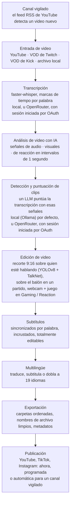

<div align="center">

[English](../../README.md) · [简体中文](README_zh.md) · [日本語](README_ja.md) · [한국어](README_ko.md) · [Türkçe](README_tr.md) · [Русский](README_ru.md) · [Tiếng Việt](README_vi.md) · [ไทย](README_th.md) · [Deutsch](README_de.md) · **Español** · [Français](README_fr.md) · [Português (Brasil)](README_pt-BR.md) · [العربية](README_ar.md) · [Bahasa Indonesia](README_id.md) · [Italiano](README_it.md) · [हिन्दी](README_hi.md) · [বাংলা](README_bn.md) · [Filipino](README_tl.md) · [اردو](README_ur.md)

</div>

<a id="clips-kitty-the-free-open-source-opus-clip-alternative-for-chatting-gaming-and-sports-on-your-own-pc"></a>

# Clips Kitty: la alternativa gratuita y de código abierto a Opus Clip para charlas, gaming y deportes, en tu propia PC

> Este README fue traducido por IA a partir del [README en inglés](../../README.md), que es la
> referencia y se actualiza primero. Las correcciones de hablantes nativos son muy bienvenidas.
>
> 🌐 [El sitio web en español](https://colingpt9.github.io/clips-studio/es.html)

<a href="https://apps.microsoft.com/detail/9NB6XT7DSQZZ">
  <picture>
    <source media="(prefers-color-scheme: dark)" srcset="https://get.microsoft.com/images/en-us%20dark.svg">
    
  </picture>
</a>

[](https://github.com/ColinGPT9/clips-studio/releases)
[](https://github.com/ColinGPT9/clips-studio/releases)
[](../../LICENSE)
[](https://github.com/ColinGPT9/clips-studio/stargazers)
[](https://github.com/ColinGPT9/clips-studio)
[](../../CONTRIBUTING.md)
[](../../docs/DOCKER.md)

<a href="https://youtu.be/g1dMqrq-YaI"></a>

<a id="star-and-share-clips-kitty--goal-150"></a>

### Dale una estrella a Clips Kitty y compártelo ⭐ Meta: 150

[](https://github.com/ColinGPT9/clips-studio/stargazers) **de 150**

**Por favor, dale una estrella al repositorio y compártelo.** No te cuesta nada, y
detrás de esto no hay presupuesto de marketing, así que el boca a boca es la única
forma de que el próximo YouTuber o streamer pequeño descubra que existe una opción gratuita.

**Lo hice para YouTubers y streamers pequeños** que no pueden pagar las otras
opciones ni a un editor. Es una alternativa gratuita a Opus Clip, Vizard y Klap que
ejecuta **Google Gemma** en tu propia PC: sin costo de servidor, sin pagar por clip y
sin cuotas por uso de IA.

> **Clips Kitty se llamaba Clips Studio hasta la versión 1.1.3**; se le cambió el nombre
> para cumplir los requisitos de nombres de Microsoft Store. La misma app, el mismo
> repositorio, los mismos datos.


**Convierte streams y videos largos en Shorts, Reels y TikToks listos para publicar,
todo en tu propia computadora.** Clips Kitty es un generador de clips con IA y editor
de video gratuito y de código abierto para creadores: pega un enlace de YouTube, Twitch
o Kick y encuentra los mejores momentos, los recorta a 9:16 con la persona que habla
siempre centrada, les incrusta subtítulos sincronizados palabra por palabra y escribe
títulos, descripciones y hashtags.

Sin IA en la nube por defecto. Sin suscripción. Sin pagar por clip. Tu material nunca
sale de tu computadora, a menos que le pidas publicar un clip en tu propio canal de YouTube.

Primero lo local, la nube cuando la necesites: si tu PC es demasiado vieja para ejecutar
la IA, un proveedor en la nube la ejecuta por ti, con cargo a tu propia cuenta.
**OpenRouter es la opción en la nube recomendada**: inicia sesión con tu cuenta de
OpenRouter (OAuth, sin claves que copiar) y tendrás muchos modelos (Claude, GPT, Gemini,
Muse Spark y más).
En mis pruebas, un video de 2 horas costó unos 11 centavos en OpenRouter, con Gemma
(Gemma 4 26B-A4B) eligiendo los clips y Whisper (large-v3-turbo) transcribiendo; lo que
pagues depende de los modelos que elijas y de la duración del video.
OpenAI, Claude, Gemini, xAI, Meta, DeepSeek y Qwen también funcionan directamente, con tu
propia clave de API.
Consulta [docs/AI-BACKENDS.md](../../docs/AI-BACKENDS.md).

**Por qué existe:** la mayoría de los creadores que hacen crecer un canal lo hacen todo
solos: grabar, transmitir, editar, publicar. Los clips son la forma en que la gente te
descubre y suelen ser lo primero que se abandona: un editor es un gasto que la mayoría
de los canales todavía no puede justificar, las herramientas de clips cobran por video o
por mes, y cortarlos a mano te quita un día que necesitabas para otra cosa. Esto funciona
en el hardware que ya tienes, así que usarlo no cuesta nada y no hay límite de cuántos
clips puedes hacer.


<sub>38 clips de un solo video en 19 minutos, en una sola PC, sin subir nada.</sub>

---

<a id="contents"></a>

## Contenido

- [Qué hace](#what-it-does)
- [Cómo se compara con Opus Clip, Klap, Vizard y CapCut](#how-it-compares-to-opus-clip-klap-vizard-and-capcut)
- [Cómo funciona](#how-it-works)
- [Funciones](#features)
- [Para qué está hecho](#what-its-built-for)
- [Requisitos](#requirements)
- [Instalar y ejecutar](#install-and-run)
- [Elige tu modelo de IA](#pick-your-ai-model)
- [Hardware probado y rendimiento](#tested-hardware-and-performance)
- [Plataformas compatibles](#supported-platforms)
- [Idiomas compatibles](#supported-languages)
- [Publicar en YouTube](#publish-to-youtube)
- [Publicar en todas las plataformas a la vez](#publish-to-every-platform-at-once)
- [Aceleración por GPU](#gpu-acceleration)
- [Uso desde la línea de comandos](#command-line-use)
- [Escribe un plugin](#write-a-plugin)
- [Construye sobre él](#build-on-it)
- [Arquitectura](#architecture)
- [Contribuir](#contributing)
- [Hoja de ruta](#roadmap-detail)
- [Licencia](#license)

---

<a id="what-it-does"></a>

## Qué hace

Le das a Clips Kitty un video largo. Te devuelve una carpeta con clips verticales
terminados que puedes publicar, además de un estudio para revisarlos y corregirlos antes.

Está hecho para el contenido que peor manejan la mayoría de las herramientas de clips:
**streams en vivo, IRL y material de cámara a cuadro, podcasts, y contenido de gimnasio y
fitness**: videos largos y poco estructurados donde los buenos momentos están enterrados
y una transcripción por sí sola no los va a encontrar.

<a id="how-it-compares-to-opus-clip-klap-vizard-and-capcut"></a>

## Cómo se compara con Opus Clip, Klap, Vizard y CapCut

Clips Kitty es una alternativa de código abierto a las herramientas de clips en la nube.
La diferencia que importa es dónde se hace el trabajo: tu video nunca se sube, así que no
hay nada que medir ni nada que cobrar.

| Herramienta | Precio, facturación mensual | Plan gratuito | Encuentra los clips por ti | Marca de agua | Sube tu video | Código abierto |
| ---- | --------------------- | --------- | ----------------------- | --------- | ------------------ | ----------- |
| **Clips Kitty** | Gratis, sin plan de pago | La app completa | Sí | Nunca | No, funciona en tu PC | Sí, AGPL-3.0 |
| Opus Clip | $15 Starter, $29 Pro | 1080p, con marca de agua, caduca en 3 días | Sí | En el plan gratuito | Sí | No |
| Klap | $29 Pro, $14 Basic con facturación anual | Un video | Sí | No se indica | Sí | No |
| Vizard | $29 Creator, $14.50 con facturación anual | 60 créditos al mes, 720p | Sí | En el plan gratuito | Sí | No |
| quso.ai | De $29 a $49 | 75 créditos al mes, 720p | Sí | No se indica | Sí | No |
| Ssemble | De $15 a $60, de $6 a $24 con facturación anual | Ninguno indicado | Sí | No se indica | Sí | No |
| Descript | $16, $24, $50 | 60 minutos al mes, 720p | En parte, es un editor de transcripciones | En Free y Hobbyist | Sí | No |
| CapCut | De uso gratuito, planes de pago en capcut.com | El editor completo | **No, cortas a mano** | Depende de la función | No en la app de escritorio | No |

**CapCut es el que vale la pena entender**, porque es la respuesta gratuita que todo el
mundo da. Es un buen editor y no cuesta nada, pero tú encuentras cada momento y recortas
cada clip. Clips Kitty también es gratis, y esa primera pasada es justo lo que hace por ti.

**Opus Clip, Klap o Vizard son la mejor opción** si no tienes una PC con Windows y tarjeta
gráfica, haces clips de vez en cuando o necesitas trabajar desde el teléfono. Clips Kitty
está hecho para hacer clips en volumen con el hardware que ya tienes.

**[Comparación completa de las siete, con aquello en lo que cada una es mejor](https://colingpt9.github.io/clips-studio/alternatives.html)**

<sub>Precios verificados en la página de precios de cada empresa el 17 de septiembre de 2026.
CapCut no publica una página de precios que pudiéramos leer, así que no se indica ningún
precio para él. Los planes cambian; esta tabla no se actualiza sola.</sub>

<a id="how-it-works"></a>

## Cómo funciona



**Cada etapa se ejecuta en tu computadora, a menos que elijas otra cosa:** OpenRouter, con
tu cuenta, para la IA o la transcripción, y la publicación, que solo sube los clips que tú
envías. Fuera de eso, lo único que toca la red en una ejecución normal es la descarga del
video original.

<a id="the-stages-in-detail"></a>

### Las etapas en detalle

**Transcripción: faster-whisper.** Marcas de tiempo por palabra, con CUDA cuando está
disponible y CPU como respaldo. La sincronización por palabra es lo que hace que los
subtítulos caigan en la sílaba correcta y que los clips empiecen en el límite real de una frase.

**Puntuación de clips con IA.** La transcripción es una señal entre cinco. El audio aporta
picos de volumen, densidad de ráfagas (así se ven las risas y los aplausos) y patrones de
silencio→explosión. Lo visual aporta cortes de escena, movimiento y cambios en el área de
los rostros. Una señal de reacción combina todo eso. Cada una se normaliza *dentro de ese
video*, así que tanto un podcast tranquilo como un stream a gritos producen picos con
sentido. Cuando existen datos reales de la audiencia (la repetición del chat de Twitch,
medida por personas únicas que escriben, o el mapa de calor de lo más repetido de YouTube),
suman una pequeña bonificación con tope.

El LLM local ve la transcripción **más una línea de tiempo de esos eventos**, así que puede
valorar bien algo como "las palabras son suaves, pero la sala explotó". Como los modelos
pequeños puntúan todo dentro de un rango estrecho, los finalistas se comparan después uno
contra otro en una sola llamada de reordenamiento: para un modelo de 7B, juzgar en términos
relativos es mucho más fácil que puntuar en términos absolutos.

**Perfiles de creador.** La app construye una base de conocimiento por creador a lo largo
de sus videos: temas recurrentes, series, colaboradores, chistes internos e historias en
curso. Ese contexto la ayuda a escribir títulos precisos y a detectar referencias a momentos
anteriores. Es conservadora a propósito: una muletilla tiene que repetirse de verdad para
contar, el conocimiento que deja de mencionarse queda inactivo, y toda contribución que haga
a la puntuación es aditiva, tiene tope y se puede desactivar.

**Editor de video.** No destructivo: recortes, cortes internos, silencios, palabras
silenciadas, volumen, fundidos, velocidad, texto de gancho, música y marca de agua se
guardan como operaciones y se aplican al renderizar. También hay un chat de edición con IA
(*"hazlo 5 segundos más largo"*, *"el subtítulo dice fantsma, debería decir fantasma"*), donde
el modelo propone y un código validado aplica los cambios.

**Procesamiento de formato largo.** Una ruta opcional en 16:9 que usa el mismo análisis:
clips horizontales, cortes con la duración de X/Twitter, un video recopilatorio con lo mejor,
o el stream completo sin los tiempos muertos.

**Flujo multilingüe y doblaje con IA.** Los subtítulos se traducen y se muestran para
revisión *antes* de escribir o incrustar nada, así que una línea mala se corrige mientras
todavía se puede. Un glosario evita que se traduzcan nombres de canales, patrocinadores y
chistes internos. El doblaje usa TTS local con voces que puedes escuchar antes de elegir.

**Aceleración local por GPU.** CUDA para la detección y la transcripción, codificación de
video por hardware mediante NVENC/AMF/QSV (detectada automáticamente, con CPU como respaldo)
y el LLM en la GPU a través de Ollama.

<a id="features"></a>

## Funciones

- **Detección multimodal de clips**: los momentos se puntúan de 0 a 100 combinando lo que
  se dice, la emoción en el audio, la actividad visual, las reacciones en pantalla y la
  fuerza del gancho y del remate. Se conservan todos los clips que superan el nivel de
  calidad, sin un tope arbitrario.
- **Seguimiento de rostros que sabe quién habla**: la detección de poses de YOLOv8 mantiene
  centrada a la persona, y en material con varias personas la cámara sigue **a quien
  realmente está hablando**, algo que decide la detección de hablante activo de TalkNet a
  partir del rostro y el audio juntos, no del movimiento. Cuando cambia quien habla, el
  encuadre **corta** a esa persona en vez de hacer un paneo, como lo haría un editor. Solo
  recorta: nunca estira ni deforma la imagen.
- **Modo podcast**: en material con varias cámaras, cada toma recibe su propio recorte fijo
  sobre una persona, así que los cortes caen en un rostro sin paneos. Dentro de una toma, la
  persona se elige por el movimiento de la boca y, si no, por el rostro más prominente.
- **Vertical Live** (vivo vertical): para un livestream que ya era vertical cuando se
  transmitió (un vivo vertical de YouTube, Twitch Dual Format, Streamlabs Dual Output, un
  vivo de Instagram o TikTok descargado). Conserva el diseño 9:16 propio del stream, omite
  el seguimiento de rostros y aun así elige los momentos de la forma habitual. Consulta
  [docs/VERTICAL-LIVE.md](../../docs/VERTICAL-LIVE.md).
- **Deportes: fútbol y básquetbol**: cada gran momento de un partido como su propio clip,
  con su jugada previa y la reacción.
  - **Fútbol**: goles, atajadas, tarjetas y ocasiones claras. Los goles se leen del
    marcador en pantalla y se ubican en el tiempo por la reacción del público, y el recorte
    9:16 sigue el balón. Elige All goals (todos los goles), Best saves (mejores atajadas),
    Cards (tarjetas) y más, y une los momentos en un resumen del partido y en reels por
    equipo o por jugador.
  - **Básquetbol**: clavadas, triples, tapones, robos y canastas ganadoras. El marcador en
    pantalla confirma cada canasta y sus puntos, y el cuarto y el reloj hacen que una canasta
    ganadora valga mucho más que una del primer cuarto. También se detectan las reacciones del
    público, de la banca y de la gente junto a la cancha. El recorte 9:16 de cada clip se
    planifica en torno a su jugada: el balón y quien lo tiene, el receptor de un pase y el
    tiro seguido hasta la canasta, con el aro y el tablero en la imagen. Se desplaza con la
    jugada y nunca hace zoom. El balón lo encuentra el modelo de detección [E-BARD](https://github.com/GabrieleGiudic/E-BARD#readme)
    (acreditado en [Licencia](#license)).

  Consulta [docs/SPORTS.md](../../docs/SPORTS.md).
- **Subtítulos incrustados editables**: sincronizados por palabra y con el estilo que
  quieras (color, tamaño, posición, palabras por línea, mayúsculas o desactivados). Corrige
  un error de transcripción línea por línea antes de exportar. Cuando hablan dos personas,
  los subtítulos de la segunda pueden ir en otro color, y uno que quede mal asignado se
  puede cambiar a mano.
- **Chat de edición con IA**: describe qué está mal con palabras sencillas y vuelve a editar.
- **Ask Clips Kitty**: el cuadro de texto en la parte inferior del panel. Di lo que quieres
  en una frase, como *"haz clips de este stream, asegúrate de incluir cuando me mató el jefe,
  con subtítulos grandes y amarillos"*, y pone el video en la cola, le dice al selector de
  clips qué buscar y ajusta las opciones que mencionaste. **Necesita un modelo Gemma 4**:
  consulta [El cuadro de texto de abajo necesita Gemma 4](#the-text-box-at-the-bottom-needs-gemma-4).
- **Títulos, descripciones y hashtags con IA**, todos editables antes de exportar.
- **Perfiles de creador**: la app aprende de cada creador con el tiempo para elegir y
  titular mejor los clips. Todo se queda en tu computadora, y puedes revisarlo, corregirlo o
  borrarlo.
- **Publicación multilingüe**: 19 idiomas, con revisión antes de incrustar nada.
- **Doblaje con IA**: texto a voz local, con voces que puedes escuchar en cada idioma.
- **Exportación de formato largo**: clips en 16:9, videos recopilatorios o una edición del
  stream sin repeticiones. La descripción de un recopilatorio incluye **marcas de tiempo de
  capítulos**, para que los espectadores salten entre momentos en YouTube.
- **Perfiles de marca de agua y de marca**: valores predeterminados por creador que se
  aplican automáticamente.
- **Gestor de modelos**: cambia el cerebro de la IA desde la propia app; descarga, elimina y
  cambia de modelo con barras de progreso y sin terminal.
- **Publica en YouTube desde el editor**: título, descripción, etiquetas, miniatura, lista
  de reproducción, público y visibilidad, y luego subes ahora o lo programas. Es opcional,
  está desactivado por defecto y usa tu propia clave de API de Google.
- **Comentarios desde la app**: reportes de errores con diagnósticos recopilados
  automáticamente, sin necesidad de cuenta.
- **Interfaz accesible**: foco del teclado, compatibilidad con movimiento reducido, fuente y
  tamaño ajustables.

<a id="what-its-built-for"></a>

## Para qué está hecho

Todo funciona con cualquier video que le des. Estos son los casos en los que piensa más o
menos de lo que sugiere la lista de funciones, para que nada te tome por sorpresa:

| Contenido | Cómo le va |
|---|---|
| **IRL, just chatting, podcasts, vlogs, entrevistas** | Para lo que está ajustado y lo que se prueba en streams reales antes de cada versión |
| **Gaming y reacciones** | Con **Gaming / Reaction** activado: la webcam en una mitad y el juego o el video al que se reacciona en la otra, comprobado sobre los propios fotogramas del video antes de procesar ([docs/GAMING.md](../../docs/GAMING.md)). El streamer es quien está hablando, nunca el rostro más grande. Sin esa opción, el encuadre puede seguir a un personaje dentro del juego. Solo personas en cámara, no VTubers |
| **Partidos deportivos** | Con **Sports** activado: hecho para transmisiones con marcador en pantalla y narración, donde los goles y las canastas son seguros. El material de clubes o de teléfono normalmente no tiene ninguna de las dos cosas: sus clips siguen el balón, y sus goles salen de los eventos del partido que pegues, como las etiquetas de gol de la app de un club ([docs/SPORTS.md](../../docs/SPORTS.md)) |
| **Aquello a lo que se reacciona** | Los clips se siguen eligiendo por lo que se *dice*, así que un momento del video que se está viendo y que nadie comenta es invisible para la app |

La selección de clips se basa en la transcripción y en las señales. Cuando lo gracioso es
*solo visual* y nadie lo comenta, cuenta con tener que encontrarlo tú en el editor.

<a id="requirements"></a>

## Requisitos

|             | Mínimo                                       | Recomendado                     |
| ----------- | -------------------------------------------- | ------------------------------- |
| **GPU**     | NVIDIA RTX 2060 (6 GB)                       | RTX 3060 12 GB o superior       |
| **CPU**     | Intel Core i3-9100 / AMD Ryzen 3 3200G (2019)| 6 núcleos o más                 |
| **RAM**     | 16 GB                                        | 16 GB o más                     |
| **Disco**   | ~20 GB, más espacio para los videos que recortes |                             |
| **SO**      | Windows 10 u 11                              |                                 |

**Por debajo del mínimo puede que siga funcionando, pero no tiene soporte y será
lento.** Hacer clips de un stream implica horas de decodificación de video,
transcripción y codificación; con hardware anterior a 2019, más o menos, tardará
tanto que la app parecerá rota aunque esté funcionando bien.

Dos de esos puntos merecen más detalle:

- **Los 16 GB de RAM no son una sugerencia.** Con 8 GB analizará un video completo y
  luego no renderizará nada, lo que parece un fallo y no un límite de memoria.
- **La GPU es opcional, no obligatoria.** Sin ella todo se ejecuta en la CPU, más
  lento, pero completo. La línea RTX 2060 es donde empieza a funcionar la ruta por GPU;
  consulta [Aceleración por GPU](#gpu-acceleration).

La app es **solo para Windows**. El motor en Python debería funcionar en Linux/macOS,
pero no existe una versión para Mac y el responsable del proyecto no tiene una Mac para
probarla. Consulta [#62](https://github.com/ColinGPT9/clips-studio/issues/62) si tienes una y quieres ayudar.

Ejecutarlo desde el código fuente requiere lo que, si no, el instalador incluye por ti:

- **Python 3.10+** y **Node.js 18+**
- **[FFmpeg](https://ffmpeg.org/download.html)** en tu PATH
- **[Ollama](https://ollama.com)** con un modelo descargado: `ollama pull gemma:7b`

<a id="install-and-run"></a>

## Instalar y ejecutar

**Lo más fácil es [Microsoft Store](https://apps.microsoft.com/detail/9NB6XT7DSQZZ).**
Un clic, se actualiza solo y Windows no muestra ninguna advertencia de seguridad.
Microsoft certificó y firmó el paquete, así que la advertencia de SmartScreen que se
describe abajo no aparece en absoluto. La Store instala las versiones nuevas cuando les
llega el turno; para tener una al instante, abre la página de Clips Kitty en Microsoft
Store y pulsa **Update** (Actualizar).

**O descarga el instalador.** Descarga el **Web Setup** más reciente desde
[Releases](https://github.com/ColinGPT9/clips-studio/releases) y ejecútalo. Incluye la app, el motor en Python, todas
las bibliotecas, FFmpeg, el entorno de ejecución de IA y todos los pesos de detección y
transcripción: sin Python, sin PATH, sin terminal y sin un segundo programa que instalar.

**O usa winget.** `winget install ColinGPT9.ClipsKitty` instala el mismo Web Setup
desde una terminal.

Lo único que no incluye es el modelo de lenguaje en sí, porque esos modelos se
distribuyen con licencias que debe aceptar la persona que los descarga, y no son algo que
se pueda aceptar en tu nombre. El asistente de instalación inicia esa descarga por sí
solo, elige el tamaño adecuado para tu tarjeta gráfica y muestra una barra de progreso.
Es decir: una descarga, un doble clic, una barra de progreso. Después funciona sin conexión.

> Windows te advertirá que la app no está firmada la primera vez que la ejecutes. Haz clic
> en *Más información → Ejecutar de todas formas*. Un certificado de firma está en la lista
> de pendientes.

<a id="from-source"></a>

### Desde el código fuente

```bash
git clone https://github.com/ColinGPT9/clips-studio
cd clips-studio
pip install -r requirements.txt

cd ui
npm install
npm run dev        # opens the Clips Kitty desktop app
```

La app inicia su propio motor en Python automáticamente. Pega un enlace en **Clip Editor**,
pulsa *Generate clips* (Generar clips) y sigue el progreso en vivo.

Compilar el instalador tú mismo es un solo comando. Consulta
[CONTRIBUTING.md](../../CONTRIBUTING.md#building-the-windows-installer).

<a id="with-docker-nothing-else-to-install"></a>

### Con Docker: nada más que instalar

Para quienes contribuyen. Necesitas [Docker Desktop](https://docs.docker.com/get-started/get-docker/)
y nada más: ni Python, ni Node, ni FFmpeg, ni PyTorch.

```bash
git clone https://github.com/ColinGPT9/clips-studio
cd clips-studio
docker compose up
```

Se levantan tres servicios juntos:

| | |
|---|---|
| **<http://localhost:5173>** | la interfaz, en tu navegador |
| **<http://localhost:8765>** | el motor y su API |
| Ollama | la IA local, en :11434 |

Luego descarga un modelo (`docker compose exec ollama ollama pull gemma3:4b`) y
tendrás una copia de trabajo funcionando.

Ejecuta las comprobaciones de la misma forma:

```bash
docker compose run --rm engine pytest
docker compose run --rm ui npm run typecheck
```

> **Sáltate la primera compilación de diez minutos:** `docker compose pull` descarga una
> imagen del motor ya compilada en vez de compilar PyTorch y OpenCV localmente.

La ventana de escritorio en sí sigue ejecutándose en tu equipo, ya que Electron necesita
una pantalla; todo lo demás va en contenedores. Los detalles, y lo que esto no puede
decirte, están en [docs/DOCKER.md](../../docs/DOCKER.md).

<a id="pick-your-ai-model"></a>

## Elige tu modelo de IA

Abre la página **Models** (Modelos) para ver qué está instalado y qué puede manejar tu GPU:

Un solo criterio: cuánta VRAM tienes. Son las mismas filas que muestra la app, tomadas de
`RECOMMENDATIONS` en [`llm/manager.py`](../../llm/manager.py). El asistente y la página
Models leen esa misma tabla, así que no pueden contradecirse entre sí ni con esto.

| Tu hardware | Modelo recomendado | |
|---|---|---|
| CPU / iGPU, sin tarjeta gráfica | `gemma3:4b` | probado |
| Menos de 6 GB de VRAM, o una PC más vieja | `gemma4:e2b` | |
| 6 GB de VRAM | `gemma4:e4b` | |
| 8 GB de VRAM | **`gemma:7b`** | probado · predeterminado de fábrica |
| 10–12 GB de VRAM | `gemma3:12b` | probado |
| 16–24 GB de VRAM | `gemma3:27b` | |

Y los modelos que vale la pena elegir por algo distinto a la VRAM:

| Por qué | Modelo |
|---|---|
| Traducción / multilingüe | `qwen3:8b` o `qwen3:14b` |
| Licencia permisiva | `mistral-nemo:12b` (Apache-2.0) · `phi4:14b` (MIT) |

**Solo los tres marcados como "probado" se han ejecutado con streams reales**, y `gemma:7b`
es el que más horas tiene encima; es con el que viene `config/settings.yaml`.
Todo lo demás aparece porque tiene un tamaño razonable y es de uso comercial gratuito,
no porque se haya medido la calidad de los clips con él. Todos funcionan, ya que la app
habla con cada modelo de la misma manera a través de Ollama, pero nadie ha comprobado si
eligen mejores momentos. Cerrar esa brecha es el objetivo de [#38](https://github.com/ColinGPT9/clips-studio/issues/38).

Cualquier modelo que sirva Ollama funciona, y cambiar es un clic. La traducción puede usar
un modelo *distinto* al de los clips. Configura `llm.translation_model`.

<a id="the-text-box-at-the-bottom-needs-gemma-4"></a>

### El cuadro de texto de abajo necesita Gemma 4

**Ask Clips Kitty**, el cuadro de texto en la parte inferior del panel, solo funciona con
un modelo que pueda usar las herramientas de la app. Gemma 4 puede. `gemma:7b` y los modelos
Gemma 3 no pueden, y la instalación pone uno de esos en una PC sin tarjeta gráfica o con 8 GB
o más de VRAM. Ahí el cuadro no funcionará hasta que agregues un modelo Gemma 4: la versión
2.0 dice *"No installed model can use tools"* (ningún modelo instalado puede usar
herramientas), y las versiones posteriores ofrecen la descarga en el propio cuadro.

Sea cual sea el modelo que elige tus clips, instala un modelo Gemma 4 junto a él en la
página **Models**: `gemma4:e4b` en una tarjeta gráfica con 6 GB o más, `gemma4:e2b` con
menos. No tienes que cambiarte a él. El cuadro lo encuentra solo, y tus clips los sigue
eligiendo el modelo que escogiste. Si en cambio ejecutas la IA a través de OpenRouter, el
cuadro usa ese modelo y no necesita nada instalado.

<a id="tested-hardware-and-performance"></a>

## Hardware probado y rendimiento

Clips Kitty se desarrolla y se prueba a diario en esta máquina, así que es un punto de
referencia útil si quieres comparar tus propios resultados:

| | |
|---|---|
| **GPU** | NVIDIA GeForce RTX 3060, 12 GB de VRAM |
| **CPU** | AMD Ryzen 5 5600X (6 núcleos / 12 hilos) |
| **RAM** | 16 GB |
| **SO** | Windows 10 |
| **Modelo para clips** | `gemma:7b` vía Ollama |
| **Transcripción** | faster-whisper `large-v3-turbo` en CUDA |

Todo en este repositorio (la configuración predeterminada, `parallel_renders: 3`, el
tamaño de bloque de análisis de 5 minutos) está ajustado más o menos para este tipo de
máquina. Con una GPU más grande, sube `llm.num_ctx` y `analysis.chunk_seconds` a la vez y
pasa a un modelo de un tamaño mayor; con una más pequeña, baja a `gemma3:4b`.

Si haces pruebas de rendimiento de Clips Kitty en otro hardware, publícalas en
[Discussions](https://github.com/ColinGPT9/clips-studio/discussions). Los números reales de máquinas reales ayudan a todos
a dimensionar su equipo.

<a id="supported-platforms"></a>

## Plataformas compatibles

| Origen | Compatibilidad |
|---|---|
| Videos de YouTube | Completa. Se elige H.264 a propósito (AV1 casi duplica el tiempo de procesamiento) |
| VODs de Twitch | Completa, incluida la repetición del chat como señal de la audiencia |
| VODs de Kick | Completa (Kick descarta el chat cuando termina el stream, así que no hay señal del chat) |
| Archivos de video locales | Completa. Haz clips de tu propio material antes de publicarlo |
| Streams en vivo | Sin soporte, por diseño. Solo VODs |

<a id="supported-languages"></a>

## Idiomas compatibles

Los clips se pueden traducir, subtitular y doblar a **19 idiomas**, y la **propia
interfaz también está traducida a los 19**, así que la app se puede usar en los mismos
idiomas en los que publica:

Inglés · Español · Portugués (Brasil) · Francés · Alemán · Hindi · Indonesio ·
Japonés · Ruso · Árabe · Chino (simplificado) · Vietnamita · Filipino · Turco ·
Urdu · Bengalí · Tailandés · Coreano · Italiano

Agregar un idioma es una fila en `multilingual/languages.py` más un archivo de idioma en
`ui/src/renderer/src/locales/`. El traductor y el generador de subtítulos son
independientes del idioma.

<a id="help-wanted-the-maintainer-only-speaks-english"></a>

### Se busca ayuda: el responsable del proyecto solo habla inglés

18 de esas 19 traducciones de la interfaz nunca las ha leído alguien que hable el
idioma. La mitad no están terminadas. Cada idioma tiene su propio issue, escrito en
inglés y en ese idioma, y **reportar una palabra mal traducida ya es una contribución
completa**: no hace falta un pull request. [Cómo funciona](../../docs/TRANSLATING.md).

**Falta terminar** (unas 68 cadenas siguen en inglés):
[বাংলা (bengalí)](https://github.com/ColinGPT9/clips-studio/issues/43) ·
[Italiano](https://github.com/ColinGPT9/clips-studio/issues/44) ·
[한국어 (coreano)](https://github.com/ColinGPT9/clips-studio/issues/45) ·
[ไทย (tailandés)](https://github.com/ColinGPT9/clips-studio/issues/46) ·
[Tagalog (filipino)](https://github.com/ColinGPT9/clips-studio/issues/47) ·
[Türkçe (turco)](https://github.com/ColinGPT9/clips-studio/issues/48) ·
[اردو (urdu)](https://github.com/ColinGPT9/clips-studio/issues/49) ·
[Tiếng Việt (vietnamita)](https://github.com/ColinGPT9/clips-studio/issues/50) ·
[中文 (chino)](https://github.com/ColinGPT9/clips-studio/issues/51)

**Falta revisar** (completas, pero nadie ha comprobado que suenen naturales):
[العربية (árabe)](https://github.com/ColinGPT9/clips-studio/issues/52) ·
[Deutsch (alemán)](https://github.com/ColinGPT9/clips-studio/issues/53) ·
[Español](https://github.com/ColinGPT9/clips-studio/issues/54) ·
[Français (francés)](https://github.com/ColinGPT9/clips-studio/issues/55) ·
[हिन्दी (hindi)](https://github.com/ColinGPT9/clips-studio/issues/56) ·
[Bahasa Indonesia (indonesio)](https://github.com/ColinGPT9/clips-studio/issues/57) ·
[日本語 (japonés)](https://github.com/ColinGPT9/clips-studio/issues/58) ·
[Português (portugués)](https://github.com/ColinGPT9/clips-studio/issues/59) ·
[Русский (ruso)](https://github.com/ColinGPT9/clips-studio/issues/60)

¿Quieres un idioma que no está aquí? [#61](https://github.com/ColinGPT9/clips-studio/issues/61).

<a id="publish-to-youtube"></a>

## Publicar en YouTube

Desactivado por defecto. Actívalo en **Settings → Publish to YouTube** (Configuración →
Publicar en YouTube) y aparecerá una pestaña **YouTube** en el editor: completa el título,
la descripción, las etiquetas, la miniatura, la lista de reproducción, el público y la
visibilidad, y luego pulsa **Upload now** (Subir ahora). Clips Kitty renderiza el clip si
tienes ediciones sin guardar y lo sube directamente a tu canal. No hay paso de
exportación ni una página de publicación aparte. Nunca sales del editor.

Si lo dejas desactivado, no cambia nada en ninguna parte de la app.

<a id="scheduling"></a>

### Programación

Elegir **Schedule on YouTube** (Programar en YouTube) sube el video *de inmediato*, lo
marca como privado y le pasa a YouTube una hora de publicación. YouTube lo publica ese día.

**Puedes cerrar Clips Kitty y apagar tu computadora.** Esta app no tiene ningún
temporizador, ningún servicio en segundo plano ni nada que dejar en ejecución. Una vez que
YouTube aceptó el video, el trabajo de Clips Kitty terminó.

<a id="you-need-your-own-google-api-key"></a>

### Necesitas tu propia clave de API de Google

Clips Kitty no incluye una clave compartida, y no es solo por precaución. La cuota de
subida de Google es **por proyecto de Cloud**: una clave compartida significaría que todos
los usuarios del mundo tiran de las mismas 100 subidas al día. Tu propio proyecto te da tu
propio cupo, y tus credenciales nunca salen de tu máquina. No hay ningún servidor de Clips
Kitty en el camino.

La configuración es gratuita y toma unos diez minutos; el asistente en Settings te guía
paso a paso:

1. Crea un proyecto en [Google Cloud Console](https://console.cloud.google.com/projectcreate).
2. Habilita **YouTube Data API v3** en APIs & Services → Library.
3. Completa la pantalla de consentimiento de OAuth y luego pulsa **Publish app**. Este paso
   importa: si lo dejas en *Testing*, Google hace caducar tu inicio de sesión cada 7 días y
   tendrías que volver a conectarte cada semana. "In production" no significa verificado y
   no cuesta nada.
4. Credentials → Create credentials → OAuth client ID → tipo **Desktop app**.
5. Pega el ID de cliente y el secreto en Settings y luego conecta tu canal.

Al conectarte verás una advertencia de "Google no verificó esta app". Es tu propia app
advirtiéndote sobre ti mismo. **Advanced → Go to (unsafe)** (Avanzado → Ir a (no seguro))
te permite continuar.

<a id="posting-publicly"></a>

### Publicar en público

Hay algo que debes saber antes de depender de esto, porque ningún software puede evitarlo:

> **Hasta que tu proyecto de Google Cloud pase la auditoría gratuita de la API de YouTube,
> YouTube bloquea como privado cada video subido a través de él.** El bloqueo es permanente.
> No puedes hacer público el video después desde Studio, y no hay apelación. La única
> solución es volver a subirlo desde un proyecto auditado.

Clips Kitty lo comprueba después de cada subida y te dice claramente si pasó, en vez de
reportar éxito con un video que nadie puede ver. Si piensas publicar en público, envía
primero el
[formulario de auditoría de YouTube API Services](https://support.google.com/youtube/contact/yt_api_form).
Subir como **unlisted** (no listado) o **private** (privado) no se ve afectado.

<a id="what-it-can-and-cannot-set"></a>

### Qué puede y qué no puede configurar

Todo lo que expone la API pública: título, descripción (las marcas de tiempo que tenga se
convierten en capítulos), etiquetas, categoría, idioma, visibilidad, hora de publicación
programada, contenido para niños, aviso de contenido alterado o sintético, licencia,
inserción, estadísticas públicas, miniatura personalizada y agregar a una lista de
reproducción.

Algunas funciones de YouTube Studio no están en absoluto en la API pública, así que a
propósito no hay ningún control para ellas, en vez de uno que en silencio no haga nada:
monetización y pausas publicitarias, aviso de promoción pagada, pantallas finales y
tarjetas, configuración de comentarios, restricción de edad, Estrenos y permisos de remix
de Shorts. El panel te enlaza a Studio para esas.

Los Shorts no necesitan nada especial: ni un modo aparte ni la etiqueta `#Shorts`. YouTube
clasifica un video como Short por sí solo, según su forma y su duración.

<a id="publish-to-every-platform-at-once"></a>

## Publicar en todas las plataformas a la vez

También desactivado por defecto. Actívalo en **Settings → Publish through WoopSocial**
(Configuración → Publicar a través de WoopSocial) y aparecerá una pestaña **Publish**
(Publicar) en el editor: elige tus plataformas —o pulsa **Everywhere** (En todas)—, escribe
el título y la descripción una sola vez, y una sola subida llega a YouTube, TikTok,
Instagram, Facebook, X, Threads, LinkedIn, Pinterest y Bluesky a la vez. **Publish all**
(Publicar todo) en el Clip Editor publica un lote completo, espaciado para que una docena
de clips no caigan en el mismo segundo.

Esta función **no es local**. El clip y sus datos se envían a un servicio de publicación,
que los entrega y mantiene las conexiones con tus cuentas sociales, así que Clips Kitty
nunca te pide la contraseña de una red social. Todo lo demás de la app sigue funcionando
en tu PC.

Hay dos servicios compatibles: **[WoopSocial](https://woopsocial.com/?via=clipskitty)**,
cuyo plan gratuito conecta dos cuentas y permite unas 5 publicaciones en YouTube al día,
con planes de pago que amplían ambas cosas, y
**[Upload-Post](https://www.upload-post.com/)**, que llega a más destinos y agrega
miniaturas, primeros comentarios y una cola de publicaciones. Activa cualquiera de los
dos, o ambos.

<sub>Enlace de afiliado: Clips Kitty puede ganar una comisión si te registras a través de
él, sin costo adicional para ti.</sub>

**Usa tu propia clave.** Tú creas la cuenta, conectas tus propias redes y usas tu propio
cupo. Clips Kitty no cobra nada, no guarda ninguna clave compartida y no paga por nada: el
mismo arreglo que la integración con YouTube, y por la misma razón.

Guía completa, compatibilidad por plataforma y límites:
**[docs/UPLOAD-POST.md](../../docs/UPLOAD-POST.md)**.

<a id="gpu-acceleration"></a>

## Aceleración por GPU

La **codificación de video** se acelera por hardware automáticamente con los tres
fabricantes: NVIDIA (NVENC), AMD (AMF) e Intel (QSV). Al iniciar, el motor codifica un
fotograma de prueba con cada uno y usa el primero que realmente funcione, con la CPU como
respaldo. Fuerza una opción con `video.encoder` en `config/settings.yaml`.

La **detección y la transcripción** son más rápidas con CUDA. De entrada, `pip install
torch` te da la versión **solo para CPU**. Para NVIDIA:

```bash
pip uninstall torch torchvision -y
pip install torch torchvision --index-url https://download.pytorch.org/whl/cu130
```

**Qué tarjetas usan la GPU:** las series GTX 16 y RTX 20, y todo lo más nuevo,
incluida la serie RTX 50.

La **transcripción en la GPU** también necesita cuBLAS 12 de NVIDIA: el motor de Whisper
(CTranslate2) está compilado para CUDA 12, y el PyTorch con CUDA 13 de arriba solo trae
cuBLAS 13. `pip install -r requirements.txt` lo instala (`nvidia-cublas-cu12`), y la app
instalada ya lo incluye, así que no necesitas el kit de herramientas de CUDA. Sin él, la
transcripción se ejecuta en la CPU y el registro dice por qué.

**La serie GTX 10 y anteriores están por debajo del mínimo.** No son una configuración
con soporte. La app no se niega a iniciar con ellas: la detección pasa a la CPU y todo
sigue funcionando, pero será lento, y una máquina tan vieja suele venir con una CPU que
vuelve lento todo el trabajo, no solo la etapa de detección.

Usa el índice `cu130` de arriba, no uno más antiguo. Las versiones de CUDA más antiguas no
tienen código para las tarjetas recientes, y entonces la app pasa a la CPU en hardware que
debería ser rápido.

Si tienes una GPU de AMD: el seguimiento y la transcripción se ejecutan en la CPU en
Windows, con todas las funciones, solo que más lento. Tu GPU se sigue usando para la
codificación de video mediante AMF y para el LLM a través de Ollama, que es compatible con
AMD por su cuenta.

La **decodificación de video** pasa por FFmpeg con aceleración por hardware en vez de
OpenCV, tanto para la pasada de seguimiento como para el renderizado. Leer fotogramas de
muestra de esta forma cuesta más o menos una décima parte de la CPU que costaba
decodificarlos en Python, y eso importa porque la pasada de seguimiento recorre cada clip.

**Reparto de la CPU.** La detección y el renderizado quieren todos los núcleos, y si se
les deja solos se pelean entre sí y con la interfaz. Al iniciar, el motor reparte los
núcleos entre los procesos de renderizado y reserva dos a propósito, para que la app siga
respondiendo mientras corre un lote. Ajústalo con `video.parallel_renders`.

<a id="command-line-use"></a>

## Uso desde la línea de comandos

Todo funciona sin la app de escritorio:

```bash
python main.py process "https://www.youtube.com/watch?v=VIDEO_ID"   # one video
python main.py models                                               # list/switch models
python main.py status                                               # processing state
python main.py serve                                                # just the API engine
```

La configuración está en [config/settings.yaml](../../config/settings.yaml). Al principio del
archivo hay un bloque corto de configuración rápida, y todo lo avanzado va debajo. Cada
prompt del LLM es un archivo de texto plano en [config/prompts/](../../config/prompts/), así que
puedes ajustar cómo se puntúan los clips sin tocar Python.

<a id="write-a-plugin"></a>

## Escribe un plugin

¿Conoces un juego, un deporte o un tipo de programa mejor que un detector de uso general?
Escribe un pequeño plugin en Python que encuentre, entienda o califique los momentos de un
video, y Clips Kitty se encarga del resto. El SDK es MIT, así que tu plugin puede usar
cualquier licencia, y no hace falta hacer un fork de nada.

```text
Clips Kitty SDK

Input                      a link or a video file
  ↓
Video                      Clips Kitty downloads it and writes down what is said
  ↓
Your plugin                every step is optional
  ├── find                 picks the moments                  built
  ├── understand           says what happens in each one      built
  ├── rate                 scores each moment                 built
  └── edit                 suggests edits for the creator     built
  ↓
Clips Kitty                does every step no plugin does, then cuts, frames and captions the clips
  ↓
Creator / Social Platform  posts when the creator clicks Publish, or on a schedule or automatic posting the creator switched on
```

- Un plugin puede encontrar los momentos de un video; reemplaza la búsqueda propia de Clips Kitty.
- Hasta 3 plugins pueden entender y hasta 3 pueden calificar, después de cualquier buscador.
- El rol de un plugin sale de `inputs` y `outputs` en su manifiesto ([Pasos](../../docs/developers/steps.md)).
- Hasta 3 plugins pueden sugerir ediciones para los clips que se van a crear.
- Los plugins de edición sugieren ediciones que esperan al creador en el editor ([Pasos](../../docs/developers/steps.md#suggest-edits-the-edit-step)).
- Publicar no es un paso de plugin: Clips Kitty publica los clips por sí mismo, y a través de WoopSocial puede publicar en muchos sitios a la vez con la propia cuenta del creador ([Publicar en todas las plataformas a la vez](#publish-to-every-platform-at-once)). `kind: publisher` se rechaza: los plugins no publican.

Tres comandos instalan el SDK, crean un plugin a partir de la plantilla `game-events` (para
Quarkbloom Arena, un juego inventado) y lo ejecutan sobre un video de prueba que genera el
SDK. Necesitan Python 3.11, FFmpeg y Git.

PowerShell (Windows):

```powershell
py -m pip install "clipskitty-sdk[yaml,test] @ git+https://github.com/ColinGPT9/clips-studio#subdirectory=sdk/python"
py -m clipskitty_sdk new quarkbloom-bursts --template game-events --publisher your-github-name
py -m clipskitty_sdk run quarkbloom-bursts --sample
```

bash (macOS, Linux):

```bash
python -m pip install "clipskitty-sdk[yaml,test] @ git+https://github.com/ColinGPT9/clips-studio#subdirectory=sdk/python"
python -m clipskitty_sdk new quarkbloom-bursts --template game-events --publisher your-github-name
python -m clipskitty_sdk run quarkbloom-bursts --sample
```

Clips Kitty 2.1.0 es la primera versión publicada que ejecuta plugins, y viene con el SDK 1.3.0.

**[Tu primer pipeline de juego](../../docs/developers/first-game-pipeline.md)** sigue a partir
de ahí, paso a paso, hasta un plugin instalado en Clips Kitty y publicado en su Marketplace.
El [recetario de señales](../../docs/developers/signals-cookbook.md) tiene recetas para leer el
video de un juego, la [referencia del SDK](../../docs/developers/sdk.md) tiene cada comando y
cada llamada, y la [documentación para desarrolladores](../../docs/developers/README.md) tiene
todo lo demás. La página [Clips Kitty SDK](https://colingpt9.github.io/clips-studio/developers.html)
del sitio web es la versión corta.

<a id="build-on-it"></a>

## Construye sobre él

La app de escritorio es una ventana a una **API HTTP local**, que está en ejecución siempre
que Clips Kitty está abierto. Un bot de Discord, un ejecutor por lotes, una interfaz web o
una integración con OBS pueden manejar el mismo pipeline, y no hace falta agregarle nada a
la app antes.

```bash
python main.py serve --port 8765          # the engine on its own, no window

curl -X POST http://127.0.0.1:8765/jobs \
  -H "Content-Type: application/json" \
  -d '{"url": "https://www.youtube.com/watch?v=VIDEO_ID"}'
# {"job_id": 149}
```

Los clips vuelven como JSON, con el desglose de la puntuación que los produjo y un MP4
que puedes transmitir:

```bash
curl -s http://127.0.0.1:8765/videos/VIDEO_ID/clips \
  | python -c "import json,sys; [print(c['score'], c['title']) for c in json.load(sys.stdin)]"
```

**[docs/API.md](../../docs/API.md)** documenta los endpoints sobre los que vale la pena
construir, con ejemplos que funcionan y las trampas que le han costado una tarde a más de
uno. El servicio también ofrece su propia documentación interactiva en
`http://127.0.0.1:8765/docs`.

**No tiene autenticación**, y por eso solo escucha en localhost. Lee la nota de seguridad
en la documentación de la API antes de apuntar cualquier cosa hacia ella.

<a id="or-bring-your-own-model"></a>

### O trae tu propio modelo

Eso es construir *alrededor* de la app. También puedes construir *dentro* de ella, y el
lugar para empezar es un plugin ([Escribe un plugin](#write-a-plugin)). Si el material que
te interesa no es aquello para lo que se ajustó esto, ya sean deportes, gaming,
reacciones, clases o algo que nadie ha probado, un plugin puede encontrar, entender o
calificar sus momentos sin hacer un fork. Se ejecuta en el Python propio de Clips Kitty, con
la biblioteca estándar (menos algunos módulos que la app deja fuera) y el SDK: Clips Kitty
todavía no puede instalar otros paquetes de Python para un plugin.

Si lo que quieres es cambiar la app en sí: el pipeline ejecuta **YOLOv8 (ultralytics),
OpenCV y TalkNet-ASD** localmente, y lo que decide qué momentos se convierten en clips es un
conjunto de señales por segundo, no una idea predefinida de lo que es interesante. Un
detector que emita una confianza a lo largo de la línea de tiempo se puede agregar como una
señal más, y sus picos se convierten en clips candidatos. Si tu detección necesita paquetes
de Python que Clips Kitty todavía no puede instalar para un plugin, haz un fork y conecta tu
propia detección.
**[docs/EXTENDING.md](../../docs/EXTENDING.md#bring-your-own-model)** tiene el contrato, el
archivo que copiar y la trampa de rendimiento que conviene conocer antes de empezar.

**Nada tiene que consultar una y otra vez.** Envía un trabajo con un `webhook_url` y el
motor hace un POST una sola vez cuando termina, firmado con tu propio secreto si le pasas
uno, así que un panel acoplado o un flujo de n8n puede quedarse quieto los cuarenta minutos
que tarda un stream en vez de preguntar cada pocos segundos. Detalles en
[docs/API.md](../../docs/API.md#webhooks-being-told-instead-of-asking).

<a id="ask-an-ai-agent-to-do-it"></a>

### Pídeselo a un agente de IA

Clips Kitty incluye un **servidor MCP**, así que Claude, Cursor o cualquier cliente MCP
puede manejar el mismo pipeline con lenguaje natural: poner un stream en la cola, seguir el
trabajo, leer los clips que eligió, exportar uno.

```bash
claude mcp add clips-kitty -- python main.py mcp
```

En una versión instalada, el binario del motor es `api.exe` (en la carpeta
`resources\backend` de la app), así que ahí el comando es `api.exe mcp`.

Se comunica con el motor en ejecución a través de `127.0.0.1:8765`, así que Clips Kitty
tiene que estar abierto, y no necesita ninguna clave de API: el modelo que hace los clips es
el de tu propia máquina (o, si elegiste uno en Settings → AI, un modelo en la nube con tu
propia clave, que el cliente MCP nunca ve). En [skills/clips-kitty/](../../skills/clips-kitty/)
hay una skill de agente para los clientes que las admiten.

<a id="built-with-clips-kitty"></a>

### Hecho con Clips Kitty

Los proyectos que funcionan sobre esta API aparecen en **[Awesome Clips Kitty](https://github.com/ColinGPT9/awesome-clips-kitty)**,
la lista de pipelines, plugins, integraciones, apps y herramientas hechos con Clips Kitty. El
primero es el [Clips Kitty OBS Plugin](https://github.com/ColinGPT9/clips-kitty-obs-plugin),
un panel acoplable de OBS Studio que le pasa tu stream a Clips Kitty cuando termina. ¿Hiciste
uno? Agrégalo con un pull request ([cómo](https://github.com/ColinGPT9/awesome-clips-kitty/blob/main/CONTRIBUTING.md)), y ponle a
tu repositorio el topic `clips-kitty`.

<a id="architecture"></a>

## Arquitectura

Consulta **[ARCHITECTURE.md](../../ARCHITECTURE.md)** para ver el diseño completo: el pipeline,
el motor de puntuación, el seguimiento, la inteligencia de creadores, la superficie de la API
y las reglas de diseño que lo mantienen modular.

<a id="contributing"></a>

## Contribuir

Las contribuciones son bienvenidas. Consulta **[CONTRIBUTING.md](../../CONTRIBUTING.md)** para
preparar el entorno de desarrollo y saber qué se espera de un pull request, y
**[SECURITY.md](../../SECURITY.md)** para reportar una vulnerabilidad. Los issues con la
etiqueta [`good-first-issue`](https://github.com/ColinGPT9/clips-studio/labels/good-first-issue) son
pequeños y bien acotados, si buscas por dónde empezar.

El sitio web está en [site/](../../site/) y se publica en GitHub Pages y en un Space de Hugging
Face. Consulta [docs/MIRRORS.md](../../docs/MIRRORS.md). **GitHub es donde se hace el
trabajo**, y el espejo del sitio web recibe un force-push en un solo sentido, así que un commit
hecho ahí se sobrescribirá.

Documentación de empaquetado y publicación de versiones:

- **[docs/RELEASING.md](../../docs/RELEASING.md)**: compilar y publicar el instalador de
  Windows, que es el canal principal
- **[docs/MSSTORE.md](../../docs/MSSTORE.md)**: el paquete de Microsoft Store, desde
  crear una cuenta de desarrollador hasta la certificación
- **[packaging/winget/](../../packaging/winget/)**: los manifiestos de winget, que apuntan al
  instalador de arriba
- **[whop-app/](../../whop-app/)**: la app de Whop, que presenta Clips Kitty a los miembros
  de comunidades de clips. Solo páginas de marketing: no procesa video, no guarda nada ni
  se comunica con la app de escritorio
- **[docs/DOCKER.md](../../docs/DOCKER.md)**: ejecutar el motor sin instalar tú mismo
  Python, FFmpeg y PyTorch
- **[PRIVACY](https://colingpt9.github.io/clips-studio/privacy.html)**: qué guarda la app y
  qué puede salir de tu máquina (respuesta corta: nada, a menos que envíes un reporte de
  errores)

<a id="changelog-known-issues-roadmap"></a>

## Registro de cambios, problemas conocidos, hoja de ruta

- **[CHANGELOG.md](../../CHANGELOG.md)**: qué cambió en cada versión, en palabras sencillas.
- **[KNOWN-ISSUES.md](../../KNOWN-ISSUES.md)**: qué está roto o falta ahora mismo, y
  cómo sortearlo. Todo lo que aparece ahí se ha observado de verdad.
- **[ROADMAP.md](../../ROADMAP.md)**: qué ya está publicado, qué viene después y la
  dirección a largo plazo.

**Sigue las novedades:**
[-%40ClipsKitty2-000000?logo=x&logoColor=white)](https://x.com/ClipsKitty2)
[](https://www.instagram.com/clipskitty2/)
[](https://www.youtube.com/@ClipsKitty2)

<a id="roadmap-detail"></a>

## Hoja de ruta en detalle

La versión corta está en [ROADMAP.md](../../ROADMAP.md). El razonamiento detrás de las
decisiones más difíciles está abajo, porque "por qué todavía no" suele ser más útil que
"todavía no".

1. **App complementaria para Android, solo Vertical Live**, para que siga siendo ligera: un
   vivo vertical ya está encuadrado para la pantalla de un teléfono, así que la app conserva
   el diseño propio del stream y solo tiene que encontrar los momentos, sin seguimiento de
   rostros ni reencuadre. Solo Twitch, Kick y archivos de video locales, para cumplir la
   política de Play Store.
2. **Más deportes**: el fútbol y el básquetbol ya están disponibles. Sigue el críquet (el
   menú Sport ya lo muestra como próximamente), como su propio módulo, igual que los demás (consulta
   [docs/SPORTS.md](../../docs/SPORTS.md#adding-a-sport)).
3. **Avisos por mensaje de texto cuando algo termina**: un mensaje cuando los clips de un
   video están listos, cuando se publican y cuando algo falla, para que un canal automático
   pueda funcionar sin que nadie esté mirando la app.
4. **Clonación de voz para el doblaje** *(última en esta lista a propósito)*: hoy el doblaje
   usa una voz local predefinida. Decir las traducciones con la voz **propia** del creador
   requiere un modelo de clonación, y todos los modelos locales creíbles traen su propia
   versión de PyTorch: en una máquina preparada para hacer clips, eso degrada torch a una
   versión solo para CPU y elimina en silencio la aceleración por GPU del seguimiento y la
   transcripción. Romper los clips para agregar doblaje es un mal negocio.

   Siendo realistas, esto espera a que el hardware de consumo se ponga al día, o llega como
   una instalación opcional aparte con su propio entorno de Python, para que el de los clips
   nunca se toque. También hay que revisar las licencias de los modelos: varios de los que
   mejor suenan son no comerciales, y los usuarios de esta app monetizan sus videos.

<a id="license"></a>

## Licencia

**GNU AGPL-3.0-or-later**. Consulta [LICENSE](../../LICENSE), y [NOTICE](../../NOTICE) para saber
qué significa eso en la práctica y qué incluye el instalador.

La detección del balón, el aro y los jugadores en el básquetbol es el
modelo de detección [E-BARD](https://github.com/GabrieleGiudic/E-BARD) (YOLOv8n), usado sin
modificaciones bajo CC BY 4.0. Gracias por
publicarlo de forma abierta. Todos los demás componentes incluidos y sus licencias están en
[NOTICE](../../NOTICE).

Tres partes tienen una licencia aparte, para que construir sobre Clips Kitty siga siendo fácil:

| Parte | Licencia |
|---|---|
| Clips Kitty (la app, su motor, este repositorio) | AGPL-3.0-or-later |
| El SDK de plugins, [`sdk/python/`](../../sdk/python/) | MIT ([sdk/python/LICENSE](../../sdk/python/LICENSE)) |
| Los plugins de ejemplo, [`examples/pipelines/scene-cut-highlights/`](../../examples/pipelines/scene-cut-highlights/) y [`examples/pipelines/keyword-rater/`](../../examples/pipelines/keyword-rater/) | MIT |
| La copia de la lista Awesome Clips Kitty que viene con la app, `plugins/catalog_index.json` (la lista es [su propio repositorio](https://github.com/ColinGPT9/awesome-clips-kitty)) | CC0-1.0 |

Los plugins, pipelines y apps hechos por otras personas conservan la licencia que hayan
elegido sus autores; el Marketplace la muestra en cada ficha. Usar el SDK no pone un plugin
bajo la AGPL.

**Si usas la app, esto no cambia nada para ti.** Instálala, haz clips de tus streams,
publica los clips y gana dinero con ellos. La AGPL obliga a quienes *distribuyen* el
software o ejecutan una copia *modificada* como servicio en red, no a quienes lo usan. Tu
material y tus clips son tuyos.

**Si lo modificas y lo compartes,** tus cambios salen bajo la misma licencia. De eso se
trata: las mejoras a una herramienta hecha para creadores siguen al alcance de esos creadores.

Y aun así está hecho para modificarse: cambia modelos, ajusta prompts, agrega plataformas.

<a id="star-history"></a>

## Historial de estrellas

Gracias a todos los que le dan una estrella a Clips Kitty, lo comparten, reportan errores y lo traducen.

<a href="https://www.star-history.com/#ColinGPT9/clips-studio&amp;Date">
  <picture>
    <source media="(prefers-color-scheme: dark)" srcset="https://api.star-history.com/chart?repos=ColinGPT9/clips-studio&amp;type=date&amp;theme=dark&amp;legend=top-left" />
    <source media="(prefers-color-scheme: light)" srcset="https://api.star-history.com/chart?repos=ColinGPT9/clips-studio&amp;type=date&amp;legend=top-left" />
    
  </picture>
</a>
