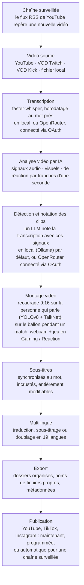

<div align="center">

[English](../../README.md) · [简体中文](README_zh.md) · [日本語](README_ja.md) · [한국어](README_ko.md) · [Türkçe](README_tr.md) · [Русский](README_ru.md) · [Tiếng Việt](README_vi.md) · [ไทย](README_th.md) · [Deutsch](README_de.md) · [Español](README_es.md) · **Français** · [Português (Brasil)](README_pt-BR.md) · [العربية](README_ar.md) · [Bahasa Indonesia](README_id.md) · [Italiano](README_it.md) · [हिन्दी](README_hi.md) · [বাংলা](README_bn.md) · [Filipino](README_tl.md) · [اردو](README_ur.md)

</div>

<a id="clips-kitty-the-free-open-source-opus-clip-alternative-for-chatting-gaming-and-sports-on-your-own-pc"></a>

# Clips Kitty : l'alternative gratuite et open source à Opus Clip pour la discussion, le gaming et le sport, sur votre propre PC

> Ce README a été traduit par IA à partir du [README en anglais](../../README.md), qui fait
> référence et est mis à jour en premier. Les corrections de locuteurs natifs sont les bienvenues.
>
> 🌐 [Le site web en français](https://colingpt9.github.io/clips-studio/fr.html)

<a href="https://apps.microsoft.com/detail/9NB6XT7DSQZZ">
  <picture>
    <source media="(prefers-color-scheme: dark)" srcset="https://get.microsoft.com/images/en-us%20dark.svg">
    
  </picture>
</a>

[](https://github.com/ColinGPT9/clips-studio/releases)
[](https://github.com/ColinGPT9/clips-studio/releases)
[](../../LICENSE)
[](https://github.com/ColinGPT9/clips-studio/stargazers)
[](https://github.com/ColinGPT9/clips-studio)
[](../../CONTRIBUTING.md)
[](../../docs/DOCKER.md)

<a href="https://youtu.be/g1dMqrq-YaI"></a>

<a id="star-and-share-clips-kitty--goal-150"></a>

### Mettez une étoile à Clips Kitty et partagez-le ⭐ Objectif : 150

[](https://github.com/ColinGPT9/clips-studio/stargazers) **sur 150**

**Merci de mettre une étoile au dépôt et de le partager.** Cela ne vous coûte rien, et il
n'y a aucun budget marketing derrière ce projet : le bouche-à-oreille est donc le seul
moyen pour le prochain petit YouTubeur ou streamer de découvrir qu'une option gratuite existe.

**Je l'ai créé pour les petits YouTubeurs et streamers** qui n'ont pas les moyens des
autres solutions ni d'un monteur. C'est une alternative gratuite à Opus Clip, Vizard et
Klap qui fait tourner **Google Gemma** sur votre propre PC : pas de coût de serveur, pas de
frais par clip, pas de frais d'utilisation de l'IA.

> **Clips Kitty s'appelait Clips Studio jusqu'à la version 1.1.3** ; il a été renommé pour
> respecter les règles de nommage du Microsoft Store. Même application, même dépôt, mêmes
> données.


**Transformez vos longs streams et vos vidéos en Shorts, Reels et TikToks prêts à publier,
entièrement sur votre propre machine.** Clips Kitty est un générateur de clips par IA et
un éditeur vidéo gratuit et open source pour les créateurs : collez un lien YouTube, Twitch
ou Kick, et il trouve les meilleurs moments, les recadre en 9:16 en gardant la personne qui
parle au centre, incruste des sous-titres synchronisés mot à mot, et rédige les titres, les
descriptions et les hashtags.

Pas d'IA dans le cloud par défaut. Pas d'abonnement. Pas de frais par clip. Vos images ne
quittent jamais votre ordinateur, sauf si vous lui demandez de publier un clip sur votre
propre chaîne YouTube.

Le local d'abord, le cloud si besoin : si votre PC est trop ancien pour faire tourner
l'IA, un fournisseur cloud s'en charge à sa place, facturé sur votre propre compte.
**OpenRouter est l'option cloud recommandée** : connectez-vous avec votre compte OpenRouter
(OAuth, aucune clé à copier) pour accéder à de nombreux modèles (Claude, GPT, Gemini, Muse
Spark et d'autres).
Lors de mes tests, une vidéo de 2 heures a coûté environ 11 cents sur OpenRouter, avec Gemma
(Gemma 4 26B-A4B) pour choisir les clips et Whisper (large-v3-turbo) pour la transcription ;
ce que vous payez dépend des modèles choisis et de la durée de la vidéo.
OpenAI, Claude, Gemini, xAI, Meta, DeepSeek et Qwen fonctionnent aussi directement, avec
votre propre clé d'API.
Voir [docs/AI-BACKENDS.md](../../docs/AI-BACKENDS.md).

**Pourquoi ce projet existe :** la plupart des créateurs qui développent une chaîne font
tout eux-mêmes : tourner, streamer, monter, publier. Les clips sont ce qui permet aux gens
de vous découvrir, et c'est souvent la première chose qu'on laisse tomber : un monteur est
une dépense que la plupart des chaînes ne peuvent pas encore justifier, les outils de clips
facturent à la vidéo ou au mois, et les découper à la main prend une journée dont vous
aviez besoin ailleurs. Ceci tourne sur le matériel que vous possédez déjà : l'utiliser ne
coûte donc rien, et il n'y a aucune limite au nombre de clips que vous créez.


<sub>38 clips tirés d'une seule vidéo en 19 minutes, sur un seul PC, sans rien envoyer en ligne.</sub>

---

<a id="contents"></a>

## Sommaire

- [Ce qu'il fait](#what-it-does)
- [Comparaison avec Opus Clip, Klap, Vizard et CapCut](#how-it-compares-to-opus-clip-klap-vizard-and-capcut)
- [Comment ça marche](#how-it-works)
- [Fonctionnalités](#features)
- [Pour quoi il est conçu](#what-its-built-for)
- [Configuration requise](#requirements)
- [Installer et lancer](#install-and-run)
- [Choisir votre modèle d'IA](#pick-your-ai-model)
- [Matériel testé et performances](#tested-hardware-and-performance)
- [Plateformes prises en charge](#supported-platforms)
- [Langues prises en charge](#supported-languages)
- [Publier sur YouTube](#publish-to-youtube)
- [Publier sur toutes les plateformes à la fois](#publish-to-every-platform-at-once)
- [Accélération GPU](#gpu-acceleration)
- [Utilisation en ligne de commande](#command-line-use)
- [Écrire un plugin](#write-a-plugin)
- [Bâtir dessus](#build-on-it)
- [Architecture](#architecture)
- [Contribuer](#contributing)
- [Feuille de route](#roadmap-detail)
- [Licence](#license)

---

<a id="what-it-does"></a>

## Ce qu'il fait

Vous donnez une longue vidéo à Clips Kitty. Il vous rend un dossier de clips verticaux
terminés, prêts à publier, ainsi qu'un studio pour les vérifier et les corriger avant de
le faire.

Il est conçu pour les contenus que la plupart des outils de clips gèrent le plus mal :
**les lives, l'IRL et les vidéos face caméra, les podcasts, et les contenus de salle de
sport et de fitness** : des vidéos longues et peu structurées, où les bons moments sont
enfouis et où une transcription seule ne suffit pas à les trouver.

<a id="how-it-compares-to-opus-clip-klap-vizard-and-capcut"></a>

## Comparaison avec Opus Clip, Klap, Vizard et CapCut

Clips Kitty est une alternative open source aux outils de clips dans le cloud. La
différence qui compte, c'est l'endroit où le travail se fait : votre vidéo n'est jamais
envoyée en ligne, il n'y a donc rien à mesurer et rien à facturer.

| Outil | Prix, facturation mensuelle | Offre gratuite | Trouve les clips pour vous | Filigrane | Envoie votre vidéo en ligne | Open source |
| ---- | --------------------- | --------- | ----------------------- | --------- | ------------------ | ----------- |
| **Clips Kitty** | Gratuit, aucune offre payante | L'application entière | Oui | Jamais | Non, tourne sur votre PC | Oui, AGPL-3.0 |
| Opus Clip | 15 $ Starter, 29 $ Pro | 1080p, avec filigrane, expire au bout de 3 jours | Oui | Sur l'offre gratuite | Oui | Non |
| Klap | 29 $ Pro, 14 $ Basic en facturation annuelle | Une vidéo | Oui | Non précisé | Oui | Non |
| Vizard | 29 $ Creator, 14,50 $ en facturation annuelle | 60 crédits par mois, 720p | Oui | Sur l'offre gratuite | Oui | Non |
| quso.ai | De 29 $ à 49 $ | 75 crédits par mois, 720p | Oui | Non précisé | Oui | Non |
| Ssemble | De 15 $ à 60 $, de 6 $ à 24 $ en facturation annuelle | Aucune indiquée | Oui | Non précisé | Oui | Non |
| Descript | 16 $, 24 $, 50 $ | 60 minutes par mois, 720p | En partie, c'est un éditeur de transcription | Sur Free et Hobbyist | Oui | Non |
| CapCut | Utilisation gratuite, offres payantes sur capcut.com | L'éditeur entier | **Non, vous coupez à la main** | Selon la fonctionnalité | Non avec l'application de bureau | Non |

**CapCut est celui qu'il vaut la peine de comprendre**, car c'est la réponse gratuite que
tout le monde donne. C'est un bon éditeur et il ne coûte rien, mais c'est vous qui trouvez
chaque moment et recadrez chaque clip. Clips Kitty est gratuit lui aussi, et ce premier
passage, c'est justement ce qu'il fait pour vous.

**Opus Clip, Klap ou Vizard sont un meilleur choix** si vous n'avez pas de PC Windows avec
une carte graphique, si vous faites des clips de temps en temps, ou si vous devez
travailler depuis un téléphone. Clips Kitty est conçu pour produire des clips en volume
sur le matériel que vous possédez déjà.

**[Comparaison complète des sept, avec ce que chacun fait le mieux](https://colingpt9.github.io/clips-studio/alternatives.html)**

<sub>Prix vérifiés sur la page tarifaire de chaque entreprise le 17 septembre 2026. CapCut
ne publie aucune page tarifaire que nous ayons pu lire, aucun prix n'est donc indiqué pour
lui. Les offres changent ; ce tableau ne se mettra pas à jour tout seul.</sub>

<a id="how-it-works"></a>

## Comment ça marche



**Chaque étape tourne sur votre ordinateur, sauf si vous en décidez autrement :**
OpenRouter, connecté avec votre compte, pour l'IA ou la transcription, et la publication,
qui n'envoie que les clips que vous choisissez. Sinon, la seule chose qui passe par le
réseau lors d'une exécution normale est le téléchargement de la vidéo source.

<a id="the-stages-in-detail"></a>

### Les étapes en détail

**Transcription : faster-whisper.** Horodatage au mot près, sur CUDA quand c'est
disponible, avec repli sur le CPU. C'est la synchronisation au mot qui fait tomber les
sous-titres sur la bonne syllabe et démarrer les clips à une vraie limite de phrase.

**Notation des clips par IA.** La transcription n'est qu'un signal parmi cinq. L'audio
apporte les pics de volume, la densité des salves (c'est à cela que ressemblent les rires
et les applaudissements) et les schémas silence→explosion. L'image apporte les changements
de plan, le mouvement et les variations de la surface des visages. Un signal de réaction
fusionne le tout. Chacun est normalisé *au sein de la vidéo*, si bien qu'un podcast calme
comme un stream où l'on hurle produisent des pics significatifs. Quand de vraies données
d'audience existent (la rediffusion du chat Twitch, mesurée en nombre de personnes
distinctes qui écrivent, ou la carte des moments les plus revus de YouTube), elles
ajoutent un petit bonus plafonné.

Le LLM local voit la transcription **plus une chronologie de ces événements**, ce qui lui
permet d'évaluer correctement un moment où « les mots sont anodins mais la salle a
explosé ». Comme les petits modèles notent tout dans une fourchette étroite, les finalistes
sont ensuite comparés les uns aux autres en un seul appel de reclassement : pour un modèle
de 7B, juger de façon relative est bien plus facile que noter dans l'absolu.

**Profils de créateur.** L'application construit une base de connaissances par créateur
au fil de ses vidéos : sujets récurrents, séries, collaborateurs, blagues récurrentes et
histoires en cours. Ce contexte l'aide à écrire des titres justes et à repérer les clins
d'œil à des moments passés. Elle est volontairement prudente : une expression fétiche doit
réellement se répéter pour compter, une connaissance qui n'est plus mentionnée se met en
sommeil, et toute contribution à la note qui en découle est additive, plafonnée et
désactivable.

**Éditeur vidéo.** Non destructif : coupes, coupes internes, passages muets, mots coupés,
volume, fondus, vitesse, texte d'accroche, musique et filigrane sont enregistrés comme des
opérations et appliqués au rendu. Il y a aussi un chat de montage par IA (*« rallonge-le de
5 secondes »*, *« le sous-titre dit fantme, il faut fantôme »*), où le modèle propose et du
code validé applique.

**Traitement en format long.** Un mode 16:9 optionnel qui utilise la même analyse : clips
horizontaux, coupes à la durée de X/Twitter, un best-of, ou le stream complet sans les
temps morts.

**Chaîne multilingue et doublage par IA.** Les sous-titres sont traduits et présentés pour
relecture *avant* que quoi que ce soit ne soit écrit ou incrusté, de sorte qu'une mauvaise
ligne est corrigée tant qu'il est encore temps. Un glossaire empêche la traduction des noms
de chaînes, des sponsors et des blagues internes. Le doublage utilise une synthèse vocale
locale avec des voix que vous pouvez écouter avant de choisir.

**Accélération GPU locale.** CUDA pour la détection et la transcription, encodage vidéo
matériel via NVENC/AMF/QSV (détecté automatiquement, avec repli sur le CPU), et le LLM sur
le GPU via Ollama.

<a id="features"></a>

## Fonctionnalités

- **Détection multimodale des clips** : les moments sont notés de 0 à 100 en combinant ce
  qui est dit, l'intensité de l'audio, l'activité à l'image, les réactions à l'écran et la
  force de l'accroche et de la chute. Tous les clips qui passent la barre de qualité sont
  conservés, sans plafond arbitraire.
- **Suivi des visages qui sait qui parle** : la détection de pose YOLOv8 garde la personne
  au centre, et quand plusieurs personnes sont à l'image, la caméra suit **celle qui parle
  réellement**, ce que décide la détection du locuteur actif de TalkNet à partir du visage
  et de l'audio ensemble, et non du mouvement. Quand la personne qui parle change, le cadre
  **coupe** vers elle au lieu de faire un panoramique, comme le ferait un monteur.
  Recadrage uniquement : jamais étiré, jamais déformé.
- **Mode podcast** : pour les tournages multicaméras, chaque plan reçoit son propre
  recadrage fixe sur une personne, si bien que les coupes tombent sur un visage sans
  panoramique. Dans un plan, la personne est choisie selon le mouvement de la bouche, ou à
  défaut selon le visage le plus visible.
- **Vertical Live** (live vertical) : pour un live qui était déjà vertical lors de sa
  diffusion (un live vertical YouTube, Twitch Dual Format, Streamlabs Dual Output, un live
  Instagram ou TikTok téléchargé). Il conserve la mise en page 9:16 du stream, saute le
  suivi des visages et choisit quand même les moments de la manière habituelle. Voir
  [docs/VERTICAL-LIVE.md](../../docs/VERTICAL-LIVE.md).
- **Sport : football et basket** : chaque grand moment d'un match dans son propre clip,
  avec l'action qui y mène et la réaction.
  - **Football** : buts, arrêts, cartons et grosses occasions. Les buts sont lus sur le
    tableau d'affichage à l'écran et situés dans le temps grâce au public, et le recadrage
    9:16 suit le ballon. Choisissez All goals (tous les buts), Best saves (meilleurs arrêts),
    Cards (cartons) et d'autres, et faites assembler les moments en résumé du match et en
    compilations par équipe ou par joueur.
  - **Basket** : dunks, paniers à trois points, contres, interceptions et paniers de la
    victoire. Le tableau d'affichage à l'écran confirme chaque panier et ses points, et le
    quart-temps et le chrono donnent à un panier de la victoire bien plus de poids qu'à un
    panier du premier quart-temps. Les réactions du public, du banc et du bord du terrain sont
    repérées aussi. Le recadrage 9:16 de chaque clip est planifié autour de son action : le
    ballon et celui qui l'a, le receveur d'une passe, et le tir suivi jusqu'au panier avec le
    cercle et la planche dans l'image. Il suit l'action en panoramique et ne zoome jamais. Le
    ballon est repéré par le modèle de détection [E-BARD](https://github.com/GabrieleGiudic/E-BARD#readme) (crédité dans [Licence](#license)).

  Voir [docs/SPORTS.md](../../docs/SPORTS.md).
- **Sous-titres incrustés modifiables** : synchronisés au mot et stylés comme vous le
  souhaitez (couleur, taille, position, mots par ligne, casse, ou désactivés). Corrigez une
  erreur de transcription ligne par ligne avant l'export. Quand deux personnes parlent, les
  sous-titres de la deuxième peuvent prendre une autre couleur, et une réplique mal
  attribuée peut être réassignée à la main.
- **Chat de montage par IA** : décrivez ce qui ne va pas avec vos mots, et il refait le montage.
- **Ask Clips Kitty** : la zone de texte en bas du tableau de bord. Dites ce que vous
  voulez en une phrase, par exemple *« fais des clips de ce stream, n'oublie pas le moment
  où le boss m'a tué, avec de gros sous-titres jaunes »*, et il met la vidéo en file
  d'attente, indique au sélecteur de clips quoi chercher et règle les options que vous avez
  citées. **Il a besoin d'un modèle Gemma 4** : voir
  [La zone de texte du bas a besoin de Gemma 4](#the-text-box-at-the-bottom-needs-gemma-4).
- **Titres, descriptions et hashtags par IA**, tous modifiables avant l'export.
- **Profils de créateur** : l'application apprend à connaître chaque créateur au fil du
  temps pour mieux choisir et titrer les clips. Tout reste sur votre ordinateur, et vous
  pouvez le consulter, le corriger ou l'effacer.
- **Publication multilingue** : 19 langues, avec relecture avant toute incrustation.
- **Doublage par IA** : synthèse vocale locale, avec écoute des voix dans chaque langue.
- **Export en format long** : clips en 16:9, best-of, ou montage du stream sans doublons.
  La description d'un best-of contient des **horodatages de chapitres**, pour que les
  spectateurs puissent passer d'un moment à l'autre sur YouTube.
- **Profils de filigrane et d'identité visuelle** : des réglages par défaut pour chaque
  créateur, appliqués automatiquement.
- **Gestionnaire de modèles** : changez le cerveau de l'IA depuis l'application ;
  téléchargez, supprimez et changez de modèle avec des barres de progression et sans terminal.
- **Publier sur YouTube depuis l'éditeur** : titre, description, tags, miniature,
  playlist, public cible et visibilité, puis mise en ligne immédiate ou programmée.
  Optionnel, désactivé par défaut, et utilise votre propre clé d'API Google.
- **Retours depuis l'application** : rapports de bug avec diagnostics collectés
  automatiquement, sans compte.
- **Interface accessible** : focus clavier, prise en charge du mouvement réduit, police et
  taille réglables.

<a id="what-its-built-for"></a>

## Pour quoi il est conçu

Tout fonctionne avec n'importe quelle vidéo que vous lui donnez. Voici les cas où il
réfléchit plus ou moins que ne le laisse penser la liste des fonctionnalités, pour que
rien ne vous surprenne :

| Contenu | Ce qu'il en fait |
|---|---|
| **IRL, just chatting, podcasts, vlogs, interviews** | Ce pour quoi il est réglé, et ce qui est testé sur de vrais streams avant chaque version |
| **Gaming et réactions** | Avec **Gaming / Reaction** activé : la webcam dans une moitié, le jeu ou la vidéo commentée dans l'autre, vérifié sur les images mêmes de la vidéo avant le traitement ([docs/GAMING.md](../../docs/GAMING.md)). Le streamer est la personne qui parle, jamais le plus grand visage. Sans cette option, le cadrage peut suivre un personnage dans le jeu. Uniquement des personnes filmées, pas de VTubers |
| **Matchs de sport** | Avec **Sports** activé : conçu pour les retransmissions avec tableau d'affichage et commentaires, où les buts et les paniers sont certains. Les images de club ou de téléphone n'ont généralement ni l'un ni l'autre : leurs clips suivent le ballon, et leurs buts proviennent des événements du match que vous collez, comme les tags de buts de l'application d'un club ([docs/SPORTS.md](../../docs/SPORTS.md)) |
| **Ce à quoi une réaction réagit** | Les clips sont toujours choisis d'après ce qui est *dit* : un moment de la vidéo regardée que personne ne commente lui reste invisible |

La sélection des clips repose sur la transcription et les signaux. Quand le moment drôle
est *purement visuel* et que personne ne le commente, attendez-vous à devoir le trouver
vous-même dans l'éditeur.

<a id="requirements"></a>

## Configuration requise

|             | Minimum                                      | Recommandé                      |
| ----------- | -------------------------------------------- | ------------------------------- |
| **GPU**     | NVIDIA RTX 2060 (6 Go)                       | RTX 3060 12 Go ou mieux         |
| **CPU**     | Intel Core i3-9100 / AMD Ryzen 3 3200G (2019)| 6 cœurs ou plus                 |
| **RAM**     | 16 Go                                        | 16 Go ou plus                   |
| **Disque**  | ~20 Go, plus la place pour les vidéos à découper |                             |
| **OS**      | Windows 10 ou 11                             |                                 |

**En dessous du minimum, il peut encore tourner, mais ce n'est pas pris en charge et ce
sera lent.** Découper un stream représente des heures de décodage vidéo, de
transcription et d'encodage ; sur du matériel antérieur à 2019 environ, ce sera si long
que l'application semblera plantée alors qu'elle fonctionne correctement.

Deux de ces points méritent qu'on s'y attarde :

- **Les 16 Go de RAM ne sont pas une suggestion.** Avec 8 Go, il analysera une vidéo
  entière puis ne rendra rien, ce qui ressemble à un plantage plutôt qu'à une limite de
  mémoire.
- **Le GPU est facultatif, pas obligatoire.** Sans GPU, tout tourne sur le CPU, plus
  lentement, mais complètement. La gamme RTX 2060 est le point à partir duquel le chemin
  GPU fonctionne ; voir [Accélération GPU](#gpu-acceleration).

L'application est **réservée à Windows**. Le moteur Python devrait tourner sous
Linux/macOS, mais il n'existe aucune version Mac et le mainteneur n'a pas de Mac pour en
tester une. Voir [#62](https://github.com/ColinGPT9/clips-studio/issues/62) si vous en avez un et voulez aider.

Lancer depuis les sources nécessite ce que l'installateur inclurait autrement pour vous :

- **Python 3.10+** et **Node.js 18+**
- **[FFmpeg](https://ffmpeg.org/download.html)** dans votre PATH
- **[Ollama](https://ollama.com)** avec un modèle téléchargé : `ollama pull gemma:7b`

<a id="install-and-run"></a>

## Installer et lancer

**Le plus simple est le [Microsoft Store](https://apps.microsoft.com/detail/9NB6XT7DSQZZ).**
Un clic, il se met à jour tout seul, et Windows n'affiche aucune alerte de sécurité.
Microsoft a certifié et signé le paquet, donc l'avertissement SmartScreen décrit plus bas
n'apparaît pas du tout. Le Store installe les nouvelles versions quand il y arrive ; pour
en avoir une tout de suite, ouvrez la page de Clips Kitty dans le Microsoft Store et
cliquez sur **Update** (Mettre à jour).

**Ou prenez l'installateur.** Téléchargez le dernier **Web Setup** depuis
[Releases](https://github.com/ColinGPT9/clips-studio/releases) et lancez-le. Il contient l'application, le moteur Python,
toutes les bibliothèques, FFmpeg, l'environnement d'exécution de l'IA et tous les poids
de détection et de transcription : pas de Python, pas de PATH, pas de terminal, et aucun
second programme à installer.

**Ou utilisez winget.** `winget install ColinGPT9.ClipsKitty` installe le même Web Setup
depuis un terminal.

La seule chose qu'il ne contient pas, c'est le modèle de langage lui-même, car ces modèles
sont distribués sous des licences que la personne qui les télécharge doit accepter, et
personne ne peut les accepter à votre place. L'assistant d'installation lance ce
téléchargement de lui-même, choisit la taille adaptée à votre carte graphique et affiche
une barre de progression. En résumé : un téléchargement, un double-clic, une barre de
progression. Ensuite, tout fonctionne hors ligne.

> Windows vous avertira que l'application n'est pas signée la première fois que vous la
> lancez. Cliquez sur *Informations complémentaires → Exécuter quand même*. Un certificat
> de signature est prévu.

<a id="from-source"></a>

### Depuis les sources

```bash
git clone https://github.com/ColinGPT9/clips-studio
cd clips-studio
pip install -r requirements.txt

cd ui
npm install
npm run dev        # opens the Clips Kitty desktop app
```

L'application démarre automatiquement son propre moteur Python. Collez un lien dans
**Clip Editor**, cliquez sur *Generate clips* (Générer les clips) et suivez la progression
en direct.

Compiler l'installateur vous-même tient en une commande. Voir
[CONTRIBUTING.md](../../CONTRIBUTING.md#building-the-windows-installer).

<a id="with-docker-nothing-else-to-install"></a>

### Avec Docker : rien d'autre à installer

Pour les contributeurs. Il vous faut [Docker Desktop](https://docs.docker.com/get-started/get-docker/)
et rien d'autre : ni Python, ni Node, ni FFmpeg, ni PyTorch.

```bash
git clone https://github.com/ColinGPT9/clips-studio
cd clips-studio
docker compose up
```

Trois services démarrent ensemble :

| | |
|---|---|
| **<http://localhost:5173>** | l'interface, dans votre navigateur |
| **<http://localhost:8765>** | le moteur et son API |
| Ollama | l'IA locale, sur :11434 |

Téléchargez ensuite un modèle (`docker compose exec ollama ollama pull gemma3:4b`) et
vous avez une copie de travail fonctionnelle.

Lancez les vérifications de la même manière :

```bash
docker compose run --rm engine pytest
docker compose run --rm ui npm run typecheck
```

> **Évitez les dix minutes de la première compilation :** `docker compose pull` récupère
> une image du moteur déjà compilée au lieu de compiler PyTorch et OpenCV en local.

L'interface de bureau elle-même tourne toujours sur votre machine, car Electron a besoin
d'un écran ; tout le reste est conteneurisé. Les détails, et ce que cela ne peut pas vous
dire, se trouvent dans [docs/DOCKER.md](../../docs/DOCKER.md).

<a id="pick-your-ai-model"></a>

## Choisir votre modèle d'IA

Ouvrez la page **Models** (Modèles) pour voir ce qui est installé et ce que votre GPU peut
gérer :

Un seul critère : la quantité de VRAM dont vous disposez. Ce sont les mêmes lignes que
celles affichées par l'application, tirées de `RECOMMENDATIONS` dans
[`llm/manager.py`](../../llm/manager.py). L'assistant et la page Models lisent ce même
tableau, ils ne peuvent donc pas se contredire, ni contredire ce document.

| Votre matériel | Modèle recommandé | |
|---|---|---|
| CPU / iGPU, sans carte graphique | `gemma3:4b` | testé |
| Moins de 6 Go de VRAM, ou un PC plus ancien | `gemma4:e2b` | |
| 6 Go de VRAM | `gemma4:e4b` | |
| 8 Go de VRAM | **`gemma:7b`** | testé · par défaut à l'installation |
| 10–12 Go de VRAM | `gemma3:12b` | testé |
| 16–24 Go de VRAM | `gemma3:27b` | |

Et les modèles qui valent le coup pour une autre raison que la VRAM :

| Pourquoi | Modèle |
|---|---|
| Traduction / multilingue | `qwen3:8b` ou `qwen3:14b` |
| Licence permissive | `mistral-nemo:12b` (Apache-2.0) · `phi4:14b` (MIT) |

**Seuls les trois modèles marqués « testé » ont été essayés sur de vrais streams**, et
`gemma:7b` est celui qui a le plus d'heures au compteur ; c'est celui fourni avec
`config/settings.yaml`. Les autres figurent ici parce qu'ils ont une taille raisonnable et
sont gratuits pour un usage commercial, pas parce que la qualité de leurs clips a été
mesurée. Ils fonctionnent tous, puisque l'application communique avec chaque modèle de la
même façon via Ollama, mais personne n'a vérifié s'ils choisissent de meilleurs moments.
Combler ce manque, c'est l'objet de [#38](https://github.com/ColinGPT9/clips-studio/issues/38).

Tout ce que sert Ollama fonctionne, et changer de modèle se fait en un clic. La traduction
peut utiliser un modèle *différent* de celui des clips. Réglez `llm.translation_model`.

<a id="the-text-box-at-the-bottom-needs-gemma-4"></a>

### La zone de texte du bas a besoin de Gemma 4

**Ask Clips Kitty**, la zone de texte en bas du tableau de bord, ne fonctionne qu'avec un
modèle capable d'utiliser les outils de l'application. Gemma 4 en est capable. `gemma:7b` et
les modèles Gemma 3 ne le sont pas, et l'installation met l'un de ceux-là sur un PC sans
carte graphique ou avec 8 Go de VRAM ou plus. Sur ces machines, la zone ne fonctionnera pas
tant que vous n'aurez pas ajouté un modèle Gemma 4 : la version 2.0 affiche *« No installed
model can use tools »* (aucun modèle installé ne peut utiliser d'outils), et les versions
suivantes proposent le téléchargement directement dans la zone.

Quel que soit le modèle qui choisit vos clips, installez un modèle Gemma 4 à côté sur la
page **Models** : `gemma4:e4b` sur une carte graphique de 6 Go ou plus, `gemma4:e2b` en
dessous. Vous n'avez pas besoin de basculer dessus. La zone le trouve toute seule, et vos
clips restent choisis par le modèle que vous avez sélectionné. Si vous faites plutôt tourner
l'IA via OpenRouter, la zone utilise ce modèle et n'a besoin de rien d'installé.

<a id="tested-hardware-and-performance"></a>

## Matériel testé et performances

Clips Kitty est développé et testé chaque jour sur cette machine ; c'est donc un point de
référence utile si vous comparez vos propres résultats :

| | |
|---|---|
| **GPU** | NVIDIA GeForce RTX 3060, 12 Go de VRAM |
| **CPU** | AMD Ryzen 5 5600X (6 cœurs / 12 threads) |
| **RAM** | 16 Go |
| **OS** | Windows 10 |
| **Modèle de découpe** | `gemma:7b` via Ollama |
| **Transcription** | faster-whisper `large-v3-turbo` sur CUDA |

Tout dans ce dépôt (les réglages par défaut, `parallel_renders: 3`, la taille de bloc
d'analyse de 5 minutes) est réglé pour cette catégorie de machine, à peu près. Sur un GPU
plus puissant, augmentez `llm.num_ctx` et `analysis.chunk_seconds` ensemble et passez à
une taille de modèle au-dessus ; sur un plus petit, descendez à `gemma3:4b`.

Si vous mesurez les performances de Clips Kitty sur un autre matériel, publiez-les dans
[Discussions](https://github.com/ColinGPT9/clips-studio/discussions). De vrais chiffres issus de vraies machines aident
tout le monde à dimensionner sa configuration.

<a id="supported-platforms"></a>

## Plateformes prises en charge

| Source | Prise en charge |
|---|---|
| Vidéos YouTube | Complète. Le H.264 est choisi délibérément (l'AV1 double à peu près le temps de traitement) |
| VOD Twitch | Complète, y compris la rediffusion du chat comme signal d'audience |
| VOD Kick | Complète (Kick supprime le chat à la fin d'un stream, il n'y a donc pas de signal de chat) |
| Fichiers vidéo locaux | Complète. Découpez vos propres images avant de les publier |
| Lives en cours | Non pris en charge, par choix. Uniquement des VOD |

<a id="supported-languages"></a>

## Langues prises en charge

Les clips peuvent être traduits, sous-titrés et doublés dans **19 langues**, et
**l'interface elle-même est aussi traduite dans les 19**, si bien que l'application est
utilisable dans les mêmes langues que celles dans lesquelles elle publie :

Anglais · Espagnol · Portugais (Brésil) · Français · Allemand · Hindi · Indonésien ·
Japonais · Russe · Arabe · Chinois (simplifié) · Vietnamien · Filipino · Turc ·
Ourdou · Bengali · Thaï · Coréen · Italien

Ajouter une langue, c'est une ligne dans `multilingual/languages.py` plus un fichier de
langue dans `ui/src/renderer/src/locales/`. Le traducteur et le générateur de sous-titres
sont indépendants de la langue.

<a id="help-wanted-the-maintainer-only-speaks-english"></a>

### Appel à l'aide : le mainteneur ne parle qu'anglais

18 de ces 19 traductions de l'interface n'ont jamais été relues par quelqu'un qui parle
la langue. La moitié ne sont pas terminées. Chaque langue a son propre ticket, rédigé en
anglais et dans la langue concernée, et **signaler un mot mal traduit est une
contribution à part entière** : pas besoin de pull request. [Comment ça marche](../../docs/TRANSLATING.md).

**À terminer** (environ 68 chaînes encore en anglais) :
[বাংলা (bengali)](https://github.com/ColinGPT9/clips-studio/issues/43) ·
[Italiano (italien)](https://github.com/ColinGPT9/clips-studio/issues/44) ·
[한국어 (coréen)](https://github.com/ColinGPT9/clips-studio/issues/45) ·
[ไทย (thaï)](https://github.com/ColinGPT9/clips-studio/issues/46) ·
[Tagalog (filipino)](https://github.com/ColinGPT9/clips-studio/issues/47) ·
[Türkçe (turc)](https://github.com/ColinGPT9/clips-studio/issues/48) ·
[اردو (ourdou)](https://github.com/ColinGPT9/clips-studio/issues/49) ·
[Tiếng Việt (vietnamien)](https://github.com/ColinGPT9/clips-studio/issues/50) ·
[中文 (chinois)](https://github.com/ColinGPT9/clips-studio/issues/51)

**À vérifier** (complètes, mais personne n'a confirmé qu'elles se lisent naturellement) :
[العربية (arabe)](https://github.com/ColinGPT9/clips-studio/issues/52) ·
[Deutsch (allemand)](https://github.com/ColinGPT9/clips-studio/issues/53) ·
[Español (espagnol)](https://github.com/ColinGPT9/clips-studio/issues/54) ·
[Français](https://github.com/ColinGPT9/clips-studio/issues/55) ·
[हिन्दी (hindi)](https://github.com/ColinGPT9/clips-studio/issues/56) ·
[Bahasa Indonesia (indonésien)](https://github.com/ColinGPT9/clips-studio/issues/57) ·
[日本語 (japonais)](https://github.com/ColinGPT9/clips-studio/issues/58) ·
[Português (portugais)](https://github.com/ColinGPT9/clips-studio/issues/59) ·
[Русский (russe)](https://github.com/ColinGPT9/clips-studio/issues/60)

Vous voulez une langue qui n'est pas dans la liste ? [#61](https://github.com/ColinGPT9/clips-studio/issues/61).

<a id="publish-to-youtube"></a>

## Publier sur YouTube

Désactivé par défaut. Activez-le dans **Settings → Publish to YouTube** (Paramètres →
Publier sur YouTube) et un onglet **YouTube** apparaît dans l'éditeur : renseignez le
titre, la description, les tags, la miniature, la playlist, le public cible et la
visibilité, puis cliquez sur **Upload now** (Mettre en ligne). Clips Kitty effectue le rendu
du clip si vous avez des modifications non enregistrées et le met en ligne directement sur
votre chaîne. Pas d'étape d'export, pas de page de publication à part. Vous ne quittez
jamais l'éditeur.

Si vous le laissez désactivé, rien ne change nulle part dans l'application.

<a id="scheduling"></a>

### Programmation

Choisir **Schedule on YouTube** (Programmer sur YouTube) met la vidéo en ligne
*immédiatement*, la passe en privé et transmet à YouTube une heure de publication.
YouTube la publie le jour venu.

**Vous pouvez fermer Clips Kitty et éteindre votre ordinateur.** Cette application n'a
aucun minuteur, aucun service en arrière-plan, rien à laisser tourner. Une fois que
YouTube a accepté la vidéo, le travail de Clips Kitty est terminé.

<a id="you-need-your-own-google-api-key"></a>

### Il vous faut votre propre clé d'API Google

Clips Kitty ne fournit pas de clé partagée, et ce n'est pas qu'une question de prudence.
Le quota de mise en ligne de Google est **par projet Cloud** : une clé partagée voudrait
dire que tous les utilisateurs du monde puisent dans les mêmes 100 mises en ligne par
jour. Votre propre projet vous donne votre propre quota, et vos identifiants ne quittent
jamais votre machine. Aucun serveur Clips Kitty n'est dans la boucle.

La configuration est gratuite et prend une dizaine de minutes ; l'assistant dans Settings
vous guide pas à pas :

1. Créez un projet dans la [Google Cloud Console](https://console.cloud.google.com/projectcreate).
2. Activez **YouTube Data API v3** dans APIs & Services → Library.
3. Remplissez l'écran de consentement OAuth, puis cliquez sur **Publish app**. Cette étape
   compte : si vous restez en *Testing*, Google fait expirer votre connexion tous les
   7 jours et vous devriez vous reconnecter chaque semaine. « In production » ne veut pas
   dire vérifié et ne coûte rien.
4. Credentials → Create credentials → OAuth client ID → type **Desktop app**.
5. Collez l'ID client et le secret dans Settings, puis connectez votre chaîne.

Au moment de la connexion, vous verrez un avertissement « Google n'a pas validé cette
application ». C'est votre propre application qui vous met en garde contre vous-même.
**Advanced → Go to (unsafe)** (Paramètres avancés → Accéder à (non sécurisé)) permet de
passer outre.

<a id="posting-publicly"></a>

### Publier en public

Une chose à savoir avant de compter là-dessus, car aucun logiciel ne peut la contourner :

> **Tant que votre projet Google Cloud n'a pas passé l'audit gratuit de l'API YouTube,
> YouTube bloque en privé chaque vidéo mise en ligne par son intermédiaire.** Ce blocage
> est définitif. Vous ne pouvez pas rendre la vidéo publique ensuite dans Studio, et il
> n'y a aucun recours. La seule solution est de la remettre en ligne depuis un projet audité.

Clips Kitty vérifie après chaque mise en ligne et vous dit clairement si c'est arrivé,
plutôt que d'annoncer une réussite pour une vidéo que personne ne peut voir. Si vous
comptez publier en public, envoyez d'abord le
[formulaire d'audit YouTube API Services](https://support.google.com/youtube/contact/yt_api_form).
Les mises en ligne en **unlisted** (non répertoriée) ou **private** (privée) ne sont pas
concernées.

<a id="what-it-can-and-cannot-set"></a>

### Ce qu'il peut régler et ce qu'il ne peut pas régler

Tout ce qu'expose l'API publique : titre, description (les horodatages qu'elle contient
deviennent des chapitres), tags, catégorie, langue, visibilité, heure de publication
programmée, contenu conçu pour les enfants, déclaration de contenu modifié ou synthétique,
licence, intégration, statistiques publiques, miniature personnalisée et ajout à une
playlist.

Certaines fonctionnalités de YouTube Studio ne figurent pas du tout dans l'API publique ;
il n'y a donc volontairement aucune commande pour elles, plutôt qu'une commande qui ne
ferait rien en silence : monétisation et coupures publicitaires, déclaration de promotion
rémunérée, écrans de fin et fiches, paramètres des commentaires, limite d'âge, Premières
et autorisations de remix des Shorts. Le panneau vous renvoie vers Studio pour celles-ci.

Les Shorts ne demandent rien de particulier : ni mode à part, ni tag `#Shorts`. YouTube
classe de lui-même une vidéo comme Short d'après son format et sa durée.

<a id="publish-to-every-platform-at-once"></a>

## Publier sur toutes les plateformes à la fois

Également désactivé par défaut. Activez-le dans **Settings → Publish through WoopSocial**
(Paramètres → Publier via WoopSocial) et un onglet **Publish** (Publier) apparaît dans
l'éditeur : choisissez vos plateformes — ou cliquez sur **Everywhere** (Partout) —,
rédigez le titre et la description une seule fois, et une seule mise en ligne part vers
YouTube, TikTok, Instagram, Facebook, X, Threads, LinkedIn, Pinterest et Bluesky en même
temps. **Publish all** (Tout publier) dans le Clip Editor traite un lot entier, en espaçant
les publications pour qu'une douzaine de clips ne tombent pas à la même seconde.

Cette fonction n'est **pas locale**. Le clip et ses informations sont envoyés à un service
de publication, qui les diffuse et détient les connexions à vos comptes sociaux : Clips
Kitty ne vous demande donc jamais le mot de passe d'un réseau social. Tout le reste de
l'application tourne toujours sur votre PC.

Deux services sont pris en charge : **[WoopSocial](https://woopsocial.com/?via=clipskitty)**,
dont l'offre gratuite connecte deux comptes et permet environ 5 publications YouTube par
jour, les offres payantes relevant ces deux limites, et
**[Upload-Post](https://www.upload-post.com/)**, qui atteint davantage de destinations et
ajoute les miniatures, les premiers commentaires et une file de publication. Activez l'un
ou l'autre, ou les deux.

<sub>Lien d'affiliation : Clips Kitty peut toucher une commission si vous vous inscrivez
via ce lien, sans aucun coût supplémentaire pour vous.</sub>

**Apportez votre propre clé.** Vous créez le compte, connectez vos propres réseaux et
utilisez votre propre quota. Clips Kitty ne facture rien, ne détient aucune clé partagée et
ne paie pour rien — le même fonctionnement que l'intégration YouTube, et pour la même
raison.

Guide complet, prise en charge par plateforme et limites :
**[docs/UPLOAD-POST.md](../../docs/UPLOAD-POST.md)**.

<a id="gpu-acceleration"></a>

## Accélération GPU

L'**encodage vidéo** est accéléré matériellement et automatiquement chez les trois
fabricants : NVIDIA (NVENC), AMD (AMF) et Intel (QSV). Au démarrage, le moteur encode une
image de test avec chacun et utilise le premier qui fonctionne vraiment, avec repli sur le
CPU. Imposez un choix avec `video.encoder` dans `config/settings.yaml`.

La **détection et la transcription** sont plus rapides avec CUDA. Par défaut, `pip install
torch` vous donne la version **CPU uniquement**. Pour NVIDIA :

```bash
pip uninstall torch torchvision -y
pip install torch torchvision --index-url https://download.pytorch.org/whl/cu130
```

**Quelles cartes utilisent le GPU :** les GTX série 16, les RTX série 20 et tout ce qui
est plus récent, y compris les RTX série 50.

La **transcription sur le GPU** nécessite aussi cuBLAS 12 de NVIDIA : le moteur de Whisper
(CTranslate2) est compilé pour CUDA 12, et le PyTorch CUDA 13 ci-dessus ne contient que
cuBLAS 13. `pip install -r requirements.txt` l'installe (`nvidia-cublas-cu12`), et
l'application installée l'inclut déjà : aucun toolkit CUDA n'est nécessaire. Sans lui, la
transcription tourne sur le CPU et le journal explique pourquoi.

**Les GTX série 10 et plus anciennes sont en dessous du minimum.** Ce n'est pas une
configuration prise en charge. L'application ne refuse pas de démarrer avec : la détection
se rabat sur le CPU et tout fonctionne quand même, mais ce sera lent, et une machine aussi
ancienne va généralement de pair avec un CPU qui ralentit tout le travail, pas seulement
l'étape de détection.

Utilisez l'index `cu130` ci-dessus, pas un plus ancien. Les anciennes versions de CUDA
n'ont pas de code pour les cartes récentes, et l'application se rabat alors sur le CPU
avec du matériel qui devrait être rapide.

Pour les possesseurs de GPU AMD : le suivi et la transcription tournent sur le CPU sous
Windows, avec toutes les fonctionnalités, juste plus lentement. Votre GPU sert quand même
à l'encodage vidéo via AMF et au LLM via Ollama, qui prend lui-même en charge AMD.

Le **décodage vidéo** passe par FFmpeg avec accélération matérielle plutôt que par OpenCV,
aussi bien pour la passe de suivi que pour le rendu. Lire des images échantillons de cette
façon coûte environ un dixième du CPU qu'il fallait pour les décoder en Python, ce qui
compte, car la passe de suivi parcourt chaque clip.

**Partage du CPU.** La détection et le rendu veulent tous les deux tous les cœurs, et
livrés à eux-mêmes, ils se battent entre eux et avec l'interface. Au démarrage, le moteur
répartit les cœurs entre les processus de rendu et en garde volontairement deux en
réserve, pour que l'application reste réactive pendant le traitement d'un lot. Réglez-le
avec `video.parallel_renders`.

<a id="command-line-use"></a>

## Utilisation en ligne de commande

Tout fonctionne sans l'application de bureau :

```bash
python main.py process "https://www.youtube.com/watch?v=VIDEO_ID"   # one video
python main.py models                                               # list/switch models
python main.py status                                               # processing state
python main.py serve                                                # just the API engine
```

Les réglages se trouvent dans [config/settings.yaml](../../config/settings.yaml). Le haut du
fichier contient un court bloc de configuration rapide, et tous les réglages avancés sont
en dessous. Chaque prompt du LLM est un simple fichier texte dans
[config/prompts/](../../config/prompts/) : vous pouvez donc ajuster la notation des clips sans
toucher à Python.

<a id="write-a-plugin"></a>

## Écrire un plugin

Vous connaissez un jeu, un sport ou un type d'émission mieux qu'un détecteur généraliste ?
Écrivez un petit plugin Python qui trouve, comprend ou note les moments d'une vidéo, et
Clips Kitty s'occupe du reste. Le SDK est sous licence MIT : votre plugin peut donc
utiliser n'importe quelle licence, et rien n'a besoin d'être forké.

```text
Clips Kitty SDK

Input                      a link or a video file
  ↓
Video                      Clips Kitty downloads it and writes down what is said
  ↓
Your plugin                every step is optional
  ├── find                 picks the moments                  built
  ├── understand           says what happens in each one      built
  ├── rate                 scores each moment                 built
  └── edit                 suggests edits for the creator     built
  ↓
Clips Kitty                does every step no plugin does, then cuts, frames and captions the clips
  ↓
Creator / Social Platform  posts when the creator clicks Publish, or on a schedule or automatic posting the creator switched on
```

- Un plugin peut trouver les moments d'une vidéo ; il remplace alors la recherche propre à Clips Kitty.
- Jusqu'à 3 plugins peuvent comprendre et jusqu'à 3 peuvent noter, après un éventuel plugin de recherche.
- Le rôle d'un plugin découle des champs `inputs` et `outputs` de son manifeste ([Étapes](../../docs/developers/steps.md)).
- Jusqu'à 3 plugins peuvent suggérer des modifications pour les clips qui seront créés.
- Les plugins de montage suggèrent des modifications qui attendent le créateur dans l'éditeur ([Étapes](../../docs/developers/steps.md#suggest-edits-the-edit-step)).
- La publication n'est pas une étape de plugin : Clips Kitty publie les clips lui-même, et via WoopSocial il peut publier sur de nombreux sites à la fois avec le propre compte du créateur ([Publier sur toutes les plateformes à la fois](#publish-to-every-platform-at-once)). `kind: publisher` est refusé : les plugins ne publient pas.

Trois commandes installent le SDK, créent un plugin à partir du modèle `game-events` (pour
Quarkbloom Arena, un jeu inventé) et l'exécutent sur une vidéo de test générée par le SDK.
Elles nécessitent Python 3.11, FFmpeg et Git.

PowerShell (Windows) :

```powershell
py -m pip install "clipskitty-sdk[yaml,test] @ git+https://github.com/ColinGPT9/clips-studio#subdirectory=sdk/python"
py -m clipskitty_sdk new quarkbloom-bursts --template game-events --publisher your-github-name
py -m clipskitty_sdk run quarkbloom-bursts --sample
```

bash (macOS, Linux) :

```bash
python -m pip install "clipskitty-sdk[yaml,test] @ git+https://github.com/ColinGPT9/clips-studio#subdirectory=sdk/python"
python -m clipskitty_sdk new quarkbloom-bursts --template game-events --publisher your-github-name
python -m clipskitty_sdk run quarkbloom-bursts --sample
```

Clips Kitty 2.1.0 est la première version publiée qui exécute des plugins, et elle intègre le SDK 1.3.0.

**[Votre premier pipeline de jeu](../../docs/developers/first-game-pipeline.md)** prend le
relais à partir de là, pas à pas, jusqu'à un plugin installé dans Clips Kitty et référencé
dans sa Marketplace. Le [recueil de recettes de signaux](../../docs/developers/signals-cookbook.md)
contient des recettes pour lire la vidéo d'un jeu, la [référence du SDK](../../docs/developers/sdk.md)
détaille chaque commande et chaque appel, et la [documentation développeurs](../../docs/developers/README.md)
couvre tout le reste. La page [Clips Kitty SDK](https://colingpt9.github.io/clips-studio/developers.html)
du site web en est la version courte.

<a id="build-on-it"></a>

## Bâtir dessus

L'application de bureau est une fenêtre sur une **API HTTP locale**, qui tourne dès que
Clips Kitty est ouvert. Un bot Discord, un outil de traitement par lots, une interface web
ou une intégration OBS peuvent piloter le même pipeline, sans rien devoir ajouter à
l'application au préalable.

```bash
python main.py serve --port 8765          # the engine on its own, no window

curl -X POST http://127.0.0.1:8765/jobs \
  -H "Content-Type: application/json" \
  -d '{"url": "https://www.youtube.com/watch?v=VIDEO_ID"}'
# {"job_id": 149}
```

Les clips reviennent en JSON, avec le détail de la note qui les a produits et un MP4 que
vous pouvez diffuser en streaming :

```bash
curl -s http://127.0.0.1:8765/videos/VIDEO_ID/clips \
  | python -c "import json,sys; [print(c['score'], c['title']) for c in json.load(sys.stdin)]"
```

**[docs/API.md](../../docs/API.md)** documente les endpoints sur lesquels il vaut la peine
de bâtir, avec des exemples fonctionnels et les pièges qui ont déjà coûté un après-midi à
certains. Le service propose aussi sa propre documentation interactive à l'adresse
`http://127.0.0.1:8765/docs`.

Il n'a **aucune authentification**, et c'est pour cette raison qu'il n'écoute que sur
localhost. Lisez la note de sécurité dans la documentation de l'API avant de brancher quoi
que ce soit dessus.

<a id="or-bring-your-own-model"></a>

### Ou apportez votre propre modèle

Ça, c'est bâtir *autour* de l'application. Vous pouvez aussi bâtir *à l'intérieur*, et le
point de départ est un plugin ([Écrire un plugin](#write-a-plugin)). Si les images qui vous
intéressent ne sont pas celles pour lesquelles l'outil a été réglé, que ce soit du sport,
du gaming, des réactions, des cours ou quelque chose que personne n'a encore essayé, un
plugin peut en trouver, comprendre ou noter les moments sans fork. Il tourne sur le Python
propre à Clips Kitty, avec la bibliothèque standard (moins quelques modules que
l'application laisse de côté) et le SDK : Clips Kitty ne peut pas encore installer d'autres
paquets Python pour un plugin.

Pour modifier plutôt l'application elle-même : le pipeline exécute **YOLOv8 (ultralytics),
OpenCV et TalkNet-ASD** en local, et ce qui décide quels moments deviennent des clips est un
ensemble de signaux seconde par seconde, pas une idée codée en dur de ce qui est
intéressant. Un détecteur qui produit un niveau de confiance sur toute la chronologie peut
être ajouté comme signal supplémentaire, et ses pics deviennent des clips candidats. Si
votre détection a besoin de paquets Python que Clips Kitty ne peut pas encore installer
pour un plugin, forkez le projet et branchez-y votre propre détection.
**[docs/EXTENDING.md](../../docs/EXTENDING.md#bring-your-own-model)** contient le contrat, le
fichier à copier et le piège de performance à connaître avant de commencer.

**Inutile d'interroger en boucle.** Soumettez une tâche avec un `webhook_url` et le moteur
envoie un POST une seule fois quand il a fini, signé avec votre propre secret si vous en
fournissez un : un dock ou un flux n8n peut ainsi rester tranquille pendant les quarante
minutes que prend un stream au lieu de demander toutes les quelques secondes. Détails dans
[docs/API.md](../../docs/API.md#webhooks-being-told-instead-of-asking).

<a id="ask-an-ai-agent-to-do-it"></a>

### Demandez-le à un agent IA

Clips Kitty inclut un **serveur MCP** : Claude, Cursor ou n'importe quel client MCP peut
donc piloter le même pipeline en langage courant : mettre un stream en file d'attente,
suivre la tâche, lire les clips choisis, en exporter un.

```bash
claude mcp add clips-kitty -- python main.py mcp
```

Dans une version installée, le binaire du moteur est `api.exe` (dans le dossier
`resources\backend` de l'application) ; la commande y est donc `api.exe mcp`.

Il communique avec le moteur en cours d'exécution via `127.0.0.1:8765`, Clips Kitty doit
donc être ouvert, et il n'a besoin d'aucune clé d'API : le modèle qui fait les clips est
celui de votre propre machine (ou, si vous en avez choisi un dans Settings → AI, un modèle
cloud avec votre propre clé, que le client MCP ne voit jamais). Une skill d'agent pour les
clients qui les prennent en charge se trouve dans [skills/clips-kitty/](../../skills/clips-kitty/).

<a id="built-with-clips-kitty"></a>

### Construit avec Clips Kitty

Les projets qui tournent sur cette API sont répertoriés dans **[Awesome Clips Kitty](https://github.com/ColinGPT9/awesome-clips-kitty)**,
la liste des pipelines, plugins, intégrations, applications et outils construits avec Clips
Kitty. Le premier est le [Clips Kitty OBS Plugin](https://github.com/ColinGPT9/clips-kitty-obs-plugin),
un dock OBS Studio qui confie votre stream à Clips Kitty une fois qu'il est terminé. Vous en
avez construit un ? Ajoutez-le avec une pull request ([comment faire](https://github.com/ColinGPT9/awesome-clips-kitty/blob/main/CONTRIBUTING.md)),
et donnez à votre dépôt le topic `clips-kitty`.

<a id="architecture"></a>

## Architecture

Voir **[ARCHITECTURE.md](../../ARCHITECTURE.md)** pour la conception complète : le pipeline,
le moteur de notation, le suivi, l'intelligence créateur, la surface de l'API et les règles
de conception qui le gardent modulaire.

<a id="contributing"></a>

## Contribuer

Les contributions sont les bienvenues. Voir **[CONTRIBUTING.md](../../CONTRIBUTING.md)** pour
la mise en place de l'environnement de développement et ce qui est attendu d'une pull
request, et **[SECURITY.md](../../SECURITY.md)** pour signaler une vulnérabilité. Les tickets
étiquetés [`good-first-issue`](https://github.com/ColinGPT9/clips-studio/labels/good-first-issue) sont
petits et bien délimités, si vous cherchez par où commencer.

Le site web se trouve dans [site/](../../site/) et est publié sur GitHub Pages et dans un Space
Hugging Face. Voir [docs/MIRRORS.md](../../docs/MIRRORS.md). **C'est sur GitHub que le
travail se fait**, et le miroir du site web est mis à jour par force-push dans un seul sens :
un commit fait sur le miroir sera écrasé.

Documentation sur l'empaquetage et la publication des versions :

- **[docs/RELEASING.md](../../docs/RELEASING.md)** : compiler et publier l'installateur
  Windows, qui est le canal principal
- **[docs/MSSTORE.md](../../docs/MSSTORE.md)** : le paquet Microsoft Store, de la
  création d'un compte développeur jusqu'à la certification
- **[packaging/winget/](../../packaging/winget/)** : les manifestes winget, qui pointent vers
  l'installateur ci-dessus
- **[whop-app/](../../whop-app/)** : l'application Whop, qui présente Clips Kitty aux membres
  des communautés de clippeurs. Uniquement des pages marketing : elle ne traite aucune
  vidéo, ne stocke rien et ne communique pas avec l'application de bureau
- **[docs/DOCKER.md](../../docs/DOCKER.md)** : faire tourner le moteur sans installer
  vous-même Python, FFmpeg et PyTorch
- **[PRIVACY](https://colingpt9.github.io/clips-studio/privacy.html)** : ce que
  l'application stocke et ce qui peut quitter votre machine (réponse courte : rien, sauf si
  vous envoyez un rapport de bug)

<a id="changelog-known-issues-roadmap"></a>

## Journal des modifications, problèmes connus, feuille de route

- **[CHANGELOG.md](../../CHANGELOG.md)** : ce qui a changé dans chaque version, en termes simples.
- **[KNOWN-ISSUES.md](../../KNOWN-ISSUES.md)** : ce qui est cassé ou manque en ce moment,
  et les solutions de contournement. Tout ce qui y figure a réellement été observé.
- **[ROADMAP.md](../../ROADMAP.md)** : ce qui est sorti, ce qui arrive ensuite et la
  direction à long terme.

**Suivez les nouveautés :**
[-%40ClipsKitty2-000000?logo=x&logoColor=white)](https://x.com/ClipsKitty2)
[](https://www.instagram.com/clipskitty2/)
[](https://www.youtube.com/@ClipsKitty2)

<a id="roadmap-detail"></a>

## Feuille de route en détail

La version courte se trouve dans [ROADMAP.md](../../ROADMAP.md). Le raisonnement derrière les
décisions les plus difficiles est ci-dessous, parce que « pourquoi pas encore » est
généralement plus utile que « pas encore ».

1. **Application compagnon Android, Vertical Live uniquement**, pour qu'elle reste légère :
   un live vertical est déjà cadré pour un écran de téléphone, l'application conserve donc
   la mise en page du stream et n'a qu'à trouver les moments, sans suivi des visages ni
   recadrage. Twitch, Kick et fichiers vidéo locaux uniquement, pour respecter les règles
   du Play Store.
2. **Plus de sports** : le football et le basket sont là. Le cricket est le suivant (le menu
   Sport l'affiche déjà comme à venir), dans son propre module comme les autres (voir
   [docs/SPORTS.md](../../docs/SPORTS.md#adding-a-sport)).
3. **Des SMS quand quelque chose se termine** : un message quand les clips d'une vidéo
   sont prêts, quand ils sont publiés et quand quelque chose échoue, pour qu'une chaîne en
   pilote automatique puisse tourner sans que personne ne surveille l'application.
4. **Clonage de voix pour le doublage** *(dernier de la liste, volontairement)* : le
   doublage utilise aujourd'hui une voix locale prédéfinie. Faire dire les traductions avec
   la **propre** voix du créateur nécessite un modèle de clonage, et tous les modèles locaux
   crédibles embarquent leur propre version de PyTorch : sur une machine configurée pour
   les clips, cela rétrograde torch vers une version CPU uniquement et retire en silence
   l'accélération GPU du suivi et de la transcription. Casser les clips pour ajouter le
   doublage serait un mauvais calcul.

   De façon réaliste, cela attendra que le matériel grand public rattrape son retard, ou
   arrivera sous forme d'installation optionnelle séparée, avec son propre environnement
   Python, pour que celui des clips ne soit jamais touché. Les licences des modèles sont
   aussi à vérifier : plusieurs de ceux qui sonnent le mieux sont non commerciaux, et les
   utilisateurs de cette application monétisent leurs vidéos.

<a id="license"></a>

## Licence

**GNU AGPL-3.0-or-later**. Voir [LICENSE](../../LICENSE), et [NOTICE](../../NOTICE) pour ce que
cela signifie en pratique et ce que l'installateur inclut.

La détection du ballon, du panier et des joueurs au basket est le
modèle de détection [E-BARD](https://github.com/GabrieleGiudic/E-BARD) (YOLOv8n), utilisé sans
modification sous CC BY 4.0. Merci de l'avoir
publié ouvertement. Tous les autres composants inclus et leur licence figurent dans
[NOTICE](../../NOTICE).

Trois parties sont sous une licence distincte, pour qu'il reste facile de bâtir sur Clips Kitty :

| Partie | Licence |
|---|---|
| Clips Kitty (l'application, son moteur, ce dépôt) | AGPL-3.0-or-later |
| Le SDK de plugins, [`sdk/python/`](../../sdk/python/) | MIT ([sdk/python/LICENSE](../../sdk/python/LICENSE)) |
| Les plugins d'exemple, [`examples/pipelines/scene-cut-highlights/`](../../examples/pipelines/scene-cut-highlights/) et [`examples/pipelines/keyword-rater/`](../../examples/pipelines/keyword-rater/) | MIT |
| La copie de la liste Awesome Clips Kitty fournie avec l'application, `plugins/catalog_index.json` (la liste est [son propre dépôt](https://github.com/ColinGPT9/awesome-clips-kitty)) | CC0-1.0 |

Les plugins, pipelines et applications créés par d'autres personnes conservent la licence
choisie par leurs auteurs ; la Marketplace l'affiche sur chaque fiche. Utiliser le SDK ne
place pas un plugin sous l'AGPL.

**Si vous utilisez l'application, cela ne change rien pour vous.** Installez-la, découpez
vos streams, publiez les clips, gagnez de l'argent avec. L'AGPL engage les personnes qui
*distribuent* le logiciel ou qui exploitent une copie *modifiée* en tant que service
réseau, pas celles qui l'utilisent. Vos images et vos clips vous appartiennent.

**Si vous le modifiez et le partagez,** vos modifications sont diffusées sous la même
licence. C'est tout l'intérêt : les améliorations d'un outil conçu pour les créateurs
restent accessibles à ces créateurs.

Et il reste conçu pour être modifié : changez de modèles, ajustez les prompts, ajoutez des
plateformes.

<a id="star-history"></a>

## Historique des étoiles

Merci à toutes celles et ceux qui mettent une étoile à Clips Kitty, le partagent, signalent des bugs et le traduisent.

<a href="https://www.star-history.com/#ColinGPT9/clips-studio&amp;Date">
  <picture>
    <source media="(prefers-color-scheme: dark)" srcset="https://api.star-history.com/chart?repos=ColinGPT9/clips-studio&amp;type=date&amp;theme=dark&amp;legend=top-left" />
    <source media="(prefers-color-scheme: light)" srcset="https://api.star-history.com/chart?repos=ColinGPT9/clips-studio&amp;type=date&amp;legend=top-left" />
    
  </picture>
</a>
