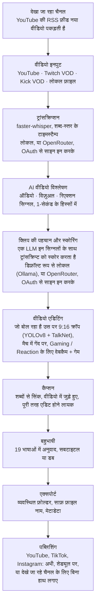

<div align="center">

[English](../../README.md) · [简体中文](README_zh.md) · [日本語](README_ja.md) · [한국어](README_ko.md) · [Türkçe](README_tr.md) · [Русский](README_ru.md) · [Tiếng Việt](README_vi.md) · [ไทย](README_th.md) · [Deutsch](README_de.md) · [Español](README_es.md) · [Français](README_fr.md) · [Português (Brasil)](README_pt-BR.md) · [العربية](README_ar.md) · [Bahasa Indonesia](README_id.md) · [Italiano](README_it.md) · **हिन्दी** · [বাংলা](README_bn.md) · [Filipino](README_tl.md) · [اردو](README_ur.md)

</div>

<a id="clips-kitty-the-free-open-source-opus-clip-alternative-for-chatting-gaming-and-sports-on-your-own-pc"></a>

# Clips Kitty: चैटिंग, गेमिंग और स्पोर्ट्स के लिए Opus Clip का मुफ़्त, ओपन-सोर्स विकल्प, आपके अपने PC पर

> यह README AI ने [अंग्रेज़ी README](../../README.md) से अनुवाद किया है, जो मूल संदर्भ है और
> सबसे पहले अपडेट होता है। हिन्दी बोलने वालों के सुधारों का दिल से स्वागत है।
>
> 🌐 [वेबसाइट हिन्दी में](https://colingpt9.github.io/clips-studio/hi.html)

<a href="https://apps.microsoft.com/detail/9NB6XT7DSQZZ">
  <picture>
    <source media="(prefers-color-scheme: dark)" srcset="https://get.microsoft.com/images/en-us%20dark.svg">
    
  </picture>
</a>

[](https://github.com/ColinGPT9/clips-studio/releases)
[](https://github.com/ColinGPT9/clips-studio/releases)
[](../../LICENSE)
[](https://github.com/ColinGPT9/clips-studio/stargazers)
[](https://github.com/ColinGPT9/clips-studio)
[](../../CONTRIBUTING.md)
[](../../docs/DOCKER.md)

<a href="https://youtu.be/g1dMqrq-YaI"></a>

<a id="star-and-share-clips-kitty--goal-150"></a>

### Clips Kitty को स्टार करें और शेयर करें ⭐ लक्ष्य: 150

[](https://github.com/ColinGPT9/clips-studio/stargazers) **150 में से**

**कृपया repo को स्टार करें और शेयर करें।** इसमें आपका कुछ भी खर्च नहीं होता, और इसके पीछे
कोई मार्केटिंग बजट नहीं है, इसलिए अगले छोटे YouTuber या स्ट्रीमर तक यह ख़बर पहुँचने का
कि एक मुफ़्त विकल्प मौजूद है, इकलौता रास्ता लोगों की ज़ुबानी चर्चा है।

**मैंने इसे छोटे YouTubers और स्ट्रीमर्स के लिए बनाया है** जो दूसरे विकल्पों या किसी एडिटर
का खर्च नहीं उठा सकते। यह Opus Clip, Vizard और Klap का मुफ़्त विकल्प है जो आपके अपने PC पर
**Google Gemma** चलाता है: न सर्वर का खर्च, न हर क्लिप की फ़ीस, न AI इस्तेमाल की
फ़ीस।

> **वर्ज़न 1.1.3 तक Clips Kitty का नाम Clips Studio था**, और Microsoft Store के नामकरण
> नियमों को पूरा करने के लिए इसका नाम बदला गया। वही ऐप, वही रिपॉज़िटरी, वही डेटा।


**लंबी स्ट्रीम और वीडियो को पोस्ट करने के लिए तैयार Shorts, Reels और TikToks में बदलें,
पूरी तरह अपनी ही मशीन पर।** Clips Kitty क्रिएटर्स के लिए एक मुफ़्त, ओपन-सोर्स AI क्लिप
जनरेटर और वीडियो एडिटर है: YouTube, Twitch या Kick का लिंक पेस्ट करें, और यह सबसे अच्छे पल
ढूँढता है, बोलने वाले को बीच में रखते हुए उन्हें 9:16 में क्रॉप करता है, शब्दों के साथ सिंक
होने वाले कैप्शन वीडियो में पक्के तौर पर जोड़ता है, और टाइटल, डिस्क्रिप्शन और हैशटैग लिखता है।

डिफ़ॉल्ट रूप से कोई क्लाउड AI नहीं। कोई सब्सक्रिप्शन नहीं। हर क्लिप की कोई फ़ीस नहीं। आपकी
फ़ुटेज आपके कंप्यूटर से बाहर कभी नहीं जाती, जब तक आप ख़ुद किसी क्लिप को अपने YouTube चैनल
पर पब्लिश करने को न कहें।

पहले लोकल, ज़रूरत पड़े तो क्लाउड: अगर आपका PC AI चलाने के लिए बहुत पुराना है, तो उसकी
जगह कोई क्लाउड प्रोवाइडर उसे चलाता है, और बिल आपके अपने अकाउंट पर आता है।
**OpenRouter सुझाया गया क्लाउड रास्ता है**: अपने OpenRouter अकाउंट से साइन इन करें
(OAuth, कोई key कॉपी नहीं करनी) और कई मॉडल इस्तेमाल करें (Claude, GPT, Gemini, Muse Spark
और भी बहुत कुछ)।
मेरी टेस्टिंग में, OpenRouter पर 2 घंटे के एक वीडियो का खर्च लगभग 11 सेंट आया, जिसमें Gemma
(Gemma 4 26B-A4B) ने क्लिप चुनीं और Whisper (large-v3-turbo) ने ट्रांसक्रिप्शन किया; आप
कितना भुगतान करेंगे, यह आपके चुने हुए मॉडल और वीडियो की लंबाई पर निर्भर करता है।
OpenAI, Claude, Gemini, xAI, Meta, DeepSeek और Qwen भी सीधे आपकी अपनी API key पर काम
करते हैं।
देखें [docs/AI-BACKENDS.md](../../docs/AI-BACKENDS.md)।

**यह क्यों बना:** चैनल बढ़ा रहे ज़्यादातर क्रिएटर सारा काम ख़ुद कर रहे होते हैं:
शूटिंग, स्ट्रीमिंग, एडिटिंग, पोस्टिंग। क्लिप्स से ही लोग आपको ढूँढते हैं, और आम तौर पर
यही काम सबसे पहले छूट जाता है: एडिटर एक ऐसा खर्च है जिसे ज़्यादातर चैनल अभी सही नहीं ठहरा
सकते, क्लिपिंग टूल हर वीडियो या हर महीने के पैसे लेते हैं, और हाथ से काटने में वह पूरा दिन
चला जाता है जिसकी आपको कहीं और ज़रूरत थी। यह उसी हार्डवेयर पर चलता है जो आपके पास पहले से
है, इसलिए इसे इस्तेमाल करने में कोई खर्च नहीं, और आप कितनी भी क्लिप बना सकते हैं।


<sub>एक वीडियो से 19 मिनट में 38 क्लिप, एक ही PC पर, बिना कुछ अपलोड किए।</sub>

---

<a id="contents"></a>

## सूची

- [यह क्या करता है](#what-it-does)
- [Opus Clip, Klap, Vizard और CapCut से तुलना](#how-it-compares-to-opus-clip-klap-vizard-and-capcut)
- [यह कैसे काम करता है](#how-it-works)
- [फ़ीचर](#features)
- [यह किस काम के लिए बना है](#what-its-built-for)
- [ज़रूरतें](#requirements)
- [इंस्टॉल करें और चलाएँ](#install-and-run)
- [अपना AI मॉडल चुनें](#pick-your-ai-model)
- [टेस्ट किया गया हार्डवेयर और परफ़ॉर्मेंस](#tested-hardware-and-performance)
- [समर्थित प्लेटफ़ॉर्म](#supported-platforms)
- [समर्थित भाषाएँ](#supported-languages)
- [YouTube पर पब्लिश करें](#publish-to-youtube)
- [एक साथ हर प्लेटफ़ॉर्म पर पब्लिश करें](#publish-to-every-platform-at-once)
- [GPU एक्सेलरेशन](#gpu-acceleration)
- [कमांड लाइन से इस्तेमाल](#command-line-use)
- [प्लगइन लिखें](#write-a-plugin)
- [इस पर कुछ बनाएँ](#build-on-it)
- [आर्किटेक्चर](#architecture)
- [योगदान](#contributing)
- [रोडमैप](#roadmap-detail)
- [लाइसेंस](#license)

---

<a id="what-it-does"></a>

## यह क्या करता है

आप Clips Kitty को एक लंबा वीडियो देते हैं। बदले में यह आपको पोस्ट करने लायक तैयार वर्टिकल
क्लिप्स का एक फ़ोल्डर देता है, साथ में एक स्टूडियो भी, जिसमें आप पोस्ट करने से पहले उन्हें देख
और ठीक कर सकते हैं।

यह उस कंटेंट के लिए बना है जिसे ज़्यादातर क्लिपिंग टूल सबसे बुरी तरह संभालते हैं: **लाइव
स्ट्रीम, IRL और टॉकिंग-हेड फ़ुटेज, पॉडकास्ट, और जिम/फ़िटनेस कंटेंट**: लंबे, ढीले-ढाले ढाँचे
वाले वीडियो, जिनमें अच्छे पल दबे होते हैं और सिर्फ़ ट्रांसक्रिप्ट से वे हाथ नहीं आते।

<a id="how-it-compares-to-opus-clip-klap-vizard-and-capcut"></a>

## Opus Clip, Klap, Vizard और CapCut से तुलना

Clips Kitty क्लाउड क्लिपिंग टूल्स का एक ओपन-सोर्स विकल्प है। असली फ़र्क इस बात का है कि
काम कहाँ होता है: आपका वीडियो कभी अपलोड नहीं होता, इसलिए न कुछ मापने को है और न किसी चीज़
के पैसे लेने को।

| टूल | कीमत, मासिक बिलिंग | मुफ़्त टियर | आपके लिए क्लिप ढूँढता है | वॉटरमार्क | आपका वीडियो अपलोड करता है | ओपन सोर्स |
| ---- | --------------------- | --------- | ----------------------- | --------- | ------------------ | ----------- |
| **Clips Kitty** | मुफ़्त, कोई पेड टियर नहीं | पूरा ऐप | हाँ | कभी नहीं | नहीं, आपके PC पर चलता है | हाँ, AGPL-3.0 |
| Opus Clip | $15 Starter, $29 Pro | 1080p, वॉटरमार्क के साथ, 3 दिन में एक्सपायर | हाँ | मुफ़्त टियर पर | हाँ | नहीं |
| Klap | $29 Pro, सालाना बिलिंग पर $14 Basic | एक वीडियो | हाँ | बताया नहीं गया | हाँ | नहीं |
| Vizard | $29 Creator, सालाना बिलिंग पर $14.50 | महीने में 60 क्रेडिट, 720p | हाँ | मुफ़्त टियर पर | हाँ | नहीं |
| quso.ai | $29 से $49 | महीने में 75 क्रेडिट, 720p | हाँ | बताया नहीं गया | हाँ | नहीं |
| Ssemble | $15 से $60, सालाना बिलिंग पर $6 से $24 | कोई सूचीबद्ध नहीं | हाँ | बताया नहीं गया | हाँ | नहीं |
| Descript | $16, $24, $50 | महीने में 60 मिनट, 720p | आंशिक रूप से, यह एक ट्रांसक्रिप्ट एडिटर है | Free और Hobbyist पर | हाँ | नहीं |
| CapCut | इस्तेमाल मुफ़्त, पेड टियर capcut.com पर | पूरा एडिटर | **नहीं, आप हाथ से काटते हैं** | फ़ीचर के हिसाब से अलग-अलग | डेस्कटॉप ऐप पर नहीं | नहीं |

**CapCut को समझना सबसे ज़रूरी है**, क्योंकि मुफ़्त विकल्प पूछने पर हर कोई यही बताता है।
यह एक अच्छा एडिटर है और इसका कोई खर्च नहीं, लेकिन हर पल आपको ख़ुद ढूँढना होता है और हर
क्लिप ख़ुद क्रॉप करनी होती है। Clips Kitty भी मुफ़्त है, और वह पहला दौर ही वह हिस्सा है जो
यह आपके लिए करता है।

**Opus Clip, Klap या Vizard बेहतर विकल्प हैं** अगर आपके पास ग्राफ़िक्स कार्ड वाला Windows
PC नहीं है, आप कभी-कभार ही क्लिप बनाते हैं, या आपको फ़ोन से काम करना होता है। Clips Kitty
उसी हार्डवेयर पर बड़ी मात्रा में क्लिपिंग के लिए बना है जो आपके पास पहले से है।

**[सातों टूल्स की पूरी तुलना, और हर एक किस काम में सबसे अच्छा है](https://colingpt9.github.io/clips-studio/alternatives.html)**

<sub>कीमतें 17 सितंबर 2026 को हर कंपनी के अपने प्राइसिंग पेज पर जाँची गईं। CapCut का ऐसा
कोई प्राइसिंग पेज नहीं है जिसे हम पढ़ पाए, इसलिए उसकी कोई कीमत नहीं दी गई। प्लान बदलते
रहते हैं; यह टेबल अपने-आप अपडेट नहीं होगी।</sub>

<a id="how-it-works"></a>

## यह कैसे काम करता है



**हर चरण आपके कंप्यूटर पर चलता है, जब तक आप कुछ और न चुनें:** AI या ट्रांसक्रिप्शन के
लिए OpenRouter, आपके अकाउंट से साइन इन करके, और पब्लिशिंग, जो सिर्फ़ वही क्लिप अपलोड करती
है जो आप भेजते हैं। इसके अलावा, सामान्य रन में नेटवर्क को छूने वाली इकलौती चीज़ सोर्स
वीडियो का डाउनलोड है।

<a id="the-stages-in-detail"></a>

### चरण विस्तार से

**ट्रांसक्रिप्शन: faster-whisper.** शब्द-स्तर के टाइमस्टैम्प, जहाँ उपलब्ध हो वहाँ CUDA पर,
वरना CPU पर। शब्दों की सटीक टाइमिंग की वजह से ही कैप्शन सही अक्षर पर आते हैं और क्लिप
किसी असली वाक्य की शुरुआत से शुरू होती हैं।

**AI क्लिप स्कोरिंग.** ट्रांसक्रिप्ट पाँच सिग्नलों में से सिर्फ़ एक है। ऑडियो से आवाज़ के
अचानक तेज़ होने के उछाल, बर्स्ट डेंसिटी (हँसी और तालियाँ ऐसी ही दिखती हैं), और
सन्नाटा→धमाका वाले पेऑफ़ पैटर्न मिलते हैं। विज़ुअल से सीन कट, हलचल और चेहरे के आकार में
बदलाव मिलते हैं। एक रिएक्शन सिग्नल इन सबको जोड़ता है। हर सिग्नल को *उसी वीडियो के भीतर*
नॉर्मलाइज़ किया जाता है, ताकि एक शांत पॉडकास्ट और चीख़-पुकार वाली स्ट्रीम, दोनों में मायने
रखने वाले पीक मिलें। जहाँ दर्शकों का असली डेटा मौजूद हो (Twitch चैट रीप्ले, जिसे अलग-अलग
चैट करने वालों की गिनती से मापा जाता है, और YouTube का most-replayed हीटमैप), वहाँ यह एक
छोटा, सीमित बोनस जोड़ता है।

लोकल LLM ट्रांसक्रिप्ट **के साथ इन घटनाओं की एक टाइमलाइन भी** देखता है, ताकि वह "शब्द तो
हल्के हैं, पर माहौल में धमाका हो गया" जैसी स्थिति को सही तौल सके। चूँकि छोटे मॉडल हर चीज़ को
एक संकरे दायरे में स्कोर करते हैं, इसलिए आख़िरी दावेदारों की एक ही rerank कॉल में आमने-सामने
तुलना होती है: 7B मॉडल के लिए अलग-अलग नंबर देने से कहीं आसान है दो चीज़ों में से बेहतर चुनना।

**Creator Profiles (क्रिएटर प्रोफ़ाइल).** ऐप हर क्रिएटर के वीडियो के आधार पर उसका एक नॉलेज
बेस बनाता है: बार-बार आने वाले विषय, सीरीज़, साथ काम करने वाले लोग, चलते आ रहे मज़ाक़, और
जारी कहानियाँ। यह संदर्भ सटीक टाइटल लिखने और पुरानी बातों के हवालों (callbacks) को पहचानने
में मदद करता है। यह जान-बूझकर सावधानी से काम करता है: कोई तकिया-कलाम तभी गिना जाता है जब
वह सच में दोहराया जाए, जिस जानकारी का ज़िक्र बंद हो जाए वह निष्क्रिय हो जाती है, और इससे
स्कोर में मिलने वाला हर योगदान सिर्फ़ जुड़ता है, उसकी सीमा तय है, और उसे बंद किया जा सकता है।

**वीडियो एडिटर.** नॉन-डिस्ट्रक्टिव: ट्रिम, अंदरूनी कट, म्यूट, म्यूट किए गए शब्द, वॉल्यूम,
फ़ेड, स्पीड, हुक टेक्स्ट, म्यूज़िक और वॉटरमार्क ऑपरेशन के रूप में सहेजे जाते हैं और रेंडर के
समय लागू होते हैं। एक AI एडिट चैट भी है (*"इसे 5 सेकंड लंबा करो"*, *"कैप्शन में gost लिखा
है, ghost होना चाहिए"*), जिसमें मॉडल बदलाव सुझाता है और जाँचा-परखा कोड उसे लागू करता है।

**लॉन्ग-फ़ॉर्म प्रोसेसिंग.** उसी विश्लेषण पर चलने वाला एक वैकल्पिक 16:9 रास्ता, जिसे आप ख़ुद
चालू करते हैं: हॉरिज़ॉन्टल क्लिप, X/Twitter की लंबाई वाले कट, बेस्ट-ऑफ़ हाइलाइट रील, या पूरी
स्ट्रीम जिसमें से ख़ाली, चुप्पी वाले हिस्से हटा दिए गए हों।

**बहुभाषी पाइपलाइन और AI डबिंग.** कैप्शन का अनुवाद होता है और कुछ भी लिखे या वीडियो में
जोड़े जाने *से पहले* समीक्षा के लिए दिखाया जाता है, ताकि कोई ग़लत पंक्ति तभी ठीक हो जाए जब
उसे ठीक करना अभी मुमकिन है। एक शब्दावली (glossary) चैनल के नाम, स्पॉन्सर और अंदरूनी
मज़ाक़ों को अनुवाद होने से बचाती है। डबिंग लोकल TTS से होती है, जिसकी आवाज़ें आप पहले
सुनकर चुन सकते हैं।

**लोकल GPU एक्सेलरेशन.** पहचान और ट्रांसक्रिप्शन के लिए CUDA, NVENC/AMF/QSV से हार्डवेयर
वीडियो एन्कोडिंग (अपने-आप पहचानी जाती है, CPU पर वापसी के विकल्प के साथ), और Ollama के
ज़रिए GPU पर LLM।

<a id="features"></a>

## फ़ीचर

- **मल्टीमोडल क्लिप पहचान**: पलों को 0–100 के बीच स्कोर किया जाता है, जिसमें कही गई बात,
  ऑडियो का जोश, विज़ुअल हलचल, स्क्रीन पर दिखने वाले रिएक्शन, और हुक/पेऑफ़ की ताक़त, सब
  मिलाकर देखे जाते हैं। क्वालिटी की सीमा पार करने वाली हर क्लिप रखी जाती है, कोई मनमानी
  गिनती की सीमा नहीं।
- **बोलने वाले को पहचानने वाली फ़ेस ट्रैकिंग**: YOLOv8 पोज़ डिटेक्शन विषय को बीच में रखता है,
  और ग्रुप फ़ुटेज में कैमरा **उसी के पीछे जाता है जो सच में बोल रहा है**, जिसका फ़ैसला
  TalkNet एक्टिव-स्पीकर डिटेक्शन चेहरे और ऑडियो, दोनों को साथ देखकर करता है, हिलने-डुलने से
  नहीं। जब बोलने वाला बदलता है तो फ़्रेमिंग उस तक पैन करने की बजाय सीधे उस पर **कट** हो जाती
  है, जैसे कोई एडिटर करता। सिर्फ़ क्रॉप वाली फ़्रेमिंग: तस्वीर कभी खींची नहीं जाती, कभी
  बिगड़ती नहीं।
- **Podcast mode (पॉडकास्ट मोड)**: मल्टी-कैमरा फ़ुटेज में हर शॉट को एक व्यक्ति पर अपना स्थिर
  क्रॉप मिलता है, ताकि कट बिना पैन किए सीधे किसी चेहरे पर आएँ। एक शॉट के भीतर विषय मुँह की
  हरकत से चुना जाता है, और वह न मिले तो सबसे प्रमुख चेहरा।
- **Vertical Live (वर्टिकल लाइव)**: ऐसी लाइवस्ट्रीम के लिए जो स्ट्रीम होते समय ही वर्टिकल थी
  (YouTube वर्टिकल लाइव, Twitch Dual Format, Streamlabs Dual Output, डाउनलोड किया गया
  Instagram या TikTok लाइव)। स्ट्रीम का अपना 9:16 लेआउट रखता है, फ़ेस ट्रैकिंग छोड़ देता है, और
  फिर भी पल हमेशा की तरह चुनता है। देखें [docs/VERTICAL-LIVE.md](../../docs/VERTICAL-LIVE.md)।
- **Sports (स्पोर्ट्स): Soccer और Basketball**: किसी मैच या गेम का हर बड़ा पल अपनी अलग क्लिप
  के रूप में, उसके बिल्ड-अप और रिएक्शन के साथ।
  - **Soccer**: गोल, सेव, कार्ड और बड़े मौके। गोल स्कोर बॉक्स से पढ़े जाते हैं और भीड़ की आवाज़
    से उनका समय तय होता है, और 9:16 क्रॉप गेंद के साथ चलता है। All goals, Best saves, Cards
    और दूसरे विकल्प चुनें, और पलों को जोड़कर एक मैच रीकैप और टीम या खिलाड़ी की रील बनवाएँ।
  - **Basketball**: डंक, थ्री-पॉइंटर, ब्लॉक, स्टील और गेम विनर। स्कोर बॉक्स हर बास्केट और उसके
    पॉइंट की पुष्टि करता है, और क्वार्टर और घड़ी की वजह से गेम विनर पहले क्वार्टर की बास्केट से
    कहीं ज़्यादा अहम गिना जाता है। भीड़, बेंच और कोर्ट के किनारे बैठे लोगों के रिएक्शन भी ढूँढे
    जाते हैं। हर क्लिप का 9:16 क्रॉप उसके प्ले के हिसाब से प्लान होता है: गेंद और जिसके पास वह
    है, पास पाने वाला, और शॉट जिसे बास्केट तक फ़ॉलो किया जाता है, रिम और बैकबोर्ड को फ़्रेम में
    रखते हुए। क्रॉप प्ले के साथ पैन करता है और कभी ज़ूम नहीं करता। गेंद को [E-BARD](https://github.com/GabrieleGiudic/E-BARD#readme) डिटेक्शन
    मॉडल ढूँढता है (इसका श्रेय [लाइसेंस](#license) में दिया गया है)।

  देखें [docs/SPORTS.md](../../docs/SPORTS.md)।
- **एडिट होने लायक, वीडियो में जुड़े कैप्शन**: शब्दों से सिंक, और आपकी पसंद की स्टाइल में
  (रंग, साइज़, जगह, हर लाइन में शब्द, अक्षरों का केस, या बंद)। एक्सपोर्ट से पहले ट्रांसक्रिप्शन
  की ग़लती लाइन-दर-लाइन ठीक करें। दो लोग बात कर रहे हों तो दूसरे स्पीकर के कैप्शन दूसरे रंग
  में हो सकते हैं, और जिस लाइन का स्पीकर यह ग़लत पहचाने, उसे हाथ से बदला जा सकता है।
- **AI एडिट चैट**: आम बोलचाल की भाषा में बताएँ कि क्या ग़लत है, और यह फिर से एडिट कर देता है।
- **Ask Clips Kitty**: डैशबोर्ड के नीचे वाला टेक्स्ट बॉक्स। एक वाक्य में बताएँ कि आपको क्या
  चाहिए, जैसे *"इस स्ट्रीम की क्लिप बनाओ, ध्यान रखना कि बॉस से मेरे मरने वाला हिस्सा ज़रूर हो,
  बड़े पीले कैप्शन के साथ"*, और यह वीडियो को कतार में लगाता है, क्लिप चुनने वाले हिस्से को
  बताता है कि क्या ढूँढना है, और आपके बताए विकल्प सेट कर देता है। **इसके लिए Gemma 4 मॉडल
  चाहिए**: देखें
  [नीचे वाले टेक्स्ट बॉक्स को Gemma 4 चाहिए](#the-text-box-at-the-bottom-needs-gemma-4)।
- **AI टाइटल, डिस्क्रिप्शन और हैशटैग**, सब एक्सपोर्ट से पहले एडिट किए जा सकते हैं।
- **Creator Profiles (क्रिएटर प्रोफ़ाइल)**: ऐप समय के साथ हर क्रिएटर को समझता जाता है, ताकि
  क्लिप बेहतर चुने और उनके बेहतर टाइटल दे। सब कुछ आपके कंप्यूटर पर रहता है, और आप इसे देख,
  सुधार या मिटा सकते हैं।
- **बहुभाषी पब्लिशिंग**: 19 भाषाएँ, वीडियो में कुछ भी जोड़ने से पहले समीक्षा के साथ।
- **AI डबिंग**: लोकल टेक्स्ट-टू-स्पीच, हर भाषा के लिए आवाज़ें सुनकर चुनने की सुविधा के साथ।
- **लॉन्ग-फ़ॉर्म एक्सपोर्ट**: 16:9 क्लिप, हाइलाइट रील, या दोहराव हटाया गया स्ट्रीम एडिट।
  हाइलाइट रील के डिस्क्रिप्शन में **चैप्टर टाइमस्टैम्प** होते हैं, ताकि दर्शक YouTube पर एक
  पल से दूसरे पल पर जा सकें।
- **वॉटरमार्क और ब्रांडिंग प्रोफ़ाइल**: हर क्रिएटर की डिफ़ॉल्ट सेटिंग अपने-आप लागू होती है।
- **मॉडल मैनेजर**: ऐप के अंदर से ही AI का दिमाग़ बदलें; प्रोग्रेस बार के साथ मॉडल डाउनलोड करें,
  हटाएँ और बदलें, बिना किसी टर्मिनल के।
- **एडिटर से ही YouTube पर पब्लिश करें**: टाइटल, डिस्क्रिप्शन, टैग, थंबनेल, प्लेलिस्ट, ऑडियंस
  और विज़िबिलिटी भरें, फिर अभी अपलोड करें या शेड्यूल करें। यह वैकल्पिक है, डिफ़ॉल्ट रूप से बंद
  रहता है, और आपकी अपनी Google API key इस्तेमाल करता है।
- **ऐप के अंदर फ़ीडबैक**: अपने-आप इकट्ठा हुई डायग्नॉस्टिक जानकारी के साथ बग रिपोर्ट, बिना
  किसी अकाउंट के।
- **सबके लिए सुलभ UI**: कीबोर्ड फ़ोकस, कम एनिमेशन (reduced motion) का सपोर्ट, और बदले जा
  सकने वाले फ़ॉन्ट व साइज़।

<a id="what-its-built-for"></a>

## यह किस काम के लिए बना है

आप जो भी वीडियो दें, सब कुछ उस पर चलता है। ये वे मामले हैं जहाँ यह फ़ीचर लिस्ट से जितना
लगता है उससे ज़्यादा या कम सोच-विचार करता है, ताकि आगे चलकर कुछ भी हैरान न करे:

| कंटेंट | यह कैसा काम करता है |
|---|---|
| **IRL, just chatting, पॉडकास्ट, व्लॉग, इंटरव्यू** | यह इसी के लिए ट्यून किया गया है, और रिलीज़ से पहले असली स्ट्रीम पर इसी की टेस्टिंग होती है |
| **गेमिंग और रिएक्शन** | **Gaming / Reaction** चालू होने पर: एक आधे हिस्से में वेबकैम, दूसरे में गेम या वह वीडियो जिस पर रिएक्शन दिया जा रहा है, और प्रोसेसिंग से पहले वीडियो के अपने फ़्रेम पर इसकी जाँच होती है ([docs/GAMING.md](../../docs/GAMING.md))। स्ट्रीमर वही माना जाता है जो बोल रहा है, सबसे बड़ा चेहरा कभी नहीं। यह स्विच बंद हो तो फ़्रेमिंग गेम के अंदर किसी किरदार के पीछे जा सकती है। सिर्फ़ कैमरे पर दिखने वाले असली लोग, VTubers नहीं |
| **स्पोर्ट्स मैच** | **Sports** चालू होने पर: स्कोर बॉक्स और कमेंट्री वाले ब्रॉडकास्ट के लिए बना है, जहाँ गोल और बास्केट पक्के तौर पर पता चलते हैं। क्लब या फ़ोन की फ़ुटेज में आम तौर पर दोनों में से कुछ नहीं होता: उसकी क्लिप गेंद के साथ चलती हैं, और उसके गोल उन मैच इवेंट्स से आते हैं जो आप पेस्ट करते हैं, जैसे किसी क्लब ऐप के गोल टैग ([docs/SPORTS.md](../../docs/SPORTS.md)) |
| **रिएक्शन जिस चीज़ पर है** | क्लिप अब भी इसी आधार पर चुनी जाती हैं कि क्या *कहा* गया, इसलिए देखे जा रहे वीडियो का कोई पल जिस पर कोई कुछ न बोले, वह इसे दिखता ही नहीं |

क्लिप का चुनाव ट्रांसक्रिप्ट और सिग्नल के आधार पर होता है। जब मज़ेदार चीज़ *सिर्फ़ दिखने
वाली* हो और उस पर कोई कुछ न बोले, तो उसे एडिटर में ख़ुद ढूँढने के लिए तैयार रहें।

<a id="requirements"></a>

## ज़रूरतें

|             | न्यूनतम                                      | सुझाया गया                     |
| ----------- | -------------------------------------------- | ------------------------------- |
| **GPU**     | NVIDIA RTX 2060 (6 GB)                       | RTX 3060 12 GB या बेहतर        |
| **CPU**     | Intel Core i3-9100 / AMD Ryzen 3 3200G (2019)| 6 कोर या ज़्यादा                 |
| **RAM**     | 16 GB                                        | 16 GB या ज़्यादा                   |
| **डिस्क**    | ~20 GB, साथ में उन वीडियो के लिए जगह जिनकी आप क्लिप बनाते हैं    |                                 |
| **OS**      | Windows 10 या 11                             |                                 |

**न्यूनतम से कम पर भी यह शायद चल जाए, लेकिन वह समर्थित नहीं है और बहुत धीमा होगा।** एक
स्ट्रीम की क्लिप बनाने का मतलब है घंटों का वीडियो डिकोडिंग, ट्रांसक्रिप्शन और एन्कोडिंग;
लगभग 2019 से पहले का हार्डवेयर इतना समय लेगा कि ऐप सही काम करते हुए भी ख़राब लगेगा।

इनमें से दो बातें थोड़ा खुलकर समझने लायक हैं:

- **16 GB RAM सिर्फ़ एक सुझाव नहीं है।** 8 GB पर पूरा वीडियो एनालाइज़ होगा और फिर कुछ भी
  रेंडर नहीं होगा, जो मेमोरी की कमी की बजाय क्रैश जैसा दिखता है।
- **GPU वैकल्पिक है, ज़रूरी नहीं।** इसके बिना सब कुछ CPU पर चलता है, धीमे, लेकिन पूरा।
  RTX 2060 वह सीमा है जहाँ से GPU वाला रास्ता काम करना शुरू करता है; देखें
  [GPU एक्सेलरेशन](#gpu-acceleration)।

ऐप **सिर्फ़ Windows** के लिए है। Python इंजन Linux/macOS पर चल जाना चाहिए, लेकिन कोई Mac
बिल्ड मौजूद नहीं है और मेंटेनर के पास उसे टेस्ट करने के लिए Mac नहीं है। अगर आपके पास Mac है
और आप मदद करना चाहते हैं, तो [#62](https://github.com/ColinGPT9/clips-studio/issues/62) देखें।

सोर्स से चलाने के लिए वे चीज़ें चाहिए जो वरना इंस्टॉलर आपके लिए साथ लाता:

- **Python 3.10+** और **Node.js 18+**
- आपके PATH पर **[FFmpeg](https://ffmpeg.org/download.html)**
- **[Ollama](https://ollama.com)**, जिसमें एक मॉडल pull किया हुआ हो: `ollama pull gemma:7b`

<a id="install-and-run"></a>

## इंस्टॉल करें और चलाएँ

**सबसे आसान तरीका [Microsoft Store](https://apps.microsoft.com/detail/9NB6XT7DSQZZ) है।**
एक क्लिक, यह ख़ुद अपडेट होता है, और Windows कोई सुरक्षा चेतावनी नहीं दिखाता। Microsoft ने
पैकेज को सर्टिफ़ाई और साइन किया है, इसलिए नीचे बताई गई SmartScreen चेतावनी बिल्कुल नहीं
आती। Store नए वर्ज़न तब इंस्टॉल करता है जब उसकी बारी आती है; तुरंत नया वर्ज़न पाने के लिए
Microsoft Store में Clips Kitty का पेज खोलें और **Update** दबाएँ।

**या इंस्टॉलर डाउनलोड करें।** [Releases](https://github.com/ColinGPT9/clips-studio/releases)
से सबसे नया **Web Setup** लें और उसे चलाएँ। इसमें ऐप, Python इंजन, हर लाइब्रेरी, FFmpeg, AI
रनटाइम और पहचान व ट्रांसक्रिप्शन के सारे मॉडल वेट्स शामिल हैं: न Python, न PATH, न टर्मिनल,
और न कोई दूसरा प्रोग्राम इंस्टॉल करना।

**या winget इस्तेमाल करें।** `winget install ColinGPT9.ClipsKitty` टर्मिनल से वही Web Setup
इंस्टॉल करता है।

इसमें सिर्फ़ एक चीज़ शामिल नहीं है, और वह है ख़ुद लैंग्वेज मॉडल, क्योंकि वे ऐसे लाइसेंस के
तहत आते हैं जिन्हें डाउनलोड करने वाले व्यक्ति को ख़ुद स्वीकार करना होता है, उन्हें आपकी ओर
से स्वीकार नहीं किया जा सकता। सेटअप विज़र्ड वह डाउनलोड ख़ुद शुरू करता है, आपके ग्राफ़िक्स
कार्ड के हिसाब से साइज़ चुनता है, और प्रोग्रेस बार दिखाता है। यानी: एक डाउनलोड, एक
डबल-क्लिक, एक प्रोग्रेस बार। उसके बाद यह ऑफ़लाइन चलता है।

> पहली बार चलाने पर Windows चेतावनी देगा कि ऐप साइन नहीं किया गया है। *More info → Run
> anyway* पर क्लिक करें। साइनिंग सर्टिफ़िकेट हमारी आगे की सूची में है।

<a id="from-source"></a>

### सोर्स से

```bash
git clone https://github.com/ColinGPT9/clips-studio
cd clips-studio
pip install -r requirements.txt

cd ui
npm install
npm run dev        # opens the Clips Kitty desktop app
```

ऐप अपना Python इंजन अपने-आप शुरू कर देता है। **Clip Editor** में लिंक पेस्ट करें,
*Generate clips* दबाएँ, और प्रोग्रेस लाइव देखें।

इंस्टॉलर ख़ुद बनाना बस एक कमांड का काम है। देखें
[CONTRIBUTING.md](../../CONTRIBUTING.md#building-the-windows-installer)।

<a id="with-docker-nothing-else-to-install"></a>

### Docker के साथ: और कुछ इंस्टॉल नहीं करना

योगदान देने वालों के लिए। आपको सिर्फ़ [Docker Desktop](https://docs.docker.com/get-started/get-docker/)
चाहिए और कुछ नहीं: न Python, न Node, न FFmpeg, न PyTorch।

```bash
git clone https://github.com/ColinGPT9/clips-studio
cd clips-studio
docker compose up
```

तीन सर्विस एक साथ शुरू होती हैं:

| | |
|---|---|
| **<http://localhost:5173>** | इंटरफ़ेस, आपके ब्राउज़र में |
| **<http://localhost:8765>** | इंजन और उसका API |
| Ollama | लोकल AI, :11434 पर |

फिर एक मॉडल pull करें (`docker compose exec ollama ollama pull gemma3:4b`), और आपके पास काम
करने वाला checkout तैयार है।

जाँचें (checks) भी इसी तरह चलाएँ:

```bash
docker compose run --rm engine pytest
docker compose run --rm ui npm run typecheck
```

> **दस मिनट का पहला बिल्ड छोड़ें:** `docker compose pull` लोकल रूप से PyTorch और OpenCV
> कंपाइल करने की बजाय पहले से बनी इंजन इमेज ले आता है।

डेस्कटॉप शेल ख़ुद अब भी आपके होस्ट पर चलता है, क्योंकि Electron को डिस्प्ले चाहिए; बाकी सब
कंटेनर में है। पूरी जानकारी, और यह तरीका क्या नहीं बता सकता, यह सब
[docs/DOCKER.md](../../docs/DOCKER.md) में है।

<a id="pick-your-ai-model"></a>

## अपना AI मॉडल चुनें

**Models** पेज खोलें और देखें कि क्या इंस्टॉल है और आपका GPU क्या संभाल सकता है:

पैमाना सिर्फ़ एक है: आपके पास कितनी VRAM है। ये वही पंक्तियाँ हैं जो ऐप दिखाता है,
[`llm/manager.py`](../../llm/manager.py) के `RECOMMENDATIONS` से। विज़र्ड और Models पेज
दोनों यही एक टेबल पढ़ते हैं, इसलिए वे न आपस में अलग बात कह सकते हैं, न इस टेबल से।

| आपका हार्डवेयर | सुझाया गया मॉडल | |
|---|---|---|
| CPU / iGPU, कोई ग्राफ़िक्स कार्ड नहीं | `gemma3:4b` | टेस्ट किया गया |
| 6 GB से कम VRAM, या पुराना PC | `gemma4:e2b` | |
| 6 GB VRAM | `gemma4:e4b` | |
| 8 GB VRAM | **`gemma:7b`** | टेस्ट किया गया · डिफ़ॉल्ट रूप से साथ आता है |
| 10–12 GB VRAM | `gemma3:12b` | टेस्ट किया गया |
| 16–24 GB VRAM | `gemma3:27b` | |

और वे मॉडल जिन्हें VRAM के अलावा किसी और वजह से चुनना ठीक है:

| क्यों | मॉडल |
|---|---|
| अनुवाद / बहुभाषी | `qwen3:8b` या `qwen3:14b` |
| खुली छूट वाला लाइसेंस | `mistral-nemo:12b` (Apache-2.0) · `phi4:14b` (MIT) |

**सिर्फ़ "टेस्ट किया गया" वाले तीन मॉडल असली स्ट्रीम पर चलाए गए हैं**, और `gemma:7b` पर
सबसे ज़्यादा घंटे लगे हैं; `config/settings.yaml` इसी के साथ आता है। बाकी सब इसलिए सूची में
हैं क्योंकि उनका साइज़ ठीक-ठाक है और वे कमर्शियल इस्तेमाल के लिए मुफ़्त हैं, इसलिए नहीं कि
उनके साथ क्लिप की क्वालिटी मापी गई है। वे सब काम करते हैं, क्योंकि ऐप Ollama के ज़रिए हर
मॉडल से एक ही तरह बात करता है, लेकिन किसी ने यह नहीं जाँचा कि वे बेहतर पल चुनते हैं या नहीं।
इस कमी को दूर करने का काम [#38](https://github.com/ColinGPT9/clips-studio/issues/38) में है।

Ollama जो भी मॉडल चलाए, वह काम करता है, और मॉडल बदलना एक क्लिक का काम है। अनुवाद के लिए
क्लिपिंग से *अलग* मॉडल इस्तेमाल हो सकता है। `llm.translation_model` सेट करें।

<a id="the-text-box-at-the-bottom-needs-gemma-4"></a>

### नीचे वाले टेक्स्ट बॉक्स को Gemma 4 चाहिए

**Ask Clips Kitty**, यानी डैशबोर्ड के नीचे वाला टेक्स्ट बॉक्स, सिर्फ़ ऐसे मॉडल के साथ काम
करता है जो ऐप के टूल्स इस्तेमाल कर सके। Gemma 4 ऐसा कर सकता है। `gemma:7b` और Gemma 3 मॉडल
नहीं कर सकते, और बिना ग्राफ़िक्स कार्ड वाले PC पर, या 8 GB या उससे ज़्यादा VRAM वाले PC पर,
सेटअप इन्हीं में से एक इंस्टॉल करता है। ऐसे PC पर यह बॉक्स तब तक काम नहीं करेगा जब तक आप
कोई Gemma 4 मॉडल न जोड़ें: वर्ज़न 2.0 *"No installed model can use tools"* दिखाता है, और बाद
के वर्ज़न बॉक्स के अंदर ही डाउनलोड का विकल्प देते हैं।

आपकी क्लिप चाहे कोई भी मॉडल चुने, **Models** पेज पर उसके साथ एक Gemma 4 मॉडल भी इंस्टॉल
करें: 6 GB या उससे ज़्यादा वाले ग्राफ़िक्स कार्ड पर `gemma4:e4b`, उससे कम पर `gemma4:e2b`।
आपको उस पर स्विच करने की ज़रूरत नहीं है। बॉक्स उसे ख़ुद ढूँढ लेता है, और आपकी क्लिप अब भी उसी
मॉडल से चुनी जाती हैं जो आपने चुना है। अगर आप AI को OpenRouter के ज़रिए चलाते हैं, तो बॉक्स
वही मॉडल इस्तेमाल करता है और कुछ भी इंस्टॉल करने की ज़रूरत नहीं।

<a id="tested-hardware-and-performance"></a>

## टेस्ट किया गया हार्डवेयर और परफ़ॉर्मेंस

Clips Kitty रोज़ इसी मशीन पर डेवलप और टेस्ट होता है, इसलिए अगर आप अपने नतीजों की तुलना
कर रहे हैं तो यह एक काम का पैमाना है:

| | |
|---|---|
| **GPU** | NVIDIA GeForce RTX 3060, 12 GB VRAM |
| **CPU** | AMD Ryzen 5 5600X (6 कोर / 12 थ्रेड) |
| **RAM** | 16 GB |
| **OS** | Windows 10 |
| **क्लिपिंग मॉडल** | Ollama के ज़रिए `gemma:7b` |
| **ट्रांसक्रिप्शन** | CUDA पर faster-whisper `large-v3-turbo` |

इस repo की हर चीज़ (डिफ़ॉल्ट सेटिंग्स, `parallel_renders: 3`, 5 मिनट का एनालिसिस चंक साइज़)
लगभग इसी श्रेणी की मशीन के लिए ट्यून की गई है। बड़े GPU पर `llm.num_ctx` और
`analysis.chunk_seconds` दोनों को साथ बढ़ाएँ और एक साइज़ बड़ा मॉडल लें; छोटे GPU पर
`gemma3:4b` पर आ जाएँ।

अगर आप Clips Kitty को किसी दूसरे हार्डवेयर पर बेंचमार्क करें, तो कृपया नतीजे
[Discussions](https://github.com/ColinGPT9/clips-studio/discussions) में पोस्ट करें। असली
मशीनों के असली आँकड़े सबको अपना सेटअप तय करने में मदद करते हैं।

<a id="supported-platforms"></a>

## समर्थित प्लेटफ़ॉर्म

| सोर्स | सपोर्ट |
|---|---|
| YouTube वीडियो | पूरा। H.264 जान-बूझकर चुना जाता है (AV1 प्रोसेसिंग का समय लगभग दोगुना कर देता है) |
| Twitch VODs | पूरा, दर्शकों के सिग्नल के रूप में चैट रीप्ले समेत |
| Kick VODs | पूरा (स्ट्रीम ख़त्म होने के बाद Kick चैट हटा देता है, इसलिए कोई चैट सिग्नल नहीं) |
| लोकल वीडियो फ़ाइलें | पूरा। अपनी फ़ुटेज पब्लिश करने से पहले ही उसकी क्लिप बना लें |
| लाइव स्ट्रीम | जान-बूझकर समर्थित नहीं। सिर्फ़ VODs |

<a id="supported-languages"></a>

## समर्थित भाषाएँ

क्लिप्स का **19 भाषाओं** में अनुवाद, सबटाइटल और डब किया जा सकता है, और **इंटरफ़ेस भी इन
सभी 19 भाषाओं में अनुवादित है**, ताकि ऐप उन्हीं भाषाओं में इस्तेमाल हो सके जिनमें यह
पब्लिश करता है:

अंग्रेज़ी · स्पेनिश · पुर्तगाली (ब्राज़ीलियाई) · फ़्रेंच · जर्मन · हिन्दी · इंडोनेशियाई ·
जापानी · रूसी · अरबी · चीनी (सरलीकृत) · वियतनामी · फ़िलिपिनो · तुर्की ·
उर्दू · बंगाली · थाई · कोरियाई · इतालवी

कोई भाषा जोड़ने के लिए बस `multilingual/languages.py` में एक पंक्ति और
`ui/src/renderer/src/locales/` में एक locale फ़ाइल चाहिए। अनुवाद करने वाला और सबटाइटल
लिखने वाला हिस्सा किसी एक भाषा से बँधे नहीं हैं।

<a id="help-wanted-the-maintainer-only-speaks-english"></a>

### मदद चाहिए: मेंटेनर सिर्फ़ अंग्रेज़ी बोलता है

उन 19 में से 18 इंटरफ़ेस अनुवाद किसी ऐसे व्यक्ति ने कभी नहीं पढ़े जो वह भाषा बोलता हो।
उनमें से आधे अभी अधूरे हैं। हर भाषा का अपना issue है, जो अंग्रेज़ी में और उसी भाषा में लिखा
गया है, और **किसी ग़लत शब्द की रिपोर्ट करना अपने-आप में पूरा योगदान है**: कोई pull request
ज़रूरी नहीं। [यह कैसे काम करता है](../../docs/TRANSLATING.md)।

**पूरा करना बाकी है** (लगभग 68 स्ट्रिंग अब भी अंग्रेज़ी में हैं):
[বাংলা (बंगाली)](https://github.com/ColinGPT9/clips-studio/issues/43) ·
[Italiano (इतालवी)](https://github.com/ColinGPT9/clips-studio/issues/44) ·
[한국어 (कोरियाई)](https://github.com/ColinGPT9/clips-studio/issues/45) ·
[ไทย (थाई)](https://github.com/ColinGPT9/clips-studio/issues/46) ·
[Tagalog (फ़िलिपिनो)](https://github.com/ColinGPT9/clips-studio/issues/47) ·
[Türkçe (तुर्की)](https://github.com/ColinGPT9/clips-studio/issues/48) ·
[اردو (उर्दू)](https://github.com/ColinGPT9/clips-studio/issues/49) ·
[Tiếng Việt (वियतनामी)](https://github.com/ColinGPT9/clips-studio/issues/50) ·
[中文 (चीनी)](https://github.com/ColinGPT9/clips-studio/issues/51)

**जाँच बाकी है** (पूरा है, लेकिन किसी ने यह पुष्टि नहीं की कि यह स्वाभाविक लगता है):
[العربية (अरबी)](https://github.com/ColinGPT9/clips-studio/issues/52) ·
[Deutsch (जर्मन)](https://github.com/ColinGPT9/clips-studio/issues/53) ·
[Español (स्पेनिश)](https://github.com/ColinGPT9/clips-studio/issues/54) ·
[Français (फ़्रेंच)](https://github.com/ColinGPT9/clips-studio/issues/55) ·
[हिन्दी](https://github.com/ColinGPT9/clips-studio/issues/56) ·
[Bahasa Indonesia (इंडोनेशियाई)](https://github.com/ColinGPT9/clips-studio/issues/57) ·
[日本語 (जापानी)](https://github.com/ColinGPT9/clips-studio/issues/58) ·
[Português (पुर्तगाली)](https://github.com/ColinGPT9/clips-studio/issues/59) ·
[Русский (रूसी)](https://github.com/ColinGPT9/clips-studio/issues/60)

कोई ऐसी भाषा चाहिए जो यहाँ नहीं है? [#61](https://github.com/ColinGPT9/clips-studio/issues/61)।

<a id="publish-to-youtube"></a>

## YouTube पर पब्लिश करें

डिफ़ॉल्ट रूप से बंद। इसे **Settings → Publish to YouTube** में चालू करें, और एडिटर में एक
**YouTube** टैब दिखने लगता है: टाइटल, डिस्क्रिप्शन, टैग, थंबनेल, प्लेलिस्ट, ऑडियंस और
विज़िबिलिटी भरें, फिर **Upload now** दबाएँ। अगर आपके कुछ एडिट सेव नहीं हुए हैं तो Clips
Kitty क्लिप को रेंडर करता है और सीधे आपके चैनल पर अपलोड कर देता है। न कोई एक्सपोर्ट वाला
क़दम है, न पब्लिश करने का कोई अलग पेज। आपको एडिटर से बाहर जाना ही नहीं पड़ता।

अगर आप इसे बंद ही रहने दें, तो ऐप में कहीं भी कुछ नहीं बदलता।

<a id="scheduling"></a>

### शेड्यूलिंग

**Schedule on YouTube** चुनने पर वीडियो *तुरंत* अपलोड हो जाता है, private मार्क होता है, और
YouTube को पब्लिश होने का समय सौंप दिया जाता है। तय दिन पर YouTube उसे पब्लिश कर देता है।

**आप Clips Kitty बंद कर सकते हैं और अपना कंप्यूटर भी बंद कर सकते हैं।** इस ऐप में न कोई
टाइमर है, न कोई बैकग्राउंड सर्विस, और न कुछ चालू छोड़ना पड़ता है। जैसे ही YouTube ने वीडियो
स्वीकार कर लिया, Clips Kitty का काम पूरा।

<a id="you-need-your-own-google-api-key"></a>

### आपको अपनी Google API key चाहिए

Clips Kitty कोई साझा key साथ नहीं देता, और यह सिर्फ़ एहतियात नहीं है। Google का अपलोड कोटा
**हर Cloud project के हिसाब से** होता है: एक साझा key का मतलब होता कि दुनिया का हर यूज़र
दिन के उन्हीं 100 अपलोड में से हिस्सा ले रहा है। आपके अपने project से आपको अपना अलग कोटा
मिलता है, और आपकी credentials आपकी मशीन से बाहर कभी नहीं जातीं। रास्ते में Clips Kitty का
कोई सर्वर नहीं है।

सेटअप मुफ़्त है और लगभग दस मिनट लगते हैं; Settings का विज़र्ड आपको हर क़दम पर साथ ले चलता है:

1. [Google Cloud Console](https://console.cloud.google.com/projectcreate) में एक project बनाएँ।
2. APIs & Services → Library में जाकर **YouTube Data API v3** चालू करें।
3. OAuth consent screen भरें, फिर **Publish app** दबाएँ। यह क़दम अहम है: अगर इसे
   *Testing* पर छोड़ दिया, तो Google हर 7 दिन में आपका साइन-इन ख़त्म कर देगा और आपको हर
   हफ़्ते दोबारा कनेक्ट करना पड़ेगा। "In production" का मतलब verified नहीं है, और इसका कोई
   खर्च नहीं।
4. Credentials → Create credentials → OAuth client ID → टाइप **Desktop app**।
5. client ID और secret को Settings में पेस्ट करें, फिर अपना चैनल कनेक्ट करें।

कनेक्ट करते समय आपको "Google hasn't verified this app" वाली चेतावनी दिखेगी। यह आपका अपना
ऐप है जो आपको आपके ही बारे में चेतावनी दे रहा है। **Advanced → Go to (unsafe)** से आप आगे
बढ़ सकते हैं।

<a id="posting-publicly"></a>

### सबके लिए (public) पोस्ट करना

इस पर भरोसा करने से पहले एक बात जान लें, क्योंकि कोई भी सॉफ़्टवेयर इससे बच नहीं सकता:

> **जब तक आपका Google Cloud project YouTube का मुफ़्त API ऑडिट पास नहीं कर लेता, तब तक
> उसके ज़रिए अपलोड हुआ हर वीडियो YouTube private पर लॉक कर देता है।** यह लॉक हमेशा के लिए है।
> आप बाद में Studio में वीडियो को public नहीं कर सकते, और कोई अपील नहीं होती। इकलौता इलाज
> है ऑडिट हो चुके project से उसे दोबारा अपलोड करना।

Clips Kitty हर अपलोड के बाद जाँच करता है और अगर ऐसा हुआ हो तो आपको साफ़-साफ़ बताता है,
बजाय ऐसे वीडियो के लिए सफलता दिखाने के जिसे कोई देख ही नहीं सकता। अगर आप public पब्लिश
करना चाहते हैं, तो पहले
[YouTube API Services audit form](https://support.google.com/youtube/contact/yt_api_form)
भेजें। **unlisted** या **private** के रूप में अपलोड करने पर इसका कोई असर नहीं पड़ता।

<a id="what-it-can-and-cannot-set"></a>

### यह क्या सेट कर सकता है और क्या नहीं

वह सब कुछ जो public API देता है: टाइटल, डिस्क्रिप्शन (इसमें दिए टाइमस्टैम्प चैप्टर बन जाते
हैं), टैग, कैटेगरी, भाषा, विज़िबिलिटी, शेड्यूल किया गया पब्लिश समय, made-for-kids,
बदले गए/सिंथेटिक कंटेंट का खुलासा, लाइसेंस, एम्बेडिंग, public आँकड़े, कस्टम थंबनेल, और
प्लेलिस्ट में जोड़ना।

YouTube Studio के कुछ फ़ीचर public API में हैं ही नहीं, इसलिए उनके लिए जान-बूझकर कोई
कंट्रोल नहीं रखा गया, बजाय ऐसे कंट्रोल के जो चुपचाप कुछ भी न करे: कमाई (monetization) और
ऐड ब्रेक, पेड प्रमोशन का खुलासा, एंड स्क्रीन और कार्ड, कमेंट सेटिंग्स, उम्र की पाबंदी,
Premieres, और Shorts रीमिक्स की अनुमतियाँ। इनके लिए पैनल आपको Studio का लिंक देता है।

Shorts के लिए कुछ ख़ास नहीं चाहिए: न कोई अलग मोड, न `#Shorts` टैग। YouTube किसी वीडियो के
आकार और लंबाई से ख़ुद तय कर लेता है कि वह Short है।

<a id="publish-to-every-platform-at-once"></a>

## एक साथ हर प्लेटफ़ॉर्म पर पब्लिश करें

यह भी डिफ़ॉल्ट रूप से बंद है। इसे **Settings → Publish through WoopSocial** में चालू करें,
और एडिटर में एक **Publish** टैब दिखने लगता है: अपने प्लेटफ़ॉर्म चुनें — या **Everywhere**
(हर जगह) दबाएँ — टाइटल और डिस्क्रिप्शन एक बार लिखें, और एक ही अपलोड YouTube, TikTok,
Instagram, Facebook, X, Threads, LinkedIn, Pinterest और Bluesky पर एक साथ पहुँच जाता है।
Clip Editor में **Publish all** (सब पब्लिश करें) पूरा बैच भेजता है, बीच में अंतर रखकर, ताकि
दर्जन भर क्लिप एक ही सेकंड में न पहुँचें।

यह वाला फ़ीचर **लोकल नहीं है**। क्लिप और उसकी जानकारी एक पब्लिशिंग सर्विस को भेजी जाती है,
जो उन्हें आगे पहुँचाती है और आपके सोशल अकाउंट्स के कनेक्शन संभालती है, इसलिए Clips Kitty
कभी किसी सोशल अकाउंट का पासवर्ड नहीं माँगता। ऐप की बाकी हर चीज़ अब भी आपके PC पर ही
चलती है।

दो सर्विस समर्थित हैं: **[WoopSocial](https://woopsocial.com/?via=clipskitty)**, जिसका मुफ़्त
प्लान दो अकाउंट जोड़ने देता है और दिन में लगभग 5 YouTube पोस्ट की अनुमति देता है, और पेड
प्लान दोनों सीमाएँ बढ़ा देते हैं; और
**[Upload-Post](https://www.upload-post.com/)**, जो ज़्यादा जगहों तक पहुँचती है और थंबनेल,
पहला कमेंट और पोस्टिंग कतार भी जोड़ती है। इनमें से कोई एक चालू करें, या दोनों।

<sub>एफ़िलिएट लिंक - अगर आप इसके ज़रिए साइन अप करते हैं तो Clips Kitty को कमीशन मिल सकता है,
आपके लिए बिना किसी अतिरिक्त खर्च के।</sub>

**अपनी key ख़ुद लाएँ।** अकाउंट आप बनाते हैं, अपने सोशल अकाउंट आप जोड़ते हैं, और अपना कोटा आप
इस्तेमाल करते हैं। Clips Kitty कोई पैसा नहीं लेता, कोई साझा key नहीं रखता, और किसी चीज़ का
भुगतान नहीं करता — बिल्कुल YouTube इंटीग्रेशन जैसी व्यवस्था, और उसी वजह से।

पूरी गाइड, हर प्लेटफ़ॉर्म का सपोर्ट और सीमाएँ:
**[docs/UPLOAD-POST.md](../../docs/UPLOAD-POST.md)**।

<a id="gpu-acceleration"></a>

## GPU एक्सेलरेशन

**वीडियो एन्कोडिंग** तीनों कंपनियों के हार्डवेयर पर अपने-आप तेज़ होती है: NVIDIA (NVENC),
AMD (AMF), और Intel (QSV)। शुरू होते समय इंजन हर एक से एक फ़्रेम टेस्ट-एन्कोड करता है और
जो सच में काम करे उसमें से पहला इस्तेमाल करता है, वरना CPU पर लौट आता है। कोई ख़ास विकल्प
ज़बरदस्ती चुनने के लिए `config/settings.yaml` में `video.encoder` सेट करें।

**पहचान और ट्रांसक्रिप्शन** CUDA के साथ सबसे तेज़ होते हैं। अपने-आप `pip install torch`
आपको **सिर्फ़ CPU वाला** बिल्ड देता है। NVIDIA के लिए:

```bash
pip uninstall torch torchvision -y
pip install torch torchvision --index-url https://download.pytorch.org/whl/cu130
```

**कौन-से कार्ड GPU इस्तेमाल करते हैं:** GTX 16-series, RTX 20-series, और उससे नए सभी कार्ड,
RTX 50-series समेत।

**GPU पर ट्रांसक्रिप्शन** के लिए NVIDIA का cuBLAS 12 भी चाहिए: Whisper का इंजन
(CTranslate2) CUDA 12 बिल्ड है, और ऊपर वाले CUDA 13 PyTorch में सिर्फ़ cuBLAS 13 है।
`pip install -r requirements.txt` इसे इंस्टॉल करता है (`nvidia-cublas-cu12`), और इंस्टॉल किए
गए ऐप में यह शामिल है, इसलिए किसी CUDA toolkit की ज़रूरत नहीं। इसके बिना ट्रांसक्रिप्शन
CPU पर चलता है और लॉग में इसकी वजह लिखी होती है।

**GTX 10-series और उससे पुराने कार्ड न्यूनतम से नीचे हैं।** ये समर्थित कॉन्फ़िगरेशन नहीं
हैं। ऐप इन पर शुरू होने से मना नहीं करता: पहचान का काम CPU पर चला जाता है और सब कुछ अब भी
काम करता है, लेकिन यह धीमा होगा, और इतनी पुरानी मशीन में आम तौर पर ऐसा CPU होता है जो
सिर्फ़ पहचान वाले चरण को नहीं, बल्कि पूरे काम को धीमा कर देता है।

ऊपर दिया `cu130` इंडेक्स ही इस्तेमाल करें, कोई पुराना नहीं। पुराने CUDA बिल्ड में नए कार्ड
के लिए कोड नहीं होता, और तब ऐप ऐसे हार्डवेयर पर भी CPU पर लौट आता है जिसे तेज़ होना चाहिए।

AMD GPU वालों के लिए: Windows पर ट्रैकिंग और ट्रांसक्रिप्शन CPU पर चलते हैं, फिर भी पूरी तरह
काम करते हैं, बस धीमे। आपका GPU अब भी AMF के ज़रिए वीडियो एन्कोडिंग में और Ollama के ज़रिए
LLM के लिए इस्तेमाल होता है, जो ख़ुद AMD को सपोर्ट करता है।

**वीडियो डिकोडिंग** OpenCV की बजाय हार्डवेयर एक्सेलरेशन वाले FFmpeg से होती है, ट्रैकिंग
और रेंडरिंग दोनों के लिए। इस तरह सैंपल फ़्रेम पढ़ने में CPU का लगभग दसवाँ हिस्सा लगता है,
जितना पहले Python में उन्हें डिकोड करने में लगता था, और यह मायने रखता है क्योंकि ट्रैकिंग हर
क्लिप पर चलती है।

**CPU का बँटवारा.** पहचान और रेंडरिंग, दोनों हर कोर चाहते हैं, और अगर उन्हें यूँ ही छोड़
दिया जाए तो वे आपस में और इंटरफ़ेस से लड़ते हैं। शुरू होते समय इंजन कोर को रेंडर वर्कर्स में
बाँट देता है और जान-बूझकर दो कोर बचाकर रखता है, ताकि बैच चलते समय भी ऐप तुरंत जवाब देता
रहे। इसे `video.parallel_renders` से ट्यून करें।

<a id="command-line-use"></a>

## कमांड लाइन से इस्तेमाल

सब कुछ डेस्कटॉप ऐप के बिना भी काम करता है:

```bash
python main.py process "https://www.youtube.com/watch?v=VIDEO_ID"   # one video
python main.py models                                               # list/switch models
python main.py status                                               # processing state
python main.py serve                                                # just the API engine
```

सेटिंग्स [config/settings.yaml](../../config/settings.yaml) में रहती हैं। फ़ाइल के ऊपर एक
छोटा क्विक-सेटअप हिस्सा है, और सारी एडवांस्ड चीज़ें उसके नीचे हैं। हर LLM प्रॉम्प्ट
[config/prompts/](../../config/prompts/) में एक सादी टेक्स्ट फ़ाइल है, इसलिए आप Python को छुए
बिना बदल सकते हैं कि क्लिप कैसे स्कोर हों।

<a id="write-a-plugin"></a>

## प्लगइन लिखें

क्या आप किसी गेम, खेल या किसी तरह के शो को एक आम डिटेक्टर से बेहतर जानते हैं? एक छोटा
Python प्लगइन लिखें जो वीडियो के पलों को ढूँढे, समझे या रेट करे, और बाकी काम Clips Kitty
करता है। SDK MIT लाइसेंस में है, इसलिए आपका प्लगइन कोई भी लाइसेंस रख सकता है, और कुछ भी
fork करने की ज़रूरत नहीं।

```text
Clips Kitty SDK

Input                      a link or a video file
  ↓
Video                      Clips Kitty downloads it and writes down what is said
  ↓
Your plugin                every step is optional
  ├── find                 picks the moments                  built
  ├── understand           says what happens in each one      built
  ├── rate                 scores each moment                 built
  └── edit                 suggests edits for the creator     built
  ↓
Clips Kitty                does every step no plugin does, then cuts, frames and captions the clips
  ↓
Creator / Social Platform  posts when the creator clicks Publish, or on a schedule or automatic posting the creator switched on
```

- एक प्लगइन किसी वीडियो के पल ढूँढ सकता है; वह Clips Kitty की अपनी खोज की जगह ले लेता है।
- किसी भी खोजने वाले प्लगइन के बाद, ज़्यादा से ज़्यादा 3 प्लगइन समझने का और 3 रेट करने का काम कर सकते हैं।
- प्लगइन की भूमिका उसके manifest के `inputs` और `outputs` से तय होती है ([Steps](../../docs/developers/steps.md))।
- ज़्यादा से ज़्यादा 3 प्लगइन बनने वाली क्लिप्स के लिए एडिट सुझा सकते हैं।
- एडिट प्लगइन ऐसे एडिट सुझाते हैं जो एडिटर में क्रिएटर का इंतज़ार करते हैं ([Steps](../../docs/developers/steps.md#suggest-edits-the-edit-step))।
- पोस्ट करना प्लगइन का क़दम नहीं है: Clips Kitty क्लिप्स ख़ुद पोस्ट करता है, और WoopSocial के ज़रिए क्रिएटर के अपने अकाउंट से एक साथ कई साइट्स पर पोस्ट कर सकता है ([एक साथ हर प्लेटफ़ॉर्म पर पब्लिश करें](#publish-to-every-platform-at-once))। `kind: publisher` स्वीकार नहीं किया जाता: प्लगइन पोस्ट नहीं करते।

तीन कमांड SDK इंस्टॉल करते हैं, `game-events` टेम्पलेट से एक प्लगइन बनाते हैं (Quarkbloom
Arena के लिए, जो एक काल्पनिक गेम है) और उसे SDK के बनाए एक टेस्ट वीडियो पर चलाते हैं। इनके
लिए Python 3.11, FFmpeg और Git चाहिए।

PowerShell (Windows):

```powershell
py -m pip install "clipskitty-sdk[yaml,test] @ git+https://github.com/ColinGPT9/clips-studio#subdirectory=sdk/python"
py -m clipskitty_sdk new quarkbloom-bursts --template game-events --publisher your-github-name
py -m clipskitty_sdk run quarkbloom-bursts --sample
```

bash (macOS, Linux):

```bash
python -m pip install "clipskitty-sdk[yaml,test] @ git+https://github.com/ColinGPT9/clips-studio#subdirectory=sdk/python"
python -m clipskitty_sdk new quarkbloom-bursts --template game-events --publisher your-github-name
python -m clipskitty_sdk run quarkbloom-bursts --sample
```

Clips Kitty 2.1.0 पहली रिलीज़ है जो प्लगइन चलाती है, और यह SDK 1.3.0 के साथ आती है।

**[आपकी पहली गेम पाइपलाइन](../../docs/developers/first-game-pipeline.md)** वहीं से आगे,
क़दम-दर-क़दम, एक ऐसे प्लगइन तक ले जाती है जो Clips Kitty में इंस्टॉल हो और उसके Marketplace
में दिखे। [Signals cookbook](../../docs/developers/signals-cookbook.md) में किसी गेम का वीडियो
पढ़ने के नुस्ख़े हैं, [SDK reference](../../docs/developers/sdk.md) में हर कमांड और कॉल है,
और [डेवलपर डॉक्स](../../docs/developers/README.md) में बाकी सब कुछ। वेबसाइट का
[Clips Kitty SDK](https://colingpt9.github.io/clips-studio/developers.html) पेज इसका छोटा
रूप है।

<a id="build-on-it"></a>

## इस पर कुछ बनाएँ

डेस्कटॉप ऐप एक **लोकल HTTP API** पर खुलने वाली खिड़की है, जो Clips Kitty खुला रहने तक
हमेशा चलता रहता है। एक Discord बॉट, बैच रनर, वेब फ़्रंट एंड या OBS इंटीग्रेशन उसी पाइपलाइन
को चला सकता है, और इसके लिए पहले ऐप में कुछ भी जोड़ने की ज़रूरत नहीं।

```bash
python main.py serve --port 8765          # the engine on its own, no window

curl -X POST http://127.0.0.1:8765/jobs \
  -H "Content-Type: application/json" \
  -d '{"url": "https://www.youtube.com/watch?v=VIDEO_ID"}'
# {"job_id": 149}
```

क्लिप्स JSON के रूप में वापस आती हैं, उस स्कोर के ब्योरे के साथ जिससे वे बनीं, और एक MP4 के
साथ जिसे आप स्ट्रीम कर सकते हैं:

```bash
curl -s http://127.0.0.1:8765/videos/VIDEO_ID/clips \
  | python -c "import json,sys; [print(c['score'], c['title']) for c in json.load(sys.stdin)]"
```

**[docs/API.md](../../docs/API.md)** में वे endpoints दर्ज हैं जिन पर कुछ बनाना फ़ायदेमंद है,
काम करने वाले उदाहरणों और उन जालों के साथ जिनमें लोगों की पूरी दोपहर चली गई। यह सर्विस
`http://127.0.0.1:8765/docs` पर अपने इंटरैक्टिव डॉक्स भी दिखाती है।

इसमें **कोई authentication नहीं है**, और इसी वजह से यह सिर्फ़ localhost पर चलता है। इसकी तरफ़
कुछ भी जोड़ने से पहले API डॉक्स में सुरक्षा वाला नोट पढ़ें।

<a id="or-bring-your-own-model"></a>

### या अपना मॉडल ख़ुद लाएँ

वह ऐप के *इर्द-गिर्द* बनाना है। आप इसके *अंदर* भी बना सकते हैं, और शुरुआत की जगह एक प्लगइन
है ([प्लगइन लिखें](#write-a-plugin))। अगर आपके लिए ज़रूरी फ़ुटेज वह नहीं है जिसके लिए यह ट्यून
किया गया था, चाहे वह स्पोर्ट्स हो, गेमिंग, रिएक्शन, लेक्चर या कुछ ऐसा जो किसी ने आज़माया ही
नहीं, तो एक प्लगइन बिना fork किए उसके पलों को ढूँढ, समझ या रेट कर सकता है। यह Clips Kitty के
अपने Python पर चलता है, स्टैंडर्ड लाइब्रेरी (उन कुछ मॉड्यूल को छोड़कर जो ऐप में शामिल नहीं)
और SDK के साथ: Clips Kitty अभी किसी प्लगइन के लिए दूसरे Python पैकेज इंस्टॉल नहीं कर सकता।

अगर आप इसकी बजाय ख़ुद ऐप को बदलना चाहते हैं: पाइपलाइन **YOLOv8 (ultralytics), OpenCV और
TalkNet-ASD** को लोकल रूप से चलाती है, और कौन-से पल क्लिप बनेंगे, इसका फ़ैसला हर सेकंड के
सिग्नलों का एक सेट करता है, न कि "दिलचस्प क्या है" का कोई पहले से लिखा तय विचार। कोई भी
डिटेक्टर जो टाइमलाइन पर एक confidence देता है, उसे एक और सिग्नल के रूप में जोड़ा जा सकता है,
और उसके पीक संभावित क्लिप बन जाते हैं। अगर आपकी पहचान के लिए ऐसे Python पैकेज चाहिए जिन्हें
Clips Kitty अभी प्लगइन के लिए इंस्टॉल नहीं कर सकता, तो इसे fork करें और अपनी पहचान वाला
हिस्सा जोड़ दें।
**[docs/EXTENDING.md](../../docs/EXTENDING.md#bring-your-own-model)** में नियम, कॉपी करने लायक
फ़ाइल, और परफ़ॉर्मेंस का वह जाल है जिसके बारे में शुरू करने से पहले जानना अच्छा है।

**बार-बार पूछने (poll) की ज़रूरत नहीं।** `webhook_url` के साथ एक job भेजें, और काम पूरा होने
पर इंजन एक बार POST करता है, अगर आप अपना secret दें तो उससे साइन करके, ताकि कोई dock या
n8n फ़्लो हर कुछ सेकंड में पूछने की बजाय उन चालीस मिनटों तक चुपचाप इंतज़ार कर सके जो एक
स्ट्रीम में लगते हैं। विस्तार से [docs/API.md](../../docs/API.md#webhooks-being-told-instead-of-asking) में।

<a id="ask-an-ai-agent-to-do-it"></a>

### किसी AI एजेंट से करवाएँ

Clips Kitty के साथ एक **MCP सर्वर** आता है, ताकि Claude, Cursor या कोई भी MCP क्लाइंट सादी
भाषा में वही पाइपलाइन चला सके: स्ट्रीम कतार में लगाना, job पर नज़र रखना, चुनी गई क्लिप्स
पढ़ना, किसी एक को एक्सपोर्ट करना।

```bash
claude mcp add clips-kitty -- python main.py mcp
```

इंस्टॉल किए गए बिल्ड में इंजन की बाइनरी `api.exe` है (ऐप के `resources\backend` फ़ोल्डर में),
इसलिए वहाँ कमांड `api.exe mcp` है।

यह चल रहे इंजन से `127.0.0.1:8765` पर बात करता है, इसलिए Clips Kitty खुला होना चाहिए, और
इसे किसी भी तरह की API key नहीं चाहिए: क्लिपिंग करने वाला मॉडल आपकी अपनी मशीन पर है (या, अगर
आपने Settings → AI में कोई चुना है, तो आपकी अपनी key पर एक क्लाउड मॉडल, जिसे MCP क्लाइंट
कभी नहीं देखता)। जो क्लाइंट एजेंट स्किल सपोर्ट करते हैं उनके लिए एक स्किल
[skills/clips-kitty/](../../skills/clips-kitty/) में है।

<a id="built-with-clips-kitty"></a>

### Clips Kitty से बनी चीज़ें

इस API पर चलने वाले प्रोजेक्ट **[Awesome Clips Kitty](https://github.com/ColinGPT9/awesome-clips-kitty)**
में सूचीबद्ध हैं, जो Clips Kitty से बनी पाइपलाइन, प्लगइन, इंटीग्रेशन, ऐप और टूल्स की सूची है।
पहला है [Clips Kitty OBS Plugin](https://github.com/ColinGPT9/clips-kitty-obs-plugin), एक OBS
Studio dock जो आपकी स्ट्रीम ख़त्म होने के बाद उसे Clips Kitty को सौंप देता है। आपने भी कुछ
बनाया है? उसे एक pull request से जोड़ें ([कैसे](https://github.com/ColinGPT9/awesome-clips-kitty/blob/main/CONTRIBUTING.md)),
और अपनी रिपॉज़िटरी को `clips-kitty` टॉपिक दें।

<a id="architecture"></a>

## आर्किटेक्चर

पूरे डिज़ाइन के लिए **[ARCHITECTURE.md](../../ARCHITECTURE.md)** देखें: पाइपलाइन, स्कोरिंग
इंजन, ट्रैकिंग, क्रिएटर इंटेलिजेंस, API, और वे डिज़ाइन नियम जो इसे मॉड्यूलर रखते हैं।

<a id="contributing"></a>

## योगदान

योगदान का स्वागत है। डेवलपमेंट सेटअप और pull request से उम्मीदों के लिए
**[CONTRIBUTING.md](../../CONTRIBUTING.md)** देखें, और किसी सुरक्षा कमज़ोरी की रिपोर्ट के लिए
**[SECURITY.md](../../SECURITY.md)**। अगर आप कहीं से शुरुआत करना चाहते हैं, तो
[`good-first-issue`](https://github.com/ColinGPT9/clips-studio/labels/good-first-issue) लेबल
वाले issues छोटे और साफ़ दायरे वाले हैं।

वेबसाइट [site/](../../site/) में है और GitHub Pages और एक Hugging Face Space पर पब्लिश होती
है। देखें [docs/MIRRORS.md](../../docs/MIRRORS.md)। **काम GitHub पर होता है**, और वेबसाइट
का मिरर एक ही दिशा में force-push होता है, इसलिए उस पर किया गया कोई भी commit ओवरराइट हो
जाएगा।

पैकेजिंग और रिलीज़ के डॉक्स:

- **[docs/RELEASING.md](../../docs/RELEASING.md)**: Windows इंस्टॉलर बनाना और पब्लिश करना,
  जो मुख्य चैनल है
- **[docs/MSSTORE.md](../../docs/MSSTORE.md)**: Microsoft Store पैकेज, डेवलपर अकाउंट बनाने
  से लेकर सर्टिफ़िकेशन तक
- **[packaging/winget/](../../packaging/winget/)**: winget manifests, जो ऊपर वाले इंस्टॉलर की
  ओर इशारा करते हैं
- **[whop-app/](../../whop-app/)**: Whop ऐप, जो Clips Kitty को क्लिपिंग कम्युनिटी के सदस्यों
  के सामने लाता है। सिर्फ़ मार्केटिंग पेज: यह न वीडियो प्रोसेस करता है, न कुछ स्टोर करता है,
  और न डेस्कटॉप ऐप से बात करता है
- **[docs/DOCKER.md](../../docs/DOCKER.md)**: Python, FFmpeg और PyTorch ख़ुद इंस्टॉल किए बिना
  इंजन चलाना
- **[PRIVACY](https://colingpt9.github.io/clips-studio/privacy.html)**: ऐप क्या स्टोर करता है
  और क्या आपकी मशीन से बाहर जा सकता है (छोटा जवाब: कुछ नहीं, जब तक आप बग रिपोर्ट न भेजें)

<a id="changelog-known-issues-roadmap"></a>

## बदलावों की सूची, ज्ञात समस्याएँ, रोडमैप

- **[CHANGELOG.md](../../CHANGELOG.md)**: हर रिलीज़ में क्या बदला, आसान शब्दों में।
- **[KNOWN-ISSUES.md](../../KNOWN-ISSUES.md)**: अभी क्या टूटा हुआ है या क्या कमी है, और उनके
  उपाय। इसमें लिखी हर बात सच में देखी गई है।
- **[ROADMAP.md](../../ROADMAP.md)**: क्या शिप हो चुका है, आगे क्या है, और लंबे समय की दिशा।

**अपडेट के लिए फ़ॉलो करें:**
[-%40ClipsKitty2-000000?logo=x&logoColor=white)](https://x.com/ClipsKitty2)
[](https://www.instagram.com/clipskitty2/)
[](https://www.youtube.com/@ClipsKitty2)

<a id="roadmap-detail"></a>

## रोडमैप विस्तार से

छोटा रूप [ROADMAP.md](../../ROADMAP.md) में है। मुश्किल फ़ैसलों के पीछे की सोच नीचे है,
क्योंकि "अभी क्यों नहीं" आम तौर पर "अभी नहीं" से ज़्यादा काम का होता है।

1. **Android साथी ऐप, सिर्फ़ Vertical Live के लिए**, ताकि यह हल्का रहे: वर्टिकल लाइव पहले से
   फ़ोन की स्क्रीन के लिए फ़्रेम किया होता है, इसलिए ऐप स्ट्रीम का अपना लेआउट रखता है और उसे
   सिर्फ़ पल ढूँढने होते हैं, बिना फ़ेस ट्रैकिंग या री-फ़्रेमिंग के। Play Store की नीति का पालन
   करने के लिए सिर्फ़ Twitch, Kick और लोकल वीडियो फ़ाइलें।
2. **और खेल**: Soccer और Basketball आ चुके हैं। अगला Cricket है (Sport मेन्यू में यह पहले से
   "जल्द आ रहा है" के रूप में दिखता है), अपने अलग मॉड्यूल के रूप में, जैसे बाकी हैं (देखें
   [docs/SPORTS.md](../../docs/SPORTS.md#adding-a-sport))।
3. **काम पूरा होने पर टेक्स्ट अपडेट**: जब किसी वीडियो की क्लिप तैयार हों, जब वे पोस्ट हो जाएँ,
   और जब कुछ फ़ेल हो जाए, तब एक टेक्स्ट मैसेज, ताकि बिना हाथ लगाए चलने वाला चैनल बिना किसी
   के ऐप पर नज़र रखे चल सके।
4. **डबिंग के लिए वॉइस क्लोनिंग** *(इस सूची में जान-बूझकर आख़िर में)*: आज डबिंग एक पहले से तय
   लोकल आवाज़ से होती है। अनुवाद को क्रिएटर की **अपनी** आवाज़ में बोलने के लिए एक क्लोनिंग
   मॉडल चाहिए, और हर भरोसेमंद लोकल मॉडल अपना अलग PyTorch बिल्ड साथ लाता है: क्लिपिंग के लिए
   सेट की गई मशीन पर इससे torch एक CPU-only बिल्ड पर डाउनग्रेड हो जाता है और ट्रैकिंग व
   ट्रांसक्रिप्शन से GPU एक्सेलरेशन चुपचाप हट जाता है। डबिंग जोड़ने के लिए क्लिपिंग तोड़ना
   घाटे का सौदा है।

   सच कहें तो यह तब तक इंतज़ार करेगा जब तक आम लोगों का हार्डवेयर इतना आगे न आ जाए, या यह
   अपने अलग Python environment वाले एक अलग वैकल्पिक इंस्टॉल के रूप में आएगा, ताकि क्लिपिंग
   वाले environment को कभी छुआ न जाए। मॉडल के लाइसेंस भी जाँचने होंगे: सबसे अच्छी आवाज़ वाले
   कई मॉडल गैर-व्यावसायिक हैं, और इस ऐप के यूज़र अपने वीडियो से कमाई करते हैं।

<a id="license"></a>

## लाइसेंस

**GNU AGPL-3.0-or-later**। देखें [LICENSE](../../LICENSE), और व्यवहार में इसका क्या मतलब है
और इंस्टॉलर में क्या-क्या शामिल है, इसके लिए [NOTICE](../../NOTICE)।

Basketball में गेंद, हूप और खिलाड़ियों की पहचान
[E-BARD](https://github.com/GabrieleGiudic/E-BARD) डिटेक्शन मॉडल (YOLOv8n) करता है, और यह बिना किसी
बदलाव के CC BY 4.0 के तहत इस्तेमाल होता है। इसे खुले तौर पर
प्रकाशित करने के लिए धन्यवाद। बाकी हर शामिल घटक और उसका लाइसेंस [NOTICE](../../NOTICE) में है।

तीन हिस्से अलग लाइसेंस में हैं, ताकि Clips Kitty पर कुछ बनाना आसान बना रहे:

| हिस्सा | लाइसेंस |
|---|---|
| Clips Kitty (ऐप, उसका इंजन, यह रिपॉज़िटरी) | AGPL-3.0-or-later |
| प्लगइन SDK, [`sdk/python/`](../../sdk/python/) | MIT ([sdk/python/LICENSE](../../sdk/python/LICENSE)) |
| उदाहरण प्लगइन, [`examples/pipelines/scene-cut-highlights/`](../../examples/pipelines/scene-cut-highlights/) और [`examples/pipelines/keyword-rater/`](../../examples/pipelines/keyword-rater/) | MIT |
| Awesome Clips Kitty सूची की वह कॉपी जो ऐप के साथ आती है, `plugins/catalog_index.json` (यह सूची [अपनी अलग रिपॉज़िटरी](https://github.com/ColinGPT9/awesome-clips-kitty) है) | CC0-1.0 |

दूसरे लोगों के बनाए प्लगइन, पाइपलाइन और ऐप वही लाइसेंस रखते हैं जो उनके लेखकों ने चुना;
Marketplace हर लिस्टिंग पर उसे दिखाता है। SDK इस्तेमाल करने से कोई प्लगइन AGPL के तहत नहीं
आ जाता।

**अगर आप ऐप इस्तेमाल करते हैं, तो आपके लिए इससे कुछ नहीं बदलता।** इसे इंस्टॉल करें, अपनी
स्ट्रीम की क्लिप बनाएँ, क्लिप पोस्ट करें, उनसे कमाई करें। AGPL उन लोगों पर लागू होता है जो
सॉफ़्टवेयर को *आगे बाँटते* हैं या उसकी *बदली हुई* कॉपी को नेटवर्क सर्विस के रूप में चलाते
हैं, इस्तेमाल करने वालों पर नहीं। आपकी फ़ुटेज और आपकी क्लिप्स आपकी हैं।

**अगर आप इसे बदलकर दूसरों के साथ शेयर करते हैं,** तो आपके बदलाव भी उसी लाइसेंस के तहत
जाते हैं। मक़सद यही है: क्रिएटर्स के लिए बने टूल में हुए सुधार उन्हीं क्रिएटर्स के लिए
उपलब्ध रहें।

फिर भी इसे बदले जाने के लिए ही बनाया गया है: मॉडल बदलें, प्रॉम्प्ट ट्यून करें, प्लेटफ़ॉर्म जोड़ें।

<a id="star-history"></a>

## स्टार इतिहास

Clips Kitty को स्टार देने, शेयर करने, बग बताने और अनुवाद करने वाले सभी लोगों का धन्यवाद।

<a href="https://www.star-history.com/#ColinGPT9/clips-studio&amp;Date">
  <picture>
    <source media="(prefers-color-scheme: dark)" srcset="https://api.star-history.com/chart?repos=ColinGPT9/clips-studio&amp;type=date&amp;theme=dark&amp;legend=top-left" />
    <source media="(prefers-color-scheme: light)" srcset="https://api.star-history.com/chart?repos=ColinGPT9/clips-studio&amp;type=date&amp;legend=top-left" />
    
  </picture>
</a>
