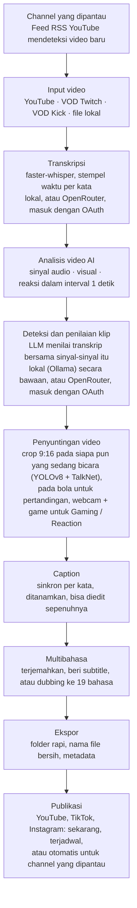

<div align="center">

[English](../../README.md) · [简体中文](README_zh.md) · [日本語](README_ja.md) · [한국어](README_ko.md) · [Türkçe](README_tr.md) · [Русский](README_ru.md) · [Tiếng Việt](README_vi.md) · [ไทย](README_th.md) · [Deutsch](README_de.md) · [Español](README_es.md) · [Français](README_fr.md) · [Português (Brasil)](README_pt-BR.md) · [العربية](README_ar.md) · **Bahasa Indonesia** · [Italiano](README_it.md) · [हिन्दी](README_hi.md) · [বাংলা](README_bn.md) · [Filipino](README_tl.md) · [اردو](README_ur.md)

</div>

<a id="clips-kitty-the-free-open-source-opus-clip-alternative-for-chatting-gaming-and-sports-on-your-own-pc"></a>

# Clips Kitty: alternatif Opus Clip yang gratis dan open source untuk konten ngobrol, gaming, dan olahraga, di PC kamu sendiri

> README ini diterjemahkan oleh AI dari [README bahasa Inggris](../../README.md), yang menjadi
> acuan dan selalu diperbarui lebih dulu. Koreksi dari penutur asli sangat dinantikan.
>
> 🌐 [Situs web dalam Bahasa Indonesia](https://colingpt9.github.io/clips-studio/id.html)

<a href="https://apps.microsoft.com/detail/9NB6XT7DSQZZ">
  <picture>
    <source media="(prefers-color-scheme: dark)" srcset="https://get.microsoft.com/images/en-us%20dark.svg">
    
  </picture>
</a>

[](https://github.com/ColinGPT9/clips-studio/releases)
[](https://github.com/ColinGPT9/clips-studio/releases)
[](../../LICENSE)
[](https://github.com/ColinGPT9/clips-studio/stargazers)
[](https://github.com/ColinGPT9/clips-studio)
[](../../CONTRIBUTING.md)
[](../../docs/DOCKER.md)

<a href="https://youtu.be/g1dMqrq-YaI"></a>

<a id="star-and-share-clips-kitty--goal-150"></a>

### Beri bintang dan bagikan Clips Kitty ⭐ Target: 150

[](https://github.com/ColinGPT9/clips-studio/stargazers) **dari 150**

**Tolong beri bintang pada repo ini dan bagikan.** Tidak ada biayanya untukmu, dan tidak ada
anggaran pemasaran di baliknya, jadi cerita dari mulut ke mulut adalah satu-satunya cara
YouTuber atau streamer kecil berikutnya tahu bahwa ada pilihan yang gratis.

**Saya membuatnya untuk YouTuber dan streamer kecil** yang tidak sanggup membayar
pilihan lain atau seorang editor. Ini adalah alternatif gratis untuk Opus Clip, Vizard, dan Klap yang
menjalankan **Google Gemma** di PC kamu sendiri: tanpa biaya server, tanpa biaya per klip, tanpa biaya
pemakaian AI.

> **Clips Kitty bernama Clips Studio hingga versi 1.1.3**, lalu berganti nama untuk memenuhi
> persyaratan penamaan Microsoft Store. Aplikasi yang sama, repositori yang sama, data yang sama.


**Ubah stream dan video panjang menjadi Shorts, Reels, dan TikTok yang siap diunggah,
sepenuhnya di komputermu sendiri.** Clips Kitty adalah generator klip AI dan editor video
gratis dan open source untuk kreator: tempel tautan YouTube, Twitch, atau Kick, lalu aplikasi ini
menemukan momen terbaik, memotongnya ke 9:16 dengan pembicara tetap di tengah, menanamkan
caption yang sinkron per kata, serta menulis judul, deskripsi, dan tagar.

Tanpa AI cloud secara bawaan. Tanpa langganan. Tanpa biaya per klip. Rekamanmu tidak pernah
meninggalkan komputermu, kecuali kamu memintanya memublikasikan klip ke channel YouTube milikmu sendiri.

Lokal dulu, cloud saat kamu membutuhkannya: kalau PC kamu terlalu lama untuk menjalankan AI, penyedia
cloud yang menjalankannya, dan tagihannya masuk ke akunmu sendiri.
**OpenRouter adalah jalur cloud yang direkomendasikan**: masuk dengan akun OpenRouter kamu
(OAuth, tanpa kunci yang perlu disalin) untuk banyak model (Claude, GPT, Gemini, Muse Spark, dan lainnya).
Dalam pengujian saya, video 2 jam menghabiskan sekitar 11 sen di OpenRouter, dengan Gemma
(Gemma 4 26B-A4B) yang memilih klip dan Whisper (large-v3-turbo) yang membuat transkrip; berapa yang
kamu bayar tergantung pada model yang kamu pilih dan panjang videonya.
OpenAI, Claude, Gemini, xAI, Meta, DeepSeek, dan Qwen juga bisa dipakai langsung, dengan kunci API
milikmu sendiri.
Lihat [docs/AI-BACKENDS.md](../../docs/AI-BACKENDS.md).

**Kenapa aplikasi ini ada:** sebagian besar kreator yang sedang menumbuhkan channel mengerjakan semuanya sendiri:
merekam, streaming, mengedit, mengunggah. Klip adalah cara orang menemukanmu, dan biasanya klip pula
yang pertama kali ditinggalkan: editor adalah biaya yang belum masuk akal bagi sebagian besar channel,
alat pembuat klip menarik bayaran per video atau per bulan, dan memotongnya secara manual menghabiskan satu hari yang
kamu butuhkan untuk hal lain. Aplikasi ini berjalan di perangkat keras yang sudah kamu miliki, jadi memakainya tidak memakan biaya dan
tidak ada batas berapa banyak klip yang kamu buat.


<sub>38 klip dari satu video dalam 19 menit, di satu PC, tanpa ada yang diunggah.</sub>

---

<a id="contents"></a>

## Daftar isi

- [Apa yang dilakukannya](#what-it-does)
- [Perbandingan dengan Opus Clip, Klap, Vizard, dan CapCut](#how-it-compares-to-opus-clip-klap-vizard-and-capcut)
- [Cara kerjanya](#how-it-works)
- [Fitur](#features)
- [Dibuat untuk apa](#what-its-built-for)
- [Persyaratan](#requirements)
- [Instal dan jalankan](#install-and-run)
- [Pilih model AI kamu](#pick-your-ai-model)
- [Perangkat keras yang diuji dan performa](#tested-hardware-and-performance)
- [Platform yang didukung](#supported-platforms)
- [Bahasa yang didukung](#supported-languages)
- [Publikasikan ke YouTube](#publish-to-youtube)
- [Publikasikan ke semua platform sekaligus](#publish-to-every-platform-at-once)
- [Akselerasi GPU](#gpu-acceleration)
- [Penggunaan baris perintah](#command-line-use)
- [Tulis plugin](#write-a-plugin)
- [Bangun di atasnya](#build-on-it)
- [Arsitektur](#architecture)
- [Berkontribusi](#contributing)
- [Peta jalan](#roadmap-detail)
- [Lisensi](#license)

---

<a id="what-it-does"></a>

## Apa yang dilakukannya

Kamu memberi Clips Kitty sebuah video panjang. Aplikasi ini mengembalikan satu folder berisi klip vertikal
jadi yang siap kamu unggah, ditambah studio untuk meninjau dan memperbaikinya sebelum kamu mengunggahnya.

Aplikasi ini dibuat untuk konten yang paling buruk ditangani kebanyakan alat pembuat klip: **siaran langsung, rekaman IRL dan
talking-head, podcast, serta konten gym/kebugaran**: video panjang dengan struktur longgar,
tempat momen-momen bagusnya terkubur dan transkrip saja tidak akan menemukannya.

<a id="how-it-compares-to-opus-clip-klap-vizard-and-capcut"></a>

## Perbandingan dengan Opus Clip, Klap, Vizard, dan CapCut

Clips Kitty adalah alternatif open source untuk alat pembuat klip berbasis cloud. Perbedaan yang
penting adalah di mana pekerjaan itu dilakukan: videomu tidak pernah diunggah, jadi tidak ada yang perlu
diukur dan tidak ada yang perlu ditagih.

| Alat | Harga, ditagih bulanan | Paket gratis | Menemukan klip untukmu | Watermark | Mengunggah videomu | Open source |
| ---- | --------------------- | --------- | ----------------------- | --------- | ------------------ | ----------- |
| **Clips Kitty** | Gratis, tanpa paket berbayar | Seluruh aplikasi | Ya | Tidak pernah | Tidak, berjalan di PC kamu | Ya, AGPL-3.0 |
| Opus Clip | $15 Starter, $29 Pro | 1080p, ber-watermark, kedaluwarsa dalam 3 hari | Ya | Di paket gratis | Ya | Tidak |
| Klap | $29 Pro, $14 Basic ditagih tahunan | Satu video | Ya | Tidak disebutkan | Ya | Tidak |
| Vizard | $29 Creator, $14.50 ditagih tahunan | 60 kredit per bulan, 720p | Ya | Di paket gratis | Ya | Tidak |
| quso.ai | $29 hingga $49 | 75 kredit per bulan, 720p | Ya | Tidak disebutkan | Ya | Tidak |
| Ssemble | $15 hingga $60, $6 hingga $24 ditagih tahunan | Tidak ada yang tercantum | Ya | Tidak disebutkan | Ya | Tidak |
| Descript | $16, $24, $50 | 60 menit per bulan, 720p | Sebagian, ini editor transkrip | Di Free dan Hobbyist | Ya | Tidak |
| CapCut | Gratis dipakai, paket berbayar di capcut.com | Seluruh editor | **Tidak, kamu memotong secara manual** | Tergantung fitur | Tidak di aplikasi desktop | Tidak |

**CapCut adalah yang paling perlu dipahami**, karena itulah jawaban gratis yang diberikan semua orang.
CapCut editor yang bagus dan tidak memakan biaya, tetapi kamu sendiri yang harus menemukan setiap momen dan memotong setiap klip.
Clips Kitty juga gratis, dan tahap pertama itulah bagian yang dikerjakannya untukmu.

**Opus Clip, Klap, atau Vizard adalah pilihan yang lebih baik** jika kamu tidak punya PC Windows dengan
kartu grafis, hanya sesekali membuat klip, atau perlu bekerja dari ponsel. Clips Kitty
dibuat untuk membuat klip dalam jumlah besar di perangkat keras yang sudah kamu miliki.

**[Perbandingan lengkap ketujuhnya, beserta keunggulan masing-masing](https://colingpt9.github.io/clips-studio/alternatives.html)**

<sub>Harga dicek di halaman harga resmi masing-masing perusahaan, 17 September 2026. CapCut
tidak menerbitkan halaman harga yang bisa kami baca, jadi tidak ada harga yang dikutip untuknya. Paket bisa berubah; tabel
ini tidak akan memperbarui dirinya sendiri.</sub>

<a id="how-it-works"></a>

## Cara kerjanya



**Setiap tahap berjalan di komputermu kecuali kamu memilih sebaliknya:** OpenRouter, dengan masuk
memakai akunmu, untuk AI atau transkripsi, serta publikasi, yang hanya mengunggah
klip yang kamu kirim. Selain itu, satu-satunya hal yang menyentuh jaringan dalam proses normal adalah
mengunduh video sumber.

<a id="the-stages-in-detail"></a>

### Tahapan secara rinci

**Transkripsi: faster-whisper.** Stempel waktu per kata, berjalan di CUDA bila
tersedia dan beralih ke CPU bila tidak. Ketepatan waktu per kata inilah yang membuat caption muncul tepat di
suku kata yang benar dan klip dimulai di batas kalimat yang sesungguhnya.

**Penilaian klip AI.** Transkrip hanyalah satu dari lima sinyal. Audio memberikan lonjakan
kekerasan suara, kepadatan semburan (seperti itulah wujud tawa dan tepuk tangan), dan pola klimaks
hening→ledakan. Visual memberikan pergantian adegan, gerakan, dan perubahan area wajah. Sinyal reaksi
menggabungkan semuanya. Masing-masing dinormalisasi *di dalam video itu sendiri*, sehingga podcast yang tenang dan
stream yang penuh teriakan sama-sama menghasilkan puncak yang bermakna. Jika ada data penonton yang nyata
(replay chat Twitch yang diukur dari jumlah chatter unik, heatmap bagian yang paling sering diputar ulang di YouTube), data itu
menambahkan bonus kecil yang dibatasi.

LLM lokal melihat transkrip **beserta linimasa peristiwa-peristiwa tersebut**, sehingga bisa menimbang
"kata-katanya biasa saja tetapi suasananya meledak" dengan benar. Karena model kecil menilai
semuanya dalam rentang yang sempit, para finalis lalu dibandingkan satu lawan satu dalam satu panggilan
pemeringkatan ulang: penilaian relatif jauh lebih mudah bagi model 7B daripada penilaian absolut.

**Profil Kreator.** Aplikasi ini membangun basis pengetahuan per kreator dari seluruh videonya:
topik yang berulang, seri, kolaborator, lelucon yang terus diulang, dan alur cerita yang sedang berjalan. Konteks
itu membantunya menulis judul yang akurat dan mengenali callback. Sengaja dibuat
konservatif: sebuah slogan khas harus benar-benar berulang sebelum dihitung, pengetahuan yang
tidak lagi disebut menjadi tidak aktif, dan setiap kontribusi skor darinya bersifat tambahan,
dibatasi, dan bisa dimatikan.

**Editor video.** Non-destruktif: pemangkasan, potongan internal, pembisuan, kata yang dibisukan, volume,
fade, kecepatan, teks hook, musik, dan watermark disimpan sebagai operasi dan diterapkan saat
render. Ada juga chat edit AI (*"buat 5 detik lebih panjang"*, *"di caption
tertulis gost, seharusnya ghost"*), di mana model mengusulkan dan kode yang tervalidasi menerapkannya.

**Pemrosesan format panjang.** Jalur 16:9 opsional yang memakai analisis yang sama: klip
horizontal, potongan seukuran X/Twitter, highlight reel berisi momen terbaik, atau stream lengkap dengan
bagian kosongnya dihapus.

**Pipeline multibahasa dan dubbing AI.** Caption diterjemahkan dan ditampilkan untuk ditinjau
*sebelum* apa pun ditulis atau ditanamkan, sehingga baris yang buruk bisa diperbaiki selagi masih
bisa diperbaiki. Glosarium melindungi nama channel, sponsor, dan lelucon internal agar tidak
ikut diterjemahkan. Dubbing memakai TTS lokal dengan suara yang bisa dicoba dulu.

**Akselerasi GPU lokal.** CUDA untuk deteksi dan transkripsi, encoding video dengan
perangkat keras melalui NVENC/AMF/QSV (terdeteksi otomatis, dengan CPU sebagai cadangan), dan LLM di GPU
melalui Ollama.

<a id="features"></a>

## Fitur

- **Deteksi klip multimodal**: momen dinilai 0–100 dengan menggabungkan apa yang diucapkan, keseruan
  audio, aktivitas visual, reaksi di layar, dan kekuatan hook/payoff. Setiap
  klip yang lolos standar kualitas disimpan, tanpa batas jumlah yang sembarangan.
- **Pelacakan wajah yang mengenali pembicara**: deteksi pose YOLOv8 menjaga subjek tetap di tengah,
  dan dalam rekaman grup kamera mengikuti **siapa pun yang benar-benar sedang bicara**, yang ditentukan oleh
  deteksi pembicara aktif TalkNet dari wajah dan audio sekaligus, bukan
  dari gerakan. Saat pembicara berganti, framing **langsung berpindah** ke orang itu alih-alih
  bergeser perlahan, seperti yang dilakukan seorang editor. Framing hanya dengan crop: tidak pernah ditarik, tidak pernah
  terdistorsi.
- **Mode podcast**: untuk rekaman multi-kamera, setiap shot mendapat crop stabilnya sendiri pada satu
  orang, sehingga setiap potongan langsung jatuh pada wajah tanpa panning. Dalam satu shot, subjek dipilih berdasarkan
  gerakan mulut, dengan wajah yang paling menonjol sebagai cadangan.
- **Vertical Live**: untuk livestream yang sudah vertikal saat disiarkan (live
  vertikal YouTube, Twitch Dual Format, Streamlabs Dual Output, live Instagram atau TikTok
  yang diunduh). Mempertahankan tata letak 9:16 milik stream itu sendiri, melewati pelacakan wajah, dan
  tetap memilih momen dengan cara yang biasa. Lihat [docs/VERTICAL-LIVE.md](../../docs/VERTICAL-LIVE.md).
- **Olahraga: Sepak bola dan Bola basket**: setiap momen besar dari sebuah pertandingan menjadi klipnya sendiri,
  beserta proses terjadinya dan reaksinya.
  - **Sepak bola**: gol, penyelamatan, kartu, dan peluang besar. Gol dibaca dari kotak skor dan waktunya
    dipastikan lewat sorakan penonton, dan crop 9:16 mengikuti bola. Pilih All goals, Best saves, Cards, dan
    lainnya, lalu gabungkan momen-momen itu menjadi rekap pertandingan dan reel tim atau pemain.
  - **Bola basket**: dunk, tembakan tiga angka, blok, steal, dan tembakan penentu kemenangan. Grafis skor di layar
    memastikan setiap tembakan yang masuk beserta poinnya, dan kuarter serta jam pertandingan membuat tembakan penentu kemenangan
    jauh lebih berbobot daripada tembakan masuk di kuarter pertama. Reaksi penonton, bangku cadangan, dan pinggir lapangan
    juga ditemukan. Crop 9:16 setiap klip direncanakan mengikuti permainannya: bola dan siapa pun yang memegangnya,
    penerima umpan, dan tembakan yang diikuti sampai ke keranjang dengan ring dan papan pantul tetap di dalam gambar.
    Crop bergeser mengikuti permainan dan tidak pernah zoom. Bola ditemukan oleh model deteksi [E-BARD](https://github.com/GabrieleGiudic/E-BARD#readme) (kreditnya
    ada di bagian [Lisensi](#license)).

  Lihat [docs/SPORTS.md](../../docs/SPORTS.md).
- **Caption tertanam yang bisa diedit**: sinkron per kata, dan bergaya sesuai seleramu (warna, ukuran,
  posisi, jumlah kata per baris, huruf besar/kecil, atau dimatikan). Perbaiki kesalahan transkripsi baris demi baris
  sebelum ekspor. Saat dua orang berbicara, caption pembicara kedua bisa memakai
  warna lain, dan caption yang salah dikenali bisa ditukar secara manual.
- **Chat edit AI**: jelaskan apa yang salah dengan bahasa sehari-hari dan aplikasi ini mengedit ulang.
- **Ask Clips Kitty**: kotak teks di bagian bawah dasbor. Katakan apa yang kamu mau dalam
  satu kalimat, misalnya *"klip stream ini, pastikan kamu menyertakan saat aku mati melawan bos,
  dengan caption kuning besar"*, dan aplikasi ini memasukkan video ke antrean, memberi tahu pemilih klip apa yang harus
  dicari, dan mengatur opsi yang kamu sebutkan. **Fitur ini membutuhkan model Gemma 4**: lihat
  [Kotak teks di bagian bawah membutuhkan Gemma 4](#the-text-box-at-the-bottom-needs-gemma-4).
- **Judul, deskripsi, dan tagar dari AI**, semuanya bisa diedit sebelum ekspor.
- **Profil Kreator**: aplikasi ini mempelajari setiap kreator dari waktu ke waktu agar makin pandai memilih dan memberi judul
  klip. Semuanya tetap di komputermu, dan kamu bisa memeriksa, mengoreksi, atau menghapusnya.
- **Publikasi multibahasa**: 19 bahasa, dengan peninjauan sebelum apa pun ditanamkan.
- **Dubbing AI**: text-to-speech lokal dengan audisi suara per bahasa.
- **Ekspor format panjang**: klip 16:9, highlight reel, atau suntingan stream tanpa bagian yang berulang.
  Deskripsi highlight reel memuat **stempel waktu bab**, sehingga penonton bisa melompat
  antarmomen di YouTube.
- **Profil watermark dan branding**: pengaturan bawaan per kreator yang diterapkan otomatis.
- **Pengelola model**: ganti otak AI dari dalam aplikasi; unduh, hapus, dan
  ganti model dengan bilah progres dan tanpa terminal.
- **Publikasikan ke YouTube dari editor**: judul, deskripsi, tag, thumbnail,
  playlist, audiens, dan visibilitas, lalu Upload now atau jadwalkan. Opsional, nonaktif
  secara bawaan, dan memakai kunci Google API milikmu sendiri.
- **Masukan dari dalam aplikasi**: laporan bug dengan diagnostik yang dikumpulkan otomatis, tanpa perlu akun.
- **UI yang aksesibel**: fokus keyboard, dukungan pengurangan gerakan, font dan ukuran yang bisa diatur.

<a id="what-its-built-for"></a>

## Dibuat untuk apa

Semuanya berjalan pada video apa pun yang kamu berikan. Berikut kasus-kasus di mana aplikasi ini berpikir lebih banyak
atau lebih sedikit daripada yang tersirat dari daftar fitur, supaya tidak ada yang mengejutkan:

| Konten | Seberapa baik hasilnya |
|---|---|
| **IRL, just chatting, podcast, vlog, wawancara** | Inilah fokus penyetelannya dan yang diuji pada stream sungguhan sebelum setiap rilis |
| **Gaming dan reaksi** | Dengan **Gaming / Reaction** dinyalakan: webcam di satu bagian, game atau video yang direaksikan di bagian lain, diperiksa pada frame video itu sendiri sebelum diproses ([docs/GAMING.md](../../docs/GAMING.md)). Streamer adalah siapa pun yang sedang bicara, bukan wajah yang paling besar. Tanpa sakelar itu, framing bisa mengikuti karakter di dalam game. Hanya orang di depan kamera, bukan VTuber |
| **Pertandingan olahraga** | Dengan **Sports** dinyalakan: dibuat untuk siaran dengan kotak skor dan komentator, di mana gol dan tembakan masuk basket bisa dipastikan. Rekaman klub atau ponsel biasanya tidak punya keduanya: klipnya mengikuti bola, dan golnya berasal dari peristiwa pertandingan yang kamu tempel, seperti tag gol dari aplikasi klub ([docs/SPORTS.md](../../docs/SPORTS.md)) |
| **Apa yang sedang direaksikan** | Klip tetap dipilih dari apa yang *diucapkan*, jadi momen dalam video yang ditonton yang tidak dikomentari siapa pun tidak akan terlihat olehnya |

Pemilihan klip digerakkan oleh transkrip dan sinyal. Saat hal lucunya *hanya visual*
dan tidak ada yang mengomentarinya, bersiaplah untuk menemukannya sendiri di editor.

<a id="requirements"></a>

## Persyaratan

|             | Minimum                                      | Direkomendasikan                |
| ----------- | -------------------------------------------- | ------------------------------- |
| **GPU**     | NVIDIA RTX 2060 (6 GB)                       | RTX 3060 12 GB atau lebih baik  |
| **CPU**     | Intel Core i3-9100 / AMD Ryzen 3 3200G (2019)| 6 core atau lebih               |
| **RAM**     | 16 GB                                        | 16 GB atau lebih                |
| **Disk**    | ~20 GB, ditambah ruang untuk video yang kamu klip |                            |
| **OS**      | Windows 10 atau 11                           |                                 |

**Di bawah minimum mungkin masih bisa berjalan, tetapi tidak didukung dan akan
lambat.** Membuat klip dari sebuah stream berarti berjam-jam decoding video, transkripsi, dan
encoding; perangkat keras dari sebelum kira-kira 2019 akan butuh waktu begitu lama sampai aplikasinya
terasa rusak padahal sebenarnya bekerja dengan benar.

Dua di antaranya perlu dijelaskan lebih lanjut:

- **RAM 16 GB bukan sekadar saran.** Dengan 8 GB, aplikasi akan menganalisis seluruh video lalu
  tidak merender apa pun, yang terlihat seperti crash, bukan batas memori.
- **GPU itu opsional, bukan wajib.** Tanpa GPU semuanya berjalan di CPU,
  lebih lambat, tetapi tetap lengkap. RTX 2060 adalah titik di mana jalur GPU mulai bekerja;
  lihat [Akselerasi GPU](#gpu-acceleration).

**Hanya Windows** untuk aplikasinya. Engine Python seharusnya bisa berjalan di Linux/macOS, tetapi
belum ada build untuk Mac dan pengelola proyek tidak punya Mac untuk mengujinya. Lihat
[#62](https://github.com/ColinGPT9/clips-studio/issues/62) jika kamu punya Mac dan ingin membantu.

Menjalankan dari kode sumber membutuhkan hal-hal yang biasanya sudah dibundel oleh installer untukmu:

- **Python 3.10+** dan **Node.js 18+**
- **[FFmpeg](https://ffmpeg.org/download.html)** di PATH kamu
- **[Ollama](https://ollama.com)** dengan model yang sudah diunduh: `ollama pull gemma:7b`

<a id="install-and-run"></a>

## Instal dan jalankan

**Cara termudah adalah lewat [Microsoft Store](https://apps.microsoft.com/detail/9NB6XT7DSQZZ).**
Satu klik, memperbarui dirinya sendiri, dan Windows tidak memunculkan peringatan keamanan apa pun. Microsoft
telah mensertifikasi dan menandatangani paketnya, jadi peringatan SmartScreen yang dijelaskan di bawah
sama sekali tidak muncul. Store memasang versi baru saat gilirannya tiba; untuk langsung
mendapatkannya, buka halaman Clips Kitty di Microsoft Store dan tekan **Update** (Perbarui).

**Atau ambil installernya.** Unduh **Web Setup** terbaru dari
[Releases](https://github.com/ColinGPT9/clips-studio/releases) lalu jalankan. Isinya sudah mencakup aplikasi, engine Python, semua
library, FFmpeg, runtime AI, serta semua bobot model deteksi dan transkripsi: tanpa
Python, tanpa PATH, tanpa terminal, dan tanpa program kedua yang harus dipasang.

**Atau gunakan winget.** `winget install ColinGPT9.ClipsKitty` memasang Web Setup yang sama
dari terminal.

Satu hal yang tidak dibawanya adalah model bahasanya sendiri, karena model-model itu didistribusikan dengan
lisensi yang harus diterima oleh orang yang mengunduhnya, bukan sesuatu yang bisa
diterima atas namamu. Wizard penyiapan memulai unduhan itu dengan sendirinya, memilih
ukuran yang cocok untuk kartu grafismu, dan menampilkan bilah progres. Jadi: satu unduhan, satu
klik ganda, satu bilah progres. Setelah itu aplikasi berjalan secara offline.

> Windows akan memperingatkan bahwa aplikasi ini belum ditandatangani saat pertama kali kamu menjalankannya. Klik
> *More info → Run anyway* (Info selengkapnya → Tetap jalankan). Sertifikat penandatanganan sudah ada di daftar rencana.

<a id="from-source"></a>

### Dari kode sumber

```bash
git clone https://github.com/ColinGPT9/clips-studio
cd clips-studio
pip install -r requirements.txt

cd ui
npm install
npm run dev        # opens the Clips Kitty desktop app
```

Aplikasi memulai engine Python-nya sendiri secara otomatis. Tempel tautan di **Clip Editor**,
tekan *Generate clips*, dan pantau progresnya secara langsung.

Membangun installer sendiri cukup dengan satu perintah. Lihat
[CONTRIBUTING.md](../../CONTRIBUTING.md#building-the-windows-installer).

<a id="with-docker-nothing-else-to-install"></a>

### Dengan Docker: tidak perlu memasang apa pun lagi

Untuk kontributor. Kamu hanya butuh [Docker Desktop](https://docs.docker.com/get-started/get-docker/)
dan tidak ada yang lain: tanpa Python, tanpa Node, tanpa FFmpeg, tanpa PyTorch.

```bash
git clone https://github.com/ColinGPT9/clips-studio
cd clips-studio
docker compose up
```

Tiga layanan berjalan bersamaan:

| | |
|---|---|
| **<http://localhost:5173>** | antarmuka, di browser kamu |
| **<http://localhost:8765>** | engine dan API-nya |
| Ollama | AI lokal, di :11434 |

Lalu unduh sebuah model (`docker compose exec ollama ollama pull gemma3:4b`) dan
kamu sudah punya salinan kerja yang berfungsi.

Jalankan pemeriksaan dengan cara yang sama:

```bash
docker compose run --rm engine pytest
docker compose run --rm ui npm run typecheck
```

> **Lewati build pertama yang memakan sepuluh menit:** `docker compose pull` mengambil image
> engine yang sudah jadi alih-alih mengompilasi PyTorch dan OpenCV secara lokal.

Shell desktop-nya sendiri tetap berjalan di host kamu, karena Electron butuh layar;
semua yang lain berjalan di dalam container. Detailnya, dan apa yang tidak bisa diberitahukan oleh cara ini, ada di
[docs/DOCKER.md](../../docs/DOCKER.md).

<a id="pick-your-ai-model"></a>

## Pilih model AI kamu

Buka halaman **Models** untuk melihat apa yang sudah terpasang dan apa yang sanggup ditangani GPU kamu:

Hanya satu ukuran: berapa banyak VRAM yang kamu punya. Ini adalah baris yang sama dengan yang ditampilkan aplikasi, dari
`RECOMMENDATIONS` di [`llm/manager.py`](../../llm/manager.py). Wizard dan halaman Models
membaca satu tabel itu sehingga keduanya tidak mungkin saling bertentangan, ataupun bertentangan dengan tabel ini.

| Perangkat keras kamu | Model yang direkomendasikan | |
|---|---|---|
| CPU / iGPU, tanpa kartu grafis | `gemma3:4b` | diuji |
| Di bawah 6 GB VRAM, atau PC lama | `gemma4:e2b` | |
| 6 GB VRAM | `gemma4:e4b` | |
| 8 GB VRAM | **`gemma:7b`** | diuji · bawaan saat dirilis |
| 10–12 GB VRAM | `gemma3:12b` | diuji |
| 16–24 GB VRAM | `gemma3:27b` | |

Dan model yang layak dipilih karena alasan selain VRAM:

| Alasan | Model |
|---|---|
| Terjemahan / multibahasa | `qwen3:8b` atau `qwen3:14b` |
| Lisensi permisif | `mistral-nemo:12b` (Apache-2.0) · `phi4:14b` (MIT) |

**Hanya tiga yang ditandai "diuji" yang pernah dijalankan pada stream sungguhan**, dan `gemma:7b`
adalah yang paling banyak jam pemakaiannya; model inilah yang disertakan di `config/settings.yaml`.
Yang lain dicantumkan karena ukurannya masuk akal dan bebas dipakai secara komersial,
bukan karena kualitas klipnya sudah diukur. Semuanya berfungsi, karena aplikasi berkomunikasi
dengan setiap model dengan cara yang sama melalui Ollama, tetapi belum ada yang memeriksa apakah model-model itu memilih
momen yang lebih baik. Menutup celah itu adalah tujuan [#38](https://github.com/ColinGPT9/clips-studio/issues/38).

Apa pun yang dilayani Ollama bisa dipakai, dan berganti model cukup satu klik. Terjemahan bisa memakai model
yang *berbeda* dari pembuatan klip. Atur `llm.translation_model`.

<a id="the-text-box-at-the-bottom-needs-gemma-4"></a>

### Kotak teks di bagian bawah membutuhkan Gemma 4

**Ask Clips Kitty**, kotak teks di bagian bawah dasbor, hanya berfungsi dengan model
yang bisa memakai tool aplikasi. Gemma 4 bisa. `gemma:7b` dan model Gemma 3 tidak bisa, dan
penyiapan memasang salah satunya di PC tanpa kartu grafis atau dengan VRAM 8 GB atau lebih.
Di PC seperti itu, kotak tersebut tidak akan berfungsi sampai kamu menambahkan model Gemma 4: versi 2.0 menampilkan *"No installed
model can use tools"*, dan versi berikutnya menawarkan unduhannya langsung di kotak itu.

Model apa pun yang memilih klipmu, pasang model Gemma 4 di sampingnya lewat halaman **Models**:
`gemma4:e4b` pada kartu grafis dengan 6 GB atau lebih, `gemma4:e2b` jika kurang. Kamu tidak
perlu beralih ke model itu. Kotak tersebut menemukannya sendiri, dan klipmu tetap dipilih oleh
model yang kamu pilih. Jika kamu menjalankan AI melalui OpenRouter, kotak itu memakai model tersebut
dan tidak perlu memasang apa pun.

<a id="tested-hardware-and-performance"></a>

## Perangkat keras yang diuji dan performa

Clips Kitty dikembangkan dan diuji setiap hari di mesin ini, jadi ini titik acuan yang berguna
jika kamu ingin membandingkan hasilmu sendiri:

| | |
|---|---|
| **GPU** | NVIDIA GeForce RTX 3060, 12 GB VRAM |
| **CPU** | AMD Ryzen 5 5600X (6 core / 12 thread) |
| **RAM** | 16 GB |
| **OS** | Windows 10 |
| **Model pembuat klip** | `gemma:7b` melalui Ollama |
| **Transkripsi** | faster-whisper `large-v3-turbo` di CUDA |

Semua yang ada di repo ini (pengaturan bawaan, `parallel_renders: 3`, ukuran potongan analisis
5 menit) disetel untuk mesin yang kira-kira sekelas ini. Pada GPU yang lebih besar,
naikkan `llm.num_ctx` dan `analysis.chunk_seconds` bersamaan dan naikkan satu ukuran model;
pada GPU yang lebih kecil, turun ke `gemma3:4b`.

Jika kamu melakukan benchmark Clips Kitty di perangkat keras lain, tolong bagikan hasilnya di
[Discussions](https://github.com/ColinGPT9/clips-studio/discussions). Angka nyata dari mesin nyata membantu semua orang menentukan
spesifikasi setup mereka.

<a id="supported-platforms"></a>

## Platform yang didukung

| Sumber | Dukungan |
|---|---|
| Video YouTube | Penuh. H.264 sengaja dipilih (AV1 kira-kira menggandakan waktu pemrosesan) |
| VOD Twitch | Penuh, termasuk replay chat sebagai sinyal penonton |
| VOD Kick | Penuh (Kick membuang chat setelah stream berakhir, jadi tidak ada sinyal chat) |
| File video lokal | Penuh. Buat klip dari rekamanmu sendiri sebelum kamu memublikasikannya |
| Siaran langsung | Sengaja tidak didukung. Hanya VOD |

<a id="supported-languages"></a>

## Bahasa yang didukung

Klip bisa diterjemahkan, diberi subtitle, dan di-dubbing ke **19 bahasa**, dan
**antarmukanya sendiri juga sudah diterjemahkan ke ke-19 bahasa itu**, jadi aplikasinya bisa dipakai dalam
bahasa-bahasa yang sama dengan bahasa publikasinya:

Inggris · Spanyol · Portugis (Brasil) · Prancis · Jerman · Hindi · Indonesia ·
Jepang · Rusia · Arab · Mandarin (Sederhana) · Vietnam · Filipino · Turki ·
Urdu · Bengali · Thai · Korea · Italia

Menambahkan bahasa cukup dengan satu baris di `multilingual/languages.py` ditambah file locale di
`ui/src/renderer/src/locales/`. Penerjemah dan penulis subtitle-nya
tidak bergantung pada bahasa tertentu.

<a id="help-wanted-the-maintainer-only-speaks-english"></a>

### Butuh bantuan: pengelola proyek hanya bisa berbahasa Inggris

18 dari 19 terjemahan antarmuka itu belum pernah dibaca oleh orang yang menguasai
bahasanya. Separuhnya belum selesai. Setiap bahasa punya issue sendiri,
ditulis dalam bahasa Inggris dan dalam bahasa tersebut, dan **melaporkan satu kata yang buruk saja sudah merupakan
kontribusi yang utuh**: tidak perlu pull request. [Cara kerjanya](../../docs/TRANSLATING.md).

**Perlu diselesaikan** (sekitar 68 string masih dalam bahasa Inggris):
[বাংলা (Bengali)](https://github.com/ColinGPT9/clips-studio/issues/43) ·
[Italiano](https://github.com/ColinGPT9/clips-studio/issues/44) ·
[한국어 (Korea)](https://github.com/ColinGPT9/clips-studio/issues/45) ·
[ไทย (Thai)](https://github.com/ColinGPT9/clips-studio/issues/46) ·
[Tagalog (Filipino)](https://github.com/ColinGPT9/clips-studio/issues/47) ·
[Türkçe (Turki)](https://github.com/ColinGPT9/clips-studio/issues/48) ·
[اردو (Urdu)](https://github.com/ColinGPT9/clips-studio/issues/49) ·
[Tiếng Việt (Vietnam)](https://github.com/ColinGPT9/clips-studio/issues/50) ·
[中文 (Mandarin)](https://github.com/ColinGPT9/clips-studio/issues/51)

**Perlu diperiksa** (sudah lengkap, tetapi belum ada yang memastikan terjemahannya terasa alami):
[العربية (Arab)](https://github.com/ColinGPT9/clips-studio/issues/52) ·
[Deutsch (Jerman)](https://github.com/ColinGPT9/clips-studio/issues/53) ·
[Español (Spanyol)](https://github.com/ColinGPT9/clips-studio/issues/54) ·
[Français (Prancis)](https://github.com/ColinGPT9/clips-studio/issues/55) ·
[हिन्दी (Hindi)](https://github.com/ColinGPT9/clips-studio/issues/56) ·
[Bahasa Indonesia (Indonesia)](https://github.com/ColinGPT9/clips-studio/issues/57) ·
[日本語 (Jepang)](https://github.com/ColinGPT9/clips-studio/issues/58) ·
[Português (Portugis)](https://github.com/ColinGPT9/clips-studio/issues/59) ·
[Русский (Rusia)](https://github.com/ColinGPT9/clips-studio/issues/60)

Ingin bahasa yang belum ada di sini? [#61](https://github.com/ColinGPT9/clips-studio/issues/61).

<a id="publish-to-youtube"></a>

## Publikasikan ke YouTube

Nonaktif secara bawaan. Nyalakan di **Settings → Publish to YouTube** dan tab **YouTube**
akan muncul di editor: isi judul, deskripsi, tag, thumbnail,
playlist, audiens, dan visibilitas, lalu tekan **Upload now**. Clips Kitty merender
klipnya jika ada suntingan yang belum disimpan dan mengunggahnya langsung ke channel kamu. Tidak
ada langkah ekspor dan tidak ada halaman publikasi terpisah. Kamu tidak pernah meninggalkan editor.

Jika kamu membiarkannya nonaktif, tidak ada yang berubah di bagian mana pun dari aplikasi.

<a id="scheduling"></a>

### Penjadwalan

Memilih **Schedule on YouTube** mengunggah video *saat itu juga*, menandainya
sebagai privat, dan menyerahkan waktu publikasinya kepada YouTube. YouTube memublikasikannya pada hari yang ditentukan.

**Kamu boleh menutup Clips Kitty dan mematikan komputermu.** Tidak ada timer di
aplikasi ini, tidak ada layanan latar belakang, dan tidak ada yang perlu dibiarkan berjalan. Begitu YouTube
menerima videonya, tugas Clips Kitty selesai.

<a id="you-need-your-own-google-api-key"></a>

### Kamu butuh kunci Google API milikmu sendiri

Clips Kitty tidak menyertakan kunci bersama, dan ini bukan sekadar sikap hati-hati. Kuota
unggah Google berlaku **per proyek Cloud**: satu kunci bersama berarti setiap pengguna di
seluruh dunia mengambil dari jatah 100 unggahan per hari yang sama. Proyekmu sendiri memberimu jatahmu
sendiri, dan kredensialmu tidak pernah meninggalkan mesinmu. Tidak ada server Clips Kitty
di jalurnya.

Penyiapannya gratis dan memakan waktu sekitar sepuluh menit; wizard di Settings memandumu melewatinya:

1. Buat proyek di [Google Cloud Console](https://console.cloud.google.com/projectcreate).
2. Aktifkan **YouTube Data API v3** di APIs & Services → Library.
3. Isi layar persetujuan OAuth, lalu tekan **Publish app**. Langkah ini penting:
   jika dibiarkan dalam status *Testing*, Google membuat login kamu kedaluwarsa setiap 7 hari dan kamu harus
   menghubungkan ulang setiap minggu. "In production" tidak berarti terverifikasi dan tidak dipungut biaya.
4. Credentials → Create credentials → OAuth client ID → jenis **Desktop app**.
5. Tempel client ID dan secret ke Settings, lalu hubungkan channel kamu.

Kamu akan melihat peringatan "Google hasn't verified this app" saat menghubungkan. Itu adalah
aplikasimu sendiri yang memperingatkan kamu tentang dirimu sendiri. **Advanced → Go to (unsafe)** akan
melewatinya.

<a id="posting-publicly"></a>

### Memublikasikan secara publik

Satu hal yang perlu kamu ketahui sebelum mengandalkan fitur ini, karena tidak ada perangkat lunak yang bisa mengakalinya:

> **Sampai proyek Google Cloud kamu lolos audit API YouTube yang gratis, YouTube mengunci
> setiap video yang diunggah melaluinya sebagai privat.** Kunci ini permanen. Kamu tidak bisa
> menjadikan video itu publik setelahnya di Studio, dan tidak ada banding. Satu-satunya solusi
> adalah mengunggahnya lagi dari proyek yang sudah diaudit.

Clips Kitty memeriksa setelah setiap unggahan dan memberitahumu dengan jelas jika hal itu terjadi, alih-alih
melaporkan keberhasilan untuk video yang tidak bisa ditonton siapa pun. Jika kamu berniat memublikasikan
secara publik, kirimkan
[formulir audit YouTube API Services](https://support.google.com/youtube/contact/yt_api_form)
terlebih dahulu. Mengunggah sebagai **unlisted** atau **private** tidak terpengaruh.

<a id="what-it-can-and-cannot-set"></a>

### Apa yang bisa dan tidak bisa diatur

Semua yang disediakan oleh API publik: judul, deskripsi (stempel waktu di dalamnya menjadi
bab), tag, kategori, bahasa, visibilitas, waktu publikasi terjadwal, konten untuk anak-anak,
pengungkapan konten yang diubah/sintetis, lisensi, penyematan, statistik publik, thumbnail
kustom, dan penambahan ke playlist.

Beberapa fitur YouTube Studio sama sekali tidak ada di API publik, jadi sengaja
tidak ada kontrol untuk fitur-fitur itu, alih-alih kontrol yang diam-diam tidak melakukan apa-apa:
monetisasi dan jeda iklan, pengungkapan promosi berbayar, layar akhir dan kartu,
pengaturan komentar, batasan usia, Premiere, dan izin remix Shorts. Untuk semua itu, panel
ini menautkanmu ke Studio.

Shorts tidak memerlukan apa pun yang khusus: tidak ada mode terpisah dan tidak perlu tag `#Shorts`. YouTube
sendiri yang mengklasifikasikan video sebagai Short dari bentuk dan durasinya.

<a id="publish-to-every-platform-at-once"></a>

## Publikasikan ke semua platform sekaligus

Juga nonaktif secara bawaan. Nyalakan di **Settings → Publish through WoopSocial**
dan tab **Publish** muncul di editor: pilih platformmu — atau tekan
**Everywhere** (Di mana-mana) — tulis judul dan deskripsi sekali saja, dan satu unggahan dikirim ke
YouTube, TikTok, Instagram, Facebook, X, Threads, LinkedIn, Pinterest, dan
Bluesky sekaligus. **Publish all** di Clip Editor memproses satu batch penuh,
dengan jeda supaya selusin klip tidak terunggah pada detik yang sama.

Yang ini **tidak lokal**. Klip dan detailnya dikirim ke layanan
publikasi, yang mengirimkannya dan menyimpan koneksi ke akun media sosialmu,
jadi Clips Kitty tidak pernah meminta kata sandi media sosial. Semua hal lain di
aplikasi tetap berjalan di PC kamu.

Dua layanan didukung: **[WoopSocial](https://woopsocial.com/?via=clipskitty)**,
yang paket gratisnya menghubungkan dua akun dan mengizinkan sekitar 5 postingan YouTube per
hari, dengan paket berbayar yang menaikkan keduanya, dan
**[Upload-Post](https://www.upload-post.com/)**, yang menjangkau lebih banyak
tujuan dan menambahkan thumbnail, komentar pertama, serta antrean posting. Nyalakan
salah satunya, atau keduanya.

<sub>Tautan afiliasi - Clips Kitty mungkin mendapat komisi jika kamu mendaftar melalui
tautan ini, tanpa biaya tambahan untukmu.</sub>

**Bawa kunci milikmu sendiri.** Kamu yang membuat akun, menghubungkan media sosialmu sendiri, dan
memakai jatahmu sendiri. Clips Kitty tidak memungut biaya apa pun, tidak menyimpan kunci bersama, dan
tidak membayar apa pun — pengaturan yang sama dengan integrasi YouTube, dan dengan
alasan yang sama.

Panduan lengkap, dukungan per platform, dan batasannya:
**[docs/UPLOAD-POST.md](../../docs/UPLOAD-POST.md)**.

<a id="gpu-acceleration"></a>

## Akselerasi GPU

**Encoding video** otomatis memakai akselerasi perangkat keras di ketiga vendor: NVIDIA
(NVENC), AMD (AMF), dan Intel (QSV). Saat mulai, engine menguji encoding satu frame dengan masing-masing
dan memakai yang pertama benar-benar berfungsi, dengan CPU sebagai cadangan. Paksa pilihan tertentu
dengan `video.encoder` di `config/settings.yaml`.

**Deteksi dan transkripsi** paling cepat dengan CUDA. Secara bawaan, `pip install
torch` memberimu build **khusus CPU**. Untuk NVIDIA:

```bash
pip uninstall torch torchvision -y
pip install torch torchvision --index-url https://download.pytorch.org/whl/cu130
```

**Kartu mana yang memakai GPU:** GTX seri 16, RTX seri 20, dan semua yang lebih baru,
termasuk RTX seri 50.

**Transkripsi di GPU** juga membutuhkan cuBLAS 12 dari NVIDIA: engine Whisper
(CTranslate2) adalah build CUDA 12, sementara PyTorch CUDA 13 di atas hanya punya cuBLAS 13.
`pip install -r requirements.txt` memasangnya (`nvidia-cublas-cu12`), dan
aplikasi yang terpasang sudah membawanya, jadi CUDA toolkit tidak diperlukan. Tanpanya, transkripsi
berjalan di CPU dan log menjelaskan alasannya.

**GTX seri 10 dan yang lebih lama berada di bawah minimum.** Itu bukan konfigurasi
yang didukung. Aplikasi tidak menolak berjalan di kartu tersebut: deteksi beralih
ke CPU dan semuanya tetap berfungsi, tetapi akan lambat, dan mesin setua itu
biasanya dipasangkan dengan CPU yang membuat seluruh pekerjaan lambat, bukan hanya
tahap deteksinya.

Gunakan index `cu130` di atas, bukan yang lebih lama. Build CUDA yang lebih lama tidak punya kode
untuk kartu terbaru, sehingga aplikasi beralih ke CPU di perangkat keras yang
seharusnya cepat.

Pemilik GPU AMD: pelacakan dan transkripsi berjalan di CPU di Windows, tetap berfungsi
sepenuhnya, hanya lebih lambat. GPU kamu tetap dipakai untuk encoding video melalui AMF dan untuk
LLM melalui Ollama, yang mendukung AMD secara langsung.

**Decoding video** berjalan melalui FFmpeg dengan akselerasi perangkat keras, bukan OpenCV,
baik untuk tahap pelacakan maupun rendering. Membaca frame sampel dengan cara ini hanya memakan sekitar
sepersepuluh CPU dibandingkan saat mendekodenya di Python, dan itu penting karena tahap pelacakan
berjalan di setiap klip.

**Pembagian CPU.** Deteksi dan rendering sama-sama menginginkan semua core, dan jika dibiarkan, keduanya
saling berebut dan juga berebut dengan antarmuka. Saat mulai, engine membagi core di antara worker render
dan sengaja menyisakan dua, supaya aplikasi tetap responsif selama sebuah batch
berjalan. Atur dengan `video.parallel_renders`.

<a id="command-line-use"></a>

## Penggunaan baris perintah

Semuanya berfungsi tanpa aplikasi desktop:

```bash
python main.py process "https://www.youtube.com/watch?v=VIDEO_ID"   # one video
python main.py models                                               # list/switch models
python main.py status                                               # processing state
python main.py serve                                                # just the API engine
```

Pengaturan ada di [config/settings.yaml](../../config/settings.yaml). Bagian atas file berisi
blok pengaturan cepat yang singkat, semua pengaturan lanjutan ada di bawahnya. Setiap prompt LLM adalah file
teks biasa di [config/prompts/](../../config/prompts/), jadi kamu bisa menyetel cara klip dinilai
tanpa menyentuh Python.

<a id="write-a-plugin"></a>

## Tulis plugin

Kamu lebih paham sebuah game, olahraga, atau jenis acara daripada detektor serbaguna?
Tulis plugin Python kecil yang menemukan, memahami, atau menilai momen-momen dalam video,
dan Clips Kitty mengerjakan sisanya. SDK-nya berlisensi MIT, jadi plugin kamu bisa memakai lisensi apa pun, dan
tidak ada yang perlu di-fork.

```text
Clips Kitty SDK

Input                      a link or a video file
  ↓
Video                      Clips Kitty downloads it and writes down what is said
  ↓
Your plugin                every step is optional
  ├── find                 picks the moments                  built
  ├── understand           says what happens in each one      built
  ├── rate                 scores each moment                 built
  └── edit                 suggests edits for the creator     built
  ↓
Clips Kitty                does every step no plugin does, then cuts, frames and captions the clips
  ↓
Creator / Social Platform  posts when the creator clicks Publish, or on a schedule or automatic posting the creator switched on
```

- Satu plugin bisa menemukan momen untuk sebuah video; plugin itu menggantikan pencarian bawaan Clips Kitty.
- Hingga 3 plugin bisa memahami dan hingga 3 bisa menilai, setelah plugin pencari mana pun.
- Peran sebuah plugin ditentukan oleh `inputs` dan `outputs` di manifest-nya ([Langkah](../../docs/developers/steps.md)).
- Hingga 3 plugin bisa menyarankan suntingan untuk klip yang akan dibuat.
- Plugin edit menyarankan suntingan yang menunggu kreator di editor ([Langkah](../../docs/developers/steps.md#suggest-edits-the-edit-step)).
- Memposting bukan langkah plugin: Clips Kitty memposting klip sendiri, dan melalui WoopSocial bisa memposting ke banyak situs sekaligus di akun milik kreator ([Publikasikan ke semua platform sekaligus](#publish-to-every-platform-at-once)). `kind: publisher` ditolak: plugin tidak memposting.

Tiga perintah memasang SDK, membuat plugin dari template `game-events` (untuk
Quarkbloom Arena, sebuah game rekaan), dan menjalankannya pada video uji yang dibuat oleh SDK. Perintah-perintah ini membutuhkan
Python 3.11, FFmpeg, dan Git.

PowerShell (Windows):

```powershell
py -m pip install "clipskitty-sdk[yaml,test] @ git+https://github.com/ColinGPT9/clips-studio#subdirectory=sdk/python"
py -m clipskitty_sdk new quarkbloom-bursts --template game-events --publisher your-github-name
py -m clipskitty_sdk run quarkbloom-bursts --sample
```

bash (macOS, Linux):

```bash
python -m pip install "clipskitty-sdk[yaml,test] @ git+https://github.com/ColinGPT9/clips-studio#subdirectory=sdk/python"
python -m clipskitty_sdk new quarkbloom-bursts --template game-events --publisher your-github-name
python -m clipskitty_sdk run quarkbloom-bursts --sample
```

Clips Kitty 2.1.0 adalah rilis pertama yang menjalankan plugin, dan hadir bersama SDK 1.3.0.

**[Pipeline game pertamamu](../../docs/developers/first-game-pipeline.md)** melanjutkan dari
situ, langkah demi langkah, hingga plugin terpasang di Clips Kitty dan tercantum di Marketplace-nya.
[Signals cookbook](../../docs/developers/signals-cookbook.md) berisi resep untuk membaca
video sebuah game, [referensi SDK](../../docs/developers/sdk.md) berisi setiap perintah dan pemanggilan,
dan [dokumentasi developer](../../docs/developers/README.md) berisi semua hal lainnya. Halaman
[Clips Kitty SDK](https://colingpt9.github.io/clips-studio/developers.html) di situs web adalah
versi singkatnya.

<a id="build-on-it"></a>

## Bangun di atasnya

Aplikasi desktop adalah jendela ke **API HTTP lokal**, yang berjalan setiap kali
Clips Kitty terbuka. Bot Discord, batch runner, front end web, atau integrasi
OBS bisa menggerakkan pipeline yang sama, dan tidak ada yang perlu ditambahkan ke aplikasi
lebih dulu.

```bash
python main.py serve --port 8765          # the engine on its own, no window

curl -X POST http://127.0.0.1:8765/jobs \
  -H "Content-Type: application/json" \
  -d '{"url": "https://www.youtube.com/watch?v=VIDEO_ID"}'
# {"job_id": 149}
```

Klip dikembalikan sebagai JSON, dengan rincian skor yang menghasilkannya dan MP4
yang bisa kamu stream:

```bash
curl -s http://127.0.0.1:8765/videos/VIDEO_ID/clips \
  | python -c "import json,sys; [print(c['score'], c['title']) for c in json.load(sys.stdin)]"
```

**[docs/API.md](../../docs/API.md)** mendokumentasikan endpoint yang layak dijadikan dasar, dengan
contoh yang berfungsi dan jebakan-jebakan yang pernah menghabiskan satu sore orang-orang. Layanan ini juga
menyajikan dokumentasi interaktifnya sendiri di `http://127.0.0.1:8765/docs`.

Layanan ini **tidak punya autentikasi** dan karena itulah hanya terikat ke localhost. Baca
catatan keamanan di dokumentasi API sebelum kamu mengarahkan apa pun ke sana.

<a id="or-bring-your-own-model"></a>

### Atau bawa model milikmu sendiri

Itu berarti membangun *di sekitar* aplikasi. Kamu juga bisa membangun *di dalamnya*, dan tempat untuk
memulainya adalah plugin ([Tulis plugin](#write-a-plugin)). Jika rekaman yang kamu pedulikan
bukan jenis yang menjadi fokus penyetelan aplikasi ini, entah itu olahraga, gaming, reaksi, kuliah, atau
sesuatu yang belum pernah dicoba siapa pun, sebuah plugin bisa menemukan, memahami, atau menilai momennya tanpa
fork. Plugin berjalan di Python milik Clips Kitty sendiri, dengan pustaka standar (dikurangi beberapa
modul yang tidak disertakan aplikasi) dan SDK: Clips Kitty belum bisa memasang paket Python lain
untuk plugin.

Untuk mengubah aplikasinya sendiri: pipeline menjalankan **YOLOv8 (ultralytics), OpenCV, dan
TalkNet-ASD** secara lokal, dan yang menentukan momen mana yang menjadi klip adalah sekumpulan
sinyal per detik, bukan gagasan yang di-hardcode tentang apa yang menarik. Detektor yang mengeluarkan
nilai keyakinan di sepanjang linimasa bisa ditambahkan sebagai satu sinyal lagi, dan puncak-puncaknya menjadi
kandidat klip. Jika deteksimu butuh paket Python yang belum bisa dipasang Clips Kitty untuk
plugin, fork aplikasinya dan pasang deteksimu sendiri.
**[docs/EXTENDING.md](../../docs/EXTENDING.md#bring-your-own-model)** berisi kontraknya,
file yang perlu disalin, dan jebakan performa yang perlu kamu ketahui sebelum mulai.

**Tidak ada yang perlu melakukan polling.** Kirim job dengan `webhook_url` dan engine mengirim POST
sekali saat selesai, ditandatangani dengan secret milikmu sendiri jika kamu memberikannya, jadi sebuah dock atau
alur n8n bisa diam selama empat puluh menit yang dibutuhkan sebuah stream, alih-alih bertanya
setiap beberapa detik. Detailnya ada di [docs/API.md](../../docs/API.md#webhooks-being-told-instead-of-asking).

<a id="ask-an-ai-agent-to-do-it"></a>

### Minta agen AI melakukannya

Clips Kitty menyertakan **server MCP**, jadi Claude, Cursor, atau klien MCP mana pun bisa menggerakkan
pipeline yang sama dengan bahasa sehari-hari: memasukkan stream ke antrean, mengikuti job, membaca klip
yang dipilihnya, mengekspor salah satunya.

```bash
claude mcp add clips-kitty -- python main.py mcp
```

Pada build yang terpasang, biner engine-nya adalah `api.exe` (di folder
`resources\backend` milik aplikasi), jadi perintahnya di sana adalah `api.exe mcp`.

Server ini berkomunikasi dengan engine yang sedang berjalan melalui `127.0.0.1:8765`, jadi Clips Kitty harus
terbuka, dan tidak butuh kunci API apa pun: model yang membuat klip adalah model
di mesinmu sendiri (atau, jika kamu memilihnya di Settings → AI, model cloud dengan kunci
milikmu, yang tidak pernah dilihat oleh klien MCP). Skill agen untuk klien yang mendukungnya ada di
[skills/clips-kitty/](../../skills/clips-kitty/).

<a id="built-with-clips-kitty"></a>

### Dibuat dengan Clips Kitty

Proyek yang berjalan di atas API ini tercantum di **[Awesome Clips Kitty](https://github.com/ColinGPT9/awesome-clips-kitty)**,
daftar pipeline, plugin, integrasi, aplikasi, dan alat yang dibuat dengan Clips Kitty. Yang
pertama adalah [Clips Kitty OBS Plugin](https://github.com/ColinGPT9/clips-kitty-obs-plugin),
dock OBS Studio yang menyerahkan stream kamu ke Clips Kitty setelah stream selesai. Sudah membuat satu?
Tambahkan lewat pull request ([caranya](https://github.com/ColinGPT9/awesome-clips-kitty/blob/main/CONTRIBUTING.md)), dan beri
repositorimu topik `clips-kitty`.

<a id="architecture"></a>

## Arsitektur

Lihat **[ARCHITECTURE.md](../../ARCHITECTURE.md)** untuk desain lengkapnya: pipeline,
engine penilaian, pelacakan, kecerdasan kreator, permukaan API, dan aturan desain
yang menjaganya tetap modular.

<a id="contributing"></a>

## Berkontribusi

Kontribusi sangat diterima. Lihat **[CONTRIBUTING.md](../../CONTRIBUTING.md)** untuk penyiapan lingkungan pengembangan
dan harapan terkait pull request, serta **[SECURITY.md](../../SECURITY.md)** untuk melaporkan
kerentanan. Issue berlabel [`good-first-issue`](https://github.com/ColinGPT9/clips-studio/labels/good-first-issue) berukuran
kecil dan cakupannya jelas jika kamu mencari tempat untuk memulai.

Situs webnya ada di [site/](../../site/) dan dipublikasikan ke GitHub Pages dan sebuah Hugging
Face Space. Lihat [docs/MIRRORS.md](../../docs/MIRRORS.md). **GitHub adalah tempat pekerjaan
dilakukan**, dan mirror situs web di-force-push satu arah, jadi commit yang dibuat di sana
akan tertimpa.

Dokumentasi pengemasan dan rilis:

- **[docs/RELEASING.md](../../docs/RELEASING.md)**: membangun dan memublikasikan installer
  Windows, yang merupakan saluran utama
- **[docs/MSSTORE.md](../../docs/MSSTORE.md)**: paket Microsoft Store, mulai dari
  membuat akun developer hingga sertifikasi
- **[packaging/winget/](../../packaging/winget/)**: manifest winget, yang mengarah ke
  installer di atas
- **[whop-app/](../../whop-app/)**: aplikasi Whop, yang menampilkan Clips Kitty di hadapan
  anggota komunitas pembuat klip. Hanya halaman pemasaran: tidak memproses
  video, tidak menyimpan apa pun, dan tidak berkomunikasi dengan aplikasi desktop
- **[docs/DOCKER.md](../../docs/DOCKER.md)**: menjalankan engine tanpa perlu memasang sendiri
  Python, FFmpeg, dan PyTorch
- **[PRIVASI](https://colingpt9.github.io/clips-studio/privacy.html)**: apa yang
  disimpan aplikasi dan apa yang bisa keluar dari mesinmu (jawaban singkatnya: tidak ada, kecuali kamu
  mengirim laporan bug)

<a id="changelog-known-issues-roadmap"></a>

## Changelog, masalah yang diketahui, peta jalan

- **[CHANGELOG.md](../../CHANGELOG.md)**: apa yang berubah di setiap rilis, dengan bahasa yang mudah dipahami.
- **[KNOWN-ISSUES.md](../../KNOWN-ISSUES.md)**: apa yang rusak atau belum ada saat ini, beserta
  cara mengatasinya. Semua yang tercantum di sana benar-benar pernah teramati.
- **[ROADMAP.md](../../ROADMAP.md)**: apa yang sudah dirilis, apa yang berikutnya, dan arah
  jangka panjangnya.

**Ikuti untuk kabar terbaru:**
[-%40ClipsKitty2-000000?logo=x&logoColor=white)](https://x.com/ClipsKitty2)
[](https://www.instagram.com/clipskitty2/)
[](https://www.youtube.com/@ClipsKitty2)

<a id="roadmap-detail"></a>

## Rincian peta jalan

Versi singkatnya ada di [ROADMAP.md](../../ROADMAP.md). Alasan di balik keputusan-keputusan
yang lebih sulit ada di bawah, karena "kenapa belum" biasanya lebih berguna daripada "belum".

1. **Aplikasi pendamping Android, hanya Vertical Live**, supaya tetap ringan: live
   vertikal sudah dibingkai untuk layar ponsel, jadi aplikasi mempertahankan tata letak
   stream itu sendiri dan hanya perlu menemukan momennya, tanpa pelacakan wajah atau pembingkaian ulang.
   Hanya Twitch, Kick, dan file video lokal, agar sesuai dengan kebijakan Play Store.
2. **Lebih banyak olahraga**: Sepak bola dan Bola basket sudah ada. Kriket berikutnya (menu Sport
   sudah mencantumkannya sebagai segera hadir), sebagai modulnya sendiri seperti yang lain (lihat
   [docs/SPORTS.md](../../docs/SPORTS.md#adding-a-sport)).
3. **Pesan teks saat proses selesai**: SMS saat klip sebuah video
   siap, saat klipnya sudah diposting, dan saat ada yang gagal, sehingga channel yang berjalan otomatis bisa
   berjalan tanpa ada yang mengawasi aplikasi.
4. **Kloning suara untuk dubbing** *(sengaja ditaruh terakhir di daftar ini)*: dubbing saat ini memakai
   suara lokal bawaan. Mengucapkan terjemahan dengan suara **asli** milik kreator membutuhkan
   model kloning, dan setiap model lokal yang kredibel membawa build PyTorch-nya sendiri: pada
   mesin yang disiapkan untuk membuat klip, hal itu menurunkan torch ke build khusus CPU dan diam-diam
   menghilangkan akselerasi GPU dari pelacakan dan transkripsi. Merusak pembuatan klip demi menambahkan
   dubbing adalah pertukaran yang buruk.

   Secara realistis, ini menunggu perangkat keras konsumen menyusul, atau dirilis sebagai instalasi
   opsional terpisah dengan lingkungan Python-nya sendiri sehingga lingkungan untuk pembuatan klip tidak pernah
   tersentuh. Lisensi model juga perlu diperiksa: beberapa model dengan suara terbaik bersifat
   non-komersial, sedangkan pengguna aplikasi ini memonetisasi video mereka.

<a id="license"></a>

## Lisensi

**GNU AGPL-3.0-or-later**. Lihat [LICENSE](../../LICENSE), dan [NOTICE](../../NOTICE) untuk apa artinya
dalam praktik dan apa saja yang dibundel oleh installer.

Deteksi bola, ring, dan pemain untuk Bola basket memakai model deteksi
[E-BARD](https://github.com/GabrieleGiudic/E-BARD) (YOLOv8n), dipakai tanpa modifikasi
di bawah CC BY 4.0. Terima kasih telah
memublikasikannya secara terbuka. Semua komponen lain yang dibundel beserta lisensinya ada di [NOTICE](../../NOTICE).

Tiga bagian dilisensikan secara terpisah, agar membangun di atas Clips Kitty tetap mudah:

| Bagian | Lisensi |
|---|---|
| Clips Kitty (aplikasinya, engine-nya, repositori ini) | AGPL-3.0-or-later |
| SDK plugin, [`sdk/python/`](../../sdk/python/) | MIT ([sdk/python/LICENSE](../../sdk/python/LICENSE)) |
| Contoh plugin, [`examples/pipelines/scene-cut-highlights/`](../../examples/pipelines/scene-cut-highlights/) dan [`examples/pipelines/keyword-rater/`](../../examples/pipelines/keyword-rater/) | MIT |
| Salinan daftar Awesome Clips Kitty yang disertakan bersama aplikasi, `plugins/catalog_index.json` (daftarnya adalah [repositori tersendiri](https://github.com/ColinGPT9/awesome-clips-kitty)) | CC0-1.0 |

Plugin, pipeline, dan aplikasi yang dibuat orang lain tetap memakai lisensi apa pun yang dipilih
pembuatnya; Marketplace menampilkannya di setiap listing. Memakai SDK tidak membuat sebuah
plugin berada di bawah AGPL.

**Jika kamu memakai aplikasinya, ini tidak mengubah apa pun bagimu.** Pasang, buat klip dari stream-mu,
unggah klipnya, hasilkan uang darinya. AGPL mengikat orang yang *mendistribusikan* perangkat lunak ini atau
menjalankan salinan yang *dimodifikasi* sebagai layanan jaringan, bukan orang yang memakainya. Rekaman dan
klipmu adalah milikmu.

**Jika kamu memodifikasi dan membagikannya,** perubahanmu dirilis di bawah lisensi yang sama. Itulah
intinya: perbaikan pada alat yang dibuat untuk kreator tetap tersedia bagi para kreator itu.

Tetap dibuat untuk dimodifikasi: ganti model, setel prompt, tambahkan platform.

<a id="star-history"></a>

## Riwayat bintang

Terima kasih kepada semua yang memberi bintang, membagikan, melaporkan bug, dan menerjemahkan Clips Kitty.

<a href="https://www.star-history.com/#ColinGPT9/clips-studio&amp;Date">
  <picture>
    <source media="(prefers-color-scheme: dark)" srcset="https://api.star-history.com/chart?repos=ColinGPT9/clips-studio&amp;type=date&amp;theme=dark&amp;legend=top-left" />
    <source media="(prefers-color-scheme: light)" srcset="https://api.star-history.com/chart?repos=ColinGPT9/clips-studio&amp;type=date&amp;legend=top-left" />
    
  </picture>
</a>
