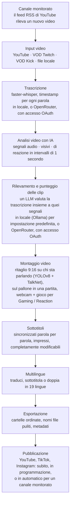

<div align="center">

[English](../../README.md) · [简体中文](README_zh.md) · [日本語](README_ja.md) · [한국어](README_ko.md) · [Türkçe](README_tr.md) · [Русский](README_ru.md) · [Tiếng Việt](README_vi.md) · [ไทย](README_th.md) · [Deutsch](README_de.md) · [Español](README_es.md) · [Français](README_fr.md) · [Português (Brasil)](README_pt-BR.md) · [العربية](README_ar.md) · [Bahasa Indonesia](README_id.md) · **Italiano** · [हिन्दी](README_hi.md) · [বাংলা](README_bn.md) · [Filipino](README_tl.md) · [اردو](README_ur.md)

</div>

<a id="clips-kitty-the-free-open-source-opus-clip-alternative-for-chatting-gaming-and-sports-on-your-own-pc"></a>

# Clips Kitty: l'alternativa gratuita e open source a Opus Clip per chiacchierate, gaming e sport, che gira sul tuo PC

> Questo README è stato tradotto con l'IA dal [README in inglese](../../README.md), che è il
> riferimento e viene aggiornato per primo. Le correzioni da parte di madrelingua sono benvenutissime.
>
> 🌐 [Il sito web in italiano](https://colingpt9.github.io/clips-studio/it.html)

<a href="https://apps.microsoft.com/detail/9NB6XT7DSQZZ">
  <picture>
    <source media="(prefers-color-scheme: dark)" srcset="https://get.microsoft.com/images/en-us%20dark.svg">
    
  </picture>
</a>

[](https://github.com/ColinGPT9/clips-studio/releases)
[](https://github.com/ColinGPT9/clips-studio/releases)
[](../../LICENSE)
[](https://github.com/ColinGPT9/clips-studio/stargazers)
[](https://github.com/ColinGPT9/clips-studio)
[](../../CONTRIBUTING.md)
[](../../docs/DOCKER.md)

<a href="https://youtu.be/g1dMqrq-YaI"></a>

<a id="star-and-share-clips-kitty--goal-150"></a>

### Metti una stella e condividi Clips Kitty ⭐ Obiettivo: 150

[](https://github.com/ColinGPT9/clips-studio/stargazers) **su 150**

**Per favore, metti una stella al repo e condividilo.** Non ti costa nulla, e dietro
non c'è alcun budget di marketing, quindi il passaparola è l'unico modo in cui il prossimo
piccolo YouTuber o streamer scopre che esiste un'opzione gratuita.

**L'ho creato per i piccoli YouTuber e streamer** che non possono permettersi le altre
opzioni o un montatore. È un'alternativa gratuita a Opus Clip, Vizard e Klap che
esegue **Google Gemma** sul tuo PC: nessun costo di server, nessuna tariffa per clip, nessun
costo di utilizzo dell'IA.

> **Clips Kitty si chiamava Clips Studio fino alla versione 1.1.3**, ed è stato rinominato per rispettare
> i requisiti sui nomi del Microsoft Store. Stessa app, stesso repository, stessi dati.


**Trasforma live e video lunghi in Shorts, Reels e TikTok pronti da pubblicare,
interamente sul tuo computer.** Clips Kitty è un generatore di clip con IA e un editor video
gratuito e open source per creator: incolla un link di YouTube, Twitch o Kick e lui trova i
momenti migliori, li ritaglia in 9:16 tenendo al centro chi parla, imprime sottotitoli
sincronizzati parola per parola e scrive titoli, descrizioni e hashtag.

Nessuna IA cloud per impostazione predefinita. Nessun abbonamento. Nessuna tariffa per clip. Il tuo girato non lascia mai
il tuo computer, a meno che tu non gli chieda di pubblicare una clip sul tuo canale YouTube.

Prima in locale, cloud quando serve: se il tuo PC è troppo vecchio per far girare l'IA, la esegue
un provider cloud, con l'addebito sul tuo account.
**OpenRouter è la via cloud consigliata**: accedi con il tuo account OpenRouter
(OAuth, nessuna chiave da copiare) per avere molti modelli (Claude, GPT, Gemini, Muse Spark e altri).
Nei miei test, un video di 2 ore è costato circa 11 centesimi su OpenRouter, con Gemma
(Gemma 4 26B-A4B) a scegliere le clip e Whisper (large-v3-turbo) a trascrivere; quanto
paghi dipende dai modelli che scegli e dalla durata del video.
Funzionano anche OpenAI, Claude, Gemini, xAI, Meta, DeepSeek e Qwen, direttamente, con la tua
chiave API.
Vedi [docs/AI-BACKENDS.md](../../docs/AI-BACKENDS.md).

**Perché esiste:** la maggior parte dei creator che fanno crescere un canale fa tutto da sé:
riprese, live, montaggio, pubblicazione. Le clip sono il modo in cui le persone ti scoprono, e di solito sono
la prima cosa che si lascia perdere: un montatore è un costo che la maggior parte dei canali non può ancora giustificare,
gli strumenti di clipping si fanno pagare a video o al mese, e tagliarle a mano richiede una giornata che ti
serviva per altro. Questo gira sull'hardware che hai già, quindi usarlo non costa nulla e
non c'è limite al numero di clip che crei.


<sub>38 clip da un solo video in 19 minuti, su un solo PC, senza caricare nulla.</sub>

---

<a id="contents"></a>

## Indice

- [Cosa fa](#what-it-does)
- [Il confronto con Opus Clip, Klap, Vizard e CapCut](#how-it-compares-to-opus-clip-klap-vizard-and-capcut)
- [Come funziona](#how-it-works)
- [Funzionalità](#features)
- [Per cosa è pensato](#what-its-built-for)
- [Requisiti](#requirements)
- [Installazione e avvio](#install-and-run)
- [Scegli il tuo modello IA](#pick-your-ai-model)
- [Hardware testato e prestazioni](#tested-hardware-and-performance)
- [Piattaforme supportate](#supported-platforms)
- [Lingue supportate](#supported-languages)
- [Pubblicare su YouTube](#publish-to-youtube)
- [Pubblicare su tutte le piattaforme insieme](#publish-to-every-platform-at-once)
- [Accelerazione GPU](#gpu-acceleration)
- [Uso da riga di comando](#command-line-use)
- [Scrivi un plugin](#write-a-plugin)
- [Costruirci sopra](#build-on-it)
- [Architettura](#architecture)
- [Contribuire](#contributing)
- [Roadmap](#roadmap-detail)
- [Licenza](#license)

---

<a id="what-it-does"></a>

## Cosa fa

Dai a Clips Kitty un video lungo. Lui ti restituisce una cartella di clip verticali finite
pronte da pubblicare, più uno studio per rivederle e sistemarle prima di farlo.

È pensato per i contenuti che la maggior parte degli strumenti di clipping gestisce peggio: **live, girato IRL e
talking-head, podcast e contenuti di palestra/fitness**: video lunghi e poco strutturati,
in cui i momenti migliori sono sepolti e la sola trascrizione non basta a trovarli.

<a id="how-it-compares-to-opus-clip-klap-vizard-and-capcut"></a>

## Il confronto con Opus Clip, Klap, Vizard e CapCut

Clips Kitty è un'alternativa open source agli strumenti di clipping in cloud. La differenza che
conta è dove avviene il lavoro: il tuo video non viene mai caricato, quindi non c'è nulla da
misurare e nulla da far pagare.

| Strumento | Prezzo, con fatturazione mensile | Piano gratuito | Trova le clip per te | Filigrana | Carica il tuo video | Open source |
| ---- | --------------------- | --------- | ----------------------- | --------- | ------------------ | ----------- |
| **Clips Kitty** | Gratis, nessun piano a pagamento | L'intera app | Sì | Mai | No, gira sul tuo PC | Sì, AGPL-3.0 |
| Opus Clip | $15 Starter, $29 Pro | 1080p, con filigrana, scade dopo 3 giorni | Sì | Nel piano gratuito | Sì | No |
| Klap | $29 Pro, $14 Basic con fatturazione annuale | Un video | Sì | Non indicato | Sì | No |
| Vizard | $29 Creator, $14.50 con fatturazione annuale | 60 crediti al mese, 720p | Sì | Nel piano gratuito | Sì | No |
| quso.ai | Da $29 a $49 | 75 crediti al mese, 720p | Sì | Non indicato | Sì | No |
| Ssemble | Da $15 a $60, da $6 a $24 con fatturazione annuale | Nessuno indicato | Sì | Non indicato | Sì | No |
| Descript | $16, $24, $50 | 60 minuti al mese, 720p | In parte, è un editor basato sulla trascrizione | Nei piani Free e Hobbyist | Sì | No |
| CapCut | Gratuito, piani a pagamento su capcut.com | L'intero editor | **No, tagli a mano** | Dipende dalla funzione | No nell'app desktop | No |

**CapCut è quello da capire bene**, perché è la risposta gratuita che danno tutti.
È un buon editor e non costa nulla, ma ogni momento lo trovi tu e ogni clip la ritagli
tu. Anche Clips Kitty è gratuito, e quel primo passaggio è proprio la parte che fa al posto tuo.

**Opus Clip, Klap o Vizard sono la scelta migliore** se non hai un PC Windows con una
scheda grafica, fai clip solo ogni tanto o devi lavorare da telefono. Clips Kitty è
pensato per fare clip in grandi quantità sull'hardware che hai già.

**[Confronto completo di tutti e sette, con il punto di forza di ciascuno](https://colingpt9.github.io/clips-studio/alternatives.html)**

<sub>Prezzi verificati sulla pagina dei prezzi di ciascuna azienda, il 17 settembre 2026. CapCut
non pubblica una pagina dei prezzi che siamo riusciti a leggere, quindi per lui non riportiamo alcun prezzo. I piani cambiano; questa
tabella non si aggiornerà da sola.</sub>

<a id="how-it-works"></a>

## Come funziona



**Ogni fase gira sul tuo computer a meno che tu non scelga diversamente:** OpenRouter, con accesso
tramite il tuo account, per l'IA o la trascrizione, e la pubblicazione, che carica solo le
clip che invii. Per il resto, l'unica cosa che tocca la rete in un'esecuzione normale è
il download del video di origine.

<a id="the-stages-in-detail"></a>

### Le fasi nel dettaglio

**Trascrizione: faster-whisper.** Timestamp a livello di parola, su CUDA dove
disponibile e con ripiego sulla CPU. È la precisione temporale delle parole a far cadere i sottotitoli sulla
sillaba giusta e a far iniziare le clip al confine di una vera frase.

**Punteggio delle clip con IA.** La trascrizione è uno dei cinque segnali. L'audio fornisce i picchi
di volume, la densità di raffiche (che è l'aspetto di risate e applausi) e le curve di climax
silenzio→esplosione. Il video fornisce i cambi di scena, il movimento e le variazioni dell'area del volto. Un segnale
di reazione li fonde insieme. Ognuno è normalizzato *all'interno di quel video*, così un podcast tranquillo e una
live piena di urla producono entrambi picchi significativi. Dove esistono dati reali sul pubblico
(il replay della chat di Twitch misurato in chatter unici, la heatmap dei momenti più rivisti di YouTube),
aggiungono un piccolo bonus con un tetto massimo.

L'LLM locale vede la trascrizione **più una timeline di quegli eventi**, così può valutare
correttamente "le parole sono tranquille ma la stanza è esplosa". Poiché i modelli piccoli assegnano
a tutto punteggi in una fascia ristretta, i finalisti vengono poi confrontati testa a testa in un'unica
chiamata di riordino: un giudizio relativo è molto più facile per un modello 7B di un punteggio assoluto.

**Profili creator.** L'app costruisce una base di conoscenza per ogni creator attraverso i suoi video:
argomenti ricorrenti, serie, collaboratori, gag ricorrenti e trame in corso. Quel
contesto la aiuta a scrivere titoli accurati e a cogliere i richiami a momenti passati. È volutamente
prudente: un tormentone deve ripetersi davvero prima di contare, le conoscenze che
non vengono più menzionate diventano inattive, e ogni contributo al punteggio che ne deriva è additivo,
limitato e disattivabile.

**Editor video.** Non distruttivo: rifilature, tagli interni, silenziamenti, parole silenziate, volume,
dissolvenze, velocità, testo di aggancio, musica e filigrana vengono salvati come operazioni e applicati al momento
del rendering. C'è anche una chat di modifica con IA (*"allungala di 5 secondi"*, *"il sottotitolo
dice gost, dovrebbe dire ghost"*), in cui il modello propone e del codice convalidato applica.

**Elaborazione long-form.** Un percorso 16:9 opzionale che usa la stessa analisi: clip
orizzontali, tagli della lunghezza adatta a X/Twitter, un highlight reel con il meglio, o la live completa con
i tempi morti rimossi.

**Pipeline multilingue e doppiaggio con IA.** I sottotitoli vengono tradotti e mostrati per la revisione
*prima* che venga scritto o impresso qualsiasi cosa, così una riga sbagliata si corregge finché è ancora
correggibile. Un glossario impedisce che nomi di canali, sponsor e battute interne vengano
tradotti. Il doppiaggio usa un TTS locale con voci che puoi ascoltare in anteprima.

**Accelerazione GPU locale.** CUDA per il rilevamento e la trascrizione, codifica video
hardware tramite NVENC/AMF/QSV (rilevata automaticamente, con ripiego sulla CPU), e l'LLM su GPU
tramite Ollama.

<a id="features"></a>

## Funzionalità

- **Rilevamento multimodale delle clip**: momenti valutati 0–100 fondendo ciò che viene detto, l'energia
  dell'audio, l'attività visiva, le reazioni sullo schermo e la forza di hook/payoff. Ogni
  clip che supera la soglia di qualità viene tenuta, senza un limite arbitrario.
- **Tracciamento del volto che riconosce chi parla**: il rilevamento della posa di YOLOv8 tiene il soggetto al centro,
  e nelle riprese di gruppo l'inquadratura segue **chi sta davvero parlando**, deciso dal
  rilevamento del parlante attivo di TalkNet a partire dal volto e dall'audio insieme, non
  dal movimento. Quando cambia chi parla, l'inquadratura **stacca** su di lui invece di
  fare una panoramica, come farebbe un montatore. Inquadratura solo tramite ritaglio: mai stirata, mai
  distorta.
- **Modalità podcast**: per le riprese multicamera, ogni inquadratura ha il suo ritaglio fisso su una
  persona, così gli stacchi cadono su un volto senza panoramiche. All'interno di un'inquadratura il soggetto viene scelto in base al
  movimento della bocca, ripiegando sul volto più in evidenza.
- **Vertical Live**: per una live che era già verticale quando è stata trasmessa (una
  live verticale di YouTube, Twitch Dual Format, Streamlabs Dual Output, una live di Instagram o TikTok
  scaricata). Mantiene il layout 9:16 originale della live, salta il tracciamento del volto e
  sceglie comunque i momenti nel solito modo. Vedi [docs/VERTICAL-LIVE.md](../../docs/VERTICAL-LIVE.md).
- **Sport: calcio e basket**: ogni grande momento di una partita in una clip a sé,
  con l'azione che lo precede e la reazione.
  - **Calcio**: gol, parate, cartellini e grandi occasioni. I gol vengono letti dal riquadro del punteggio e collocati nel tempo
    grazie al boato del pubblico, e il ritaglio 9:16 segue il pallone. Scegli All goals, Best saves, Cards e
    altro ancora, e fai unire i momenti in un riassunto della partita e in reel di squadra o di giocatore.
  - **Basket**: schiacciate, triple, stoppate, palle rubate e canestri della vittoria. Il riquadro del punteggio conferma
    ogni canestro e i suoi punti, e il quarto e il cronometro fanno valere un canestro della vittoria molto più di un canestro
    del primo quarto. Vengono trovate anche le reazioni del pubblico, della panchina e quelle a bordo campo. Il ritaglio 9:16 di
    ogni clip è pianificato attorno alla sua azione: il pallone e chi lo ha, chi riceve un passaggio e il tiro seguito fino
    al canestro, con ferro e tabellone nell'inquadratura. Segue l'azione in panoramica e non zooma mai. Il pallone viene
    trovato dal modello di rilevamento [E-BARD](https://github.com/GabrieleGiudic/E-BARD#readme) (citato in [Licenza](#license)).

  Vedi [docs/SPORTS.md](../../docs/SPORTS.md).
- **Sottotitoli impressi modificabili**: sincronizzati parola per parola e con lo stile che preferisci (colore, dimensione,
  posizione, parole per riga, maiuscole/minuscole, o disattivati). Correggi un errore di trascrizione riga per riga
  prima dell'esportazione. Con due persone che parlano, i sottotitoli del secondo parlante possono avere
  un altro colore, e quelli attribuiti alla persona sbagliata si possono scambiare a mano.
- **Chat di modifica con IA**: descrivi cosa non va con parole semplici e la clip viene rimontata.
- **Ask Clips Kitty**: la casella di testo in fondo alla dashboard. Scrivi cosa vuoi in
  una frase, per esempio *"fai le clip di questa live, assicurati di includere quando sono morto contro il boss,
  con sottotitoli gialli grandi"*, e lui mette il video in coda, dice al selettore delle clip cosa
  cercare e imposta le opzioni che hai indicato. **Serve un modello Gemma 4**: vedi
  [La casella di testo in fondo richiede Gemma 4](#the-text-box-at-the-bottom-needs-gemma-4).
- **Titoli, descrizioni e hashtag con IA**, tutti modificabili prima dell'esportazione.
- **Profili creator**: l'app impara a conoscere ogni creator nel tempo per scegliere e intitolare meglio
  le clip. Tutto resta sul tuo computer, e puoi esaminarlo, correggerlo o cancellarlo.
- **Pubblicazione multilingue**: 19 lingue, con revisione prima che venga impresso qualsiasi cosa.
- **Doppiaggio con IA**: sintesi vocale locale con ascolto delle voci in anteprima per ogni lingua.
- **Esportazione long-form**: clip 16:9, highlight reel o un montaggio della live senza ripetizioni.
  La descrizione di un highlight reel include i **timestamp dei capitoli**, così gli spettatori possono saltare
  da un momento all'altro su YouTube.
- **Profili di filigrana e branding**: impostazioni predefinite per ogni creator, applicate automaticamente.
- **Gestione modelli**: cambia il cervello dell'IA dall'interno dell'app; scarica, rimuovi e
  cambia modello con barre di avanzamento e senza terminale.
- **Pubblica su YouTube dall'editor**: titolo, descrizione, tag, miniatura,
  playlist, pubblico e visibilità, poi Upload now o programmala. Facoltativo, disattivato
  per impostazione predefinita, e usa la tua chiave API di Google.
- **Feedback dall'app**: segnalazioni di bug con diagnostica raccolta automaticamente, senza bisogno di un account.
- **Interfaccia accessibile**: focus da tastiera, supporto al movimento ridotto, font e dimensione regolabili.

<a id="what-its-built-for"></a>

## Per cosa è pensato

Tutto funziona su qualsiasi video tu gli dia. Questi sono i casi in cui ragiona di più
o di meno di quanto lasci intendere l'elenco delle funzionalità, così niente ti coglie di sorpresa:

| Contenuto | Come se la cava |
|---|---|
| **IRL, just chatting, podcast, vlog, interviste** | È ciò per cui è ottimizzato e ciò che viene testato su live reali prima di ogni rilascio |
| **Gaming e reaction** | Con **Gaming / Reaction** attivo: la webcam in una metà, il gioco o il video a cui si reagisce nell'altra, verificato sui fotogrammi del video stesso prima dell'elaborazione ([docs/GAMING.md](../../docs/GAMING.md)). Lo streamer è chi sta parlando, mai il volto più grande. Senza l'opzione, l'inquadratura può seguire un personaggio all'interno del gioco. Solo persone in camera, niente VTuber |
| **Partite sportive** | Con **Sports** attivo: pensato per le trasmissioni con riquadro del punteggio e telecronaca, dove i gol e i canestri sono certi. Le riprese di un club o fatte col telefono di solito non hanno né l'uno né l'altra: le loro clip seguono il pallone, e i gol arrivano dagli eventi della partita che incolli, come i tag dei gol dell'app di un club ([docs/SPORTS.md](../../docs/SPORTS.md)) |
| **Ciò a cui si sta reagendo** | Le clip vengono comunque scelte in base a ciò che viene *detto*, quindi un momento del video guardato che nessuno commenta gli resta invisibile |

La selezione delle clip si basa su trascrizione e segnali. Quando la cosa divertente è *solo visiva*
e nessuno la commenta, aspettati di doverla trovare da solo nell'editor.

<a id="requirements"></a>

## Requisiti

|             | Minimo                                       | Consigliato                     |
| ----------- | -------------------------------------------- | ------------------------------- |
| **GPU**     | NVIDIA RTX 2060 (6 GB)                       | RTX 3060 12 GB o superiore      |
| **CPU**     | Intel Core i3-9100 / AMD Ryzen 3 3200G (2019)| 6 core o più                    |
| **RAM**     | 16 GB                                        | 16 GB o più                     |
| **Disco**   | ~20 GB, più lo spazio per i video da cui fai le clip |                         |
| **OS**      | Windows 10 o 11                              |                                 |

**Sotto il minimo potrebbe comunque funzionare, ma non è supportato e sarà
lento.** Fare le clip di una live significa ore di decodifica video, trascrizione e
codifica; con hardware precedente al 2019 circa ci vorrà così tanto che l'app
sembrerà rotta anche quando funziona correttamente.

Due di questi meritano qualche parola in più:

- **16 GB di RAM non sono un suggerimento.** Con 8 GB analizzerà un intero video e poi
  non renderizzerà nulla, il che sembra un crash più che un limite di memoria.
- **La GPU è facoltativa, non obbligatoria.** Senza, tutto gira sulla CPU,
  più lentamente, ma per intero. La RTX 2060 è la soglia da cui il percorso GPU inizia a funzionare;
  vedi [Accelerazione GPU](#gpu-acceleration).

**Solo Windows** per l'app. Il motore Python dovrebbe girare su Linux/macOS, ma
non esiste una build per Mac e il manutentore non ha un Mac su cui testarla. Vedi
[#62](https://github.com/ColinGPT9/clips-studio/issues/62) se ne hai uno e vuoi dare una mano.

Eseguirlo dal sorgente richiede le cose che altrimenti l'installer includerebbe per te:

- **Python 3.10+** e **Node.js 18+**
- **[FFmpeg](https://ffmpeg.org/download.html)** nel tuo PATH
- **[Ollama](https://ollama.com)** con un modello scaricato: `ollama pull gemma:7b`

<a id="install-and-run"></a>

## Installazione e avvio

**Il modo più semplice è il [Microsoft Store](https://apps.microsoft.com/detail/9NB6XT7DSQZZ).**
Un clic, si aggiorna da solo e Windows non mostra alcun avviso di sicurezza. Microsoft
ha certificato e firmato il pacchetto, quindi l'avviso di SmartScreen descritto più sotto
non compare affatto. Lo Store installa le nuove versioni quando ci arriva; per averne
una subito, apri la pagina di Clips Kitty nel Microsoft Store e premi **Update** (Aggiorna).

**Oppure scarica l'installer.** Prendi l'ultimo **Web Setup** da
[Releases](https://github.com/ColinGPT9/clips-studio/releases) ed eseguilo. Contiene l'app, il motore Python, ogni
libreria, FFmpeg, il runtime dell'IA e tutti i pesi di rilevamento e trascrizione: niente
Python, niente PATH, niente terminale e nessun secondo programma da installare.

**Oppure usa winget.** `winget install ColinGPT9.ClipsKitty` installa lo stesso Web Setup
da un terminale.

L'unica cosa che non contiene è il modello linguistico vero e proprio, perché questi modelli vengono distribuiti con
licenze che deve accettare chi li scarica, e non è qualcosa che si possa
accettare a nome tuo. La procedura guidata di configurazione avvia quel download da sola, sceglie la
dimensione adatta alla tua scheda grafica e mostra una barra di avanzamento. Quindi: un download, un
doppio clic, una barra di avanzamento. Dopodiché funziona offline.

> La prima volta che lo avvii, Windows avviserà che l'app non è firmata. Fai clic su
> *More info → Run anyway* (Ulteriori informazioni → Esegui comunque). Un certificato di firma è nella lista delle cose da fare.

<a id="from-source"></a>

### Dal sorgente

```bash
git clone https://github.com/ColinGPT9/clips-studio
cd clips-studio
pip install -r requirements.txt

cd ui
npm install
npm run dev        # opens the Clips Kitty desktop app
```

L'app avvia automaticamente il proprio motore Python. Incolla un link in **Clip Editor**,
premi *Generate clips* e segui l'avanzamento in tempo reale.

Compilare l'installer da solo richiede un solo comando. Vedi
[CONTRIBUTING.md](../../CONTRIBUTING.md#building-the-windows-installer).

<a id="with-docker-nothing-else-to-install"></a>

### Con Docker: nient'altro da installare

Per chi contribuisce. Ti serve [Docker Desktop](https://docs.docker.com/get-started/get-docker/)
e nient'altro: niente Python, niente Node, niente FFmpeg, niente PyTorch.

```bash
git clone https://github.com/ColinGPT9/clips-studio
cd clips-studio
docker compose up
```

Tre servizi si avviano insieme:

| | |
|---|---|
| **<http://localhost:5173>** | l'interfaccia, nel tuo browser |
| **<http://localhost:8765>** | il motore e la sua API |
| Ollama | l'IA locale, su :11434 |

Poi scarica un modello (`docker compose exec ollama ollama pull gemma3:4b`) e
hai una copia di lavoro funzionante.

Esegui i controlli allo stesso modo:

```bash
docker compose run --rm engine pytest
docker compose run --rm ui npm run typecheck
```

> **Salta la prima build da dieci minuti:** `docker compose pull` scarica un'immagine
> del motore già pronta invece di compilare PyTorch e OpenCV in locale.

La shell desktop gira comunque sul tuo host, perché Electron ha bisogno di uno schermo;
tutto il resto è containerizzato. I dettagli, e ciò che questo approccio non può dirti, sono in
[docs/DOCKER.md](../../docs/DOCKER.md).

<a id="pick-your-ai-model"></a>

## Scegli il tuo modello IA

Apri la pagina **Models** per vedere cosa è installato e cosa può gestire la tua GPU:

Un solo criterio: quanta VRAM hai. Queste sono le stesse righe che mostra l'app, prese da
`RECOMMENDATIONS` in [`llm/manager.py`](../../llm/manager.py). La procedura guidata e la pagina Models
leggono quell'unica tabella, quindi non possono essere in disaccordo tra loro, né con questa.

| Il tuo hardware | Modello consigliato | |
|---|---|---|
| CPU / iGPU, nessuna scheda grafica | `gemma3:4b` | testato |
| Meno di 6 GB di VRAM, o un PC più vecchio | `gemma4:e2b` | |
| 6 GB di VRAM | `gemma4:e4b` | |
| 8 GB di VRAM | **`gemma:7b`** | testato · predefinito di serie |
| 10–12 GB di VRAM | `gemma3:12b` | testato |
| 16–24 GB di VRAM | `gemma3:27b` | |

E i modelli che vale la pena scegliere per un motivo diverso dalla VRAM:

| Motivo | Modello |
|---|---|
| Traduzione / multilingue | `qwen3:8b` o `qwen3:14b` |
| Licenza permissiva | `mistral-nemo:12b` (Apache-2.0) · `phi4:14b` (MIT) |

**Solo i tre segnati come "testato" sono stati provati su live reali**, e `gemma:7b`
è quello con più ore di utilizzo alle spalle; è quello con cui viene distribuito `config/settings.yaml`.
Tutti gli altri sono elencati perché hanno una dimensione sensata e sono liberi per l'uso commerciale,
non perché la qualità delle clip sia stata misurata con loro. Funzionano tutti, dato che l'app comunica
con ogni modello allo stesso modo tramite Ollama, ma nessuno ha verificato se scelgano
momenti migliori. Colmare questa lacuna è l'obiettivo di [#38](https://github.com/ColinGPT9/clips-studio/issues/38).

Qualsiasi modello servito da Ollama funziona, e cambiarlo richiede un clic. La traduzione può usare un modello
*diverso* da quello per le clip. Imposta `llm.translation_model`.

<a id="the-text-box-at-the-bottom-needs-gemma-4"></a>

### La casella di testo in fondo richiede Gemma 4

**Ask Clips Kitty**, la casella di testo in fondo alla dashboard, funziona solo con un modello
in grado di usare gli strumenti dell'app. Gemma 4 ci riesce. `gemma:7b` e i modelli Gemma 3 no, e
la configurazione installa uno di questi su un PC senza scheda grafica o con 8 GB di VRAM o più.
Lì la casella non funzionerà finché non aggiungi un modello Gemma 4: la versione 2.0 dice *"No installed
model can use tools"*, e le versioni successive offrono il download direttamente nella casella.

Qualunque modello scelga le tue clip, installa accanto a esso un modello Gemma 4 dalla pagina **Models**:
`gemma4:e4b` su una scheda grafica con 6 GB o più, `gemma4:e2b` con meno. Non devi
passare a quel modello. La casella lo trova da sola, e le tue clip continuano a essere scelte dal
modello che hai selezionato. Se invece esegui l'IA tramite OpenRouter, la casella usa quel modello
e non serve installare nulla.

<a id="tested-hardware-and-performance"></a>

## Hardware testato e prestazioni

Clips Kitty viene sviluppato e testato ogni giorno su questa macchina, quindi è un utile punto
di riferimento se stai confrontando i tuoi risultati:

| | |
|---|---|
| **GPU** | NVIDIA GeForce RTX 3060, 12 GB di VRAM |
| **CPU** | AMD Ryzen 5 5600X (6 core / 12 thread) |
| **RAM** | 16 GB |
| **OS** | Windows 10 |
| **Modello per le clip** | `gemma:7b` tramite Ollama |
| **Trascrizione** | faster-whisper `large-v3-turbo` su CUDA |

Tutto in questo repo (le impostazioni predefinite, `parallel_renders: 3`, i blocchi di analisi
da 5 minuti) è calibrato più o meno per questa classe di macchina. Su una GPU più potente,
alza insieme `llm.num_ctx` e `analysis.chunk_seconds` e passa a un modello di una taglia superiore;
su una meno potente, scendi a `gemma3:4b`.

Se fai un benchmark di Clips Kitty su un hardware diverso, pubblicalo in
[Discussions](https://github.com/ColinGPT9/clips-studio/discussions). Numeri reali da macchine reali aiutano tutti a dimensionare
il proprio setup.

<a id="supported-platforms"></a>

## Piattaforme supportate

| Sorgente | Supporto |
|---|---|
| Video di YouTube | Completo. H.264 viene selezionato di proposito (AV1 raddoppia circa i tempi di elaborazione) |
| VOD di Twitch | Completo, incluso il replay della chat come segnale del pubblico |
| VOD di Kick | Completo (Kick elimina la chat alla fine di una live, quindi non c'è segnale dalla chat) |
| File video locali | Completo. Fai le clip del tuo girato prima di pubblicarlo |
| Dirette | Non supportate per scelta. Solo VOD |

<a id="supported-languages"></a>

## Lingue supportate

Le clip possono essere tradotte, sottotitolate e doppiate in **19 lingue**, e
**anche l'interfaccia è tradotta in tutte e 19**, quindi l'app si può usare nelle stesse
lingue in cui pubblica:

Inglese · Spagnolo · Portoghese (brasiliano) · Francese · Tedesco · Hindi · Indonesiano ·
Giapponese · Russo · Arabo · Cinese (semplificato) · Vietnamita · Filippino · Turco ·
Urdu · Bengalese · Thailandese · Coreano · Italiano

Aggiungere una lingua richiede una riga in `multilingual/languages.py` più un file di localizzazione in
`ui/src/renderer/src/locales/`. Il traduttore e il generatore di sottotitoli sono
indipendenti dalla lingua.

<a id="help-wanted-the-maintainer-only-speaks-english"></a>

### Cercasi aiuto: il manutentore parla solo inglese

18 di quelle 19 traduzioni dell'interfaccia non sono mai state lette da qualcuno che parla
la lingua. La metà non è finita. Ogni lingua ha la sua issue,
scritta in inglese e in quella lingua, e **segnalare una parola sbagliata è già un
contributo completo**: non serve alcuna pull request. [Come funziona](../../docs/TRANSLATING.md).

**Da completare** (circa 68 stringhe ancora in inglese):
[বাংলা (bengalese)](https://github.com/ColinGPT9/clips-studio/issues/43) ·
[Italiano](https://github.com/ColinGPT9/clips-studio/issues/44) ·
[한국어 (coreano)](https://github.com/ColinGPT9/clips-studio/issues/45) ·
[ไทย (thailandese)](https://github.com/ColinGPT9/clips-studio/issues/46) ·
[Tagalog (filippino)](https://github.com/ColinGPT9/clips-studio/issues/47) ·
[Türkçe (turco)](https://github.com/ColinGPT9/clips-studio/issues/48) ·
[اردو (urdu)](https://github.com/ColinGPT9/clips-studio/issues/49) ·
[Tiếng Việt (vietnamita)](https://github.com/ColinGPT9/clips-studio/issues/50) ·
[中文 (cinese)](https://github.com/ColinGPT9/clips-studio/issues/51)

**Da verificare** (complete, ma nessuno ha controllato che suonino naturali):
[العربية (arabo)](https://github.com/ColinGPT9/clips-studio/issues/52) ·
[Deutsch (tedesco)](https://github.com/ColinGPT9/clips-studio/issues/53) ·
[Español (spagnolo)](https://github.com/ColinGPT9/clips-studio/issues/54) ·
[Français (francese)](https://github.com/ColinGPT9/clips-studio/issues/55) ·
[हिन्दी (hindi)](https://github.com/ColinGPT9/clips-studio/issues/56) ·
[Bahasa Indonesia (indonesiano)](https://github.com/ColinGPT9/clips-studio/issues/57) ·
[日本語 (giapponese)](https://github.com/ColinGPT9/clips-studio/issues/58) ·
[Português (portoghese)](https://github.com/ColinGPT9/clips-studio/issues/59) ·
[Русский (russo)](https://github.com/ColinGPT9/clips-studio/issues/60)

Vuoi una lingua che non c'è? [#61](https://github.com/ColinGPT9/clips-studio/issues/61).

<a id="publish-to-youtube"></a>

## Pubblicare su YouTube

Disattivato per impostazione predefinita. Attivalo in **Settings → Publish to YouTube** e nell'editor compare
una scheda **YouTube**: compila titolo, descrizione, tag, miniatura,
playlist, pubblico e visibilità, poi premi **Upload now**. Clips Kitty renderizza
la clip se hai modifiche non salvate e la carica direttamente sul tuo canale. Non
c'è alcun passaggio di esportazione né una pagina di pubblicazione separata. Non esci mai dall'editor.

Se lo lasci disattivato, nell'app non cambia nulla.

<a id="scheduling"></a>

### Programmazione

Scegliere **Schedule on YouTube** carica il video *subito*, lo imposta come
privato e comunica a YouTube un orario di pubblicazione. YouTube lo pubblica nel giorno stabilito.

**Puoi chiudere Clips Kitty e spegnere il computer.** In questa app non c'è
nessun timer, nessun servizio in background e niente da lasciare in esecuzione. Una volta che YouTube ha
accettato il video, il lavoro di Clips Kitty è finito.

<a id="you-need-your-own-google-api-key"></a>

### Ti serve una tua chiave API di Google

Clips Kitty non include una chiave condivisa, e non è solo prudenza. La quota di
caricamento di Google è **per progetto Cloud**: una chiave condivisa significherebbe che ogni utente al
mondo attinge agli stessi 100 caricamenti al giorno. Un tuo progetto ti dà una tua
quota, e le tue credenziali non lasciano mai la tua macchina. Non c'è alcun server di Clips Kitty
di mezzo.

La configurazione è gratuita e richiede circa dieci minuti; la procedura guidata in Settings ti accompagna passo passo:

1. Crea un progetto nella [Google Cloud Console](https://console.cloud.google.com/projectcreate).
2. Abilita **YouTube Data API v3** in APIs & Services → Library.
3. Compila la schermata di consenso OAuth, poi premi **Publish app**. Questo passaggio è importante:
   se lo lasci in *Testing*, Google fa scadere il tuo accesso ogni 7 giorni e dovresti
   ricollegarti ogni settimana. "In production" non significa verificata e non costa nulla.
4. Credentials → Create credentials → OAuth client ID → tipo **Desktop app**.
5. Incolla il client ID e il secret in Settings, poi collega il tuo canale.

Quando ti colleghi vedrai l'avviso "Google hasn't verified this app". È
la tua stessa app che ti mette in guardia da te stesso. **Advanced → Go to (unsafe)** ti permette di
superarlo.

<a id="posting-publicly"></a>

### Pubblicare in modo pubblico

Una cosa da sapere prima di farci affidamento, perché nessun software può aggirarla:

> **Finché il tuo progetto Google Cloud non supera l'audit gratuito dell'API di YouTube, YouTube blocca
> come privato ogni video caricato tramite esso.** Il blocco è permanente. Non puoi
> rendere pubblico il video in seguito da Studio, e non c'è possibilità di ricorso. L'unica soluzione
> è caricarlo di nuovo da un progetto che ha superato l'audit.

Clips Kitty controlla dopo ogni caricamento e ti dice chiaramente se è successo, invece
di segnalare un successo per un video che nessuno può guardare. Se intendi pubblicare
in modo pubblico, invia il
[modulo di audit di YouTube API Services](https://support.google.com/youtube/contact/yt_api_form)
prima di tutto. Caricare come **unlisted** o **private** non ne risente.

<a id="what-it-can-and-cannot-set"></a>

### Cosa può e non può impostare

Tutto ciò che l'API pubblica espone: titolo, descrizione (i timestamp al suo interno diventano
capitoli), tag, categoria, lingua, visibilità, orario di pubblicazione programmato, contenuto destinato ai bambini,
dichiarazione di contenuti alterati/sintetici, licenza, incorporamento, statistiche pubbliche, miniatura
personalizzata e aggiunta a una playlist.

Alcune funzioni di YouTube Studio non sono affatto presenti nell'API pubblica, quindi di proposito
non c'è un controllo per esse, piuttosto che uno che in silenzio non fa nulla:
monetizzazione e interruzioni pubblicitarie, dichiarazione di promozione a pagamento, schermate finali e schede,
impostazioni dei commenti, limiti di età, Premiere e autorizzazioni di remix degli Shorts. Per queste il
pannello ti rimanda a Studio.

Gli Shorts non richiedono nulla di speciale: nessuna modalità separata e nessun tag `#Shorts`. YouTube
classifica da solo un video come Short in base al formato e alla durata.

<a id="publish-to-every-platform-at-once"></a>

## Pubblicare su tutte le piattaforme insieme

Anche questo è disattivato per impostazione predefinita. Attivalo in **Settings → Publish through WoopSocial**
e nell'editor compare una scheda **Publish**: scegli le tue piattaforme — oppure premi
**Everywhere** (Ovunque) — scrivi titolo e descrizione una sola volta, e un unico caricamento arriva a
YouTube, TikTok, Instagram, Facebook, X, Threads, LinkedIn, Pinterest e
Bluesky insieme. **Publish all** nel Clip Editor gestisce un intero lotto,
distanziando i post così che una dozzina di clip non arrivi nello stesso secondo.

Questa funzione **non è locale**. La clip e i suoi dettagli vengono inviati a un servizio
di pubblicazione, che li consegna e custodisce i collegamenti ai tuoi account
social, quindi Clips Kitty non ti chiede mai una password dei social. Tutto il resto
dell'app continua a girare sul tuo PC.

Sono supportati due servizi: **[WoopSocial](https://woopsocial.com/?via=clipskitty)**,
il cui piano gratuito collega due account e consente circa 5 post su YouTube al
giorno, con i piani a pagamento che alzano entrambi i limiti, e
**[Upload-Post](https://www.upload-post.com/)**, che raggiunge più
destinazioni e aggiunge miniature, primi commenti e una coda di pubblicazione. Attivane
uno, o entrambi.

<sub>Link di affiliazione - Clips Kitty potrebbe ricevere una commissione se ti iscrivi tramite
questo link, senza alcun costo aggiuntivo per te.</sub>

**Porta la tua chiave.** Crei tu l'account, colleghi i tuoi social e
usi la tua quota. Clips Kitty non fa pagare nulla, non custodisce chiavi condivise e
non paga nulla — lo stesso accordo dell'integrazione con YouTube, e per
lo stesso motivo.

Guida completa, supporto per ogni piattaforma e limiti:
**[docs/UPLOAD-POST.md](../../docs/UPLOAD-POST.md)**.

<a id="gpu-acceleration"></a>

## Accelerazione GPU

**La codifica video** è accelerata via hardware automaticamente su tutti e tre i produttori: NVIDIA
(NVENC), AMD (AMF) e Intel (QSV). All'avvio il motore codifica un fotogramma di prova con ciascuno
e usa il primo che funziona davvero, ripiegando sulla CPU. Puoi forzare una scelta
con `video.encoder` in `config/settings.yaml`.

**Rilevamento e trascrizione** sono più veloci con CUDA. Di base `pip install
torch` ti dà la build **solo CPU**. Per NVIDIA:

```bash
pip uninstall torch torchvision -y
pip install torch torchvision --index-url https://download.pytorch.org/whl/cu130
```

**Quali schede usano la GPU:** GTX serie 16, RTX serie 20 e tutte le più recenti,
inclusa la RTX serie 50.

**La trascrizione su GPU** richiede anche cuBLAS 12 di NVIDIA: il motore di Whisper
(CTranslate2) è una build CUDA 12, mentre il PyTorch CUDA 13 qui sopra ha solo cuBLAS 13.
`pip install -r requirements.txt` lo installa (`nvidia-cublas-cu12`), e
l'app installata lo include, quindi non serve alcun CUDA toolkit. Senza, la trascrizione
gira sulla CPU e il log spiega perché.

**Le GTX serie 10 e precedenti sono sotto il minimo.** Non sono una configurazione
supportata. L'app non si rifiuta di avviarsi su di esse: il rilevamento ripiega
sulla CPU e tutto continua a funzionare, ma sarà lento, e una macchina così
vecchia di solito ha una CPU che rende lento l'intero lavoro, non solo
la fase di rilevamento.

Usa l'indice `cu130` qui sopra, non uno più vecchio. Le build CUDA più vecchie non hanno codice
per le schede recenti, e l'app finisce per ripiegare sulla CPU su un hardware che
dovrebbe essere veloce.

Se hai una GPU AMD: tracciamento e trascrizione girano sulla CPU su Windows, e restano pienamente
funzionanti, solo più lenti. La tua GPU viene comunque usata per la codifica video tramite AMF e per
l'LLM tramite Ollama, che supporta AMD direttamente.

**La decodifica video** passa per FFmpeg con accelerazione hardware invece che per OpenCV,
sia per la fase di tracciamento sia per il rendering. Leggere i fotogrammi campione in questo modo costa circa un
decimo della CPU rispetto a decodificarli in Python, ed è importante perché la fase di tracciamento
viene eseguita su ogni clip.

**Condivisione della CPU.** Rilevamento e rendering vogliono entrambi tutti i core e, lasciati a sé stessi,
si contendono le risorse tra loro e con l'interfaccia. All'avvio il motore suddivide i core tra i worker di rendering
e ne tiene di proposito due da parte, così l'app resta reattiva mentre un lotto
è in esecuzione. Regolalo con `video.parallel_renders`.

<a id="command-line-use"></a>

## Uso da riga di comando

Tutto funziona anche senza l'app desktop:

```bash
python main.py process "https://www.youtube.com/watch?v=VIDEO_ID"   # one video
python main.py models                                               # list/switch models
python main.py status                                               # processing state
python main.py serve                                                # just the API engine
```

Le impostazioni si trovano in [config/settings.yaml](../../config/settings.yaml). In cima al file c'è
un breve blocco di configurazione rapida, e tutte le opzioni avanzate sono sotto. Ogni prompt dell'LLM è un semplice
file di testo in [config/prompts/](../../config/prompts/), così puoi regolare il modo in cui vengono valutate le clip
senza toccare Python.

<a id="write-a-plugin"></a>

## Scrivi un plugin

Conosci un gioco, uno sport o un tipo di programma meglio di un rilevatore generico?
Scrivi un piccolo plugin Python che trova, comprende o valuta i momenti di un video,
e Clips Kitty fa il resto. L'SDK è MIT, quindi il tuo plugin può usare qualsiasi licenza, e
non serve fare il fork di nulla.

```text
Clips Kitty SDK

Input                      a link or a video file
  ↓
Video                      Clips Kitty downloads it and writes down what is said
  ↓
Your plugin                every step is optional
  ├── find                 picks the moments                  built
  ├── understand           says what happens in each one      built
  ├── rate                 scores each moment                 built
  └── edit                 suggests edits for the creator     built
  ↓
Clips Kitty                does every step no plugin does, then cuts, frames and captions the clips
  ↓
Creator / Social Platform  posts when the creator clicks Publish, or on a schedule or automatic posting the creator switched on
```

- Un plugin può trovare i momenti di un video; sostituisce la ricerca interna di Clips Kitty.
- Fino a 3 plugin possono comprendere e fino a 3 possono valutare, dopo l'eventuale plugin di ricerca.
- Il ruolo di un plugin deriva da `inputs` e `outputs` nel suo manifest ([Passaggi](../../docs/developers/steps.md)).
- Fino a 3 plugin possono suggerire modifiche per le clip che verranno create.
- I plugin di modifica suggeriscono modifiche che restano in attesa del creator nell'editor ([Passaggi](../../docs/developers/steps.md#suggest-edits-the-edit-step)).
- La pubblicazione non è un passaggio dei plugin: Clips Kitty pubblica le clip da sé, e tramite WoopSocial può pubblicare su molti siti insieme sull'account del creator ([Pubblicare su tutte le piattaforme insieme](#publish-to-every-platform-at-once)). `kind: publisher` viene rifiutato: i plugin non pubblicano.

Tre comandi installano l'SDK, creano un plugin dal template `game-events` (per
Quarkbloom Arena, un gioco inventato) e lo eseguono su un video di prova generato dall'SDK. Richiedono
Python 3.11, FFmpeg e Git.

PowerShell (Windows):

```powershell
py -m pip install "clipskitty-sdk[yaml,test] @ git+https://github.com/ColinGPT9/clips-studio#subdirectory=sdk/python"
py -m clipskitty_sdk new quarkbloom-bursts --template game-events --publisher your-github-name
py -m clipskitty_sdk run quarkbloom-bursts --sample
```

bash (macOS, Linux):

```bash
python -m pip install "clipskitty-sdk[yaml,test] @ git+https://github.com/ColinGPT9/clips-studio#subdirectory=sdk/python"
python -m clipskitty_sdk new quarkbloom-bursts --template game-events --publisher your-github-name
python -m clipskitty_sdk run quarkbloom-bursts --sample
```

Clips Kitty 2.1.0 è la prima release che esegue i plugin, e include l'SDK 1.3.0.

**[La tua prima pipeline per un gioco](../../docs/developers/first-game-pipeline.md)** prosegue da
lì, passo dopo passo, fino a un plugin installato in Clips Kitty e presente nel suo Marketplace.
Il [Signals cookbook](../../docs/developers/signals-cookbook.md) contiene ricette per leggere il
video di un gioco, il [riferimento dell'SDK](../../docs/developers/sdk.md) contiene ogni comando e chiamata,
e la [documentazione per sviluppatori](../../docs/developers/README.md) contiene tutto il resto. La pagina
[Clips Kitty SDK](https://colingpt9.github.io/clips-studio/developers.html) del sito è la
versione breve.

<a id="build-on-it"></a>

## Costruirci sopra

L'app desktop è una finestra su un'**API HTTP locale**, attiva ogni volta che
Clips Kitty è aperto. Un bot Discord, uno script per l'elaborazione in lotti, un front end web o un'integrazione
con OBS possono pilotare la stessa pipeline, e non serve aggiungere nulla all'app
prima.

```bash
python main.py serve --port 8765          # the engine on its own, no window

curl -X POST http://127.0.0.1:8765/jobs \
  -H "Content-Type: application/json" \
  -d '{"url": "https://www.youtube.com/watch?v=VIDEO_ID"}'
# {"job_id": 149}
```

Le clip tornano come JSON, con la ripartizione del punteggio che le ha prodotte e un MP4
che puoi riprodurre in streaming:

```bash
curl -s http://127.0.0.1:8765/videos/VIDEO_ID/clips \
  | python -c "import json,sys; [print(c['score'], c['title']) for c in json.load(sys.stdin)]"
```

**[docs/API.md](../../docs/API.md)** documenta gli endpoint su cui vale la pena costruire, con
esempi funzionanti e le trappole che hanno fatto perdere un pomeriggio a più di qualcuno. Il servizio
offre anche la propria documentazione interattiva su `http://127.0.0.1:8765/docs`.

**Non ha autenticazione** e per questo resta legato a localhost. Leggi la
nota sulla sicurezza nella documentazione dell'API prima di collegarci qualsiasi cosa.

<a id="or-bring-your-own-model"></a>

### Oppure porta il tuo modello

Quello è costruire *attorno* all'app. Puoi anche costruire *al suo interno*, e il punto da cui
partire è un plugin ([Scrivi un plugin](#write-a-plugin)). Se il girato che ti interessa non è
quello per cui l'app è stata ottimizzata, che si tratti di sport, gaming, reaction, lezioni o
qualcosa che nessuno ha ancora provato, un plugin può trovarne, comprenderne o valutarne i momenti senza un
fork. Gira sul Python di Clips Kitty, con la libreria standard (tranne alcuni
moduli che l'app non include) e l'SDK: Clips Kitty non può ancora installare altri pacchetti Python
per un plugin.

Per modificare invece l'app stessa: la pipeline esegue **YOLOv8 (ultralytics), OpenCV e
TalkNet-ASD** in locale, e ciò che decide quali momenti diventano clip è un insieme di
segnali al secondo, non un'idea scritta nel codice di cosa sia interessante. Un rilevatore che emette
un livello di confidenza lungo la timeline può essere aggiunto come ulteriore segnale, e i suoi picchi diventano
clip candidate. Se il tuo rilevamento richiede pacchetti Python che Clips Kitty non può ancora installare per un
plugin, fai il fork e collega il tuo rilevamento.
**[docs/EXTENDING.md](../../docs/EXTENDING.md#bring-your-own-model)** contiene il contratto, il
file da copiare e la trappola sulle prestazioni che è bene conoscere prima di iniziare.

**Nessuno deve fare polling.** Invia un job con un `webhook_url` e il motore invia una POST
una sola volta quando ha finito, firmata con il tuo secret se ne passi uno, così un dock o
un flusso n8n può restare in silenzio per i quaranta minuti che richiede una live invece di chiedere
a intervalli di pochi secondi. Dettagli in [docs/API.md](../../docs/API.md#webhooks-being-told-instead-of-asking).

<a id="ask-an-ai-agent-to-do-it"></a>

### Chiedi a un agente IA di farlo

Clips Kitty include un **server MCP**, quindi Claude, Cursor o qualsiasi client MCP può pilotare
la stessa pipeline in linguaggio naturale: mettere in coda una live, seguire il job, leggere le clip
che ha scelto, esportarne una.

```bash
claude mcp add clips-kitty -- python main.py mcp
```

In una build installata il binario del motore è `api.exe` (nella cartella
`resources\backend` dell'app), quindi lì il comando è `api.exe mcp`.

Comunica con il motore in esecuzione tramite `127.0.0.1:8765`, quindi Clips Kitty deve essere
aperto, e non richiede alcuna chiave API: il modello che crea le clip è quello
sulla tua macchina (oppure, se ne hai scelto uno in Settings → AI, un modello cloud con la tua
chiave, che il client MCP non vede mai). Una skill per agenti, per i client che le supportano, si trova in
[skills/clips-kitty/](../../skills/clips-kitty/).

<a id="built-with-clips-kitty"></a>

### Creato con Clips Kitty

I progetti che girano su questa API sono elencati in **[Awesome Clips Kitty](https://github.com/ColinGPT9/awesome-clips-kitty)**,
l'elenco di pipeline, plugin, integrazioni, app e strumenti creati con Clips Kitty. Il
primo è il [Clips Kitty OBS Plugin](https://github.com/ColinGPT9/clips-kitty-obs-plugin),
un dock di OBS Studio che passa la tua live a Clips Kitty quando finisce. Ne hai creato uno?
Aggiungilo con una pull request ([come fare](https://github.com/ColinGPT9/awesome-clips-kitty/blob/main/CONTRIBUTING.md)), e assegna al tuo
repository il topic `clips-kitty`.

<a id="architecture"></a>

## Architettura

Vedi **[ARCHITECTURE.md](../../ARCHITECTURE.md)** per il design completo: la pipeline, il
motore di punteggio, il tracciamento, l'intelligenza sui creator, la superficie dell'API e le regole di design
che lo mantengono modulare.

<a id="contributing"></a>

## Contribuire

I contributi sono benvenuti. Vedi **[CONTRIBUTING.md](../../CONTRIBUTING.md)** per la configurazione dell'ambiente di sviluppo
e cosa ci si aspetta dalle pull request, e **[SECURITY.md](../../SECURITY.md)** per segnalare una
vulnerabilità. Le issue con l'etichetta [`good-first-issue`](https://github.com/ColinGPT9/clips-studio/labels/good-first-issue) sono
piccole e ben delimitate, se cerchi un punto da cui iniziare.

Il sito web si trova in [site/](../../site/) ed è pubblicato su GitHub Pages e su uno Space di Hugging
Face. Vedi [docs/MIRRORS.md](../../docs/MIRRORS.md). **Il lavoro si fa su
GitHub**, e il mirror del sito viene aggiornato con un force-push in una sola direzione, quindi un commit fatto lì
verrà sovrascritto.

Documentazione su pacchetti e release:

- **[docs/RELEASING.md](../../docs/RELEASING.md)**: compilare e pubblicare l'installer per
  Windows, che è il canale principale
- **[docs/MSSTORE.md](../../docs/MSSTORE.md)**: il pacchetto per il Microsoft Store, dalla
  creazione di un account sviluppatore fino alla certificazione
- **[packaging/winget/](../../packaging/winget/)**: i manifest di winget, che puntano
  all'installer qui sopra
- **[whop-app/](../../whop-app/)**: l'app Whop, che porta Clips Kitty davanti ai
  membri delle community di clipping. Solo pagine di marketing: non elabora
  video, non memorizza nulla e non comunica con l'app desktop
- **[docs/DOCKER.md](../../docs/DOCKER.md)**: eseguire il motore senza installare tu stesso
  Python, FFmpeg e PyTorch
- **[PRIVACY](https://colingpt9.github.io/clips-studio/privacy.html)**: cosa
  memorizza l'app e cosa può uscire dalla tua macchina (in breve: niente, a meno che tu
  non invii una segnalazione di bug)

<a id="changelog-known-issues-roadmap"></a>

## Changelog, problemi noti, roadmap

- **[CHANGELOG.md](../../CHANGELOG.md)**: cosa è cambiato in ogni release, in parole semplici.
- **[KNOWN-ISSUES.md](../../KNOWN-ISSUES.md)**: cosa non funziona o manca in questo momento, e
  le soluzioni alternative. Tutto ciò che c'è è stato effettivamente osservato.
- **[ROADMAP.md](../../ROADMAP.md)**: cosa è già uscito, cosa viene dopo e la direzione a lungo
  termine.

**Segui gli aggiornamenti:**
[-%40ClipsKitty2-000000?logo=x&logoColor=white)](https://x.com/ClipsKitty2)
[](https://www.instagram.com/clipskitty2/)
[](https://www.youtube.com/@ClipsKitty2)

<a id="roadmap-detail"></a>

## Roadmap nel dettaglio

La versione breve è in [ROADMAP.md](../../ROADMAP.md). Il ragionamento dietro le decisioni
più difficili è qui sotto, perché "perché non ancora" di solito è più utile di "non ancora".

1. **App companion per Android, solo Vertical Live**, così resta leggera: una
   live verticale è già inquadrata per lo schermo di un telefono, quindi l'app mantiene il layout originale
   della live e deve solo trovare i momenti, senza tracciamento del volto né reinquadratura.
   Solo Twitch, Kick e file video locali, per rispettare le norme del Play Store.
2. **Più sport**: calcio e basket ci sono già. Il prossimo è il cricket (il menu Sport
   lo elenca già come in arrivo), come modulo a sé, come gli altri (vedi
   [docs/SPORTS.md](../../docs/SPORTS.md#adding-a-sport)).
3. **SMS quando le cose finiscono**: un messaggio quando le clip di un video sono
   pronte, quando sono state pubblicate e quando qualcosa va storto, così un canale in automatico può
   funzionare senza che nessuno tenga d'occhio l'app.
4. **Clonazione vocale per il doppiaggio** *(ultima in questa lista di proposito)*: oggi il doppiaggio usa
   una voce locale predefinita. Pronunciare le traduzioni con la voce **del creator stesso** richiede un
   modello di clonazione, e ogni modello locale credibile si porta dietro la propria build di PyTorch: su una
   macchina configurata per le clip, questo declassa torch a una build solo CPU e toglie in silenzio
   l'accelerazione GPU a tracciamento e trascrizione. Rompere le clip per aggiungere il
   doppiaggio è un pessimo compromesso.

   Realisticamente questo aspetta che l'hardware consumer si metta al passo, oppure arriverà come installazione
   facoltativa separata con un proprio ambiente Python, così quello per le clip non viene mai
   toccato. Vanno controllate anche le licenze dei modelli: molti di quelli con la resa migliore sono
   non commerciali, e gli utenti di questa app monetizzano i loro video.

<a id="license"></a>

## Licenza

**GNU AGPL-3.0-or-later**. Vedi [LICENSE](../../LICENSE), e [NOTICE](../../NOTICE) per cosa significa
in pratica e cosa include l'installer.

Il rilevamento di pallone, canestro e giocatori nel basket è il
modello di rilevamento [E-BARD](https://github.com/GabrieleGiudic/E-BARD) (YOLOv8n), usato senza modifiche
secondo la licenza CC BY 4.0. Grazie per averlo
pubblicato apertamente. Ogni altro componente incluso e la sua licenza sono in [NOTICE](../../NOTICE).

Tre parti hanno una licenza separata, così costruire su Clips Kitty resta semplice:

| Parte | Licenza |
|---|---|
| Clips Kitty (l'app, il suo motore, questo repository) | AGPL-3.0-or-later |
| L'SDK per i plugin, [`sdk/python/`](../../sdk/python/) | MIT ([sdk/python/LICENSE](../../sdk/python/LICENSE)) |
| I plugin di esempio, [`examples/pipelines/scene-cut-highlights/`](../../examples/pipelines/scene-cut-highlights/) e [`examples/pipelines/keyword-rater/`](../../examples/pipelines/keyword-rater/) | MIT |
| La copia dell'elenco Awesome Clips Kitty distribuita con l'app, `plugins/catalog_index.json` (l'elenco è [un repository a sé](https://github.com/ColinGPT9/awesome-clips-kitty)) | CC0-1.0 |

Plugin, pipeline e app creati da altre persone mantengono la licenza scelta dai loro
autori; il Marketplace la mostra in ogni scheda. Usare l'SDK non mette un
plugin sotto AGPL.

**Se usi l'app, per te non cambia nulla.** Installala, fai le clip delle tue live,
pubblica le clip, guadagnaci. L'AGPL vincola chi *distribuisce* il software o
esegue una copia *modificata* come servizio di rete, non chi lo usa. Il tuo girato e
le tue clip sono tuoi.

**Se lo modifichi e lo condividi,** le tue modifiche escono con la stessa licenza. È proprio
questo il punto: i miglioramenti a uno strumento creato per i creator restano a disposizione di quei creator.

Pensato comunque per essere modificato: cambia i modelli, regola i prompt, aggiungi piattaforme.

<a id="star-history"></a>

## Cronologia delle stelle

Grazie a tutti quelli che mettono una stella a Clips Kitty, lo condividono, segnalano bug e lo traducono.

<a href="https://www.star-history.com/#ColinGPT9/clips-studio&amp;Date">
  <picture>
    <source media="(prefers-color-scheme: dark)" srcset="https://api.star-history.com/chart?repos=ColinGPT9/clips-studio&amp;type=date&amp;theme=dark&amp;legend=top-left" />
    <source media="(prefers-color-scheme: light)" srcset="https://api.star-history.com/chart?repos=ColinGPT9/clips-studio&amp;type=date&amp;legend=top-left" />
    
  </picture>
</a>
