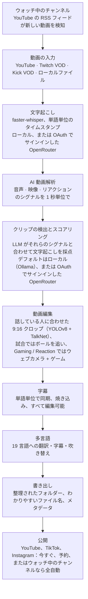

<div align="center">

[English](../../README.md) · [简体中文](README_zh.md) · **日本語** · [한국어](README_ko.md) · [Türkçe](README_tr.md) · [Русский](README_ru.md) · [Tiếng Việt](README_vi.md) · [ไทย](README_th.md) · [Deutsch](README_de.md) · [Español](README_es.md) · [Français](README_fr.md) · [Português (Brasil)](README_pt-BR.md) · [العربية](README_ar.md) · [Bahasa Indonesia](README_id.md) · [Italiano](README_it.md) · [हिन्दी](README_hi.md) · [বাংলা](README_bn.md) · [Filipino](README_tl.md) · [اردو](README_ur.md)

</div>

<a id="clips-kitty-the-free-open-source-opus-clip-alternative-for-chatting-gaming-and-sports-on-your-own-pc"></a>

# Clips Kitty：雑談・ゲーム・スポーツに対応、自分の PC で動く無料でオープンソースの Opus Clip 代替ツール

> この README は[英語版 README](../../README.md) から AI によって翻訳されたものです。英語版が正本で、常に先に更新されます。ネイティブスピーカーの方からの修正を大歓迎します。
>
> 🌐 [ウェブサイトの日本語ページ](https://colingpt9.github.io/clips-studio/ja.html)

<a href="https://apps.microsoft.com/detail/9NB6XT7DSQZZ">
  <picture>
    <source media="(prefers-color-scheme: dark)" srcset="https://get.microsoft.com/images/en-us%20dark.svg">
    
  </picture>
</a>

[](https://github.com/ColinGPT9/clips-studio/releases)
[](https://github.com/ColinGPT9/clips-studio/releases)
[](../../LICENSE)
[](https://github.com/ColinGPT9/clips-studio/stargazers)
[](https://github.com/ColinGPT9/clips-studio)
[](../../CONTRIBUTING.md)
[](../../docs/DOCKER.md)

<a href="https://youtu.be/g1dMqrq-YaI"></a>

<a id="star-and-share-clips-kitty--goal-150"></a>

### Clips Kitty にスターをつけてシェアしてください ⭐ 目標：150

[](https://github.com/ColinGPT9/clips-studio/stargazers) **/ 目標 150**

**ぜひリポジトリにスターをつけて、シェアしてください。** お金は一切かかりません。このプロジェクトにはマーケティング予算がまったくないので、次の小さな YouTuber や配信者が無料の選択肢があると知るには、口コミだけが頼りです。

**私はこれを、小さな YouTuber や配信者のために作りました。** 他のツールや編集者に払うお金がない人たちです。Opus Clip、Vizard、Klap の無料の代替ツールで、自分の PC 上で **Google Gemma** を動かします。サーバー費用も、クリップごとの料金も、AI の利用料もかかりません。

> **Clips Kitty はバージョン 1.1.3 まで Clips Studio という名前でした。** Microsoft Store の命名要件に合わせて改名しました。アプリも、リポジトリも、データも同じです。


**長い配信や動画を、すぐ投稿できる Shorts、Reels、TikTok に。すべて自分のマシンの中で完結します。** Clips Kitty はクリエイター向けの無料・オープンソースの AI クリップ生成ツール兼動画エディターです。YouTube、Twitch、Kick のリンクを貼り付けるだけで、ベストな瞬間を見つけ、話している人を中央に保ったまま 9:16 に切り抜き、単語単位で同期した字幕を焼き込み、タイトル・説明文・ハッシュタグまで書いてくれます。

デフォルトではクラウド AI を使いません。サブスクリプションも、クリップごとの料金もありません。自分の YouTube チャンネルへのクリップ公開を指示しない限り、映像があなたのコンピューターの外に出ることはありません。

ローカル優先、必要なときだけクラウド：PC が古くて AI を動かせない場合は、代わりにクラウドプロバイダーが実行し、料金はあなた自身のアカウントに請求されます。**おすすめのクラウド経路は OpenRouter です。** OpenRouter アカウントでサインインするだけで（OAuth なのでキーのコピーは不要）、多数のモデル（Claude、GPT、Gemini、Muse Spark など）が使えます。私のテストでは、2 時間の動画が OpenRouter で約 11 セントでした。クリップ選びは Gemma（Gemma 4 26B-A4B）、文字起こしは Whisper（large-v3-turbo）です。実際の金額は、選ぶモデルと動画の長さによって変わります。OpenAI、Claude、Gemini、xAI、Meta、DeepSeek、Qwen も、あなた自身の API キーで直接使えます。詳しくは [docs/AI-BACKENDS.md](../../docs/AI-BACKENDS.md) をご覧ください。

**なぜ作ったのか：** チャンネルを伸ばしているクリエイターの多くは、撮影、配信、編集、投稿まで全部ひとりでこなしています。切り抜きは新しい視聴者に見つけてもらうための手段なのに、真っ先に後回しにされがちです。編集者を雇うのはまだ割に合わないチャンネルがほとんどですし、切り抜きツールは動画単位か月額で課金され、手作業で切ると他のことに使いたかった丸一日が消えます。これはすでに持っているハードウェアで動くので、使うのにお金はかからず、作れるクリップ数にも上限はありません。


<sub>1 本の動画から 19 分で 38 本のクリップ。PC 1 台で、何もアップロードしていません。</sub>

---

<a id="contents"></a>

## 目次

- [できること](#what-it-does)
- [Opus Clip、Klap、Vizard、CapCut との比較](#how-it-compares-to-opus-clip-klap-vizard-and-capcut)
- [仕組み](#how-it-works)
- [機能](#features)
- [得意なコンテンツ](#what-its-built-for)
- [動作要件](#requirements)
- [インストールと実行](#install-and-run)
- [AI モデルを選ぶ](#pick-your-ai-model)
- [テスト環境とパフォーマンス](#tested-hardware-and-performance)
- [対応プラットフォーム](#supported-platforms)
- [対応言語](#supported-languages)
- [YouTube に公開する](#publish-to-youtube)
- [すべてのプラットフォームに一度に公開する](#publish-to-every-platform-at-once)
- [GPU アクセラレーション](#gpu-acceleration)
- [コマンドラインでの使い方](#command-line-use)
- [プラグインを書く](#write-a-plugin)
- [これを土台に作る](#build-on-it)
- [アーキテクチャ](#architecture)
- [コントリビュート](#contributing)
- [ロードマップ](#roadmap-detail)
- [ライセンス](#license)

---

<a id="what-it-does"></a>

## できること

Clips Kitty に長い動画を渡すと、そのまま投稿できる縦型クリップの完成品がフォルダーにまとまって返ってきます。投稿前に確認・修正するためのスタジオも付いています。

ほとんどの切り抜きツールが最も苦手とするコンテンツのために作られています。**ライブ配信、IRL やトーク主体の映像、ポッドキャスト、ジム／フィットネス系コンテンツ**です。長くて構成がゆるく、良い瞬間が埋もれていて、文字起こしだけでは見つけられない動画です。

<a id="how-it-compares-to-opus-clip-klap-vizard-and-capcut"></a>

## Opus Clip、Klap、Vizard、CapCut との比較

Clips Kitty は、クラウド型切り抜きツールのオープンソース代替です。大事な違いは、処理がどこで行われるかです。動画は一切アップロードされないので、計測するものも課金するものもありません。

| ツール | 料金（月払い） | 無料プラン | クリップを自動で見つける | ウォーターマーク | 動画をアップロードする | オープンソース |
| ---- | --------------------- | --------- | ----------------------- | --------- | ------------------ | ----------- |
| **Clips Kitty** | 無料、有料プランなし | アプリ全体 | はい | 一切なし | いいえ、自分の PC で動作 | はい、AGPL-3.0 |
| Opus Clip | Starter $15、Pro $29 | 1080p、ウォーターマーク付き、3 日で期限切れ | はい | 無料プランで付く | はい | いいえ |
| Klap | Pro $29、Basic は年払いで $14 | 動画 1 本 | はい | 記載なし | はい | いいえ |
| Vizard | Creator $29、年払いで $14.50 | 月 60 クレジット、720p | はい | 無料プランで付く | はい | いいえ |
| quso.ai | $29〜$49 | 月 75 クレジット、720p | はい | 記載なし | はい | いいえ |
| Ssemble | $15〜$60、年払いで $6〜$24 | 記載なし | はい | 記載なし | はい | いいえ |
| Descript | $16、$24、$50 | 月 60 分、720p | 一部のみ（文字起こしベースのエディター） | Free と Hobbyist で付く | はい | いいえ |
| CapCut | 無料で利用可、capcut.com に有料プランあり | エディター全体 | **いいえ、手作業でカット** | 機能による | デスクトップアプリではしない | いいえ |

**押さえておくべきは CapCut です。** 「無料なら CapCut」と誰もが答えるからです。CapCut は良いエディターで無料ですが、瞬間を探すのも、クリップを切り抜くのも全部自分です。Clips Kitty も無料で、その最初の下ごしらえこそが代わりにやってくれる部分です。

グラフィックカード付きの Windows PC がない、切り抜きはたまにしかしない、スマホで作業したい、という場合は **Opus Clip、Klap、Vizard のほうが向いています**。Clips Kitty は、すでに持っているハードウェアで大量に切り抜くために作られています。

**[7 つのツールすべての詳しい比較と、それぞれの得意分野](https://colingpt9.github.io/clips-studio/alternatives.html)**

<sub>料金は 2026 年 9 月 17 日に各社の料金ページで確認しました。CapCut には読み取れる料金ページがなかったため、料金は記載していません。プランは変わりますが、この表は自動では更新されません。</sub>

<a id="how-it-works"></a>

## 仕組み



**自分で別の方法を選ばない限り、すべての段階はあなたのコンピューター上で動きます。** 例外は、AI や文字起こしに使う（あなたのアカウントでサインインした）OpenRouter と、送ったクリップだけをアップロードする公開機能です。それ以外で通常の実行中にネットワークに触れるのは、元動画のダウンロードだけです。

<a id="the-stages-in-detail"></a>

### 各段階の詳細

**文字起こし：faster-whisper。** 単語単位のタイムスタンプ付きで、使える場合は CUDA で、使えなければ CPU で動きます。単語単位のタイミングがあるからこそ、字幕が正しい音節に合い、クリップが本当の文の切れ目から始まります。

**AI クリップスコアリング。** 文字起こしは 5 つのシグナルのうちの 1 つにすぎません。音声からは、音量のピーク、バーストの密度（笑い声や拍手はこういう形になります）、そして静寂→爆発という盛り上がりの形を取ります。映像からは、シーンの切り替わり、動き、顔の大きさの変化を取ります。リアクションシグナルはそれらを統合したものです。どれも*その動画の中で*正規化されるので、静かなポッドキャストでも叫びっぱなしの配信でも、意味のあるピークが出ます。実際の視聴者データ（ユニークなチャット参加者数で測る Twitch のチャットリプレイ、YouTube の「最も再生された部分」のヒートマップ）がある場合は、上限付きの小さなボーナスが加わります。

ローカル LLM は文字起こし**とそれらのイベントのタイムライン**を一緒に見るので、「言葉は穏やかだけど現場は大爆発した」場面を正しく評価できます。小さなモデルはすべてを狭い範囲で採点しがちなので、最終候補は 1 回の再ランク付けの呼び出しで直接比較されます。7B モデルにとっては、絶対評価よりも相対評価のほうがずっと簡単だからです。

**Creator Profiles（クリエイタープロフィール）。** アプリは、クリエイターごとに複数の動画にまたがる知識ベースを作ります。繰り返し出てくる話題、シリーズ、コラボ相手、お決まりのネタ、続いているストーリーなどです。この文脈が、正確なタイトル付けや過去ネタへの言及の発見に役立ちます。意図的に慎重に作ってあります。決め台詞は実際に繰り返されて初めてカウントされ、話題に出なくなった知識は休眠状態になり、そこから加わるスコアはすべて加算式で上限があり、オフにもできます。

**動画エディター。** 非破壊編集です。トリム、途中のカット、ミュート、単語単位のミュート、音量、フェード、速度、フックテキスト、音楽、ウォーターマークは操作として保存され、レンダリング時に適用されます。AI 編集チャットもあり（*「5 秒長くして」*、*「字幕が gost になってる、ghost が正しい」*）、モデルが提案し、検証済みのコードがそれを適用します。

**長尺処理。** 同じ解析を使う、オプトインの 16:9 ルートです。横型クリップ、X/Twitter 向けの長さのカット、ベスト・オブのハイライトリール、または無音部分を取り除いた配信全体を作れます。

**多言語パイプラインと AI 吹き替え。** 字幕は翻訳されたあと、書き出しや焼き込みの*前に*確認用に表示されるので、おかしな行はまだ直せるうちに直せます。用語集を使えば、チャンネル名、スポンサー、内輪ネタが翻訳されないように守れます。吹き替えはローカルの TTS を使い、声を試聴して選べます。

**ローカル GPU アクセラレーション。** 検出と文字起こしには CUDA、動画のハードウェアエンコードには NVENC/AMF/QSV（自動検出、CPU へのフォールバックあり）、LLM は Ollama 経由で GPU 上で動きます。

<a id="features"></a>

## 機能

- **マルチモーダルなクリップ検出**：話の内容、音声の盛り上がり、映像の動き、画面上のリアクション、フック／オチの強さを組み合わせて、各瞬間を 0〜100 で採点します。品質ラインを超えたクリップはすべて残し、恣意的な上限はありません。
- **話者を認識する顔トラッキング**：YOLOv8 の姿勢検出で被写体を中央に保ち、複数人の映像では**実際に話している人**をカメラが追います。誰が話しているかは、動きではなく、顔と音声の両方から TalkNet のアクティブ話者検出が判断します。話者が変わると、パンで横切るのではなく、編集者がするように**カット**で切り替えます。クロップのみのフレーミングで、引き伸ばしや歪みは一切ありません。
- **Podcast mode（ポッドキャストモード）**：マルチカメラの映像では、ショットごとに 1 人に合わせた安定したクロップになるので、カットが切り替わるとパンなしで顔に収まります。ショット内では口の動きで被写体を選び、判断できなければ最も目立つ顔を選びます。
- **Vertical Live（縦型ライブ）**：配信時点ですでに縦型だったライブ配信向けです（YouTube の縦型ライブ、Twitch Dual Format、Streamlabs Dual Output、ダウンロードした Instagram や TikTok のライブ）。配信そのものの 9:16 レイアウトを保ち、顔トラッキングは省略しつつ、瞬間選びはいつも通り行います。[docs/VERTICAL-LIVE.md](../../docs/VERTICAL-LIVE.md) をご覧ください。
- **Sports（スポーツ）：サッカーとバスケットボール**：試合の大きな見せ場を 1 つずつ、前振りとリアクション込みの 1 本のクリップにします。
  - **サッカー**：ゴール、セーブ、カード、決定機。ゴールはスコア表示から読み取り、観客の反応でタイミングを特定し、9:16 クロップはボールを追います。All goals（全ゴール）、Best saves（ベストセーブ）、Cards（カード）などを選べ、瞬間をつないで試合のまとめやチーム・選手ごとのリールにもできます。
  - **バスケットボール**：ダンク、スリーポイント、ブロック、スティール、決勝シュート。画面のスコア表示ですべての得点とその点数を確かめ、クォーターと残り時間によって、決勝シュートは第 1 クォーターの得点よりはるかに重く扱われます。観客、ベンチ、コートサイドのリアクションも見つけます。各クリップの 9:16 クロップはそのプレーに合わせて組み立てます。ボールとそれを持っている選手、パスの受け手、そしてリングとバックボードを画面に入れたままゴールまで追うシュートです。クロップはプレーに合わせてパンし、ズームは一切しません。ボールは [E-BARD](https://github.com/GabrieleGiudic/E-BARD#readme) 検出モデルで見つけます（クレジットは[ライセンス](#license)に記載）。

  [docs/SPORTS.md](../../docs/SPORTS.md) をご覧ください。
- **編集できる焼き込み字幕**：単語単位で同期し、スタイルは自由に設定できます（色、サイズ、位置、1 行あたりの単語数、大文字・小文字、またはオフ）。書き出し前に、文字起こしの間違いを 1 行ずつ直せます。2 人が話している場合は 2 人目の話者の字幕を別の色にでき、話者の判定を間違えたところは手動で切り替えられます。
- **AI 編集チャット**：どこがおかしいかを普通の言葉で伝えれば、編集し直してくれます。
- **Ask Clips Kitty**：ダッシュボード下部のテキストボックスです。*「この配信を切り抜いて。ボスにやられたところは必ず入れて、字幕は大きな黄色で」*のように、やりたいことを一文で伝えると、動画をキューに入れ、クリップ選びに何を探すべきかを伝え、指定したオプションを設定してくれます。**Gemma 4 モデルが必要です**。[下のテキストボックスには Gemma 4 が必要](#the-text-box-at-the-bottom-needs-gemma-4)をご覧ください。
- **AI によるタイトル・説明文・ハッシュタグ**。書き出し前にすべて編集できます。
- **Creator Profiles（クリエイタープロフィール）**：アプリが時間をかけて各クリエイターを学び、クリップ選びやタイトル付けを上達させます。データはすべて自分のコンピューターに残り、確認・修正・消去ができます。
- **多言語での公開**：19 言語に対応し、焼き込む前に確認できます。
- **AI 吹き替え**：ローカルのテキスト読み上げで、言語ごとに声を試聴できます。
- **長尺の書き出し**：16:9 のクリップ、ハイライトリール、または重複を取り除いた配信の編集版。ハイライトリールの説明文には**チャプターのタイムスタンプ**が入るので、視聴者は YouTube 上で瞬間から瞬間へ飛べます。
- **ウォーターマークとブランディングのプロフィール**：クリエイターごとのデフォルト設定が自動で適用されます。
- **モデルマネージャー**：アプリ内から AI の頭脳を入れ替えられます。モデルのダウンロード、削除、切り替えはすべて進捗バー付きで、ターミナルは不要です。
- **エディターから YouTube に公開**：タイトル、説明文、タグ、サムネイル、再生リスト、視聴者、公開設定を入力し、今すぐアップロードするか予約します。任意の機能でデフォルトはオフ、あなた自身の Google API キーを使います。
- **アプリ内フィードバック**：診断情報を自動で集めるバグ報告。アカウントは不要です。
- **アクセシブルな UI**：キーボードフォーカス、動きを減らす設定への対応、フォントとサイズの調整。

<a id="what-its-built-for"></a>

## 得意なコンテンツ

どんな動画を渡しても処理はできます。以下は、機能一覧から想像されるより多く、または少なく判断しているケースです。あとで驚かないように書いておきます。

| コンテンツ | どう動くか |
|---|---|
| **IRL、雑談、ポッドキャスト、Vlog、インタビュー** | 最も調整が行き届いていて、リリース前に実際の配信でテストしている分野です |
| **ゲームとリアクション** | **Gaming / Reaction**（ゲーム／リアクション）をオンにすると、画面の半分にウェブカメラ、もう半分にゲームやリアクション対象の動画を配置し、処理前に動画自体のフレームで確認します（[docs/GAMING.md](../../docs/GAMING.md)）。配信者として扱うのは話している人で、いちばん大きく映っている顔ではありません。オフのままだと、フレーミングがゲーム内のキャラクターを追ってしまうことがあります。対象は顔出しの人のみで、VTuber には対応していません |
| **スポーツの試合** | **Sports**（スポーツ）をオンにした場合：スコア表示と実況のある中継向けで、その場合はゴールやバスケットボールの得点を確実に判定できます。クラブやスマホで撮った映像には通常どちらもないので、クリップはボールを追い、ゴールは貼り付けた試合イベント（クラブのアプリのゴールタグなど）から取ります（[docs/SPORTS.md](../../docs/SPORTS.md)） |
| **リアクションの対象になっているもの** | クリップはあくまで*話された内容*から選ばれるので、見ている動画の中で誰もコメントしなかった瞬間は検出できません |

クリップ選びは文字起こしとシグナルで動いています。面白いところが*映像だけ*で、誰もそれに触れていない場合は、エディターで自分で探すことになります。

<a id="requirements"></a>

## 動作要件

|             | 最小                                      | 推奨                     |
| ----------- | -------------------------------------------- | ------------------------------- |
| **GPU**     | NVIDIA RTX 2060（6 GB）                       | RTX 3060 12 GB 以上        |
| **CPU**     | Intel Core i3-9100 / AMD Ryzen 3 3200G（2019 年）| 6 コア以上                 |
| **RAM**     | 16 GB                                        | 16 GB 以上                   |
| **ディスク**    | 約 20 GB と、切り抜く動画を置く容量    |                                 |
| **OS**      | Windows 10 または 11                             |                                 |

**最小要件を下回っても動くことはありますが、サポート対象外で、動作は遅くなります。** 配信を切り抜くということは、何時間分もの動画のデコード、文字起こし、エンコードを行うということです。おおむね 2019 年より前のハードウェアでは時間がかかりすぎて、正常に動いていてもアプリが壊れているように感じるはずです。

このうち 2 点は詳しく説明しておきます。

- **16 GB の RAM は「推奨」ではなく必須です。** 8 GB だと動画全体を解析したあと何もレンダリングできず、メモリ不足ではなくクラッシュのように見えます。
- **GPU は任意で、必須ではありません。** GPU がなくてもすべて CPU で動きます。遅くはなりますが、最後まで処理できます。RTX 2060 クラスが GPU 経路が機能し始めるラインです。[GPU アクセラレーション](#gpu-acceleration)をご覧ください。

アプリは **Windows のみ**です。Python エンジンは Linux/macOS でも動くはずですが、Mac 版のビルドはなく、メンテナーはテスト用の Mac を持っていません。Mac をお持ちで協力していただける方は [#62](https://github.com/ColinGPT9/clips-studio/issues/62) をご覧ください。

ソースから実行する場合は、本来インストーラーに同梱されているものを自分で用意する必要があります。

- **Python 3.10+** と **Node.js 18+**
- PATH に通した **[FFmpeg](https://ffmpeg.org/download.html)**
- モデルを pull 済みの **[Ollama](https://ollama.com)**：`ollama pull gemma:7b`

<a id="install-and-run"></a>

## インストールと実行

**いちばん簡単なのは [Microsoft Store](https://apps.microsoft.com/detail/9NB6XT7DSQZZ) です。** ワンクリックで入り、自動で更新され、Windows のセキュリティ確認も出ません。Microsoft がパッケージを認証・署名しているので、下で説明している SmartScreen の警告はまったく表示されません。新しいバージョンは Store の順番が来たときにインストールされます。すぐに入れたい場合は、Microsoft Store で Clips Kitty のページを開き、**Update**（更新）を押してください。

**インストーラーを使う方法もあります。** [Releases](https://github.com/ColinGPT9/clips-studio/releases) から最新の **Web Setup** をダウンロードして実行します。アプリ、Python エンジン、すべてのライブラリ、FFmpeg、AI ランタイム、検出と文字起こしの重みがすべて入っています。Python も PATH 設定もターミナルも不要で、2 つ目のプログラムをインストールする必要もありません。

**winget でも入れられます。** `winget install ColinGPT9.ClipsKitty` で、同じ Web Setup をターミナルからインストールできます。

同梱されていない唯一のものが言語モデル本体です。モデルには、ダウンロードする本人が同意しなければならないライセンスが付いていて、代わりに同意することはできないからです。セットアップウィザードがダウンロードを自動で始め、グラフィックカードに合ったサイズを選び、進捗バーを表示します。つまり、ダウンロード 1 回、ダブルクリック 1 回、進捗バー 1 つ。その後はオフラインで動きます。

> 初回起動時に、Windows がアプリが署名されていないと警告します。*詳細情報 → 実行*をクリックしてください。コード署名証明書は対応予定リストに入っています。

<a id="from-source"></a>

### ソースから

```bash
git clone https://github.com/ColinGPT9/clips-studio
cd clips-studio
pip install -r requirements.txt

cd ui
npm install
npm run dev        # opens the Clips Kitty desktop app
```

アプリは自分で Python エンジンを自動的に起動します。**Clip Editor**（クリップエディター）にリンクを貼り付けて *Generate clips*（クリップを生成）を押せば、進捗をリアルタイムで確認できます。

インストーラーを自分でビルドするのもコマンド 1 つです。[CONTRIBUTING.md](../../CONTRIBUTING.md#building-the-windows-installer) をご覧ください。

<a id="with-docker-nothing-else-to-install"></a>

### Docker で：他に何もインストール不要

コントリビューター向けです。必要なのは [Docker Desktop](https://docs.docker.com/get-started/get-docker/) だけで、Python も Node も FFmpeg も PyTorch もいりません。

```bash
git clone https://github.com/ColinGPT9/clips-studio
cd clips-studio
docker compose up
```

3 つのサービスが一緒に立ち上がります。

| | |
|---|---|
| **<http://localhost:5173>** | インターフェース（ブラウザーで開く） |
| **<http://localhost:8765>** | エンジンとその API |
| Ollama | ローカル AI（:11434） |

あとはモデルを pull すれば（`docker compose exec ollama ollama pull gemma3:4b`）、動作する開発環境の完成です。

チェックも同じ方法で実行します。

```bash
docker compose run --rm engine pytest
docker compose run --rm ui npm run typecheck
```

> **10 分かかる初回ビルドを省略するには：** `docker compose pull` を使うと、PyTorch と OpenCV をローカルでコンパイルする代わりに、ビルド済みのエンジンイメージを取得します。

デスクトップのシェル自体は引き続きホスト側で動きます。Electron にはディスプレイが必要だからです。それ以外はすべてコンテナ化されています。詳細と、この方法では確認できないことについては [docs/DOCKER.md](../../docs/DOCKER.md) をご覧ください。

<a id="pick-your-ai-model"></a>

## AI モデルを選ぶ

**Models**（モデル）ページを開くと、インストール済みのモデルと、GPU で扱えるモデルが確認できます。

基準は 1 つだけ、VRAM の容量です。以下はアプリに表示されるものと同じ行で、[`llm/manager.py`](../../llm/manager.py) の `RECOMMENDATIONS` から来ています。ウィザードと Models ページは同じ 1 つの表を読んでいるので、互いに食い違うことも、ここと食い違うこともありません。

| ハードウェア | おすすめのモデル | |
|---|---|---|
| CPU / 内蔵 GPU、グラフィックカードなし | `gemma3:4b` | テスト済み |
| VRAM 6 GB 未満、または古い PC | `gemma4:e2b` | |
| VRAM 6 GB | `gemma4:e4b` | |
| VRAM 8 GB | **`gemma:7b`** | テスト済み · 出荷時のデフォルト |
| VRAM 10〜12 GB | `gemma3:12b` | テスト済み |
| VRAM 16〜24 GB | `gemma3:27b` | |

VRAM 以外の理由で選ぶ価値があるモデル：

| 理由 | モデル |
|---|---|
| 翻訳 / 多言語 | `qwen3:8b` または `qwen3:14b` |
| 制限の緩いライセンス | `mistral-nemo:12b`（Apache-2.0）· `phi4:14b`（MIT） |

**実際の配信で試したのは「テスト済み」の 3 つだけです。** 中でも `gemma:7b` が最も長時間使われていて、`config/settings.yaml` に最初から設定されているのもこのモデルです。それ以外のモデルは、サイズが妥当で商用でも無料で使えるから載せているのであって、クリップの品質を測ったからではありません。アプリは Ollama を通じてどのモデルとも同じようにやり取りするので、どれも動作はしますが、より良い瞬間を選べるかどうかは誰も確かめていません。この穴を埋めるのが [#38](https://github.com/ColinGPT9/clips-studio/issues/38) です。

Ollama が提供するモデルなら何でも使え、切り替えはワンクリックです。翻訳には切り抜きとは*別の*モデルを使えます。`llm.translation_model` を設定してください。

<a id="the-text-box-at-the-bottom-needs-gemma-4"></a>

### 下のテキストボックスには Gemma 4 が必要

ダッシュボード下部のテキストボックスである **Ask Clips Kitty** は、アプリのツールを使えるモデルでしか動きません。Gemma 4 は使えます。`gemma:7b` と Gemma 3 系のモデルは使えず、グラフィックカードのない PC や VRAM が 8 GB 以上の PC では、セットアップがそのどちらかをインストールします。そうした PC では、Gemma 4 モデルを追加するまでボックスは動きません。バージョン 2.0 では *"No installed model can use tools"*（ツールを使えるモデルがインストールされていません）と表示され、それ以降のバージョンではボックスの中でダウンロードを提案します。

クリップ選びにどのモデルを使っていても、**Models** ページで Gemma 4 モデルを横に並べてインストールしてください。VRAM 6 GB 以上のグラフィックカードなら `gemma4:e4b`、それ未満なら `gemma4:e2b` です。そのモデルに切り替える必要はありません。ボックスが自分で見つけ、クリップ選びは引き続きあなたが選んだモデルが行います。AI を OpenRouter で動かしている場合は、ボックスもそのモデルを使うので、何もインストールする必要はありません。

<a id="tested-hardware-and-performance"></a>

## テスト環境とパフォーマンス

Clips Kitty は毎日このマシンで開発・テストしているので、自分の結果と比べる際の参考になります。

| | |
|---|---|
| **GPU** | NVIDIA GeForce RTX 3060、VRAM 12 GB |
| **CPU** | AMD Ryzen 5 5600X（6 コア / 12 スレッド） |
| **RAM** | 16 GB |
| **OS** | Windows 10 |
| **切り抜き用モデル** | Ollama 経由の `gemma:7b` |
| **文字起こし** | CUDA 上の faster-whisper `large-v3-turbo` |

このリポジトリのすべて（デフォルト設定、`parallel_renders: 3`、5 分の解析チャンクサイズ）は、だいたいこのクラスのマシンに合わせて調整されています。もっと大きな GPU なら、`llm.num_ctx` と `analysis.chunk_seconds` を一緒に上げ、モデルを 1 サイズ上げてください。小さな GPU なら `gemma3:4b` に下げてください。

別のハードウェアで Clips Kitty のベンチマークを取ったら、ぜひ [Discussions](https://github.com/ColinGPT9/clips-studio/discussions) に投稿してください。実機の実測値は、みんなが自分の環境を見積もる助けになります。

<a id="supported-platforms"></a>

## 対応プラットフォーム

| ソース | 対応状況 |
|---|---|
| YouTube の動画 | 完全対応。意図的に H.264 を選んでいます（AV1 だと処理時間がおよそ 2 倍になるため） |
| Twitch の VOD | 完全対応。チャットリプレイも視聴者シグナルとして使います |
| Kick の VOD | 完全対応（Kick は配信終了後にチャットを破棄するため、チャットのシグナルはありません） |
| ローカルの動画ファイル | 完全対応。公開前に自分の映像を切り抜けます |
| ライブ配信 | 設計上、非対応です。VOD のみ |

<a id="supported-languages"></a>

## 対応言語

クリップは **19 言語**に翻訳・字幕付け・吹き替えでき、**インターフェース自体も 19 言語すべてに翻訳されている**ので、公開に使うのと同じ言語でアプリを使えます。

英語 · スペイン語 · ポルトガル語（ブラジル） · フランス語 · ドイツ語 · ヒンディー語 · インドネシア語 · 日本語 · ロシア語 · アラビア語 · 中国語（簡体字） · ベトナム語 · フィリピン語 · トルコ語 · ウルドゥー語 · ベンガル語 · タイ語 · 韓国語 · イタリア語

言語の追加は、`multilingual/languages.py` に 1 行と、`ui/src/renderer/src/locales/` にロケールファイルを 1 つ足すだけです。翻訳と字幕の書き出しは言語に依存しない作りになっています。

<a id="help-wanted-the-maintainer-only-speaks-english"></a>

### 協力者募集：メンテナーは英語しか話せません

19 のインターフェース翻訳のうち 18 は、その言語を話す人に一度も読まれたことがありません。半分はまだ未完成です。言語ごとに英語とその言語で書かれた issue があり、**おかしな言葉を 1 つ報告するだけで、立派な貢献になります**。プルリクエストは不要です。[参加方法](../../docs/TRANSLATING.md)。

**仕上げが必要**（まだ約 68 個の文字列が英語のまま）：[বাংলা（ベンガル語）](https://github.com/ColinGPT9/clips-studio/issues/43) · [Italiano（イタリア語）](https://github.com/ColinGPT9/clips-studio/issues/44) · [한국어（韓国語）](https://github.com/ColinGPT9/clips-studio/issues/45) · [ไทย（タイ語）](https://github.com/ColinGPT9/clips-studio/issues/46) · [Tagalog（フィリピン語）](https://github.com/ColinGPT9/clips-studio/issues/47) · [Türkçe（トルコ語）](https://github.com/ColinGPT9/clips-studio/issues/48) · [اردو（ウルドゥー語）](https://github.com/ColinGPT9/clips-studio/issues/49) · [Tiếng Việt（ベトナム語）](https://github.com/ColinGPT9/clips-studio/issues/50) · [中文（中国語）](https://github.com/ColinGPT9/clips-studio/issues/51)

**チェックが必要**（翻訳は完了しているが、自然に読めるか誰も確認していない）：[العربية（アラビア語）](https://github.com/ColinGPT9/clips-studio/issues/52) · [Deutsch（ドイツ語）](https://github.com/ColinGPT9/clips-studio/issues/53) · [Español（スペイン語）](https://github.com/ColinGPT9/clips-studio/issues/54) · [Français（フランス語）](https://github.com/ColinGPT9/clips-studio/issues/55) · [हिन्दी（ヒンディー語）](https://github.com/ColinGPT9/clips-studio/issues/56) · [Bahasa Indonesia（インドネシア語）](https://github.com/ColinGPT9/clips-studio/issues/57) · [日本語](https://github.com/ColinGPT9/clips-studio/issues/58) · [Português（ポルトガル語）](https://github.com/ColinGPT9/clips-studio/issues/59) · [Русский（ロシア語）](https://github.com/ColinGPT9/clips-studio/issues/60)

ここにない言語が欲しい場合は [#61](https://github.com/ColinGPT9/clips-studio/issues/61) へどうぞ。

<a id="publish-to-youtube"></a>

## YouTube に公開する

デフォルトではオフです。**Settings → Publish to YouTube**（設定 → YouTube に公開）でオンにすると、エディターに **YouTube** タブが表示されます。タイトル、説明文、タグ、サムネイル、再生リスト、視聴者、公開設定を入力して、**Upload now**（今すぐアップロード）を押してください。未保存の編集があれば Clips Kitty がクリップをレンダリングし、そのままチャンネルにアップロードします。書き出しの手順も、別の公開ページもありません。エディターから離れる必要は一切ありません。

オフのままにしておけば、アプリのどこにも変化はありません。

<a id="scheduling"></a>

### 予約公開

**Schedule on YouTube**（YouTube で予約）を選ぶと、動画は*すぐに*アップロードされて非公開に設定され、公開日時が YouTube に渡されます。当日になれば YouTube が公開します。

**Clips Kitty を閉じても、コンピューターの電源を切っても大丈夫です。** このアプリにはタイマーもバックグラウンドサービスもなく、動かしっぱなしにしておくものは何もありません。YouTube が動画を受け付けた時点で、Clips Kitty の仕事は終わりです。

<a id="you-need-your-own-google-api-key"></a>

### 自分の Google API キーが必要です

Clips Kitty は共有キーを同梱していません。これは単に用心のためではありません。Google のアップロード割り当ては **Cloud プロジェクトごと**なので、共有キーを 1 つにすると、世界中のユーザー全員が同じ 1 日 100 回のアップロード枠を取り合うことになります。自分のプロジェクトなら自分専用の枠があり、認証情報が自分のマシンから出ることもありません。間に Clips Kitty のサーバーは一切挟まりません。

設定は無料で、10 分ほどで終わります。設定画面のウィザードが順を追って案内します。

1. [Google Cloud Console](https://console.cloud.google.com/projectcreate) でプロジェクトを作成します。
2. APIs & Services → Library で **YouTube Data API v3** を有効にします。
3. OAuth 同意画面を入力し、**Publish app**（アプリを公開）を押します。ここが重要です。*Testing*（テスト）のままにしておくと、Google がサインインを 7 日ごとに失効させるので、毎週つなぎ直すことになります。「In production」（本番環境）は審査済みという意味ではなく、費用もかかりません。
4. Credentials → Create credentials → OAuth client ID → 種類は **Desktop app** を選びます。
5. クライアント ID とシークレットを設定画面に貼り付けて、チャンネルを接続します。

接続するときに「Google hasn't verified this app」（このアプリは Google で確認されていません）という警告が表示されます。これは、あなた自身のアプリがあなた自身について警告しているだけです。**Advanced → Go to (unsafe)** で先に進めます。

<a id="posting-publicly"></a>

### 一般公開する

これに頼る前に知っておいてほしいことが 1 つあります。どんなソフトウェアでも回避できないことだからです。

> **Google Cloud プロジェクトが YouTube の無料 API 監査に合格するまでは、そのプロジェクト経由でアップロードした動画はすべて、YouTube によって非公開にロックされます。** このロックは永久です。あとから Studio で動画を公開に変えることはできず、異議申し立てもできません。唯一の解決策は、監査済みのプロジェクトからアップロードし直すことです。

Clips Kitty はアップロードのたびにこれを確認し、誰も見られない動画を「成功」と報告するのではなく、起きたことをはっきり伝えます。一般公開するつもりなら、先に [YouTube API サービスの監査フォーム](https://support.google.com/youtube/contact/yt_api_form)を提出してください。**限定公開**や**非公開**でのアップロードには影響しません。

<a id="what-it-can-and-cannot-set"></a>

### 設定できること・できないこと

公開 API で扱えるものはすべて設定できます。タイトル、説明文（中のタイムスタンプはチャプターになります）、タグ、カテゴリ、言語、公開設定、予約公開の日時、子ども向けかどうか、改変・合成コンテンツの開示、ライセンス、埋め込み、統計情報の公開、カスタムサムネイル、再生リストへの追加です。

YouTube Studio の機能の中には公開 API にまったく含まれないものもあるので、こっそり何もしないコントロールを置くのではなく、あえてコントロールを用意していません。収益化と広告ブレーク、有料プロモーションの開示、終了画面とカード、コメント設定、年齢制限、プレミア公開、ショートのリミックス許可です。これらについては、パネルから Studio へのリンクを用意しています。

ショートには特別な準備は不要です。別のモードも `#Shorts` タグもいりません。YouTube が動画の形と長さから自動的にショートとして分類します。

<a id="publish-to-every-platform-at-once"></a>

## すべてのプラットフォームに一度に公開する

こちらもデフォルトではオフです。**Settings → Publish through WoopSocial**（設定 → WoopSocial 経由で公開）でオンにすると、エディターに **Publish**（公開）タブが表示されます。プラットフォームを選ぶか、**Everywhere**（すべて）を押し、タイトルと説明文を一度書けば、1 回のアップロードで YouTube、TikTok、Instagram、Facebook、X、Threads、LinkedIn、Pinterest、Bluesky にまとめて投稿されます。Clip Editor の **Publish all**（すべて公開）は一括で処理し、十数本のクリップが同じ秒に投稿されないよう間隔を空けます。

この機能は**ローカルではありません**。クリップとその情報は公開サービスに送られ、そのサービスが配信を行い、ソーシャルアカウントとの接続も管理します。そのため Clips Kitty がソーシャルのパスワードを尋ねることはありません。アプリのそれ以外の部分は、引き続きあなたの PC 上で動きます。

対応しているサービスは 2 つです。**[WoopSocial](https://woopsocial.com/?via=clipskitty)** は、無料プランで 2 アカウントを接続でき、YouTube への投稿は 1 日およそ 5 件まで、有料プランではどちらの上限も上がります。**[Upload-Post](https://www.upload-post.com/)** は投稿先がさらに多く、サムネイル、最初のコメント、投稿キューにも対応しています。どちらか一方でも、両方でもオンにできます。

<sub>アフィリエイトリンクです - このリンクから登録すると Clips Kitty に紹介料が入ることがありますが、あなたの負担が増えることはありません。</sub>

**自分のキーを使います。** アカウントを作るのも、ソーシャルを接続するのもあなた自身で、使うのもあなた自身の枠です。Clips Kitty は料金を取らず、共有キーも持たず、何の費用も払いません。YouTube 連携と同じ仕組みで、理由も同じです。

詳しい手順、プラットフォームごとの対応状況と制限：**[docs/UPLOAD-POST.md](../../docs/UPLOAD-POST.md)**。

<a id="gpu-acceleration"></a>

## GPU アクセラレーション

**動画のエンコード**は、NVIDIA（NVENC）、AMD（AMF）、Intel（QSV）の 3 社すべてで自動的にハードウェアアクセラレーションが効きます。エンジンは起動時にそれぞれで 1 フレームをテストエンコードし、実際に動いた最初のものを使い、だめなら CPU にフォールバックします。`config/settings.yaml` の `video.encoder` で強制的に指定することもできます。

**検出と文字起こし**は CUDA で最も速くなります。そのままの `pip install torch` では **CPU 専用**ビルドが入ります。NVIDIA の場合：

```bash
pip uninstall torch torchvision -y
pip install torch torchvision --index-url https://download.pytorch.org/whl/cu130
```

**GPU を使うカード：** GTX 16 シリーズ、RTX 20 シリーズ、そして RTX 50 シリーズを含むそれ以降のすべて。

**GPU での文字起こし**には NVIDIA の cuBLAS 12 も必要です。Whisper のエンジン（CTranslate2）は CUDA 12 ビルドで、上の CUDA 13 版 PyTorch には cuBLAS 13 しか入っていないためです。`pip install -r requirements.txt` でインストールされ（`nvidia-cublas-cu12`）、インストール版のアプリにも同梱されているので、CUDA ツールキットは不要です。これがないと文字起こしは CPU で動き、その理由がログに出ます。

**GTX 10 シリーズ以前は最小要件を下回ります。** サポート対象の構成ではありません。それらのカードで起動を拒否することはなく、検出は CPU にフォールバックしてすべて動作しますが、遅くなります。それに、そこまで古いマシンは CPU も遅いことが多く、検出の段階だけでなく作業全体が遅くなります。

上の `cu130` インデックスを使い、古いものは使わないでください。古い CUDA ビルドには最近のカード向けのコードがなく、本来速いはずのハードウェアで CPU にフォールバックしてしまいます。

AMD GPU をお使いの方へ：Windows ではトラッキングと文字起こしは CPU で動きます。機能はすべて使え、遅くなるだけです。GPU は引き続き AMF による動画エンコードと、Ollama 経由の LLM に使われます（Ollama 自体が AMD に対応しています）。

**動画のデコード**は、トラッキングでもレンダリングでも、OpenCV ではなくハードウェアアクセラレーション付きの FFmpeg で行います。この方法でサンプルフレームを読むと、Python でデコードしていたときの約 10 分の 1 の CPU で済みます。トラッキングはすべてのクリップに対して走るので、これは大きな差です。

**CPU の配分。** 検出とレンダリングはどちらも全コアを使いたがり、放っておくと互いに、そしてインターフェースとも奪い合います。エンジンは起動時にコアをレンダリングワーカーに割り振り、意図的に 2 コアを残しておくので、一括処理中もアプリの反応が保たれます。`video.parallel_renders` で調整できます。

<a id="command-line-use"></a>

## コマンドラインでの使い方

デスクトップアプリがなくても、すべての機能が使えます。

```bash
python main.py process "https://www.youtube.com/watch?v=VIDEO_ID"   # one video
python main.py models                                               # list/switch models
python main.py status                                               # processing state
python main.py serve                                                # just the API engine
```

設定は [config/settings.yaml](../../config/settings.yaml) にあります。ファイルの先頭は短いクイックセットアップの部分で、高度な設定はすべてその下にあります。LLM のプロンプトはすべて [config/prompts/](../../config/prompts/) にあるプレーンテキストのファイルなので、Python に触れずにクリップの採点方法を調整できます。

<a id="write-a-plugin"></a>

## プラグインを書く

あるゲーム、スポーツ、番組のジャンルについて、汎用の検出器より詳しいですか？動画の中の瞬間を見つけたり、理解したり、評価したりする小さな Python プラグインを書けば、残りは Clips Kitty がやってくれます。SDK は MIT ライセンスなので、プラグインにはどんなライセンスでも付けられ、何も fork する必要はありません。

```text
Clips Kitty SDK

Input                      a link or a video file
  ↓
Video                      Clips Kitty downloads it and writes down what is said
  ↓
Your plugin                every step is optional
  ├── find                 picks the moments                  built
  ├── understand           says what happens in each one      built
  ├── rate                 scores each moment                 built
  └── edit                 suggests edits for the creator     built
  ↓
Clips Kitty                does every step no plugin does, then cuts, frames and captions the clips
  ↓
Creator / Social Platform  posts when the creator clicks Publish, or on a schedule or automatic posting the creator switched on
```

- 1 つのプラグインが動画の瞬間を見つける役を担えます。その場合、Clips Kitty 自身の検出の代わりになります。
- どの検出プラグインの後でも、理解するプラグインは最大 3 つ、評価するプラグインは最大 3 つまで使えます。
- プラグインの役割は、マニフェストの `inputs` と `outputs` で決まります（[ステップ](../../docs/developers/steps.md)）。
- 作られるクリップに編集を提案するプラグインは最大 3 つまで使えます。
- 編集プラグインが提案した編集は、エディターでクリエイターの判断を待ちます（[ステップ](../../docs/developers/steps.md#suggest-edits-the-edit-step)）。
- 投稿はプラグインのステップではありません。クリップの投稿は Clips Kitty 自身が行い、WoopSocial を通じてクリエイター自身のアカウントで多くのサイトにまとめて投稿できます（[すべてのプラットフォームに一度に公開する](#publish-to-every-platform-at-once)）。`kind: publisher` は拒否されます。プラグインは投稿しません。

3 つのコマンドで、SDK のインストール、`game-events` テンプレート（架空のゲーム Quarkbloom Arena 用）からのプラグイン作成、SDK が作るテスト動画での実行までできます。Python 3.11、FFmpeg、Git が必要です。

PowerShell（Windows）：

```powershell
py -m pip install "clipskitty-sdk[yaml,test] @ git+https://github.com/ColinGPT9/clips-studio#subdirectory=sdk/python"
py -m clipskitty_sdk new quarkbloom-bursts --template game-events --publisher your-github-name
py -m clipskitty_sdk run quarkbloom-bursts --sample
```

bash（macOS、Linux）：

```bash
python -m pip install "clipskitty-sdk[yaml,test] @ git+https://github.com/ColinGPT9/clips-studio#subdirectory=sdk/python"
python -m clipskitty_sdk new quarkbloom-bursts --template game-events --publisher your-github-name
python -m clipskitty_sdk run quarkbloom-bursts --sample
```

Clips Kitty 2.1.0 はプラグインを実行できる最初のリリースで、SDK 1.3.0 が同梱されています。

**[はじめてのゲームパイプライン](../../docs/developers/first-game-pipeline.md)** は、ここから先を一歩ずつ進め、Clips Kitty にインストールされて Marketplace に掲載されるプラグインまで案内します。[シグナルのクックブック](../../docs/developers/signals-cookbook.md)にはゲーム映像を読み取るためのレシピが、[SDK リファレンス](../../docs/developers/sdk.md)にはすべてのコマンドと呼び出しが、[開発者向けドキュメント](../../docs/developers/README.md)にはそれ以外のすべてがあります。ウェブサイトの [Clips Kitty SDK](https://colingpt9.github.io/clips-studio/developers.html) ページはその短縮版です。

<a id="build-on-it"></a>

## これを土台に作る

デスクトップアプリは**ローカル HTTP API** への窓口で、この API は Clips Kitty が開いている間ずっと動いています。Discord ボット、バッチ実行ツール、ウェブのフロントエンド、OBS 連携などから同じパイプラインを動かせ、事前にアプリへ何かを追加する必要はありません。

```bash
python main.py serve --port 8765          # the engine on its own, no window

curl -X POST http://127.0.0.1:8765/jobs \
  -H "Content-Type: application/json" \
  -d '{"url": "https://www.youtube.com/watch?v=VIDEO_ID"}'
# {"job_id": 149}
```

クリップは JSON で返ってきます。そのクリップを生んだスコアの内訳と、ストリーミング再生できる MP4 付きです。

```bash
curl -s http://127.0.0.1:8765/videos/VIDEO_ID/clips \
  | python -c "import json,sys; [print(c['score'], c['title']) for c in json.load(sys.stdin)]"
```

**[docs/API.md](../../docs/API.md)** には、土台にする価値のあるエンドポイントが、動くサンプルと、午後を丸ごと潰しかねない落とし穴と一緒にまとめてあります。サービス自体も `http://127.0.0.1:8765/docs` で対話型のドキュメントを提供しています。

この API には**認証がありません**。そのため localhost にのみバインドしています。何かをつなぐ前に、API ドキュメントのセキュリティに関する注意をお読みください。

<a id="or-bring-your-own-model"></a>

### 自分のモデルを持ち込む

ここまではアプリの*外側*に作る話でした。アプリの*内側*に作ることもでき、その出発点がプラグインです（[プラグインを書く](#write-a-plugin)）。扱いたい映像が、このアプリの調整対象ではないもの、たとえばスポーツ、ゲーム、リアクション、講義、あるいは誰も試していない何かであっても、プラグインなら fork せずにその瞬間を見つけ、理解し、評価できます。プラグインは Clips Kitty 自身の Python 上で、標準ライブラリ（アプリが省いている一部のモジュールを除く）と SDK を使って動きます。Clips Kitty はまだ、プラグインのために他の Python パッケージをインストールできません。

アプリ自体を変えたい場合：パイプラインはローカルで **YOLOv8（ultralytics）、OpenCV、TalkNet-ASD** を動かしていて、どの瞬間をクリップにするかを決めるのは、「何が面白いか」をハードコードした考えではなく、秒ごとのシグナルの集まりです。タイムライン上で信頼度を出力する検出器なら、シグナルの 1 つとして追加でき、そのピークがクリップ候補になります。検出に、Clips Kitty がまだプラグイン用にインストールできない Python パッケージが必要なら、fork して自分の検出を組み込んでください。**[docs/EXTENDING.md](../../docs/EXTENDING.md#bring-your-own-model)** に、守るべき約束事、コピーすべきファイル、始める前に知っておくべきパフォーマンスの落とし穴が書いてあります。

**ポーリングは一切不要です。** `webhook_url` を付けてジョブを送ると、エンジンは完了時に 1 回だけ POST します（シークレットを渡せば、それで署名もします）。これで、ドックや n8n のフローは、数秒ごとに問い合わせる代わりに、配信 1 本にかかる 40 分間をじっと待っていられます。詳しくは [docs/API.md](../../docs/API.md#webhooks-being-told-instead-of-asking) をご覧ください。

<a id="ask-an-ai-agent-to-do-it"></a>

### AI エージェントに任せる

Clips Kitty には **MCP サーバー**が付いているので、Claude、Cursor など任意の MCP クライアントから、普通の言葉で同じパイプラインを動かせます。配信をキューに入れる、ジョブを追う、選ばれたクリップを読む、1 本を書き出す、といったことができます。

```bash
claude mcp add clips-kitty -- python main.py mcp
```

インストール版では、エンジンの実行ファイルは `api.exe`（アプリの `resources\backend` フォルダー内）なので、コマンドは `api.exe mcp` になります。

MCP サーバーは `127.0.0.1:8765` で動いているエンジンと通信するので、Clips Kitty を開いておく必要があります。どんな種類の API キーも不要です。切り抜きをするモデルは自分のマシン上のモデルです（Settings → AI でクラウドモデルを選んだ場合は、あなた自身のキーで動くクラウドモデルで、そのキーが MCP クライアントに見えることはありません）。エージェントスキルに対応したクライアント向けのスキルは [skills/clips-kitty/](../../skills/clips-kitty/) にあります。

<a id="built-with-clips-kitty"></a>

### Clips Kitty で作られたもの

この API の上で動くプロジェクトは、**[Awesome Clips Kitty](https://github.com/ColinGPT9/awesome-clips-kitty)** に載っています。Clips Kitty で作られたパイプライン、プラグイン、連携、アプリ、ツールの一覧です。最初の 1 つが [Clips Kitty OBS Plugin](https://github.com/ColinGPT9/clips-kitty-obs-plugin) で、配信が終わるとその配信を Clips Kitty に渡す OBS Studio のドックです。何か作りましたか？プルリクエストで追加して（[方法](https://github.com/ColinGPT9/awesome-clips-kitty/blob/main/CONTRIBUTING.md)）、リポジトリに `clips-kitty` トピックを付けてください。

<a id="architecture"></a>

## アーキテクチャ

設計の全体は **[ARCHITECTURE.md](../../ARCHITECTURE.md)** をご覧ください。パイプライン、スコアリングエンジン、トラッキング、クリエイターインテリジェンス、API の範囲、そしてモジュール性を保つための設計ルールが書かれています。

<a id="contributing"></a>

## コントリビュート

コントリビューションを歓迎します。開発環境のセットアップとプルリクエストで期待することは **[CONTRIBUTING.md](../../CONTRIBUTING.md)** を、脆弱性の報告は **[SECURITY.md](../../SECURITY.md)** をご覧ください。どこから始めればいいか迷ったら、[`good-first-issue`](https://github.com/ColinGPT9/clips-studio/labels/good-first-issue) ラベルの付いた issue は小さく、範囲もはっきりしています。

ウェブサイトは [site/](../../site/) にあり、GitHub Pages と Hugging Face の Space に公開されています。[docs/MIRRORS.md](../../docs/MIRRORS.md) をご覧ください。**作業は GitHub で行います。** ウェブサイトのミラーは一方向に強制プッシュされるので、ミラー側で行ったコミットは上書きされます。

パッケージングとリリースのドキュメント：

- **[docs/RELEASING.md](../../docs/RELEASING.md)**：主要な配布経路である Windows インストーラーのビルドと公開
- **[docs/MSSTORE.md](../../docs/MSSTORE.md)**：Microsoft Store のパッケージ。開発者アカウントの作成から認証まで
- **[packaging/winget/](../../packaging/winget/)**：上記のインストーラーを指す winget マニフェスト
- **[whop-app/](../../whop-app/)**：切り抜きコミュニティのメンバーに Clips Kitty を紹介する Whop アプリ。マーケティング用のページのみで、動画の処理、データの保存、デスクトップアプリとの通信は一切しません
- **[docs/DOCKER.md](../../docs/DOCKER.md)**：Python、FFmpeg、PyTorch を自分でインストールせずにエンジンを動かす方法
- **[プライバシー](https://colingpt9.github.io/clips-studio/privacy.html)**：アプリが保存するもの、そしてマシンの外に出る可能性があるもの（簡単に言うと、バグ報告を送らない限り何も出ません）

<a id="changelog-known-issues-roadmap"></a>

## 変更履歴、既知の問題、ロードマップ

- **[CHANGELOG.md](../../CHANGELOG.md)**：リリースごとの変更点を、わかりやすい言葉で。
- **[KNOWN-ISSUES.md](../../KNOWN-ISSUES.md)**：今壊れているもの、足りないもの、その回避策。載っているものはすべて実際に確認されたものです。
- **[ROADMAP.md](../../ROADMAP.md)**：リリース済みのもの、次にやること、長期的な方向性。

**最新情報はこちらでフォロー：**
[-%40ClipsKitty2-000000?logo=x&logoColor=white)](https://x.com/ClipsKitty2)
[](https://www.instagram.com/clipskitty2/)
[](https://www.youtube.com/@ClipsKitty2)

<a id="roadmap-detail"></a>

## ロードマップの詳細

短い版は [ROADMAP.md](../../ROADMAP.md) にあります。判断が難しかった項目の理由を以下に書いておきます。「まだです」よりも「なぜまだなのか」のほうが、たいてい役に立つからです。

1. **Android のコンパニオンアプリ（Vertical Live のみ）**。軽量に保つためです。縦型ライブはもともとスマホの画面向けにフレーミングされているので、アプリは配信そのもののレイアウトを保ち、瞬間を見つけるだけで済み、顔トラッキングもリフレーミングも必要ありません。Play ストアのポリシーに従うため、Twitch、Kick、ローカルの動画ファイルのみに対応します。
2. **対応スポーツの拡大**：サッカーとバスケットボールは対応済みです。次はクリケット（Sport メニューにはすでに「近日対応」として載っています）で、ほかと同じように独立したモジュールとして作ります（[docs/SPORTS.md](../../docs/SPORTS.md#adding-a-sport) を参照）。
3. **処理完了時のテキスト通知**：動画のクリップができたとき、投稿されたとき、何かが失敗したときにテキストメッセージを送り、全自動のチャンネルを誰もアプリを見ていなくても運用できるようにします。
4. **吹き替え用の音声クローン** *（あえてこのリストの最後にしています）*：今の吹き替えは、あらかじめ用意したローカルの声を使っています。翻訳をクリエイター**自身**の声で話させるにはクローン用のモデルが必要ですが、信頼できるローカルのモデルはどれも独自の PyTorch ビルドを引き込みます。切り抜き用にセットアップしたマシンでは、torch が CPU 専用ビルドにダウングレードされ、トラッキングと文字起こしの GPU アクセラレーションが知らないうちに外れてしまいます。吹き替えを足すために切り抜きを壊すのは、割に合いません。

   現実的には、一般向けハードウェアが追いつくのを待つか、切り抜き用の環境に一切手を触れないよう、独自の Python 環境を持つ別のオプションインストールとして出すことになります。モデルのライセンスも確認が必要です。音質の良いモデルのいくつかは非商用で、このアプリのユーザーは動画で収益を得ているからです。

<a id="license"></a>

## ライセンス

**GNU AGPL-3.0-or-later** です。[LICENSE](../../LICENSE) と、それが実際に何を意味するか、インストーラーに何が同梱されているかを説明した [NOTICE](../../NOTICE) をご覧ください。

バスケットボールのボール、リング、選手の検出には、[E-BARD](https://github.com/GabrieleGiudic/E-BARD) 検出モデル（YOLOv8n）を、改変せずに CC BY 4.0 のもとで使っています。オープンに公開してくださったことに感謝します。そのほかの同梱コンポーネントとそのライセンスはすべて [NOTICE](../../NOTICE) に載っています。

Clips Kitty を土台にした開発が手軽なままであるよう、3 つの部分は別のライセンスになっています。

| 部分 | ライセンス |
|---|---|
| Clips Kitty（アプリ、エンジン、このリポジトリ） | AGPL-3.0-or-later |
| プラグイン SDK、[`sdk/python/`](../../sdk/python/) | MIT（[sdk/python/LICENSE](../../sdk/python/LICENSE)） |
| サンプルプラグイン、[`examples/pipelines/scene-cut-highlights/`](../../examples/pipelines/scene-cut-highlights/) と [`examples/pipelines/keyword-rater/`](../../examples/pipelines/keyword-rater/) | MIT |
| アプリに同梱されている Awesome Clips Kitty 一覧のコピー、`plugins/catalog_index.json`（一覧自体は[独立したリポジトリ](https://github.com/ColinGPT9/awesome-clips-kitty)です） | CC0-1.0 |

他の人が作ったプラグイン、パイプライン、アプリには、作者が選んだライセンスがそのまま適用されます。Marketplace ではすべての掲載項目にそのライセンスが表示されます。SDK を使ったからといって、プラグインが AGPL の対象になることはありません。

**アプリを使うだけなら、何も変わりません。** インストールして、配信を切り抜いて、クリップを投稿して、収益を得てください。AGPL が縛るのは、ソフトウェアを*配布する*人や、*改変した*コピーをネットワークサービスとして運用する人であって、使う人ではありません。あなたの映像もクリップも、あなたのものです。

**改変して共有する場合は、** その変更も同じライセンスで公開されます。それこそが狙いです。クリエイターのためのツールへの改良は、そのクリエイターたちが使えるままであり続けます。

それでも改変しやすいように作ってあります。モデルを入れ替え、プロンプトを調整し、プラットフォームを追加してください。

<a id="star-history"></a>

## スターの推移

Clips Kitty にスターをくれた方、シェアしてくれた方、バグを報告してくれた方、翻訳してくれた方、みなさんありがとうございます。

<a href="https://www.star-history.com/#ColinGPT9/clips-studio&amp;Date">
  <picture>
    <source media="(prefers-color-scheme: dark)" srcset="https://api.star-history.com/chart?repos=ColinGPT9/clips-studio&amp;type=date&amp;theme=dark&amp;legend=top-left" />
    <source media="(prefers-color-scheme: light)" srcset="https://api.star-history.com/chart?repos=ColinGPT9/clips-studio&amp;type=date&amp;legend=top-left" />
    
  </picture>
</a>
