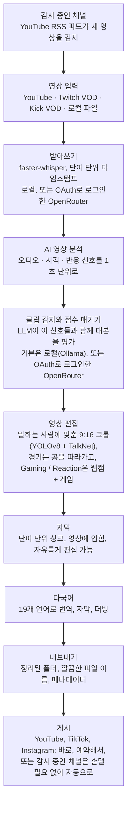

<div align="center">

[English](../../README.md) · [简体中文](README_zh.md) · [日本語](README_ja.md) · **한국어** · [Türkçe](README_tr.md) · [Русский](README_ru.md) · [Tiếng Việt](README_vi.md) · [ไทย](README_th.md) · [Deutsch](README_de.md) · [Español](README_es.md) · [Français](README_fr.md) · [Português (Brasil)](README_pt-BR.md) · [العربية](README_ar.md) · [Bahasa Indonesia](README_id.md) · [Italiano](README_it.md) · [हिन्दी](README_hi.md) · [বাংলা](README_bn.md) · [Filipino](README_tl.md) · [اردو](README_ur.md)

</div>

<a id="clips-kitty-the-free-open-source-opus-clip-alternative-for-chatting-gaming-and-sports-on-your-own-pc"></a>

# Clips Kitty: 내 PC에서 돌아가는 토크, 게임, 스포츠용 무료 오픈 소스 Opus Clip 대안

> 이 README는 [영어 README](../../README.md)를 AI로 번역한 것입니다. 기준이 되는 문서는 영어 README이며, 항상 영어판이 먼저 업데이트됩니다. 원어민분들의 수정 제안을 언제든 환영합니다.
>
> 🌐 [웹사이트 한국어 페이지](https://colingpt9.github.io/clips-studio/ko.html)

<a href="https://apps.microsoft.com/detail/9NB6XT7DSQZZ">
  <picture>
    <source media="(prefers-color-scheme: dark)" srcset="https://get.microsoft.com/images/en-us%20dark.svg">
    
  </picture>
</a>

[](https://github.com/ColinGPT9/clips-studio/releases)
[](https://github.com/ColinGPT9/clips-studio/releases)
[](../../LICENSE)
[](https://github.com/ColinGPT9/clips-studio/stargazers)
[](https://github.com/ColinGPT9/clips-studio)
[](../../CONTRIBUTING.md)
[](../../docs/DOCKER.md)

<a href="https://youtu.be/g1dMqrq-YaI"></a>

<a id="star-and-share-clips-kitty--goal-150"></a>

### Clips Kitty에 스타를 누르고 공유해 주세요 ⭐ 목표: 150

[](https://github.com/ColinGPT9/clips-studio/stargazers) **/ 150**

**저장소에 스타를 누르고 공유해 주세요.** 여러분에게는 비용이 전혀 들지 않습니다. 이 프로젝트에는 마케팅 예산이 없어서, 다음 소규모 유튜버나 스트리머가 무료 선택지가 있다는 사실을 알게 되는 길은 입소문뿐입니다.

**저는 다른 도구나 편집자를 쓸 여유가 없는 소규모 유튜버와 스트리머를 위해 이 앱을 만들었습니다.** 내 PC에서 **Google Gemma**를 실행하는 무료 Opus Clip, Vizard, Klap 대안으로, 서버 비용도, 클립당 요금도, AI 사용료도 없습니다.

> **Clips Kitty는 버전 1.1.3까지 Clips Studio라는 이름이었으며**, Microsoft Store의 이름 규정에 맞추기 위해 이름을 바꿨습니다. 앱도, 저장소도, 데이터도 그대로입니다.


**긴 방송과 영상을 바로 올릴 수 있는 Shorts, Reels, TikTok 영상으로 바꿔 줍니다. 모든 작업이 내 컴퓨터에서 이루어집니다.** Clips Kitty는 크리에이터를 위한 무료 오픈 소스 AI 클립 생성기이자 동영상 편집기입니다. YouTube, Twitch, Kick 링크를 붙여 넣으면 가장 좋은 순간을 찾아내고, 말하는 사람을 가운데에 둔 채 9:16으로 잘라 내고, 단어 단위로 싱크된 자막을 영상에 입히고, 제목·설명·해시태그까지 작성합니다.

기본적으로 클라우드 AI를 쓰지 않습니다. 구독도 없습니다. 클립당 요금도 없습니다. 내 YouTube 채널에 클립을 게시해 달라고 직접 요청하지 않는 한, 영상은 내 컴퓨터 밖으로 나가지 않습니다.

로컬이 우선이고, 필요할 때는 클라우드를 씁니다. PC가 너무 오래되어 AI를 돌릴 수 없다면 클라우드 제공업체가 대신 실행하고, 요금은 내 계정으로 청구됩니다. **추천하는 클라우드 경로는 OpenRouter입니다**. OpenRouter 계정으로 로그인하면(OAuth 방식이라 복사할 키가 없습니다) 여러 모델(Claude, GPT, Gemini, Muse Spark 등)을 쓸 수 있습니다. 제가 테스트했을 때 2시간짜리 영상 하나에 OpenRouter 비용이 약 11센트 들었습니다. Gemma(Gemma 4 26B-A4B)가 클립을 고르고 Whisper(large-v3-turbo)가 받아쓰기를 맡았으며, 실제 비용은 고르는 모델과 영상 길이에 따라 달라집니다. OpenAI, Claude, Gemini, xAI, Meta, DeepSeek, Qwen도 내 API 키로 직접 연결할 수 있습니다. [docs/AI-BACKENDS.md](../../docs/AI-BACKENDS.md)를 참고하세요.

**이 앱을 만든 이유:** 채널을 키워 가는 크리에이터 대부분은 촬영, 방송, 편집, 업로드를 전부 혼자 합니다. 클립은 사람들이 나를 발견하는 통로인데도, 보통 가장 먼저 포기하게 되는 일입니다. 편집자를 두는 건 아직 대부분의 채널에 부담스러운 비용이고, 클리핑 도구는 영상 단위나 월 단위로 요금을 받으며, 손으로 직접 자르려면 다른 데 써야 할 하루가 통째로 날아갑니다. 이 앱은 이미 가진 하드웨어에서 돌아가므로 쓰는 데 비용이 들지 않고, 만들 수 있는 클립 수에도 제한이 없습니다.


<sub>영상 하나에서 19분 만에 클립 38개. PC 한 대로, 아무것도 업로드하지 않고.</sub>

---

<a id="contents"></a>

## 목차

- [하는 일](#what-it-does)
- [Opus Clip, Klap, Vizard, CapCut과 비교](#how-it-compares-to-opus-clip-klap-vizard-and-capcut)
- [작동 방식](#how-it-works)
- [기능](#features)
- [어떤 콘텐츠에 맞게 만들었나](#what-its-built-for)
- [요구 사항](#requirements)
- [설치 및 실행](#install-and-run)
- [AI 모델 고르기](#pick-your-ai-model)
- [테스트한 하드웨어와 성능](#tested-hardware-and-performance)
- [지원 플랫폼](#supported-platforms)
- [지원 언어](#supported-languages)
- [YouTube에 게시하기](#publish-to-youtube)
- [모든 플랫폼에 한 번에 게시하기](#publish-to-every-platform-at-once)
- [GPU 가속](#gpu-acceleration)
- [명령줄 사용법](#command-line-use)
- [플러그인 만들기](#write-a-plugin)
- [이 위에 무언가 만들기](#build-on-it)
- [아키텍처](#architecture)
- [기여하기](#contributing)
- [로드맵](#roadmap-detail)
- [라이선스](#license)

---

<a id="what-it-does"></a>

## 하는 일

Clips Kitty에 긴 영상을 넣으면, 바로 올릴 수 있는 완성된 세로 클립이 담긴 폴더를 돌려줍니다. 올리기 전에 클립을 검토하고 고칠 수 있는 스튜디오도 함께 제공합니다.

대부분의 클리핑 도구가 가장 서툰 콘텐츠를 위해 만들었습니다. **라이브 방송, IRL과 토킹 헤드 영상, 팟캐스트, 헬스/피트니스 콘텐츠**처럼, 길고 구성이 느슨해서 좋은 순간이 묻혀 있고 대본만으로는 찾아낼 수 없는 영상들입니다.

<a id="how-it-compares-to-opus-clip-klap-vizard-and-capcut"></a>

## Opus Clip, Klap, Vizard, CapCut과 비교

Clips Kitty는 클라우드 클리핑 도구의 오픈 소스 대안입니다. 중요한 차이는 작업이 어디서 이루어지느냐입니다. 영상이 업로드되지 않으니 사용량을 잴 것도, 요금을 매길 것도 없습니다.

| 도구 | 가격(월 결제 기준) | 무료 플랜 | 클립을 대신 찾아 줌 | 워터마크 | 영상을 업로드함 | 오픈 소스 |
| ---- | --------------------- | --------- | ----------------------- | --------- | ------------------ | ----------- |
| **Clips Kitty** | 무료, 유료 플랜 없음 | 앱 전체 | 예 | 절대 없음 | 아니요, 내 PC에서 실행 | 예, AGPL-3.0 |
| Opus Clip | Starter $15, Pro $29 | 1080p, 워터마크, 3일 후 만료 | 예 | 무료 플랜에서 | 예 | 아니요 |
| Klap | Pro $29, Basic $14(연 결제) | 영상 1개 | 예 | 명시 안 됨 | 예 | 아니요 |
| Vizard | Creator $29, 연 결제 시 $14.50 | 월 60크레딧, 720p | 예 | 무료 플랜에서 | 예 | 아니요 |
| quso.ai | $29~$49 | 월 75크레딧, 720p | 예 | 명시 안 됨 | 예 | 아니요 |
| Ssemble | $15~$60, 연 결제 시 $6~$24 | 표시된 플랜 없음 | 예 | 명시 안 됨 | 예 | 아니요 |
| Descript | $16, $24, $50 | 월 60분, 720p | 일부, 대본 편집기임 | Free와 Hobbyist 플랜에서 | 예 | 아니요 |
| CapCut | 무료 사용, capcut.com에 유료 플랜 | 편집기 전체 | **아니요, 직접 잘라야 함** | 기능마다 다름 | 데스크톱 앱은 아니요 | 아니요 |

**CapCut은 제대로 알아 둘 만합니다.** 누구나 무료 답으로 꼽는 도구이기 때문입니다. 좋은 편집기이고 비용도 들지 않지만, 모든 순간을 찾고 모든 클립을 자르는 일은 직접 해야 합니다. Clips Kitty도 무료이며, 바로 그 첫 작업을 대신해 줍니다.

그래픽 카드가 달린 Windows PC가 없거나, 클립을 가끔만 만들거나, 휴대폰으로 작업해야 한다면 **Opus Clip, Klap, Vizard가 더 나은 선택입니다**. Clips Kitty는 이미 가진 하드웨어로 클립을 대량으로 만드는 용도에 맞춰져 있습니다.

**[7가지 도구 전체 비교와 각 도구가 가장 잘하는 것](https://colingpt9.github.io/clips-studio/alternatives.html)**

<sub>가격은 2026년 9월 17일에 각 회사의 공식 가격 페이지에서 확인했습니다. CapCut은 저희가 읽을 수 있는 가격 페이지를 공개하지 않아서 가격을 적지 않았습니다. 요금제는 바뀌며, 이 표는 저절로 업데이트되지 않습니다.</sub>

<a id="how-it-works"></a>

## 작동 방식



**따로 선택하지 않는 한 모든 단계가 내 컴퓨터에서 실행됩니다.** 예외는 AI나 받아쓰기에 내 계정으로 로그인한 OpenRouter를 쓰는 경우, 그리고 내가 보낸 클립만 업로드하는 게시 기능입니다. 그 밖에 일반적인 실행에서 네트워크를 쓰는 것은 원본 영상 다운로드뿐입니다.

<a id="the-stages-in-detail"></a>

### 단계별 상세

**받아쓰기: faster-whisper.** 단어 단위 타임스탬프를 만들며, 가능하면 CUDA에서 실행하고 아니면 CPU로 전환합니다. 자막이 정확한 음절에 맞춰 나오고 클립이 실제 문장 경계에서 시작되는 것은 이 단어 타이밍 덕분입니다.

**AI 클립 점수.** 대본은 다섯 가지 신호 중 하나일 뿐입니다. 오디오에서는 음량 급상승, 버스트 밀도(웃음과 박수가 이런 모양으로 나타납니다), 그리고 정적→폭발로 이어지는 반전 패턴을 얻습니다. 시각 신호에서는 장면 전환, 움직임, 얼굴 영역 변화를 얻습니다. 반응 신호는 이것들을 합칩니다. 각 신호는 *그 영상 안에서* 정규화되므로, 조용한 팟캐스트든 소리 지르는 방송이든 의미 있는 정점이 나옵니다. 실제 시청자 데이터가 있으면(고유 채팅 참여자 수로 측정한 Twitch 채팅 리플레이, YouTube의 '가장 많이 다시 본 구간' 히트맵) 상한이 있는 작은 보너스를 더합니다.

로컬 LLM은 대본과 **함께 이 이벤트들의 타임라인**을 보므로, "말은 밋밋한데 현장은 폭발했다" 같은 상황을 제대로 판단할 수 있습니다. 작은 모델은 모든 것을 좁은 범위의 점수로 매기기 때문에, 최종 후보들은 한 번의 재순위 호출에서 서로 직접 비교됩니다. 7B 모델에게는 절대 점수보다 상대 비교가 훨씬 쉽습니다.

**크리에이터 프로필.** 앱은 크리에이터별로 여러 영상에 걸친 지식 베이스를 만듭니다. 자주 나오는 주제, 시리즈, 함께하는 사람들, 반복되는 농담, 이어지는 스토리라인 같은 것들입니다. 이 맥락은 정확한 제목을 쓰고 예전 내용을 다시 꺼내는 순간(콜백)을 알아차리는 데 도움이 됩니다. 일부러 보수적으로 설계했습니다. 유행어는 실제로 반복되어야 인정되고, 더 이상 언급되지 않는 지식은 휴면 상태가 되며, 여기서 나오는 점수 기여는 모두 더하기 방식이고 상한이 있으며 끌 수 있습니다.

**동영상 편집기.** 비파괴 방식입니다. 트림, 중간 컷, 음소거, 단어 음소거, 볼륨, 페이드, 속도, 훅 텍스트, 음악, 워터마크는 작업 목록으로 저장되었다가 렌더링할 때 적용됩니다. AI 편집 채팅도 있습니다(*"5초 더 길게 해 줘"*, *"자막에 gost라고 나오는데 ghost가 맞아"*). 모델이 제안하고, 검증된 코드가 적용합니다.

**롱폼 처리.** 같은 분석을 쓰는 선택형 16:9 경로입니다. 가로 클립, X/Twitter 길이의 컷, 베스트 하이라이트 릴, 또는 공백 구간을 뺀 방송 전체를 만들 수 있습니다.

**다국어 파이프라인과 AI 더빙.** 자막은 번역된 뒤, 무언가를 쓰거나 영상에 입히기 *전에* 검토용으로 먼저 보여 줍니다. 그래서 잘못된 줄을 아직 고칠 수 있을 때 고칠 수 있습니다. 용어집이 채널 이름, 스폰서, 내부 농담이 번역되지 않도록 지켜 줍니다. 더빙은 미리 들어 볼 수 있는 음성을 갖춘 로컬 TTS를 사용합니다.

**로컬 GPU 가속.** 감지와 받아쓰기에는 CUDA, 동영상 인코딩에는 NVENC/AMF/QSV 하드웨어 인코딩(자동 감지, CPU 대체 지원), 그리고 Ollama를 통해 GPU에서 LLM을 돌립니다.

<a id="features"></a>

## 기능

- **멀티모달 클립 감지**: 말한 내용, 오디오의 흥분도, 시각적 활동, 화면 속 반응, 훅/반전의 강도를 합쳐 각 순간에 0–100점을 매깁니다. 품질 기준을 넘는 클립은 임의의 개수 제한 없이 모두 남깁니다.
- **화자 인식 얼굴 추적**: YOLOv8 포즈 감지로 대상을 가운데에 유지하고, 여러 명이 나오는 영상에서는 **실제로 말하는 사람**을 카메라가 따라갑니다. 이 판단은 움직임이 아니라 얼굴과 오디오를 함께 보는 TalkNet 활성 화자 감지가 내립니다. 화자가 바뀌면 화면을 가로질러 패닝하지 않고, 편집자가 하듯 그 사람에게 **컷**으로 넘어갑니다. 크롭만 하는 프레이밍이라 늘어나거나 왜곡되는 일이 없습니다.
- **팟캐스트 모드**: 멀티캠 영상에서는 샷마다 한 사람에게 고정된 크롭을 따로 잡으므로, 패닝 없이 컷이 바로 얼굴로 넘어갑니다. 한 샷 안에서는 입 움직임으로 대상을 고르고, 그게 안 되면 가장 눈에 띄는 얼굴을 고릅니다.
- **Vertical Live**(세로 라이브): 방송할 때부터 세로였던 라이브 방송용입니다(YouTube 세로 라이브, Twitch Dual Format, Streamlabs Dual Output, 다운로드한 Instagram이나 TikTok 라이브). 방송 자체의 9:16 레이아웃을 유지하고 얼굴 추적은 건너뛰며, 순간은 평소와 같은 방식으로 고릅니다. [docs/VERTICAL-LIVE.md](../../docs/VERTICAL-LIVE.md)를 참고하세요.
- **Sports**(스포츠, 축구와 농구): 경기의 큰 순간 하나하나를 빌드업과 반응을 포함한 각각의 클립으로 만듭니다.
  - **축구**: 골, 선방, 카드, 결정적 기회. 골은 스코어 박스에서 읽고 관중 반응으로 시점을 잡으며, 9:16 크롭은 공을 따라갑니다. All goals, Best saves, Cards 등을 고르고, 그 순간들을 묶어 경기 요약과 팀 또는 선수 릴로 만들 수 있습니다.
  - **농구**: 덩크, 3점슛, 블록, 스틸, 위닝샷. 화면의 스코어 그래픽으로 모든 득점과 그 점수를 확인하고, 쿼터와 남은 시간을 따져 위닝샷은 1쿼터 득점보다 훨씬 큰 비중을 갖습니다. 관중, 벤치, 코트사이드의 반응도 찾아냅니다. 각 클립의 9:16 크롭은 그 플레이에 맞춰 계획합니다. 공과 공을 가진 선수, 패스를 받는 선수, 그리고 림과 백보드를 화면에 담은 채 골대까지 따라가는 슛입니다. 크롭은 플레이를 따라 패닝할 뿐 절대 줌하지 않습니다. 공은 [E-BARD](https://github.com/GabrieleGiudic/E-BARD#readme) 감지 모델이 찾습니다([라이선스](#license)에 출처 표기).

  [docs/SPORTS.md](../../docs/SPORTS.md)를 참고하세요.
- **편집 가능한 하드 자막**: 단어 단위로 싱크되며 원하는 스타일로 꾸밀 수 있습니다(색상, 크기, 위치, 줄당 단어 수, 대소문자, 또는 끄기). 내보내기 전에 받아쓰기 실수를 한 줄씩 고칠 수 있습니다. 두 사람이 대화할 때는 두 번째 화자의 자막을 다른 색으로 표시할 수 있고, 화자를 잘못 잡은 자막은 직접 바꿀 수 있습니다.
- **AI 편집 채팅**: 무엇이 잘못됐는지 평소 말로 설명하면 다시 편집합니다.
- **Ask Clips Kitty**: 대시보드 맨 아래에 있는 텍스트 상자입니다. 원하는 것을 한 문장으로 말하면 됩니다. 예를 들어 *"이 방송 클립 만들어 줘, 내가 보스한테 죽은 장면은 꼭 넣고, 자막은 크고 노랗게"* 라고 쓰면, 영상을 대기열에 넣고, 클립 선택기에 무엇을 찾아야 하는지 알려 주고, 말한 옵션을 설정합니다. **Gemma 4 모델이 필요합니다**. [하단 텍스트 상자에는 Gemma 4가 필요합니다](#the-text-box-at-the-bottom-needs-gemma-4)를 참고하세요.
- **AI 제목, 설명, 해시태그**, 모두 내보내기 전에 편집할 수 있습니다.
- **크리에이터 프로필**: 앱이 시간이 지나면서 크리에이터 한 명 한 명을 학습해 클립을 더 잘 고르고 제목도 더 잘 붙입니다. 모든 정보는 내 컴퓨터에 남고, 직접 확인하고 고치거나 지울 수 있습니다.
- **다국어 게시**: 19개 언어를 지원하며, 영상에 입히기 전에 검토할 수 있습니다.
- **AI 더빙**: 언어별로 음성을 미리 들어 보고 고를 수 있는 로컬 텍스트 음성 변환.
- **롱폼 내보내기**: 16:9 클립, 하이라이트 릴, 또는 중복을 뺀 방송 편집본. 하이라이트 릴의 설명에는 **챕터 타임스탬프**가 들어가므로, 시청자가 YouTube에서 순간과 순간 사이를 건너뛸 수 있습니다.
- **워터마크와 브랜딩 프로필**: 크리에이터별 기본값이 자동으로 적용됩니다.
- **모델 관리자**: 앱 안에서 AI 두뇌를 바꿉니다. 터미널 없이 진행 막대를 보며 모델을 다운로드하고, 삭제하고, 전환할 수 있습니다.
- **편집기에서 바로 YouTube에 게시**: 제목, 설명, 태그, 썸네일, 재생목록, 시청자층, 공개 범위를 정한 뒤 바로 업로드하거나 예약합니다. 선택 사항이고 기본적으로 꺼져 있으며, 내 Google API 키를 사용합니다.
- **앱 내 피드백**: 진단 정보를 자동으로 모아 주는 버그 신고, 계정이 필요 없습니다.
- **접근성 있는 UI**: 키보드 포커스, 동작 줄이기 지원, 글꼴과 크기 조절.

<a id="what-its-built-for"></a>

## 어떤 콘텐츠에 맞게 만들었나

어떤 영상을 넣어도 전부 작동합니다. 아래는 기능 목록에서 짐작하는 것보다 더 많이, 혹은 덜 판단하는 경우들입니다. 예상 밖의 일이 없도록 미리 적어 둡니다.

| 콘텐츠 | 결과 |
|---|---|
| **IRL, 잡담 방송, 팟캐스트, 브이로그, 인터뷰** | 이 앱이 맞춰진 콘텐츠이며, 출시 전에 실제 방송으로 테스트하는 대상입니다 |
| **게임과 리액션** | **Gaming / Reaction**을 켜면: 화면 절반에는 웹캠, 나머지 절반에는 게임이나 리액션 대상 영상이 들어가며, 처리 전에 영상 자체의 프레임으로 확인합니다([docs/GAMING.md](../../docs/GAMING.md)). 스트리머는 가장 큰 얼굴이 아니라 지금 말하고 있는 사람입니다. 이 스위치를 켜지 않으면 프레이밍이 게임 속 캐릭터를 따라갈 수 있습니다. 카메라에 나오는 실제 사람만 지원하며, VTuber는 지원하지 않습니다 |
| **스포츠 경기** | **Sports**를 켜면: 스코어 박스와 해설이 있어 골과 농구 득점이 확실한 중계 영상용으로 만들었습니다. 클럽이나 휴대폰으로 찍은 영상에는 보통 둘 다 없습니다. 그런 영상의 클립은 공을 따라가고, 골은 클럽 앱의 골 태그처럼 직접 붙여 넣은 경기 이벤트에서 가져옵니다([docs/SPORTS.md](../../docs/SPORTS.md)) |
| **리액션이 반응하는 대상** | 클립은 여전히 *말한 내용*을 기준으로 고르므로, 보고 있는 영상 속 순간이라도 아무도 언급하지 않으면 앱은 알아채지 못합니다 |

클립 선택은 대본과 신호를 기반으로 합니다. 웃긴 장면이 *시각적으로만* 존재하고 아무도 언급하지 않는다면, 편집기에서 직접 찾아야 할 수 있습니다.

<a id="requirements"></a>

## 요구 사항

|             | 최소                                      | 권장                     |
| ----------- | -------------------------------------------- | ------------------------------- |
| **GPU**     | NVIDIA RTX 2060 (6 GB)                       | RTX 3060 12 GB 이상        |
| **CPU**     | Intel Core i3-9100 / AMD Ryzen 3 3200G (2019)| 6코어 이상                 |
| **RAM**     | 16 GB                                        | 16 GB 이상                   |
| **디스크**    | 약 20 GB, 그리고 클립을 만들 영상을 둘 공간    |                                 |
| **OS**      | Windows 10 또는 11                             |                                 |

**최소 사양보다 낮아도 실행은 될 수 있지만, 지원하지 않으며 느립니다.** 방송 하나를 클립으로 만드는 일은 몇 시간 분량의 영상 디코딩, 받아쓰기, 인코딩입니다. 대략 2019년 이전의 하드웨어에서는 시간이 너무 오래 걸려서, 제대로 작동하는 중에도 앱이 고장 난 것처럼 느껴집니다.

그중 두 가지는 좀 더 설명해 둘 만합니다.

- **16 GB RAM은 권장 사항이 아닙니다.** 8 GB에서는 영상 전체를 분석한 뒤 아무것도 렌더링하지 못하는데, 이것이 메모리 한계가 아니라 충돌처럼 보입니다.
- **GPU는 선택 사항이며 필수가 아닙니다.** GPU가 없으면 모든 것이 CPU에서 돌아가며, 느리지만 끝까지 완료됩니다. GPU 경로가 작동하기 시작하는 선이 RTX 2060입니다. [GPU 가속](#gpu-acceleration)을 참고하세요.

앱은 **Windows 전용**입니다. Python 엔진은 Linux/macOS에서도 돌아갈 것이지만, Mac 빌드는 없고 관리자에게는 테스트할 Mac도 없습니다. Mac이 있고 돕고 싶다면 [#62](https://github.com/ColinGPT9/clips-studio/issues/62)를 봐 주세요.

소스에서 실행하려면, 원래 설치 프로그램이 함께 묶어 주는 것들이 필요합니다.

- **Python 3.10+** 및 **Node.js 18+**
- PATH에 등록된 **[FFmpeg](https://ffmpeg.org/download.html)**
- 모델을 받아 둔 **[Ollama](https://ollama.com)**: `ollama pull gemma:7b`

<a id="install-and-run"></a>

## 설치 및 실행

**가장 쉬운 방법은 [Microsoft Store](https://apps.microsoft.com/detail/9NB6XT7DSQZZ)입니다.** 클릭 한 번이면 되고, 자동으로 업데이트되며, Windows 보안 경고도 뜨지 않습니다. Microsoft가 패키지를 인증하고 서명했기 때문에 아래에서 설명하는 SmartScreen 경고가 아예 나타나지 않습니다. Store는 자기 일정에 맞춰 새 버전을 설치합니다. 바로 받고 싶다면 Microsoft Store에서 Clips Kitty 페이지를 열고 **Update**(업데이트)를 누르세요.

**또는 설치 프로그램을 받으세요.** [Releases](https://github.com/ColinGPT9/clips-studio/releases)에서 최신 **Web Setup**을 받아 실행합니다. 앱, Python 엔진, 모든 라이브러리, FFmpeg, AI 런타임, 감지 및 받아쓰기 가중치가 모두 들어 있습니다. Python도, PATH 설정도, 터미널도, 따로 설치할 두 번째 프로그램도 필요 없습니다.

**또는 winget을 쓰세요.** `winget install ColinGPT9.ClipsKitty`로 터미널에서 같은 Web Setup을 설치합니다.

설치 프로그램에 들어 있지 않은 단 하나는 언어 모델 자체입니다. 언어 모델은 다운로드하는 사람이 직접 동의해야 하는 라이선스로 배포되며, 남이 대신 동의해 줄 수 있는 것이 아니기 때문입니다. 설정 마법사가 알아서 그 다운로드를 시작하고, 그래픽 카드에 맞는 크기를 고르고, 진행 막대를 보여 줍니다. 즉 다운로드 한 번, 더블클릭 한 번, 진행 막대 하나입니다. 그 뒤로는 오프라인으로 돌아갑니다.

> 처음 실행할 때 Windows가 서명되지 않은 앱이라고 경고합니다. *More info → Run anyway*(추가 정보 → 실행)를 누르세요. 서명 인증서는 할 일 목록에 있습니다.

<a id="from-source"></a>

### 소스에서 설치

```bash
git clone https://github.com/ColinGPT9/clips-studio
cd clips-studio
pip install -r requirements.txt

cd ui
npm install
npm run dev        # opens the Clips Kitty desktop app
```

앱이 자체 Python 엔진을 자동으로 시작합니다. **Clip Editor**(클립 편집기)에 링크를 붙여 넣고 *Generate clips*(클립 생성)를 누른 뒤 진행 상황을 실시간으로 지켜보세요.

설치 프로그램을 직접 빌드하는 것도 명령 하나면 됩니다. [CONTRIBUTING.md](../../CONTRIBUTING.md#building-the-windows-installer)를 참고하세요.

<a id="with-docker-nothing-else-to-install"></a>

### Docker로: 따로 설치할 것 없음

기여자를 위한 방법입니다. [Docker Desktop](https://docs.docker.com/get-started/get-docker/)만 있으면 됩니다. Python도, Node도, FFmpeg도, PyTorch도 필요 없습니다.

```bash
git clone https://github.com/ColinGPT9/clips-studio
cd clips-studio
docker compose up
```

세 가지 서비스가 함께 올라옵니다.

| | |
|---|---|
| **<http://localhost:5173>** | 브라우저에서 보는 인터페이스 |
| **<http://localhost:8765>** | 엔진과 API |
| Ollama | 로컬 AI, :11434에서 실행 |

그다음 모델을 받으면(`docker compose exec ollama ollama pull gemma3:4b`) 바로 작동하는 개발 환경이 갖춰집니다.

검사도 같은 방식으로 실행합니다.

```bash
docker compose run --rm engine pytest
docker compose run --rm ui npm run typecheck
```

> **10분 걸리는 첫 빌드를 건너뛰세요:** `docker compose pull`은 PyTorch와 OpenCV를 로컬에서 컴파일하는 대신 미리 빌드된 엔진 이미지를 받아 옵니다.

데스크톱 셸 자체는 Electron에 디스플레이가 필요하기 때문에 여전히 호스트에서 실행되고, 나머지는 모두 컨테이너에서 돌아갑니다. 자세한 내용과 이 방식으로는 확인할 수 없는 것들은 [docs/DOCKER.md](../../docs/DOCKER.md)에 있습니다.

<a id="pick-your-ai-model"></a>

## AI 모델 고르기

**Models**(모델) 페이지를 열면 설치된 모델과 내 GPU가 감당할 수 있는 모델을 볼 수 있습니다.

기준은 하나뿐입니다. VRAM이 얼마나 있느냐입니다. 아래 행은 앱에 표시되는 것과 같으며, [`llm/manager.py`](../../llm/manager.py)의 `RECOMMENDATIONS`에서 가져왔습니다. 마법사와 Models 페이지가 이 표 하나를 읽기 때문에, 둘이 서로 다르거나 이 문서와 다를 수 없습니다.

| 내 하드웨어 | 권장 모델 | |
|---|---|---|
| CPU / iGPU, 그래픽 카드 없음 | `gemma3:4b` | 테스트됨 |
| VRAM 6 GB 미만, 또는 오래된 PC | `gemma4:e2b` | |
| VRAM 6 GB | `gemma4:e4b` | |
| VRAM 8 GB | **`gemma:7b`** | 테스트됨 · 기본 탑재 |
| VRAM 10–12 GB | `gemma3:12b` | 테스트됨 |
| VRAM 16–24 GB | `gemma3:27b` | |

VRAM 말고 다른 이유로 고를 만한 모델들도 있습니다.

| 이유 | 모델 |
|---|---|
| 번역 / 다국어 | `qwen3:8b` 또는 `qwen3:14b` |
| 허용적인 라이선스 | `mistral-nemo:12b` (Apache-2.0) · `phi4:14b` (MIT) |

**"테스트됨"으로 표시된 세 개만 실제 방송으로 돌려 봤으며**, 그중 가장 오래 써 본 것이 `gemma:7b`입니다. `config/settings.yaml`에 기본으로 들어 있는 것도 이 모델입니다. 나머지는 적당한 크기이고 상업적으로 무료로 쓸 수 있어서 목록에 넣었을 뿐, 클립 품질을 측정해 보고 넣은 것은 아닙니다. 앱이 Ollama를 통해 모든 모델과 똑같은 방식으로 통신하므로 전부 작동은 하지만, 더 좋은 순간을 고르는지는 아무도 확인하지 않았습니다. 이 빈틈을 메우는 작업이 [#38](https://github.com/ColinGPT9/clips-studio/issues/38)입니다.

Ollama가 제공하는 모델이라면 무엇이든 작동하며, 전환은 클릭 한 번이면 됩니다. 번역에는 클리핑과 *다른* 모델을 쓸 수 있습니다. `llm.translation_model`을 설정하세요.

<a id="the-text-box-at-the-bottom-needs-gemma-4"></a>

### 하단 텍스트 상자에는 Gemma 4가 필요합니다

대시보드 맨 아래의 텍스트 상자인 **Ask Clips Kitty**는 앱의 도구를 사용할 수 있는 모델에서만 작동합니다. Gemma 4는 됩니다. `gemma:7b`와 Gemma 3 모델들은 안 되는데, 그래픽 카드가 없거나 VRAM이 8 GB 이상인 PC에서는 설정 과정에서 이 중 하나가 설치됩니다. 그런 PC에서는 Gemma 4 모델을 추가하기 전까지 상자가 작동하지 않습니다. 버전 2.0에서는 *"No installed model can use tools"*(도구를 사용할 수 있는 설치된 모델이 없습니다)라고 표시되고, 이후 버전에서는 상자 안에서 바로 다운로드를 제안합니다.

어떤 모델이 클립을 고르든, **Models** 페이지에서 Gemma 4 모델을 함께 설치해 두세요. 그래픽 카드 메모리가 6 GB 이상이면 `gemma4:e4b`, 그보다 적으면 `gemma4:e2b`입니다. 그 모델로 전환할 필요는 없습니다. 상자가 알아서 찾아 쓰고, 클립은 여전히 내가 고른 모델이 선택합니다. AI를 OpenRouter로 실행한다면 상자는 그 모델을 사용하며 따로 설치할 것이 없습니다.

<a id="tested-hardware-and-performance"></a>

## 테스트한 하드웨어와 성능

Clips Kitty는 매일 이 컴퓨터에서 개발하고 테스트하므로, 내 결과와 비교할 때 유용한 기준점이 됩니다.

| | |
|---|---|
| **GPU** | NVIDIA GeForce RTX 3060, 12 GB VRAM |
| **CPU** | AMD Ryzen 5 5600X (6코어 / 12스레드) |
| **RAM** | 16 GB |
| **OS** | Windows 10 |
| **클리핑 모델** | Ollama를 통한 `gemma:7b` |
| **받아쓰기** | CUDA에서 실행하는 faster-whisper `large-v3-turbo` |

이 저장소의 모든 것(기본 설정, `parallel_renders: 3`, 5분 단위 분석 청크 크기)은 대략 이 정도 사양의 컴퓨터에 맞춰져 있습니다. 더 큰 GPU라면 `llm.num_ctx`와 `analysis.chunk_seconds`를 함께 올리고 모델 크기를 한 단계 키우세요. 더 작은 GPU라면 `gemma3:4b`로 낮추세요.

다른 하드웨어에서 Clips Kitty 벤치마크를 해 보셨다면 [Discussions](https://github.com/ColinGPT9/clips-studio/discussions)에 올려 주세요. 실제 컴퓨터에서 나온 실제 수치는 모두가 자기 환경을 가늠하는 데 도움이 됩니다.

<a id="supported-platforms"></a>

## 지원 플랫폼

| 소스 | 지원 |
|---|---|
| YouTube 영상 | 완전 지원. 일부러 H.264를 선택합니다(AV1은 처리 시간이 약 두 배로 늘어납니다) |
| Twitch VOD | 완전 지원, 채팅 리플레이를 시청자 신호로 활용하는 것까지 포함 |
| Kick VOD | 완전 지원(Kick은 방송이 끝나면 채팅을 지우므로 채팅 신호는 없습니다) |
| 로컬 동영상 파일 | 완전 지원. 게시하기 전에 내 영상을 클립으로 만들어 보세요 |
| 라이브 방송 | 의도적으로 지원하지 않습니다. VOD만 지원합니다 |

<a id="supported-languages"></a>

## 지원 언어

클립은 **19개 언어**로 번역, 자막, 더빙할 수 있고, **인터페이스 자체도 19개 언어 모두로 번역되어 있어서**, 게시하는 언어 그대로 앱을 쓸 수 있습니다.

영어 · 스페인어 · 포르투갈어(브라질) · 프랑스어 · 독일어 · 힌디어 · 인도네시아어 · 일본어 · 러시아어 · 아랍어 · 중국어(간체) · 베트남어 · 필리핀어 · 튀르키예어 · 우르두어 · 벵골어 · 태국어 · 한국어 · 이탈리아어

언어를 추가하려면 `multilingual/languages.py`에 한 줄, `ui/src/renderer/src/locales/`에 로케일 파일 하나만 넣으면 됩니다. 번역기와 자막 작성기는 언어에 상관없이 작동합니다.

<a id="help-wanted-the-maintainer-only-speaks-english"></a>

### 도움 요청: 관리자는 영어만 할 줄 압니다

19개 인터페이스 번역 중 18개는 그 언어를 쓰는 사람이 한 번도 읽어 본 적이 없습니다. 그중 절반은 아직 완성되지 않았습니다. 언어마다 영어와 해당 언어로 작성된 이슈가 따로 있으며, **어색한 단어 하나를 알려 주는 것만으로도 완전한 기여입니다**. 풀 리퀘스트는 필요 없습니다. [참여 방법](../../docs/TRANSLATING.md).

**마무리 필요**(약 68개 문자열이 아직 영어): [বাংলা (벵골어)](https://github.com/ColinGPT9/clips-studio/issues/43) · [Italiano (이탈리아어)](https://github.com/ColinGPT9/clips-studio/issues/44) · [한국어](https://github.com/ColinGPT9/clips-studio/issues/45) · [ไทย (태국어)](https://github.com/ColinGPT9/clips-studio/issues/46) · [Tagalog (필리핀어)](https://github.com/ColinGPT9/clips-studio/issues/47) · [Türkçe (튀르키예어)](https://github.com/ColinGPT9/clips-studio/issues/48) · [اردو (우르두어)](https://github.com/ColinGPT9/clips-studio/issues/49) · [Tiếng Việt (베트남어)](https://github.com/ColinGPT9/clips-studio/issues/50) · [中文 (중국어)](https://github.com/ColinGPT9/clips-studio/issues/51)

**확인 필요**(완성되었지만, 자연스럽게 읽히는지 아무도 확인하지 않음): [العربية (아랍어)](https://github.com/ColinGPT9/clips-studio/issues/52) · [Deutsch (독일어)](https://github.com/ColinGPT9/clips-studio/issues/53) · [Español (스페인어)](https://github.com/ColinGPT9/clips-studio/issues/54) · [Français (프랑스어)](https://github.com/ColinGPT9/clips-studio/issues/55) · [हिन्दी (힌디어)](https://github.com/ColinGPT9/clips-studio/issues/56) · [Bahasa Indonesia (인도네시아어)](https://github.com/ColinGPT9/clips-studio/issues/57) · [日本語 (일본어)](https://github.com/ColinGPT9/clips-studio/issues/58) · [Português (포르투갈어)](https://github.com/ColinGPT9/clips-studio/issues/59) · [Русский (러시아어)](https://github.com/ColinGPT9/clips-studio/issues/60)

여기 없는 언어가 필요하신가요? [#61](https://github.com/ColinGPT9/clips-studio/issues/61).

<a id="publish-to-youtube"></a>

## YouTube에 게시하기

기본적으로 꺼져 있습니다. **Settings → Publish to YouTube**(설정 → YouTube에 게시)에서 켜면 편집기에 **YouTube** 탭이 나타납니다. 제목, 설명, 태그, 썸네일, 재생목록, 시청자층, 공개 범위를 채운 뒤 **Upload now**(지금 업로드)를 누르세요. 저장하지 않은 편집이 있으면 Clips Kitty가 클립을 렌더링한 뒤 내 채널에 바로 업로드합니다. 내보내기 단계도, 별도의 게시 페이지도 없습니다. 편집기를 떠날 일이 없습니다.

꺼 둔 채로 두면 앱 어디에서도 달라지는 것이 없습니다.

<a id="scheduling"></a>

### 예약

**Schedule on YouTube**(YouTube에서 예약)를 선택하면 영상을 *즉시* 업로드하고 비공개로 표시한 뒤, YouTube에 게시 시간을 넘깁니다. 그날이 되면 YouTube가 게시합니다.

**Clips Kitty를 닫고 컴퓨터를 꺼도 됩니다.** 이 앱에는 타이머도, 백그라운드 서비스도, 켜 둬야 할 것도 없습니다. YouTube가 영상을 받아들이면 Clips Kitty의 일은 끝납니다.

<a id="you-need-your-own-google-api-key"></a>

### 내 Google API 키가 필요합니다

Clips Kitty는 공용 키를 제공하지 않으며, 이건 단순히 조심하려는 이유만이 아닙니다. Google의 업로드 할당량은 **Cloud 프로젝트 단위**입니다. 공용 키 하나를 쓰면 전 세계 모든 사용자가 하루 100개 업로드라는 같은 한도를 나눠 쓰게 됩니다. 내 프로젝트를 만들면 나만의 한도가 생기고, 내 인증 정보는 컴퓨터 밖으로 나가지 않습니다. 중간에 Clips Kitty 서버는 없습니다.

설정은 무료이며 10분 정도 걸립니다. Settings의 마법사가 단계별로 안내합니다.

1. [Google Cloud Console](https://console.cloud.google.com/projectcreate)에서 프로젝트를 만듭니다.
2. APIs & Services → Library에서 **YouTube Data API v3**를 사용 설정합니다.
3. OAuth 동의 화면을 채운 뒤 **Publish app**(앱 게시)을 누릅니다. 이 단계가 중요합니다. *Testing*(테스트) 상태로 두면 Google이 7일마다 로그인을 만료시켜서 매주 다시 연결해야 합니다. "In production"(프로덕션)은 인증을 받았다는 뜻이 아니며 비용도 들지 않습니다.
4. Credentials → Create credentials → OAuth client ID → 유형은 **Desktop app**.
5. 클라이언트 ID와 클라이언트 보안 비밀을 Settings에 붙여 넣은 뒤 채널을 연결합니다.

연결할 때 "Google에서 확인하지 않은 앱" 경고가 나타납니다. 내가 만든 앱이 나 자신에게 경고하는 것입니다. **Advanced → Go to (unsafe)**(고급 → (안전하지 않음)으로 이동)를 누르면 넘어갈 수 있습니다.

<a id="posting-publicly"></a>

### 공개로 게시하기

이 기능에 기대기 전에 꼭 알아야 할 점이 하나 있습니다. 어떤 소프트웨어로도 피해 갈 수 없는 문제이기 때문입니다.

> **Google Cloud 프로젝트가 YouTube의 무료 API 감사를 통과하기 전까지는, 그 프로젝트로 업로드한 모든 영상을 YouTube가 비공개로 잠급니다.** 이 잠금은 영구적입니다. 나중에 Studio에서 공개로 바꿀 수도 없고, 이의 제기도 할 수 없습니다. 유일한 해결책은 감사를 통과한 프로젝트에서 다시 업로드하는 것입니다.

Clips Kitty는 업로드할 때마다 확인하고, 이런 일이 생기면 아무도 볼 수 없는 영상을 성공이라고 보고하는 대신 그 사실을 분명하게 알려 줍니다. 공개로 게시할 계획이라면 먼저 [YouTube API 서비스 감사 양식](https://support.google.com/youtube/contact/yt_api_form)을 제출하세요. **일부 공개(unlisted)** 또는 **비공개(private)** 업로드는 영향을 받지 않습니다.

<a id="what-it-can-and-cannot-set"></a>

### 설정할 수 있는 것과 없는 것

공개 API가 제공하는 모든 것을 설정할 수 있습니다. 제목, 설명(설명에 넣은 타임스탬프는 챕터가 됩니다), 태그, 카테고리, 언어, 공개 범위, 예약 게시 시간, 아동용 여부, 변경/합성 콘텐츠 공개, 라이선스, 퍼가기 허용, 공개 통계, 맞춤 썸네일, 재생목록에 추가.

YouTube Studio의 일부 기능은 공개 API에 아예 없습니다. 그래서 아무 일도 하지 않는 컨트롤을 슬쩍 두는 대신 일부러 컨트롤을 두지 않았습니다. 수익 창출과 광고 시점, 유료 프로모션 공개, 최종 화면과 카드, 댓글 설정, 연령 제한, 최초 공개, Shorts 리믹스 권한이 그렇습니다. 이런 항목은 패널에서 Studio로 가는 링크를 제공합니다.

Shorts에는 특별한 것이 필요 없습니다. 별도 모드도, `#Shorts` 태그도 필요 없습니다. YouTube가 영상의 비율과 길이를 보고 알아서 Short로 분류합니다.

<a id="publish-to-every-platform-at-once"></a>

## 모든 플랫폼에 한 번에 게시하기

이것도 기본적으로 꺼져 있습니다. **Settings → Publish through WoopSocial**(설정 → WoopSocial로 게시)에서 켜면 편집기에 **Publish**(게시) 탭이 나타납니다. 플랫폼을 고르거나 **Everywhere**(모든 곳)를 누르고, 제목과 설명을 한 번만 쓰면, 업로드 한 번으로 YouTube, TikTok, Instagram, Facebook, X, Threads, LinkedIn, Pinterest, Bluesky에 함께 올라갑니다. Clip Editor의 **Publish all**(모두 게시)은 한 묶음 전체를 처리하며, 클립 열두 개가 같은 순간에 올라가지 않도록 간격을 둡니다.

이 기능은 **로컬이 아닙니다**. 클립과 세부 정보는 게시 서비스로 전송되고, 그 서비스가 클립을 전달하며 내 소셜 계정과의 연결을 보관합니다. 그래서 Clips Kitty는 소셜 계정 비밀번호를 절대 묻지 않습니다. 앱의 나머지 기능은 여전히 내 PC에서 실행됩니다.

지원하는 서비스는 두 가지입니다. **[WoopSocial](https://woopsocial.com/?via=clipskitty)**: 무료 플랜은 계정 두 개를 연결할 수 있고 YouTube 게시물을 하루 약 5개까지 올릴 수 있으며, 유료 플랜에서는 둘 다 늘어납니다. **[Upload-Post](https://www.upload-post.com/)**: 더 많은 곳에 게시할 수 있고 썸네일, 첫 댓글, 게시 대기열을 추가로 제공합니다. 둘 중 하나만 켜도 되고, 둘 다 켜도 됩니다.

<sub>제휴 링크입니다. 이 링크로 가입하시면 Clips Kitty가 수수료를 받을 수 있으며, 여러분에게 추가 비용은 없습니다.</sub>

**내 키를 직접 쓰세요.** 계정은 내가 만들고, 내 소셜 계정을 연결하고, 내 한도를 씁니다. Clips Kitty는 요금을 받지 않고, 공용 키를 갖고 있지 않으며, 아무것도 대신 결제하지 않습니다. YouTube 연동과 같은 방식이고, 이유도 같습니다.

전체 안내, 플랫폼별 지원 범위와 제한: **[docs/UPLOAD-POST.md](../../docs/UPLOAD-POST.md)**.

<a id="gpu-acceleration"></a>

## GPU 가속

**동영상 인코딩**은 세 제조사 모두에서 자동으로 하드웨어 가속됩니다. NVIDIA(NVENC), AMD(AMF), Intel(QSV)입니다. 엔진이 시작할 때 각 인코더로 프레임 하나를 시험 인코딩해 보고, 실제로 작동하는 첫 번째 것을 쓰며, 모두 안 되면 CPU로 전환합니다. `config/settings.yaml`의 `video.encoder`로 직접 지정할 수 있습니다.

**감지와 받아쓰기**는 CUDA에서 가장 빠릅니다. 기본 `pip install torch`로는 **CPU 전용** 빌드가 설치됩니다. NVIDIA라면 다음과 같이 하세요.

```bash
pip uninstall torch torchvision -y
pip install torch torchvision --index-url https://download.pytorch.org/whl/cu130
```

**GPU를 쓰는 그래픽 카드:** GTX 16 시리즈, RTX 20 시리즈, 그리고 RTX 50 시리즈를 포함한 그 이후의 모든 카드.

**GPU에서 받아쓰기**를 하려면 NVIDIA의 cuBLAS 12도 필요합니다. Whisper의 엔진(CTranslate2)은 CUDA 12 빌드인데, 위의 CUDA 13 PyTorch에는 cuBLAS 13만 들어 있기 때문입니다. `pip install -r requirements.txt`가 이것(`nvidia-cublas-cu12`)을 설치하고, 설치형 앱에도 들어 있으므로 CUDA 툴킷은 필요 없습니다. 이것이 없으면 받아쓰기는 CPU에서 실행되며, 로그에 그 이유가 나옵니다.

**GTX 10 시리즈 이하는 최소 사양 미만입니다.** 지원하는 구성이 아닙니다. 그래도 앱이 실행을 거부하지는 않습니다. 감지는 CPU로 전환되고 모든 기능이 여전히 작동하지만 느립니다. 게다가 그렇게 오래된 컴퓨터에는 보통 CPU도 오래된 것이 달려 있어서, 감지 단계만이 아니라 작업 전체가 느려집니다.

더 오래된 인덱스 말고 위의 `cu130` 인덱스를 쓰세요. 오래된 CUDA 빌드에는 최신 카드용 코드가 없어서, 빨라야 할 하드웨어에서 앱이 CPU로 전환됩니다.

AMD GPU 사용자: Windows에서는 추적과 받아쓰기가 CPU에서 실행되며, 기능은 모두 작동하고 속도만 느립니다. GPU는 여전히 AMF를 통한 동영상 인코딩과, AMD를 자체 지원하는 Ollama를 통한 LLM에 쓰입니다.

**동영상 디코딩**은 추적 단계와 렌더링 모두에서 OpenCV 대신 하드웨어 가속을 쓰는 FFmpeg로 처리합니다. 이렇게 샘플 프레임을 읽으면 Python에서 디코딩하던 것에 비해 CPU를 약 10분의 1만 씁니다. 추적 단계는 모든 클립에 대해 실행되기 때문에 이 차이가 중요합니다.

**CPU 분배.** 감지와 렌더링은 둘 다 모든 코어를 원하기 때문에, 그냥 두면 서로 다투고 인터페이스와도 다툽니다. 엔진은 시작할 때 코어를 렌더 작업자들에게 나눠 주고 일부러 두 개를 남겨 두므로, 일괄 작업이 돌아가는 동안에도 앱이 원활하게 반응합니다. `video.parallel_renders`로 조정하세요.

<a id="command-line-use"></a>

## 명령줄 사용법

데스크톱 앱 없이도 모든 기능이 작동합니다.

```bash
python main.py process "https://www.youtube.com/watch?v=VIDEO_ID"   # one video
python main.py models                                               # list/switch models
python main.py status                                               # processing state
python main.py serve                                                # just the API engine
```

설정은 [config/settings.yaml](../../config/settings.yaml)에 있습니다. 파일 맨 위에는 짧은 빠른 설정 블록이 있고, 고급 설정은 모두 그 아래에 있습니다. 모든 LLM 프롬프트는 [config/prompts/](../../config/prompts/)의 일반 텍스트 파일이므로, Python을 건드리지 않고도 클립 점수를 매기는 방식을 조정할 수 있습니다.

<a id="write-a-plugin"></a>

## 플러그인 만들기

범용 감지기보다 어떤 게임, 스포츠, 프로그램 장르를 더 잘 아시나요? 영상 속 순간을 찾거나, 이해하거나, 평가하는 작은 Python 플러그인을 작성하면 나머지는 Clips Kitty가 처리합니다. SDK는 MIT 라이선스라서 플러그인에는 어떤 라이선스든 쓸 수 있고, 아무것도 포크할 필요가 없습니다.

```text
Clips Kitty SDK

Input                      a link or a video file
  ↓
Video                      Clips Kitty downloads it and writes down what is said
  ↓
Your plugin                every step is optional
  ├── find                 picks the moments                  built
  ├── understand           says what happens in each one      built
  ├── rate                 scores each moment                 built
  └── edit                 suggests edits for the creator     built
  ↓
Clips Kitty                does every step no plugin does, then cuts, frames and captions the clips
  ↓
Creator / Social Platform  posts when the creator clicks Publish, or on a schedule or automatic posting the creator switched on
```

- 하나의 플러그인이 영상의 순간을 찾을 수 있으며, 이 경우 Clips Kitty의 자체 찾기 기능을 대신합니다.
- 찾기 단계 뒤에 최대 3개의 플러그인이 이해를, 최대 3개가 평가를 맡을 수 있습니다.
- 플러그인의 역할은 매니페스트의 `inputs`와 `outputs`로 정해집니다([단계](../../docs/developers/steps.md)).
- 최대 3개의 플러그인이 만들어질 클립에 대한 편집을 제안할 수 있습니다.
- 편집 플러그인이 제안한 편집은 편집기에서 크리에이터의 확인을 기다립니다([단계](../../docs/developers/steps.md#suggest-edits-the-edit-step)).
- 게시는 플러그인 단계가 아닙니다. Clips Kitty가 직접 클립을 게시하며, WoopSocial을 통해 크리에이터 본인의 계정으로 여러 사이트에 한 번에 게시할 수 있습니다([모든 플랫폼에 한 번에 게시하기](#publish-to-every-platform-at-once)). `kind: publisher`는 거부됩니다. 플러그인은 게시하지 않습니다.

명령 세 개로 SDK를 설치하고, `game-events` 템플릿(가상의 게임인 Quarkbloom Arena용)으로 플러그인을 만들고, SDK가 만들어 주는 테스트 영상에서 실행해 볼 수 있습니다. Python 3.11, FFmpeg, Git이 필요합니다.

PowerShell (Windows):

```powershell
py -m pip install "clipskitty-sdk[yaml,test] @ git+https://github.com/ColinGPT9/clips-studio#subdirectory=sdk/python"
py -m clipskitty_sdk new quarkbloom-bursts --template game-events --publisher your-github-name
py -m clipskitty_sdk run quarkbloom-bursts --sample
```

bash (macOS, Linux):

```bash
python -m pip install "clipskitty-sdk[yaml,test] @ git+https://github.com/ColinGPT9/clips-studio#subdirectory=sdk/python"
python -m clipskitty_sdk new quarkbloom-bursts --template game-events --publisher your-github-name
python -m clipskitty_sdk run quarkbloom-bursts --sample
```

Clips Kitty 2.1.0은 플러그인을 실행하는 첫 릴리스이며, SDK 1.3.0이 함께 제공됩니다.

그다음은 **[첫 게임 파이프라인 만들기](../../docs/developers/first-game-pipeline.md)** 가이드가 단계별로 이어서, Clips Kitty에 설치되고 Marketplace에 등록되는 플러그인까지 안내합니다. [Signals 쿡북](../../docs/developers/signals-cookbook.md)에는 게임 영상을 읽는 레시피가, [SDK 레퍼런스](../../docs/developers/sdk.md)에는 모든 명령과 호출이, [개발자 문서](../../docs/developers/README.md)에는 그 밖의 모든 것이 있습니다. 웹사이트의 [Clips Kitty SDK](https://colingpt9.github.io/clips-studio/developers.html) 페이지는 짧은 요약판입니다.

<a id="build-on-it"></a>

## 이 위에 무언가 만들기

데스크톱 앱은 Clips Kitty가 열려 있을 때 항상 실행되는 **로컬 HTTP API**를 들여다보는 창입니다. Discord 봇, 일괄 처리기, 웹 프런트엔드, OBS 연동이 같은 파이프라인을 구동할 수 있으며, 그러기 위해 앱에 먼저 무언가를 추가할 필요가 없습니다.

```bash
python main.py serve --port 8765          # the engine on its own, no window

curl -X POST http://127.0.0.1:8765/jobs \
  -H "Content-Type: application/json" \
  -d '{"url": "https://www.youtube.com/watch?v=VIDEO_ID"}'
# {"job_id": 149}
```

클립은 JSON으로 돌아오며, 그 클립을 만든 점수 세부 내역과 스트리밍할 수 있는 MP4가 함께 옵니다.

```bash
curl -s http://127.0.0.1:8765/videos/VIDEO_ID/clips \
  | python -c "import json,sys; [print(c['score'], c['title']) for c in json.load(sys.stdin)]"
```

**[docs/API.md](../../docs/API.md) 문서**에는 활용할 만한 엔드포인트가 동작하는 예제, 그리고 사람들이 오후 한나절을 날리곤 하는 함정과 함께 정리되어 있습니다. 서비스는 `http://127.0.0.1:8765/docs`에서 자체 대화형 문서도 제공합니다.

이 API에는 **인증이 없으며**, 그래서 localhost에만 바인딩됩니다. 무언가를 연결하기 전에 API 문서의 보안 안내를 읽어 보세요.

<a id="or-bring-your-own-model"></a>

### 또는 나만의 모델 가져오기

여기까지는 앱 *바깥에서* 만드는 방법입니다. 앱 *안에서* 만들 수도 있으며, 그 출발점은 플러그인입니다([플러그인 만들기](#write-a-plugin)). 관심 있는 영상이 이 앱이 맞춰진 종류가 아니라면, 그게 스포츠든 게임이든 리액션이든 강의든 아직 아무도 시도하지 않은 무언가든, 플러그인으로 포크 없이 그 순간을 찾거나, 이해하거나, 평가할 수 있습니다. 플러그인은 Clips Kitty 자체의 Python에서 표준 라이브러리(앱이 빼 둔 몇몇 모듈 제외)와 SDK로 실행됩니다. Clips Kitty는 아직 플러그인용으로 다른 Python 패키지를 설치할 수 없습니다.

앱 자체를 바꾸고 싶다면: 파이프라인은 **YOLOv8 (ultralytics), OpenCV, TalkNet-ASD**를 로컬에서 실행하며, 어떤 순간이 클립이 될지는 무엇이 재미있는지에 대한 하드코딩된 생각이 아니라 초 단위 신호들의 묶음이 결정합니다. 타임라인 전체에 걸쳐 신뢰도를 내보내는 감지기는 신호 하나로 추가할 수 있고, 그 정점들이 클립 후보가 됩니다. 감지에 Clips Kitty가 아직 플러그인용으로 설치할 수 없는 Python 패키지가 필요하다면, 포크해서 직접 만든 감지를 연결하세요. **[docs/EXTENDING.md](../../docs/EXTENDING.md#bring-your-own-model) 문서**에 지켜야 할 계약, 복사할 파일, 시작하기 전에 알아 둘 성능 함정이 정리되어 있습니다.

**폴링할 필요가 없습니다.** `webhook_url`과 함께 작업을 제출하면 작업이 끝났을 때 엔진이 한 번 POST를 보내며, 내 비밀 값을 넘기면 그 값으로 서명합니다. 그래서 독(dock)이나 n8n 플로우가 몇 초마다 물어보는 대신, 방송 하나에 걸리는 40분 동안 조용히 기다릴 수 있습니다. 자세한 내용은 [docs/API.md](../../docs/API.md#webhooks-being-told-instead-of-asking)에 있습니다.

<a id="ask-an-ai-agent-to-do-it"></a>

### AI 에이전트에게 맡기기

Clips Kitty에는 **MCP 서버**가 포함되어 있어서, Claude, Cursor 또는 어떤 MCP 클라이언트든 평소 말로 같은 파이프라인을 구동할 수 있습니다. 방송을 대기열에 넣고, 작업을 따라가고, 앱이 고른 클립을 읽고, 하나를 내보내는 식입니다.

```bash
claude mcp add clips-kitty -- python main.py mcp
```

설치된 빌드에서는 엔진 실행 파일이 `api.exe`(앱의 `resources\backend` 폴더 안)이므로, 거기서는 명령이 `api.exe mcp`입니다.

이 서버는 `127.0.0.1:8765`로 실행 중인 엔진과 통신하므로 Clips Kitty가 열려 있어야 하며, 어떤 종류의 API 키도 필요 없습니다. 클리핑을 하는 모델은 내 컴퓨터에 있는 모델입니다(또는 Settings → AI에서 골랐다면 내 키로 쓰는 클라우드 모델이며, MCP 클라이언트는 그 키를 볼 수 없습니다). 에이전트 스킬을 지원하는 클라이언트용 스킬은 [skills/clips-kitty/](../../skills/clips-kitty/)에 있습니다.

<a id="built-with-clips-kitty"></a>

### Clips Kitty로 만든 것들

이 API로 돌아가는 프로젝트들은 **[Awesome Clips Kitty](https://github.com/ColinGPT9/awesome-clips-kitty) 목록**에 올라 있습니다. Clips Kitty로 만든 파이프라인, 플러그인, 연동, 앱, 도구를 모은 목록입니다. 첫 번째 항목은 방송이 끝나면 그 방송을 Clips Kitty에 넘겨주는 OBS Studio 독인 [Clips Kitty OBS Plugin](https://github.com/ColinGPT9/clips-kitty-obs-plugin)입니다. 직접 만들어 보셨나요? 풀 리퀘스트로 추가하고([방법](https://github.com/ColinGPT9/awesome-clips-kitty/blob/main/CONTRIBUTING.md)), 저장소에 `clips-kitty` 토픽을 달아 주세요.

<a id="architecture"></a>

## 아키텍처

전체 설계는 **[ARCHITECTURE.md](../../ARCHITECTURE.md) 문서**를 참고하세요. 파이프라인, 점수 엔진, 추적, 크리에이터 인텔리전스, API 구성, 그리고 모듈 구조를 유지하는 설계 규칙을 다룹니다.

<a id="contributing"></a>

## 기여하기

기여를 환영합니다. 개발 환경 설정과 풀 리퀘스트에 기대하는 사항은 **[CONTRIBUTING.md](../../CONTRIBUTING.md) 문서**를, 취약점 신고는 **[SECURITY.md](../../SECURITY.md) 문서**를 참고하세요. 어디서부터 시작할지 찾고 있다면, [`good-first-issue`](https://github.com/ColinGPT9/clips-studio/labels/good-first-issue) 라벨이 붙은 이슈들은 작고 범위가 명확합니다.

웹사이트는 [site/](../../site/)에 있으며 GitHub Pages와 Hugging Face Space에 게시됩니다. [docs/MIRRORS.md](../../docs/MIRRORS.md)를 참고하세요. **작업은 GitHub에서 이루어지며**, 웹사이트 미러는 한 방향으로 강제 푸시되므로 미러에서 만든 커밋은 덮어써집니다.

패키징과 릴리스 문서:

- **[docs/RELEASING.md](../../docs/RELEASING.md)**: 주 배포 채널인 Windows 설치 프로그램을 빌드하고 게시하는 방법
- **[docs/MSSTORE.md](../../docs/MSSTORE.md)**: 개발자 계정 만들기부터 인증까지, Microsoft Store 패키지
- **[packaging/winget/](../../packaging/winget/)**: 위 설치 프로그램을 가리키는 winget 매니페스트
- **[whop-app/](../../whop-app/)**: 클리핑 커뮤니티 회원들에게 Clips Kitty를 알리는 Whop 앱. 마케팅 페이지일 뿐이며, 영상을 처리하거나, 무언가를 저장하거나, 데스크톱 앱과 통신하지 않습니다
- **[docs/DOCKER.md](../../docs/DOCKER.md)**: Python, FFmpeg, PyTorch를 직접 설치하지 않고 엔진 실행하기
- **[PRIVACY](https://colingpt9.github.io/clips-studio/privacy.html)**: 앱이 저장하는 것과 내 컴퓨터 밖으로 나갈 수 있는 것(짧게 답하면: 버그 신고를 제출하지 않는 한 아무것도 없습니다)

<a id="changelog-known-issues-roadmap"></a>

## 변경 기록, 알려진 문제, 로드맵

- **[CHANGELOG.md](../../CHANGELOG.md)**: 릴리스마다 무엇이 바뀌었는지 쉬운 말로 정리했습니다.
- **[KNOWN-ISSUES.md](../../KNOWN-ISSUES.md)**: 지금 고장 났거나 빠진 것과 우회 방법. 목록의 모든 항목은 실제로 확인된 것입니다.
- **[ROADMAP.md](../../ROADMAP.md)**: 출시된 것, 다음에 할 것, 장기적인 방향.

**업데이트 소식 팔로우:**
[-%40ClipsKitty2-000000?logo=x&logoColor=white)](https://x.com/ClipsKitty2)
[](https://www.instagram.com/clipskitty2/)
[](https://www.youtube.com/@ClipsKitty2)

<a id="roadmap-detail"></a>

## 로드맵 상세

짧은 버전은 [ROADMAP.md](../../ROADMAP.md)에 있습니다. 어려운 결정 뒤에 있는 이유는 아래에 적었습니다. "왜 아직 안 되는지"가 보통 "아직 안 된다"보다 더 쓸모 있기 때문입니다.

1. **Android 보조 앱, Vertical Live 전용**으로 가볍게 유지합니다. 세로 라이브는 이미 휴대폰 화면에 맞게 구성되어 있으므로, 앱은 방송 자체의 레이아웃을 유지하고 순간만 찾으면 되며 얼굴 추적이나 리프레이밍이 필요 없습니다. Play Store 정책을 지키기 위해 Twitch, Kick, 로컬 동영상 파일만 지원합니다.
2. **더 많은 스포츠**: 축구와 농구는 들어갔습니다. 다음은 크리켓입니다(Sport 메뉴에 이미 '곧 지원'으로 올라 있습니다). 다른 종목처럼 독립된 모듈로 만듭니다([docs/SPORTS.md](../../docs/SPORTS.md#adding-a-sport) 참고).
3. **작업이 끝나면 문자 알림**: 영상의 클립이 준비되었을 때, 게시되었을 때, 무언가 실패했을 때 문자 메시지를 보내서, 아무도 앱을 지켜보지 않아도 자동으로 돌아가는 채널을 운영할 수 있게 합니다.
4. **더빙용 음성 복제** *(일부러 이 목록의 마지막에 둠)*: 지금 더빙은 미리 정해진 로컬 음성을 씁니다. 번역을 크리에이터 **본인의** 목소리로 말하게 하려면 복제 모델이 필요한데, 믿을 만한 로컬 모델은 모두 자체 PyTorch 빌드를 끌어옵니다. 클리핑용으로 설정된 컴퓨터에서는 이것이 torch를 CPU 전용 빌드로 다운그레이드해서, 추적과 받아쓰기의 GPU 가속을 소리 없이 없애 버립니다. 더빙을 넣으려고 클리핑을 망가뜨리는 건 나쁜 거래입니다.

   현실적으로 이 기능은 일반 소비자용 하드웨어가 따라잡을 때까지 기다리거나, 클리핑용 환경을 절대 건드리지 않도록 자체 Python 환경을 갖춘 별도의 선택 설치로 나올 것입니다. 모델 라이선스도 확인해야 합니다. 소리가 가장 좋은 모델 중 여럿이 비상업용인데, 이 앱의 사용자들은 영상으로 수익을 냅니다.

<a id="license"></a>

## 라이선스

**GNU AGPL-3.0-or-later**입니다. [LICENSE](../../LICENSE)를 참고하시고, 실제로 무엇을 뜻하는지와 설치 프로그램에 무엇이 포함되는지는 [NOTICE](../../NOTICE)를 참고하세요.

농구의 공, 골대, 선수 감지에는 [E-BARD](https://github.com/GabrieleGiudic/E-BARD) 감지 모델(YOLOv8n)을 수정 없이 CC BY 4.0에 따라 사용합니다. 공개적으로 배포해 주셔서 감사합니다. 그 밖에 포함된 모든 구성 요소와 각각의 라이선스는 [NOTICE](../../NOTICE)에 있습니다.

Clips Kitty 위에 무언가를 만들기 쉽도록, 세 부분은 따로 라이선스가 적용됩니다.

| 구성 요소 | 라이선스 |
|---|---|
| Clips Kitty (앱, 엔진, 이 저장소) | AGPL-3.0-or-later |
| 플러그인 SDK, [`sdk/python/`](../../sdk/python/) | MIT ([sdk/python/LICENSE](../../sdk/python/LICENSE)) |
| 예제 플러그인, [`examples/pipelines/scene-cut-highlights/`](../../examples/pipelines/scene-cut-highlights/) 및 [`examples/pipelines/keyword-rater/`](../../examples/pipelines/keyword-rater/) | MIT |
| 앱에 포함된 Awesome Clips Kitty 목록 사본, `plugins/catalog_index.json` (목록 자체는 [별도 저장소](https://github.com/ColinGPT9/awesome-clips-kitty)에 있음) | CC0-1.0 |

다른 사람이 만든 플러그인, 파이프라인, 앱은 작성자가 고른 라이선스를 그대로 따르며, Marketplace의 모든 항목에 그 라이선스가 표시됩니다. SDK를 사용한다고 해서 플러그인이 AGPL 적용을 받게 되지는 않습니다.

**앱을 사용하기만 한다면 달라지는 것은 없습니다.** 설치하고, 방송을 클립으로 만들고, 클립을 올리고, 수익을 내세요. AGPL은 소프트웨어를 *배포*하거나 *수정한* 사본을 네트워크 서비스로 운영하는 사람에게 적용되며, 사용하는 사람에게는 적용되지 않습니다. 내 영상과 클립은 내 것입니다.

**수정해서 공유한다면,** 변경 사항도 같은 라이선스로 공개됩니다. 그게 핵심입니다. 크리에이터를 위해 만든 도구의 개선 사항은 그 크리에이터들이 계속 쓸 수 있어야 하니까요.

그래도 수정하기 좋게 만들었습니다. 모델을 바꾸고, 프롬프트를 조정하고, 플랫폼을 추가해 보세요.

<a id="star-history"></a>

## 스타 기록

Clips Kitty에 스타를 주고, 공유하고, 버그를 알려 주고, 번역해 주신 모든 분께 감사드립니다.

<a href="https://www.star-history.com/#ColinGPT9/clips-studio&amp;Date">
  <picture>
    <source media="(prefers-color-scheme: dark)" srcset="https://api.star-history.com/chart?repos=ColinGPT9/clips-studio&amp;type=date&amp;theme=dark&amp;legend=top-left" />
    <source media="(prefers-color-scheme: light)" srcset="https://api.star-history.com/chart?repos=ColinGPT9/clips-studio&amp;type=date&amp;legend=top-left" />
    
  </picture>
</a>
