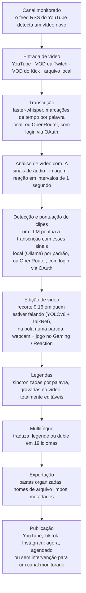

<div align="center">

[English](../../README.md) · [简体中文](README_zh.md) · [日本語](README_ja.md) · [한국어](README_ko.md) · [Türkçe](README_tr.md) · [Русский](README_ru.md) · [Tiếng Việt](README_vi.md) · [ไทย](README_th.md) · [Deutsch](README_de.md) · [Español](README_es.md) · [Français](README_fr.md) · **Português (Brasil)** · [العربية](README_ar.md) · [Bahasa Indonesia](README_id.md) · [Italiano](README_it.md) · [हिन्दी](README_hi.md) · [বাংলা](README_bn.md) · [Filipino](README_tl.md) · [اردو](README_ur.md)

</div>

<a id="clips-kitty-the-free-open-source-opus-clip-alternative-for-chatting-gaming-and-sports-on-your-own-pc"></a>

# Clips Kitty: a alternativa gratuita e de código aberto ao Opus Clip para bate-papo, games e esportes, no seu próprio PC

> Este README foi traduzido por IA a partir do [README em inglês](../../README.md), que é a
> referência e é atualizado primeiro. Correções de falantes nativos são muito bem-vindas.
>
> 🌐 [O site em português](https://colingpt9.github.io/clips-studio/pt.html)

<a href="https://apps.microsoft.com/detail/9NB6XT7DSQZZ">
  <picture>
    <source media="(prefers-color-scheme: dark)" srcset="https://get.microsoft.com/images/en-us%20dark.svg">
    
  </picture>
</a>

[](https://github.com/ColinGPT9/clips-studio/releases)
[](https://github.com/ColinGPT9/clips-studio/releases)
[](../../LICENSE)
[](https://github.com/ColinGPT9/clips-studio/stargazers)
[](https://github.com/ColinGPT9/clips-studio)
[](../../CONTRIBUTING.md)
[](../../docs/DOCKER.md)

<a href="https://youtu.be/g1dMqrq-YaI"></a>

<a id="star-and-share-clips-kitty--goal-150"></a>

### Dê uma estrela e compartilhe o Clips Kitty ⭐ Meta: 150

[](https://github.com/ColinGPT9/clips-studio/stargazers) **de 150**

**Por favor, dê uma estrela no repositório e compartilhe.** Não custa nada, e não
existe orçamento de marketing por trás disso, então o boca a boca é a única forma
de o próximo pequeno YouTuber ou streamer descobrir que existe uma opção gratuita.

**Eu fiz isto para pequenos YouTubers e streamers** que não podem pagar pelas outras
opções nem por um editor. É uma alternativa gratuita ao Opus Clip, Vizard e Klap que
roda o **Google Gemma** no seu próprio PC: sem custo de servidor, sem taxa por clipe,
sem taxa de uso de IA.

> **O Clips Kitty se chamava Clips Studio até a versão 1.1.3** e foi renomeado para
> atender às exigências de nomes da Microsoft Store. Mesmo app, mesmo repositório, mesmos dados.


**Transforme lives e vídeos longos em Shorts, Reels e TikToks prontos para postar,
inteiramente na sua própria máquina.** O Clips Kitty é um gerador de clipes com IA e
editor de vídeo gratuito e de código aberto para criadores: cole um link do YouTube,
Twitch ou Kick e ele encontra os melhores momentos, recorta em 9:16 mantendo quem fala
centralizado, grava legendas sincronizadas palavra por palavra e escreve títulos,
descrições e hashtags.

Sem IA na nuvem por padrão. Sem assinatura. Sem taxa por clipe. Suas gravações nunca
saem do seu computador, a menos que você peça para publicar um clipe no seu próprio
canal do YouTube.

Local primeiro, nuvem quando você precisar: se o seu PC for antigo demais para rodar a
IA, um provedor na nuvem a executa no lugar dele, cobrado na sua própria conta.
**O OpenRouter é o caminho recomendado na nuvem**: entre com a sua conta OpenRouter
(OAuth, sem chave para copiar) para usar muitos modelos (Claude, GPT, Gemini, Muse Spark e outros).
Nos meus testes, um vídeo de 2 horas custou cerca de 11 centavos no OpenRouter, com o Gemma
(Gemma 4 26B-A4B) escolhendo os clipes e o Whisper (large-v3-turbo) transcrevendo; quanto você
paga depende dos modelos que escolher e da duração do vídeo.
OpenAI, Claude, Gemini, xAI, Meta, DeepSeek e Qwen também funcionam diretamente, com a sua
própria chave de API.
Veja [docs/AI-BACKENDS.md](../../docs/AI-BACKENDS.md).

**Por que ele existe:** a maioria dos criadores que estão crescendo um canal faz tudo
sozinha: grava, faz live, edita, posta. Os clipes são como as pessoas te encontram, e
geralmente são a primeira coisa a ser deixada de lado: um editor é um custo que a maioria
dos canais ainda não consegue justificar, as ferramentas de clipes cobram por vídeo ou por
mês, e cortar à mão toma um dia que você precisava para outra coisa. Isto roda no hardware
que você já tem, então não custa nada para usar e não há limite de quantos clipes você faz.


<sub>38 clipes de um único vídeo em 19 minutos, em um PC, sem nada enviado para a internet.</sub>

---

<a id="contents"></a>

## Conteúdo

- [O que ele faz](#what-it-does)
- [Comparação com Opus Clip, Klap, Vizard e CapCut](#how-it-compares-to-opus-clip-klap-vizard-and-capcut)
- [Como funciona](#how-it-works)
- [Recursos](#features)
- [Para o que ele foi feito](#what-its-built-for)
- [Requisitos](#requirements)
- [Instalar e executar](#install-and-run)
- [Escolha seu modelo de IA](#pick-your-ai-model)
- [Hardware testado e desempenho](#tested-hardware-and-performance)
- [Plataformas suportadas](#supported-platforms)
- [Idiomas suportados](#supported-languages)
- [Publicar no YouTube](#publish-to-youtube)
- [Publicar em todas as plataformas de uma vez](#publish-to-every-platform-at-once)
- [Aceleração por GPU](#gpu-acceleration)
- [Uso pela linha de comando](#command-line-use)
- [Escreva um plugin](#write-a-plugin)
- [Construa em cima dele](#build-on-it)
- [Arquitetura](#architecture)
- [Como contribuir](#contributing)
- [Roteiro](#roadmap-detail)
- [Licença](#license)

---

<a id="what-it-does"></a>

## O que ele faz

Você entrega um vídeo longo ao Clips Kitty. Ele te devolve uma pasta de clipes verticais
prontos para postar, além de um estúdio para revisar e corrigir tudo antes disso.

Ele foi feito para o conteúdo que a maioria das ferramentas de clipes trata pior: **lives,
IRL e vídeos de pessoas falando para a câmera, podcasts e conteúdo de academia/fitness**:
vídeos longos e pouco estruturados, em que os bons momentos ficam enterrados e só a
transcrição não basta para encontrá-los.

<a id="how-it-compares-to-opus-clip-klap-vizard-and-capcut"></a>

## Comparação com Opus Clip, Klap, Vizard e CapCut

O Clips Kitty é uma alternativa de código aberto às ferramentas de clipes na nuvem. A
diferença que importa é onde o trabalho acontece: o seu vídeo nunca é enviado, então não
há nada para medir e nada para cobrar.

| Ferramenta | Preço, cobrança mensal | Plano gratuito | Encontra os clipes para você | Marca d'água | Envia o seu vídeo | Código aberto |
| ---- | --------------------- | --------- | ----------------------- | --------- | ------------------ | ----------- |
| **Clips Kitty** | Grátis, sem plano pago | O app inteiro | Sim | Nunca | Não, roda no seu PC | Sim, AGPL-3.0 |
| Opus Clip | US$ 15 Starter, US$ 29 Pro | 1080p, com marca d'água, expira em 3 dias | Sim | No plano gratuito | Sim | Não |
| Klap | US$ 29 Pro, US$ 14 Basic na cobrança anual | Um vídeo | Sim | Não informado | Sim | Não |
| Vizard | US$ 29 Creator, US$ 14,50 na cobrança anual | 60 créditos por mês, 720p | Sim | No plano gratuito | Sim | Não |
| quso.ai | US$ 29 a US$ 49 | 75 créditos por mês, 720p | Sim | Não informado | Sim | Não |
| Ssemble | US$ 15 a US$ 60, US$ 6 a US$ 24 na cobrança anual | Nenhum listado | Sim | Não informado | Sim | Não |
| Descript | US$ 16, US$ 24, US$ 50 | 60 minutos por mês, 720p | Em parte, é um editor de transcrição | Nos planos Free e Hobbyist | Sim | Não |
| CapCut | Gratuito, planos pagos em capcut.com | O editor inteiro | **Não, você corta à mão** | Varia conforme o recurso | Não, no app para desktop | Não |

**O CapCut é o que vale a pena entender**, porque é a resposta gratuita que todo mundo dá.
É um bom editor e não custa nada, mas é você quem encontra cada momento e recorta cada
clipe. O Clips Kitty também é gratuito, e essa primeira passada é justamente a parte que
ele faz por você.

**Opus Clip, Klap ou Vizard são a melhor escolha** se você não tem um PC com Windows e placa
de vídeo, se faz clipes só de vez em quando ou se precisa trabalhar pelo celular. O Clips
Kitty foi feito para gerar clipes em volume no hardware que você já tem.

**[Comparação completa das sete, com aquilo em que cada uma é melhor](https://colingpt9.github.io/clips-studio/alternatives.html)**

<sub>Preços conferidos na página de preços de cada empresa em 17 de setembro de 2026. O CapCut
não publica uma página de preços que conseguíssemos ler, então nenhum preço é citado para ele.
Os planos mudam; esta tabela não vai se atualizar sozinha.</sub>

<a id="how-it-works"></a>

## Como funciona



**Todas as etapas rodam no seu computador, a menos que você escolha outra coisa:** o
OpenRouter, com login na sua conta, para a IA ou a transcrição, e a publicação, que envia
apenas os clipes que você mandar. Fora isso, a única coisa que usa a rede numa execução
normal é o download do vídeo de origem.

<a id="the-stages-in-detail"></a>

### As etapas em detalhe

**Transcrição: faster-whisper.** Marcações de tempo por palavra, rodando em CUDA quando
disponível e recorrendo à CPU quando não. O tempo de cada palavra é o que faz as legendas
caírem na sílaba certa e os clipes começarem no limite real de uma frase.

**Pontuação de clipes com IA.** A transcrição é um sinal entre cinco. O áudio fornece picos
de volume, densidade de rajadas (o formato de risadas e aplausos) e padrões de silêncio→explosão
que dão o desfecho. A imagem fornece cortes de cena, movimento e mudanças na área do rosto.
Um sinal de reação combina tudo isso. Cada um é normalizado *dentro daquele vídeo*, então um
podcast calmo e uma live aos gritos produzem picos significativos. Onde existem dados reais
do público (replay do chat da Twitch medido por pessoas únicas no chat, o mapa de calor de
"mais repetidos" do YouTube), eles somam um pequeno bônus com limite.

O LLM local vê a transcrição **mais uma linha do tempo desses eventos**, então consegue pesar
corretamente "as palavras são leves, mas a sala explodiu". Como modelos pequenos dão notas
numa faixa estreita, os finalistas são depois comparados lado a lado numa única chamada de
reordenação: julgar de forma relativa é muito mais fácil para um modelo de 7B do que dar
uma nota absoluta.

**Perfis de Criador.** O app monta uma base de conhecimento por criador, ao longo dos vídeos
dele: temas recorrentes, séries, colaboradores, piadas internas e histórias em andamento.
Esse contexto ajuda a escrever títulos precisos e a perceber referências a momentos
anteriores. Ele é conservador de propósito: um bordão precisa de fato se repetir antes de
contar, conhecimento que deixa de ser mencionado fica adormecido, e toda contribuição dele
para a pontuação é somada, tem limite e pode ser desligada.

**Editor de vídeo.** Não destrutivo: cortes nas pontas, cortes internos, silenciamentos,
palavras silenciadas, volume, fades, velocidade, texto de gancho, música e marca d'água são
guardados como operações e aplicados na renderização. Também há um chat de edição com IA
(*"deixa 5 segundos mais longo"*, *"a legenda diz fatasma, deveria ser fantasma"*), em que
o modelo propõe e um código validado aplica.

**Processamento de formato longo.** Um caminho 16:9 opcional que usa a mesma análise: clipes
horizontais, cortes no tamanho do X/Twitter, um compilado com os melhores momentos ou a live
inteira sem os trechos mortos.

**Pipeline multilíngue e dublagem com IA.** As legendas são traduzidas e mostradas para revisão
*antes* de qualquer coisa ser escrita ou gravada no vídeo, então uma linha ruim é corrigida
enquanto ainda dá para corrigir. Um glossário impede que nomes de canais, patrocinadores e
piadas internas sejam traduzidos. A dublagem usa TTS local com vozes que você pode ouvir antes.

**Aceleração local por GPU.** CUDA para detecção e transcrição, codificação de vídeo por
hardware via NVENC/AMF/QSV (detectada automaticamente, com CPU como alternativa) e o LLM na
GPU através do Ollama.

<a id="features"></a>

## Recursos

- **Detecção multimodal de clipes**: momentos pontuados de 0 a 100 combinando o que é dito, a
  empolgação no áudio, a atividade visual, as reações na tela e a força do gancho/desfecho.
  Todo clipe que passa da barra de qualidade é mantido, sem limite arbitrário.
- **Rastreamento de rosto que sabe quem fala**: a detecção de pose do YOLOv8 mantém a pessoa
  centralizada e, em gravações com várias pessoas, a câmera segue **quem está de fato
  falando**, decidido pela detecção de falante ativo do TalkNet a partir do rosto e do áudio
  juntos, e não pelo movimento. Quando o falante muda, o enquadramento **corta** para ele em
  vez de deslizar pela cena, como faria um editor. Enquadramento só por recorte: nunca
  esticado, nunca distorcido.
- **Modo podcast**: em gravações com várias câmeras, cada plano ganha seu próprio recorte
  estável em uma pessoa, então os cortes caem num rosto sem panorâmica. Dentro de um plano,
  a pessoa é escolhida pelo movimento da boca, recorrendo ao rosto mais em destaque.
- **Vertical Live**: para uma live que já era vertical quando foi transmitida (uma live
  vertical do YouTube, Twitch Dual Format, Streamlabs Dual Output, uma live do Instagram ou do
  TikTok baixada). Mantém o próprio layout 9:16 da transmissão, pula o rastreamento de rosto e
  continua escolhendo os momentos do jeito de sempre. Veja [docs/VERTICAL-LIVE.md](../../docs/VERTICAL-LIVE.md).
- **Esportes: futebol e basquete**: cada grande momento de uma partida ou jogo como um clipe
  próprio, com a construção da jogada e a reação.
  - **Futebol**: gols, defesas, cartões e grandes chances. Os gols são lidos do placar na tela
    e datados pela torcida, e o recorte 9:16 segue a bola. Escolha All goals (todos os gols),
    Best saves (melhores defesas), Cards (cartões) e mais, e junte os momentos num resumo da
    partida e em compilados de time ou de jogador.
  - **Basquete**: enterradas, bolas de três, tocos, roubos de bola e cestas da vitória. O placar
    na tela confirma cada cesta e seus pontos, e o quarto e o relógio fazem uma cesta da vitória
    valer muito mais do que uma cesta do primeiro quarto. As reações da torcida, do banco e da
    beira da quadra também são encontradas. O recorte 9:16 de cada clipe é planejado em torno
    da jogada: a bola e quem está com ela, quem recebe um passe e o arremesso acompanhado até a
    cesta, com o aro e a tabela na imagem. Ele acompanha a jogada com panorâmicas e nunca dá
    zoom. A bola é encontrada pelo modelo de detecção [E-BARD](https://github.com/GabrieleGiudic/E-BARD#readme) (creditado em [Licença](#license)).

  Veja [docs/SPORTS.md](../../docs/SPORTS.md).
- **Legendas gravadas no vídeo e editáveis**: sincronizadas palavra por palavra e com o estilo que
  você quiser (cor, tamanho, posição, palavras por linha, maiúsculas/minúsculas, ou desligadas).
  Corrija um erro de transcrição linha por linha antes de exportar. Com duas pessoas falando, as
  legendas do segundo falante podem ter outra cor, e uma que ele atribuir errado pode ser trocada
  à mão.
- **Chat de edição com IA**: descreva o que está errado em linguagem simples e ele edita de novo.
- **Ask Clips Kitty**: a caixa de texto na parte de baixo do painel. Diga o que você quer numa
  frase, como *"clipa esta live, não deixa de incluir quando eu morri pro chefão, com legendas
  grandes e amarelas"*, e ele coloca o vídeo na fila, diz ao seletor de clipes o que procurar e
  ajusta as opções que você citou. **Ela precisa de um modelo Gemma 4**: veja
  [A caixa de texto na parte de baixo precisa do Gemma 4](#the-text-box-at-the-bottom-needs-gemma-4).
- **Títulos, descrições e hashtags com IA**, todos editáveis antes de exportar.
- **Perfis de Criador**: o app aprende sobre cada criador com o tempo para escolher e dar títulos
  melhores aos clipes. Tudo fica no seu computador, e você pode inspecionar, corrigir ou apagar.
- **Publicação multilíngue**: 19 idiomas, com revisão antes de qualquer coisa ser gravada no vídeo.
- **Dublagem com IA**: conversão de texto em fala local, com teste de vozes por idioma.
- **Exportação em formato longo**: clipes 16:9, compilados de melhores momentos ou uma edição da
  live sem repetições. A descrição de um compilado traz **marcações de capítulos**, para que os
  espectadores pulem entre os momentos no YouTube.
- **Perfis de marca d'água e identidade visual**: padrões por criador aplicados automaticamente.
- **Gerenciador de modelos**: troque o cérebro da IA de dentro do app; baixe, remova e alterne
  modelos com barras de progresso e sem terminal.
- **Publique no YouTube direto do editor**: título, descrição, tags, miniatura, playlist,
  público e visibilidade, e depois Upload now (enviar agora) ou agende. Opcional, desligado
  por padrão, e usa a sua própria chave de API do Google.
- **Feedback dentro do app**: relatórios de bug com diagnóstico coletado automaticamente, sem
  precisar de conta.
- **Interface acessível**: foco pelo teclado, suporte a movimento reduzido, fonte e tamanho ajustáveis.

<a id="what-its-built-for"></a>

## Para o que ele foi feito

Tudo roda em qualquer vídeo que você der a ele. Estes são os casos em que ele pensa mais ou
menos do que a lista de recursos sugere, para que nada seja uma surpresa:

| Conteúdo | Como ele se sai |
|---|---|
| **IRL, just chatting, podcasts, vlogs, entrevistas** | É para isso que ele está ajustado e é isso que é testado em lives reais antes de cada lançamento |
| **Games e reacts** | Com **Gaming / Reaction** ligado: a webcam numa metade, o jogo ou o vídeo reagido na outra, conferido nos próprios quadros do vídeo antes do processamento ([docs/GAMING.md](../../docs/GAMING.md)). O streamer é quem está falando, nunca o maior rosto. Sem essa opção, o enquadramento pode seguir um personagem dentro do jogo. Só pessoas na câmera, sem VTubers |
| **Partidas esportivas** | Com **Sports** ligado: feito para transmissões com placar na tela e narração, em que os gols e as cestas são certos. Gravações de clube ou de celular normalmente não têm nenhum dos dois: os clipes delas seguem a bola, e os gols vêm dos eventos da partida que você colar, como as marcações de gol do app de um clube ([docs/SPORTS.md](../../docs/SPORTS.md)) |
| **Aquilo a que um react está reagindo** | Os clipes continuam sendo escolhidos pelo que é *dito*, então um momento do vídeo assistido que ninguém comenta fica invisível para ele |

A seleção de clipes é guiada pela transcrição e pelos sinais. Quando a graça é *só visual* e
ninguém comenta, conte com encontrá-la você mesmo no editor.

<a id="requirements"></a>

## Requisitos

|             | Mínimo                                       | Recomendado                     |
| ----------- | -------------------------------------------- | ------------------------------- |
| **GPU**     | NVIDIA RTX 2060 (6 GB)                       | RTX 3060 12 GB ou melhor        |
| **CPU**     | Intel Core i3-9100 / AMD Ryzen 3 3200G (2019)| 6 núcleos ou mais               |
| **RAM**     | 16 GB                                        | 16 GB ou mais                   |
| **Disco**   | ~20 GB, mais espaço para os vídeos que você clipar |                           |
| **SO**      | Windows 10 ou 11                             |                                 |

**Abaixo do mínimo ele ainda pode rodar, mas não há suporte e vai ser lento.** Clipar uma live
são horas de decodificação de vídeo, transcrição e codificação; um hardware anterior a mais ou
menos 2019 vai demorar tanto que o app parece quebrado mesmo quando está funcionando direito.

Dois desses pontos merecem mais explicação:

- **16 GB de RAM não é uma sugestão.** Com 8 GB ele analisa um vídeo inteiro e depois não
  renderiza nada, o que parece um travamento e não um limite de memória.
- **A GPU é opcional, não obrigatória.** Sem ela tudo roda na CPU, mais devagar, mas por
  completo. A RTX 2060 é a linha a partir da qual o caminho pela GPU começa a funcionar;
  veja [Aceleração por GPU](#gpu-acceleration).

**Só Windows** para o app. O motor em Python deve rodar em Linux/macOS, mas não existe versão
para Mac e o mantenedor não tem um Mac para testar. Veja
[#62](https://github.com/ColinGPT9/clips-studio/issues/62) se você tem um e quer ajudar.

Rodar a partir do código-fonte exige as coisas que o instalador traria para você:

- **Python 3.10+** e **Node.js 18+**
- **[FFmpeg](https://ffmpeg.org/download.html)** no seu PATH
- **[Ollama](https://ollama.com)** com um modelo baixado: `ollama pull gemma:7b`

<a id="install-and-run"></a>

## Instalar e executar

**O jeito mais fácil é pela [Microsoft Store](https://apps.microsoft.com/detail/9NB6XT7DSQZZ).**
Um clique, ele se atualiza sozinho e o Windows não mostra nenhum aviso de segurança. A Microsoft
certificou e assinou o pacote, então o aviso do SmartScreen descrito abaixo nem aparece. A Store
instala as versões novas quando chega a vez delas; para ter uma na hora, abra a página do Clips
Kitty na Microsoft Store e clique em **Update** (Atualizar).

**Ou baixe o instalador.** Pegue o **Web Setup** mais recente em
[Releases](https://github.com/ColinGPT9/clips-studio/releases) e execute. Ele traz o app, o motor em Python, todas as
bibliotecas, o FFmpeg, o runtime de IA e todos os pesos de detecção e transcrição: sem Python,
sem PATH, sem terminal e sem um segundo programa para instalar.

**Ou use o winget.** `winget install ColinGPT9.ClipsKitty` instala o mesmo Web Setup a partir de
um terminal.

A única coisa que ele não traz é o próprio modelo de linguagem, porque esses modelos vêm com
licenças que a pessoa que faz o download precisa aceitar, e não algo que possa ser aceito em seu
nome. O assistente de instalação inicia esse download sozinho, escolhe o tamanho adequado à sua
placa de vídeo e mostra uma barra de progresso. Ou seja: um download, um clique duplo, uma barra
de progresso. Depois disso ele funciona offline.

> O Windows vai avisar que o app não é assinado na primeira vez que você executá-lo. Clique em
> *Mais informações → Executar assim mesmo*. Um certificado de assinatura está na lista de pendências.

<a id="from-source"></a>

### A partir do código-fonte

```bash
git clone https://github.com/ColinGPT9/clips-studio
cd clips-studio
pip install -r requirements.txt

cd ui
npm install
npm run dev        # opens the Clips Kitty desktop app
```

O app inicia seu próprio motor em Python automaticamente. Cole um link no **Clip Editor**,
clique em *Generate clips* (gerar clipes) e acompanhe o progresso ao vivo.

Gerar o instalador você mesmo é um único comando. Veja
[CONTRIBUTING.md](../../CONTRIBUTING.md#building-the-windows-installer).

<a id="with-docker-nothing-else-to-install"></a>

### Com Docker: nada mais para instalar

Para quem contribui. Você precisa do [Docker Desktop](https://docs.docker.com/get-started/get-docker/)
e de mais nada: sem Python, sem Node, sem FFmpeg, sem PyTorch.

```bash
git clone https://github.com/ColinGPT9/clips-studio
cd clips-studio
docker compose up
```

Três serviços sobem juntos:

| | |
|---|---|
| **<http://localhost:5173>** | a interface, no seu navegador |
| **<http://localhost:8765>** | o motor e a API dele |
| Ollama | a IA local, na porta :11434 |

Depois baixe um modelo (`docker compose exec ollama ollama pull gemma3:4b`) e você terá um
ambiente funcionando.

Rode as verificações do mesmo jeito:

```bash
docker compose run --rm engine pytest
docker compose run --rm ui npm run typecheck
```

> **Pule a primeira compilação de dez minutos:** `docker compose pull` baixa uma imagem do motor
> já pronta em vez de compilar o PyTorch e o OpenCV localmente.

O próprio shell de desktop ainda roda na sua máquina, já que o Electron precisa de uma tela;
todo o resto fica em contêineres. Detalhes, e o que isto não consegue te dizer, em
[docs/DOCKER.md](../../docs/DOCKER.md).

<a id="pick-your-ai-model"></a>

## Escolha seu modelo de IA

Abra a página **Models** (Modelos) para ver o que está instalado e o que a sua GPU aguenta:

Um único critério: quanta VRAM você tem. Estas são as mesmas linhas que o app mostra, vindas de
`RECOMMENDATIONS` em [`llm/manager.py`](../../llm/manager.py). O assistente e a página Models
leem essa mesma tabela, então não podem discordar entre si, nem deste texto.

| Seu hardware | Modelo recomendado | |
|---|---|---|
| CPU / iGPU, sem placa de vídeo | `gemma3:4b` | testado |
| Menos de 6 GB de VRAM, ou um PC mais antigo | `gemma4:e2b` | |
| 6 GB de VRAM | `gemma4:e4b` | |
| 8 GB de VRAM | **`gemma:7b`** | testado · padrão de fábrica |
| 10–12 GB de VRAM | `gemma3:12b` | testado |
| 16–24 GB de VRAM | `gemma3:27b` | |

E os modelos que valem a pena por outro motivo além da VRAM:

| Por quê | Modelo |
|---|---|
| Tradução / multilíngue | `qwen3:8b` ou `qwen3:14b` |
| Licença permissiva | `mistral-nemo:12b` (Apache-2.0) · `phi4:14b` (MIT) |

**Só os três marcados como "testado" foram rodados em lives reais**, e o `gemma:7b` é o que tem
mais horas de uso; é ele que vem no `config/settings.yaml`. Todos os outros estão na lista por
terem um tamanho sensato e serem livres para uso comercial, não porque a qualidade dos clipes
tenha sido medida com eles. Todos funcionam, já que o app conversa com todos os modelos do mesmo
jeito através do Ollama, mas ninguém verificou se eles escolhem momentos melhores. Fechar essa
lacuna é a [#38](https://github.com/ColinGPT9/clips-studio/issues/38).

Qualquer coisa que o Ollama sirva funciona, e trocar é um clique. A tradução pode usar um modelo
*diferente* do usado para os clipes. Defina `llm.translation_model`.

<a id="the-text-box-at-the-bottom-needs-gemma-4"></a>

### A caixa de texto na parte de baixo precisa do Gemma 4

O **Ask Clips Kitty**, a caixa de texto na parte de baixo do painel, só funciona com um modelo
que consiga usar as ferramentas do app. O Gemma 4 consegue. O `gemma:7b` e os modelos Gemma 3 não
conseguem, e a instalação coloca um desses num PC sem placa de vídeo ou com 8 GB de VRAM ou mais.
Nesses casos a caixa não funciona até você adicionar um modelo Gemma 4: a versão 2.0 diz *"No installed
model can use tools"* (nenhum modelo instalado pode usar ferramentas), e as versões seguintes
oferecem o download na própria caixa.

Seja qual for o modelo que escolhe seus clipes, instale um modelo Gemma 4 ao lado dele na página
**Models**: `gemma4:e4b` numa placa de vídeo com 6 GB ou mais, `gemma4:e2b` com menos. Você não
precisa trocar para ele. A caixa o encontra sozinha, e seus clipes continuam sendo escolhidos pelo
modelo que você escolheu. Se você roda a IA pelo OpenRouter, a caixa usa esse modelo e não precisa
de nada instalado.

<a id="tested-hardware-and-performance"></a>

## Hardware testado e desempenho

O Clips Kitty é desenvolvido e testado todos os dias nesta máquina, então ela é um bom ponto de
referência se você estiver comparando os seus próprios resultados:

| | |
|---|---|
| **GPU** | NVIDIA GeForce RTX 3060, 12 GB de VRAM |
| **CPU** | AMD Ryzen 5 5600X (6 núcleos / 12 threads) |
| **RAM** | 16 GB |
| **SO** | Windows 10 |
| **Modelo de clipes** | `gemma:7b` via Ollama |
| **Transcrição** | faster-whisper `large-v3-turbo` em CUDA |

Tudo neste repositório (as configurações padrão, `parallel_renders: 3`, o tamanho de bloco de
análise de 5 minutos) está ajustado para mais ou menos esta classe de máquina. Numa GPU maior,
aumente `llm.num_ctx` e `analysis.chunk_seconds` juntos e suba um tamanho de modelo; numa menor,
desça para `gemma3:4b`.

Se você fizer benchmark do Clips Kitty em outro hardware, por favor poste em
[Discussions](https://github.com/ColinGPT9/clips-studio/discussions). Números reais de máquinas reais ajudam todo mundo a
dimensionar a própria configuração.

<a id="supported-platforms"></a>

## Plataformas suportadas

| Origem | Suporte |
|---|---|
| Vídeos do YouTube | Completo. O H.264 é escolhido de propósito (o AV1 praticamente dobra o tempo de processamento) |
| VODs da Twitch | Completo, incluindo o replay do chat como sinal do público |
| VODs do Kick | Completo (o Kick descarta o chat depois que a live termina, então não há sinal de chat) |
| Arquivos de vídeo locais | Completo. Clipe suas próprias gravações antes de publicá-las |
| Lives ao vivo | Sem suporte, por decisão de projeto. Só VODs |

<a id="supported-languages"></a>

## Idiomas suportados

Os clipes podem ser traduzidos, legendados e dublados em **19 idiomas**, e a **própria interface
também está traduzida para todos os 19**, então o app pode ser usado nos mesmos idiomas em que
publica:

Inglês · Espanhol · Português (Brasil) · Francês · Alemão · Hindi · Indonésio ·
Japonês · Russo · Árabe · Chinês (Simplificado) · Vietnamita · Filipino · Turco ·
Urdu · Bengali · Tailandês · Coreano · Italiano

Adicionar um idioma é uma linha em `multilingual/languages.py` mais um arquivo de localização em
`ui/src/renderer/src/locales/`. O tradutor e o gerador de legendas não dependem de idioma.

<a id="help-wanted-the-maintainer-only-speaks-english"></a>

### Precisa-se de ajuda: o mantenedor só fala inglês

18 dessas 19 traduções da interface nunca foram lidas por alguém que fale o idioma. Metade delas
não está terminada. Cada idioma tem a sua própria issue, escrita em inglês e no próprio idioma, e
**relatar uma palavra ruim já é uma contribuição completa**: não precisa de pull request.
[Como funciona](../../docs/TRANSLATING.md).

**Precisam ser terminadas** (cerca de 68 textos ainda em inglês):
[বাংলা (bengali)](https://github.com/ColinGPT9/clips-studio/issues/43) ·
[Italiano](https://github.com/ColinGPT9/clips-studio/issues/44) ·
[한국어 (coreano)](https://github.com/ColinGPT9/clips-studio/issues/45) ·
[ไทย (tailandês)](https://github.com/ColinGPT9/clips-studio/issues/46) ·
[Tagalog (filipino)](https://github.com/ColinGPT9/clips-studio/issues/47) ·
[Türkçe (turco)](https://github.com/ColinGPT9/clips-studio/issues/48) ·
[اردو (urdu)](https://github.com/ColinGPT9/clips-studio/issues/49) ·
[Tiếng Việt (vietnamita)](https://github.com/ColinGPT9/clips-studio/issues/50) ·
[中文 (chinês)](https://github.com/ColinGPT9/clips-studio/issues/51)

**Precisam ser revisadas** (completas, mas ninguém verificou se soam naturais):
[العربية (árabe)](https://github.com/ColinGPT9/clips-studio/issues/52) ·
[Deutsch (alemão)](https://github.com/ColinGPT9/clips-studio/issues/53) ·
[Español (espanhol)](https://github.com/ColinGPT9/clips-studio/issues/54) ·
[Français (francês)](https://github.com/ColinGPT9/clips-studio/issues/55) ·
[हिन्दी (hindi)](https://github.com/ColinGPT9/clips-studio/issues/56) ·
[Bahasa Indonesia (indonésio)](https://github.com/ColinGPT9/clips-studio/issues/57) ·
[日本語 (japonês)](https://github.com/ColinGPT9/clips-studio/issues/58) ·
[Português (português)](https://github.com/ColinGPT9/clips-studio/issues/59) ·
[Русский (russo)](https://github.com/ColinGPT9/clips-studio/issues/60)

Quer um idioma que não está aqui? [#61](https://github.com/ColinGPT9/clips-studio/issues/61).

<a id="publish-to-youtube"></a>

## Publicar no YouTube

Desligado por padrão. Ligue em **Settings → Publish to YouTube** (Configurações → Publicar no
YouTube) e uma aba **YouTube** aparece no editor: preencha o título, a descrição, as tags, a
miniatura, a playlist, o público e a visibilidade, e depois clique em **Upload now** (enviar
agora). O Clips Kitty renderiza o clipe se houver edições não salvas e o envia direto para o seu
canal. Não há etapa de exportação nem página de publicação separada. Você nunca sai do editor.

Se você deixar desligado, nada muda em lugar nenhum do app.

<a id="scheduling"></a>

### Agendamento

Escolher **Schedule on YouTube** (agendar no YouTube) envia o vídeo *imediatamente*, marca como
privado e passa ao YouTube um horário de publicação. O YouTube publica no dia.

**Você pode fechar o Clips Kitty e desligar o computador.** Não há temporizador neste app, nenhum
serviço em segundo plano e nada que precise ficar rodando. Depois que o YouTube aceita o vídeo, o
trabalho do Clips Kitty está feito.

<a id="you-need-your-own-google-api-key"></a>

### Você precisa da sua própria chave de API do Google

O Clips Kitty não traz uma chave compartilhada, e não é só por precaução. A cota de envio do
Google é **por projeto do Cloud**: uma chave compartilhada significaria todos os usuários do mundo
tirando dos mesmos 100 envios por dia. O seu próprio projeto te dá a sua própria cota, e as suas
credenciais nunca saem da sua máquina. Não há nenhum servidor do Clips Kitty no caminho.

A configuração é gratuita e leva uns dez minutos; o assistente em Settings te guia por ela:

1. Crie um projeto no [Google Cloud Console](https://console.cloud.google.com/projectcreate).
2. Ative a **YouTube Data API v3** em APIs & Services → Library.
3. Preencha a tela de consentimento OAuth e clique em **Publish app**. Esta parte importa: se
   ficar em *Testing*, o Google expira o seu login a cada 7 dias e você teria que reconectar
   toda semana. "In production" não significa verificado e não custa nada.
4. Credentials → Create credentials → OAuth client ID → tipo **Desktop app**.
5. Cole o client ID e o secret em Settings e conecte o seu canal.

Você verá um aviso "Google hasn't verified this app" (o Google não verificou este app) ao
conectar. É o seu próprio app avisando você sobre você mesmo. **Advanced → Go to (unsafe)**
(Avançado → Acessar (não seguro)) passa por ele.

<a id="posting-publicly"></a>

### Postar publicamente

Uma coisa para saber antes de depender disto, porque nenhum software consegue contornar:

> **Até o seu projeto do Google Cloud passar pela auditoria gratuita da API do YouTube, o YouTube
> trava como privado todo vídeo enviado por ele.** A trava é permanente. Você não consegue deixar
> o vídeo público depois no Studio, e não há recurso. A única solução é enviá-lo de novo a partir
> de um projeto auditado.

O Clips Kitty confere depois de cada envio e te diz claramente se isso aconteceu, em vez de
informar sucesso para um vídeo que ninguém consegue assistir. Se você pretende publicar
publicamente, envie primeiro o
[formulário de auditoria dos YouTube API Services](https://support.google.com/youtube/contact/yt_api_form).
Enviar como **não listado** ou **privado** não é afetado.

<a id="what-it-can-and-cannot-set"></a>

### O que ele pode e não pode definir

Tudo o que a API pública expõe: título, descrição (as marcações de tempo nela viram capítulos),
tags, categoria, idioma, visibilidade, horário de publicação agendado, conteúdo para crianças,
aviso de conteúdo alterado/sintético, licença, incorporação, estatísticas públicas, miniatura
personalizada e adição a uma playlist.

Alguns recursos do YouTube Studio simplesmente não estão na API pública, então de propósito não
há um controle para eles, em vez de um que silenciosamente não faz nada: monetização e
intervalos de anúncio, aviso de promoção paga, telas finais e cards, configurações de
comentários, restrição de idade, Estreias e permissões de remix de Shorts. O painel te leva ao
Studio para esses.

Os Shorts não precisam de nada especial: nenhum modo separado e nenhuma tag `#Shorts`. O YouTube
classifica um vídeo como Short sozinho, pelo formato e pela duração.

<a id="publish-to-every-platform-at-once"></a>

## Publicar em todas as plataformas de uma vez

Também desligado por padrão. Ligue em **Settings → Publish through WoopSocial** (Configurações →
Publicar via WoopSocial) e uma aba **Publish** (Publicar) aparece no editor: escolha suas
plataformas — ou clique em **Everywhere** (em todas) —, escreva o título e a descrição uma vez, e
um único envio vai para YouTube, TikTok, Instagram, Facebook, X, Threads, LinkedIn, Pinterest e
Bluesky ao mesmo tempo. **Publish all** (publicar todos) no Clip Editor faz um lote inteiro,
espaçado para que uma dúzia de clipes não caia no mesmo segundo.

Esta parte **não é local**. O clipe e os detalhes dele são enviados a um serviço de publicação,
que os entrega e guarda as conexões com as suas redes sociais, então o Clips Kitty nunca pede uma
senha de rede social. Todo o resto do app continua rodando no seu PC.

Dois serviços são suportados: **[WoopSocial](https://woopsocial.com/?via=clipskitty)**, cujo plano
gratuito conecta duas contas e permite cerca de 5 posts no YouTube por dia, com os planos pagos
aumentando os dois limites, e **[Upload-Post](https://www.upload-post.com/)**, que alcança mais
destinos e acrescenta miniaturas, primeiros comentários e uma fila de postagem. Ligue um dos dois,
ou ambos.

<sub>Link de afiliado - o Clips Kitty pode ganhar uma comissão se você se cadastrar por ele, sem
nenhum custo extra para você.</sub>

**Traga a sua própria chave.** Você cria a conta, conecta as suas próprias redes e usa a sua
própria cota. O Clips Kitty não cobra nada, não guarda nenhuma chave compartilhada e não paga por
nada — o mesmo arranjo da integração com o YouTube, e pelo mesmo motivo.

Passo a passo completo, suporte por plataforma e limites:
**[docs/UPLOAD-POST.md](../../docs/UPLOAD-POST.md)**.

<a id="gpu-acceleration"></a>

## Aceleração por GPU

A **codificação de vídeo** é acelerada por hardware automaticamente nos três fabricantes: NVIDIA
(NVENC), AMD (AMF) e Intel (QSV). Na inicialização, o motor faz um teste de codificação de um
quadro com cada um e usa o primeiro que realmente funciona, recorrendo à CPU se nenhum funcionar.
Force uma escolha com `video.encoder` em `config/settings.yaml`.

A **detecção e a transcrição** são mais rápidas com CUDA. Por padrão, `pip install
torch` te dá a versão **só para CPU**. Para NVIDIA:

```bash
pip uninstall torch torchvision -y
pip install torch torchvision --index-url https://download.pytorch.org/whl/cu130
```

**Quais placas usam a GPU:** série GTX 16, série RTX 20 e tudo o que é mais novo, incluindo a
série RTX 50.

A **transcrição na GPU** também precisa do cuBLAS 12 da NVIDIA: o motor do Whisper (CTranslate2) é
uma build para CUDA 12, e o PyTorch para CUDA 13 acima só tem o cuBLAS 13.
`pip install -r requirements.txt` o instala (`nvidia-cublas-cu12`), e o app instalado já o traz,
então nenhum CUDA toolkit é necessário. Sem ele, a transcrição roda na CPU e o log diz por quê.

**As séries GTX 10 e mais antigas estão abaixo do mínimo.** Não são uma configuração suportada. O
app não se recusa a iniciar nelas: a detecção recorre à CPU e tudo continua funcionando, mas vai
ser lento, e uma máquina tão antiga geralmente vem com uma CPU que deixa o trabalho inteiro lento,
e não só a etapa de detecção.

Use o índice `cu130` acima, não um mais antigo. As builds de CUDA mais antigas não têm código para
as placas recentes, e o app então recorre à CPU num hardware que deveria ser rápido.

Quem tem GPU AMD: o rastreamento e a transcrição rodam na CPU no Windows, continuam totalmente
funcionais, só mais lentos. A sua GPU ainda é usada para codificar vídeo via AMF e para o LLM
através do Ollama, que tem suporte próprio para AMD.

A **decodificação de vídeo** passa pelo FFmpeg com aceleração por hardware em vez do OpenCV, tanto
na passada de rastreamento quanto na renderização. Ler os quadros de amostra assim custa cerca de
um décimo da CPU que decodificá-los em Python custava, o que importa porque a passada de
rastreamento roda sobre todos os clipes.

**Divisão da CPU.** A detecção e a renderização querem todos os núcleos e, se deixadas por conta
própria, brigam entre si e com a interface. Na inicialização o motor divide os núcleos entre os
processos de renderização e reserva dois de propósito, para que o app continue respondendo
enquanto um lote roda. Ajuste com `video.parallel_renders`.

<a id="command-line-use"></a>

## Uso pela linha de comando

Tudo funciona sem o app de desktop:

```bash
python main.py process "https://www.youtube.com/watch?v=VIDEO_ID"   # one video
python main.py models                                               # list/switch models
python main.py status                                               # processing state
python main.py serve                                                # just the API engine
```

As configurações ficam em [config/settings.yaml](../../config/settings.yaml). O topo do arquivo é
um bloco curto de configuração rápida; tudo o que é avançado vem abaixo. Cada prompt do LLM é um
arquivo de texto simples em [config/prompts/](../../config/prompts/), então você pode ajustar como
os clipes são pontuados sem mexer em Python.

<a id="write-a-plugin"></a>

## Escreva um plugin

Conhece um jogo, um esporte ou um tipo de programa melhor do que um detector genérico? Escreva um
pequeno plugin em Python que encontre, entenda ou avalie os momentos de um vídeo, e o Clips Kitty
faz o resto. O SDK é MIT, então o seu plugin pode usar qualquer licença, e não é preciso fazer
fork de nada.

```text
Clips Kitty SDK

Input                      a link or a video file
  ↓
Video                      Clips Kitty downloads it and writes down what is said
  ↓
Your plugin                every step is optional
  ├── find                 picks the moments                  built
  ├── understand           says what happens in each one      built
  ├── rate                 scores each moment                 built
  └── edit                 suggests edits for the creator     built
  ↓
Clips Kitty                does every step no plugin does, then cuts, frames and captions the clips
  ↓
Creator / Social Platform  posts when the creator clicks Publish, or on a schedule or automatic posting the creator switched on
```

- Um plugin pode encontrar os momentos de um vídeo; ele substitui a busca do próprio Clips Kitty.
- Até 3 plugins podem entender e até 3 podem avaliar, depois de qualquer plugin de busca.
- O papel de um plugin vem de `inputs` e `outputs` no manifesto dele ([Etapas](../../docs/developers/steps.md)).
- Até 3 plugins podem sugerir edições para os clipes que serão feitos.
- Os plugins de edição sugerem edições que ficam esperando o criador no editor ([Etapas](../../docs/developers/steps.md#suggest-edits-the-edit-step)).
- Postar não é uma etapa de plugin: o Clips Kitty posta os clipes ele mesmo e, via WoopSocial, pode postar em muitos sites de uma vez na própria conta do criador ([Publicar em todas as plataformas de uma vez](#publish-to-every-platform-at-once)). `kind: publisher` é recusado: plugins não postam.

Três comandos instalam o SDK, criam um plugin a partir do template `game-events` (para o
Quarkbloom Arena, um jogo inventado) e o executam num vídeo de teste que o SDK gera. Eles precisam
de Python 3.11, FFmpeg e Git.

PowerShell (Windows):

```powershell
py -m pip install "clipskitty-sdk[yaml,test] @ git+https://github.com/ColinGPT9/clips-studio#subdirectory=sdk/python"
py -m clipskitty_sdk new quarkbloom-bursts --template game-events --publisher your-github-name
py -m clipskitty_sdk run quarkbloom-bursts --sample
```

bash (macOS, Linux):

```bash
python -m pip install "clipskitty-sdk[yaml,test] @ git+https://github.com/ColinGPT9/clips-studio#subdirectory=sdk/python"
python -m clipskitty_sdk new quarkbloom-bursts --template game-events --publisher your-github-name
python -m clipskitty_sdk run quarkbloom-bursts --sample
```

O Clips Kitty 2.1.0 é a primeira versão lançada que roda plugins, e já vem com o SDK 1.3.0.

**[Seu primeiro pipeline de jogo](../../docs/developers/first-game-pipeline.md)** segue a partir
daí, passo a passo, até um plugin instalado no Clips Kitty e listado no Marketplace dele. O
[Signals cookbook](../../docs/developers/signals-cookbook.md) (livro de receitas de sinais) tem
receitas para ler o vídeo de um jogo, a [referência do SDK](../../docs/developers/sdk.md) tem cada
comando e chamada, e a [documentação para desenvolvedores](../../docs/developers/README.md) tem
todo o resto. A página [Clips Kitty SDK](https://colingpt9.github.io/clips-studio/developers.html)
do site é a versão curta.

<a id="build-on-it"></a>

## Construa em cima dele

O app de desktop é uma janela para uma **API HTTP local**, que fica rodando sempre que o Clips
Kitty está aberto. Um bot do Discord, um executor de lotes, uma interface web ou uma integração
com o OBS podem comandar o mesmo pipeline, e nada precisa ser adicionado ao app antes.

```bash
python main.py serve --port 8765          # the engine on its own, no window

curl -X POST http://127.0.0.1:8765/jobs \
  -H "Content-Type: application/json" \
  -d '{"url": "https://www.youtube.com/watch?v=VIDEO_ID"}'
# {"job_id": 149}
```

Os clipes voltam como JSON, com o detalhamento da pontuação que os gerou e um MP4 que você pode
transmitir:

```bash
curl -s http://127.0.0.1:8765/videos/VIDEO_ID/clips \
  | python -c "import json,sys; [print(c['score'], c['title']) for c in json.load(sys.stdin)]"
```

**[docs/API.md](../../docs/API.md)** documenta os endpoints que valem a pena usar, com exemplos que
funcionam e as armadilhas que já custaram uma tarde a algumas pessoas. O serviço também serve a
sua própria documentação interativa em `http://127.0.0.1:8765/docs`.

Ele **não tem autenticação** e, por esse motivo, escuta só em localhost. Leia a nota de segurança
na documentação da API antes de apontar qualquer coisa para ele.

<a id="or-bring-your-own-model"></a>

### Ou traga o seu próprio modelo

Isso é construir *em volta* do app. Você também pode construir *dentro* dele, e o lugar para
começar é um plugin ([Escreva um plugin](#write-a-plugin)). Se as gravações que importam para você
não são aquilo para o que ele foi ajustado, sejam esportes, games, reacts, aulas ou algo que
ninguém tentou, um plugin pode encontrar, entender ou avaliar os momentos delas sem fork. Ele roda
no próprio Python do Clips Kitty, com a biblioteca padrão (menos alguns módulos que o app deixa de
fora) e o SDK: o Clips Kitty ainda não consegue instalar outros pacotes Python para um plugin.

Para mudar o próprio app: o pipeline roda **YOLOv8 (ultralytics), OpenCV e TalkNet-ASD**
localmente, e o que decide quais momentos viram clipes é um conjunto de sinais por segundo, não
uma ideia fixa no código do que é interessante. Um detector que emite uma confiança ao longo da
linha do tempo pode ser adicionado como mais um sinal, e os picos dele viram clipes candidatos.
Se a sua detecção precisa de pacotes Python que o Clips Kitty ainda não consegue instalar para um
plugin, faça um fork e conecte a sua própria detecção.
**[docs/EXTENDING.md](../../docs/EXTENDING.md#bring-your-own-model)** tem o contrato, o arquivo
para copiar e a armadilha de desempenho que vale conhecer antes de começar.

**Nada precisa ficar consultando.** Envie um job com um `webhook_url` e o motor faz um POST uma
vez quando terminar, assinado com o seu próprio segredo se você passar um, então um dock ou um
fluxo do n8n pode ficar quieto pelos quarenta minutos que uma live leva, em vez de perguntar a
cada poucos segundos. Detalhes em [docs/API.md](../../docs/API.md#webhooks-being-told-instead-of-asking).

<a id="ask-an-ai-agent-to-do-it"></a>

### Peça a um agente de IA para fazer

O Clips Kitty traz um **servidor MCP**, então o Claude, o Cursor ou qualquer cliente MCP pode
comandar o mesmo pipeline em linguagem simples: colocar uma live na fila, acompanhar o job, ler os
clipes que ele escolheu, exportar um.

```bash
claude mcp add clips-kitty -- python main.py mcp
```

Numa versão instalada, o binário do motor é o `api.exe` (na pasta `resources\backend` do app),
então o comando ali é `api.exe mcp`.

Ele conversa com o motor em execução por `127.0.0.1:8765`, então o Clips Kitty precisa estar
aberto, e não precisa de nenhum tipo de chave de API: o modelo que faz os clipes é o da sua
própria máquina (ou, se você escolheu um em Settings → AI, um modelo na nuvem com a sua própria
chave, que o cliente MCP nunca vê). Uma skill de agente para os clientes que têm suporte a isso
está em [skills/clips-kitty/](../../skills/clips-kitty/).

<a id="built-with-clips-kitty"></a>

### Feito com Clips Kitty

Os projetos que rodam sobre esta API estão listados em **[Awesome Clips Kitty](https://github.com/ColinGPT9/awesome-clips-kitty)**,
a lista de pipelines, plugins, integrações, apps e ferramentas feitos com o Clips Kitty. O
primeiro é o [Clips Kitty OBS Plugin](https://github.com/ColinGPT9/clips-kitty-obs-plugin), um
dock do OBS Studio que entrega a sua live ao Clips Kitty quando ela termina. Fez um? Adicione com
um pull request ([como](https://github.com/ColinGPT9/awesome-clips-kitty/blob/main/CONTRIBUTING.md)) e dê ao seu
repositório o tópico `clips-kitty`.

<a id="architecture"></a>

## Arquitetura

Veja **[ARCHITECTURE.md](../../ARCHITECTURE.md)** para o design completo: o pipeline, o motor de
pontuação, o rastreamento, a inteligência de criadores, a superfície da API e as regras de design
que o mantêm modular.

<a id="contributing"></a>

## Como contribuir

Contribuições são bem-vindas. Veja **[CONTRIBUTING.md](../../CONTRIBUTING.md)** para configurar o
ambiente de desenvolvimento e saber o que se espera de um pull request, e **[SECURITY.md](../../SECURITY.md)**
para relatar uma vulnerabilidade. As issues marcadas como [`good-first-issue`](https://github.com/ColinGPT9/clips-studio/labels/good-first-issue)
são pequenas e bem delimitadas, se você quiser um lugar para começar.

O site fica em [site/](../../site/) e é publicado no GitHub Pages e num Space do Hugging Face.
Veja [docs/MIRRORS.md](../../docs/MIRRORS.md). **O trabalho acontece no GitHub**, e o espelho do
site recebe force-push em um único sentido, então um commit feito nele será sobrescrito.

Documentação de empacotamento e lançamento:

- **[docs/RELEASING.md](../../docs/RELEASING.md)**: como gerar e publicar o instalador para
  Windows, que é o canal principal
- **[docs/MSSTORE.md](../../docs/MSSTORE.md)**: o pacote da Microsoft Store, desde a criação de
  uma conta de desenvolvedor até a certificação
- **[packaging/winget/](../../packaging/winget/)**: os manifestos do winget, que apontam para o
  instalador acima
- **[whop-app/](../../whop-app/)**: o app do Whop, que apresenta o Clips Kitty aos membros de
  comunidades de clipes. Só páginas de divulgação: ele não processa vídeo, não guarda nada e não
  se comunica com o app de desktop
- **[docs/DOCKER.md](../../docs/DOCKER.md)**: rodar o motor sem instalar você mesmo Python, FFmpeg
  e PyTorch
- **[PRIVACIDADE](https://colingpt9.github.io/clips-studio/privacy.html)**: o que o app guarda e o
  que pode sair da sua máquina (resposta curta: nada, a menos que você envie um relatório de bug)

<a id="changelog-known-issues-roadmap"></a>

## Changelog, problemas conhecidos, roteiro

- **[CHANGELOG.md](../../CHANGELOG.md)**: o que mudou em cada versão, em termos simples.
- **[KNOWN-ISSUES.md](../../KNOWN-ISSUES.md)**: o que está quebrado ou faltando agora, e as
  soluções alternativas. Tudo o que está lá foi de fato observado.
- **[ROADMAP.md](../../ROADMAP.md)**: o que já foi lançado, o que vem a seguir e a direção de longo
  prazo.

**Siga para receber novidades:**
[-%40ClipsKitty2-000000?logo=x&logoColor=white)](https://x.com/ClipsKitty2)
[](https://www.instagram.com/clipskitty2/)
[](https://www.youtube.com/@ClipsKitty2)

<a id="roadmap-detail"></a>

## Roteiro em detalhe

A versão curta está em [ROADMAP.md](../../ROADMAP.md). O raciocínio por trás das decisões mais
difíceis está abaixo, porque "por que ainda não" costuma ser mais útil do que "ainda não".

1. **App complementar para Android, só Vertical Live**, para continuar leve: uma live vertical já
   vem enquadrada para a tela do celular, então o app mantém o próprio layout da transmissão e só
   precisa encontrar os momentos, sem rastreamento de rosto nem reenquadramento. Só Twitch, Kick e
   arquivos de vídeo locais, para cumprir as políticas da Play Store.
2. **Mais esportes**: futebol e basquete já estão aqui. O próximo é o críquete (o menu Sport já o
   lista como em breve), como seu próprio módulo, do jeito que os outros são (veja
   [docs/SPORTS.md](../../docs/SPORTS.md#adding-a-sport)).
3. **Avisos por SMS quando as coisas terminam**: uma mensagem de texto quando os clipes de um vídeo
   estiverem prontos, quando forem postados e quando algo falhar, para que um canal sem
   intervenção possa rodar sem ninguém de olho no app.
4. **Clonagem de voz para dublagem** *(última desta lista de propósito)*: hoje a dublagem usa uma
   voz local predefinida. Falar as traduções com a **própria** voz do criador exige um modelo de
   clonagem, e todo modelo local confiável traz a sua própria build do PyTorch: numa máquina
   preparada para clipes, isso rebaixa o torch para uma build só para CPU e, sem avisar, tira a
   aceleração por GPU do rastreamento e da transcrição. Quebrar os clipes para adicionar dublagem
   é uma troca ruim.

   Realisticamente, isto espera o hardware de consumo alcançar, ou chega como uma instalação
   opcional separada, com seu próprio ambiente Python, para que o de clipes nunca seja tocado. As
   licenças dos modelos também precisam ser verificadas: vários dos que soam melhor são não
   comerciais, e os usuários deste app monetizam os seus vídeos.

<a id="license"></a>

## Licença

**GNU AGPL-3.0-or-later**. Veja [LICENSE](../../LICENSE), e [NOTICE](../../NOTICE) para o que isso
significa na prática e o que o instalador inclui.

A detecção da bola, da cesta e dos jogadores no basquete é o
modelo de detecção [E-BARD](https://github.com/GabrieleGiudic/E-BARD) (YOLOv8n), usado sem modificações
sob CC BY 4.0. Obrigado por
publicá-lo abertamente. Todos os outros componentes incluídos e suas licenças estão no
[NOTICE](../../NOTICE).

Três partes têm licença separada, para que construir em cima do Clips Kitty continue fácil:

| Parte | Licença |
|---|---|
| Clips Kitty (o app, o motor dele, este repositório) | AGPL-3.0-or-later |
| O SDK de plugins, [`sdk/python/`](../../sdk/python/) | MIT ([sdk/python/LICENSE](../../sdk/python/LICENSE)) |
| Os plugins de exemplo, [`examples/pipelines/scene-cut-highlights/`](../../examples/pipelines/scene-cut-highlights/) e [`examples/pipelines/keyword-rater/`](../../examples/pipelines/keyword-rater/) | MIT |
| A cópia da lista Awesome Clips Kitty que vem com o app, `plugins/catalog_index.json` (a lista é [um repositório próprio](https://github.com/ColinGPT9/awesome-clips-kitty)) | CC0-1.0 |

Plugins, pipelines e apps feitos por outras pessoas mantêm a licença que os seus autores
escolheram; o Marketplace a mostra em cada item listado. Usar o SDK não coloca um plugin sob a
AGPL.

**Se você usa o app, isto não muda nada para você.** Instale, clipe as suas lives, poste os
clipes, ganhe dinheiro com eles. A AGPL obriga quem *distribui* o software ou roda uma cópia
*modificada* como serviço de rede, não quem o usa. As suas gravações e os seus clipes são seus.

**Se você modificar e compartilhar,** as suas alterações saem sob a mesma licença. Esse é o
objetivo: melhorias numa ferramenta feita para criadores continuam disponíveis para esses
criadores.

Ainda assim feito para ser modificado: troque modelos, ajuste prompts, adicione plataformas.

<a id="star-history"></a>

## Histórico de estrelas

Obrigado a todos que dão estrela, compartilham, reportam bugs e traduzem o Clips Kitty.

<a href="https://www.star-history.com/#ColinGPT9/clips-studio&amp;Date">
  <picture>
    <source media="(prefers-color-scheme: dark)" srcset="https://api.star-history.com/chart?repos=ColinGPT9/clips-studio&amp;type=date&amp;theme=dark&amp;legend=top-left" />
    <source media="(prefers-color-scheme: light)" srcset="https://api.star-history.com/chart?repos=ColinGPT9/clips-studio&amp;type=date&amp;legend=top-left" />
    
  </picture>
</a>
