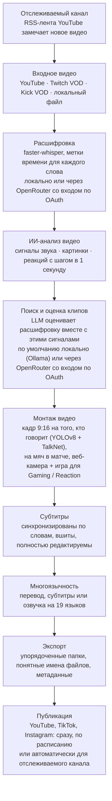

<div align="center">

[English](../../README.md) · [简体中文](README_zh.md) · [日本語](README_ja.md) · [한국어](README_ko.md) · [Türkçe](README_tr.md) · **Русский** · [Tiếng Việt](README_vi.md) · [ไทย](README_th.md) · [Deutsch](README_de.md) · [Español](README_es.md) · [Français](README_fr.md) · [Português (Brasil)](README_pt-BR.md) · [العربية](README_ar.md) · [Bahasa Indonesia](README_id.md) · [Italiano](README_it.md) · [हिन्दी](README_hi.md) · [বাংলা](README_bn.md) · [Filipino](README_tl.md) · [اردو](README_ur.md)

</div>

<a id="clips-kitty-the-free-open-source-opus-clip-alternative-for-chatting-gaming-and-sports-on-your-own-pc"></a>

# Clips Kitty: бесплатная альтернатива Opus Clip с открытым исходным кодом для разговорных стримов, игр и спорта, которая работает на вашем ПК

> Этот README переведён с помощью ИИ с [английского README](../../README.md), который является
> эталоном и обновляется первым. Исправления от носителей языка очень приветствуются.
>
> 🌐 [Страница сайта на русском](https://colingpt9.github.io/clips-studio/ru.html)

<a href="https://apps.microsoft.com/detail/9NB6XT7DSQZZ">
  <picture>
    <source media="(prefers-color-scheme: dark)" srcset="https://get.microsoft.com/images/en-us%20dark.svg">
    
  </picture>
</a>

[](https://github.com/ColinGPT9/clips-studio/releases)
[](https://github.com/ColinGPT9/clips-studio/releases)
[](../../LICENSE)
[](https://github.com/ColinGPT9/clips-studio/stargazers)
[](https://github.com/ColinGPT9/clips-studio)
[](../../CONTRIBUTING.md)
[](../../docs/DOCKER.md)

<a href="https://youtu.be/g1dMqrq-YaI"></a>

<a id="star-and-share-clips-kitty--goal-150"></a>

### Поставьте звезду Clips Kitty и расскажите о нём ⭐ Цель: 150

[](https://github.com/ColinGPT9/clips-studio/stargazers) **из 150**

**Пожалуйста, поставьте репозиторию звезду и поделитесь им.** Вам это ничего не стоит,
а маркетингового бюджета за проектом нет, так что только сарафанное радио поможет
следующему небольшому ютуберу или стримеру узнать, что есть бесплатный вариант.

**Я сделал его для небольших ютуберов и стримеров**, которым не по карману другие
сервисы или монтажёр. Это бесплатная альтернатива Opus Clip, Vizard и Klap, которая
запускает **Google Gemma** на вашем собственном ПК: никаких расходов на сервер, никакой
платы за клип, никакой платы за использование ИИ.

> **До версии 1.1.3 Clips Kitty назывался Clips Studio** и был переименован, чтобы
> соответствовать требованиям Microsoft Store к названиям. То же приложение, тот же
> репозиторий, те же данные.


**Превращайте длинные стримы и видео в готовые к публикации Shorts, Reels и TikTok —
целиком на своём компьютере.** Clips Kitty — бесплатный генератор клипов на базе ИИ
и видеоредактор с открытым исходным кодом для авторов контента: вставьте ссылку на
YouTube, Twitch или Kick, и он найдёт лучшие моменты, обрежет их до 9:16, удерживая
говорящего по центру, вшьёт субтитры, синхронизированные по словам, и напишет
заголовки, описания и хештеги.

По умолчанию без облачного ИИ. Без подписки. Без платы за клип. Ваши записи никогда
не покидают компьютер, если только вы сами не попросите опубликовать клип на своём
YouTube-канале.

Сначала локально, облако — когда нужно: если ваш ПК слишком старый для работы ИИ,
вместо него это сделает облачный провайдер, а счёт придёт на ваш собственный аккаунт.
**Рекомендуемый облачный путь — OpenRouter**: войдите через свой аккаунт OpenRouter
(OAuth, копировать ключ не нужно) и получите доступ ко множеству моделей (Claude, GPT,
Gemini, Muse Spark и другим). В моих тестах обработка 2-часового видео через OpenRouter
стоила около 11 центов: клипы выбирала Gemma (Gemma 4 26B-A4B), а расшифровывал Whisper
(large-v3-turbo); итоговая цена зависит от выбранных моделей и длины видео.
OpenAI, Claude, Gemini, xAI, Meta, DeepSeek и Qwen тоже работают напрямую, по вашему
собственному API-ключу.
См. [docs/AI-BACKENDS.md](../../docs/AI-BACKENDS.md).

**Зачем он нужен:** большинство авторов, которые развивают канал, делают всё сами:
снимают, стримят, монтируют, публикуют. Клипы — это то, как вас находят люди, и обычно
именно от них отказываются первыми: монтажёр — это расход, который большинство каналов
пока не может оправдать, сервисы для нарезки берут плату за видео или за месяц, а
резать вручную — это день, который был нужен для другого. Clips Kitty работает на
железе, которое у вас уже есть, поэтому пользоваться им бесплатно, а количество клипов
ничем не ограничено.


<sub>38 клипов из одного видео за 19 минут на одном ПК, без единой загрузки в сеть.</sub>

---

<a id="contents"></a>

## Содержание

- [Что он делает](#what-it-does)
- [Сравнение с Opus Clip, Klap, Vizard и CapCut](#how-it-compares-to-opus-clip-klap-vizard-and-capcut)
- [Как это работает](#how-it-works)
- [Возможности](#features)
- [Для чего он создан](#what-its-built-for)
- [Системные требования](#requirements)
- [Установка и запуск](#install-and-run)
- [Выбор модели ИИ](#pick-your-ai-model)
- [Проверенное железо и производительность](#tested-hardware-and-performance)
- [Поддерживаемые платформы](#supported-platforms)
- [Поддерживаемые языки](#supported-languages)
- [Публикация на YouTube](#publish-to-youtube)
- [Публикация на все платформы сразу](#publish-to-every-platform-at-once)
- [Ускорение на GPU](#gpu-acceleration)
- [Использование из командной строки](#command-line-use)
- [Написать плагин](#write-a-plugin)
- [Создавайте на его основе](#build-on-it)
- [Архитектура](#architecture)
- [Участие в разработке](#contributing)
- [Дорожная карта](#roadmap-detail)
- [Лицензия](#license)

---

<a id="what-it-does"></a>

## Что он делает

Вы даёте Clips Kitty длинное видео. Он возвращает папку готовых вертикальных клипов,
которые можно публиковать, а также студию, где их можно просмотреть и поправить перед этим.

Он создан для контента, с которым большинство сервисов нарезки справляются хуже всего:
**прямые трансляции, IRL и «говорящие головы», подкасты, а также контент про спортзал и
фитнес** — длинные, слабо структурированные видео, где хорошие моменты зарыты глубоко и
одной расшифровки недостаточно, чтобы их найти.

<a id="how-it-compares-to-opus-clip-klap-vizard-and-capcut"></a>

## Сравнение с Opus Clip, Klap, Vizard и CapCut

Clips Kitty — альтернатива облачным сервисам нарезки с открытым исходным кодом. Главное
отличие в том, где выполняется работа: ваше видео никогда не загружается в сеть, поэтому
нечего считать и не за что брать деньги.

| Сервис | Цена при помесячной оплате | Бесплатный тариф | Сам находит клипы | Водяной знак | Загружает ваше видео | Открытый код |
| ---- | --------------------- | --------- | ----------------------- | --------- | ------------------ | ----------- |
| **Clips Kitty** | Бесплатно, платного тарифа нет | Всё приложение | Да | Никогда | Нет, работает на вашем ПК | Да, AGPL-3.0 |
| Opus Clip | $15 Starter, $29 Pro | 1080p, с водяным знаком, хранится 3 дня | Да | На бесплатном тарифе | Да | Нет |
| Klap | $29 Pro, $14 Basic при годовой оплате | Одно видео | Да | Не указано | Да | Нет |
| Vizard | $29 Creator, $14.50 при годовой оплате | 60 кредитов в месяц, 720p | Да | На бесплатном тарифе | Да | Нет |
| quso.ai | от $29 до $49 | 75 кредитов в месяц, 720p | Да | Не указано | Да | Нет |
| Ssemble | от $15 до $60, от $6 до $24 при годовой оплате | Не указан | Да | Не указано | Да | Нет |
| Descript | $16, $24, $50 | 60 минут в месяц, 720p | Частично, это редактор по расшифровке | На Free и Hobbyist | Да | Нет |
| CapCut | Бесплатно, платные тарифы на capcut.com | Весь редактор | **Нет, режете вручную** | Зависит от функции | Нет в настольном приложении | Нет |

**Стоит разобраться именно с CapCut**, потому что его все называют как бесплатный ответ.
Это хороший редактор, и он ничего не стоит, но каждый момент вы ищете и каждый клип
обрезаете сами. Clips Kitty тоже бесплатен, и как раз этот первый проход он делает за вас.

**Opus Clip, Klap или Vizard — лучший выбор**, если у вас нет ПК на Windows с видеокартой,
вы делаете клипы время от времени или вам нужно работать с телефона. Clips Kitty создан
для нарезки в больших объёмах на железе, которое у вас уже есть.

**[Полное сравнение всех семи, с тем, в чём каждый из них лучше всего](https://colingpt9.github.io/clips-studio/alternatives.html)**

<sub>Цены проверены на страницах тарифов каждой компании 17 сентября 2026 года. У CapCut
нет страницы с ценами, которую мы смогли бы прочитать, поэтому цена для него не указана.
Тарифы меняются, а эта таблица сама не обновится.</sub>

<a id="how-it-works"></a>

## Как это работает



**Каждый этап выполняется на вашем компьютере, если вы не выберете иное:** OpenRouter,
со входом через ваш аккаунт, для ИИ или расшифровки, и публикация, которая загружает
только отправленные вами клипы. В остальном при обычном запуске в сеть обращается только
загрузка исходного видео.

<a id="the-stages-in-detail"></a>

### Этапы подробнее

**Расшифровка: faster-whisper.** Метки времени для каждого слова; работает на CUDA, где
она доступна, и переключается на CPU, если нет. Именно тайминг слов позволяет субтитрам
попадать в нужный слог, а клипам — начинаться на настоящей границе предложения.

**Оценка клипов с помощью ИИ.** Расшифровка — лишь один сигнал из пяти. Звук даёт всплески
громкости, плотность всплесков (так выглядят смех и аплодисменты) и переходы «тишина →
взрыв». Картинка даёт смены сцен, движение и изменения площади лица. Сигнал реакции
объединяет всё это. Каждый сигнал нормализуется *внутри конкретного видео*, поэтому и
тихий подкаст, и стрим с криками дают осмысленные пики. Там, где есть реальные данные об
аудитории (повтор чата Twitch, измеряемый по числу уникальных зрителей в чате, и тепловая
карта «самых пересматриваемых» моментов YouTube), добавляется небольшой ограниченный бонус.

Локальная LLM видит расшифровку **вместе с таймлайном этих событий**, поэтому может
правильно оценить ситуацию «слова спокойные, но зал взорвался». Так как маленькие модели
ставят всему оценки в узком диапазоне, финалисты затем сравниваются друг с другом в одном
запросе на переранжирование: относительное суждение даётся модели на 7B гораздо легче,
чем абсолютная оценка.

**Профили авторов.** Приложение строит базу знаний о каждом авторе по его видео:
повторяющиеся темы, серии, соавторы, локальные шутки и продолжающиеся сюжетные линии.
Этот контекст помогает писать точные заголовки и замечать отсылки. Он намеренно
осторожен: коронная фраза засчитывается, только если действительно повторяется; знания,
о которых перестали упоминать, «засыпают»; а каждый его вклад в оценку только добавляется,
ограничен сверху и может быть отключён.

**Видеоредактор.** Недеструктивный: обрезка, внутренние вырезки, отключение звука,
заглушённые слова, громкость, затухания, скорость, текст-крючок, музыка и водяной знак
хранятся как операции и применяются при рендере. Есть и ИИ-чат для правок (*«сделай на
5 секунд длиннее»*, *«в субтитре написано gost, а должно быть ghost»*): модель предлагает
изменение, а проверенный код его применяет.

**Обработка длинного формата.** Включаемый вручную путь 16:9 на основе того же анализа:
горизонтальные клипы, нарезки длины для X/Twitter, ролик с лучшими моментами или весь
стрим с вырезанными паузами.

**Многоязычный конвейер и ИИ-озвучка.** Субтитры переводятся и показываются на проверку
*до того*, как что-либо будет записано или вшито, так что неудачную строку можно исправить,
пока это ещё возможно. Глоссарий защищает названия каналов, спонсоров и внутренние шутки
от перевода. Озвучка использует локальный TTS с голосами, которые можно прослушать заранее.

**Локальное ускорение на GPU.** CUDA для распознавания и расшифровки, аппаратное
кодирование видео через NVENC/AMF/QSV (определяется автоматически, с откатом на CPU) и
LLM на GPU через Ollama.

<a id="features"></a>

## Возможности

- **Мультимодальный поиск клипов**: моменты получают оценку от 0 до 100, объединяющую
  сказанное, возбуждение в звуке, активность в кадре, реакции на экране и силу крючка и
  развязки. Сохраняется каждый клип, прошедший планку качества, без произвольного лимита.
- **Отслеживание лиц с учётом говорящего**: распознавание позы YOLOv8 удерживает человека
  по центру, а в групповых записях камера следует за **тем, кто действительно говорит**:
  это решает модель распознавания активного говорящего TalkNet по лицу и звуку вместе, а не
  по движению. Когда говорящий меняется, кадр **переключается** на него, а не плавно
  переезжает, как сделал бы монтажёр. Только обрезка кадра: никогда не растягивается и не
  искажается.
- **Режим подкаста**: для многокамерных записей каждый план получает свой стабильный кадр
  на одном человеке, поэтому склейки попадают на лицо без панорамирования. Внутри плана
  человек выбирается по движению губ, а если это не удаётся — по самому заметному лицу.
- **Vertical Live** (вертикальный эфир): для трансляции, которая уже была вертикальной во
  время эфира (вертикальный эфир YouTube, Twitch Dual Format, Streamlabs Dual Output,
  скачанный эфир из Instagram или TikTok). Сохраняет собственную раскладку 9:16, пропускает
  отслеживание лиц и всё так же выбирает моменты обычным способом. См.
  [docs/VERTICAL-LIVE.md](../../docs/VERTICAL-LIVE.md).
- **Sports: футбол и баскетбол**: каждый важный момент матча или игры — отдельным клипом,
  с развитием атаки и реакцией.
  - **Футбол**: голы, сейвы, карточки и опасные моменты. Голы считываются с табло и
    привязываются ко времени по реакции трибун, а кадр 9:16 следует за мячом. Выберите «Все
    голы», «Лучшие сейвы», «Карточки» и другое, и моменты можно собрать в обзор матча и в
    ролики о команде или игроке.
  - **Баскетбол**: данки, трёхочковые, блок-шоты, перехваты и победные броски. Табло
    подтверждает каждое попадание и его очки, а четверть и время на часах делают победный
    бросок гораздо весомее попадания в первой четверти. Находятся и реакции трибун, скамейки
    и зрителей у площадки. Кадр 9:16 каждого клипа строится вокруг его розыгрыша: мяч и тот,
    кто им владеет, получатель паса и бросок, за которым кадр следует до корзины, с кольцом и
    щитом в кадре. Кадр панорамирует вслед за игрой и никогда не приближает. Мяч находит
    модель детекции [E-BARD](https://github.com/GabrieleGiudic/E-BARD#readme) (указана в разделе [Лицензия](#license)).

  См. [docs/SPORTS.md](../../docs/SPORTS.md).
- **Редактируемые вшитые субтитры**: синхронизированы по словам и оформлены так, как вам
  нравится (цвет, размер, положение, слов в строке, регистр или вообще без них). Исправляйте
  ошибки расшифровки построчно перед экспортом. Когда говорят двое, субтитры второго
  говорящего можно сделать другим цветом, а неверно определённую реплику — переключить вручную.
- **ИИ-чат для правок**: опишите проблему простыми словами, и он перемонтирует клип.
- **Ask Clips Kitty** (Спросите Clips Kitty): текстовое поле внизу панели. Скажите одним
  предложением, что вам нужно, например *«нарежь этот стрим, обязательно включи момент, где
  я умер от босса, с крупными жёлтыми субтитрами»*, и он поставит видео в очередь, подскажет
  алгоритму выбора клипов, что искать, и выставит названные вами настройки. **Для него нужна
  модель Gemma 4**: см.
  [Текстовому полю внизу нужна Gemma 4](#the-text-box-at-the-bottom-needs-gemma-4).
- **Заголовки, описания и хештеги от ИИ** — всё можно отредактировать перед экспортом.
- **Профили авторов**: со временем приложение узнаёт каждого автора, чтобы лучше выбирать
  клипы и придумывать им заголовки. Всё остаётся на вашем компьютере, и вы можете это
  просмотреть, исправить или стереть.
- **Многоязычная публикация**: 19 языков, с проверкой до того, как что-либо будет вшито.
- **ИИ-озвучка**: локальный синтез речи с прослушиванием голосов для каждого языка.
- **Экспорт длинного формата**: клипы 16:9, ролики с лучшими моментами или монтаж стрима
  без повторов. В описании ролика с лучшими моментами есть **метки глав**, так что зрители
  могут переходить между моментами на YouTube.
- **Профили водяных знаков и брендинга**: настройки по умолчанию для каждого автора
  применяются автоматически.
- **Менеджер моделей**: меняйте «мозг» ИИ прямо в приложении — скачивайте, удаляйте и
  переключайте модели с индикаторами прогресса и без терминала.
- **Публикация на YouTube из редактора**: заголовок, описание, теги, обложка, плейлист,
  аудитория и доступ, затем загрузить сейчас или по расписанию. Необязательно, по умолчанию
  выключено, использует ваш собственный API-ключ Google.
- **Обратная связь в приложении**: отчёты об ошибках с автоматически собранной диагностикой,
  аккаунт не нужен.
- **Доступный интерфейс**: фокус с клавиатуры, поддержка уменьшенной анимации, настраиваемые
  шрифт и размер.

<a id="what-its-built-for"></a>

## Для чего он создан

Всё работает с любым видео, которое вы ему дадите. Ниже — случаи, когда он «думает»
больше или меньше, чем можно предположить по списку возможностей, чтобы ничего не стало
сюрпризом:

| Контент | Как он справляется |
|---|---|
| **IRL, just chatting, подкасты, влоги, интервью** | То, под что он настроен и на чём проверяется на реальных стримах перед каждым релизом |
| **Игры и реакции** | С включённым **Gaming / Reaction** (Игры / Реакции): веб-камера в одной половине, игра или видео, на которое идёт реакция, — в другой; проверяется на кадрах самого видео перед обработкой ([docs/GAMING.md](../../docs/GAMING.md)). Стример — тот, кто говорит, а не самое крупное лицо. Без этого переключателя кадр может следовать за персонажем внутри игры. Только люди в кадре, без VTuber-ов |
| **Спортивные матчи** | С включённым **Sports** (Спорт): создан для трансляций с табло и комментарием, где голы и попадания определяются наверняка. В клубных записях или съёмке на телефон обычно нет ни того, ни другого: их клипы следуют за мячом, а голы берутся из событий матча, которые вы вставляете, например из отметок голов в клубном приложении ([docs/SPORTS.md](../../docs/SPORTS.md)) |
| **То, на что идёт реакция** | Клипы по-прежнему выбираются по тому, что *сказано*, поэтому момент в просматриваемом видео, который никто не прокомментировал, для него невидим |

Выбор клипов опирается на расшифровку и сигналы. Если смешное происходит *только в
картинке* и никто это не комментирует, скорее всего, найти это придётся вам самим в редакторе.

<a id="requirements"></a>

## Системные требования

|             | Минимум                                      | Рекомендуется                   |
| ----------- | -------------------------------------------- | ------------------------------- |
| **GPU**     | NVIDIA RTX 2060 (6 ГБ)                       | RTX 3060 12 ГБ или лучше        |
| **CPU**     | Intel Core i3-9100 / AMD Ryzen 3 3200G (2019)| 6 ядер или больше               |
| **RAM**     | 16 ГБ                                        | 16 ГБ или больше                |
| **Диск**    | ~20 ГБ плюс место для видео, которые нарезаете |                               |
| **ОС**      | Windows 10 или 11                            |                                 |

**Ниже минимума он, возможно, и запустится, но это не поддерживается и будет медленно.**
Нарезка стрима — это часы декодирования видео, расшифровки и кодирования; на железе
примерно до 2019 года это займёт столько времени, что приложение будет казаться
сломанным, даже когда работает правильно.

Два пункта стоит пояснить:

- **16 ГБ RAM — это не пожелание.** С 8 ГБ он проанализирует всё видео, а потом ничего не
  отрендерит, и это выглядит как сбой, а не как нехватка памяти.
- **GPU желателен, но не обязателен.** Без него всё работает на CPU — медленнее, но
  полностью. RTX 2060 — это граница, с которой начинает работать путь через GPU;
  см. [Ускорение на GPU](#gpu-acceleration).

Приложение работает **только в Windows**. Движок на Python должен работать в Linux/macOS,
но сборки для Mac нет, и у сопровождающего нет Mac, чтобы её протестировать. Загляните в
[#62](https://github.com/ColinGPT9/clips-studio/issues/62), если у вас он есть и вы хотите помочь.

Для запуска из исходного кода нужно то, что иначе установщик включил бы за вас:

- **Python 3.10+** и **Node.js 18+**
- **[FFmpeg](https://ffmpeg.org/download.html)** в PATH
- **[Ollama](https://ollama.com)** со скачанной моделью: `ollama pull gemma:7b`

<a id="install-and-run"></a>

## Установка и запуск

**Проще всего через [Microsoft Store](https://apps.microsoft.com/detail/9NB6XT7DSQZZ).**
Один клик, обновляется сам, и Windows не показывает никаких предупреждений безопасности.
Microsoft сертифицировала и подписала пакет, поэтому описанное ниже предупреждение
SmartScreen вообще не появляется. Store устанавливает новые версии, когда до них доходит
очередь; чтобы получить новую сразу, откройте страницу Clips Kitty в Microsoft Store и
нажмите **Update** (Обновить).

**Или скачайте установщик.** Возьмите последний **Web Setup** со страницы
[Releases](https://github.com/ColinGPT9/clips-studio/releases) и запустите его. В нём есть
приложение, движок на Python, все библиотеки, FFmpeg, среда выполнения ИИ и все веса для
распознавания и расшифровки: не нужны ни Python, ни PATH, ни терминал, ни вторая программа.

**Или используйте winget.** `winget install ColinGPT9.ClipsKitty` устанавливает тот же
Web Setup из терминала.

Единственное, чего в нём нет, — это сама языковая модель, потому что модели
распространяются по лицензиям, которые должен принять тот, кто их скачивает, и принять их
за вас нельзя. Мастер установки сам запускает эту загрузку, подбирает размер под вашу
видеокарту и показывает индикатор прогресса. Итого: одна загрузка, один двойной клик, один
индикатор прогресса. После этого всё работает офлайн.

> При первом запуске Windows предупредит, что приложение не подписано. Нажмите
> *Подробнее → Выполнить в любом случае*. Сертификат для подписи — в планах.

<a id="from-source"></a>

### Из исходного кода

```bash
git clone https://github.com/ColinGPT9/clips-studio
cd clips-studio
pip install -r requirements.txt

cd ui
npm install
npm run dev        # opens the Clips Kitty desktop app
```

Приложение само запускает свой движок на Python. Вставьте ссылку в **Clip Editor**
(Редактор клипов), нажмите *Generate clips* (Создать клипы) и следите за прогрессом в
реальном времени.

Собрать установщик самостоятельно можно одной командой. См.
[CONTRIBUTING.md](../../CONTRIBUTING.md#building-the-windows-installer).

<a id="with-docker-nothing-else-to-install"></a>

### Через Docker: больше ничего устанавливать не нужно

Для участников разработки. Нужен только [Docker Desktop](https://docs.docker.com/get-started/get-docker/)
и больше ничего: ни Python, ни Node, ни FFmpeg, ни PyTorch.

```bash
git clone https://github.com/ColinGPT9/clips-studio
cd clips-studio
docker compose up
```

Вместе запускаются три сервиса:

| | |
|---|---|
| **<http://localhost:5173>** | интерфейс в вашем браузере |
| **<http://localhost:8765>** | движок и его API |
| Ollama | локальный ИИ на :11434 |

Затем скачайте модель (`docker compose exec ollama ollama pull gemma3:4b`), и у вас
готовая рабочая копия.

Проверки запускаются так же:

```bash
docker compose run --rm engine pytest
docker compose run --rm ui npm run typecheck
```

> **Пропустите десятиминутную первую сборку:** `docker compose pull` скачивает готовый
> образ движка вместо локальной компиляции PyTorch и OpenCV.

Сама настольная оболочка по-прежнему работает на вашей машине, поскольку Electron нужен
дисплей; всё остальное — в контейнерах. Подробности и то, чего этот способ проверить не
может, — в [docs/DOCKER.md](../../docs/DOCKER.md).

<a id="pick-your-ai-model"></a>

## Выбор модели ИИ

Откройте страницу **Models** (Модели), чтобы увидеть, что установлено и с чем справится ваш GPU:

Критерий только один: сколько у вас видеопамяти (VRAM). Это те же строки, что показывает
приложение, из `RECOMMENDATIONS` в [`llm/manager.py`](../../llm/manager.py). Мастер
установки и страница Models читают одну и ту же таблицу, поэтому не могут расходиться ни
друг с другом, ни с этим текстом.

| Ваше железо | Рекомендуемая модель | |
|---|---|---|
| CPU / встроенная графика, без видеокарты | `gemma3:4b` | проверена |
| Меньше 6 ГБ VRAM или старый ПК | `gemma4:e2b` | |
| 6 ГБ VRAM | `gemma4:e4b` | |
| 8 ГБ VRAM | **`gemma:7b`** | проверена · по умолчанию |
| 10–12 ГБ VRAM | `gemma3:12b` | проверена |
| 16–24 ГБ VRAM | `gemma3:27b` | |

И модели, которые стоит выбрать по причинам, не связанным с VRAM:

| Зачем | Модель |
|---|---|
| Перевод / многоязычность | `qwen3:8b` или `qwen3:14b` |
| Свободная лицензия | `mistral-nemo:12b` (Apache-2.0) · `phi4:14b` (MIT) |

**Только три модели с пометкой «проверена» прогонялись на реальных стримах**, и больше
всего часов наработано у `gemma:7b`; именно с ней поставляется `config/settings.yaml`.
Остальные перечислены потому, что они разумного размера и бесплатны для коммерческого
использования, а не потому, что с ними измерялось качество клипов. Все они работают, так как
приложение общается с каждой моделью одинаково через Ollama, но никто не проверял, выбирают
ли они моменты лучше. Закрыть этот пробел — задача [#38](https://github.com/ColinGPT9/clips-studio/issues/38).

Работает всё, что отдаёт Ollama, а переключение — в один клик. Для перевода можно
использовать *другую* модель, чем для нарезки. Задайте `llm.translation_model`.

<a id="the-text-box-at-the-bottom-needs-gemma-4"></a>

### Текстовому полю внизу нужна Gemma 4

**Ask Clips Kitty**, текстовое поле внизу панели, работает только с моделью, которая умеет
пользоваться инструментами приложения. Gemma 4 умеет. `gemma:7b` и модели Gemma 3 — нет, а
установка ставит одну из них на ПК без видеокарты или с 8 ГБ VRAM и больше. На таком ПК поле
не будет работать, пока вы не добавите модель Gemma 4: версия 2.0 пишет *«No installed
model can use tools»* (Ни одна установленная модель не умеет пользоваться инструментами), а
более поздние версии предлагают скачать её прямо в самом поле.

Какая бы модель ни выбирала ваши клипы, установите рядом с ней модель Gemma 4 на странице
**Models**: `gemma4:e4b` на видеокарте с 6 ГБ и больше, `gemma4:e2b` — если меньше.
Переключаться на неё не нужно. Поле находит её само, а клипы по-прежнему выбирает выбранная
вами модель. Если вместо этого вы запускаете ИИ через OpenRouter, поле использует ту модель,
и устанавливать ничего не нужно.

<a id="tested-hardware-and-performance"></a>

## Проверенное железо и производительность

Clips Kitty разрабатывается и ежедневно тестируется на этой машине, так что это удобная
точка отсчёта, если вы сравниваете свои результаты:

| | |
|---|---|
| **GPU** | NVIDIA GeForce RTX 3060, 12 ГБ VRAM |
| **CPU** | AMD Ryzen 5 5600X (6 ядер / 12 потоков) |
| **RAM** | 16 ГБ |
| **ОС** | Windows 10 |
| **Модель для нарезки** | `gemma:7b` через Ollama |
| **Расшифровка** | faster-whisper `large-v3-turbo` на CUDA |

Всё в этом репозитории (настройки по умолчанию, `parallel_renders: 3`, 5-минутные
фрагменты анализа) настроено примерно под такой класс машин. На более мощном GPU
увеличьте `llm.num_ctx` и `analysis.chunk_seconds` вместе и возьмите модель на размер
больше; на более слабом перейдите на `gemma3:4b`.

Если вы протестируете Clips Kitty на другом железе, пожалуйста, опубликуйте результаты в
[Discussions](https://github.com/ColinGPT9/clips-studio/discussions). Реальные цифры с
реальных машин помогают всем подобрать себе конфигурацию.

<a id="supported-platforms"></a>

## Поддерживаемые платформы

| Источник | Поддержка |
|---|---|
| Видео YouTube | Полная. Намеренно выбирается H.264 (AV1 примерно вдвое увеличивает время обработки) |
| Twitch VOD | Полная, включая повтор чата как сигнал аудитории |
| Kick VOD | Полная (Kick удаляет чат после окончания стрима, поэтому сигнала чата нет) |
| Локальные видеофайлы | Полная. Нарезайте собственные записи до их публикации |
| Прямые трансляции | Не поддерживаются намеренно. Только VOD |

<a id="supported-languages"></a>

## Поддерживаемые языки

Клипы можно перевести, снабдить субтитрами и озвучить на **19 языков**, и **сам интерфейс
тоже переведён на все 19**, так что приложением можно пользоваться на тех же языках, на
которых оно публикует:

английский · испанский · португальский (бразильский) · французский · немецкий · хинди ·
индонезийский · японский · русский · арабский · китайский (упрощённый) · вьетнамский ·
филиппинский · турецкий · урду · бенгальский · тайский · корейский · итальянский

Добавление языка — это одна строка в `multilingual/languages.py` плюс файл локали в
`ui/src/renderer/src/locales/`. Переводчик и модуль записи субтитров от языка не зависят.

<a id="help-wanted-the-maintainer-only-speaks-english"></a>

### Нужна помощь: сопровождающий говорит только по-английски

18 из этих 19 переводов интерфейса ни разу не читал человек, который говорит на этом языке.
Половина из них не закончена. У каждого языка есть своя задача (issue), написанная
по-английски и на этом языке, и **сообщение о неудачном слове — это полноценный вклад**:
pull request не нужен. [Как это устроено](../../docs/TRANSLATING.md).

**Нужно доделать** (около 68 строк всё ещё на английском):
[বাংলা (бенгальский)](https://github.com/ColinGPT9/clips-studio/issues/43) ·
[Italiano](https://github.com/ColinGPT9/clips-studio/issues/44) ·
[한국어 (корейский)](https://github.com/ColinGPT9/clips-studio/issues/45) ·
[ไทย (тайский)](https://github.com/ColinGPT9/clips-studio/issues/46) ·
[Tagalog (филиппинский)](https://github.com/ColinGPT9/clips-studio/issues/47) ·
[Türkçe (турецкий)](https://github.com/ColinGPT9/clips-studio/issues/48) ·
[اردو (урду)](https://github.com/ColinGPT9/clips-studio/issues/49) ·
[Tiếng Việt (вьетнамский)](https://github.com/ColinGPT9/clips-studio/issues/50) ·
[中文 (китайский)](https://github.com/ColinGPT9/clips-studio/issues/51)

**Нужно проверить** (перевод полный, но никто не убедился, что он звучит естественно):
[العربية (арабский)](https://github.com/ColinGPT9/clips-studio/issues/52) ·
[Deutsch (немецкий)](https://github.com/ColinGPT9/clips-studio/issues/53) ·
[Español (испанский)](https://github.com/ColinGPT9/clips-studio/issues/54) ·
[Français (французский)](https://github.com/ColinGPT9/clips-studio/issues/55) ·
[हिन्दी (хинди)](https://github.com/ColinGPT9/clips-studio/issues/56) ·
[Bahasa Indonesia (индонезийский)](https://github.com/ColinGPT9/clips-studio/issues/57) ·
[日本語 (японский)](https://github.com/ColinGPT9/clips-studio/issues/58) ·
[Português (португальский)](https://github.com/ColinGPT9/clips-studio/issues/59) ·
[Русский](https://github.com/ColinGPT9/clips-studio/issues/60)

Нужен язык, которого здесь нет? [#61](https://github.com/ColinGPT9/clips-studio/issues/61).

<a id="publish-to-youtube"></a>

## Публикация на YouTube

По умолчанию выключено. Включите в **Settings → Publish to YouTube** (Настройки →
Публикация на YouTube), и в редакторе появится вкладка **YouTube**: заполните заголовок,
описание, теги, обложку, плейлист, аудиторию и доступ, затем нажмите **Upload now**
(Загрузить сейчас). Если у вас есть несохранённые правки, Clips Kitty отрендерит клип и
загрузит его прямо на ваш канал. Нет ни шага экспорта, ни отдельной страницы публикации.
Вы вообще не выходите из редактора.

Если оставить функцию выключенной, в приложении ничего не изменится.

<a id="scheduling"></a>

### Публикация по расписанию

Вариант **Schedule on YouTube** (Запланировать на YouTube) загружает видео *сразу*,
помечает его как приватное и передаёт YouTube время публикации. YouTube опубликует его в
назначенный день.

**Можно закрыть Clips Kitty и выключить компьютер.** В приложении нет таймера, фоновой
службы и ничего, что нужно оставлять запущенным. Как только YouTube принял видео, работа
Clips Kitty завершена.

<a id="you-need-your-own-google-api-key"></a>

### Вам нужен собственный API-ключ Google

Clips Kitty не поставляется с общим ключом, и дело не только в осторожности. Квота Google
на загрузку действует **на каждый Cloud-проект**: один общий ключ означал бы, что все
пользователи в мире делят одни и те же 100 загрузок в день. Собственный проект даёт вам
собственный лимит, а ваши учётные данные никогда не покидают вашу машину. Никакого сервера
Clips Kitty по пути нет.

Настройка бесплатна и занимает около десяти минут; мастер в настройках проведёт вас по шагам:

1. Создайте проект в [Google Cloud Console](https://console.cloud.google.com/projectcreate).
2. Включите **YouTube Data API v3** в разделе APIs & Services → Library.
3. Заполните экран согласия OAuth, затем нажмите **Publish app**. Это важно: если
   оставить режим *Testing*, Google будет сбрасывать ваш вход каждые 7 дней, и
   переподключаться придётся еженедельно. «In production» не означает прохождение
   проверки и ничего не стоит.
4. Credentials → Create credentials → OAuth client ID → тип **Desktop app**.
5. Вставьте client ID и secret в настройки, затем подключите свой канал.

При подключении вы увидите предупреждение «Google hasn't verified this app» (Google не
проверил это приложение). Это ваше собственное приложение предупреждает вас о вас же.
**Advanced → Go to (unsafe)** позволяет пройти дальше.

<a id="posting-publicly"></a>

### Публичная публикация

Одну вещь нужно знать, прежде чем на это полагаться, потому что никакая программа не
может её обойти:

> **Пока ваш проект Google Cloud не пройдёт бесплатный аудит API YouTube, YouTube
> блокирует каждое загруженное через него видео в статусе приватного.** Блокировка
> постоянная. Сделать видео публичным потом в Studio нельзя, и обжаловать это невозможно.
> Единственное решение — загрузить его заново из проекта, прошедшего аудит.

Clips Kitty проверяет это после каждой загрузки и прямо сообщает вам, если так случилось,
а не рапортует об успехе для видео, которое никто не сможет посмотреть. Если вы
собираетесь публиковать публично, сначала отправьте
[форму аудита YouTube API Services](https://support.google.com/youtube/contact/yt_api_form).
Загрузок с доступом **по ссылке** или **приватным** это не касается.

<a id="what-it-can-and-cannot-set"></a>

### Что он может и чего не может настроить

Всё, что открывает публичный API: заголовок, описание (метки времени в нём становятся
главами), теги, категорию, язык, доступ, время публикации по расписанию, пометку «для
детей», раскрытие изменённого/синтетического контента, лицензию, встраивание, публичную
статистику, собственную обложку и добавление в плейлист.

Некоторых функций YouTube Studio в публичном API нет вовсе, поэтому для них намеренно нет
элементов управления, вместо того чтобы показывать такие, которые молча ничего не делают:
монетизация и рекламные паузы, раскрытие платного продвижения, конечные заставки и
подсказки, настройки комментариев, возрастные ограничения, премьеры и разрешения на ремиксы
Shorts. Для этого панель отправляет вас в Studio.

Для Shorts ничего особенного не нужно: ни отдельного режима, ни тега `#Shorts`. YouTube сам
относит видео к Shorts по его формату и длине.

<a id="publish-to-every-platform-at-once"></a>

## Публикация на все платформы сразу

Тоже выключено по умолчанию. Включите в **Settings → Publish through WoopSocial**
(Настройки → Публикация через WoopSocial), и в редакторе появится вкладка **Publish**
(Публикация): выберите платформы — или нажмите **Everywhere** (Везде), — один раз напишите
заголовок и описание, и одна загрузка уйдёт сразу на YouTube, TikTok, Instagram, Facebook,
X, Threads, LinkedIn, Pinterest и Bluesky. **Publish all** (Опубликовать все) в Clip Editor
отправляет целую пачку, с интервалами, чтобы дюжина клипов не вышла в одну и ту же секунду.

Эта функция **не локальная**. Клип и его данные отправляются в сервис публикации, который
доставляет их и хранит подключения к вашим соцсетям, поэтому Clips Kitty никогда не
спрашивает пароль от соцсетей. Всё остальное в приложении по-прежнему работает на вашем ПК.

Поддерживаются два сервиса: **[WoopSocial](https://woopsocial.com/?via=clipskitty)**,
бесплатный тариф которого подключает два аккаунта и позволяет примерно 5 публикаций на
YouTube в день, а платные тарифы поднимают оба лимита, и
**[Upload-Post](https://www.upload-post.com/)**, который охватывает больше площадок и
добавляет обложки, первые комментарии и очередь публикаций. Включите любой из них или оба.

<sub>Партнёрская ссылка: Clips Kitty может получить комиссию, если вы зарегистрируетесь
по ней, без дополнительных затрат для вас.</sub>

**Свой ключ.** Вы сами создаёте аккаунт, подключаете свои соцсети и используете свой лимит.
Clips Kitty ничего не берёт, не хранит общего ключа и ни за что не платит — так же, как с
интеграцией YouTube, и по той же причине.

Полное руководство, поддержка и ограничения по платформам:
**[docs/UPLOAD-POST.md](../../docs/UPLOAD-POST.md)**.

<a id="gpu-acceleration"></a>

## Ускорение на GPU

**Кодирование видео** автоматически ускоряется аппаратно у всех трёх производителей: NVIDIA
(NVENC), AMD (AMF) и Intel (QSV). При запуске движок пробно кодирует кадр каждым из них и
использует первый, который действительно работает, с откатом на CPU. Принудительно выбрать
кодировщик можно через `video.encoder` в `config/settings.yaml`.

**Распознавание и расшифровка** быстрее всего работают с CUDA. По умолчанию `pip install
torch` ставит сборку **только для CPU**. Для NVIDIA:

```bash
pip uninstall torch torchvision -y
pip install torch torchvision --index-url https://download.pytorch.org/whl/cu130
```

**Какие видеокарты используют GPU:** серия GTX 16, серия RTX 20 и всё новее, включая серию
RTX 50.

**Расшифровке на GPU** также нужен cuBLAS 12 от NVIDIA: движок Whisper (CTranslate2) собран
под CUDA 12, а указанный выше PyTorch для CUDA 13 содержит только cuBLAS 13.
`pip install -r requirements.txt` устанавливает его (`nvidia-cublas-cu12`), и в
установленном приложении он тоже есть, так что CUDA Toolkit не нужен. Без него расшифровка
выполняется на CPU, а в журнале написано почему.

**Серия GTX 10 и более старые карты ниже минимума.** Эта конфигурация не поддерживается.
Приложение не отказывается на них запускаться: распознавание переходит на CPU и всё
по-прежнему работает, но медленно, а к такой старой машине обычно прилагается CPU, из-за
которого медленной становится вся работа, а не только этап распознавания.

Используйте указанный выше индекс `cu130`, а не более старый. В старых сборках CUDA нет
кода для современных карт, и тогда приложение откатывается на CPU на железе, которое
должно быть быстрым.

Владельцам GPU от AMD: отслеживание и расшифровка в Windows выполняются на CPU — полностью
рабочие, просто медленнее. Ваш GPU всё равно используется для кодирования видео через AMF
и для LLM через Ollama, которая сама поддерживает AMD.

**Декодирование видео** идёт через FFmpeg с аппаратным ускорением, а не через OpenCV — и
для прохода отслеживания, и для рендера. Чтение кадров-образцов этим способом требует
примерно в десять раз меньше CPU, чем их декодирование в Python, а это важно, поскольку
проход отслеживания выполняется по каждому клипу.

**Распределение CPU.** И распознавание, и рендер хотят все ядра, и если их не ограничивать,
они мешают друг другу и интерфейсу. При запуске движок делит ядра между рендер-воркерами и
намеренно оставляет два в резерве, чтобы приложение откликалось, пока обрабатывается пачка.
Настраивается через `video.parallel_renders`.

<a id="command-line-use"></a>

## Использование из командной строки

Всё работает и без настольного приложения:

```bash
python main.py process "https://www.youtube.com/watch?v=VIDEO_ID"   # one video
python main.py models                                               # list/switch models
python main.py status                                               # processing state
python main.py serve                                                # just the API engine
```

Настройки находятся в [config/settings.yaml](../../config/settings.yaml). В начале файла —
короткий блок быстрой настройки, всё продвинутое — ниже. Каждый промпт для LLM — обычный
текстовый файл в [config/prompts/](../../config/prompts/), так что можно настраивать оценку
клипов, не трогая Python.

<a id="write-a-plugin"></a>

## Написать плагин

Разбираетесь в какой-то игре, виде спорта или типе шоу лучше, чем универсальный детектор?
Напишите небольшой плагин на Python, который находит, понимает или оценивает моменты в
видео, а остальное Clips Kitty сделает сам. SDK распространяется под MIT, поэтому ваш
плагин может использовать любую лицензию, и ничего не нужно форкать.

```text
Clips Kitty SDK

Input                      a link or a video file
  ↓
Video                      Clips Kitty downloads it and writes down what is said
  ↓
Your plugin                every step is optional
  ├── find                 picks the moments                  built
  ├── understand           says what happens in each one      built
  ├── rate                 scores each moment                 built
  └── edit                 suggests edits for the creator     built
  ↓
Clips Kitty                does every step no plugin does, then cuts, frames and captions the clips
  ↓
Creator / Social Platform  posts when the creator clicks Publish, or on a schedule or automatic posting the creator switched on
```

- Один плагин может находить моменты в видео; он заменяет собственный поиск Clips Kitty.
- До 3 плагинов могут понимать и до 3 — оценивать, после любого поискового плагина.
- Роль плагина определяется полями `inputs` и `outputs` в его манифесте ([Шаги](../../docs/developers/steps.md)).
- До 3 плагинов могут предлагать правки для клипов, которые будут созданы.
- Плагины правок предлагают изменения, которые ждут автора в редакторе ([Шаги](../../docs/developers/steps.md#suggest-edits-the-edit-step)).
- Публикация — не шаг плагина: Clips Kitty публикует клипы сам, а через WoopSocial может публиковать сразу на множество сайтов с собственного аккаунта автора ([Публикация на все платформы сразу](#publish-to-every-platform-at-once)). `kind: publisher` отклоняется: плагины не публикуют.

Три команды устанавливают SDK, создают плагин из шаблона `game-events` (для Quarkbloom Arena,
выдуманной игры) и запускают его на тестовом видео, которое создаёт SDK. Для них нужны
Python 3.11, FFmpeg и Git.

PowerShell (Windows):

```powershell
py -m pip install "clipskitty-sdk[yaml,test] @ git+https://github.com/ColinGPT9/clips-studio#subdirectory=sdk/python"
py -m clipskitty_sdk new quarkbloom-bursts --template game-events --publisher your-github-name
py -m clipskitty_sdk run quarkbloom-bursts --sample
```

bash (macOS, Linux):

```bash
python -m pip install "clipskitty-sdk[yaml,test] @ git+https://github.com/ColinGPT9/clips-studio#subdirectory=sdk/python"
python -m clipskitty_sdk new quarkbloom-bursts --template game-events --publisher your-github-name
python -m clipskitty_sdk run quarkbloom-bursts --sample
```

Clips Kitty 2.1.0 — первый релиз, который запускает плагины, и вместе с ним выходит SDK 1.3.0.

**[Ваш первый игровой конвейер](../../docs/developers/first-game-pipeline.md)** продолжает
с этого места, шаг за шагом, до плагина, установленного в Clips Kitty и размещённого в его
Marketplace. В [сборнике рецептов по сигналам](../../docs/developers/signals-cookbook.md)
есть рецепты для чтения видео игры, в [справочнике по SDK](../../docs/developers/sdk.md) —
все команды и вызовы, а в [документации для разработчиков](../../docs/developers/README.md) —
всё остальное. Страница [Clips Kitty SDK](https://colingpt9.github.io/clips-studio/developers.html)
на сайте — это краткая версия.

<a id="build-on-it"></a>

## Создавайте на его основе

Настольное приложение — это окно в **локальный HTTP API**, который работает всё время,
пока открыт Clips Kitty. Бот для Discord, пакетный обработчик, веб-интерфейс или
интеграция с OBS могут управлять тем же конвейером, и сначала ничего не нужно добавлять в
приложение.

```bash
python main.py serve --port 8765          # the engine on its own, no window

curl -X POST http://127.0.0.1:8765/jobs \
  -H "Content-Type: application/json" \
  -d '{"url": "https://www.youtube.com/watch?v=VIDEO_ID"}'
# {"job_id": 149}
```

Клипы возвращаются в виде JSON, с разбивкой оценки, по которой они были выбраны, и MP4,
который можно воспроизводить потоком:

```bash
curl -s http://127.0.0.1:8765/videos/VIDEO_ID/clips \
  | python -c "import json,sys; [print(c['score'], c['title']) for c in json.load(sys.stdin)]"
```

**[docs/API.md](../../docs/API.md)** описывает эндпоинты, на которые стоит опираться, с
рабочими примерами и ловушками, на которые люди тратят полдня. Сервис также отдаёт
собственную интерактивную документацию по адресу `http://127.0.0.1:8765/docs`.

У него **нет аутентификации**, и по этой причине он слушает только localhost. Прочитайте
примечание о безопасности в документации по API, прежде чем что-либо к нему подключать.

<a id="or-bring-your-own-model"></a>

### Или подключите свою модель

Это всё — разработка *вокруг* приложения. Можно разрабатывать и *внутри* него, и начинать
стоит с плагина ([Написать плагин](#write-a-plugin)). Если интересующие вас записи — не то,
под что он настроен, будь то спорт, игры, реакции, лекции или что-то, что никто ещё не
пробовал, плагин может находить, понимать или оценивать их моменты без форка. Он работает
на собственном Python Clips Kitty со стандартной библиотекой (за вычетом нескольких модулей,
которые приложение не включает) и SDK: другие пакеты Python для плагина Clips Kitty пока
устанавливать не умеет.

Чтобы вместо этого изменить само приложение: конвейер локально запускает **YOLOv8
(ultralytics), OpenCV и TalkNet-ASD**, а то, какие моменты станут клипами, решает набор
посекундных сигналов, а не жёстко заданное представление о том, что интересно. Детектор,
который выдаёт уверенность вдоль таймлайна, можно добавить как ещё один сигнал, и его пики
станут кандидатами в клипы. Если вашему детектору нужны пакеты Python, которые Clips Kitty
пока не может установить для плагина, форкните проект и подключите свой детектор.
**[docs/EXTENDING.md](../../docs/EXTENDING.md#bring-your-own-model)** описывает контракт,
файл, который нужно скопировать, и ловушку производительности, о которой стоит знать до начала.

**Опрашивать ничего не нужно.** Отправьте задание с `webhook_url`, и движок один раз
сделает POST по завершении, подписанный вашим собственным секретом, если вы его передали,
так что док-панель или поток n8n может спокойно ждать те сорок минут, что занимает стрим,
вместо того чтобы спрашивать каждые несколько секунд. Подробности — в
[docs/API.md](../../docs/API.md#webhooks-being-told-instead-of-asking).

<a id="ask-an-ai-agent-to-do-it"></a>

### Попросите ИИ-агента сделать это

Clips Kitty поставляется с **MCP-сервером**, так что Claude, Cursor или любой MCP-клиент
может управлять тем же конвейером обычным языком: поставить стрим в очередь, следить за
заданием, прочитать выбранные клипы, экспортировать один из них.

```bash
claude mcp add clips-kitty -- python main.py mcp
```

В установленной сборке исполняемый файл движка — `api.exe` (в папке приложения
`resources\backend`), поэтому там команда выглядит как `api.exe mcp`.

Он общается с запущенным движком через `127.0.0.1:8765`, поэтому Clips Kitty должен быть
открыт, и ему не нужен никакой API-ключ: нарезкой занимается модель на вашей собственной
машине (или, если вы выбрали её в Settings → AI, облачная модель на вашем собственном
ключе, который MCP-клиент никогда не видит). Навык (skill) агента для клиентов, которые их
поддерживают, находится в [skills/clips-kitty/](../../skills/clips-kitty/).

<a id="built-with-clips-kitty"></a>

### Сделано с Clips Kitty

Проекты, работающие на этом API, перечислены в **[Awesome Clips Kitty](https://github.com/ColinGPT9/awesome-clips-kitty)** —
списке конвейеров, плагинов, интеграций, приложений и инструментов, созданных с Clips Kitty.
Первый из них — [Clips Kitty OBS Plugin](https://github.com/ColinGPT9/clips-kitty-obs-plugin),
док-панель для OBS Studio, которая передаёт ваш стрим в Clips Kitty после его окончания.
Сделали что-то своё? Добавьте через pull request ([как](https://github.com/ColinGPT9/awesome-clips-kitty/blob/main/CONTRIBUTING.md))
и присвойте своему репозиторию тему (topic) `clips-kitty`.

<a id="architecture"></a>

## Архитектура

Полное описание устройства — в **[ARCHITECTURE.md](../../ARCHITECTURE.md)**: конвейер,
движок оценки, отслеживание, интеллект авторов, поверхность API и принципы проектирования,
которые сохраняют модульность.

<a id="contributing"></a>

## Участие в разработке

Вклад приветствуется. В **[CONTRIBUTING.md](../../CONTRIBUTING.md)** описаны настройка
среды разработки и ожидания к pull request, а в **[SECURITY.md](../../SECURITY.md)** — как
сообщить об уязвимости. Задачи с меткой [`good-first-issue`](https://github.com/ColinGPT9/clips-studio/labels/good-first-issue)
небольшие и чётко очерченные, если хотите с чего-то начать.

Сайт находится в [site/](../../site/) и публикуется на GitHub Pages и в Hugging Face Space.
См. [docs/MIRRORS.md](../../docs/MIRRORS.md). **Вся работа ведётся на GitHub**, а зеркало
сайта обновляется принудительным push в одну сторону, так что коммит, сделанный в нём,
будет перезаписан.

Документация по сборке пакетов и релизам:

- **[docs/RELEASING.md](../../docs/RELEASING.md)**: сборка и публикация установщика для
  Windows — основного канала распространения
- **[docs/MSSTORE.md](../../docs/MSSTORE.md)**: пакет для Microsoft Store, от создания
  аккаунта разработчика до сертификации
- **[packaging/winget/](../../packaging/winget/)**: манифесты winget, указывающие на
  установщик выше
- **[whop-app/](../../whop-app/)**: приложение для Whop, которое показывает Clips Kitty
  участникам сообществ по нарезке клипов. Только маркетинговые страницы: оно не обрабатывает
  видео, ничего не хранит и не общается с настольным приложением
- **[docs/DOCKER.md](../../docs/DOCKER.md)**: запуск движка без самостоятельной установки
  Python, FFmpeg и PyTorch
- **[PRIVACY](https://colingpt9.github.io/clips-studio/privacy.html)**: что приложение
  хранит и что может покинуть вашу машину (коротко: ничего, если вы не отправите отчёт об ошибке)

<a id="changelog-known-issues-roadmap"></a>

## Журнал изменений, известные проблемы, дорожная карта

- **[CHANGELOG.md](../../CHANGELOG.md)**: что изменилось в каждом релизе, простыми словами.
- **[KNOWN-ISSUES.md](../../KNOWN-ISSUES.md)**: что сейчас сломано или отсутствует, и как
  это обойти. Всё перечисленное там действительно наблюдалось.
- **[ROADMAP.md](../../ROADMAP.md)**: что уже вышло, что дальше и куда проект движется в
  долгосрочной перспективе.

**Следите за обновлениями:**
[-%40ClipsKitty2-000000?logo=x&logoColor=white)](https://x.com/ClipsKitty2)
[](https://www.instagram.com/clipskitty2/)
[](https://www.youtube.com/@ClipsKitty2)

<a id="roadmap-detail"></a>

## Подробная дорожная карта

Краткая версия — в [ROADMAP.md](../../ROADMAP.md). Обоснование более сложных решений
приведено ниже, потому что «почему пока нет» обычно полезнее, чем просто «пока нет».

1. **Приложение-компаньон для Android, только Vertical Live**, чтобы оно оставалось лёгким:
   вертикальный эфир уже скадрирован под экран телефона, поэтому приложение сохраняет
   собственную раскладку стрима и должно только находить моменты, без отслеживания лиц и
   перекадрирования. Только Twitch, Kick и локальные видеофайлы, чтобы соответствовать
   правилам Play Store.
2. **Больше видов спорта**: футбол и баскетбол уже есть. Следующий — крикет (в меню Sport
   он уже указан как «скоро»), в виде отдельного модуля, как и остальные (см.
   [docs/SPORTS.md](../../docs/SPORTS.md#adding-a-sport)).
3. **SMS-уведомления о завершении**: сообщение, когда клипы из видео готовы, когда они
   опубликованы и когда что-то пошло не так, чтобы канал на автопилоте мог работать без
   того, чтобы кто-то следил за приложением.
4. **Клонирование голоса для озвучки** *(намеренно последний пункт в этом списке)*: сейчас
   озвучка использует заранее заданный локальный голос. Чтобы переводы звучали **собственным**
   голосом автора, нужна модель клонирования, а каждая достойная локальная модель тянет свою
   сборку PyTorch: на машине, настроенной для нарезки, это откатывает torch до сборки только
   для CPU и молча лишает отслеживание и расшифровку ускорения на GPU. Ломать нарезку ради
   озвучки — плохой обмен.

   Реалистично это подождёт, пока потребительское железо не подтянется, или выйдет отдельной
   необязательной установкой со своим окружением Python, чтобы окружение для нарезки никогда
   не затрагивалось. Лицензии моделей тоже нужно проверить: несколько из лучше всего звучащих
   некоммерческие, а пользователи этого приложения монетизируют свои видео.

<a id="license"></a>

## Лицензия

**GNU AGPL-3.0-or-later**. См. [LICENSE](../../LICENSE), а в [NOTICE](../../NOTICE) — что это
означает на практике и что включено в установщик.

Распознавание мяча, кольца и игроков в баскетболе выполняет
модель детекции [E-BARD](https://github.com/GabrieleGiudic/E-BARD) (YOLOv8n); модель
используется без изменений по лицензии CC BY 4.0.
Спасибо за открытую публикацию. Все остальные поставляемые компоненты и их лицензии перечислены в
[NOTICE](../../NOTICE).

Три части лицензированы отдельно, чтобы разрабатывать на основе Clips Kitty было легко:

| Часть | Лицензия |
|---|---|
| Clips Kitty (приложение, его движок, этот репозиторий) | AGPL-3.0-or-later |
| SDK для плагинов, [`sdk/python/`](../../sdk/python/) | MIT ([sdk/python/LICENSE](../../sdk/python/LICENSE)) |
| Примеры плагинов, [`examples/pipelines/scene-cut-highlights/`](../../examples/pipelines/scene-cut-highlights/) и [`examples/pipelines/keyword-rater/`](../../examples/pipelines/keyword-rater/) | MIT |
| Копия списка Awesome Clips Kitty, поставляемая с приложением, `plugins/catalog_index.json` (сам список — [отдельный репозиторий](https://github.com/ColinGPT9/awesome-clips-kitty)) | CC0-1.0 |

Плагины, конвейеры и приложения, созданные другими людьми, сохраняют ту лицензию, которую
выбрали их авторы; Marketplace показывает её в каждой карточке. Использование SDK не
переводит плагин под AGPL.

**Если вы пользуетесь приложением, для вас это ничего не меняет.** Устанавливайте его,
нарезайте свои стримы, публикуйте клипы, зарабатывайте на них. AGPL обязывает тех, кто
*распространяет* программу или запускает *изменённую* копию как сетевой сервис, а не тех,
кто ею пользуется. Ваши записи и ваши клипы принадлежат вам.

**Если вы изменяете его и делитесь им,** ваши изменения распространяются под той же
лицензией. В этом и смысл: улучшения инструмента, созданного для авторов, остаются
доступными этим авторам.

И всё же он создан для того, чтобы его меняли: меняйте модели, настраивайте промпты,
добавляйте платформы.

<a id="star-history"></a>

## История звёзд

Спасибо всем, кто ставит звёзды, делится, сообщает об ошибках и переводит Clips Kitty.

<a href="https://www.star-history.com/#ColinGPT9/clips-studio&amp;Date">
  <picture>
    <source media="(prefers-color-scheme: dark)" srcset="https://api.star-history.com/chart?repos=ColinGPT9/clips-studio&amp;type=date&amp;theme=dark&amp;legend=top-left" />
    <source media="(prefers-color-scheme: light)" srcset="https://api.star-history.com/chart?repos=ColinGPT9/clips-studio&amp;type=date&amp;legend=top-left" />
    
  </picture>
</a>
