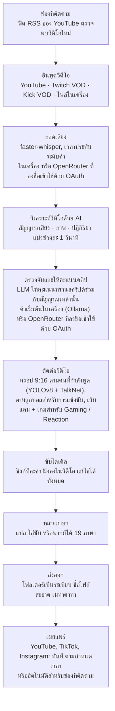

<div align="center">

[English](../../README.md) · [简体中文](README_zh.md) · [日本語](README_ja.md) · [한국어](README_ko.md) · [Türkçe](README_tr.md) · [Русский](README_ru.md) · [Tiếng Việt](README_vi.md) · **ไทย** · [Deutsch](README_de.md) · [Español](README_es.md) · [Français](README_fr.md) · [Português (Brasil)](README_pt-BR.md) · [العربية](README_ar.md) · [Bahasa Indonesia](README_id.md) · [Italiano](README_it.md) · [हिन्दी](README_hi.md) · [বাংলা](README_bn.md) · [Filipino](README_tl.md) · [اردو](README_ur.md)

</div>

<a id="clips-kitty-the-free-open-source-opus-clip-alternative-for-chatting-gaming-and-sports-on-your-own-pc"></a>

# Clips Kitty: ทางเลือกแทน Opus Clip ที่ฟรีและเป็นโอเพนซอร์ส สำหรับคลิปพูดคุย เกม และกีฬา ทำงานบนพีซีของคุณเอง

> README นี้แปลโดย AI จาก [README ภาษาอังกฤษ](../../README.md) ซึ่งเป็นฉบับอ้างอิงและจะได้รับการอัปเดตก่อนเสมอ ยินดีอย่างยิ่งหากเจ้าของภาษาช่วยแก้ไขให้
>
> 🌐 [หน้าเว็บไซต์ภาษาไทย](https://colingpt9.github.io/clips-studio/th.html)

<a href="https://apps.microsoft.com/detail/9NB6XT7DSQZZ">
  <picture>
    <source media="(prefers-color-scheme: dark)" srcset="https://get.microsoft.com/images/en-us%20dark.svg">
    
  </picture>
</a>

[](https://github.com/ColinGPT9/clips-studio/releases)
[](https://github.com/ColinGPT9/clips-studio/releases)
[](../../LICENSE)
[](https://github.com/ColinGPT9/clips-studio/stargazers)
[](https://github.com/ColinGPT9/clips-studio)
[](../../CONTRIBUTING.md)
[](../../docs/DOCKER.md)

<a href="https://youtu.be/g1dMqrq-YaI"></a>

<a id="star-and-share-clips-kitty--goal-150"></a>

### กดดาวและแชร์ Clips Kitty ⭐ เป้าหมาย: 150

[](https://github.com/ColinGPT9/clips-studio/stargazers) **จาก 150**

**ช่วยกดดาวให้ repo นี้และแชร์ต่อด้วยนะครับ** คุณไม่เสียอะไรเลย และโปรเจกต์นี้ไม่มีงบการตลาด การบอกต่อจึงเป็นทางเดียวที่ YouTuber หรือสตรีมเมอร์ตัวเล็ก ๆ คนต่อไปจะรู้ว่ามีตัวเลือกฟรีอยู่

**ผมทำมันขึ้นมาเพื่อ YouTuber และสตรีมเมอร์ตัวเล็ก ๆ** ที่ไม่มีเงินจ่ายเครื่องมืออื่นหรือจ้างคนตัดต่อ มันคือทางเลือกแทน Opus Clip, Vizard และ Klap ที่ฟรี ซึ่งรัน **Google Gemma** บนพีซีของคุณเอง: ไม่มีค่าเซิร์ฟเวอร์ ไม่มีค่าธรรมเนียมต่อคลิป ไม่มีค่าใช้งาน AI

> **Clips Kitty เคยชื่อ Clips Studio จนถึงเวอร์ชัน 1.1.3** และเปลี่ยนชื่อเพื่อให้ตรงตามข้อกำหนดการตั้งชื่อของ Microsoft Store แอปเดิม repository เดิม ข้อมูลเดิม


**เปลี่ยนสตรีมและวิดีโอยาว ๆ ให้เป็น Shorts, Reels และ TikTok ที่พร้อมโพสต์ ทั้งหมดบนเครื่องของคุณเอง** Clips Kitty คือเครื่องมือสร้างคลิปด้วย AI และโปรแกรมตัดต่อวิดีโอสำหรับครีเอเตอร์ที่ฟรีและเป็นโอเพนซอร์ส: วางลิงก์ YouTube, Twitch หรือ Kick แล้วมันจะหาช่วงที่ดีที่สุด ครอปเป็น 9:16 โดยให้คนที่กำลังพูดอยู่กลางเฟรม ฝังซับไตเติลที่ซิงก์ทีละคำ และเขียนชื่อเรื่อง คำอธิบาย และแฮชแท็กให้

ค่าเริ่มต้นไม่ใช้ AI บนคลาวด์ ไม่มีค่าสมาชิก ไม่มีค่าธรรมเนียมต่อคลิป ฟุตเทจของคุณไม่เคยออกจากคอมพิวเตอร์ของคุณ เว้นแต่คุณจะสั่งให้มันเผยแพร่คลิปไปยังช่อง YouTube ของคุณเอง

เน้นทำงานในเครื่องก่อน ใช้คลาวด์เมื่อจำเป็น: ถ้าพีซีของคุณเก่าเกินกว่าจะรัน AI ได้ ผู้ให้บริการคลาวด์จะรันแทน โดยเรียกเก็บเงินจากบัญชีของคุณเอง **OpenRouter คือเส้นทางคลาวด์ที่แนะนำ**: ลงชื่อเข้าใช้ด้วยบัญชี OpenRouter ของคุณ (OAuth ไม่ต้องคัดลอกคีย์) เพื่อใช้โมเดลได้มากมาย (Claude, GPT, Gemini, Muse Spark และอื่น ๆ) จากการทดสอบของผม วิดีโอยาว 2 ชั่วโมงมีค่าใช้จ่ายบน OpenRouter ประมาณ 11 เซนต์ โดยให้ Gemma (Gemma 4 26B-A4B) เลือกคลิป และ Whisper (large-v3-turbo) ถอดเสียง ค่าใช้จ่ายจริงขึ้นอยู่กับโมเดลที่คุณเลือกและความยาวของวิดีโอ OpenAI, Claude, Gemini, xAI, Meta, DeepSeek และ Qwen ก็ใช้งานได้โดยตรงเช่นกัน ด้วย API key ของคุณเอง ดู [docs/AI-BACKENDS.md](../../docs/AI-BACKENDS.md)

**ทำไมถึงมีโปรเจกต์นี้:** ครีเอเตอร์ส่วนใหญ่ที่กำลังปั้นช่องทำทุกอย่างเองหมด: ถ่าย สตรีม ตัดต่อ โพสต์ คลิปสั้นคือช่องทางที่คนจะค้นเจอคุณ และมักเป็นสิ่งแรกที่ถูกตัดทิ้ง: การจ้างคนตัดต่อเป็นต้นทุนที่ช่องส่วนใหญ่ยังไม่คุ้มจะจ่าย เครื่องมือทำคลิปก็คิดเงินต่อวิดีโอหรือต่อเดือน และการตัดเองด้วยมือก็กินเวลาไปทั้งวันที่คุณควรได้ใช้ทำอย่างอื่น โปรแกรมนี้รันบนฮาร์ดแวร์ที่คุณมีอยู่แล้ว จึงใช้ได้ฟรี และไม่มีขีดจำกัดว่าจะทำคลิปได้กี่คลิป


<sub>38 คลิปจากวิดีโอเดียวใน 19 นาที บนพีซีเครื่องเดียว โดยไม่มีอะไรถูกอัปโหลด</sub>

---

<a id="contents"></a>

## สารบัญ

- [มันทำอะไรได้บ้าง](#what-it-does)
- [เทียบกับ Opus Clip, Klap, Vizard และ CapCut](#how-it-compares-to-opus-clip-klap-vizard-and-capcut)
- [ทำงานอย่างไร](#how-it-works)
- [ฟีเจอร์](#features)
- [เหมาะกับคอนเทนต์แบบไหน](#what-its-built-for)
- [ความต้องการของระบบ](#requirements)
- [ติดตั้งและใช้งาน](#install-and-run)
- [เลือกโมเดล AI ของคุณ](#pick-your-ai-model)
- [ฮาร์ดแวร์ที่ทดสอบและประสิทธิภาพ](#tested-hardware-and-performance)
- [แพลตฟอร์มที่รองรับ](#supported-platforms)
- [ภาษาที่รองรับ](#supported-languages)
- [เผยแพร่ไปยัง YouTube](#publish-to-youtube)
- [เผยแพร่ไปทุกแพลตฟอร์มพร้อมกัน](#publish-to-every-platform-at-once)
- [การเร่งความเร็วด้วย GPU](#gpu-acceleration)
- [ใช้งานผ่านบรรทัดคำสั่ง](#command-line-use)
- [เขียนปลั๊กอิน](#write-a-plugin)
- [ต่อยอดจากมัน](#build-on-it)
- [สถาปัตยกรรม](#architecture)
- [ร่วมพัฒนา](#contributing)
- [แผนงาน](#roadmap-detail)
- [สัญญาอนุญาต](#license)

---

<a id="what-it-does"></a>

## มันทำอะไรได้บ้าง

คุณให้วิดีโอยาวหนึ่งเรื่องกับ Clips Kitty แล้วมันจะคืนโฟลเดอร์ที่มีคลิปแนวตั้งพร้อมโพสต์กลับมาให้ พร้อมสตูดิโอสำหรับตรวจทานและแก้ไขก่อนโพสต์

มันสร้างมาเพื่อคอนเทนต์ที่เครื่องมือทำคลิปส่วนใหญ่รับมือได้แย่ที่สุด: **ไลฟ์สตรีม, คอนเทนต์ IRL และแบบพูดหน้ากล้อง, พอดแคสต์ และคอนเทนต์ยิม/ฟิตเนส** ซึ่งเป็นวิดีโอยาวที่โครงสร้างหลวม ๆ ช่วงดี ๆ ถูกฝังอยู่ข้างใน และแค่ทรานสคริปต์อย่างเดียวหาไม่เจอ

<a id="how-it-compares-to-opus-clip-klap-vizard-and-capcut"></a>

## เทียบกับ Opus Clip, Klap, Vizard และ CapCut

Clips Kitty คือทางเลือกโอเพนซอร์สแทนเครื่องมือทำคลิปบนคลาวด์ ความแตกต่างที่สำคัญคือการทำงานเกิดขึ้นที่ไหน: วิดีโอของคุณไม่เคยถูกอัปโหลด จึงไม่มีอะไรให้นับโควตาและไม่มีอะไรให้เก็บเงิน

| เครื่องมือ | ราคา (รายเดือน) | แพ็กเกจฟรี | หาคลิปให้คุณ | ลายน้ำ | อัปโหลดวิดีโอของคุณ | โอเพนซอร์ส |
| ---- | --------------------- | --------- | ----------------------- | --------- | ------------------ | ----------- |
| **Clips Kitty** | ฟรี ไม่มีแพ็กเกจเสียเงิน | ทั้งแอป | ใช่ | ไม่มีเลย | ไม่ รันบนพีซีของคุณ | ใช่, AGPL-3.0 |
| Opus Clip | $15 Starter, $29 Pro | 1080p มีลายน้ำ หมดอายุใน 3 วัน | ใช่ | ในแพ็กเกจฟรี | ใช่ | ไม่ |
| Klap | $29 Pro, $14 Basic เมื่อจ่ายรายปี | หนึ่งวิดีโอ | ใช่ | ไม่ได้ระบุ | ใช่ | ไม่ |
| Vizard | $29 Creator, $14.50 เมื่อจ่ายรายปี | 60 เครดิตต่อเดือน, 720p | ใช่ | ในแพ็กเกจฟรี | ใช่ | ไม่ |
| quso.ai | $29 ถึง $49 | 75 เครดิตต่อเดือน, 720p | ใช่ | ไม่ได้ระบุ | ใช่ | ไม่ |
| Ssemble | $15 ถึง $60, $6 ถึง $24 เมื่อจ่ายรายปี | ไม่ได้ระบุไว้ | ใช่ | ไม่ได้ระบุ | ใช่ | ไม่ |
| Descript | $16, $24, $50 | 60 นาทีต่อเดือน, 720p | บางส่วน เพราะเป็นโปรแกรมแก้ไขทรานสคริปต์ | ใน Free และ Hobbyist | ใช่ | ไม่ |
| CapCut | ใช้ฟรีได้ มีแพ็กเกจเสียเงินที่ capcut.com | ทั้งโปรแกรมตัดต่อ | **ไม่ คุณตัดเองด้วยมือ** | แล้วแต่ฟีเจอร์ | ไม่ ในแอปเดสก์ท็อป | ไม่ |

**CapCut คือตัวที่ควรทำความเข้าใจ** เพราะมันเป็นคำตอบฟรีที่ใคร ๆ ก็แนะนำ มันเป็นโปรแกรมตัดต่อที่ดีและไม่เสียเงิน แต่คุณต้องหาทุกช่วงและครอปทุกคลิปเอง Clips Kitty ก็ฟรีเหมือนกัน และขั้นแรกนั้นแหละคือส่วนที่มันทำแทนคุณ

**Opus Clip, Klap หรือ Vizard เป็นตัวเลือกที่ดีกว่า** ถ้าคุณไม่มีพีซี Windows ที่มีการ์ดจอ ทำคลิปแค่นาน ๆ ครั้ง หรือต้องทำงานจากมือถือ Clips Kitty สร้างมาเพื่อทำคลิปจำนวนมากบนฮาร์ดแวร์ที่คุณมีอยู่แล้ว

**[เปรียบเทียบทั้งเจ็ดตัวแบบเต็ม พร้อมจุดเด่นของแต่ละตัว](https://colingpt9.github.io/clips-studio/alternatives.html)**

<sub>ราคาตรวจสอบจากหน้าราคาของแต่ละบริษัทเอง เมื่อวันที่ 17 กันยายน 2026 CapCut ไม่ได้เผยแพร่หน้าราคาที่เราอ่านได้ จึงไม่ได้ระบุราคาไว้ แพ็กเกจเปลี่ยนแปลงได้ และตารางนี้จะไม่อัปเดตตัวเอง</sub>

<a id="how-it-works"></a>

## ทำงานอย่างไร



**ทุกขั้นตอนรันบนคอมพิวเตอร์ของคุณ เว้นแต่คุณจะเลือกเป็นอย่างอื่น:** คือ OpenRouter ที่ลงชื่อเข้าใช้ด้วยบัญชีของคุณ สำหรับ AI หรือการถอดเสียง และการเผยแพร่ ซึ่งอัปโหลดเฉพาะคลิปที่คุณส่งเท่านั้น นอกเหนือจากนั้น สิ่งเดียวที่ใช้เครือข่ายในการทำงานปกติคือการดาวน์โหลดวิดีโอต้นฉบับ

<a id="the-stages-in-detail"></a>

### รายละเอียดแต่ละขั้นตอน

**การถอดเสียง: faster-whisper** เวลาประทับระดับคำ รันบน CUDA เมื่อมี และถอยกลับไปใช้ CPU เมื่อไม่มี จังหวะเวลาของแต่ละคำคือสิ่งที่ทำให้ซับไตเติลขึ้นตรงพยางค์ และทำให้คลิปเริ่มตรงขอบประโยคจริง ๆ

**การให้คะแนนคลิปด้วย AI** ทรานสคริปต์เป็นเพียงหนึ่งในห้าสัญญาณ เสียงให้ข้อมูลจุดที่ดังขึ้นทันที ความหนาแน่นของเสียงระเบิด (ลักษณะของเสียงหัวเราะและเสียงปรบมือ) และรูปแบบเงียบ→ระเบิด ภาพให้ข้อมูลการเปลี่ยนฉาก การเคลื่อนไหว และการเปลี่ยนแปลงพื้นที่ใบหน้า สัญญาณปฏิกิริยาจะรวมสิ่งเหล่านี้เข้าด้วยกัน แต่ละสัญญาณถูกปรับให้เป็นมาตรฐาน *ภายในวิดีโอนั้น ๆ* ทำให้ทั้งพอดแคสต์เงียบ ๆ และสตรีมที่ตะโกนลั่นต่างก็ได้จุดพีกที่มีความหมาย เมื่อมีข้อมูลผู้ชมจริง (แชตย้อนหลังของ Twitch ที่วัดจากจำนวนคนแชตไม่ซ้ำกัน และฮีตแมป "เล่นซ้ำมากที่สุด" ของ YouTube) จะได้โบนัสเล็กน้อยที่มีเพดานจำกัด

LLM ในเครื่องจะเห็นทรานสคริปต์ **พร้อมไทม์ไลน์ของเหตุการณ์เหล่านั้น** จึงชั่งน้ำหนักกรณี "คำพูดธรรมดา แต่ทั้งห้องระเบิด" ได้ถูกต้อง และเพราะโมเดลขนาดเล็กมักให้คะแนนทุกอย่างในช่วงแคบ ๆ ตัวที่เข้ารอบสุดท้ายจะถูกนำมาเทียบกันตัวต่อตัวในการเรียกจัดอันดับใหม่ครั้งเดียว: การตัดสินแบบเปรียบเทียบง่ายกว่าการให้คะแนนแบบสัมบูรณ์มากสำหรับโมเดล 7B

**โปรไฟล์ครีเอเตอร์** แอปจะสร้างฐานความรู้ของครีเอเตอร์แต่ละคนจากวิดีโอต่าง ๆ ของเขา: หัวข้อที่พูดถึงบ่อย ซีรีส์ คนที่ร่วมงานด้วย มุกประจำ และเรื่องราวที่ดำเนินต่อเนื่อง บริบทนี้ช่วยให้มันเขียนชื่อเรื่องได้ตรงและจับการอ้างถึงเรื่องเก่าได้ มันถูกออกแบบให้ระมัดระวังโดยตั้งใจ: วลีติดปากต้องซ้ำจริง ๆ ก่อนจึงจะนับ ความรู้ที่เลิกถูกพูดถึงจะถูกพักไว้ และคะแนนทุกส่วนที่มาจากมันเป็นแบบบวกเพิ่ม มีเพดาน และปิดได้

**โปรแกรมตัดต่อวิดีโอ** แบบไม่ทำลายต้นฉบับ: การตัดหัวท้าย การตัดช่วงกลาง การปิดเสียง คำที่ปิดเสียง ระดับเสียง การเฟด ความเร็ว ข้อความเปิด เพลง และลายน้ำ ถูกเก็บเป็นการดำเนินการและนำไปใช้ตอนเรนเดอร์ มีแชตแก้ไขด้วย AI ด้วย (*"ทำให้ยาวขึ้น 5 วินาที"*, *"ซับเขียนว่า gost ควรเป็น ghost"*) โดยโมเดลจะเสนอการแก้ และโค้ดที่ผ่านการตรวจสอบแล้วจะเป็นผู้ลงมือแก้

**การประมวลผลแบบยาว** เส้นทาง 16:9 ที่เลือกเปิดได้ ใช้การวิเคราะห์ชุดเดียวกัน: คลิปแนวนอน คลิปความยาวสำหรับ X/Twitter ไฮไลต์รวมช่วงเด็ด หรือสตรีมเต็มที่ตัดช่วงเงียบออก

**ไปป์ไลน์หลายภาษาและการพากย์ด้วย AI** ซับไตเติลจะถูกแปลและแสดงให้ตรวจทาน *ก่อน* ที่จะมีการเขียนหรือฝังอะไรลงไป บรรทัดที่แปลผิดจึงถูกแก้ได้ในขณะที่ยังแก้ได้ อภิธานศัพท์ช่วยป้องกันไม่ให้ชื่อช่อง สปอนเซอร์ และมุกภายในถูกแปล การพากย์ใช้ TTS ในเครื่องพร้อมเสียงที่ฟังตัวอย่างก่อนได้

**การเร่งความเร็วด้วย GPU ในเครื่อง** CUDA สำหรับการตรวจจับและการถอดเสียง การเข้ารหัสวิดีโอด้วยฮาร์ดแวร์ผ่าน NVENC/AMF/QSV (ตรวจหาอัตโนมัติ และถอยกลับไปใช้ CPU ได้) และ LLM บน GPU ผ่าน Ollama

<a id="features"></a>

## ฟีเจอร์

- **ตรวจจับคลิปแบบหลายมิติ**: ให้คะแนนช่วงเวลา 0–100 โดยรวมสิ่งที่พูด ความตื่นเต้นในเสียง ความเคลื่อนไหวในภาพ ปฏิกิริยาบนหน้าจอ และความแรงของจุดเปิด/จุดพีกเข้าด้วยกัน ทุกคลิปที่ผ่านเกณฑ์คุณภาพจะถูกเก็บไว้ โดยไม่มีเพดานแบบตั้งขึ้นลอย ๆ
- **ติดตามใบหน้าโดยรู้ว่าใครพูด**: การตรวจจับท่าทางของ YOLOv8 ช่วยให้ตัวแบบอยู่กลางเฟรม และในฟุตเทจที่มีหลายคน กล้องจะตาม **คนที่กำลังพูดอยู่จริง ๆ** ซึ่งตัดสินโดยการตรวจจับผู้พูดของ TalkNet จากใบหน้าและเสียงร่วมกัน ไม่ใช่จากการเคลื่อนไหว เมื่อผู้พูดเปลี่ยน เฟรมจะ **ตัด** ไปหาคนนั้นแทนการแพนข้ามไป แบบที่คนตัดต่อทำ เฟรมแบบครอปอย่างเดียว: ไม่ยืด ไม่บิดเบี้ยว
- **โหมดพอดแคสต์**: สำหรับฟุตเทจหลายกล้อง แต่ละช็อตจะได้การครอปที่นิ่งของตัวเองบนคนคนเดียว การตัดจึงลงที่ใบหน้าโดยไม่มีการแพน ภายในช็อตหนึ่ง ตัวแบบจะถูกเลือกจากการขยับปาก หากไม่ได้ก็ใช้ใบหน้าที่เด่นที่สุด
- **Vertical Live**: สำหรับไลฟ์สตรีมที่เป็นแนวตั้งอยู่แล้วตั้งแต่ตอนสตรีม (ไลฟ์แนวตั้งของ YouTube, Twitch Dual Format, Streamlabs Dual Output, ไลฟ์ Instagram หรือ TikTok ที่ดาวน์โหลดมา) คงเลย์เอาต์ 9:16 ของสตรีมไว้ ข้ามการติดตามใบหน้า และยังคงเลือกช่วงเด็ดตามวิธีปกติ ดู [docs/VERTICAL-LIVE.md](../../docs/VERTICAL-LIVE.md)
- **กีฬา: ฟุตบอลและบาสเกตบอล**: ทุกจังหวะสำคัญของการแข่งขันกลายเป็นคลิปของตัวเอง พร้อมการเล่นก่อนหน้าและปฏิกิริยา
  - **ฟุตบอล**: ประตู การเซฟ ใบเหลืองใบแดง และโอกาสทอง ประตูถูกอ่านจากกล่องสกอร์และระบุเวลาจากเสียงคนดู และการครอป 9:16 จะตามลูกบอล เลือก All goals, Best saves, Cards และอื่น ๆ แล้วให้ช่วงเหล่านั้นถูกรวมเป็นสรุปการแข่งขันและคลิปรวมของทีมหรือผู้เล่น
  - **บาสเกตบอล**: ดังก์ สามแต้ม บล็อก สตีล และลูกชี้ชะตา แถบสกอร์บนจอยืนยันทุกลูกที่ลงห่วงและจำนวนแต้มของมัน ส่วนควอเตอร์และเวลาการแข่งขันทำให้ลูกชี้ชะตามีน้ำหนักมากกว่าลูกที่ลงในควอเตอร์แรกมาก ปฏิกิริยาของคนดู ม้านั่งสำรอง และข้างสนามก็ถูกหาเจอด้วย การครอป 9:16 ของแต่ละคลิปถูกวางแผนรอบการเล่นนั้น: ลูกบอลและคนที่ครองบอล ผู้รับลูกส่ง และการยิงที่ตามไปจนถึงห่วงโดยมีห่วงและแป้นบาสอยู่ในภาพ การครอปแพนตามการเล่นและไม่ซูมเลย ลูกบอลถูกหาโดยโมเดลตรวจจับ [E-BARD](https://github.com/GabrieleGiudic/E-BARD#readme) (ให้เครดิตไว้ใน[สัญญาอนุญาต](#license))

  ดู [docs/SPORTS.md](../../docs/SPORTS.md)
- **ซับไตเติลฝังที่แก้ไขได้**: ซิงก์ทีละคำ และปรับสไตล์ได้ตามต้องการ (สี ขนาด ตำแหน่ง จำนวนคำต่อบรรทัด ตัวพิมพ์ หรือปิด) แก้คำที่ถอดเสียงผิดทีละบรรทัดได้ก่อนส่งออก เมื่อมีสองคนพูด ซับของผู้พูดคนที่สองใช้อีกสีได้ และถ้าระบบระบุผู้พูดผิด ก็สลับเองด้วยมือได้
- **แชตแก้ไขด้วย AI**: อธิบายสิ่งที่ผิดด้วยภาษาธรรมดา แล้วมันจะตัดต่อใหม่ให้
- **Ask Clips Kitty**: ช่องข้อความด้านล่างของแดชบอร์ด บอกสิ่งที่คุณต้องการเป็นประโยค เช่น *"ทำคลิปจากสตรีมนี้ ต้องมีตอนที่ฉันตายให้บอสด้วย ใส่ซับตัวใหญ่สีเหลือง"* แล้วมันจะเข้าคิววิดีโอ บอกตัวเลือกคลิปว่าต้องมองหาอะไร และตั้งค่าตามที่คุณระบุ **ต้องใช้โมเดล Gemma 4**: ดู [ช่องข้อความด้านล่างต้องใช้ Gemma 4](#the-text-box-at-the-bottom-needs-gemma-4)
- **ชื่อเรื่อง คำอธิบาย และแฮชแท็กด้วย AI** แก้ไขได้ทั้งหมดก่อนส่งออก
- **โปรไฟล์ครีเอเตอร์**: แอปจะเรียนรู้ครีเอเตอร์แต่ละคนไปเรื่อย ๆ เพื่อเลือกคลิปและตั้งชื่อได้ดีขึ้น ทุกอย่างอยู่บนคอมพิวเตอร์ของคุณ และคุณตรวจดู แก้ไข หรือลบทิ้งได้
- **เผยแพร่หลายภาษา**: 19 ภาษา พร้อมการตรวจทานก่อนจะฝังอะไรลงไป
- **พากย์ด้วย AI**: แปลงข้อความเป็นเสียงในเครื่อง พร้อมฟังตัวอย่างเสียงได้ในแต่ละภาษา
- **ส่งออกแบบยาว**: คลิป 16:9 ไฮไลต์รวม หรือสตรีมที่ตัดต่อโดยตัดส่วนซ้ำออก คำอธิบายของไฮไลต์รวมมี **เวลาประทับของบท** ให้ผู้ชมกระโดดข้ามระหว่างช่วงต่าง ๆ บน YouTube ได้
- **โปรไฟล์ลายน้ำและแบรนด์**: ค่าเริ่มต้นของแต่ละครีเอเตอร์ที่ใช้โดยอัตโนมัติ
- **ตัวจัดการโมเดล**: เปลี่ยนสมอง AI ได้จากในแอป ดาวน์โหลด ลบ และสลับโมเดลพร้อมแถบความคืบหน้า โดยไม่ต้องใช้เทอร์มินัล
- **เผยแพร่ไปยัง YouTube จากโปรแกรมตัดต่อ**: ชื่อเรื่อง คำอธิบาย แท็ก ภาพปก เพลย์ลิสต์ กลุ่มผู้ชม และการมองเห็น แล้วอัปโหลดทันทีหรือตั้งเวลา เป็นตัวเลือกเสริม ปิดไว้โดยค่าเริ่มต้น และใช้ Google API key ของคุณเอง
- **ส่งความคิดเห็นในแอป**: รายงานบั๊กพร้อมข้อมูลวินิจฉัยที่เก็บอัตโนมัติ ไม่ต้องมีบัญชี
- **UI ที่เข้าถึงได้ง่าย**: โฟกัสด้วยคีย์บอร์ด รองรับการลดภาพเคลื่อนไหว ปรับฟอนต์และขนาดได้

<a id="what-its-built-for"></a>

## เหมาะกับคอนเทนต์แบบไหน

ทุกอย่างทำงานได้กับวิดีโอทุกเรื่องที่คุณป้อนให้ ต่อไปนี้คือกรณีที่มันคิดมากกว่าหรือน้อยกว่าที่รายการฟีเจอร์อาจทำให้เข้าใจ จะได้ไม่มีอะไรทำให้คุณแปลกใจ:

| คอนเทนต์ | ทำได้แค่ไหน |
|---|---|
| **IRL, Just Chatting, พอดแคสต์, วล็อก, สัมภาษณ์** | สิ่งที่มันถูกปรับจูนมา และเป็นสิ่งที่ถูกทดสอบกับสตรีมจริงก่อนออกทุกเวอร์ชัน |
| **เกมและรีแอ็กชัน** | เมื่อเปิด **Gaming / Reaction**: เว็บแคมอยู่ครึ่งหนึ่ง เกมหรือวิดีโอที่ถูกรีแอ็กต์อยู่อีกครึ่ง โดยตรวจสอบจากเฟรมของวิดีโอนั้นเองก่อนประมวลผล ([docs/GAMING.md](../../docs/GAMING.md)) สตรีมเมอร์คือคนที่กำลังพูด ไม่ใช่ใบหน้าที่ใหญ่ที่สุด ถ้าไม่เปิดสวิตช์นี้ เฟรมอาจไปตามตัวละครในเกมได้ รองรับเฉพาะคนจริงหน้ากล้อง ไม่รองรับ VTuber |
| **การแข่งขันกีฬา** | เมื่อเปิด **Sports**: สร้างมาสำหรับการถ่ายทอดสดที่มีกล่องสกอร์และผู้บรรยาย ซึ่งระบุประตูและลูกบาสที่ลงห่วงได้แน่นอน ฟุตเทจของสโมสรหรือที่ถ่ายด้วยมือถือมักไม่มีทั้งสองอย่าง: คลิปจะตามลูกบอล และประตูมาจากเหตุการณ์การแข่งขันที่คุณวางเข้าไป เช่น แท็กประตูจากแอปของสโมสร ([docs/SPORTS.md](../../docs/SPORTS.md)) |
| **สิ่งที่รีแอ็กชันกำลังรีแอ็กต์อยู่** | คลิปยังคงถูกเลือกจากสิ่งที่ *พูด* ดังนั้นช่วงในวิดีโอที่กำลังดูซึ่งไม่มีใครพูดถึงจะมองไม่เห็นสำหรับมัน |

การเลือกคลิปขับเคลื่อนด้วยทรานสคริปต์และสัญญาณ ถ้าสิ่งที่ตลกเป็น *ภาพล้วน ๆ* และไม่มีใครพูดถึง ให้เตรียมไปหาเองในโปรแกรมตัดต่อ

<a id="requirements"></a>

## ความต้องการของระบบ

|             | ขั้นต่ำ                                      | แนะนำ                     |
| ----------- | -------------------------------------------- | ------------------------------- |
| **GPU**     | NVIDIA RTX 2060 (6 GB)                       | RTX 3060 12 GB หรือดีกว่า        |
| **CPU**     | Intel Core i3-9100 / AMD Ryzen 3 3200G (2019)| 6 คอร์ขึ้นไป                 |
| **RAM**     | 16 GB                                        | 16 GB ขึ้นไป                   |
| **ดิสก์**    | ~20 GB บวกพื้นที่สำหรับวิดีโอที่คุณจะทำคลิป    |                                 |
| **OS**      | Windows 10 หรือ 11                             |                                 |

**ต่ำกว่าขั้นต่ำอาจยังรันได้ แต่ไม่รองรับและจะช้า** การทำคลิปจากสตรีมหนึ่งเรื่องคือการถอดรหัสวิดีโอ ถอดเสียง และเข้ารหัสเป็นชั่วโมง ๆ ฮาร์ดแวร์ที่เก่ากว่าราวปี 2019 จะใช้เวลานานจนรู้สึกเหมือนแอปพัง ทั้งที่มันทำงานถูกต้องอยู่

มีสองข้อที่ควรขยายความ:

- **RAM 16 GB ไม่ใช่แค่คำแนะนำ** ด้วย 8 GB มันจะวิเคราะห์วิดีโอทั้งเรื่องแล้วไม่เรนเดอร์อะไรออกมาเลย ซึ่งดูเหมือนแอปแครชมากกว่าจะดูเหมือนหน่วยความจำไม่พอ
- **GPU เป็นตัวเลือกเสริม ไม่ใช่สิ่งจำเป็น** ถ้าไม่มี ทุกอย่างจะรันบน CPU ช้ากว่า แต่ครบถ้วน RTX 2060 คือจุดที่เส้นทาง GPU เริ่มใช้งานได้ ดู [การเร่งความเร็วด้วย GPU](#gpu-acceleration)

ตัวแอป **รองรับเฉพาะ Windows** เอนจิน Python น่าจะรันบน Linux/macOS ได้ แต่ยังไม่มีบิลด์สำหรับ Mac และผู้ดูแลโปรเจกต์ก็ไม่มี Mac ไว้ทดสอบ ดู [#62](https://github.com/ColinGPT9/clips-studio/issues/62) ถ้าคุณมีและอยากช่วย

การรันจากซอร์สโค้ดต้องใช้สิ่งที่ตัวติดตั้งปกติจะรวมมาให้:

- **Python 3.10+** และ **Node.js 18+**
- **[FFmpeg](https://ffmpeg.org/download.html)** อยู่ใน PATH ของคุณ
- **[Ollama](https://ollama.com)** พร้อมโมเดลที่ดึงมาแล้ว: `ollama pull gemma:7b`

<a id="install-and-run"></a>

## ติดตั้งและใช้งาน

**วิธีที่ง่ายที่สุดคือ [Microsoft Store](https://apps.microsoft.com/detail/9NB6XT7DSQZZ)** คลิกเดียว อัปเดตตัวเองได้ และ Windows ไม่แสดงคำเตือนด้านความปลอดภัย Microsoft ได้รับรองและลงนามแพ็กเกจแล้ว คำเตือน SmartScreen ที่อธิบายไว้ด้านล่างจึงไม่ปรากฏเลย Store จะติดตั้งเวอร์ชันใหม่เมื่อถึงคิว ถ้าอยากได้ทันที ให้เปิดหน้าของ Clips Kitty ใน Microsoft Store แล้วกด **Update** (อัปเดต)

**หรือดาวน์โหลดตัวติดตั้ง** ดาวน์โหลด **Web Setup** เวอร์ชันล่าสุดจาก [Releases](https://github.com/ColinGPT9/clips-studio/releases) แล้วรัน มันรวมแอป เอนจิน Python ไลบรารีทุกตัว FFmpeg รันไทม์ AI และเวทของการตรวจจับและการถอดเสียงทั้งหมดไว้แล้ว: ไม่ต้องมี Python ไม่ต้องตั้ง PATH ไม่ต้องใช้เทอร์มินัล และไม่ต้องติดตั้งโปรแกรมที่สอง

**หรือใช้ winget** `winget install ColinGPT9.ClipsKitty` จะติดตั้ง Web Setup ตัวเดียวกันจากเทอร์มินัล

สิ่งเดียวที่ไม่ได้รวมมาคือตัวโมเดลภาษา เพราะโมเดลเหล่านั้นมาพร้อมสัญญาอนุญาตที่ผู้ดาวน์โหลดต้องยอมรับเอง ไม่ใช่สิ่งที่ใครจะยอมรับแทนคุณได้ ตัวช่วยตั้งค่าจะเริ่มดาวน์โหลดให้เอง เลือกขนาดที่เหมาะกับการ์ดจอของคุณ และแสดงแถบความคืบหน้า สรุปคือ: ดาวน์โหลดครั้งเดียว ดับเบิลคลิกครั้งเดียว แถบความคืบหน้าอันเดียว หลังจากนั้นก็ทำงานออฟไลน์ได้

> Windows จะเตือนว่าแอปไม่ได้ลงนามในครั้งแรกที่คุณเปิด ให้คลิก *More info → Run anyway* (ข้อมูลเพิ่มเติม → เรียกใช้ต่อไป) ใบรับรองสำหรับลงนามอยู่ในรายการสิ่งที่จะทำแล้ว

<a id="from-source"></a>

### จากซอร์สโค้ด

```bash
git clone https://github.com/ColinGPT9/clips-studio
cd clips-studio
pip install -r requirements.txt

cd ui
npm install
npm run dev        # opens the Clips Kitty desktop app
```

แอปจะเริ่มเอนจิน Python ของตัวเองโดยอัตโนมัติ วางลิงก์ใน **Clip Editor** กด *Generate clips* (สร้างคลิป) แล้วดูความคืบหน้าแบบสด

การบิลด์ตัวติดตั้งเองใช้คำสั่งเดียว ดู [CONTRIBUTING.md](../../CONTRIBUTING.md#building-the-windows-installer)

<a id="with-docker-nothing-else-to-install"></a>

### ด้วย Docker: ไม่ต้องติดตั้งอย่างอื่น

สำหรับผู้ร่วมพัฒนา คุณต้องมี [Docker Desktop](https://docs.docker.com/get-started/get-docker/) เท่านั้น: ไม่ต้องมี Python, Node, FFmpeg หรือ PyTorch

```bash
git clone https://github.com/ColinGPT9/clips-studio
cd clips-studio
docker compose up
```

บริการสามตัวจะเริ่มพร้อมกัน:

| | |
|---|---|
| **<http://localhost:5173>** | หน้าอินเทอร์เฟซ ในเบราว์เซอร์ของคุณ |
| **<http://localhost:8765>** | เอนจินและ API ของมัน |
| Ollama | AI ในเครื่อง ที่ :11434 |

จากนั้นดึงโมเดล (`docker compose exec ollama ollama pull gemma3:4b`) แล้วคุณก็จะมีโค้ดที่พร้อมใช้งาน

รันการตรวจสอบด้วยวิธีเดียวกัน:

```bash
docker compose run --rm engine pytest
docker compose run --rm ui npm run typecheck
```

> **ข้ามการบิลด์ครั้งแรกที่ใช้เวลาสิบนาที:** `docker compose pull` จะดึงอิมเมจเอนจินที่บิลด์ไว้แล้ว แทนการคอมไพล์ PyTorch และ OpenCV ในเครื่อง

ตัวเชลล์เดสก์ท็อปยังคงรันบนเครื่องโฮสต์ของคุณ เพราะ Electron ต้องมีจอแสดงผล ส่วนอื่นทั้งหมดอยู่ในคอนเทนเนอร์ รายละเอียด และสิ่งที่วิธีนี้บอกคุณไม่ได้ อยู่ใน [docs/DOCKER.md](../../docs/DOCKER.md)

<a id="pick-your-ai-model"></a>

## เลือกโมเดล AI ของคุณ

เปิดหน้า **Models** (โมเดล) เพื่อดูว่าติดตั้งอะไรไว้แล้ว และ GPU ของคุณรับไหวแค่ไหน:

มีแกนเดียวเท่านั้น: คุณมี VRAM เท่าไร แถวเหล่านี้เป็นแถวเดียวกับที่แอปแสดง มาจาก `RECOMMENDATIONS` ใน [`llm/manager.py`](../../llm/manager.py) ตัวช่วยตั้งค่าและหน้า Models อ่านจากตารางเดียวกันนี้ จึงขัดแย้งกันเองหรือขัดแย้งกับตารางนี้ไม่ได้

| ฮาร์ดแวร์ของคุณ | โมเดลที่แนะนำ | |
|---|---|---|
| CPU / iGPU ไม่มีการ์ดจอ | `gemma3:4b` | ทดสอบแล้ว |
| VRAM ต่ำกว่า 6 GB หรือพีซีรุ่นเก่า | `gemma4:e2b` | |
| VRAM 6 GB | `gemma4:e4b` | |
| VRAM 8 GB | **`gemma:7b`** | ทดสอบแล้ว · ค่าเริ่มต้นที่มากับแอป |
| VRAM 10–12 GB | `gemma3:12b` | ทดสอบแล้ว |
| VRAM 16–24 GB | `gemma3:27b` | |

และโมเดลที่น่าเลือกด้วยเหตุผลอื่นนอกจาก VRAM:

| เหตุผล | โมเดล |
|---|---|
| การแปล / หลายภาษา | `qwen3:8b` หรือ `qwen3:14b` |
| สัญญาอนุญาตแบบเปิดกว้าง | `mistral-nemo:12b` (Apache-2.0) · `phi4:14b` (MIT) |

**มีเพียงสามตัวที่ระบุว่า "ทดสอบแล้ว" เท่านั้นที่ถูกรันกับสตรีมจริง** และ `gemma:7b` คือตัวที่ใช้งานมานานที่สุด และเป็นตัวที่ `config/settings.yaml` ตั้งไว้ตอนส่งมอบ ตัวอื่น ๆ อยู่ในรายการเพราะขนาดเหมาะสมและใช้เชิงพาณิชย์ได้ฟรี ไม่ใช่เพราะวัดคุณภาพคลิปกับมันแล้ว ทุกตัวใช้งานได้ เพราะแอปคุยกับทุกโมเดลผ่าน Ollama ด้วยวิธีเดียวกัน แต่ยังไม่มีใครตรวจว่ามันเลือกช่วงได้ดีกว่าหรือไม่ การปิดช่องว่างนี้คือ [#38](https://github.com/ColinGPT9/clips-studio/issues/38)

อะไรก็ตามที่ Ollama ให้บริการใช้ได้หมด และสลับได้ในคลิกเดียว การแปลใช้โมเดล *คนละตัว* กับการทำคลิปได้ ตั้งค่าที่ `llm.translation_model`

<a id="the-text-box-at-the-bottom-needs-gemma-4"></a>

### ช่องข้อความด้านล่างต้องใช้ Gemma 4

**Ask Clips Kitty** ช่องข้อความด้านล่างของแดชบอร์ด ใช้งานได้กับโมเดลที่ใช้เครื่องมือของแอปได้เท่านั้น Gemma 4 ทำได้ แต่ `gemma:7b` และโมเดล Gemma 3 ทำไม่ได้ และตัวตั้งค่าจะติดตั้งหนึ่งในโมเดลเหล่านั้นบนพีซีที่ไม่มีการ์ดจอหรือมี VRAM ตั้งแต่ 8 GB ขึ้นไป ในเครื่องแบบนั้น ช่องนี้จะใช้ไม่ได้จนกว่าคุณจะเพิ่มโมเดล Gemma 4: เวอร์ชัน 2.0 จะแสดงว่า *"No installed model can use tools"* (ไม่มีโมเดลที่ติดตั้งไว้ตัวใดใช้เครื่องมือได้) และเวอร์ชันหลังจากนั้นจะเสนอให้ดาวน์โหลดในช่องนั้นเลย

ไม่ว่าโมเดลไหนจะเป็นตัวเลือกคลิป ให้ติดตั้งโมเดล Gemma 4 ไว้ข้าง ๆ ในหน้า **Models**: `gemma4:e4b` สำหรับการ์ดจอที่มี 6 GB ขึ้นไป และ `gemma4:e2b` ถ้าน้อยกว่านั้น คุณไม่ต้องสลับไปใช้มัน ช่องนี้จะหาเจอเอง และคลิปของคุณจะยังคงถูกเลือกโดยโมเดลที่คุณเลือกไว้ ถ้าคุณรัน AI ผ่าน OpenRouter แทน ช่องนี้จะใช้โมเดลนั้นและไม่ต้องติดตั้งอะไร

<a id="tested-hardware-and-performance"></a>

## ฮาร์ดแวร์ที่ทดสอบและประสิทธิภาพ

Clips Kitty ถูกพัฒนาและทดสอบทุกวันบนเครื่องนี้ จึงเป็นจุดอ้างอิงที่มีประโยชน์ถ้าคุณจะเทียบกับผลลัพธ์ของตัวเอง:

| | |
|---|---|
| **GPU** | NVIDIA GeForce RTX 3060, VRAM 12 GB |
| **CPU** | AMD Ryzen 5 5600X (6 คอร์ / 12 เธรด) |
| **RAM** | 16 GB |
| **OS** | Windows 10 |
| **โมเดลทำคลิป** | `gemma:7b` ผ่าน Ollama |
| **การถอดเสียง** | faster-whisper `large-v3-turbo` บน CUDA |

ทุกอย่างใน repo นี้ (ค่าเริ่มต้น, `parallel_renders: 3`, ขนาดช่วงการวิเคราะห์ 5 นาที) ถูกปรับจูนสำหรับเครื่องระดับประมาณนี้ ถ้า GPU ใหญ่กว่า ให้เพิ่ม `llm.num_ctx` และ `analysis.chunk_seconds` ไปพร้อมกัน และขยับขึ้นไปใช้โมเดลขนาดใหญ่ขึ้นหนึ่งขั้น ถ้าเล็กกว่า ให้ลดลงมาใช้ `gemma3:4b`

ถ้าคุณวัดประสิทธิภาพ Clips Kitty บนฮาร์ดแวร์อื่น ช่วยโพสต์ไว้ใน [Discussions](https://github.com/ColinGPT9/clips-studio/discussions) ด้วยนะครับ ตัวเลขจริงจากเครื่องจริงช่วยให้ทุกคนเลือกสเปกเครื่องได้เหมาะสม

<a id="supported-platforms"></a>

## แพลตฟอร์มที่รองรับ

| แหล่งที่มา | การรองรับ |
|---|---|
| วิดีโอ YouTube | เต็มรูปแบบ เลือกใช้ H.264 โดยตั้งใจ (AV1 ทำให้เวลาประมวลผลเพิ่มขึ้นเกือบเท่าตัว) |
| Twitch VOD | เต็มรูปแบบ รวมถึงแชตย้อนหลังเป็นสัญญาณจากผู้ชม |
| Kick VOD | เต็มรูปแบบ (Kick ลบแชตทิ้งหลังสตรีมจบ จึงไม่มีสัญญาณจากแชต) |
| ไฟล์วิดีโอในเครื่อง | เต็มรูปแบบ ทำคลิปจากฟุตเทจของคุณเองก่อนเผยแพร่ |
| ไลฟ์สตรีม | ไม่รองรับโดยการออกแบบ รองรับเฉพาะ VOD |

<a id="supported-languages"></a>

## ภาษาที่รองรับ

คลิปสามารถแปล ใส่ซับ และพากย์ได้ **19 ภาษา** และ **ตัวอินเทอร์เฟซเองก็แปลครบทั้ง 19 ภาษาด้วย** แอปจึงใช้งานได้ในภาษาเดียวกับที่มันเผยแพร่:

อังกฤษ · สเปน · โปรตุเกส (บราซิล) · ฝรั่งเศส · เยอรมัน · ฮินดี · อินโดนีเซีย · ญี่ปุ่น · รัสเซีย · อาหรับ · จีน (ตัวย่อ) · เวียดนาม · ฟิลิปปินส์ · ตุรกี · อูรดู · เบงกาลี · ไทย · เกาหลี · อิตาลี

การเพิ่มภาษาคือการเพิ่มหนึ่งแถวใน `multilingual/languages.py` และไฟล์ locale หนึ่งไฟล์ใน `ui/src/renderer/src/locales/` ตัวแปลและตัวเขียนซับไตเติลไม่ขึ้นกับภาษา

<a id="help-wanted-the-maintainer-only-speaks-english"></a>

### ต้องการความช่วยเหลือ: ผู้ดูแลพูดได้แค่ภาษาอังกฤษ

คำแปลอินเทอร์เฟซ 18 จาก 19 ภาษายังไม่เคยมีคนที่พูดภาษานั้นได้อ่านเลย และครึ่งหนึ่งยังแปลไม่เสร็จ ทุกภาษามี issue ของตัวเอง เขียนทั้งภาษาอังกฤษและภาษานั้น ๆ และ **การรายงานคำที่ผิดก็ถือเป็นการมีส่วนร่วมที่สมบูรณ์แล้ว**: ไม่ต้องส่ง pull request [วิธีการ](../../docs/TRANSLATING.md)

**ต้องแปลให้เสร็จ** (ยังมีข้อความภาษาอังกฤษเหลืออยู่ประมาณ 68 ข้อความ): [বাংলা (เบงกาลี)](https://github.com/ColinGPT9/clips-studio/issues/43) · [Italiano (อิตาลี)](https://github.com/ColinGPT9/clips-studio/issues/44) · [한국어 (เกาหลี)](https://github.com/ColinGPT9/clips-studio/issues/45) · [ไทย](https://github.com/ColinGPT9/clips-studio/issues/46) · [Tagalog (ฟิลิปปินส์)](https://github.com/ColinGPT9/clips-studio/issues/47) · [Türkçe (ตุรกี)](https://github.com/ColinGPT9/clips-studio/issues/48) · [اردو (อูรดู)](https://github.com/ColinGPT9/clips-studio/issues/49) · [Tiếng Việt (เวียดนาม)](https://github.com/ColinGPT9/clips-studio/issues/50) · [中文 (จีน)](https://github.com/ColinGPT9/clips-studio/issues/51)

**ต้องตรวจทาน** (แปลครบแล้ว แต่ยังไม่มีใครยืนยันว่าอ่านแล้วเป็นธรรมชาติ): [العربية (อาหรับ)](https://github.com/ColinGPT9/clips-studio/issues/52) · [Deutsch (เยอรมัน)](https://github.com/ColinGPT9/clips-studio/issues/53) · [Español (สเปน)](https://github.com/ColinGPT9/clips-studio/issues/54) · [Français (ฝรั่งเศส)](https://github.com/ColinGPT9/clips-studio/issues/55) · [हिन्दी (ฮินดี)](https://github.com/ColinGPT9/clips-studio/issues/56) · [Bahasa Indonesia (อินโดนีเซีย)](https://github.com/ColinGPT9/clips-studio/issues/57) · [日本語 (ญี่ปุ่น)](https://github.com/ColinGPT9/clips-studio/issues/58) · [Português (โปรตุเกส)](https://github.com/ColinGPT9/clips-studio/issues/59) · [Русский (รัสเซีย)](https://github.com/ColinGPT9/clips-studio/issues/60)

อยากได้ภาษาที่ไม่มีอยู่ที่นี่ใช่ไหม? [#61](https://github.com/ColinGPT9/clips-studio/issues/61)

<a id="publish-to-youtube"></a>

## เผยแพร่ไปยัง YouTube

ปิดไว้โดยค่าเริ่มต้น เปิดได้ที่ **Settings → Publish to YouTube** (การตั้งค่า → เผยแพร่ไปยัง YouTube) แล้วแท็บ **YouTube** จะปรากฏในโปรแกรมตัดต่อ: กรอกชื่อเรื่อง คำอธิบาย แท็ก ภาพปก เพลย์ลิสต์ กลุ่มผู้ชม และการมองเห็น แล้วกด **Upload now** (อัปโหลดเลย) Clips Kitty จะเรนเดอร์คลิปให้หากคุณมีการแก้ไขที่ยังไม่ได้บันทึก และอัปโหลดตรงไปยังช่องของคุณ ไม่มีขั้นตอนส่งออกและไม่มีหน้าเผยแพร่แยกต่างหาก คุณไม่ต้องออกจากโปรแกรมตัดต่อเลย

ถ้าคุณปิดไว้ ก็จะไม่มีอะไรเปลี่ยนแปลงในแอปเลย

<a id="scheduling"></a>

### การตั้งเวลา

เมื่อเลือก **Schedule on YouTube** (ตั้งเวลาบน YouTube) วิดีโอจะถูกอัปโหลด *ทันที* ตั้งเป็นส่วนตัว และส่งเวลาเผยแพร่ให้ YouTube แล้ว YouTube จะเผยแพร่เองเมื่อถึงวัน

**คุณปิด Clips Kitty และปิดคอมพิวเตอร์ได้เลย** แอปนี้ไม่มีตัวจับเวลา ไม่มีบริการเบื้องหลัง และไม่มีอะไรที่ต้องเปิดค้างไว้ เมื่อ YouTube รับวิดีโอแล้ว งานของ Clips Kitty ก็จบ

<a id="you-need-your-own-google-api-key"></a>

### คุณต้องใช้ Google API key ของคุณเอง

Clips Kitty ไม่ได้แจกคีย์ส่วนกลางมาให้ และนี่ไม่ใช่แค่ความระมัดระวัง โควตาการอัปโหลดของ Google คิด **ต่อ Cloud project**: ถ้าใช้คีย์ร่วมกันหนึ่งคีย์ ผู้ใช้ทุกคนทั่วโลกจะต้องแย่งกันใช้โควตา 100 อัปโหลดต่อวันเดียวกัน โปรเจกต์ของคุณเองจะให้โควตาของคุณเอง และข้อมูลรับรองของคุณจะไม่ออกจากเครื่องของคุณเลย ไม่มีเซิร์ฟเวอร์ของ Clips Kitty อยู่ตรงกลาง

การตั้งค่าฟรีและใช้เวลาประมาณสิบนาที ตัวช่วยในหน้าการตั้งค่าจะพาคุณทำทีละขั้น:

1. สร้างโปรเจกต์ใน [Google Cloud Console](https://console.cloud.google.com/projectcreate)
2. เปิดใช้งาน **YouTube Data API v3** ใน APIs & Services → Library
3. กรอกหน้าจอขอความยินยอม OAuth แล้วกด **Publish app** ข้อนี้สำคัญ: ถ้าปล่อยไว้ที่ *Testing* Google จะทำให้การลงชื่อเข้าใช้ของคุณหมดอายุทุก 7 วัน และคุณจะต้องเชื่อมต่อใหม่ทุกสัปดาห์ "In production" ไม่ได้แปลว่าได้รับการยืนยันแล้ว และไม่มีค่าใช้จ่าย
4. Credentials → Create credentials → OAuth client ID → ประเภท **Desktop app**
5. วาง client ID และ secret ลงในหน้าการตั้งค่า แล้วเชื่อมต่อช่องของคุณ

คุณจะเห็นคำเตือน "Google hasn't verified this app" (Google ยังไม่ได้ยืนยันแอปนี้) ตอนเชื่อมต่อ นั่นคือแอปของคุณเองกำลังเตือนคุณเกี่ยวกับตัวคุณเอง กด **Advanced → Go to (unsafe)** (ขั้นสูง → ไปที่ (ไม่ปลอดภัย)) เพื่อผ่านไป

<a id="posting-publicly"></a>

### การโพสต์แบบสาธารณะ

มีสิ่งหนึ่งที่ควรรู้ก่อนจะพึ่งฟีเจอร์นี้ เพราะไม่มีซอฟต์แวร์ใดหลีกเลี่ยงได้:

> **จนกว่า Google Cloud project ของคุณจะผ่านการตรวจสอบ API ฟรีของ YouTube ทุกวิดีโอที่อัปโหลดผ่านโปรเจกต์นั้นจะถูก YouTube ล็อกให้เป็นส่วนตัว** การล็อกนี้ถาวร คุณเปลี่ยนวิดีโอเป็นสาธารณะใน Studio ภายหลังไม่ได้ และไม่มีการอุทธรณ์ ทางแก้เดียวคืออัปโหลดใหม่จากโปรเจกต์ที่ผ่านการตรวจสอบแล้ว

Clips Kitty จะตรวจสอบหลังการอัปโหลดทุกครั้งและบอกคุณตรง ๆ ถ้าเกิดเรื่องนี้ขึ้น แทนที่จะรายงานว่าสำเร็จสำหรับวิดีโอที่ไม่มีใครดูได้ ถ้าคุณตั้งใจจะเผยแพร่แบบสาธารณะ ให้ส่ง [แบบฟอร์มตรวจสอบ YouTube API Services](https://support.google.com/youtube/contact/yt_api_form) ก่อน การอัปโหลดแบบ **ไม่เป็นสาธารณะ** หรือ **ส่วนตัว** จะไม่ได้รับผลกระทบ

<a id="what-it-can-and-cannot-set"></a>

### สิ่งที่ตั้งค่าได้และตั้งค่าไม่ได้

ทุกอย่างที่ API สาธารณะเปิดให้: ชื่อเรื่อง คำอธิบาย (เวลาประทับในคำอธิบายจะกลายเป็นบท) แท็ก หมวดหมู่ ภาษา การมองเห็น เวลาเผยแพร่ที่ตั้งไว้ สร้างมาเพื่อเด็ก การเปิดเผยเนื้อหาที่ดัดแปลง/สังเคราะห์ สัญญาอนุญาต การฝัง สถิติสาธารณะ ภาพปกที่กำหนดเอง และการเพิ่มลงเพลย์ลิสต์

ฟีเจอร์บางอย่างของ YouTube Studio ไม่มีอยู่ใน API สาธารณะเลย จึงไม่มีตัวควบคุมสำหรับสิ่งเหล่านั้นโดยตั้งใจ แทนที่จะมีตัวควบคุมที่ไม่ได้ทำอะไรจริงแบบเงียบ ๆ: การสร้างรายได้และช่วงโฆษณา การเปิดเผยการโปรโมตแบบมีค่าตอบแทน หน้าจอท้ายวิดีโอและการ์ด การตั้งค่าความคิดเห็น การจำกัดอายุ รอบปฐมทัศน์ และสิทธิ์รีมิกซ์ Shorts แผงควบคุมจะลิงก์คุณไปที่ Studio สำหรับสิ่งเหล่านั้น

Shorts ไม่ต้องทำอะไรพิเศษ: ไม่มีโหมดแยก และไม่ต้องใส่แท็ก `#Shorts` YouTube จะจัดวิดีโอเป็น Short เองจากสัดส่วนภาพและความยาว

<a id="publish-to-every-platform-at-once"></a>

## เผยแพร่ไปทุกแพลตฟอร์มพร้อมกัน

ปิดไว้โดยค่าเริ่มต้นเช่นกัน เปิดได้ที่ **Settings → Publish through WoopSocial** (การตั้งค่า → เผยแพร่ผ่าน WoopSocial) แล้วแท็บ **Publish** (เผยแพร่) จะปรากฏในโปรแกรมตัดต่อ: เลือกแพลตฟอร์มของคุณ — หรือกด **Everywhere** (ทุกที่) — เขียนชื่อเรื่องและคำอธิบายครั้งเดียว แล้วการอัปโหลดครั้งเดียวจะไปถึง YouTube, TikTok, Instagram, Facebook, X, Threads, LinkedIn, Pinterest และ Bluesky พร้อมกัน **Publish all** (เผยแพร่ทั้งหมด) ใน Clip Editor จะจัดการทั้งชุด โดยเว้นระยะเวลาไว้ เพื่อไม่ให้คลิปนับสิบลงพร้อมกันในวินาทีเดียว

ฟีเจอร์นี้ **ไม่ได้ทำงานในเครื่อง** คลิปและรายละเอียดจะถูกส่งไปยังบริการเผยแพร่ ซึ่งจะส่งต่อให้และถือการเชื่อมต่อกับบัญชีโซเชียลของคุณไว้ Clips Kitty จึงไม่เคยขอรหัสผ่านโซเชียลของคุณ ส่วนอื่นทั้งหมดในแอปยังคงรันบนพีซีของคุณ

รองรับสองบริการ: **[WoopSocial](https://woopsocial.com/?via=clipskitty)** ซึ่งแพ็กเกจฟรีเชื่อมต่อได้สองบัญชีและโพสต์ YouTube ได้ประมาณ 5 โพสต์ต่อวัน โดยแพ็กเกจเสียเงินจะเพิ่มทั้งสองอย่าง และ **[Upload-Post](https://www.upload-post.com/)** ซึ่งไปถึงปลายทางได้มากกว่า และเพิ่มภาพปก คอมเมนต์แรก และคิวการโพสต์ เปิดตัวใดตัวหนึ่งหรือทั้งสองตัวก็ได้

<sub>ลิงก์แอฟฟิลิเอต - Clips Kitty อาจได้รับค่าคอมมิชชันหากคุณสมัครผ่านลิงก์นี้ โดยคุณไม่เสียค่าใช้จ่ายเพิ่ม</sub>

**ใช้คีย์ของคุณเอง** คุณสร้างบัญชีเอง เชื่อมต่อโซเชียลของคุณเอง และใช้โควตาของคุณเอง Clips Kitty ไม่เก็บเงิน ไม่ถือคีย์ส่วนกลาง และไม่จ่ายค่าอะไรเลย — แบบเดียวกับการเชื่อมต่อ YouTube และด้วยเหตุผลเดียวกัน

คู่มือฉบับเต็ม การรองรับของแต่ละแพลตฟอร์ม และข้อจำกัด: **[docs/UPLOAD-POST.md](../../docs/UPLOAD-POST.md)**

<a id="gpu-acceleration"></a>

## การเร่งความเร็วด้วย GPU

**การเข้ารหัสวิดีโอ** ถูกเร่งความเร็วด้วยฮาร์ดแวร์โดยอัตโนมัติบนทั้งสามค่าย: NVIDIA (NVENC), AMD (AMF) และ Intel (QSV) เอนจินจะทดลองเข้ารหัสหนึ่งเฟรมด้วยแต่ละตัวตอนเริ่มทำงาน และใช้ตัวแรกที่ใช้ได้จริง หากไม่ได้ก็ถอยกลับไปใช้ CPU บังคับเลือกได้ด้วย `video.encoder` ใน `config/settings.yaml`

**การตรวจจับและการถอดเสียง** เร็วที่สุดเมื่อใช้ CUDA โดยปกติ `pip install torch` จะให้บิลด์ **สำหรับ CPU เท่านั้น** สำหรับ NVIDIA:

```bash
pip uninstall torch torchvision -y
pip install torch torchvision --index-url https://download.pytorch.org/whl/cu130
```

**การ์ดที่ใช้ GPU ได้:** GTX ซีรีส์ 16, RTX ซีรีส์ 20 และทุกรุ่นที่ใหม่กว่า รวมถึง RTX ซีรีส์ 50

**การถอดเสียงบน GPU** ต้องใช้ cuBLAS 12 ของ NVIDIA ด้วย: เอนจินของ Whisper (CTranslate2) เป็นบิลด์ CUDA 12 แต่ PyTorch CUDA 13 ด้านบนมีแค่ cuBLAS 13 `pip install -r requirements.txt` จะติดตั้งให้ (`nvidia-cublas-cu12`) และแอปที่ติดตั้งแล้วก็รวมไว้ให้ จึงไม่ต้องใช้ CUDA toolkit ถ้าไม่มี การถอดเสียงจะรันบน CPU และล็อกจะบอกเหตุผล

**GTX ซีรีส์ 10 และรุ่นเก่ากว่าต่ำกว่าขั้นต่ำ** ไม่ใช่การตั้งค่าที่รองรับ แอปไม่ได้ปฏิเสธการเปิดบนการ์ดเหล่านี้: การตรวจจับจะถอยกลับไปใช้ CPU และทุกอย่างยังทำงานได้ แต่จะช้า และเครื่องที่เก่าขนาดนั้นมักจับคู่กับ CPU ที่ทำให้งานทั้งหมดช้า ไม่ใช่แค่ขั้นตอนการตรวจจับ

ใช้ดัชนี `cu130` ด้านบน อย่าใช้รุ่นที่เก่ากว่า บิลด์ CUDA รุ่นเก่าไม่มีโค้ดสำหรับการ์ดรุ่นใหม่ ๆ แล้วแอปจะถอยกลับไปใช้ CPU บนฮาร์ดแวร์ที่ควรจะเร็ว

สำหรับผู้ใช้ GPU ของ AMD: การติดตามและการถอดเสียงรันบน CPU ใน Windows ยังใช้งานได้ครบ แค่ช้ากว่า GPU ของคุณยังถูกใช้สำหรับการเข้ารหัสวิดีโอผ่าน AMF และสำหรับ LLM ผ่าน Ollama ซึ่งรองรับ AMD เอง

**การถอดรหัสวิดีโอ** ทำผ่าน FFmpeg ด้วยการเร่งความเร็วด้วยฮาร์ดแวร์แทน OpenCV ทั้งในรอบการติดตามและการเรนเดอร์ การอ่านเฟรมตัวอย่างด้วยวิธีนี้ใช้ CPU ประมาณหนึ่งในสิบของการถอดรหัสใน Python ซึ่งสำคัญเพราะรอบการติดตามรันกับทุกคลิป

**การแบ่ง CPU** การตรวจจับและการเรนเดอร์ต่างก็ต้องการทุกคอร์ ถ้าปล่อยไว้ก็จะแย่งกันเองและแย่งกับอินเทอร์เฟซ เอนจินจะแบ่งคอร์ให้ตัวเรนเดอร์ตอนเริ่มทำงาน และกันไว้สองคอร์โดยตั้งใจ เพื่อให้แอปตอบสนองได้ดีขณะประมวลผลเป็นชุด ปรับได้ด้วย `video.parallel_renders`

<a id="command-line-use"></a>

## ใช้งานผ่านบรรทัดคำสั่ง

ทุกอย่างทำงานได้โดยไม่ต้องใช้แอปเดสก์ท็อป:

```bash
python main.py process "https://www.youtube.com/watch?v=VIDEO_ID"   # one video
python main.py models                                               # list/switch models
python main.py status                                               # processing state
python main.py serve                                                # just the API engine
```

การตั้งค่าอยู่ใน [config/settings.yaml](../../config/settings.yaml) ส่วนบนของไฟล์เป็นบล็อกตั้งค่าด่วนสั้น ๆ ส่วนการตั้งค่าขั้นสูงทั้งหมดอยู่ด้านล่าง พรอมต์ LLM ทุกอันเป็นไฟล์ข้อความธรรมดาใน [config/prompts/](../../config/prompts/) คุณจึงปรับวิธีให้คะแนนคลิปได้โดยไม่ต้องแตะ Python

<a id="write-a-plugin"></a>

## เขียนปลั๊กอิน

รู้จักเกม กีฬา หรือรายการประเภทหนึ่งดีกว่าตัวตรวจจับทั่วไปใช่ไหม? เขียนปลั๊กอิน Python เล็ก ๆ ที่หา ทำความเข้าใจ หรือให้คะแนนช่วงเวลาในวิดีโอ แล้ว Clips Kitty จะจัดการส่วนที่เหลือ SDK ใช้สัญญาอนุญาต MIT ปลั๊กอินของคุณจึงใช้สัญญาอนุญาตแบบไหนก็ได้ และไม่ต้อง fork อะไรเลย

```text
Clips Kitty SDK

Input                      a link or a video file
  ↓
Video                      Clips Kitty downloads it and writes down what is said
  ↓
Your plugin                every step is optional
  ├── find                 picks the moments                  built
  ├── understand           says what happens in each one      built
  ├── rate                 scores each moment                 built
  └── edit                 suggests edits for the creator     built
  ↓
Clips Kitty                does every step no plugin does, then cuts, frames and captions the clips
  ↓
Creator / Social Platform  posts when the creator clicks Publish, or on a schedule or automatic posting the creator switched on
```

- ปลั๊กอินหนึ่งตัวหาช่วงเวลาสำหรับวิดีโอได้ และจะใช้แทนการค้นหาของ Clips Kitty เอง
- ปลั๊กอินได้สูงสุด 3 ตัวทำความเข้าใจ และสูงสุด 3 ตัวให้คะแนน ต่อจากตัวค้นหา (ถ้ามี)
- บทบาทของปลั๊กอินมาจาก `inputs` และ `outputs` ในแมนิเฟสต์ของมัน ([Steps](../../docs/developers/steps.md))
- ปลั๊กอินได้สูงสุด 3 ตัวเสนอการแก้ไขให้คลิปที่จะถูกสร้าง
- ปลั๊กอินแก้ไขจะเสนอการแก้ไขที่รอให้ครีเอเตอร์ตัดสินใจในโปรแกรมตัดต่อ ([Steps](../../docs/developers/steps.md#suggest-edits-the-edit-step))
- การโพสต์ไม่ใช่ขั้นตอนของปลั๊กอิน: Clips Kitty โพสต์คลิปเอง และผ่าน WoopSocial มันโพสต์ไปหลายเว็บพร้อมกันได้ด้วยบัญชีของครีเอเตอร์เอง ([เผยแพร่ไปทุกแพลตฟอร์มพร้อมกัน](#publish-to-every-platform-at-once)) `kind: publisher` จะถูกปฏิเสธ: ปลั๊กอินไม่โพสต์

สามคำสั่งนี้จะติดตั้ง SDK สร้างปลั๊กอินจากเทมเพลต `game-events` (สำหรับ Quarkbloom Arena ซึ่งเป็นเกมสมมติ) และรันมันกับวิดีโอทดสอบที่ SDK สร้างขึ้น ต้องมี Python 3.11, FFmpeg และ Git

PowerShell (Windows):

```powershell
py -m pip install "clipskitty-sdk[yaml,test] @ git+https://github.com/ColinGPT9/clips-studio#subdirectory=sdk/python"
py -m clipskitty_sdk new quarkbloom-bursts --template game-events --publisher your-github-name
py -m clipskitty_sdk run quarkbloom-bursts --sample
```

bash (macOS, Linux):

```bash
python -m pip install "clipskitty-sdk[yaml,test] @ git+https://github.com/ColinGPT9/clips-studio#subdirectory=sdk/python"
python -m clipskitty_sdk new quarkbloom-bursts --template game-events --publisher your-github-name
python -m clipskitty_sdk run quarkbloom-bursts --sample
```

Clips Kitty 2.1.0 เป็นเวอร์ชันแรกที่รันปลั๊กอินได้ และมาพร้อมกับ SDK 1.3.0

**[ไปป์ไลน์เกมแรกของคุณ](../../docs/developers/first-game-pipeline.md)** จะพาต่อจากตรงนั้นทีละขั้น ไปจนถึงปลั๊กอินที่ติดตั้งใน Clips Kitty และอยู่ใน Marketplace [Signals cookbook](../../docs/developers/signals-cookbook.md) มีสูตรสำหรับอ่านวิดีโอของเกม [ข้อมูลอ้างอิง SDK](../../docs/developers/sdk.md) มีทุกคำสั่งและทุกการเรียก และ [เอกสารสำหรับนักพัฒนา](../../docs/developers/README.md) มีทุกอย่างที่เหลือ หน้า [Clips Kitty SDK](https://colingpt9.github.io/clips-studio/developers.html) บนเว็บไซต์คือฉบับย่อ

<a id="build-on-it"></a>

## ต่อยอดจากมัน

แอปเดสก์ท็อปเป็นหน้าต่างที่เชื่อมไปยัง **HTTP API ในเครื่อง** ซึ่งทำงานอยู่ตลอดเวลาที่ Clips Kitty เปิดอยู่ บอต Discord ตัวรันงานเป็นชุด หน้าเว็บ หรือการเชื่อมต่อกับ OBS สามารถสั่งงานไปป์ไลน์เดียวกันนี้ได้ โดยไม่ต้องเพิ่มอะไรลงในแอปก่อน

```bash
python main.py serve --port 8765          # the engine on its own, no window

curl -X POST http://127.0.0.1:8765/jobs \
  -H "Content-Type: application/json" \
  -d '{"url": "https://www.youtube.com/watch?v=VIDEO_ID"}'
# {"job_id": 149}
```

คลิปจะส่งกลับมาเป็น JSON พร้อมรายละเอียดคะแนนที่ทำให้ได้คลิปนั้น และไฟล์ MP4 ที่คุณสตรีมได้:

```bash
curl -s http://127.0.0.1:8765/videos/VIDEO_ID/clips \
  | python -c "import json,sys; [print(c['score'], c['title']) for c in json.load(sys.stdin)]"
```

**[docs/API.md](../../docs/API.md)** อธิบาย endpoint ที่น่าต่อยอด พร้อมตัวอย่างที่ใช้งานได้จริง และกับดักที่ทำให้คนเสียเวลาไปทั้งบ่าย บริการนี้ยังมีเอกสารแบบโต้ตอบของตัวเองที่ `http://127.0.0.1:8765/docs`

มัน **ไม่มีการยืนยันตัวตน** และด้วยเหตุนี้จึงผูกไว้กับ localhost อ่านหมายเหตุด้านความปลอดภัยในเอกสาร API ก่อนจะชี้อะไรเข้าไปหามัน

<a id="or-bring-your-own-model"></a>

### หรือใช้โมเดลของคุณเอง

นั่นคือการสร้าง *รอบ ๆ* แอป คุณยังสร้าง *ภายใน* แอปได้ด้วย และจุดเริ่มต้นคือปลั๊กอิน ([เขียนปลั๊กอิน](#write-a-plugin)) ถ้าฟุตเทจที่คุณสนใจไม่ใช่สิ่งที่แอปนี้ปรับจูนมา ไม่ว่าจะเป็นกีฬา เกม รีแอ็กชัน การบรรยาย หรืออะไรที่ยังไม่มีใครลอง ปลั๊กอินก็หา ทำความเข้าใจ หรือให้คะแนนช่วงเวลาของมันได้โดยไม่ต้อง fork มันรันบน Python ของ Clips Kitty เอง พร้อมไลบรารีมาตรฐาน (ยกเว้นบางโมดูลที่แอปไม่ได้ใส่มา) และ SDK: ตอนนี้ Clips Kitty ยังติดตั้งแพ็กเกจ Python อื่นให้ปลั๊กอินไม่ได้

ถ้าต้องการเปลี่ยนตัวแอปเองแทน: ไปป์ไลน์รัน **YOLOv8 (ultralytics), OpenCV และ TalkNet-ASD** ในเครื่อง และสิ่งที่ตัดสินว่าช่วงไหนจะกลายเป็นคลิปคือชุดสัญญาณรายวินาที ไม่ใช่ความคิดที่เขียนตายตัวไว้ว่าอะไรน่าสนใจ ตัวตรวจจับที่ให้ค่าความมั่นใจตลอดไทม์ไลน์สามารถเพิ่มเป็นอีกหนึ่งสัญญาณได้ และจุดพีกของมันจะกลายเป็นคลิปตัวเลือก ถ้าการตรวจจับของคุณต้องใช้แพ็กเกจ Python ที่ Clips Kitty ยังติดตั้งให้ปลั๊กอินไม่ได้ ให้ fork แล้วเสียบการตรวจจับของคุณเข้าไป **[docs/EXTENDING.md](../../docs/EXTENDING.md#bring-your-own-model)** มีสัญญาการเชื่อมต่อ ไฟล์ที่ให้คัดลอก และกับดักด้านประสิทธิภาพที่ควรรู้ก่อนเริ่ม

**ไม่ต้องคอยถามซ้ำ ๆ** ส่งงานพร้อม `webhook_url` แล้วเอนจินจะส่ง POST มาหนึ่งครั้งเมื่อเสร็จ โดยลงนามด้วย secret ของคุณเองถ้าคุณส่งมา ด็อกหรือโฟลว์ n8n จึงรอเงียบ ๆ ได้ตลอดสี่สิบนาทีที่สตรีมหนึ่งเรื่องใช้ แทนที่จะคอยถามทุกไม่กี่วินาที รายละเอียดอยู่ใน [docs/API.md](../../docs/API.md#webhooks-being-told-instead-of-asking)

<a id="ask-an-ai-agent-to-do-it"></a>

### ให้เอเจนต์ AI ทำให้

Clips Kitty มาพร้อม **เซิร์ฟเวอร์ MCP** ดังนั้น Claude, Cursor หรือไคลเอนต์ MCP ตัวใดก็ได้จะสั่งงานไปป์ไลน์เดียวกันนี้ด้วยภาษาธรรมดาได้: เข้าคิวสตรีม ติดตามงาน อ่านคลิปที่มันเลือก และส่งออกคลิป

```bash
claude mcp add clips-kitty -- python main.py mcp
```

ในบิลด์ที่ติดตั้งแล้ว ไฟล์ไบนารีของเอนจินคือ `api.exe` (อยู่ในโฟลเดอร์ `resources\backend` ของแอป) คำสั่งในกรณีนั้นจึงเป็น `api.exe mcp`

มันคุยกับเอนจินที่กำลังทำงานผ่าน `127.0.0.1:8765` ดังนั้น Clips Kitty ต้องเปิดอยู่ และไม่ต้องใช้ API key ใด ๆ เลย: โมเดลที่ทำคลิปคือโมเดลบนเครื่องของคุณเอง (หรือ ถ้าคุณเลือกไว้ใน Settings → AI ก็จะเป็นโมเดลคลาวด์ด้วยคีย์ของคุณเอง ซึ่งไคลเอนต์ MCP ไม่เคยเห็น) สกิลเอเจนต์สำหรับไคลเอนต์ที่รองรับอยู่ใน [skills/clips-kitty/](../../skills/clips-kitty/)

<a id="built-with-clips-kitty"></a>

### สร้างด้วย Clips Kitty

โปรเจกต์ที่ทำงานบน API นี้ถูกรวบรวมไว้ใน **[Awesome Clips Kitty](https://github.com/ColinGPT9/awesome-clips-kitty)** ซึ่งเป็นรายการไปป์ไลน์ ปลั๊กอิน การเชื่อมต่อ แอป และเครื่องมือที่สร้างด้วย Clips Kitty ตัวแรกคือ [Clips Kitty OBS Plugin](https://github.com/ColinGPT9/clips-kitty-obs-plugin) ด็อกของ OBS Studio ที่ส่งสตรีมของคุณให้ Clips Kitty หลังสตรีมจบ สร้างของตัวเองแล้วใช่ไหม? เพิ่มเข้าไปด้วย pull request ([วิธีการ](https://github.com/ColinGPT9/awesome-clips-kitty/blob/main/CONTRIBUTING.md)) และใส่ topic `clips-kitty` ให้ repository ของคุณ

<a id="architecture"></a>

## สถาปัตยกรรม

ดู **[ARCHITECTURE.md](../../ARCHITECTURE.md)** สำหรับการออกแบบทั้งหมด: ไปป์ไลน์ เอนจินให้คะแนน การติดตาม ระบบความรู้เรื่องครีเอเตอร์ พื้นผิวของ API และหลักการออกแบบที่ทำให้มันเป็นโมดูล

<a id="contributing"></a>

## ร่วมพัฒนา

ยินดีต้อนรับการมีส่วนร่วม ดู **[CONTRIBUTING.md](../../CONTRIBUTING.md)** สำหรับการตั้งค่าสภาพแวดล้อมพัฒนาและสิ่งที่คาดหวังจาก pull request และดู **[SECURITY.md](../../SECURITY.md)** เพื่อรายงานช่องโหว่ issue ที่ติดป้าย [`good-first-issue`](https://github.com/ColinGPT9/clips-studio/labels/good-first-issue) เป็นงานเล็ก ๆ ที่ขอบเขตชัดเจน ถ้าคุณอยากหาจุดเริ่มต้น

เว็บไซต์อยู่ใน [site/](../../site/) และเผยแพร่ไปยัง GitHub Pages และ Hugging Face Space ดู [docs/MIRRORS.md](../../docs/MIRRORS.md) **งานเกิดขึ้นที่ GitHub** และมิเรอร์ของเว็บไซต์ถูก force-push ทางเดียว ดังนั้นคอมมิตที่ทำบนมิเรอร์จะถูกเขียนทับ

เอกสารการแพ็กเกจและการออกเวอร์ชัน:

- **[docs/RELEASING.md](../../docs/RELEASING.md)**: การบิลด์และเผยแพร่ตัวติดตั้ง Windows ซึ่งเป็นช่องทางหลัก
- **[docs/MSSTORE.md](../../docs/MSSTORE.md)**: แพ็กเกจ Microsoft Store ตั้งแต่สร้างบัญชีนักพัฒนาไปจนถึงการรับรอง
- **[packaging/winget/](../../packaging/winget/)**: แมนิเฟสต์ของ winget ซึ่งชี้ไปที่ตัวติดตั้งด้านบน
- **[whop-app/](../../whop-app/)**: แอป Whop ซึ่งนำ Clips Kitty ไปให้สมาชิกของชุมชนทำคลิปได้เห็น เป็นหน้าการตลาดเท่านั้น: มันไม่ประมวลผลวิดีโอ ไม่เก็บอะไร และไม่คุยกับแอปเดสก์ท็อป
- **[docs/DOCKER.md](../../docs/DOCKER.md)**: การรันเอนจินโดยไม่ต้องติดตั้ง Python, FFmpeg และ PyTorch เอง
- **[PRIVACY](https://colingpt9.github.io/clips-studio/privacy.html)**: แอปเก็บอะไรไว้บ้าง และอะไรออกจากเครื่องของคุณได้ (คำตอบสั้น ๆ: ไม่มีเลย เว้นแต่คุณจะส่งรายงานบั๊ก)

<a id="changelog-known-issues-roadmap"></a>

## บันทึกการเปลี่ยนแปลง ปัญหาที่ทราบ และแผนงาน

- **[CHANGELOG.md](../../CHANGELOG.md)**: อะไรเปลี่ยนไปในแต่ละเวอร์ชัน อธิบายด้วยภาษาง่าย ๆ
- **[KNOWN-ISSUES.md](../../KNOWN-ISSUES.md)**: อะไรที่เสียหรือยังขาดอยู่ตอนนี้ พร้อมวิธีแก้ชั่วคราว ทุกอย่างในนั้นพบเจอจริงแล้ว
- **[ROADMAP.md](../../ROADMAP.md)**: อะไรที่ออกแล้ว อะไรจะมาต่อ และทิศทางระยะยาว

**ติดตามข่าวสาร:**
[-%40ClipsKitty2-000000?logo=x&logoColor=white)](https://x.com/ClipsKitty2)
[](https://www.instagram.com/clipskitty2/)
[](https://www.youtube.com/@ClipsKitty2)

<a id="roadmap-detail"></a>

## รายละเอียดแผนงาน

ฉบับย่ออยู่ใน [ROADMAP.md](../../ROADMAP.md) เหตุผลเบื้องหลังการตัดสินใจที่ยากกว่าอยู่ด้านล่าง เพราะ "ทำไมยังไม่ทำ" มักมีประโยชน์กว่า "ยังไม่ทำ"

1. **แอปคู่หูบน Android เฉพาะ Vertical Live** เพื่อให้มันเบา: ไลฟ์แนวตั้งถูกจัดเฟรมสำหรับจอมือถืออยู่แล้ว แอปจึงคงเลย์เอาต์ของสตรีมไว้และแค่หาช่วงเด็ด โดยไม่ต้องติดตามใบหน้าหรือจัดเฟรมใหม่ รองรับเฉพาะ Twitch, Kick และไฟล์วิดีโอในเครื่อง เพื่อให้เป็นไปตามนโยบายของ Play Store
2. **กีฬาเพิ่มเติม**: ฟุตบอลและบาสเกตบอลมีแล้ว ต่อไปคือคริกเก็ต (เมนู Sport แสดงไว้แล้วว่าเร็ว ๆ นี้) เป็นโมดูลของตัวเองแบบเดียวกับกีฬาอื่น ๆ (ดู [docs/SPORTS.md](../../docs/SPORTS.md#adding-a-sport))
3. **ข้อความแจ้งเตือนเมื่องานเสร็จ**: ส่งข้อความเมื่อคลิปของวิดีโอพร้อม เมื่อโพสต์แล้ว และเมื่อมีอะไรล้มเหลว เพื่อให้ช่องที่ทำงานอัตโนมัติทำงานได้โดยไม่ต้องมีใครเฝ้าแอป
4. **โคลนเสียงสำหรับการพากย์** *(อยู่ท้ายสุดของรายการโดยตั้งใจ)*: ทุกวันนี้การพากย์ใช้เสียงสำเร็จรูปในเครื่อง การพูดคำแปลด้วยเสียง **ของครีเอเตอร์เอง** ต้องใช้โมเดลโคลนเสียง และโมเดลในเครื่องที่น่าเชื่อถือทุกตัวดึง PyTorch บิลด์ของตัวเองมาด้วย: บนเครื่องที่ตั้งค่าไว้สำหรับทำคลิป มันจะลดรุ่น torch เป็นบิลด์ CPU อย่างเดียว และตัดการเร่งความเร็วด้วย GPU ออกจากการติดตามและการถอดเสียงแบบเงียบ ๆ การทำให้การทำคลิปพังเพื่อเพิ่มการพากย์เป็นการแลกที่ไม่คุ้ม

   ตามความเป็นจริง เรื่องนี้ต้องรอให้ฮาร์ดแวร์ของผู้ใช้ทั่วไปตามทัน หรือออกเป็นการติดตั้งเสริมแยกต่างหากที่มีสภาพแวดล้อม Python ของตัวเอง เพื่อไม่ให้แตะต้องสภาพแวดล้อมของการทำคลิปเลย ต้องตรวจสอบสัญญาอนุญาตของโมเดลด้วย: หลายตัวที่เสียงดีที่สุดห้ามใช้เชิงพาณิชย์ และผู้ใช้แอปนี้สร้างรายได้จากวิดีโอของพวกเขา

<a id="license"></a>

## สัญญาอนุญาต

**GNU AGPL-3.0-or-later** ดู [LICENSE](../../LICENSE) และ [NOTICE](../../NOTICE) ว่าในทางปฏิบัติหมายความว่าอย่างไร และตัวติดตั้งรวมอะไรไว้บ้าง

การตรวจจับลูกบอล ห่วง และผู้เล่นของบาสเกตบอลใช้โมเดลตรวจจับ [E-BARD](https://github.com/GabrieleGiudic/E-BARD) (YOLOv8n) โดยไม่ได้แก้ไข ภายใต้ CC BY 4.0 ขอบคุณที่เผยแพร่อย่างเปิดกว้าง ส่วนประกอบอื่นทุกตัวที่รวมมาและสัญญาอนุญาตของแต่ละตัวอยู่ใน [NOTICE](../../NOTICE)

มีสามส่วนที่ใช้สัญญาอนุญาตแยกต่างหาก เพื่อให้การต่อยอดจาก Clips Kitty ยังง่ายอยู่:

| ส่วน | สัญญาอนุญาต |
|---|---|
| Clips Kitty (ตัวแอป เอนจิน และ repository นี้) | AGPL-3.0-or-later |
| SDK ปลั๊กอิน [`sdk/python/`](../../sdk/python/) | MIT ([sdk/python/LICENSE](../../sdk/python/LICENSE)) |
| ปลั๊กอินตัวอย่าง [`examples/pipelines/scene-cut-highlights/`](../../examples/pipelines/scene-cut-highlights/) และ [`examples/pipelines/keyword-rater/`](../../examples/pipelines/keyword-rater/) | MIT |
| สำเนาของรายการ Awesome Clips Kitty ที่มากับแอป `plugins/catalog_index.json` (ตัวรายการเป็น [repository ของตัวเอง](https://github.com/ColinGPT9/awesome-clips-kitty)) | CC0-1.0 |

ปลั๊กอิน ไปป์ไลน์ และแอปที่คนอื่นสร้าง ใช้สัญญาอนุญาตตามที่ผู้สร้างเลือก โดย Marketplace จะแสดงไว้ในทุกรายการ การใช้ SDK ไม่ได้ทำให้ปลั๊กอินต้องอยู่ภายใต้ AGPL

**ถ้าคุณใช้แอป สิ่งนี้ไม่เปลี่ยนอะไรสำหรับคุณเลย** ติดตั้ง ทำคลิปจากสตรีม โพสต์คลิป และหารายได้จากมันได้เลย AGPL ผูกมัดคนที่ *แจกจ่าย* ซอฟต์แวร์ หรือรันสำเนาที่ *ดัดแปลงแล้ว* เป็นบริการบนเครือข่าย ไม่ใช่คนที่ใช้งาน ฟุตเทจและคลิปของคุณเป็นของคุณ

**ถ้าคุณดัดแปลงและแชร์ต่อ** การเปลี่ยนแปลงของคุณต้องออกภายใต้สัญญาอนุญาตเดียวกัน นั่นแหละคือจุดประสงค์: การปรับปรุงเครื่องมือที่สร้างมาเพื่อครีเอเตอร์จะยังเปิดให้ครีเอเตอร์เหล่านั้นใช้ได้ต่อไป

และยังคงสร้างมาให้ดัดแปลงได้: สลับโมเดล ปรับพรอมต์ เพิ่มแพลตฟอร์ม

<a id="star-history"></a>

## ประวัติดาว

ขอบคุณทุกคนที่กดดาว แชร์ แจ้งบั๊ก และช่วยแปล Clips Kitty

<a href="https://www.star-history.com/#ColinGPT9/clips-studio&amp;Date">
  <picture>
    <source media="(prefers-color-scheme: dark)" srcset="https://api.star-history.com/chart?repos=ColinGPT9/clips-studio&amp;type=date&amp;theme=dark&amp;legend=top-left" />
    <source media="(prefers-color-scheme: light)" srcset="https://api.star-history.com/chart?repos=ColinGPT9/clips-studio&amp;type=date&amp;legend=top-left" />
    
  </picture>
</a>
