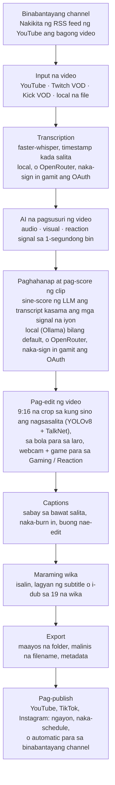

<div align="center">

[English](../../README.md) · [简体中文](README_zh.md) · [日本語](README_ja.md) · [한국어](README_ko.md) · [Türkçe](README_tr.md) · [Русский](README_ru.md) · [Tiếng Việt](README_vi.md) · [ไทย](README_th.md) · [Deutsch](README_de.md) · [Español](README_es.md) · [Français](README_fr.md) · [Português (Brasil)](README_pt-BR.md) · [العربية](README_ar.md) · [Bahasa Indonesia](README_id.md) · [Italiano](README_it.md) · [हिन्दी](README_hi.md) · [বাংলা](README_bn.md) · **Filipino** · [اردو](README_ur.md)

</div>

<a id="clips-kitty-the-free-open-source-opus-clip-alternative-for-chatting-gaming-and-sports-on-your-own-pc"></a>

# Clips Kitty: ang libre at open-source na alternatibo sa Opus Clip para sa chatting, gaming at sports, na tumatakbo sa sarili mong PC

> Isinalin ng AI ang README na ito mula sa [README sa English](../../README.md), na siyang
> batayan at unang ina-update. Malugod naming tinatanggap ang mga pagwawasto mula sa mga native speaker.
>
> 🌐 [Ang website sa Filipino](https://colingpt9.github.io/clips-studio/tl.html)

<a href="https://apps.microsoft.com/detail/9NB6XT7DSQZZ">
  <picture>
    <source media="(prefers-color-scheme: dark)" srcset="https://get.microsoft.com/images/en-us%20dark.svg">
    
  </picture>
</a>

[](https://github.com/ColinGPT9/clips-studio/releases)
[](https://github.com/ColinGPT9/clips-studio/releases)
[](../../LICENSE)
[](https://github.com/ColinGPT9/clips-studio/stargazers)
[](https://github.com/ColinGPT9/clips-studio)
[](../../CONTRIBUTING.md)
[](../../docs/DOCKER.md)

<a href="https://youtu.be/g1dMqrq-YaI"></a>

<a id="star-and-share-clips-kitty--goal-150"></a>

### I-star at i-share ang Clips Kitty ⭐ Layunin: 150

[](https://github.com/ColinGPT9/clips-studio/stargazers) **sa 150**

**Pakisuyo, i-star ang repo at i-share ito.** Wala itong gastos sa iyo, at walang
marketing budget sa likod nito, kaya ang kuwentuhan ng mga tao lang ang paraan para
malaman ng susunod na maliit na YouTuber o streamer na may libreng opsyon pala.

**Ginawa ko ito para sa maliliit na YouTuber at streamer** na hindi kayang bayaran ang
ibang opsyon o ang isang editor. Libre itong alternatibo sa Opus Clip, Vizard at Klap na
nagpapatakbo ng **Google Gemma** sa sarili mong PC: walang bayad sa server, walang bayad
kada clip, walang bayad sa paggamit ng AI.

> **Clips Studio ang pangalan ng Clips Kitty hanggang version 1.1.3**, at pinalitan
> para sumunod sa mga patakaran ng Microsoft Store sa pangalan. Parehong app, parehong
> repository, parehong data.


**Gawing Shorts, Reels at TikTok na handa nang i-post ang mahahabang stream at video,
nang buo sa sarili mong makina.** Ang Clips Kitty ay libre at open-source na AI clip
generator at video editor para sa mga creator: i-paste ang link ng YouTube, Twitch o Kick
at hahanapin nito ang pinakamagagandang moment, ika-crop sa 9:16 na nasa gitna ang
nagsasalita, ilalagay ang captions na sabay sa bawat salita, at susulatin ang mga title,
description at hashtag.

Walang cloud AI bilang default. Walang subscription. Walang bayad kada clip. Hindi
lumalabas ng computer mo ang footage mo, maliban kung ipa-publish mo ang isang clip sa
sarili mong YouTube channel.

Local muna, cloud kapag kailangan mo: kung masyadong luma ang PC mo para patakbuhin ang
AI, isang cloud provider ang magpapatakbo nito, at sa sarili mong account ang singil.
**OpenRouter ang inirerekomendang cloud na daan**: mag-sign in gamit ang OpenRouter account
mo (OAuth, walang key na kokopyahin) para sa maraming model (Claude, GPT, Gemini, Muse Spark
at iba pa). Sa pagsubok ko, mga 11 cents ang nagastos sa OpenRouter para sa isang 2-oras na
video, kung saan si Gemma (Gemma 4 26B-A4B) ang pumili ng mga clip at si Whisper
(large-v3-turbo) ang nag-transcribe; ang babayaran mo ay depende sa mga model na pipiliin
mo at sa haba ng video.
Gumagana rin nang direkta ang OpenAI, Claude, Gemini, xAI, Meta, DeepSeek at Qwen, gamit
ang sarili mong API key.
Tingnan ang [docs/AI-BACKENDS.md](../../docs/AI-BACKENDS.md).

**Bakit ito ginawa:** karamihan sa mga creator na nagpapalaki ng channel ay gumagawa ng
lahat nang mag-isa: nagfi-film, nag-i-stream, nag-e-edit, nagpo-post. Sa clips ka
nakikilala ng mga tao, pero ito rin kadalasan ang unang naiiwan: ang editor ay gastos na
hindi pa kaya ng karamihan ng channel, ang mga clipping tool ay naniningil kada video o
kada buwan, at ang pag-cut nang mano-mano ay umuubos ng isang araw na kailangan mo sa
ibang bagay. Tumatakbo ito sa hardware na meron ka na, kaya wala kang gagastusin para
gamitin ito at walang limit kung ilang clip ang gagawin mo.


<sub>38 clip mula sa isang video sa loob ng 19 minuto, sa iisang PC, nang walang ina-upload.</sub>

---

<a id="contents"></a>

## Nilalaman

- [Ano ang ginagawa nito](#what-it-does)
- [Paano ito ikinukumpara sa Opus Clip, Klap, Vizard at CapCut](#how-it-compares-to-opus-clip-klap-vizard-and-capcut)
- [Paano ito gumagana](#how-it-works)
- [Mga feature](#features)
- [Para saan ito ginawa](#what-its-built-for)
- [Mga kailangan](#requirements)
- [Pag-install at pagpapatakbo](#install-and-run)
- [Piliin ang AI model mo](#pick-your-ai-model)
- [Na-test na hardware at performance](#tested-hardware-and-performance)
- [Mga suportadong platform](#supported-platforms)
- [Mga suportadong wika](#supported-languages)
- [Mag-publish sa YouTube](#publish-to-youtube)
- [Mag-publish sa lahat ng platform nang sabay-sabay](#publish-to-every-platform-at-once)
- [GPU acceleration](#gpu-acceleration)
- [Paggamit sa command line](#command-line-use)
- [Gumawa ng plugin](#write-a-plugin)
- [Bumuo sa ibabaw nito](#build-on-it)
- [Arkitektura](#architecture)
- [Pag-contribute](#contributing)
- [Roadmap](#roadmap-detail)
- [Lisensya](#license)

---

<a id="what-it-does"></a>

## Ano ang ginagawa nito

Bibigyan mo ang Clips Kitty ng mahabang video. Ibabalik nito sa iyo ang isang folder ng
mga tapos nang vertical clip na puwede mong i-post, kasama ang isang studio para
i-review at ayusin ang mga ito bago mo i-post.

Ginawa ito para sa content na pinakahirap para sa karamihan ng clipping tool: **live
stream, IRL at talking-head na footage, podcast, at gym/fitness na content**: mahahaba at
maluwag ang pagkakaayos na video kung saan nakabaon ang magagandang moment at hindi ito
mahahanap ng transcript lang.

<a id="how-it-compares-to-opus-clip-klap-vizard-and-capcut"></a>

## Paano ito ikinukumpara sa Opus Clip, Klap, Vizard at CapCut

Ang Clips Kitty ay open-source na alternatibo sa mga cloud clipping tool. Ang
mahalagang pagkakaiba ay kung saan nangyayari ang trabaho: hindi kailanman ina-upload
ang video mo, kaya walang susukatin at walang sisingilin.

| Tool | Presyo, buwanang singil | Libreng tier | Ito ang naghahanap ng clips para sa iyo | Watermark | Ina-upload ang video mo | Open source |
| ---- | --------------------- | --------- | ----------------------- | --------- | ------------------ | ----------- |
| **Clips Kitty** | Libre, walang bayad na tier | Ang buong app | Oo | Hindi kailanman | Hindi, tumatakbo sa PC mo | Oo, AGPL-3.0 |
| Opus Clip | $15 Starter, $29 Pro | 1080p, may watermark, nag-e-expire sa loob ng 3 araw | Oo | Sa libreng tier | Oo | Hindi |
| Klap | $29 Pro, $14 Basic kung taunan ang singil | Isang video | Oo | Hindi nakasaad | Oo | Hindi |
| Vizard | $29 Creator, $14.50 kung taunan ang singil | 60 credit kada buwan, 720p | Oo | Sa libreng tier | Oo | Hindi |
| quso.ai | $29 hanggang $49 | 75 credit kada buwan, 720p | Oo | Hindi nakasaad | Oo | Hindi |
| Ssemble | $15 hanggang $60, $6 hanggang $24 kung taunan ang singil | Walang nakalista | Oo | Hindi nakasaad | Oo | Hindi |
| Descript | $16, $24, $50 | 60 minuto kada buwan, 720p | Bahagya, transcript editor ito | Sa Free at Hobbyist | Oo | Hindi |
| CapCut | Libreng gamitin, may bayad na tier sa capcut.com | Ang buong editor | **Hindi, ikaw ang magka-cut nang mano-mano** | Depende sa feature | Hindi, sa desktop app | Hindi |

**Ang CapCut ang dapat mong maintindihan**, dahil ito ang libreng sagot na binibigay ng
lahat. Magandang editor ito at wala itong bayad, pero ikaw mismo ang maghahanap ng bawat
moment at magka-crop ng bawat clip. Libre rin ang Clips Kitty, at ang unang pass na iyon
ang bahaging ginagawa nito para sa iyo.

**Mas magandang piliin ang Opus Clip, Klap o Vizard** kung wala kang Windows PC na may
graphics card, paminsan-minsan ka lang mag-clip, o kailangan mong magtrabaho mula sa
phone. Ginawa ang Clips Kitty para sa maramihang pag-clip sa hardware na meron ka na.

**[Buong paghahambing ng pito, at kung saan pinakamagaling ang bawat isa](https://colingpt9.github.io/clips-studio/alternatives.html)**

<sub>Sinuri ang mga presyo sa sariling pricing page ng bawat kumpanya, 17 Setyembre 2026.
Walang pricing page ang CapCut na nabasa namin, kaya walang presyong nakasaad para dito.
Nagbabago ang mga plan; hindi kusang mag-a-update ang table na ito.</sub>

<a id="how-it-works"></a>

## Paano ito gumagana



**Tumatakbo sa computer mo ang bawat yugto maliban kung iba ang piliin mo:** OpenRouter,
naka-sign in gamit ang account mo, para sa AI o sa transcription, at ang pag-publish, na
nag-a-upload lang ng mga clip na ipapadala mo. Bukod doon, ang tanging gumagamit ng
network sa isang normal na run ay ang pag-download ng source na video.

<a id="the-stages-in-detail"></a>

### Ang mga yugto nang detalyado

**Transcription: faster-whisper.** Timestamp kada salita, tumatakbo sa CUDA kung meron at
babalik sa CPU kung wala. Ang timing kada salita ang dahilan kung bakit tumatama ang
captions sa tamang pantig at nagsisimula ang clips sa totoong simula ng pangungusap.

**AI na pag-score ng clip.** Isa lang ang transcript sa limang signal. Ang audio ay
nagbibigay ng biglang lakas ng tunog, dami ng sunud-sunod na ingay (ganito ang hitsura ng
tawanan at palakpakan), at ang hugis ng katahimikan→pagsabog na payoff. Ang visual ay
nagbibigay ng scene cut, galaw, at pagbabago ng laki ng mukha. Pinagsasama ang mga ito ng
isang reaction signal. Ninonormalize ang bawat isa *sa loob ng video na iyon*, kaya
parehong may makabuluhang peak ang tahimik na podcast at ang stream na puno ng sigawan.
Kung may totoong data mula sa audience (Twitch chat replay na sinusukat ayon sa dami ng
iba't ibang nag-chat, at ang most-replayed heatmap ng YouTube), nagdadagdag ito ng maliit
at may limit na bonus.

Nakikita ng local na LLM ang transcript **kasama ang timeline ng mga event na iyon**, kaya
tama nitong natitimbang ang "mahina ang mga salita pero nagwala ang buong kuwarto". Dahil
ang maliliit na model ay nagbibigay ng score sa lahat sa makitid na range, pinaghahambing
nang harapan ang mga finalist sa isang rerank call: mas madali para sa 7B model ang
paghahambing kaysa sa absolute na pag-score.

**Creator Profiles.** Bumubuo ang app ng knowledge base para sa bawat creator mula sa mga
video nila: mga paulit-ulit na topic, serye, mga kasama, running joke, at tuloy-tuloy na
storyline. Nakakatulong ang context na iyon para makasulat ito ng tamang title at mapansin
ang mga callback. Sadyang maingat ito: kailangang talagang maulit ang isang catchphrase
bago ito bilangin, natutulog ang kaalamang hindi na nababanggit, at bawat ambag nito sa
score ay dagdag lang, may limit, at puwedeng i-off.

**Video editor.** Non-destructive: ang trim, mga cut sa loob, mute, mga naka-mute na salita,
volume, fade, bilis, hook text, musika at watermark ay iniimbak bilang mga operasyon at
inilalapat sa oras ng render. May AI edit chat din (*"gawin mong 5 segundo na mas mahaba"*,
*"gost ang nakasulat sa caption, dapat ghost"*), kung saan nagmumungkahi ang model at
ang na-validate na code ang naglalapat.

**Long-form na pagproseso.** Isang opsyonal na 16:9 na daan na gumagamit ng parehong
pagsusuri: horizontal na clip, cut na kasinghaba ng pang-X/Twitter, isang best-of
highlight reel, o ang buong stream na tinanggal ang mga patay na bahagi.

**Pipeline para sa maraming wika at AI dubbing.** Isinasalin ang captions at ipinapakita
para ma-review *bago* may maisulat o ma-burn, kaya naaayos ang maling linya habang
naaayos pa ito. Pinoprotektahan ng isang glossary ang mga pangalan ng channel, sponsor at
inside joke para hindi maisalin. Gumagamit ang dubbing ng local na TTS na may mga boses na
puwede mong pakinggan muna.

**Local na GPU acceleration.** CUDA para sa detection at transcription, hardware video
encoding gamit ang NVENC/AMF/QSV (kusang nade-detect, at may CPU fallback), at ang LLM sa
GPU sa pamamagitan ng Ollama.

<a id="features"></a>

## Mga feature

- **Multimodal na paghahanap ng clip**: binibigyan ng score na 0–100 ang mga moment sa
  pagsasama ng sinasabi, sigla ng audio, galaw sa video, mga reaksyon sa screen, at lakas
  ng hook/payoff. Itinatago ang bawat clip na pumasa sa quality bar, nang walang basta-basta
  na limit.
- **Face tracking na alam kung sino ang nagsasalita**: pinapanatili ng YOLOv8 pose detection
  na nasa gitna ang subject, at sa footage na maraming tao, sinusundan ng camera **kung
  sino talaga ang nagsasalita**, na pinagpapasyahan ng TalkNet active-speaker detection
  mula sa mukha at audio nang magkasama, hindi mula sa galaw. Kapag nagpalit ang
  nagsasalita, **lilipat** agad ang framing sa kanya sa halip na mag-pan, gaya ng gagawin ng
  isang editor. Crop lang ang framing: hindi kailanman binabanat, hindi kailanman
  binabaluktot.
- **Podcast mode**: para sa footage na maraming camera, may sariling steady na crop sa
  iisang tao ang bawat shot, kaya tumatama ang mga cut sa mukha nang walang pan. Sa loob ng
  isang shot, pinipili ang subject ayon sa galaw ng bibig, at kung hindi, ang
  pinakakapansin-pansing mukha.
- **Vertical Live**: para sa livestream na vertical na noong ini-stream (YouTube vertical
  live, Twitch Dual Format, Streamlabs Dual Output, o na-download na live sa Instagram o
  TikTok). Pinapanatili ang sariling 9:16 na layout ng stream, nilalaktawan ang face
  tracking, at pumipili pa rin ng mga moment sa karaniwang paraan. Tingnan ang
  [docs/VERTICAL-LIVE.md](../../docs/VERTICAL-LIVE.md).
- **Sports: Soccer at Basketball**: bawat malaking moment ng isang laro bilang sariling clip,
  kasama ang build-up at reaksyon.
  - **Soccer**: mga goal, save, card at malalaking tsansa. Binabasa ang mga goal mula sa
    score box at tinutukoy ang oras ayon sa ingay ng crowd, at sinusundan ng 9:16 na crop ang
    bola. Piliin ang All goals, Best saves, Cards at iba pa, at ipagdugtong ang mga moment
    para maging match recap at reel ng team o player.
  - **Basketball**: mga dunk, three, block, steal at game winner. Kinukumpirma ng score box
    ang bawat basket at ang puntos nito, at dahil sa quarter at sa orasan, di-hamak na mas malaki ang
    halaga ng isang game winner kaysa sa basket sa unang quarter. Nahahanap din ang reaksyon
    ng crowd, ng bench at ng mga nasa courtside. Pinaplano ang 9:16 na crop ng bawat clip
    ayon sa play nito: ang bola at ang may hawak nito, ang tatanggap ng pasa, at ang tira na
    sinusundan hanggang sa basket na kita ang rim at backboard. Sumasabay ang crop sa play at hindi
    kailanman nagzu-zoom. Ang bola ay hinahanap ng [E-BARD](https://github.com/GabrieleGiudic/E-BARD#readme) detection model (nakakredito sa
    [Lisensya](#license)).

  Tingnan ang [docs/SPORTS.md](../../docs/SPORTS.md).
- **Nae-edit na burned-in captions**: sabay sa bawat salita, at naka-style ayon sa gusto mo
  (kulay, laki, posisyon, dami ng salita kada linya, malaki o maliit na titik, o naka-off).
  Ayusin ang mali sa transcription linya kada linya bago mag-export. Kapag dalawang tao ang
  nag-uusap, puwedeng ibang kulay ang captions ng pangalawang nagsasalita, at ang maling
  natukoy nito ay puwedeng palitan nang mano-mano.
- **AI edit chat**: ilarawan ang mali sa simpleng salita at ie-edit nito ulit.
- **Ask Clips Kitty**: ang text box sa ibaba ng dashboard. Sabihin sa isang pangungusap
  ang gusto mo, gaya ng *"i-clip mo itong stream, siguraduhin mong kasama yung namatay ako
  sa boss, na may malaking dilaw na captions"*, at ipipila nito ang video, sasabihin sa
  pumipili ng clip kung ano ang hahanapin, at itatakda ang mga opsyong binanggit mo.
  **Kailangan nito ng Gemma 4 na model**: tingnan ang
  [Kailangan ng text box sa ibaba ang Gemma 4](#the-text-box-at-the-bottom-needs-gemma-4).
- **AI na title, description at hashtag**, lahat nae-edit bago mag-export.
- **Creator Profiles**: natututunan ng app ang bawat creator sa paglipas ng panahon para
  mas mahusay na makapili at makapagbigay ng title sa clips. Nananatili ang lahat sa
  computer mo, at puwede mo itong tingnan, itama o burahin.
- **Pag-publish sa maraming wika**: 19 na wika, may review bago may ma-burn.
- **AI dubbing**: local na text-to-speech na may pagsubok ng boses kada wika.
- **Long-form na export**: 16:9 na clip, highlight reel, o edit ng stream na tinanggal ang
  mga ulit. May **chapter timestamps** ang description ng highlight reel, kaya nakakalipat
  ang mga manonood sa pagitan ng mga moment sa YouTube.
- **Watermark at branding profiles**: mga default kada creator na kusang inilalapat.
- **Model manager**: palitan ang utak ng AI mula sa loob ng app; mag-download, magtanggal at
  magpalit ng model na may progress bar at walang terminal.
- **Mag-publish sa YouTube mula sa editor**: title, description, tags, thumbnail, playlist,
  audience at visibility, tapos Upload now o i-schedule. Opsyonal, naka-off bilang default,
  at gumagamit ng sarili mong Google API key.
- **Feedback sa loob ng app**: bug report na may kusang nakolektang diagnostics, hindi
  kailangan ng account.
- **Accessible na UI**: keyboard focus, suporta sa reduced motion, naaayos na font at laki.

<a id="what-its-built-for"></a>

## Para saan ito ginawa

Gumagana ito sa kahit anong video na ibigay mo. Ito ang mga kaso kung saan mas marami o
mas kaunti ang iniisip nito kaysa sa ipinapahiwatig ng listahan ng feature, para walang
sorpresa:

| Content | Paano ito gumagana |
|---|---|
| **IRL, just chatting, podcast, vlog, interview** | Ito ang pinag-tune-an nito at ang tine-test sa totoong stream bago ang bawat release |
| **Gaming at reaction** | Kapag naka-on ang **Gaming / Reaction**: ang webcam sa isang kalahati, ang game o ang video na nire-react-an sa kabila, sinusuri sa sariling frames ng video bago iproseso ([docs/GAMING.md](../../docs/GAMING.md)). Ang streamer ay kung sino ang nagsasalita, hindi kailanman ang pinakamalaking mukha. Kapag naka-off, puwedeng sundan ng framing ang isang character sa loob ng game. Para lang sa mga taong nasa camera, walang VTuber |
| **Mga laban sa sports** | Kapag naka-on ang **Sports**: ginawa para sa broadcast na may score box at commentary, kung saan sigurado ang mga goal at basket. Kadalasan walang ganoon ang footage mula sa club o phone: sinusundan ng clips nito ang bola, at ang mga goal nito ay mula sa mga match event na ipe-paste mo, gaya ng goal tags mula sa app ng club ([docs/SPORTS.md](../../docs/SPORTS.md)) |
| **Ang nire-react-an ng isang reaction** | Pinipili pa rin ang clips mula sa *sinasabi*, kaya hindi nito nakikita ang moment sa pinapanood na video na walang nagkomento |

Ang pagpili ng clip ay batay sa transcript at mga signal. Kapag ang nakakatawa ay *puro
visual* at walang nagkomento rito, asahan mong ikaw ang makakahanap nito sa editor.

<a id="requirements"></a>

## Mga kailangan

|             | Minimum                                      | Inirerekomenda                  |
| ----------- | -------------------------------------------- | ------------------------------- |
| **GPU**     | NVIDIA RTX 2060 (6 GB)                       | RTX 3060 12 GB o mas maganda    |
| **CPU**     | Intel Core i3-9100 / AMD Ryzen 3 3200G (2019)| 6 core o higit pa               |
| **RAM**     | 16 GB                                        | 16 GB o higit pa                |
| **Disk**    | ~20 GB, dagdag ang espasyo para sa mga video na ika-clip mo |                  |
| **OS**      | Windows 10 o 11                              |                                 |

**Kapag mas mababa sa minimum, puwedeng tumakbo pa rin ito, pero hindi ito suportado at
mabagal ito.** Ang pag-clip ng stream ay ilang oras ng video decoding, transcription at
encoding; ang hardware na mas luma sa mga 2019 ay sobrang tagal na parang sira ang app
kahit tama naman ang takbo nito.

Dalawa sa mga iyon ang dapat ipaliwanag pa:

- **Hindi suhestiyon lang ang 16 GB na RAM.** Sa 8 GB, susuriin nito ang buong video at
  wala namang mare-render, na mukhang crash at hindi limit ng memory.
- **Opsyonal ang GPU, hindi kailangan.** Kung wala nito, sa CPU tatakbo ang lahat, mas
  mabagal, pero kumpleto. Sa RTX 2060 nagsisimulang gumana ang GPU na daan; tingnan ang
  [GPU acceleration](#gpu-acceleration).

**Windows lang** para sa app. Dapat tumakbo ang Python engine sa Linux/macOS, pero walang
Mac build at walang Mac ang maintainer para i-test ito. Tingnan ang
[#62](https://github.com/ColinGPT9/clips-studio/issues/62) kung may Mac ka at gusto mong tumulong.

Kapag pinatakbo mula sa source, kailangan mo ang mga bagay na kung hindi ay kasama na sa
installer:

- **Python 3.10+** at **Node.js 18+**
- **[FFmpeg](https://ffmpeg.org/download.html)** sa PATH mo
- **[Ollama](https://ollama.com)** na may na-pull na model: `ollama pull gemma:7b`

<a id="install-and-run"></a>

## Pag-install at pagpapatakbo

**Ang pinakamadaling paraan ay ang [Microsoft Store](https://apps.microsoft.com/detail/9NB6XT7DSQZZ).**
Isang click, kusang nag-a-update, at walang security prompt mula sa Windows. Sinertipikahan
at pinirmahan ng Microsoft ang package, kaya hindi lalabas ang babala ng SmartScreen na
inilalarawan sa ibaba. Ini-install ng Store ang mga bagong version kapag naabot na nito;
para makuha agad, buksan ang page ng Clips Kitty sa Microsoft Store at pindutin ang
**Update**.

**O kunin ang installer.** Ang pinakabagong **Web Setup** mula sa
[Releases](https://github.com/ColinGPT9/clips-studio/releases), at patakbuhin ito. Dala nito ang app, ang Python engine, bawat
library, FFmpeg, ang AI runtime at lahat ng weights para sa detection at transcription:
walang Python, walang PATH, walang terminal, at walang ibang program na kailangang i-install.

**O gamitin ang winget.** Ini-install ng `winget install ColinGPT9.ClipsKitty` ang parehong
Web Setup mula sa terminal.

Ang tanging hindi nito dala ay ang language model mismo, dahil may lisensya ang mga iyon na
ang nagda-download mismo ang dapat tumanggap, at hindi puwedeng tanggapin para sa iyo. Kusang
sinisimulan ng setup wizard ang download na iyon, pinipili ang laki na bagay sa graphics
card mo, at nagpapakita ng progress bar. Kaya: isang download, isang double-click, isang
progress bar. Pagkatapos noon, tumatakbo na ito offline.

> Magbababala ang Windows na hindi naka-sign ang app sa unang beses na patakbuhin mo ito.
> I-click ang *More info → Run anyway* (Karagdagang impormasyon → Patakbuhin pa rin).
> Nasa listahan ang pagkuha ng signing certificate.

<a id="from-source"></a>

### Mula sa source

```bash
git clone https://github.com/ColinGPT9/clips-studio
cd clips-studio
pip install -r requirements.txt

cd ui
npm install
npm run dev        # opens the Clips Kitty desktop app
```

Kusang sinisimulan ng app ang sarili nitong Python engine. Mag-paste ng link sa **Clip
Editor**, pindutin ang *Generate clips*, at panoorin nang live ang progress.

Isang command lang para ikaw mismo ang mag-build ng installer. Tingnan ang
[CONTRIBUTING.md](../../CONTRIBUTING.md#building-the-windows-installer).

<a id="with-docker-nothing-else-to-install"></a>

### Gamit ang Docker: wala nang ibang i-install

Para sa mga contributor. Kailangan mo lang ng [Docker Desktop](https://docs.docker.com/get-started/get-docker/)
at wala nang iba: walang Python, walang Node, walang FFmpeg, walang PyTorch.

```bash
git clone https://github.com/ColinGPT9/clips-studio
cd clips-studio
docker compose up
```

Tatlong service ang sabay-sabay na bubukas:

| | |
|---|---|
| **<http://localhost:5173>** | ang interface, sa browser mo |
| **<http://localhost:8765>** | ang engine at ang API nito |
| Ollama | ang local na AI, sa :11434 |

Pagkatapos, mag-pull ng model (`docker compose exec ollama ollama pull gemma3:4b`) at
may gumaganang checkout ka na.

Patakbuhin ang mga check sa parehong paraan:

```bash
docker compose run --rm engine pytest
docker compose run --rm ui npm run typecheck
```

> **Laktawan ang sampung-minutong unang build:** kinukuha ng `docker compose pull` ang
> isang prebuilt na engine image sa halip na i-compile ang PyTorch at OpenCV sa local.

Sa host mo pa rin tumatakbo ang desktop shell mismo, dahil kailangan ng Electron ng
display; naka-container ang lahat ng iba pa. Ang mga detalye, at ang hindi nito masasabi
sa iyo, ay nasa [docs/DOCKER.md](../../docs/DOCKER.md).

<a id="pick-your-ai-model"></a>

## Piliin ang AI model mo

Buksan ang page na **Models** para makita kung ano ang naka-install at kung ano ang kaya ng
GPU mo:

Iisang batayan lang: kung gaano kalaki ang VRAM mo. Ito rin ang mga row na ipinapakita ng
app, mula sa `RECOMMENDATIONS` sa [`llm/manager.py`](../../llm/manager.py). Iisang table ang
binabasa ng wizard at ng page na Models kaya hindi sila puwedeng magkasalungat, o
sumalungat dito.

| Hardware mo | Inirerekomendang model | |
|---|---|---|
| CPU / iGPU, walang graphics card | `gemma3:4b` | na-test |
| Mas mababa sa 6 GB VRAM, o lumang PC | `gemma4:e2b` | |
| 6 GB VRAM | `gemma4:e4b` | |
| 8 GB VRAM | **`gemma:7b`** | na-test · default na kasama |
| 10–12 GB VRAM | `gemma3:12b` | na-test |
| 16–24 GB VRAM | `gemma3:27b` | |

At ang mga model na sulit piliin sa ibang dahilan bukod sa VRAM:

| Bakit | Model |
|---|---|
| Pagsasalin / maraming wika | `qwen3:8b` o `qwen3:14b` |
| Maluwag na lisensya | `mistral-nemo:12b` (Apache-2.0) · `phi4:14b` (MIT) |

**Ang tatlong may markang "na-test" lang ang napatakbo na sa totoong stream**, at ang
`gemma:7b` ang may pinakamaraming oras ng paggamit; ito ang kasama sa `config/settings.yaml`.
Nakalista ang lahat ng iba dahil makatwiran ang laki nila at libre silang gamitin nang
pang-komersyal, hindi dahil nasukat na ang kalidad ng clip gamit ang mga ito. Gumagana silang
lahat, dahil pare-pareho ang pakikipag-usap ng app sa bawat model sa pamamagitan ng Ollama,
pero wala pang nakasuri kung mas magagandang moment ang napipili nila. Ang pagpuno sa
kakulangang iyon ay [#38](https://github.com/ColinGPT9/clips-studio/issues/38).

Gumagana ang kahit anong sine-serve ng Ollama, at isang click lang ang pagpapalit. Puwedeng
gumamit ng *ibang* model ang pagsasalin kaysa sa pag-clip. I-set ang `llm.translation_model`.

<a id="the-text-box-at-the-bottom-needs-gemma-4"></a>

### Kailangan ng text box sa ibaba ang Gemma 4

Gumagana lang ang **Ask Clips Kitty**, ang text box sa ibaba ng dashboard, sa model na kayang
gamitin ang mga tool ng app. Kaya ito ng Gemma 4. Hindi kaya ng `gemma:7b` at ng mga Gemma 3
na model, at isa sa mga iyon ang ini-install ng setup sa PC na walang graphics card o may
8 GB o higit pang VRAM. Doon, hindi gagana ang box hangga't hindi ka nagdadagdag ng Gemma 4
na model: sinasabi ng version 2.0 na *"No installed model can use tools"* (Walang naka-install
na model na kayang gumamit ng tools), at sa mga susunod na version, iniaalok mismo ng box ang
download.

Kahit anong model ang pumipili ng clips mo, mag-install ng Gemma 4 na model sa tabi nito sa
page na **Models**: `gemma4:e4b` sa graphics card na may 6 GB o higit pa, `gemma4:e2b` kung
mas mababa. Hindi mo kailangang lumipat dito. Kusa itong hahanapin ng box, at ang model na
pinili mo pa rin ang pipili ng clips mo. Kung sa OpenRouter mo pinapatakbo ang AI, ang model
na iyon ang gagamitin ng box at wala nang kailangang i-install.

<a id="tested-hardware-and-performance"></a>

## Na-test na hardware at performance

Araw-araw dine-develop at tine-test ang Clips Kitty sa makinang ito, kaya magandang
batayan ito kung ikinukumpara mo ang sarili mong resulta:

| | |
|---|---|
| **GPU** | NVIDIA GeForce RTX 3060, 12 GB VRAM |
| **CPU** | AMD Ryzen 5 5600X (6 core / 12 thread) |
| **RAM** | 16 GB |
| **OS** | Windows 10 |
| **Model sa pag-clip** | `gemma:7b` sa pamamagitan ng Ollama |
| **Transcription** | faster-whisper `large-v3-turbo` sa CUDA |

Lahat ng nasa repo na ito (ang default na settings, `parallel_renders: 3`, ang 5-minutong
laki ng analysis chunk) ay naka-tune para sa makinang halos ganitong klase. Sa mas malaking
GPU, sabay na taasan ang `llm.num_ctx` at `analysis.chunk_seconds` at umakyat ng isang laki
ng model; sa mas maliit, bumaba sa `gemma3:4b`.

Kung magbe-benchmark ka ng Clips Kitty sa ibang hardware, pakipost ito sa
[Discussions](https://github.com/ColinGPT9/clips-studio/discussions). Nakakatulong sa lahat ang totoong numero mula sa totoong makina
para malaman kung anong setup ang kailangan nila.

<a id="supported-platforms"></a>

## Mga suportadong platform

| Source | Suporta |
|---|---|
| Mga video sa YouTube | Buo. Sadyang H.264 ang pinipili (halos dinodoble ng AV1 ang oras ng pagproseso) |
| Twitch VODs | Buo, kasama ang chat replay bilang signal mula sa audience |
| Kick VODs | Buo (binubura ng Kick ang chat pagkatapos ng stream, kaya walang chat signal) |
| Mga local na video file | Buo. I-clip ang sarili mong footage bago mo ito i-publish |
| Live stream | Sadyang hindi suportado. VOD lang |

<a id="supported-languages"></a>

## Mga suportadong wika

Puwedeng isalin, lagyan ng subtitle, at i-dub ang clips sa **19 na wika**, at **naisalin din
ang interface mismo sa lahat ng 19**, kaya magagamit ang app sa parehong mga wikang
pinagpa-publish-an nito:

Ingles · Espanyol · Portuges (Brazil) · Pranses · Aleman · Hindi · Indonesian ·
Hapon · Ruso · Arabe · Tsino (Simplified) · Vietnamese · Filipino · Turko ·
Urdu · Bengali · Thai · Koreano · Italyano

Ang pagdagdag ng wika ay isang row sa `multilingual/languages.py` at isang locale file sa
`ui/src/renderer/src/locales/`. Hindi nakatali sa isang wika ang translator at ang subtitle
writer.

<a id="help-wanted-the-maintainer-only-speaks-english"></a>

### Kailangan ng tulong: English lang ang alam ng maintainer

18 sa 19 na salin ng interface ang hindi pa nababasa ng taong nagsasalita ng wikang iyon.
Hindi pa tapos ang kalahati sa mga ito. May sariling issue ang bawat wika, nakasulat sa
English at sa wikang iyon, at **ang pag-report ng isang maling salita ay buong
kontribusyon na**: hindi kailangan ng pull request. [Paano ito gumagana](../../docs/TRANSLATING.md).

**Kailangang tapusin** (mga 68 string na nasa English pa):
[বাংলা (Bengali)](https://github.com/ColinGPT9/clips-studio/issues/43) ·
[Italiano](https://github.com/ColinGPT9/clips-studio/issues/44) ·
[한국어 (Korean)](https://github.com/ColinGPT9/clips-studio/issues/45) ·
[ไทย (Thai)](https://github.com/ColinGPT9/clips-studio/issues/46) ·
[Tagalog (Filipino)](https://github.com/ColinGPT9/clips-studio/issues/47) ·
[Türkçe (Turkish)](https://github.com/ColinGPT9/clips-studio/issues/48) ·
[اردو (Urdu)](https://github.com/ColinGPT9/clips-studio/issues/49) ·
[Tiếng Việt (Vietnamese)](https://github.com/ColinGPT9/clips-studio/issues/50) ·
[中文 (Chinese)](https://github.com/ColinGPT9/clips-studio/issues/51)

**Kailangang suriin** (kumpleto na, pero wala pang nakapag-verify na natural itong basahin):
[العربية (Arabic)](https://github.com/ColinGPT9/clips-studio/issues/52) ·
[Deutsch (German)](https://github.com/ColinGPT9/clips-studio/issues/53) ·
[Español (Spanish)](https://github.com/ColinGPT9/clips-studio/issues/54) ·
[Français (French)](https://github.com/ColinGPT9/clips-studio/issues/55) ·
[हिन्दी (Hindi)](https://github.com/ColinGPT9/clips-studio/issues/56) ·
[Bahasa Indonesia (Indonesian)](https://github.com/ColinGPT9/clips-studio/issues/57) ·
[日本語 (Japanese)](https://github.com/ColinGPT9/clips-studio/issues/58) ·
[Português (Portuguese)](https://github.com/ColinGPT9/clips-studio/issues/59) ·
[Русский (Russian)](https://github.com/ColinGPT9/clips-studio/issues/60)

May gusto kang wika na wala rito? [#61](https://github.com/ColinGPT9/clips-studio/issues/61).

<a id="publish-to-youtube"></a>

## Mag-publish sa YouTube

Naka-off bilang default. I-on ito sa **Settings → Publish to YouTube** at lalabas ang tab na
**YouTube** sa editor: punan ang title, description, tags, thumbnail, playlist, audience at
visibility, tapos pindutin ang **Upload now**. Ire-render ng Clips Kitty ang clip kung may
edit kang hindi pa naka-save at diretsong ia-upload ito sa channel mo. Walang hakbang na
export at walang hiwalay na page para sa pag-publish. Hindi mo na kailangang umalis sa editor.

Kung iiwan mo itong naka-off, walang magbabago kahit saan sa app.

<a id="scheduling"></a>

### Pag-schedule

Kapag pinili mo ang **Schedule on YouTube**, ia-upload ang video *agad-agad*, mamarkahan
itong private, at bibigyan ang YouTube ng oras ng pag-publish. Ang YouTube ang magpa-publish
nito sa araw na iyon.

**Puwede mong isara ang Clips Kitty at patayin ang computer mo.** Walang timer sa app na
ito, walang background service, at walang kailangang iwanang tumatakbo. Kapag natanggap na
ng YouTube ang video, tapos na ang trabaho ng Clips Kitty.

<a id="you-need-your-own-google-api-key"></a>

### Kailangan mo ng sarili mong Google API key

Walang kasamang shared na key ang Clips Kitty, at hindi lang ito dahil sa pag-iingat. Ang
upload quota ng Google ay **kada Cloud project**: kung iisang shared key, lahat ng user sa
buong mundo ay kukuha sa parehong 100 upload kada araw. Ang sarili mong project ay
nagbibigay sa iyo ng sarili mong allowance, at hindi kailanman lumalabas ng makina mo ang
credentials mo. Walang server ng Clips Kitty sa gitna.

Libre ang setup at mga sampung minuto lang; gagabayan ka ng wizard sa Settings:

1. Gumawa ng project sa [Google Cloud Console](https://console.cloud.google.com/projectcreate).
2. I-enable ang **YouTube Data API v3** sa APIs & Services → Library.
3. Punan ang OAuth consent screen, tapos pindutin ang **Publish app**. Mahalaga ito: kung
   iiwan sa *Testing*, ine-expire ng Google ang sign-in mo kada 7 araw at kailangan mong
   mag-reconnect linggo-linggo. Hindi ibig sabihin ng "In production" na verified na ito,
   at wala itong bayad.
4. Credentials → Create credentials → OAuth client ID → type na **Desktop app**.
5. I-paste ang client ID at secret sa Settings, tapos i-connect ang channel mo.

Makakakita ka ng babalang "Google hasn't verified this app" (Hindi pa vine-verify ng Google
ang app na ito) kapag nag-connect ka. Iyan ang sarili mong app na nagbababala sa iyo tungkol
sa iyo. Malalampasan mo ito gamit ang **Advanced → Go to (unsafe)**.

<a id="posting-publicly"></a>

### Pag-post nang public

Isang bagay na dapat mong malaman bago ka umasa rito, dahil walang software na
makakalusot dito:

> **Hangga't hindi pumapasa ang Google Cloud project mo sa libreng API audit ng YouTube,
> ila-lock ng YouTube sa private ang bawat video na ina-upload sa pamamagitan nito.**
> Permanente ang lock. Hindi mo na magagawang public ang video pagkatapos sa Studio, at
> walang apela. Ang tanging solusyon ay i-upload ito ulit mula sa project na na-audit na.

Sinusuri ng Clips Kitty pagkatapos ng bawat upload at diretsahang sasabihin sa iyo kung
nangyari ito, sa halip na mag-report ng tagumpay para sa video na walang makakapanood. Kung
balak mong mag-publish nang public, isumite muna ang
[YouTube API Services audit form](https://support.google.com/youtube/contact/yt_api_form).
Hindi apektado ang pag-upload bilang **unlisted** o **private**.

<a id="what-it-can-and-cannot-set"></a>

### Ano ang kaya at hindi kayang i-set nito

Lahat ng inilalabas ng public API: title, description (nagiging chapters ang mga timestamp
dito), tags, category, wika, visibility, naka-schedule na oras ng pag-publish, made-for-kids,
disclosure ng altered/synthetic na content, lisensya, embedding, public stats, custom
thumbnail, at pagdagdag sa playlist.

May ilang feature ng YouTube Studio na wala talaga sa public API, kaya sadyang walang
control para sa mga ito sa halip na control na tahimik na walang ginagawa: monetization at
ad breaks, disclosure ng paid promotion, end screens at cards, comment settings, age
restriction, Premieres, at Shorts remix permissions. Ili-link ka ng panel sa Studio para
sa mga iyon.

Walang espesyal na kailangan ang Shorts: walang hiwalay na mode at walang `#Shorts` na tag.
Kusang kinikilala ng YouTube ang video bilang Short batay sa hugis at haba nito.

<a id="publish-to-every-platform-at-once"></a>

## Mag-publish sa lahat ng platform nang sabay-sabay

Naka-off din bilang default. I-on ito sa **Settings → Publish through WoopSocial** at
lalabas ang tab na **Publish** sa editor: piliin ang mga platform mo — o pindutin ang
**Everywhere** (Lahat) — isulat nang isang beses ang title at description, at isang upload
ang mapupunta nang sabay-sabay sa YouTube, TikTok, Instagram, Facebook, X, Threads, LinkedIn,
Pinterest at Bluesky. Ang **Publish all** sa Clip Editor ay gumagawa ng buong batch,
nakahiwa-hiwalay para hindi sabay-sabay na lumapag ang isang dosenang clip sa iisang segundo.

Ang isang ito ay **hindi local**. Ipinapadala ang clip at ang mga detalye nito sa isang
publishing service, na siyang naghahatid ng mga ito at may hawak ng koneksyon sa mga social
account mo, kaya hindi kailanman hihingi ng password ng social ang Clips Kitty. Ang lahat ng
iba pa sa app ay tumatakbo pa rin sa PC mo.

Dalawang service ang suportado: ang **[WoopSocial](https://woopsocial.com/?via=clipskitty)**,
na ang libreng plan ay nagko-connect ng dalawang account at pumapayag sa mga 5 post sa
YouTube kada araw, at itinataas ng mga bayad na plan ang dalawang iyon, at ang
**[Upload-Post](https://www.upload-post.com/)**, na umaabot sa mas maraming destinasyon at
nagdadagdag ng thumbnail, first comment at posting queue. I-on ang alinman, o pareho.

<sub>Affiliate link - Maaaring kumita ng komisyon ang Clips Kitty kung mag-sign up ka sa
pamamagitan nito, nang walang dagdag na gastos sa iyo.</sub>

**Gamitin ang sarili mong key.** Ikaw ang gagawa ng account, magko-connect ng sarili mong
socials at gagamit ng sarili mong allowance. Walang sinisingil ang Clips Kitty, walang
hawak na shared na key at walang binabayaran — parehong ayos ng integration sa YouTube, at
sa parehong dahilan.

Buong gabay, suporta kada platform at mga limit:
**[docs/UPLOAD-POST.md](../../docs/UPLOAD-POST.md)**.

<a id="gpu-acceleration"></a>

## GPU acceleration

Kusang hardware-accelerated ang **video encoding** sa tatlong vendor: NVIDIA (NVENC), AMD
(AMF), at Intel (QSV). Sa pagsisimula, nagte-test encode ang engine ng isang frame gamit ang
bawat isa at ginagamit ang unang talagang gumagana, at babalik sa CPU kung wala. Para
pilitin ang isang pagpili, gamitin ang `video.encoder` sa `config/settings.yaml`.

Pinakamabilis ang **detection at transcription** gamit ang CUDA. Sa simula, ang `pip install
torch` ay nagbibigay sa iyo ng build na **CPU lang**. Para sa NVIDIA:

```bash
pip uninstall torch torchvision -y
pip install torch torchvision --index-url https://download.pytorch.org/whl/cu130
```

**Aling mga card ang gumagamit ng GPU:** GTX 16-series, RTX 20-series, at lahat ng mas bago
kasama ang RTX 50-series.

Kailangan din ng **transcription sa GPU** ang cuBLAS 12 ng NVIDIA: CUDA 12 build ang engine
ni Whisper (CTranslate2), at cuBLAS 13 lang ang meron sa CUDA 13 na PyTorch sa itaas.
Ini-install ito ng `pip install -r requirements.txt` (`nvidia-cublas-cu12`), at dala ito ng
naka-install na app, kaya hindi kailangan ng CUDA toolkit. Kung wala ito, sa CPU tatakbo ang
transcription at sasabihin ng log kung bakit.

**Mas mababa sa minimum ang GTX 10-series at mas luma.** Hindi suportadong configuration ang
mga ito. Hindi tumatangging magsimula ang app sa mga ito: babalik sa CPU ang detection at
gagana pa rin ang lahat, pero mabagal ito, at ang makinang ganoon kaluma ay kadalasang may
CPU na nagpapabagal sa buong trabaho at hindi lang sa detection.

Gamitin ang `cu130` na index sa itaas, hindi ang mas luma. Walang code ang mas lumang CUDA
build para sa mga bagong card, at babalik ang app sa CPU sa hardware na dapat sana ay mabilis.

Sa mga may AMD GPU: sa CPU tumatakbo ang tracking at transcription sa Windows, gumagana pa
rin nang buo, mas mabagal lang. Ginagamit pa rin ang GPU mo para sa video encoding sa
pamamagitan ng AMF at para sa LLM sa pamamagitan ng Ollama, na sumusuporta mismo sa AMD.

Dumadaan ang **video decoding** sa FFmpeg na may hardware acceleration sa halip na sa OpenCV,
para sa tracking pass at sa rendering. Ang pagbasa ng sample frames sa ganitong paraan ay
gumagamit ng mga ikasampu lang ng CPU kumpara sa pag-decode sa Python, na mahalaga dahil
dumadaan ang tracking pass sa bawat clip.

**Paghahati ng CPU.** Parehong gusto ng detection at rendering ang bawat core, at kung
pababayaan, mag-aagawan sila at ang interface. Sa pagsisimula, hinahati ng engine ang mga core
sa mga render worker at sadyang nagtatabi ng dalawa, para manatiling mabilis tumugon ang app
habang tumatakbo ang isang batch. I-tune gamit ang `video.parallel_renders`.

<a id="command-line-use"></a>

## Paggamit sa command line

Gumagana ang lahat kahit wala ang desktop app:

```bash
python main.py process "https://www.youtube.com/watch?v=VIDEO_ID"   # one video
python main.py models                                               # list/switch models
python main.py status                                               # processing state
python main.py serve                                                # just the API engine
```

Nasa [config/settings.yaml](../../config/settings.yaml) ang settings. Sa itaas ng file ay may
maikling quick-setup block, at nasa ibaba nito ang lahat ng advanced. Bawat LLM prompt ay
isang simpleng text file sa [config/prompts/](../../config/prompts/), kaya maaayos mo kung
paano binibigyan ng score ang clips nang hindi gumagalaw ng Python.

<a id="write-a-plugin"></a>

## Gumawa ng plugin

Mas kilala mo ba ang isang game, sport o klase ng palabas kaysa sa isang pangkalahatang
detector? Gumawa ng maliit na Python plugin na naghahanap, umiintindi o nagbibigay ng score
sa mga moment sa isang video, at ang Clips Kitty na ang bahala sa iba. MIT ang SDK, kaya
puwedeng gumamit ng kahit anong lisensya ang plugin mo, at walang kailangang i-fork.

```text
Clips Kitty SDK

Input                      a link or a video file
  ↓
Video                      Clips Kitty downloads it and writes down what is said
  ↓
Your plugin                every step is optional
  ├── find                 picks the moments                  built
  ├── understand           says what happens in each one      built
  ├── rate                 scores each moment                 built
  └── edit                 suggests edits for the creator     built
  ↓
Clips Kitty                does every step no plugin does, then cuts, frames and captions the clips
  ↓
Creator / Social Platform  posts when the creator clicks Publish, or on a schedule or automatic posting the creator switched on
```

- Isang plugin lang ang puwedeng maghanap ng mga moment para sa isang video; papalitan nito
  ang sariling paghahanap ng Clips Kitty.
- Hanggang 3 plugin ang puwedeng umintindi at hanggang 3 ang puwedeng magbigay ng score,
  pagkatapos ng kahit anong finder.
- Nagmumula ang papel ng isang plugin sa `inputs` at `outputs` sa manifest nito ([Mga hakbang](../../docs/developers/steps.md)).
- Hanggang 3 plugin ang puwedeng magmungkahi ng edit para sa mga clip na gagawin.
- Nagmumungkahi ang mga edit plugin ng mga edit na naghihintay sa creator sa editor ([Mga hakbang](../../docs/developers/steps.md#suggest-edits-the-edit-step)).
- Hindi plugin step ang pag-post: ang Clips Kitty mismo ang nagpo-post ng clips, at sa
  pamamagitan ng WoopSocial ay kaya nitong mag-post sa maraming site nang sabay gamit ang
  sariling account ng creator ([Mag-publish sa lahat ng platform nang sabay-sabay](#publish-to-every-platform-at-once)). Tinatanggihan ang `kind: publisher`: hindi nagpo-post ang mga plugin.

Tatlong command ang nag-i-install ng SDK, gumagawa ng plugin mula sa template na
`game-events` (para sa Quarkbloom Arena, isang imbentong game) at pinapatakbo ito sa isang
test video na ginagawa ng SDK. Kailangan nila ng Python 3.11, FFmpeg at Git.

PowerShell (Windows):

```powershell
py -m pip install "clipskitty-sdk[yaml,test] @ git+https://github.com/ColinGPT9/clips-studio#subdirectory=sdk/python"
py -m clipskitty_sdk new quarkbloom-bursts --template game-events --publisher your-github-name
py -m clipskitty_sdk run quarkbloom-bursts --sample
```

bash (macOS, Linux):

```bash
python -m pip install "clipskitty-sdk[yaml,test] @ git+https://github.com/ColinGPT9/clips-studio#subdirectory=sdk/python"
python -m clipskitty_sdk new quarkbloom-bursts --template game-events --publisher your-github-name
python -m clipskitty_sdk run quarkbloom-bursts --sample
```

Ang Clips Kitty 2.1.0 ang unang release na nagpapatakbo ng plugins, at kasama nito ang SDK 1.3.0.

Ang **[Ang una mong game pipeline](../../docs/developers/first-game-pipeline.md)** ay
nagpapatuloy mula roon, hakbang-hakbang, hanggang sa plugin na naka-install sa Clips Kitty at
nakalista sa Marketplace nito. May mga recipe ang [Signals cookbook](../../docs/developers/signals-cookbook.md)
para sa pagbasa ng video ng isang game, nasa [SDK reference](../../docs/developers/sdk.md) ang
bawat command at call, at nasa [developer docs](../../docs/developers/README.md) ang lahat ng
iba pa. Ang page na [Clips Kitty SDK](https://colingpt9.github.io/clips-studio/developers.html)
sa website ang maikling bersyon.

<a id="build-on-it"></a>

## Bumuo sa ibabaw nito

Ang desktop app ay isang bintana papunta sa isang **local HTTP API**, na tumatakbo tuwing
bukas ang Clips Kitty. Kayang patakbuhin ng isang Discord bot, batch runner, web front end o
OBS integration ang parehong pipeline, at walang kailangang idagdag muna sa app.

```bash
python main.py serve --port 8765          # the engine on its own, no window

curl -X POST http://127.0.0.1:8765/jobs \
  -H "Content-Type: application/json" \
  -d '{"url": "https://www.youtube.com/watch?v=VIDEO_ID"}'
# {"job_id": 149}
```

Bumabalik ang clips bilang JSON, kasama ang breakdown ng score na pinagmulan nila at isang
MP4 na puwede mong i-stream:

```bash
curl -s http://127.0.0.1:8765/videos/VIDEO_ID/clips \
  | python -c "import json,sys; [print(c['score'], c['title']) for c in json.load(sys.stdin)]"
```

Idinodokumento ng **[docs/API.md](../../docs/API.md)** ang mga endpoint na sulit pagbuuan, na
may gumaganang halimbawa at ang mga bitag na umuubos ng isang hapon sa mga tao. Nagse-serve
din ang service ng sarili nitong interactive docs sa `http://127.0.0.1:8765/docs`.

**Walang authentication** ito at dahil doon, sa localhost lang ito naka-bind. Basahin ang
security note sa API docs bago mo ituro ang kahit ano rito.

<a id="or-bring-your-own-model"></a>

### O gamitin ang sarili mong model

Iyan ang pagbuo *sa paligid* ng app. Puwede ka ring bumuo *sa loob* nito, at ang plugin ang
lugar para magsimula ([Gumawa ng plugin](#write-a-plugin)). Kung ang footage na mahalaga sa
iyo ay hindi ang pinag-tune-an nito, sports man, gaming, reaction, lecture o bagay na wala pang
sumusubok, kayang hanapin, intindihin o bigyan ng score ng isang plugin ang mga moment nito
nang walang fork. Tumatakbo ito sa sariling Python ng Clips Kitty, kasama ang standard library
(bawas ang ilang module na hindi isinama ng app) at ang SDK: hindi pa kayang mag-install ng
Clips Kitty ng ibang Python package para sa isang plugin.

Para baguhin mismo ang app: lokal na pinapatakbo ng pipeline ang **YOLOv8 (ultralytics), OpenCV
at TalkNet-ASD**, at ang nagpapasya kung aling mga moment ang magiging clip ay isang set ng
signal kada segundo, hindi isang nakapirming ideya kung ano ang kawili-wili. Ang detector na
naglalabas ng confidence sa buong timeline ay puwedeng idagdag bilang isa pang signal, at ang
mga peak nito ay nagiging kandidatong clip. Kung kailangan ng detection mo ng mga Python package
na hindi pa kayang i-install ng Clips Kitty para sa isang plugin, i-fork ito at isaksak ang
sarili mong detection.
Nasa **[docs/EXTENDING.md](../../docs/EXTENDING.md#bring-your-own-model)** ang kontrata, ang
file na kokopyahin, at ang bitag sa performance na dapat mong malaman bago ka magsimula.

**Walang kailangang mag-poll.** Mag-submit ng job na may `webhook_url` at magpo-POST ang engine
nang isang beses kapag tapos na ito, naka-sign gamit ang sarili mong secret kung magbibigay
ka nito, kaya ang isang dock o n8n flow ay puwedeng manahimik lang sa loob ng apatnapung
minutong kailangan ng isang stream sa halip na magtanong kada ilang segundo. Ang mga detalye
ay nasa [docs/API.md](../../docs/API.md#webhooks-being-told-instead-of-asking).

<a id="ask-an-ai-agent-to-do-it"></a>

### Ipagawa ito sa isang AI agent

May kasamang **MCP server** ang Clips Kitty, kaya kayang patakbuhin ng Claude, Cursor o kahit
anong MCP client ang parehong pipeline gamit ang simpleng salita: magpila ng stream, sundan ang
job, basahin ang clips na pinili nito, mag-export ng isa.

```bash
claude mcp add clips-kitty -- python main.py mcp
```

Sa naka-install na build, `api.exe` ang binary ng engine (sa folder na `resources\backend` ng
app), kaya `api.exe mcp` ang command doon.

Kumakausap ito sa tumatakbong engine sa `127.0.0.1:8765`, kaya kailangang bukas ang Clips Kitty,
at hindi ito nangangailangan ng kahit anong API key: ang model na nagki-clip ay ang nasa sarili
mong makina (o, kung pumili ka sa Settings → AI, isang cloud model sa sarili mong key, na hindi
kailanman nakikita ng MCP client). Nasa [skills/clips-kitty/](../../skills/clips-kitty/) ang
isang agent skill para sa mga client na sumusuporta rito.

<a id="built-with-clips-kitty"></a>

### Ginawa gamit ang Clips Kitty

Nakalista ang mga project na tumatakbo sa API na ito sa **[Awesome Clips Kitty](https://github.com/ColinGPT9/awesome-clips-kitty)**,
ang listahan ng mga pipeline, plugin, integration, app at tool na ginawa gamit ang Clips Kitty.
Ang una ay ang [Clips Kitty OBS Plugin](https://github.com/ColinGPT9/clips-kitty-obs-plugin),
isang OBS Studio dock na nagpapasa ng stream mo sa Clips Kitty pagkatapos nito. May nagawa ka?
Idagdag ito gamit ang pull request ([paano](https://github.com/ColinGPT9/awesome-clips-kitty/blob/main/CONTRIBUTING.md)), at bigyan
ang repository mo ng topic na `clips-kitty`.

<a id="architecture"></a>

## Arkitektura

Tingnan ang **[ARCHITECTURE.md](../../ARCHITECTURE.md)** para sa buong disenyo: ang pipeline,
ang scoring engine, tracking, creator intelligence, ang API surface, at ang mga patakaran sa
disenyo na nagpapanatili ritong modular.

<a id="contributing"></a>

## Pag-contribute

Malugod na tinatanggap ang mga kontribusyon. Tingnan ang **[CONTRIBUTING.md](../../CONTRIBUTING.md)**
para sa dev setup at sa mga inaasahan sa pull request, at ang **[SECURITY.md](../../SECURITY.md)**
para mag-report ng vulnerability. Ang mga issue na may label na [`good-first-issue`](https://github.com/ColinGPT9/clips-studio/labels/good-first-issue)
ay maliliit at malinaw ang saklaw kung naghahanap ka ng masisimulan.

Nasa [site/](../../site/) ang website at naka-publish ito sa GitHub Pages at sa isang Hugging
Face Space. Tingnan ang [docs/MIRRORS.md](../../docs/MIRRORS.md). **Sa GitHub nangyayari ang
trabaho**, at one-way na force-push ang mirror ng website, kaya mapapatungan ang commit na
gagawin doon.

Dokumentasyon ng packaging at release:

- **[docs/RELEASING.md](../../docs/RELEASING.md)**: pag-build at pag-publish ng Windows
  installer, na siyang pangunahing channel
- **[docs/MSSTORE.md](../../docs/MSSTORE.md)**: ang package para sa Microsoft Store, mula sa
  paggawa ng developer account hanggang sa certification
- **[packaging/winget/](../../packaging/winget/)**: ang mga winget manifest, na nakaturo sa
  installer sa itaas
- **[whop-app/](../../whop-app/)**: ang Whop app, na naglalapit sa Clips Kitty sa mga miyembro
  ng mga clipping community. Mga marketing page lang: hindi ito nagpoproseso ng video, hindi
  nag-iimbak ng kahit ano, at hindi kumakausap sa desktop app
- **[docs/DOCKER.md](../../docs/DOCKER.md)**: pagpapatakbo ng engine nang hindi ikaw mismo ang
  nag-i-install ng Python, FFmpeg at PyTorch
- **[PRIVACY](https://colingpt9.github.io/clips-studio/privacy.html)**: kung ano ang iniimbak
  ng app at kung ano ang puwedeng lumabas sa makina mo (maikling sagot: wala, maliban kung
  magsusumite ka ng bug report)

<a id="changelog-known-issues-roadmap"></a>

## Changelog, mga kilalang isyu, roadmap

- **[CHANGELOG.md](../../CHANGELOG.md)**: kung ano ang nagbago sa bawat release, sa simpleng salita.
- **[KNOWN-ISSUES.md](../../KNOWN-ISSUES.md)**: kung ano ang sira o kulang ngayon, at ang mga
  pansamantalang solusyon. Lahat ng nakalista roon ay talagang naobserbahan.
- **[ROADMAP.md](../../ROADMAP.md)**: kung ano ang nailabas na, ano ang susunod, at ang
  pangmatagalang direksyon.

**I-follow para sa mga update:**
[-%40ClipsKitty2-000000?logo=x&logoColor=white)](https://x.com/ClipsKitty2)
[](https://www.instagram.com/clipskitty2/)
[](https://www.youtube.com/@ClipsKitty2)

<a id="roadmap-detail"></a>

## Detalye ng roadmap

Nasa [ROADMAP.md](../../ROADMAP.md) ang maikling bersyon. Nasa ibaba ang dahilan sa likod ng
mas mahihirap na desisyon, dahil kadalasan mas kapaki-pakinabang ang "bakit hindi pa" kaysa
sa "hindi pa".

1. **Android companion app, Vertical Live lang**, para manatili itong magaan: naka-frame na
   para sa screen ng phone ang vertical live, kaya pinapanatili ng app ang sariling layout ng
   stream at kailangan lang hanapin ang mga moment, nang walang face tracking o reframing.
   Twitch, Kick at mga local na video file lang, para sumunod sa patakaran ng Play Store.
2. **Mas maraming sports**: Kasama na ang Soccer at Basketball. Susunod ang Cricket (nakalista
   na ito sa menu na Sport bilang coming soon), bilang sariling module gaya ng iba (tingnan ang
   [docs/SPORTS.md](../../docs/SPORTS.md#adding-a-sport)).
3. **Text update kapag may natapos**: isang text message kapag handa na ang clips ng isang
   video, kapag na-post na ang mga ito, at kapag may pumalya, para tumakbo ang isang automatic
   na channel nang walang nagbabantay sa app.
4. **Voice cloning para sa dubbing** *(sadyang huli sa listahang ito)*: sa ngayon, preset na
   local na boses ang gamit ng dubbing. Para masabi ang mga salin sa **sariling** boses ng
   creator, kailangan ng cloning model, at bawat kapani-paniwalang local na model ay may
   sariling PyTorch build: sa makinang naka-set up para sa pag-clip, ida-downgrade nito ang
   torch sa build na CPU lang at tahimik na tatanggalin ang GPU acceleration sa tracking at
   transcription. Masamang palitan ang sirain ang pag-clip para lang magdagdag ng dubbing.

   Sa totoo lang, maghihintay ito hanggang humabol ang consumer hardware, o ilalabas bilang
   hiwalay na opsyonal na install na may sariling Python environment para hindi kailanman
   magalaw ang para sa pag-clip. Kailangan ding suriin ang lisensya ng mga model: ilan sa
   pinakamagandang pakinggan ay non-commercial, at kumikita sa mga video nila ang mga user ng
   app na ito.

<a id="license"></a>

## Lisensya

**GNU AGPL-3.0-or-later**. Tingnan ang [LICENSE](../../LICENSE), at ang [NOTICE](../../NOTICE)
para sa kahulugan nito sa praktika at kung ano ang kasama sa installer.

Ang pag-detect ng bola, ring at mga player sa Basketball ay ang
[E-BARD](https://github.com/GabrieleGiudic/E-BARD) detection model (YOLOv8n), na ginagamit nang
walang binago sa ilalim ng CC BY 4.0. Salamat
sa paglalathala nito nang bukas. Nasa [NOTICE](../../NOTICE) ang bawat iba pang kasamang
component at ang lisensya nito.

Tatlong bahagi ang hiwalay ang lisensya, para manatiling madali ang pagbuo sa ibabaw ng
Clips Kitty:

| Bahagi | Lisensya |
|---|---|
| Clips Kitty (ang app, ang engine nito, ang repository na ito) | AGPL-3.0-or-later |
| Ang plugin SDK, [`sdk/python/`](../../sdk/python/) | MIT ([sdk/python/LICENSE](../../sdk/python/LICENSE)) |
| Ang mga halimbawang plugin, [`examples/pipelines/scene-cut-highlights/`](../../examples/pipelines/scene-cut-highlights/) at [`examples/pipelines/keyword-rater/`](../../examples/pipelines/keyword-rater/) | MIT |
| Ang kopya ng listahang Awesome Clips Kitty na kasama sa app, `plugins/catalog_index.json` (ang listahan ay [sarili nitong repository](https://github.com/ColinGPT9/awesome-clips-kitty)) | CC0-1.0 |

Ang mga plugin, pipeline at app na ginawa ng ibang tao ay nananatili sa kahit anong lisensyang
pinili ng mga gumawa; ipinapakita ito ng Marketplace sa bawat listing. Ang paggamit ng SDK ay
hindi naglalagay sa isang plugin sa ilalim ng AGPL.

**Kung ginagamit mo lang ang app, wala itong binabago para sa iyo.** I-install ito, i-clip ang
mga stream mo, i-post ang clips, kumita mula sa mga ito. Ang AGPL ay nagbubuklod sa mga taong
*nagpapamahagi* ng software o nagpapatakbo ng *binagong* kopya bilang network service, hindi sa
mga taong gumagamit nito. Iyo ang footage mo at ang clips mo.

**Kung babaguhin mo ito at ibabahagi,** lalabas ang mga pagbabago mo sa ilalim ng parehong
lisensya. Iyon ang punto: ang mga pagpapabuti sa tool na ginawa para sa mga creator ay
nananatiling available sa mga creator na iyon.

Ginawa pa rin para baguhin: magpalit ng model, i-tune ang mga prompt, magdagdag ng platform.

<a id="star-history"></a>

## Kasaysayan ng star

Salamat sa lahat ng nag-star, nag-share, nag-report ng bug at tumulong mag-translate ng Clips Kitty.

<a href="https://www.star-history.com/#ColinGPT9/clips-studio&amp;Date">
  <picture>
    <source media="(prefers-color-scheme: dark)" srcset="https://api.star-history.com/chart?repos=ColinGPT9/clips-studio&amp;type=date&amp;theme=dark&amp;legend=top-left" />
    <source media="(prefers-color-scheme: light)" srcset="https://api.star-history.com/chart?repos=ColinGPT9/clips-studio&amp;type=date&amp;legend=top-left" />
    
  </picture>
</a>
