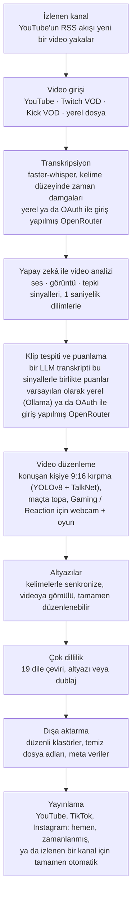

<div align="center">

[English](../../README.md) · [简体中文](README_zh.md) · [日本語](README_ja.md) · [한국어](README_ko.md) · **Türkçe** · [Русский](README_ru.md) · [Tiếng Việt](README_vi.md) · [ไทย](README_th.md) · [Deutsch](README_de.md) · [Español](README_es.md) · [Français](README_fr.md) · [Português (Brasil)](README_pt-BR.md) · [العربية](README_ar.md) · [Bahasa Indonesia](README_id.md) · [Italiano](README_it.md) · [हिन्दी](README_hi.md) · [বাংলা](README_bn.md) · [Filipino](README_tl.md) · [اردو](README_ur.md)

</div>

<a id="clips-kitty-the-free-open-source-opus-clip-alternative-for-chatting-gaming-and-sports-on-your-own-pc"></a>

# Clips Kitty: sohbet, oyun ve spor için kendi bilgisayarınızda çalışan ücretsiz, açık kaynaklı Opus Clip alternatifi

> Bu README, referans kabul edilen ve her zaman ilk güncellenen [İngilizce README](../../README.md)'den
> yapay zekâ ile çevrildi. Anadili Türkçe olanların düzeltmelerini memnuniyetle bekliyoruz.
>
> 🌐 [Web sitesinin Türkçe sayfası](https://colingpt9.github.io/clips-studio/tr.html)

<a href="https://apps.microsoft.com/detail/9NB6XT7DSQZZ">
  <picture>
    <source media="(prefers-color-scheme: dark)" srcset="https://get.microsoft.com/images/en-us%20dark.svg">
    
  </picture>
</a>

[](https://github.com/ColinGPT9/clips-studio/releases)
[](https://github.com/ColinGPT9/clips-studio/releases)
[](../../LICENSE)
[](https://github.com/ColinGPT9/clips-studio/stargazers)
[](https://github.com/ColinGPT9/clips-studio)
[](../../CONTRIBUTING.md)
[](../../docs/DOCKER.md)

<a href="https://youtu.be/g1dMqrq-YaI"></a>

<a id="star-and-share-clips-kitty--goal-150"></a>

### Clips Kitty'ye yıldız verin ve paylaşın ⭐ Hedef: 150

[](https://github.com/ColinGPT9/clips-studio/stargazers) **/ 150**

**Lütfen depoya yıldız verin ve paylaşın.** Size hiçbir maliyeti yok. Bu projenin
arkasında bir pazarlama bütçesi de yok; bir sonraki küçük YouTuber'ın ya da yayıncının
ücretsiz bir seçenek olduğunu öğrenmesinin tek yolu kulaktan kulağa yayılması.

**Bunu, diğer seçeneklere ya da bir editöre bütçesi yetmeyen küçük YouTuber'lar ve
yayıncılar için yaptım.** Kendi bilgisayarınızda **Google Gemma** çalıştıran ücretsiz bir
Opus Clip, Vizard ve Klap alternatifi: sunucu maliyeti yok, klip başına ücret yok, yapay
zekâ kullanım ücreti yok.

> **Clips Kitty, 1.1.3 sürümüne kadar Clips Studio adını taşıyordu**; Microsoft Store'un
> adlandırma kurallarına uymak için adı değişti. Aynı uygulama, aynı depo, aynı veriler.


**Uzun yayınları ve videoları, tamamen kendi bilgisayarınızda, paylaşıma hazır Shorts,
Reels ve TikTok videolarına dönüştürün.** Clips Kitty, içerik üreticileri için ücretsiz ve
açık kaynaklı bir yapay zekâ klip oluşturucu ve video düzenleyicidir: bir YouTube, Twitch
ya da Kick bağlantısı yapıştırın; en iyi anları bulur, konuşan kişiyi ortada tutarak 9:16
olarak kırpar, kelimelerle senkronize altyazıları videoya gömer ve başlıkları,
açıklamaları ve hashtag'leri yazar.

Varsayılan olarak bulut yapay zekâsı yok. Abonelik yok. Klip başına ücret yok. Kendi
YouTube kanalınıza bir klip yayınlamasını istemediğiniz sürece görüntüleriniz
bilgisayarınızdan hiç çıkmaz.

Önce yerel, gerektiğinde bulut: bilgisayarınız yapay zekâyı çalıştıramayacak kadar
eskiyse, işi bir bulut sağlayıcısı üstlenir ve ücreti kendi hesabınıza yansır.
**Önerilen bulut yolu OpenRouter'dır**: OpenRouter hesabınızla giriş yapın (OAuth,
kopyalanacak anahtar yok) ve birçok modeli kullanın (Claude, GPT, Gemini, Muse Spark ve
daha fazlası). Benim testlerimde 2 saatlik bir video OpenRouter'da yaklaşık 11 sente mal
oldu; klipleri Gemma (Gemma 4 26B-A4B) seçti, transkripsiyonu Whisper (large-v3-turbo)
yaptı. Ödeyeceğiniz tutar seçtiğiniz modellere ve videonun uzunluğuna bağlıdır.
OpenAI, Claude, Gemini, xAI, Meta, DeepSeek ve Qwen de kendi API anahtarınızla doğrudan
çalışır.
Bkz. [docs/AI-BACKENDS.md](../../docs/AI-BACKENDS.md).

**Neden var:** kanalını büyüten içerik üreticilerinin çoğu her şeyi kendi başına yapıyor:
çekim, yayın, kurgu, paylaşım. Klipler insanların sizi keşfetme yoludur ve genellikle ilk
bırakılan iş de bu olur: editör, çoğu kanalın henüz karşılayamayacağı bir masraftır; klip
araçları video başına ya da aylık ücret alır; elle kesmek ise başka işlere ayırmanız
gereken bir gününüzü alır. Bu uygulama zaten sahip olduğunuz donanımda çalışır; kullanmak
size hiçbir şeye mal olmaz ve kaç klip yapacağınıza dair bir sınır yoktur.


<sub>Tek bir videodan 19 dakikada 38 klip, tek bir bilgisayarda, hiçbir şey yüklenmeden.</sub>

---

<a id="contents"></a>

## İçindekiler

- [Ne yapar](#what-it-does)
- [Opus Clip, Klap, Vizard ve CapCut ile karşılaştırma](#how-it-compares-to-opus-clip-klap-vizard-and-capcut)
- [Nasıl çalışır](#how-it-works)
- [Özellikler](#features)
- [Ne için yapıldı](#what-its-built-for)
- [Gereksinimler](#requirements)
- [Kurulum ve çalıştırma](#install-and-run)
- [Yapay zekâ modelinizi seçin](#pick-your-ai-model)
- [Test edilen donanım ve performans](#tested-hardware-and-performance)
- [Desteklenen platformlar](#supported-platforms)
- [Desteklenen diller](#supported-languages)
- [YouTube'da yayınlama](#publish-to-youtube)
- [Tüm platformlarda aynı anda yayınlama](#publish-to-every-platform-at-once)
- [GPU hızlandırma](#gpu-acceleration)
- [Komut satırı kullanımı](#command-line-use)
- [Eklenti yazma](#write-a-plugin)
- [Üzerine inşa edin](#build-on-it)
- [Mimari](#architecture)
- [Katkıda bulunma](#contributing)
- [Yol haritası](#roadmap-detail)
- [Lisans](#license)

---

<a id="what-it-does"></a>

## Ne yapar

Clips Kitty'ye uzun bir video verirsiniz. O da size paylaşabileceğiniz, bitmiş dikey
kliplerle dolu bir klasör ve paylaşmadan önce bunları gözden geçirip düzeltebileceğiniz
bir stüdyo verir.

Çoğu klip aracının en kötü başa çıktığı içerikler için yapıldı: **canlı yayınlar, IRL ve
kameraya konuşma (talking-head) görüntüleri, podcast'ler ve spor salonu/fitness
içerikleri**; yani iyi anların derinlere gömüldüğü ve tek başına bir transkriptin
bulamayacağı uzun, gevşek yapılı videolar.

<a id="how-it-compares-to-opus-clip-klap-vizard-and-capcut"></a>

## Opus Clip, Klap, Vizard ve CapCut ile karşılaştırma

Clips Kitty, bulut tabanlı klip araçlarına açık kaynaklı bir alternatiftir. Asıl fark
işin nerede yapıldığıdır: videonuz hiçbir zaman yüklenmez, bu yüzden ölçülecek ya da
ücretlendirilecek bir şey yoktur.

| Araç | Fiyat, aylık faturalandırma | Ücretsiz plan | Klipleri sizin için bulur | Filigran | Videonuzu yükler | Açık kaynak |
| ---- | --------------------- | --------- | ----------------------- | --------- | ------------------ | ----------- |
| **Clips Kitty** | Ücretsiz, ücretli plan yok | Uygulamanın tamamı | Evet | Asla | Hayır, bilgisayarınızda çalışır | Evet, AGPL-3.0 |
| Opus Clip | Starter $15, Pro $29 | 1080p, filigranlı, 3 gün sonra sona erer | Evet | Ücretsiz planda | Evet | Hayır |
| Klap | Pro $29, yıllık faturalandırmada Basic $14 | Bir video | Evet | Belirtilmemiş | Evet | Hayır |
| Vizard | Creator $29, yıllık faturalandırmada $14.50 | Ayda 60 kredi, 720p | Evet | Ücretsiz planda | Evet | Hayır |
| quso.ai | $29 ile $49 arası | Ayda 75 kredi, 720p | Evet | Belirtilmemiş | Evet | Hayır |
| Ssemble | $15 ile $60 arası, yıllık faturalandırmada $6 ile $24 arası | Listelenmemiş | Evet | Belirtilmemiş | Evet | Hayır |
| Descript | $16, $24, $50 | Ayda 60 dakika, 720p | Kısmen, bir transkript düzenleyicisidir | Free ve Hobbyist planlarında | Evet | Hayır |
| CapCut | Kullanımı ücretsiz, ücretli planlar capcut.com'da | Düzenleyicinin tamamı | **Hayır, elle kesersiniz** | Özelliğe göre değişir | Masaüstü uygulamasında hayır | Hayır |

**Asıl iyi anlaşılması gereken CapCut**, çünkü herkesin verdiği ücretsiz cevap o.
İyi bir düzenleyici ve hiçbir ücreti yok; ama her anı bulmak ve her klibi kırpmak size
kalıyor. Clips Kitty de ücretsiz ve tam da o ilk aşamayı sizin yerinize yapıyor.

Grafik kartlı bir Windows bilgisayarınız yoksa, ara sıra klip yapıyorsanız ya da
telefondan çalışmanız gerekiyorsa **Opus Clip, Klap veya Vizard daha iyi bir seçimdir**.
Clips Kitty, zaten sahip olduğunuz donanımda yüksek hacimde klip üretmek için yapıldı.

**[Yedi aracın tam karşılaştırması ve her birinin en iyi olduğu alanlar](https://colingpt9.github.io/clips-studio/alternatives.html)**

<sub>Fiyatlar 17 Eylül 2026'da her şirketin kendi fiyatlandırma sayfasından kontrol edildi.
CapCut okuyabildiğimiz bir fiyatlandırma sayfası yayınlamadığı için onun fiyatı verilmedi.
Planlar değişir; bu tablo kendiliğinden güncellenmez.</sub>

<a id="how-it-works"></a>

## Nasıl çalışır



**Siz başka türlü seçmedikçe her aşama bilgisayarınızda çalışır:** istisnalar, yapay
zekâ ya da transkripsiyon için hesabınızla giriş yaptığınız OpenRouter ve yalnızca
gönderdiğiniz klipleri yükleyen yayınlama özelliğidir. Bunların dışında, normal bir
çalıştırmada ağa dokunan tek şey kaynak videonun indirilmesidir.

<a id="the-stages-in-detail"></a>

### Aşamaların ayrıntıları

**Transkripsiyon: faster-whisper.** Kelime düzeyinde zaman damgaları; mümkünse CUDA
üzerinde çalışır, değilse CPU'ya geçer. Altyazıların doğru heceye denk gelmesini ve
kliplerin gerçek bir cümle sınırında başlamasını sağlayan şey kelime zamanlamasıdır.

**Yapay zekâ ile klip puanlama.** Transkript, beş sinyalden yalnızca biridir. Ses; ses
yüksekliğindeki ani sıçramaları, patlama yoğunluğunu (kahkaha ve alkış böyle görünür) ve
sessizlik→patlama biçimindeki doruk anlarını verir. Görüntü; sahne geçişlerini, hareketi
ve yüz alanındaki değişimleri verir. Bir tepki sinyali bunları birleştirir. Her biri *o
videonun kendi içinde* normalize edilir; böylece hem sakin bir podcast hem de çığlık
çığlığa bir yayın anlamlı doruklar üretir. Gerçek izleyici verisi varsa (benzersiz sohbet
katılımcısı sayısıyla ölçülen Twitch sohbet tekrarı, YouTube'un en çok tekrar oynatılan
bölümler ısı haritası), küçük ve üst sınırı olan bir bonus ekler.

Yerel LLM transkripti **ve bu olayların bir zaman çizelgesini** görür; böylece "sözler
sakin ama ortam yıkıldı" durumunu doğru tartabilir. Küçük modeller her şeyi dar bir
aralıkta puanladığı için, finalistler daha sonra tek bir yeniden sıralama çağrısında
birbirleriyle doğrudan karşılaştırılır: göreli değerlendirme, 7B bir model için mutlak
puanlamadan çok daha kolaydır.

**İçerik üreticisi profilleri.** Uygulama, her içerik üreticisi için videoları boyunca bir
bilgi tabanı oluşturur: tekrar eden konular, seriler, birlikte çalıştığı kişiler,
süregelen şakalar ve devam eden hikâyeler. Bu bağlam, doğru başlıklar yazmaya ve önceki
anlara yapılan göndermeleri yakalamaya yardımcı olur. Bilerek temkinli tasarlandı: sık
kullanılan bir sözün sayılması için gerçekten tekrar etmesi gerekir, artık anılmayan
bilgiler uykuya geçer ve buradan gelen her puan katkısı eklemelidir, bir üst sınırı vardır
ve kapatılabilir.

**Video düzenleyici.** Tahribatsız düzenleme: kırpmalar, ara kesimler, sessize almalar,
sessize alınan kelimeler, ses seviyesi, geçişler (fade), hız, kanca metni, müzik ve
filigran işlem olarak saklanır ve render sırasında uygulanır. Bir de yapay zekâ ile
düzenleme sohbeti var (*"5 saniye daha uzun yap"*, *"altyazıda gost yazıyor, ghost
olmalı"*); model önerir, doğrulanmış kod uygular.

**Uzun format işleme.** Aynı analizi kullanan, isteğe bağlı bir 16:9 yolu: yatay klipler,
X/Twitter uzunluğunda kesitler, en iyi anlardan oluşan bir derleme ya da ölü anları
çıkarılmış yayının tamamı.

**Çok dilli işlem hattı ve yapay zekâ dublajı.** Altyazılar çevrilir ve herhangi bir şey
yazılmadan ya da videoya gömülmeden *önce* incelemeniz için gösterilir; böylece hatalı bir
satır, hâlâ düzeltilebilirken düzeltilir. Bir sözlük; kanal adlarını, sponsorları ve iç
şakaları çevrilmekten korur. Dublaj, önceden dinleyebileceğiniz seslerle yerel TTS
kullanır.

**Yerel GPU hızlandırma.** Tespit ve transkripsiyon için CUDA, NVENC/AMF/QSV ile
donanımsal video kodlama (otomatik algılanır, CPU yedeğiyle) ve Ollama üzerinden GPU'da
çalışan LLM.

<a id="features"></a>

## Özellikler

- **Çok kipli klip tespiti**: anlar; söylenenler, sesteki heyecan, görsel hareketlilik,
  ekrandaki tepkiler ve kanca/doruk gücü birleştirilerek 0–100 arasında puanlanır. Kalite
  çıtasını geçen her klip tutulur; keyfi bir üst sınır yoktur.
- **Konuşmacıyı tanıyan yüz takibi**: YOLOv8 poz tespiti kişiyi ortada tutar ve grup
  görüntülerinde kamera **gerçekte kim konuşuyorsa** onu izler; buna hareket değil, yüz
  ile sesi birlikte değerlendiren TalkNet aktif konuşmacı tespiti karar verir. Konuşmacı
  değiştiğinde çerçeve, kaydırarak geçmek yerine bir editörün yapacağı gibi o kişiye
  **keser**. Yalnızca kırpma ile çerçeveleme: asla esnetilmez, asla bozulmaz.
- **Podcast modu**: çok kameralı görüntülerde her çekim, tek bir kişi üzerinde kendi sabit
  kırpmasını alır; böylece kesmeler kaydırma olmadan doğrudan bir yüze denk gelir. Bir
  çekim içinde kişi ağız hareketine göre seçilir; olmazsa en belirgin yüz seçilir.
- **Vertical Live** (dikey canlı yayın): yayınlandığı sırada zaten dikey olan canlı
  yayınlar için (YouTube dikey canlı yayını, Twitch Dual Format, Streamlabs Dual Output,
  indirilmiş bir Instagram ya da TikTok canlı yayını). Yayının kendi 9:16 düzenini korur,
  yüz takibini atlar ve anları yine her zamanki gibi seçer. Bkz.
  [docs/VERTICAL-LIVE.md](../../docs/VERTICAL-LIVE.md).
- **Sports** (spor: futbol ve basketbol): bir maçın her büyük anı, hazırlığı ve tepkisiyle
  birlikte kendi klibi olarak.
  - **Futbol**: goller, kurtarışlar, kartlar ve büyük fırsatlar. Goller skor kutusundan
    okunur, zamanları seyircinin tepkisinden belirlenir ve 9:16 kırpma topu izler. All
    goals, Best saves, Cards ve diğerlerini seçin; anları bir maç özetinde ve takım ya da
    oyuncu derlemelerinde birleştirin.
  - **Basketbol**: smaçlar, üçlükler, bloklar, top çalmalar ve galibiyet basketleri.
    Skor kutusu her basketi ve kaç sayı olduğunu doğrular; çeyrek ve süre sayesinde bir
    galibiyet basketi, ilk çeyrekteki bir basketten çok daha fazla değer taşır.
    Seyircinin, yedek kulübesinin ve saha kenarının tepkileri de bulunur. Her klibin 9:16
    kırpması kendi oyununa göre planlanır: top ve topu tutan oyuncu, pası alan oyuncu ve
    çember ile panya kadrajda kalacak şekilde potaya kadar izlenen şut. Kırpma oyunla
    birlikte kayar ve asla yakınlaştırmaz. Top, [E-BARD](https://github.com/GabrieleGiudic/E-BARD#readme) algılama modeliyle bulunur
    ([Lisans](#license) bölümünde atfı yapılmıştır).

  Bkz. [docs/SPORTS.md](../../docs/SPORTS.md).
- **Düzenlenebilir gömülü altyazılar**: kelimelerle senkronize ve istediğiniz gibi
  biçimlendirilir (renk, boyut, konum, satır başına kelime, büyük/küçük harf ya da
  kapalı). Dışa aktarmadan önce transkripsiyon hatalarını satır satır düzeltin. İki kişi
  konuşurken ikinci konuşmacının altyazıları başka bir renk alabilir; yanlış atananlar elle
  değiştirilebilir.
- **Yapay zekâ ile düzenleme sohbeti**: neyin yanlış olduğunu günlük dille anlatın, o
  yeniden düzenlesin.
- **Ask Clips Kitty**: kontrol panelinin altındaki metin kutusu. Ne istediğinizi tek
  cümleyle söyleyin, örneğin *"bu yayından klip çıkar, boss'a öldüğüm anı mutlaka ekle,
  altyazılar büyük ve sarı olsun"*; videoyu sıraya alır, klip seçiciye neye bakması
  gerektiğini söyler ve belirttiğiniz seçenekleri ayarlar. **Bir Gemma 4 modeli
  gerekir**: bkz.
  [Alttaki metin kutusu Gemma 4 gerektirir](#the-text-box-at-the-bottom-needs-gemma-4).
- **Yapay zekâ ile başlıklar, açıklamalar ve hashtag'ler**; hepsi dışa aktarmadan önce
  düzenlenebilir.
- **İçerik üreticisi profilleri**: uygulama zamanla her içerik üreticisini tanır ve
  klipleri daha iyi seçip daha iyi başlıklandırır. Her şey bilgisayarınızda kalır;
  inceleyebilir, düzeltebilir ya da silebilirsiniz.
- **Çok dilli yayınlama**: 19 dil; videoya gömülmeden önce inceleme imkânıyla.
- **Yapay zekâ dublajı**: her dil için sesleri önceden dinleyebileceğiniz yerel metin okuma.
- **Uzun format dışa aktarma**: 16:9 klipler, derlemeler ya da tekrarları ayıklanmış bir
  yayın kurgusu. Bir derlemenin açıklaması **bölüm zaman damgaları** içerir; böylece
  izleyiciler YouTube'da anlar arasında atlayabilir.
- **Filigran ve marka profilleri**: içerik üreticisine özel varsayılanlar otomatik
  uygulanır.
- **Model yöneticisi**: yapay zekâ beynini uygulamanın içinden değiştirin; modelleri
  terminale gerek kalmadan, ilerleme çubuklarıyla indirin, kaldırın ve aralarında geçiş
  yapın.
- **Düzenleyiciden YouTube'a yayınlama**: başlık, açıklama, etiketler, küçük resim,
  oynatma listesi, kitle ve görünürlük; ardından hemen yükleyin ya da zamanlayın. İsteğe
  bağlıdır, varsayılan olarak kapalıdır ve kendi Google API anahtarınızı kullanır.
- **Uygulama içi geri bildirim**: tanılama bilgilerini otomatik toplayan hata bildirimleri,
  hesap gerekmez.
- **Erişilebilir arayüz**: klavye odağı, azaltılmış hareket desteği, ayarlanabilir yazı
  tipi ve boyutu.

<a id="what-its-built-for"></a>

## Ne için yapıldı

Verdiğiniz her videoda her şey çalışır. Aşağıdakiler, özellik listesinin
düşündürdüğünden daha çok ya da daha az akıl yürüttüğü durumlar; hiçbir şey sürpriz
olmasın diye:

| İçerik | Nasıl sonuç verir |
|---|---|
| **IRL, just chatting, podcast'ler, vlog'lar, röportajlar** | Asıl ayarlandığı içerik budur; sürümden önce gerçek yayınlarda test edilen de budur |
| **Oyun ve tepki videoları** | **Gaming / Reaction** açıkken: bir yarıda webcam, diğer yarıda oyun ya da tepki verilen video; işlemeden önce videonun kendi kareleri üzerinde kontrol edilir ([docs/GAMING.md](../../docs/GAMING.md)). Yayıncı en büyük yüz değil, konuşan kişidir. Bu anahtar kapalıyken çerçeveleme oyunun içindeki bir karakteri izleyebilir. Yalnızca kamerada görünen gerçek kişiler; VTuber desteklenmez |
| **Spor maçları** | **Sports** açıkken: skor kutusu ve spiker anlatımı olan, gollerin ve basketlerin kesin olduğu yayınlar için yapıldı. Kulüp ya da telefon görüntülerinde genellikle ikisi de yoktur: bu görüntülerin klipleri topu izler, golleri ise yapıştırdığınız maç olaylarından gelir; örneğin bir kulüp uygulamasının gol etiketleri ([docs/SPORTS.md](../../docs/SPORTS.md)) |
| **Tepki videosunun neye tepki verdiği** | Klipler yine *söylenenlere* göre seçilir; bu yüzden izlenen videoda kimsenin yorum yapmadığı bir an uygulama için görünmezdir |

Klip seçimi transkripte ve sinyallere dayanır. Komik olan şey *yalnızca görselse* ve kimse
bu konuda yorum yapmıyorsa, onu düzenleyicide kendiniz bulmanız gerekebilir.

<a id="requirements"></a>

## Gereksinimler

|             | Minimum                                      | Önerilen                     |
| ----------- | -------------------------------------------- | ------------------------------- |
| **GPU**     | NVIDIA RTX 2060 (6 GB)                       | RTX 3060 12 GB veya daha iyisi        |
| **CPU**     | Intel Core i3-9100 / AMD Ryzen 3 3200G (2019)| 6 çekirdek veya daha fazlası                 |
| **RAM**     | 16 GB                                        | 16 GB veya daha fazlası                   |
| **Disk**    | ~20 GB, artı klip çıkaracağınız videolar için yer    |                                 |
| **İşletim sistemi**      | Windows 10 veya 11                             |                                 |

**Minimumun altında yine de çalışabilir, ancak desteklenmez ve yavaş olur.** Bir yayından
klip çıkarmak, saatlerce video çözme, transkripsiyon ve kodlama demektir; kabaca 2019
öncesi donanımda bu o kadar uzun sürer ki uygulama düzgün çalışırken bile bozukmuş gibi
hissettirir.

Bunlardan ikisini biraz açmakta fayda var:

- **16 GB RAM bir öneri değil.** 8 GB ile tüm videoyu analiz eder ve sonra hiçbir şey
  render etmez; bu da bir bellek sınırı gibi değil, bir çökme gibi görünür.
- **GPU isteğe bağlıdır, zorunlu değildir.** GPU yoksa her şey CPU'da çalışır; daha yavaş
  ama eksiksiz. GPU yolunun çalışmaya başladığı çizgi RTX 2060'tır; bkz.
  [GPU hızlandırma](#gpu-acceleration).

Uygulama **yalnızca Windows** içindir. Python motorunun Linux/macOS'ta çalışması gerekir,
ancak bir Mac sürümü yok ve geliştiricinin test edebileceği bir Mac'i de yok. Mac'iniz
varsa ve yardım etmek istiyorsanız
[#62](https://github.com/ColinGPT9/clips-studio/issues/62) numaralı konuya bakın.

Kaynaktan çalıştırmak için, kurulum programının normalde sizin için paketlediği şeyler
gerekir:

- **Python 3.10+** ve **Node.js 18+**
- PATH'inizde **[FFmpeg](https://ffmpeg.org/download.html)**
- Bir model indirilmiş **[Ollama](https://ollama.com)**: `ollama pull gemma:7b`

<a id="install-and-run"></a>

## Kurulum ve çalıştırma

**En kolay yol [Microsoft Store](https://apps.microsoft.com/detail/9NB6XT7DSQZZ)'dur.**
Tek tıkla kurulur, kendini günceller ve Windows hiçbir güvenlik uyarısı göstermez.
Paketi Microsoft onayladı ve imzaladı; bu yüzden aşağıda anlatılan SmartScreen uyarısı
hiç görünmez. Store yeni sürümleri sırası geldiğinde yükler; hemen almak için Microsoft
Store'da Clips Kitty'nin sayfasını açıp **Update** (Güncelleştir) düğmesine basın.

**Ya da kurulum programını indirin.** [Releases](https://github.com/ColinGPT9/clips-studio/releases)
sayfasından en son **Web Setup**'ı indirip çalıştırın. İçinde uygulama, Python motoru, tüm
kütüphaneler, FFmpeg, yapay zekâ çalışma ortamı ve tüm tespit ve transkripsiyon
ağırlıkları var: Python yok, PATH yok, terminal yok, kurulacak ikinci bir program yok.

**Ya da winget kullanın.** `winget install ColinGPT9.ClipsKitty`, aynı Web Setup'ı bir
terminalden kurar.

İçinde olmayan tek şey dil modelinin kendisidir; çünkü modeller, indiren kişinin kendisinin
kabul etmesi gereken lisanslarla dağıtılır, sizin adınıza kabul edilebilecek bir şey
değildir. Kurulum sihirbazı bu indirmeyi kendiliğinden başlatır, grafik kartınıza uygun
boyutu seçer ve bir ilerleme çubuğu gösterir. Yani: tek indirme, tek çift tıklama, tek
ilerleme çubuğu. Sonrasında çevrimdışı çalışır.

> Windows, uygulamayı ilk çalıştırdığınızda imzasız olduğu konusunda uyarır.
> *Ek bilgi → Yine de çalıştır* (*More info → Run anyway*) seçeneğine tıklayın. İmzalama
> sertifikası yapılacaklar listesinde.

<a id="from-source"></a>

### Kaynaktan

```bash
git clone https://github.com/ColinGPT9/clips-studio
cd clips-studio
pip install -r requirements.txt

cd ui
npm install
npm run dev        # opens the Clips Kitty desktop app
```

Uygulama kendi Python motorunu otomatik olarak başlatır. **Clip Editor** (Klip
Düzenleyici) ekranına bir bağlantı yapıştırın, *Generate clips* (Klip oluştur) düğmesine
basın ve ilerlemeyi canlı izleyin.

Kurulum programını kendiniz derlemek tek bir komut. Bkz.
[CONTRIBUTING.md](../../CONTRIBUTING.md#building-the-windows-installer).

<a id="with-docker-nothing-else-to-install"></a>

### Docker ile: başka hiçbir şey kurmadan

Katkıda bulunanlar için. Yalnızca [Docker Desktop](https://docs.docker.com/get-started/get-docker/)
gerekir, başka hiçbir şey: Python yok, Node yok, FFmpeg yok, PyTorch yok.

```bash
git clone https://github.com/ColinGPT9/clips-studio
cd clips-studio
docker compose up
```

Üç servis birlikte ayağa kalkar:

| | |
|---|---|
| **<http://localhost:5173>** | tarayıcınızda arayüz |
| **<http://localhost:8765>** | motor ve API'si |
| Ollama | yerel yapay zekâ, :11434 üzerinde |

Ardından bir model indirin (`docker compose exec ollama ollama pull gemma3:4b`); artık
çalışan bir geliştirme ortamınız var.

Kontrolleri de aynı şekilde çalıştırın:

```bash
docker compose run --rm engine pytest
docker compose run --rm ui npm run typecheck
```

> **On dakikalık ilk derlemeyi atlayın:** `docker compose pull`, PyTorch ve OpenCV'yi
> yerelde derlemek yerine önceden derlenmiş bir motor imajı indirir.

Masaüstü kabuğunun kendisi yine ana makinenizde çalışır, çünkü Electron bir ekran ister;
geri kalan her şey konteynerde çalışır. Ayrıntılar ve bu yöntemin size söyleyemeyecekleri
[docs/DOCKER.md](../../docs/DOCKER.md) içinde.

<a id="pick-your-ai-model"></a>

## Yapay zekâ modelinizi seçin

Neyin kurulu olduğunu ve GPU'nuzun neyi kaldırabileceğini görmek için **Models**
(Modeller) sayfasını açın:

Tek bir ölçüt var: ne kadar VRAM'iniz olduğu. Bunlar uygulamanın gösterdiği satırların
aynısı ve [`llm/manager.py`](../../llm/manager.py) içindeki `RECOMMENDATIONS` tablosundan
geliyor. Sihirbaz ve Models sayfası bu tek tabloyu okur; bu yüzden ne birbirleriyle ne de
bu belgeyle çelişebilirler.

| Donanımınız | Önerilen model | |
|---|---|---|
| CPU / iGPU, grafik kartı yok | `gemma3:4b` | test edildi |
| 6 GB altı VRAM ya da eski bir bilgisayar | `gemma4:e2b` | |
| 6 GB VRAM | `gemma4:e4b` | |
| 8 GB VRAM | **`gemma:7b`** | test edildi · varsayılan olarak gelir |
| 10–12 GB VRAM | `gemma3:12b` | test edildi |
| 16–24 GB VRAM | `gemma3:27b` | |

VRAM dışında bir nedenle seçmeye değer modeller de şunlar:

| Neden | Model |
|---|---|
| Çeviri / çok dillilik | `qwen3:8b` veya `qwen3:14b` |
| Serbest lisans | `mistral-nemo:12b` (Apache-2.0) · `phi4:14b` (MIT) |

**Yalnızca "test edildi" olarak işaretlenen üç model gerçek yayınlarda denendi** ve en
çok saat biriktiren `gemma:7b`; `config/settings.yaml` da onunla gelir. Diğerleri, makul
boyutta oldukları ve ticari kullanımları ücretsiz olduğu için listede; klip kalitesi
onlarla ölçüldüğü için değil. Uygulama Ollama üzerinden her modelle aynı şekilde konuştuğu
için hepsi çalışır, ama daha iyi anlar seçip seçmediklerini kimse kontrol etmedi. Bu açığı
kapatmak [#38](https://github.com/ColinGPT9/clips-studio/issues/38) numaralı konunun işi.

Ollama'nın sunduğu her model çalışır ve geçiş yapmak tek tık. Çeviri, klip çıkarmadan
*farklı* bir model kullanabilir. `llm.translation_model` ayarını yapın.

<a id="the-text-box-at-the-bottom-needs-gemma-4"></a>

### Alttaki metin kutusu Gemma 4 gerektirir

Kontrol panelinin altındaki metin kutusu **Ask Clips Kitty**, yalnızca uygulamanın
araçlarını kullanabilen bir modelle çalışır. Gemma 4 bunu yapabilir. `gemma:7b` ve Gemma 3
modelleri yapamaz; kurulum da grafik kartı olmayan ya da 8 GB veya daha fazla VRAM'i olan
bir bilgisayara bunlardan birini kurar. Böyle bir bilgisayarda bir Gemma 4 modeli
ekleyene kadar kutu çalışmaz: 2.0 sürümü *"No installed model can use tools"* (Araç
kullanabilen kurulu model yok) der, sonraki sürümler ise indirmeyi kutunun içinde önerir.

Klipleriniz hangi modelle seçilirse seçilsin, **Models** sayfasında yanına bir Gemma 4
modeli kurun: 6 GB veya daha fazla belleği olan bir grafik kartında `gemma4:e4b`, daha
azında `gemma4:e2b`. O modele geçmeniz gerekmez. Kutu onu kendisi bulur ve klipleriniz
yine seçtiğiniz model tarafından seçilir. Yapay zekâyı OpenRouter üzerinden
çalıştırıyorsanız kutu o modeli kullanır ve hiçbir şey kurmanız gerekmez.

<a id="tested-hardware-and-performance"></a>

## Test edilen donanım ve performans

Clips Kitty her gün bu makinede geliştirilip test ediliyor; kendi sonuçlarınızı
karşılaştırıyorsanız işe yarar bir referans noktası:

| | |
|---|---|
| **GPU** | NVIDIA GeForce RTX 3060, 12 GB VRAM |
| **CPU** | AMD Ryzen 5 5600X (6 çekirdek / 12 iş parçacığı) |
| **RAM** | 16 GB |
| **İşletim sistemi** | Windows 10 |
| **Klip modeli** | Ollama üzerinden `gemma:7b` |
| **Transkripsiyon** | CUDA üzerinde faster-whisper `large-v3-turbo` |

Bu depodaki her şey (varsayılan ayarlar, `parallel_renders: 3`, 5 dakikalık analiz parçası
boyutu) kabaca bu sınıftaki bir makineye göre ayarlandı. Daha güçlü bir GPU'da
`llm.num_ctx` ve `analysis.chunk_seconds` değerlerini birlikte artırın ve bir model boyutu
yukarı çıkın; daha zayıf bir GPU'da `gemma3:4b` modeline inin.

Clips Kitty'yi farklı bir donanımda test ederseniz lütfen sonuçları
[Discussions](https://github.com/ColinGPT9/clips-studio/discussions) bölümünde paylaşın.
Gerçek makinelerden gelen gerçek sayılar herkesin kendi kurulumunu boyutlandırmasına
yardımcı olur.

<a id="supported-platforms"></a>

## Desteklenen platformlar

| Kaynak | Destek |
|---|---|
| YouTube videoları | Tam. H.264 bilerek seçilir (AV1 işleme süresini kabaca iki katına çıkarır) |
| Twitch VOD'ları | Tam; izleyici sinyali olarak sohbet tekrarı da dahil |
| Kick VOD'ları | Tam (Kick, yayın bittikten sonra sohbeti siler; bu yüzden sohbet sinyali yoktur) |
| Yerel video dosyaları | Tam. Kendi görüntülerinizden yayınlamadan önce klip çıkarın |
| Canlı yayınlar | Bilinçli olarak desteklenmez. Yalnızca VOD'lar |

<a id="supported-languages"></a>

## Desteklenen diller

Klipler **19 dile** çevrilebilir, altyazılanabilir ve dublajlanabilir; **arayüzün kendisi
de 19 dilin hepsine çevrildi**, yani uygulamayı yayın yaptığı dillerin aynısında
kullanabilirsiniz:

İngilizce · İspanyolca · Portekizce (Brezilya) · Fransızca · Almanca · Hintçe · Endonezce ·
Japonca · Rusça · Arapça · Çince (Basitleştirilmiş) · Vietnamca · Filipince · Türkçe ·
Urduca · Bengalce · Tayca · Korece · İtalyanca

Dil eklemek, `multilingual/languages.py` içinde bir satır ve
`ui/src/renderer/src/locales/` içinde bir yerel ayar dosyası demektir. Çevirmen ve altyazı
yazıcı dilden bağımsızdır.

<a id="help-wanted-the-maintainer-only-speaks-english"></a>

### Yardım aranıyor: geliştirici yalnızca İngilizce biliyor

Bu 19 arayüz çevirisinin 18'i, o dili konuşan biri tarafından hiç okunmadı. Yarısı henüz
bitmedi. Her dilin İngilizce ve o dilde yazılmış kendi konusu (issue) var ve **kötü bir
kelimeyi bildirmek başlı başına eksiksiz bir katkıdır**: pull request gerekmez.
[Nasıl işler](../../docs/TRANSLATING.md).

**Bitirilmesi gerekiyor** (yaklaşık 68 metin hâlâ İngilizce):
[বাংলা (Bengalce)](https://github.com/ColinGPT9/clips-studio/issues/43) ·
[Italiano (İtalyanca)](https://github.com/ColinGPT9/clips-studio/issues/44) ·
[한국어 (Korece)](https://github.com/ColinGPT9/clips-studio/issues/45) ·
[ไทย (Tayca)](https://github.com/ColinGPT9/clips-studio/issues/46) ·
[Tagalog (Filipince)](https://github.com/ColinGPT9/clips-studio/issues/47) ·
[Türkçe](https://github.com/ColinGPT9/clips-studio/issues/48) ·
[اردو (Urduca)](https://github.com/ColinGPT9/clips-studio/issues/49) ·
[Tiếng Việt (Vietnamca)](https://github.com/ColinGPT9/clips-studio/issues/50) ·
[中文 (Çince)](https://github.com/ColinGPT9/clips-studio/issues/51)

**Kontrol edilmesi gerekiyor** (tamamlandı, ama doğal okunup okunmadığını kimse doğrulamadı):
[العربية (Arapça)](https://github.com/ColinGPT9/clips-studio/issues/52) ·
[Deutsch (Almanca)](https://github.com/ColinGPT9/clips-studio/issues/53) ·
[Español (İspanyolca)](https://github.com/ColinGPT9/clips-studio/issues/54) ·
[Français (Fransızca)](https://github.com/ColinGPT9/clips-studio/issues/55) ·
[हिन्दी (Hintçe)](https://github.com/ColinGPT9/clips-studio/issues/56) ·
[Bahasa Indonesia (Endonezce)](https://github.com/ColinGPT9/clips-studio/issues/57) ·
[日本語 (Japonca)](https://github.com/ColinGPT9/clips-studio/issues/58) ·
[Português (Portekizce)](https://github.com/ColinGPT9/clips-studio/issues/59) ·
[Русский (Rusça)](https://github.com/ColinGPT9/clips-studio/issues/60)

Burada olmayan bir dil mi istiyorsunuz? [#61](https://github.com/ColinGPT9/clips-studio/issues/61).

<a id="publish-to-youtube"></a>

## YouTube'da yayınlama

Varsayılan olarak kapalıdır. **Settings → Publish to YouTube** (Ayarlar → YouTube'da
yayınla) bölümünden açtığınızda düzenleyicide bir **YouTube** sekmesi belirir: başlığı,
açıklamayı, etiketleri, küçük resmi, oynatma listesini, kitleyi ve görünürlüğü doldurun,
ardından **Upload now** (Şimdi yükle) düğmesine basın. Kaydedilmemiş düzenlemeleriniz
varsa Clips Kitty klibi render eder ve doğrudan kanalınıza yükler. Dışa aktarma adımı yok,
ayrı bir yayınlama sayfası yok. Düzenleyiciden hiç çıkmazsınız.

Kapalı bırakırsanız uygulamanın hiçbir yerinde hiçbir şey değişmez.

<a id="scheduling"></a>

### Zamanlama

**Schedule on YouTube** (YouTube'da zamanla) seçeneği videoyu *hemen* yükler, özel olarak
işaretler ve YouTube'a bir yayın zamanı iletir. YouTube videoyu o gün yayınlar.

**Clips Kitty'yi kapatabilir, bilgisayarınızı da kapatabilirsiniz.** Bu uygulamada
zamanlayıcı yok, arka plan servisi yok, açık bırakılması gereken hiçbir şey yok. YouTube
videoyu kabul ettiği anda Clips Kitty'nin işi biter.

<a id="you-need-your-own-google-api-key"></a>

### Kendi Google API anahtarınız gerekir

Clips Kitty ortak bir anahtarla gelmez ve bunun nedeni yalnızca temkin değil. Google'ın
yükleme kotası **Cloud projesi başınadır**: tek bir ortak anahtar, dünyadaki her
kullanıcının aynı günlük 100 yüklemeyi paylaşması anlamına gelirdi. Kendi projeniz size
kendi kotanızı verir ve kimlik bilgileriniz makinenizden hiç çıkmaz. Arada bir Clips Kitty
sunucusu yoktur.

Kurulum ücretsizdir ve yaklaşık on dakika sürer; Settings'teki sihirbaz adım adım yol
gösterir:

1. [Google Cloud Console](https://console.cloud.google.com/projectcreate)'da bir proje oluşturun.
2. APIs & Services → Library altında **YouTube Data API v3**'ü etkinleştirin.
3. OAuth izin ekranını doldurun, ardından **Publish app** (Uygulamayı yayınla) düğmesine
   basın. Bu adım önemli: *Testing* (Test) durumunda bırakılırsa Google oturumunuzu her 7
   günde bir sonlandırır ve her hafta yeniden bağlanmanız gerekir. "In production"
   (Üretimde) doğrulanmış demek değildir ve hiçbir ücreti yoktur.
4. Credentials → Create credentials → OAuth client ID → tür olarak **Desktop app**.
5. İstemci kimliğini (client ID) ve gizli anahtarı (secret) Settings'e yapıştırın, ardından
   kanalınızı bağlayın.

Bağlanırken "Google bu uygulamayı doğrulamadı" uyarısı görürsünüz. Bu, kendi uygulamanızın
sizi kendinize karşı uyarmasıdır. **Advanced → Go to (unsafe)** (Gelişmiş → ... sitesine
git (güvenli değil)) ile bu adımı geçebilirsiniz.

<a id="posting-publicly"></a>

### Herkese açık yayınlama

Buna güvenmeden önce bilmeniz gereken bir şey var, çünkü hiçbir yazılım bunu aşamaz:

> **Google Cloud projeniz YouTube'un ücretsiz API denetimini geçene kadar, YouTube o proje
> üzerinden yüklenen her videoyu özel olarak kilitler.** Kilit kalıcıdır. Videoyu sonradan
> Studio'da herkese açık yapamazsınız ve itiraz yolu da yoktur. Tek çözüm, denetimden
> geçmiş bir projeden yeniden yüklemektir.

Clips Kitty her yüklemeden sonra kontrol eder ve kimsenin izleyemeyeceği bir video için
başarı bildirmek yerine bu olduysa size açıkça söyler. Herkese açık yayınlamayı
düşünüyorsanız önce
[YouTube API Hizmetleri denetim formunu](https://support.google.com/youtube/contact/yt_api_form)
gönderin. **Liste dışı** ya da **özel** olarak yükleme bundan etkilenmez.

<a id="what-it-can-and-cannot-set"></a>

### Neleri ayarlayabilir, neleri ayarlayamaz

Herkese açık API'nin sunduğu her şeyi: başlık, açıklama (içindeki zaman damgaları
bölümlere dönüşür), etiketler, kategori, dil, görünürlük, zamanlanmış yayın saati,
çocuklara özel olma durumu, değiştirilmiş/sentetik içerik beyanı, lisans, yerleştirme,
herkese açık istatistikler, özel küçük resim ve oynatma listesine ekleme.

Bazı YouTube Studio özellikleri herkese açık API'de hiç yer almıyor; bu yüzden sessizce
hiçbir şey yapmayan bir kontrol koymak yerine bilerek hiç kontrol koymadık: para kazanma
ve reklam araları, ücretli tanıtım beyanı, bitiş ekranları ve kartlar, yorum ayarları, yaş
sınırlaması, Galalar (Premieres) ve Shorts remiks izinleri. Panel, bunlar için sizi
Studio'ya yönlendirir.

Shorts için özel hiçbir şey gerekmez: ayrı bir mod da `#Shorts` etiketi de yok. YouTube
bir videoyu şekline ve uzunluğuna bakarak kendisi Short olarak sınıflandırır.

<a id="publish-to-every-platform-at-once"></a>

## Tüm platformlarda aynı anda yayınlama

Bu da varsayılan olarak kapalıdır. **Settings → Publish through WoopSocial** (Ayarlar →
WoopSocial üzerinden yayınla) bölümünden açtığınızda düzenleyicide bir **Publish**
(Yayınla) sekmesi belirir: platformlarınızı seçin — ya da **Everywhere** (Her yerde)
düğmesine basın — başlığı ve açıklamayı bir kez yazın; tek bir yükleme YouTube, TikTok,
Instagram, Facebook, X, Threads, LinkedIn, Pinterest ve Bluesky'a birlikte gider. Clip
Editor'deki **Publish all** (Tümünü yayınla), bir düzine klip aynı saniyede düşmesin diye
aralıklarla bütün bir grubu yayınlar.

Bu özellik **yerel değildir**. Klip ve ayrıntıları bir yayınlama hizmetine gönderilir; bu
hizmet onları teslim eder ve sosyal hesaplarınızla bağlantıları elinde tutar, bu yüzden
Clips Kitty sizden hiçbir zaman bir sosyal medya şifresi istemez. Uygulamadaki diğer her
şey yine bilgisayarınızda çalışır.

İki hizmet desteklenir: ücretsiz planı iki hesap bağlamaya ve günde yaklaşık 5 YouTube
gönderisine izin veren, ücretli planlarında ikisini de artıran
**[WoopSocial](https://woopsocial.com/?via=clipskitty)** ve daha fazla hedefe ulaşan,
küçük resimler, ilk yorumlar ve bir gönderi kuyruğu ekleyen
**[Upload-Post](https://www.upload-post.com/)**. İkisinden birini ya da ikisini birden
açabilirsiniz.

<sub>Satış ortaklığı bağlantısı - Bu bağlantı üzerinden kaydolursanız Clips Kitty
komisyon kazanabilir; bunun size ek bir maliyeti olmaz.</sub>

**Kendi anahtarınızı getirin.** Hesabı siz oluşturur, kendi sosyal hesaplarınızı bağlar ve
kendi kotanızı kullanırsınız. Clips Kitty hiçbir ücret almaz, ortak bir anahtar tutmaz ve
hiçbir şeyin parasını ödemez — YouTube entegrasyonuyla aynı düzen, aynı nedenle.

Tam rehber, platform bazında destek ve sınırlar:
**[docs/UPLOAD-POST.md](../../docs/UPLOAD-POST.md)**.

<a id="gpu-acceleration"></a>

## GPU hızlandırma

**Video kodlama** üç üreticinin hepsinde otomatik olarak donanımla hızlandırılır: NVIDIA
(NVENC), AMD (AMF) ve Intel (QSV). Motor açılışta her biriyle bir kareyi deneme amaçlı
kodlar ve gerçekten çalışan ilkini kullanır; hiçbiri çalışmazsa CPU'ya geçer. Seçimi
`config/settings.yaml` içindeki `video.encoder` ile zorlayabilirsiniz.

**Tespit ve transkripsiyon** CUDA ile en hızlı çalışır. Varsayılan `pip install torch`
size **yalnızca CPU** sürümünü verir. NVIDIA için:

```bash
pip uninstall torch torchvision -y
pip install torch torchvision --index-url https://download.pytorch.org/whl/cu130
```

**Hangi kartlar GPU'yu kullanır:** GTX 16 serisi, RTX 20 serisi ve RTX 50 serisi dahil
daha yeni olan her şey.

**GPU'da transkripsiyon** için NVIDIA'nın cuBLAS 12'si de gerekir: Whisper'ın motoru
(CTranslate2) bir CUDA 12 derlemesidir, yukarıdaki CUDA 13 PyTorch'ta ise yalnızca cuBLAS
13 vardır. `pip install -r requirements.txt` bunu kurar (`nvidia-cublas-cu12`) ve kurulu
uygulamada da bulunur, yani CUDA araç seti gerekmez. Bu olmadan transkripsiyon CPU'da
çalışır ve günlük kaydı nedenini söyler.

**GTX 10 serisi ve daha eskileri minimumun altındadır.** Desteklenen bir yapılandırma
değildir. Uygulama bunlarda açılmayı reddetmez: tespit CPU'ya geçer ve her şey yine
çalışır, ama yavaş olur; ayrıca o kadar eski bir makinede genellikle yalnızca tespit
aşamasını değil bütün işi yavaşlatan bir CPU bulunur.

Daha eski bir dizini değil, yukarıdaki `cu130` dizinini kullanın. Eski CUDA derlemelerinde
yeni kartlar için kod yoktur ve uygulama, hızlı olması gereken donanımda CPU'ya düşer.

AMD GPU sahipleri: Windows'ta takip ve transkripsiyon CPU'da çalışır; tamamen işlevsel,
yalnızca daha yavaş. GPU'nuz yine AMF ile video kodlama ve AMD'yi kendisi destekleyen
Ollama üzerinden LLM için kullanılır.

**Video çözme**, hem takip geçişi hem de render için OpenCV yerine donanım hızlandırmalı
FFmpeg üzerinden yapılır. Örnek kareleri bu şekilde okumak, Python'da çözmenin harcadığı
CPU'nun yaklaşık onda birine mal olur; takip geçişi her klip üzerinde çalıştığı için bu
önemlidir.

**CPU paylaşımı.** Tespit ve render ikisi de her çekirdeği ister; kendi hâllerine
bırakılırlarsa hem birbirleriyle hem de arayüzle kavga ederler. Motor açılışta çekirdekleri
render işçileri arasında paylaştırır ve bilerek ikisini geride tutar; böylece bir grup iş
çalışırken uygulama hızlı tepki vermeye devam eder. `video.parallel_renders` ile ayarlayın.

<a id="command-line-use"></a>

## Komut satırı kullanımı

Masaüstü uygulaması olmadan da her şey çalışır:

```bash
python main.py process "https://www.youtube.com/watch?v=VIDEO_ID"   # one video
python main.py models                                               # list/switch models
python main.py status                                               # processing state
python main.py serve                                                # just the API engine
```

Ayarlar [config/settings.yaml](../../config/settings.yaml) içindedir. Dosyanın en üstünde
kısa bir hızlı kurulum bloğu, altında ise tüm gelişmiş ayarlar bulunur. Her LLM istemi
[config/prompts/](../../config/prompts/) içinde düz bir metin dosyasıdır; böylece Python'a
dokunmadan kliplerin nasıl puanlandığını ayarlayabilirsiniz.

<a id="write-a-plugin"></a>

## Eklenti yazma

Bir oyunu, bir sporu ya da bir program türünü genel amaçlı bir dedektörden daha iyi mi
tanıyorsunuz? Bir videodaki anları bulan, anlayan ya da puanlayan küçük bir Python
eklentisi yazın, gerisini Clips Kitty halletsin. SDK MIT lisanslıdır; bu yüzden eklentiniz
istediği lisansı kullanabilir ve hiçbir şeyi çatallamanız (fork) gerekmez.

```text
Clips Kitty SDK

Input                      a link or a video file
  ↓
Video                      Clips Kitty downloads it and writes down what is said
  ↓
Your plugin                every step is optional
  ├── find                 picks the moments                  built
  ├── understand           says what happens in each one      built
  ├── rate                 scores each moment                 built
  └── edit                 suggests edits for the creator     built
  ↓
Clips Kitty                does every step no plugin does, then cuts, frames and captions the clips
  ↓
Creator / Social Platform  posts when the creator clicks Publish, or on a schedule or automatic posting the creator switched on
```

- Bir video için anları tek bir eklenti bulabilir; bu, Clips Kitty'nin kendi bulma
  işleminin yerini alır.
- Bulma adımından sonra en fazla 3 eklenti anlama, en fazla 3 eklenti de puanlama yapabilir.
- Bir eklentinin rolü, manifestindeki `inputs` ve `outputs` alanlarından gelir ([Adımlar](../../docs/developers/steps.md)).
- Oluşturulacak klipler için en fazla 3 eklenti düzenleme önerebilir.
- Düzenleme eklentileri, düzenleyicide içerik üreticisinin onayını bekleyen düzenlemeler önerir ([Adımlar](../../docs/developers/steps.md#suggest-edits-the-edit-step)).
- Paylaşım bir eklenti adımı değildir: Clips Kitty klipleri kendisi paylaşır ve WoopSocial üzerinden içerik üreticisinin kendi hesabıyla aynı anda birçok siteye gönderebilir ([Tüm platformlarda aynı anda yayınlama](#publish-to-every-platform-at-once)). `kind: publisher` reddedilir: eklentiler paylaşım yapmaz.

Üç komut SDK'yı kurar, `game-events` şablonundan (uydurma bir oyun olan Quarkbloom Arena
için) bir eklenti oluşturur ve onu SDK'nın hazırladığı bir test videosunda çalıştırır.
Python 3.11, FFmpeg ve Git gerekir.

PowerShell (Windows):

```powershell
py -m pip install "clipskitty-sdk[yaml,test] @ git+https://github.com/ColinGPT9/clips-studio#subdirectory=sdk/python"
py -m clipskitty_sdk new quarkbloom-bursts --template game-events --publisher your-github-name
py -m clipskitty_sdk run quarkbloom-bursts --sample
```

bash (macOS, Linux):

```bash
python -m pip install "clipskitty-sdk[yaml,test] @ git+https://github.com/ColinGPT9/clips-studio#subdirectory=sdk/python"
python -m clipskitty_sdk new quarkbloom-bursts --template game-events --publisher your-github-name
python -m clipskitty_sdk run quarkbloom-bursts --sample
```

Clips Kitty 2.1.0, eklenti çalıştıran ilk sürümdür ve SDK 1.3.0 ile birlikte gelir.

**[İlk oyun işlem hattınız](../../docs/developers/first-game-pipeline.md)** buradan
devam eder ve sizi adım adım Clips Kitty'ye kurulmuş, Marketplace'te listelenmiş bir
eklentiye kadar götürür. [Sinyaller tarif kitabı](../../docs/developers/signals-cookbook.md)
bir oyunun videosunu okumak için tarifler, [SDK başvuru belgesi](../../docs/developers/sdk.md)
her komut ve çağrıyı, [geliştirici belgeleri](../../docs/developers/README.md) de geri kalan
her şeyi içerir. Web sitesindeki
[Clips Kitty SDK](https://colingpt9.github.io/clips-studio/developers.html) sayfası bunun
kısa sürümüdür.

<a id="build-on-it"></a>

## Üzerine inşa edin

Masaüstü uygulaması, Clips Kitty açık olduğu sürece çalışan bir **yerel HTTP API**'ye
açılan bir penceredir. Bir Discord botu, bir toplu iş çalıştırıcısı, bir web arayüzü ya da
bir OBS entegrasyonu aynı işlem hattını yönetebilir; bunun için önce uygulamaya hiçbir şey
eklenmesi gerekmez.

```bash
python main.py serve --port 8765          # the engine on its own, no window

curl -X POST http://127.0.0.1:8765/jobs \
  -H "Content-Type: application/json" \
  -d '{"url": "https://www.youtube.com/watch?v=VIDEO_ID"}'
# {"job_id": 149}
```

Klipler, onları üreten puan dökümüyle ve akış olarak oynatabileceğiniz bir MP4 ile
birlikte JSON olarak geri döner:

```bash
curl -s http://127.0.0.1:8765/videos/VIDEO_ID/clips \
  | python -c "import json,sys; [print(c['score'], c['title']) for c in json.load(sys.stdin)]"
```

**[docs/API.md](../../docs/API.md)**, üzerine inşa etmeye değer uç noktaları; çalışan
örneklerle ve insanlara bir öğleden sonrasına mal olan tuzaklarla birlikte belgeler. Servis
ayrıca `http://127.0.0.1:8765/docs` adresinde kendi etkileşimli belgelerini de sunar.

**Kimlik doğrulaması yoktur** ve bu yüzden yalnızca localhost'a bağlanır. Ona herhangi bir
şey yöneltmeden önce API belgelerindeki güvenlik notunu okuyun.

<a id="or-bring-your-own-model"></a>

### Ya da kendi modelinizi getirin

Bu, uygulamanın *etrafında* inşa etmek. Uygulamanın *içinde* de inşa edebilirsiniz ve
başlangıç noktası bir eklentidir ([Eklenti yazma](#write-a-plugin)). Önemsediğiniz
görüntüler bu uygulamanın ayarlandığı türden değilse (ister spor, oyun, tepki videoları,
dersler olsun ister kimsenin denemediği bir şey), bir eklenti çatallamaya gerek kalmadan o
görüntülerin anlarını bulabilir, anlayabilir ya da puanlayabilir. Eklenti, Clips Kitty'nin
kendi Python'unda, standart kütüphaneyle (uygulamanın dışarıda bıraktığı birkaç modül
hariç) ve SDK ile çalışır: Clips Kitty henüz bir eklenti için başka Python paketleri
kuramıyor.

Bunun yerine uygulamanın kendisini değiştirmek isterseniz: işlem hattı **YOLOv8
(ultralytics), OpenCV ve TalkNet-ASD**'yi yerelde çalıştırır ve hangi anların klip
olacağına, neyin ilginç olduğuna dair sabit kodlanmış bir fikir değil, saniye başına bir
dizi sinyal karar verir. Zaman çizelgesi boyunca bir güven değeri üreten bir dedektör, bir
sinyal daha olarak eklenebilir ve onun dorukları aday klipler hâline gelir. Tespitiniz,
Clips Kitty'nin henüz bir eklenti için kuramadığı Python paketlerine ihtiyaç duyuyorsa,
projeyi çatallayın ve kendi tespitinizi takın.
**[docs/EXTENDING.md](../../docs/EXTENDING.md#bring-your-own-model)**; sözleşmeyi,
kopyalanacak dosyayı ve başlamadan önce bilmeye değer performans tuzağını içerir.

**Sürekli sorgulamaya gerek yok.** Bir işi `webhook_url` ile gönderin; motor iş bittiğinde
bir kez POST isteği gönderir, bir gizli anahtar verirseniz isteği onunla imzalar. Böylece
bir dock ya da bir n8n akışı, birkaç saniyede bir sormak yerine bir yayının sürdüğü kırk
dakika boyunca sessizce bekleyebilir. Ayrıntılar
[docs/API.md](../../docs/API.md#webhooks-being-told-instead-of-asking) içinde.

<a id="ask-an-ai-agent-to-do-it"></a>

### Bir yapay zekâ ajanına yaptırın

Clips Kitty bir **MCP sunucusu** ile gelir; böylece Claude, Cursor ya da herhangi bir MCP
istemcisi aynı işlem hattını günlük dille yönetebilir: bir yayını sıraya almak, işi takip
etmek, seçtiği klipleri okumak, birini dışa aktarmak.

```bash
claude mcp add clips-kitty -- python main.py mcp
```

Kurulu bir derlemede motorun çalıştırılabilir dosyası `api.exe`'dir (uygulamanın
`resources\backend` klasöründe), dolayısıyla oradaki komut `api.exe mcp` olur.

`127.0.0.1:8765` üzerinden çalışan motorla konuşur; bu yüzden Clips Kitty'nin açık olması
gerekir ve hiçbir türde API anahtarına ihtiyaç duymaz: klip çıkaran model kendi
makinenizdeki modeldir (ya da Settings → AI'da bir tane seçtiyseniz, kendi anahtarınızla
çalışan ve MCP istemcisinin hiç görmediği bir bulut modelidir). Ajan becerilerini
destekleyen istemciler için bir beceri [skills/clips-kitty/](../../skills/clips-kitty/)
içinde.

<a id="built-with-clips-kitty"></a>

### Clips Kitty ile yapılanlar

Bu API üzerinde çalışan projeler, Clips Kitty ile yapılmış işlem hatları, eklentiler,
entegrasyonlar, uygulamalar ve araçların listesi olan
**[Awesome Clips Kitty](https://github.com/ColinGPT9/awesome-clips-kitty)**'de listelenir.
İlki, yayınınız bittikten sonra onu Clips Kitty'ye teslim eden bir OBS Studio paneli olan
[Clips Kitty OBS Plugin](https://github.com/ColinGPT9/clips-kitty-obs-plugin). Siz de bir
tane mi yaptınız? Bir pull request ile ekleyin
([nasıl](https://github.com/ColinGPT9/awesome-clips-kitty/blob/main/CONTRIBUTING.md)) ve
deponuza `clips-kitty` konusunu (topic) ekleyin.

<a id="architecture"></a>

## Mimari

Tam tasarım için **[ARCHITECTURE.md](../../ARCHITECTURE.md)**'ye bakın: işlem hattı,
puanlama motoru, takip, içerik üreticisi zekâsı, API yüzeyi ve sistemi modüler tutan
tasarım kuralları.

<a id="contributing"></a>

## Katkıda bulunma

Katkılara açığız. Geliştirme ortamı kurulumu ve pull request beklentileri için
**[CONTRIBUTING.md](../../CONTRIBUTING.md)**'ye, bir güvenlik açığı bildirmek için
**[SECURITY.md](../../SECURITY.md)**'ye bakın. Başlayacak bir yer arıyorsanız
[`good-first-issue`](https://github.com/ColinGPT9/clips-studio/labels/good-first-issue)
etiketli konular küçük ve kapsamı net konulardır.

Web sitesi [site/](../../site/) içinde bulunur ve GitHub Pages ile bir Hugging Face
Space'te yayınlanır. Bkz. [docs/MIRRORS.md](../../docs/MIRRORS.md). **Çalışma GitHub'da
yapılır** ve web sitesi aynası tek yönlü olarak zorla gönderilir (force-push); bu yüzden
aynada yapılan bir commit'in üzerine yazılır.

Paketleme ve sürüm belgeleri:

- **[docs/RELEASING.md](../../docs/RELEASING.md)**: birincil dağıtım kanalı olan Windows
  kurulum programını derleme ve yayınlama
- **[docs/MSSTORE.md](../../docs/MSSTORE.md)**: geliştirici hesabı oluşturmaktan
  sertifikasyona kadar Microsoft Store paketi
- **[packaging/winget/](../../packaging/winget/)**: yukarıdaki kurulum programını işaret
  eden winget manifestleri
- **[whop-app/](../../whop-app/)**: Clips Kitty'yi klip topluluklarının üyelerine tanıtan
  Whop uygulaması. Yalnızca pazarlama sayfalarıdır: video işlemez, hiçbir şey saklamaz ve
  masaüstü uygulamasıyla konuşmaz
- **[docs/DOCKER.md](../../docs/DOCKER.md)**: Python, FFmpeg ve PyTorch'u kendiniz
  kurmadan motoru çalıştırma
- **[PRIVACY](https://colingpt9.github.io/clips-studio/privacy.html)**: uygulamanın neleri
  sakladığı ve makinenizden nelerin çıkabileceği (kısa cevap: bir hata bildirimi
  göndermediğiniz sürece hiçbir şey)

<a id="changelog-known-issues-roadmap"></a>

## Değişiklik günlüğü, bilinen sorunlar, yol haritası

- **[CHANGELOG.md](../../CHANGELOG.md)**: her sürümde nelerin değiştiği, sade bir dille.
- **[KNOWN-ISSUES.md](../../KNOWN-ISSUES.md)**: şu anda bozuk ya da eksik olanlar ve
  geçici çözümleri. Listedeki her şey gerçekten gözlemlendi.
- **[ROADMAP.md](../../ROADMAP.md)**: neler yayında, sırada ne var ve uzun vadeli yön.

**Güncellemeler için takip edin:**
[-%40ClipsKitty2-000000?logo=x&logoColor=white)](https://x.com/ClipsKitty2)
[](https://www.instagram.com/clipskitty2/)
[](https://www.youtube.com/@ClipsKitty2)

<a id="roadmap-detail"></a>

## Yol haritası ayrıntıları

Kısa sürümü [ROADMAP.md](../../ROADMAP.md) içinde. Zor kararların ardındaki gerekçeler
aşağıda, çünkü "neden henüz değil" genellikle "henüz değil"den daha faydalıdır.

1. **Yalnızca Vertical Live için bir Android yardımcı uygulaması**; böylece hafif kalır:
   dikey bir canlı yayın zaten telefon ekranı için çerçevelenmiştir, bu yüzden uygulama
   yayının kendi düzenini korur ve yalnızca anları bulması gerekir; yüz takibi ya da yeniden
   çerçeveleme gerekmez. Play Store politikasına uymak için yalnızca Twitch, Kick ve yerel
   video dosyaları.
2. **Daha fazla spor**: futbol ve basketbol eklendi. Sırada kriket var (Sport menüsü onu
   zaten "yakında" olarak listeliyor), diğerleri gibi kendi modülü olarak (bkz.
   [docs/SPORTS.md](../../docs/SPORTS.md#adding-a-sport)).
3. **İşler bittiğinde SMS bildirimi**: bir videonun klipleri hazır olduğunda, paylaşıldığında
   ve bir şey başarısız olduğunda bir kısa mesaj; böylece otomatik işleyen bir kanal, kimse
   uygulamanın başında beklemeden çalışabilir.
4. **Dublaj için ses klonlama** *(bilerek bu listenin sonunda)*: bugün dublaj hazır bir
   yerel ses kullanıyor. Çevirileri içerik üreticisinin **kendi** sesiyle seslendirmek bir
   klonlama modeli gerektirir ve güvenilir yerel modellerin hepsi kendi PyTorch derlemesini
   getirir: klip için kurulmuş bir makinede bu, torch'u yalnızca CPU'lu bir derlemeye
   düşürür ve takip ile transkripsiyondan GPU hızlandırmayı sessizce kaldırır. Dublaj
   eklemek için klip çıkarmayı bozmak kötü bir takas.

   Gerçekçi olmak gerekirse bu, tüketici donanımının yetişmesini bekliyor ya da klip
   ortamına hiç dokunulmaması için kendi Python ortamına sahip ayrı ve isteğe bağlı bir
   kurulum olarak gelecek. Model lisanslarının da kontrol edilmesi gerekiyor: sesi en iyi
   olan modellerin birçoğu ticari olmayan kullanım içindir, bu uygulamanın kullanıcıları ise
   videolarından para kazanıyor.

<a id="license"></a>

## Lisans

**GNU AGPL-3.0-or-later**. Bkz. [LICENSE](../../LICENSE); bunun pratikte ne anlama
geldiği ve kurulum programının neleri paketlediği için de [NOTICE](../../NOTICE).

Basketbolda top, pota ve oyuncu algılama, [E-BARD](https://github.com/GabrieleGiudic/E-BARD)
algılama modeli (YOLOv8n) ile yapılır; model
CC BY 4.0 kapsamında değiştirilmeden
kullanılır. Herkese açık
olarak yayımlandığı için teşekkürler. Paketlenen diğer her bileşen ve lisansı [NOTICE](../../NOTICE)
içinde yer alır.

Clips Kitty üzerine inşa etmek kolay kalsın diye üç parça ayrı lisanslanmıştır:

| Parça | Lisans |
|---|---|
| Clips Kitty (uygulama, motoru, bu depo) | AGPL-3.0-or-later |
| Eklenti SDK'sı, [`sdk/python/`](../../sdk/python/) | MIT ([sdk/python/LICENSE](../../sdk/python/LICENSE)) |
| Örnek eklentiler, [`examples/pipelines/scene-cut-highlights/`](../../examples/pipelines/scene-cut-highlights/) ve [`examples/pipelines/keyword-rater/`](../../examples/pipelines/keyword-rater/) | MIT |
| Uygulamayla birlikte gelen Awesome Clips Kitty listesinin kopyası, `plugins/catalog_index.json` (liste [kendi deposunda](https://github.com/ColinGPT9/awesome-clips-kitty)) | CC0-1.0 |

Başkalarının yaptığı eklentiler, işlem hatları ve uygulamalar, yazarlarının seçtiği lisansı
korur; Marketplace bunu her listelemede gösterir. SDK'yı kullanmak bir eklentiyi AGPL
kapsamına sokmaz.

**Uygulamayı kullanıyorsanız bu sizin için hiçbir şeyi değiştirmez.** Kurun, yayınlarınızdan
klip çıkarın, klipleri paylaşın, onlardan para kazanın. AGPL, yazılımı kullananları değil,
onu *dağıtanları* ya da *değiştirilmiş* bir kopyasını ağ hizmeti olarak çalıştıranları
bağlar. Görüntüleriniz ve klipleriniz sizindir.

**Değiştirip paylaşırsanız**, değişiklikleriniz aynı lisansla yayılır. Mesele de bu:
içerik üreticileri için yapılmış bir aracın iyileştirmeleri o içerik üreticilerinin
kullanımına açık kalır.

Yine de değiştirilmek üzere tasarlandı: modelleri değiştirin, istemleri ayarlayın,
platform ekleyin.

<a id="star-history"></a>

## Yıldız geçmişi

Clips Kitty'ye yıldız veren, paylaşan, hata bildiren ve çeviri yapan herkese teşekkürler.

<a href="https://www.star-history.com/#ColinGPT9/clips-studio&amp;Date">
  <picture>
    <source media="(prefers-color-scheme: dark)" srcset="https://api.star-history.com/chart?repos=ColinGPT9/clips-studio&amp;type=date&amp;theme=dark&amp;legend=top-left" />
    <source media="(prefers-color-scheme: light)" srcset="https://api.star-history.com/chart?repos=ColinGPT9/clips-studio&amp;type=date&amp;legend=top-left" />
    
  </picture>
</a>
