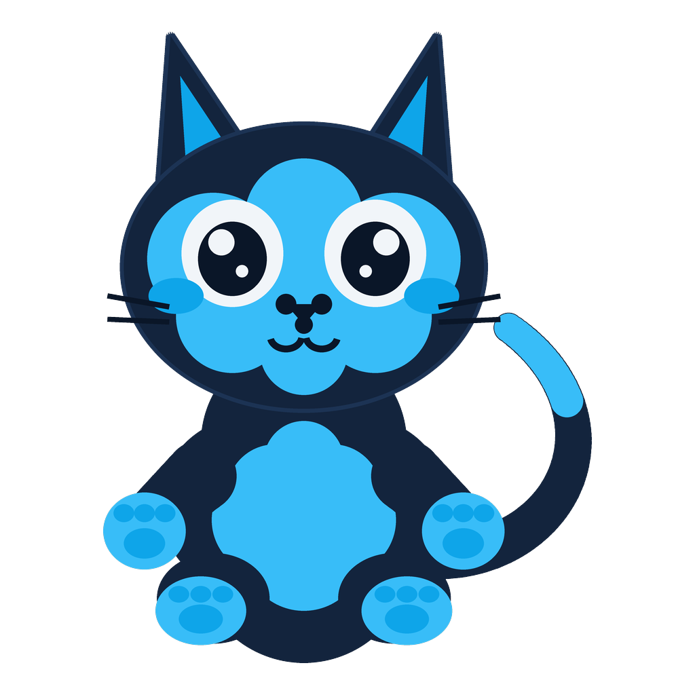
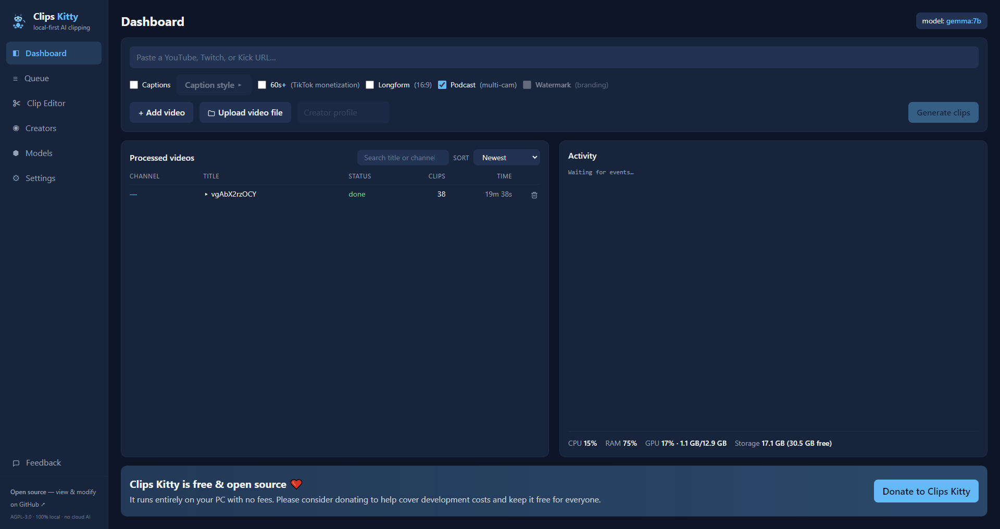
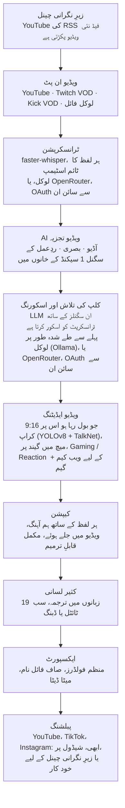

<div align="center">

[English](../../README.md) · [简体中文](README_zh.md) · [日本語](README_ja.md) · [한국어](README_ko.md) · [Türkçe](README_tr.md) · [Русский](README_ru.md) · [Tiếng Việt](README_vi.md) · [ไทย](README_th.md) · [Deutsch](README_de.md) · [Español](README_es.md) · [Français](README_fr.md) · [Português (Brasil)](README_pt-BR.md) · [العربية](README_ar.md) · [Bahasa Indonesia](README_id.md) · [Italiano](README_it.md) · [हिन्दी](README_hi.md) · [বাংলা](README_bn.md) · [Filipino](README_tl.md) · **اردو**

</div>

<div dir="rtl">

<a id="clips-kitty-the-free-open-source-opus-clip-alternative-for-chatting-gaming-and-sports-on-your-own-pc"></a>

# Clips Kitty: گپ شپ، گیمنگ اور اسپورٹس کے لیے آپ کے اپنے PC پر چلنے والا مفت، اوپن سورس Opus Clip کا متبادل

> یہ README، [انگریزی README](../../README.md) سے AI نے ترجمہ کیا ہے، جو اصل حوالہ ہے اور سب سے
> پہلے اپ ڈیٹ ہوتا ہے۔ اہلِ زبان کی طرف سے اصلاحات کا دل سے خیرمقدم ہے۔
>
> 🌐 [ویب سائٹ اردو میں](https://colingpt9.github.io/clips-studio/ur.html)

<a href="https://apps.microsoft.com/detail/9NB6XT7DSQZZ">
  <picture>
    <source media="(prefers-color-scheme: dark)" srcset="https://get.microsoft.com/images/en-us%20dark.svg">
    
  </picture>
</a>

[](https://github.com/ColinGPT9/clips-studio/releases)
[](https://github.com/ColinGPT9/clips-studio/releases)
[](../../LICENSE)
[](https://github.com/ColinGPT9/clips-studio/stargazers)
[](https://github.com/ColinGPT9/clips-studio)
[](../../CONTRIBUTING.md)
[](../../docs/DOCKER.md)

<a href="https://youtu.be/g1dMqrq-YaI"></a>

<a id="star-and-share-clips-kitty--goal-150"></a>

### Clips Kitty کو اسٹار کریں اور شیئر کریں ⭐ ہدف: 150

[](https://github.com/ColinGPT9/clips-studio/stargazers) **150 میں سے**

**براہِ کرم ریپو کو اسٹار کریں اور اسے شیئر کریں۔** اس پر آپ کا کچھ خرچ نہیں ہوتا، اور
اس کے پیچھے کوئی مارکیٹنگ بجٹ نہیں ہے، اس لیے زبانی بات ہی وہ واحد راستہ ہے جس سے اگلے
چھوٹے YouTuber یا اسٹریمر کو پتا چلے کہ ایک مفت آپشن بھی موجود ہے۔

**میں نے اسے چھوٹے YouTubers اور اسٹریمرز کے لیے بنایا ہے** جو دوسرے آپشنز یا کسی ایڈیٹر کا
خرچ نہیں اٹھا سکتے۔ یہ Opus Clip، Vizard اور Klap کا مفت متبادل ہے جو آپ کے اپنے PC پر
**Google Gemma** چلاتا ہے: نہ سرور کا خرچ، نہ فی کلپ فیس، نہ AI کے استعمال کی فیس۔

> **Clips Kitty کا نام ورژن 1.1.3 تک Clips Studio تھا**، اور Microsoft Store کی نام سے متعلق
> شرائط پوری کرنے کے لیے بدلا گیا۔ وہی ایپ، وہی ریپوزٹری، وہی ڈیٹا۔



**لمبی اسٹریمز اور ویڈیوز کو پوسٹ کے لیے تیار Shorts، Reels اور TikToks میں بدلیں، پوری
طرح اپنی مشین پر۔** Clips Kitty کری ایٹرز کے لیے ایک مفت، اوپن سورس AI کلپ جنریٹر اور
ویڈیو ایڈیٹر ہے: YouTube، Twitch یا Kick کا لنک پیسٹ کریں اور یہ بہترین لمحات ڈھونڈتا ہے،
بولنے والے کو بیچ میں رکھتے ہوئے انہیں 9:16 میں کراپ کرتا ہے، ہر لفظ کے ساتھ ہم آہنگ
کیپشن ویڈیو میں جلا دیتا ہے، اور ٹائٹل، ڈسکرپشن اور ہیش ٹیگ لکھتا ہے۔

پہلے سے طے شدہ طور پر کوئی کلاؤڈ AI نہیں۔ کوئی سبسکرپشن نہیں۔ کوئی فی کلپ فیس نہیں۔ آپ کی
فوٹیج کبھی آپ کے کمپیوٹر سے باہر نہیں جاتی، سوائے اس کے کہ آپ کسی کلپ کو اپنے ہی YouTube
چینل پر پبلش کرنے کو کہیں۔

پہلے لوکل، ضرورت ہو تو کلاؤڈ: اگر آپ کا PC AI چلانے کے لیے بہت پرانا ہے تو اس کی جگہ کوئی
کلاؤڈ فراہم کنندہ اسے چلاتا ہے، اور بل آپ کے اپنے اکاؤنٹ میں آتا ہے۔
**OpenRouter تجویز کردہ کلاؤڈ راستہ ہے**: اپنے OpenRouter اکاؤنٹ سے سائن ان کریں (OAuth،
کوئی key کاپی نہیں کرنی) اور بہت سے ماڈلز استعمال کریں (Claude، GPT، Gemini، Muse Spark
اور مزید)۔ میری جانچ میں، 2 گھنٹے کی ایک ویڈیو پر OpenRouter میں تقریباً 11 سینٹ لگے، جہاں
Gemma (Gemma 4 26B-A4B) نے کلپس چنے اور Whisper (large-v3-turbo) نے ٹرانسکرپشن کی؛ آپ
کتنا ادا کریں گے یہ آپ کے چنے ہوئے ماڈلز اور ویڈیو کی لمبائی پر منحصر ہے۔
OpenAI، Claude، Gemini، xAI، Meta، DeepSeek اور Qwen بھی براہِ راست کام کرتے ہیں، آپ کی اپنی
API key پر۔
دیکھیں [docs/AI-BACKENDS.md](../../docs/AI-BACKENDS.md)۔

**یہ کیوں بنا:** چینل بڑھانے والے زیادہ تر کری ایٹرز سب کچھ خود کر رہے ہوتے ہیں: فلم بنانا،
اسٹریم کرنا، ایڈٹ کرنا، پوسٹ کرنا۔ کلپس ہی سے لوگ آپ کو ڈھونڈتے ہیں اور عام طور پر یہی کام
سب سے پہلے چھوٹ جاتا ہے: ایڈیٹر ایک ایسا خرچ ہے جسے زیادہ تر چینل ابھی برداشت نہیں کر
سکتے، کلپنگ ٹولز فی ویڈیو یا ماہانہ پیسے لیتے ہیں، اور ہاتھ سے کاٹنے میں وہ پورا دن لگ
جاتا ہے جو آپ کو کہیں اور چاہیے تھا۔ یہ اسی ہارڈویئر پر چلتا ہے جو آپ کے پاس پہلے سے ہے،
اس لیے اسے استعمال کرنے کا کوئی خرچ نہیں اور آپ جتنے چاہیں کلپس بنا سکتے ہیں۔



<sub>ایک ویڈیو سے 19 منٹ میں 38 کلپس، ایک ہی PC پر، کچھ بھی اپ لوڈ کیے بغیر۔</sub>

---

<a id="contents"></a>

## فہرست

- [یہ کیا کرتا ہے](#what-it-does)
- [Opus Clip، Klap، Vizard اور CapCut سے موازنہ](#how-it-compares-to-opus-clip-klap-vizard-and-capcut)
- [یہ کیسے کام کرتا ہے](#how-it-works)
- [خصوصیات](#features)
- [یہ کس کے لیے بنا ہے](#what-its-built-for)
- [ضروریات](#requirements)
- [انسٹال کریں اور چلائیں](#install-and-run)
- [اپنا AI ماڈل چنیں](#pick-your-ai-model)
- [آزمایا ہوا ہارڈویئر اور کارکردگی](#tested-hardware-and-performance)
- [معاون پلیٹ فارمز](#supported-platforms)
- [معاون زبانیں](#supported-languages)
- [YouTube پر پبلش کریں](#publish-to-youtube)
- [ایک ساتھ ہر پلیٹ فارم پر پبلش کریں](#publish-to-every-platform-at-once)
- [GPU ایکسلریشن](#gpu-acceleration)
- [کمانڈ لائن سے استعمال](#command-line-use)
- [پلگ اِن لکھیں](#write-a-plugin)
- [اس کے اوپر بنائیں](#build-on-it)
- [آرکیٹیکچر](#architecture)
- [حصہ ڈالیں](#contributing)
- [روڈ میپ](#roadmap-detail)
- [لائسنس](#license)

---

<a id="what-it-does"></a>

## یہ کیا کرتا ہے

آپ Clips Kitty کو ایک لمبی ویڈیو دیتے ہیں۔ یہ آپ کو پوسٹ کے لیے تیار عمودی کلپس کا ایک
فولڈر واپس دیتا ہے، ساتھ ہی ایک اسٹوڈیو بھی تاکہ پوسٹ کرنے سے پہلے آپ انہیں دیکھ اور
درست کر سکیں۔

یہ اس مواد کے لیے بنا ہے جسے زیادہ تر کلپنگ ٹولز سب سے بُری طرح سنبھالتے ہیں: **لائیو
اسٹریمز، IRL اور ٹاکنگ ہیڈ فوٹیج، پوڈکاسٹس، اور جم/فٹنس کا مواد**: لمبی، ڈھیلے ڈھالے انداز
کی ویڈیوز جن میں اچھے لمحات دبے ہوتے ہیں اور صرف ٹرانسکرپٹ سے وہ نہیں ملتے۔

<a id="how-it-compares-to-opus-clip-klap-vizard-and-capcut"></a>

## Opus Clip، Klap، Vizard اور CapCut سے موازنہ

Clips Kitty کلاؤڈ کلپنگ ٹولز کا ایک اوپن سورس متبادل ہے۔ اصل فرق یہ ہے کہ کام کہاں ہوتا
ہے: آپ کی ویڈیو کبھی اپ لوڈ نہیں ہوتی، اس لیے نہ کچھ ناپنے کو ہے نہ کسی چیز کے پیسے لینے کو۔

| ٹول | قیمت، ماہانہ بل | مفت درجہ | آپ کے لیے کلپس ڈھونڈتا ہے | واٹر مارک | آپ کی ویڈیو اپ لوڈ کرتا ہے | اوپن سورس |
| ---- | --------------------- | --------- | ----------------------- | --------- | ------------------ | ----------- |
| **Clips Kitty** | مفت، کوئی ادا شدہ درجہ نہیں | پوری ایپ | ہاں | کبھی نہیں | نہیں، آپ کے PC پر چلتا ہے | ہاں، AGPL-3.0 |
| Opus Clip | $15 Starter، $29 Pro | 1080p، واٹر مارک کے ساتھ، 3 دن میں ختم | ہاں | مفت درجے پر | ہاں | نہیں |
| Klap | $29 Pro، $14 Basic سالانہ بل پر | ایک ویڈیو | ہاں | واضح نہیں | ہاں | نہیں |
| Vizard | $29 Creator، $14.50 سالانہ بل پر | ماہانہ 60 کریڈٹس، 720p | ہاں | مفت درجے پر | ہاں | نہیں |
| quso.ai | $29 سے $49 | ماہانہ 75 کریڈٹس، 720p | ہاں | واضح نہیں | ہاں | نہیں |
| Ssemble | $15 سے $60، سالانہ بل پر $6 سے $24 | کوئی درج نہیں | ہاں | واضح نہیں | ہاں | نہیں |
| Descript | $16، $24، $50 | ماہانہ 60 منٹ، 720p | جزوی، یہ ٹرانسکرپٹ ایڈیٹر ہے | Free اور Hobbyist پر | ہاں | نہیں |
| CapCut | استعمال مفت، ادا شدہ درجے capcut.com پر | پورا ایڈیٹر | **نہیں، آپ ہاتھ سے کاٹتے ہیں** | فیچر کے حساب سے مختلف | ڈیسک ٹاپ ایپ پر نہیں | نہیں |

**CapCut کو سمجھنا سب سے ضروری ہے**، کیونکہ ہر کوئی یہی مفت جواب دیتا ہے۔ یہ ایک اچھا
ایڈیٹر ہے اور اس کا کوئی خرچ نہیں، لیکن ہر لمحہ آپ خود ڈھونڈتے ہیں اور ہر کلپ خود کراپ
کرتے ہیں۔ Clips Kitty بھی مفت ہے، اور وہ پہلا مرحلہ ہی وہ حصہ ہے جو یہ آپ کے لیے کرتا ہے۔

**Opus Clip، Klap یا Vizard بہتر انتخاب ہیں** اگر آپ کے پاس گرافکس کارڈ والا Windows PC
نہیں ہے، آپ کبھی کبھار کلپ بناتے ہیں، یا آپ کو فون سے کام کرنا ہے۔ Clips Kitty اس ہارڈویئر
پر بڑی تعداد میں کلپس بنانے کے لیے بنا ہے جو آپ کے پاس پہلے سے ہے۔

**[ساتوں کا مکمل موازنہ، اور ہر ایک کس چیز میں سب سے اچھا ہے](https://colingpt9.github.io/clips-studio/alternatives.html)**

<sub>قیمتیں ہر کمپنی کے اپنے پرائسنگ پیج پر 17 ستمبر 2026 کو چیک کی گئیں۔ CapCut کا کوئی
ایسا پرائسنگ پیج نہیں جسے ہم پڑھ سکے، اس لیے اس کی کوئی قیمت نہیں دی گئی۔ پلان بدلتے رہتے
ہیں؛ یہ ٹیبل خود بخود اپ ڈیٹ نہیں ہوگا۔</sub>

<a id="how-it-works"></a>

## یہ کیسے کام کرتا ہے



**ہر مرحلہ آپ کے کمپیوٹر پر چلتا ہے جب تک آپ کچھ اور نہ چنیں:** AI یا ٹرانسکرپشن کے لیے
OpenRouter، آپ کے اکاؤنٹ سے سائن ان، اور پبلشنگ، جو صرف وہی کلپس اپ لوڈ کرتی ہے جو آپ
بھیجتے ہیں۔ ورنہ عام رن میں نیٹ ورک کو چھونے والی واحد چیز سورس ویڈیو کی ڈاؤن لوڈ ہے۔

<a id="the-stages-in-detail"></a>

### مراحل کی تفصیل

**ٹرانسکرپشن: faster-whisper۔** ہر لفظ کا ٹائم اسٹیمپ، جہاں دستیاب ہو CUDA پر چلتا ہے
اور ورنہ CPU پر۔ ہر لفظ کی ٹائمنگ کی وجہ سے ہی کیپشن صحیح حرف پر آتے ہیں اور کلپس کسی
اصل جملے کے آغاز سے شروع ہوتے ہیں۔

**AI کلپ اسکورنگ۔** ٹرانسکرپٹ پانچ سگنلز میں سے صرف ایک ہے۔ آڈیو سے آواز کے اچانک
اُچھال، شور کے جھونکوں کی گنجانی (ہنسی اور تالیاں ایسی ہی دکھتی ہیں)، اور خاموشی→دھماکے
والے پے آف کی شکلیں ملتی ہیں۔ بصری حصے سے سین کٹس، حرکت، اور چہرے کے رقبے میں تبدیلیاں
ملتی ہیں۔ ایک ردِعمل کا سگنل ان سب کو ملاتا ہے۔ ہر ایک کو *اسی ویڈیو کے اندر* نارملائز
کیا جاتا ہے، اس لیے ایک خاموش پوڈکاسٹ اور چیختی چلاتی اسٹریم دونوں میں بامعنی چوٹیاں
بنتی ہیں۔ جہاں ناظرین کا اصل ڈیٹا موجود ہو (Twitch چیٹ ری پلے جو منفرد چیٹ کرنے والوں سے
ناپا جاتا ہے، YouTube کا most-replayed ہیٹ میپ)، وہاں یہ ایک چھوٹا، حد بند بونس جوڑتا ہے۔

لوکل LLM ٹرانسکرپٹ **کے ساتھ ان واقعات کی ٹائم لائن** بھی دیکھتا ہے، اس لیے وہ "الفاظ
ہلکے ہیں مگر کمرہ پھٹ پڑا" کو صحیح وزن دے سکتا ہے۔ چونکہ چھوٹے ماڈلز ہر چیز کو ایک تنگ
دائرے میں اسکور کرتے ہیں، اس لیے فائنلسٹس کا پھر ایک ری رینک کال میں آمنے سامنے موازنہ
کیا جاتا ہے: 7B ماڈل کے لیے مطلق اسکورنگ کے مقابلے میں نسبتی فیصلہ کہیں آسان ہے۔

**Creator Profiles۔** ایپ ہر کری ایٹر کی ویڈیوز سے اس کا ایک نالج بیس بناتی ہے: بار بار
آنے والے موضوعات، سیریز، ساتھی، چلتے ہوئے لطیفے، اور جاری کہانیاں۔ یہ سیاق و سباق درست
ٹائٹل لکھنے اور پرانی باتوں کے حوالے پہچاننے میں مدد کرتا ہے۔ یہ جان بوجھ کر محتاط ہے:
کوئی تکیہ کلام تب ہی گنا جاتا ہے جب وہ واقعی دہرایا جائے، جس بات کا ذکر بند ہو جائے وہ
غیر فعال ہو جاتی ہے، اور اسکور میں اس کا ہر حصہ صرف اضافی، حد بند، اور بند کیا جا سکنے
والا ہے۔

**ویڈیو ایڈیٹر۔** غیر تباہ کن: ٹرم، اندرونی کٹس، میوٹ، میوٹ کیے گئے الفاظ، والیوم، فیڈ،
رفتار، ہُک ٹیکسٹ، موسیقی، اور واٹر مارک آپریشنز کے طور پر محفوظ ہوتے ہیں اور رینڈر کے وقت
لاگو ہوتے ہیں۔ ایک AI ایڈٹ چیٹ بھی ہے (*"اسے 5 سیکنڈ لمبا کر دو"*، *"کیپشن میں gost لکھا
ہے، ghost ہونا چاہیے"*)، جہاں ماڈل تجویز دیتا ہے اور تصدیق شدہ کوڈ اسے لاگو کرتا ہے۔

**لانگ فارم پروسیسنگ۔** اسی تجزیے کو استعمال کرنے والا ایک اختیاری 16:9 راستہ: افقی
کلپس، X/Twitter کی لمبائی کے کٹس، بہترین لمحات کی ہائی لائٹ ریل، یا پوری اسٹریم جس میں
سے خالی وقفے نکال دیے گئے ہوں۔

**کثیر لسانی پائپ لائن اور AI ڈبنگ۔** کیپشنز کا ترجمہ ہوتا ہے اور کچھ بھی لکھے یا جلائے
جانے *سے پہلے* جائزے کے لیے دکھایا جاتا ہے، تاکہ غلط سطر تب ہی درست ہو جائے جب وہ ابھی
درست ہو سکتی ہو۔ ایک گلاسری چینل کے ناموں، اسپانسرز اور اندرونی مذاق کو ترجمہ ہونے سے بچاتی
ہے۔ ڈبنگ لوکل TTS استعمال کرتی ہے جس کی آوازیں آپ پہلے سن کر چن سکتے ہیں۔

**لوکل GPU ایکسلریشن۔** ڈیٹیکشن اور ٹرانسکرپشن کے لیے CUDA، NVENC/AMF/QSV کے ذریعے ہارڈویئر
ویڈیو انکوڈنگ (خود بخود پہچانا جاتا ہے، CPU کے متبادل کے ساتھ)، اور Ollama کے ذریعے GPU
پر LLM۔

<a id="features"></a>

## خصوصیات

- **ملٹی موڈل کلپ ڈیٹیکشن**: لمحات کو 0–100 اسکور دیا جاتا ہے، جس میں کہی گئی بات، آڈیو کا
  جوش، بصری سرگرمی، اسکرین پر ردِعمل، اور ہُک/پے آف کی طاقت سب ملائے جاتے ہیں۔ معیار پر
  پورا اترنے والا ہر کلپ رکھا جاتا ہے، کسی من مانی حد کے بغیر۔
- **بولنے والے کو پہچاننے والی فیس ٹریکنگ**: YOLOv8 پوز ڈیٹیکشن موضوع کو بیچ میں رکھتا ہے،
  اور گروپ فوٹیج میں کیمرہ **اسی کے پیچھے جاتا ہے جو واقعی بول رہا ہو**، جس کا فیصلہ TalkNet
  ایکٹو اسپیکر ڈیٹیکشن چہرے اور آواز دونوں کو ملا کر کرتا ہے، حرکت سے نہیں۔ جب بولنے والا
  بدلتا ہے تو فریمنگ ادھر سے ادھر پین کرنے کے بجائے سیدھا اس پر **کٹ** کرتی ہے، جیسے ایک
  ایڈیٹر کرتا۔ فریمنگ صرف کراپ سے: کبھی کھینچی نہیں جاتی، کبھی بگاڑی نہیں جاتی۔
- **Podcast mode (پوڈکاسٹ موڈ)**: کئی کیمروں والی فوٹیج کے لیے ہر شاٹ کو ایک ہی شخص پر اپنا
  مستحکم کراپ ملتا ہے، اس لیے کٹس بغیر پین کے کسی چہرے پر آتے ہیں۔ ایک شاٹ کے اندر موضوع
  منہ کی حرکت سے چنا جاتا ہے، ورنہ سب سے نمایاں چہرہ۔
- **Vertical Live**: اس لائیو اسٹریم کے لیے جو اسٹریم کے وقت ہی عمودی تھی (YouTube کی عمودی
  لائیو، Twitch Dual Format، Streamlabs Dual Output، ڈاؤن لوڈ کی ہوئی Instagram یا TikTok
  لائیو)۔ اسٹریم کا اپنا 9:16 لے آؤٹ برقرار رکھتا ہے، فیس ٹریکنگ چھوڑ دیتا ہے، اور لمحات اب
  بھی معمول کے طریقے سے چنتا ہے۔ دیکھیں [docs/VERTICAL-LIVE.md](../../docs/VERTICAL-LIVE.md)۔
- **Sports: Soccer اور Basketball**: کسی میچ یا گیم کا ہر بڑا لمحہ اپنے الگ کلپ کے طور پر، اس کے
  بِلڈ اپ اور ردِعمل کے ساتھ۔
  - **Soccer**: گول، سیوز، کارڈز اور بڑے مواقع۔ گول اسکور باکس سے پڑھے جاتے ہیں اور ان کا وقت
    ہجوم کے شور سے طے ہوتا ہے، اور 9:16 کراپ گیند کے پیچھے چلتا ہے۔ All goals، Best saves،
    Cards وغیرہ چنیں، اور لمحات کو جوڑ کر میچ کا خلاصہ اور ٹیم یا کھلاڑی کی ریلز بنوائیں۔
  - **Basketball**: ڈنکس، تھری پوائنٹرز، بلاکس، اسٹیلز اور گیم وِنرز۔ اسکور باکس ہر باسکٹ اور اس
    کے پوائنٹس کی تصدیق کرتا ہے، اور کوارٹر اور گھڑی کی وجہ سے گیم وِنر پہلے کوارٹر کی باسکٹ سے
    کہیں زیادہ اہم گنا جاتا ہے۔ ہجوم، بینچ اور کورٹ کے کنارے بیٹھے لوگوں کے ردِعمل بھی ڈھونڈے
    جاتے ہیں۔ ہر کلپ کا 9:16 کراپ اس کے کھیل کے گرد پلان ہوتا ہے: گیند اور جس کے پاس وہ ہے، پاس
    لینے والا، اور شاٹ جسے باسکٹ تک فالو کیا جاتا ہے، رِم اور بیک بورڈ کو تصویر میں رکھتے ہوئے۔
    کراپ کھیل کے ساتھ پین کرتا ہے اور کبھی زوم نہیں کرتا۔ گیند [E-BARD](https://github.com/GabrieleGiudic/E-BARD#readme) ڈیٹیکشن ماڈل ڈھونڈتا ہے
    (اس کا کریڈٹ [لائسنس](#license) میں دیا گیا ہے)۔

  دیکھیں [docs/SPORTS.md](../../docs/SPORTS.md)۔
- **قابلِ ترمیم، ویڈیو میں جلے ہوئے کیپشن**: ہر لفظ کے ساتھ ہم آہنگ، اور آپ کی پسند کے انداز
  میں (رنگ، سائز، جگہ، فی سطر الفاظ، چھوٹے بڑے حروف، یا بند)۔ ایکسپورٹ سے پہلے ٹرانسکرپشن
  کی غلطی سطر بہ سطر درست کریں۔ جب دو لوگ بات کر رہے ہوں تو دوسرے بولنے والے کے کیپشن کسی
  اور رنگ میں ہو سکتے ہیں، اور جو کیپشن یہ غلط پہچانے اسے ہاتھ سے بدلا جا سکتا ہے۔
- **AI ایڈٹ چیٹ**: سادہ الفاظ میں بتائیں کیا غلط ہے اور یہ دوبارہ ایڈٹ کر دیتا ہے۔
- **Ask Clips Kitty**: ڈیش بورڈ کے نیچے والا ٹیکسٹ باکس۔ ایک جملے میں بتائیں آپ کیا چاہتے
  ہیں، جیسے *"اس اسٹریم کے کلپس بناؤ، اس میں وہ حصہ ضرور شامل کرنا جب میں باس سے مرا، بڑے
  پیلے کیپشنز کے ساتھ"*، اور یہ ویڈیو قطار میں لگاتا ہے، کلپ چننے والے کو بتاتا ہے کہ کیا
  ڈھونڈنا ہے اور آپ کے بتائے آپشنز سیٹ کرتا ہے۔ **اسے Gemma 4 ماڈل چاہیے**: دیکھیں
  [نیچے والے ٹیکسٹ باکس کو Gemma 4 چاہیے](#the-text-box-at-the-bottom-needs-gemma-4)۔
- **AI ٹائٹلز، ڈسکرپشنز اور ہیش ٹیگز**، سب ایکسپورٹ سے پہلے قابلِ ترمیم۔
- **Creator Profiles**: ایپ وقت کے ساتھ ہر کری ایٹر کو سیکھتی ہے تاکہ کلپس بہتر چنے اور ان
  کے بہتر ٹائٹل دے۔ سب کچھ آپ کے کمپیوٹر پر رہتا ہے، اور آپ اسے دیکھ، درست یا مٹا سکتے ہیں۔
- **کثیر لسانی پبلشنگ**: 19 زبانیں، اور کچھ بھی جلانے سے پہلے جائزہ۔
- **AI ڈبنگ**: لوکل ٹیکسٹ ٹو اسپیچ، ہر زبان کے لیے آوازیں سن کر چننے کی سہولت کے ساتھ۔
- **لانگ فارم ایکسپورٹ**: 16:9 کلپس، ہائی لائٹ ریلز، یا دہرائے ہوئے حصے نکالی گئی اسٹریم۔
  ہائی لائٹ ریل کی ڈسکرپشن میں **چیپٹر ٹائم اسٹیمپس** ہوتے ہیں، تاکہ ناظرین YouTube پر
  لمحات کے درمیان چھلانگ لگا سکیں۔
- **واٹر مارک اور برانڈنگ پروفائلز**: ہر کری ایٹر کی ڈیفالٹ سیٹنگز جو خود بخود لاگو ہوتی ہیں۔
- **ماڈل مینیجر**: ایپ کے اندر سے ہی AI کا دماغ بدلیں؛ ماڈلز ڈاؤن لوڈ کریں، ہٹائیں اور بدلیں،
  پروگریس بار کے ساتھ اور کسی ٹرمینل کے بغیر۔
- **ایڈیٹر سے سیدھا YouTube پر پبلش**: ٹائٹل، ڈسکرپشن، ٹیگز، تھمب نیل، پلے لسٹ، ناظرین اور
  وزیبلٹی، پھر Upload now یا شیڈول کریں۔ اختیاری، پہلے سے بند، اور آپ کی اپنی Google API
  key استعمال کرتا ہے۔
- **ایپ کے اندر فیڈ بیک**: خود بخود جمع کی گئی تشخیصی معلومات کے ساتھ بگ رپورٹس، کسی اکاؤنٹ
  کی ضرورت نہیں۔
- **قابلِ رسائی UI**: کی بورڈ فوکس، کم حرکت (reduced motion) کی سپورٹ، قابلِ تبدیلی فونٹ اور سائز۔

<a id="what-its-built-for"></a>

## یہ کس کے لیے بنا ہے

یہ ہر اس ویڈیو پر چلتا ہے جو آپ اسے دیں۔ یہ وہ صورتیں ہیں جہاں یہ فیچرز کی فہرست سے
زیادہ یا کم سوچ بچار کرتا ہے، تاکہ کوئی بات حیران نہ کرے:

| مواد | یہ کیسا کرتا ہے |
|---|---|
| **IRL، just chatting، پوڈکاسٹس، ولاگز، انٹرویوز** | یہی وہ مواد ہے جس کے لیے یہ ٹیون کیا گیا ہے اور جسے ہر ریلیز سے پہلے اصل اسٹریمز پر آزمایا جاتا ہے |
| **گیمنگ اور ری ایکشنز** | **Gaming / Reaction** آن ہو تو: ایک آدھے حصے میں ویب کیم، دوسرے میں گیم یا وہ ویڈیو جس پر ردِعمل دیا جا رہا ہے، پروسیسنگ سے پہلے ویڈیو کے اپنے فریمز پر جانچا جاتا ہے ([docs/GAMING.md](../../docs/GAMING.md))۔ اسٹریمر وہ ہے جو بول رہا ہو، سب سے بڑا چہرہ کبھی نہیں۔ یہ سوئچ بند ہو تو فریمنگ گیم کے اندر کسی کردار کے پیچھے جا سکتی ہے۔ صرف کیمرے پر موجود لوگ، VTubers نہیں |
| **کھیلوں کے میچ** | **Sports** آن ہو تو: اسکور باکس اور کمنٹری والی نشریات کے لیے بنا ہے، جہاں گول اور باسکٹس یقینی ہوتے ہیں۔ کلب یا فون کی فوٹیج میں عموماً دونوں نہیں ہوتے: اس کے کلپس گیند کے پیچھے چلتے ہیں، اور اس کے گول ان میچ ایونٹس سے آتے ہیں جو آپ پیسٹ کریں، جیسے کسی کلب ایپ کے گول ٹیگز ([docs/SPORTS.md](../../docs/SPORTS.md)) |
| **وہ چیز جس پر ری ایکشن دیا جا رہا ہے** | کلپس اب بھی *کہی گئی بات* سے چنے جاتے ہیں، اس لیے دیکھی جا رہی ویڈیو کا وہ لمحہ جس پر کوئی تبصرہ نہ کرے، اسے نظر نہیں آتا |

کلپس کا انتخاب ٹرانسکرپٹ اور سگنلز کی بنیاد پر ہوتا ہے۔ جب مزے کی بات *صرف بصری* ہو اور
کوئی اس پر کچھ نہ کہے، تو توقع رکھیں کہ اسے آپ خود ایڈیٹر میں ڈھونڈیں گے۔

<a id="requirements"></a>

## ضروریات

|             | کم از کم                                      | تجویز کردہ                      |
| ----------- | -------------------------------------------- | ------------------------------- |
| **GPU**     | NVIDIA RTX 2060 (6 GB)                       | RTX 3060 12 GB یا بہتر          |
| **CPU**     | Intel Core i3-9100 / AMD Ryzen 3 3200G (2019)| 6 یا زیادہ کورز                 |
| **RAM**     | 16 GB                                        | 16 GB یا زیادہ                  |
| **Disk**    | ~20 GB، اور ان ویڈیوز کے لیے جگہ جن کے آپ کلپس بنائیں |                        |
| **OS**      | Windows 10 یا 11                             |                                 |

**کم از کم سے نیچے یہ شاید پھر بھی چل جائے، لیکن یہ معاون نہیں اور سست ہوگا۔** ایک اسٹریم
کے کلپس بنانا گھنٹوں کی ویڈیو ڈی کوڈنگ، ٹرانسکرپشن اور انکوڈنگ ہے؛ تقریباً 2019 سے پرانا
ہارڈویئر اتنا وقت لے گا کہ ایپ ٹوٹی ہوئی لگے گی حالانکہ وہ ٹھیک کام کر رہی ہوگی۔

ان میں سے دو باتوں کی مزید وضاحت ضروری ہے:

- **16 GB RAM محض ایک مشورہ نہیں۔** 8 GB پوری ویڈیو کا تجزیہ تو کر لے گی لیکن پھر کچھ بھی
  رینڈر نہیں کرے گی، جو میموری کی حد کے بجائے کریش جیسا لگتا ہے۔
- **GPU اختیاری ہے، لازمی نہیں۔** اس کے بغیر سب کچھ CPU پر چلتا ہے، آہستہ، مگر مکمل۔ RTX
  2060 وہ حد ہے جہاں سے GPU والا راستہ کام کرنا شروع کرتا ہے؛ دیکھیں
  [GPU ایکسلریشن](#gpu-acceleration)۔

ایپ **صرف Windows** کے لیے ہے۔ Python انجن کو Linux/macOS پر چلنا چاہیے، لیکن کوئی Mac
بِلڈ موجود نہیں اور مینٹینر کے پاس اسے آزمانے کے لیے Mac نہیں ہے۔ اگر آپ کے پاس Mac ہے
اور آپ مدد کرنا چاہتے ہیں تو دیکھیں
[#62](https://github.com/ColinGPT9/clips-studio/issues/62)۔

سورس سے چلانے کے لیے وہ چیزیں چاہییں جو ورنہ انسٹالر آپ کے لیے ساتھ لاتا:

- **Python 3.10+** اور **Node.js 18+**
- آپ کے PATH پر **[FFmpeg](https://ffmpeg.org/download.html)**
- **[Ollama](https://ollama.com)** اور اس میں ایک ماڈل: `ollama pull gemma:7b`

<a id="install-and-run"></a>

## انسٹال کریں اور چلائیں

**سب سے آسان طریقہ [Microsoft Store](https://apps.microsoft.com/detail/9NB6XT7DSQZZ) ہے۔**
ایک کلک، یہ خود اپ ڈیٹ ہوتا ہے، اور Windows کوئی سیکیورٹی پرامپٹ نہیں دکھاتا۔ Microsoft نے
پیکج کو سرٹیفائی اور سائن کیا ہے، اس لیے نیچے بیان کردہ SmartScreen کی وارننگ آتی ہی نہیں۔
Store نئے ورژن اپنی باری پر انسٹال کرتا ہے؛ فوراً حاصل کرنے کے لیے Microsoft Store میں Clips
Kitty کا صفحہ کھولیں اور **Update** دبائیں۔

**یا انسٹالر لے لیں۔** [Releases](https://github.com/ColinGPT9/clips-studio/releases) سے تازہ ترین
**Web Setup** لیں اور چلائیں۔ اس میں ایپ، Python انجن، ہر لائبریری، FFmpeg، AI رن ٹائم اور
ڈیٹیکشن اور ٹرانسکرپشن کے تمام ویٹس شامل ہیں: نہ Python، نہ PATH، نہ ٹرمینل، اور نہ کوئی
دوسرا پروگرام انسٹال کرنا ہے۔

**یا winget استعمال کریں۔** `winget install ColinGPT9.ClipsKitty` وہی Web Setup ٹرمینل سے
انسٹال کرتا ہے۔

جو چیز اس میں شامل نہیں وہ خود لینگویج ماڈل ہے، کیونکہ یہ ایسے لائسنسز کے تحت آتے ہیں جنہیں
ڈاؤن لوڈ کرنے والے شخص کو خود قبول کرنا ہوتا ہے، اور انہیں آپ کی طرف سے قبول نہیں کیا جا
سکتا۔ سیٹ اپ وزرڈ وہ ڈاؤن لوڈ خود شروع کرتا ہے، آپ کے گرافکس کارڈ کے مطابق سائز چنتا ہے، اور
پروگریس بار دکھاتا ہے۔ یعنی: ایک ڈاؤن لوڈ، ایک ڈبل کلک، ایک پروگریس بار۔ اس کے بعد یہ آف
لائن چلتا ہے۔

> پہلی بار چلانے پر Windows خبردار کرے گا کہ ایپ سائن شدہ نہیں ہے۔ *More info → Run anyway*
> (مزید معلومات → پھر بھی چلائیں) پر کلک کریں۔ سائننگ سرٹیفکیٹ فہرست میں شامل ہے۔

<a id="from-source"></a>

### سورس سے

```bash
git clone https://github.com/ColinGPT9/clips-studio
cd clips-studio
pip install -r requirements.txt

cd ui
npm install
npm run dev        # opens the Clips Kitty desktop app
```

ایپ اپنا Python انجن خود بخود شروع کرتی ہے۔ **Clip Editor** میں لنک پیسٹ کریں، *Generate
clips* دبائیں، اور پیش رفت لائیو دیکھیں۔

انسٹالر خود بِلڈ کرنا ایک ہی کمانڈ ہے۔ دیکھیں
[CONTRIBUTING.md](../../CONTRIBUTING.md#building-the-windows-installer)۔

<a id="with-docker-nothing-else-to-install"></a>

### Docker کے ساتھ: اور کچھ انسٹال نہیں کرنا

کنٹری بیوٹرز کے لیے۔ آپ کو صرف [Docker Desktop](https://docs.docker.com/get-started/get-docker/)
چاہیے اور کچھ نہیں: نہ Python، نہ Node، نہ FFmpeg، نہ PyTorch۔

```bash
git clone https://github.com/ColinGPT9/clips-studio
cd clips-studio
docker compose up
```

تین سروسز ایک ساتھ چلنے لگتی ہیں:

| | |
|---|---|
| **<http://localhost:5173>** | انٹرفیس، آپ کے براؤزر میں |
| **<http://localhost:8765>** | انجن اور اس کی API |
| Ollama | لوکل AI، :11434 پر |

پھر ایک ماڈل پُل کریں (`docker compose exec ollama ollama pull gemma3:4b`) اور آپ کے پاس
ایک کام کرتا ہوا چیک آؤٹ ہے۔

چیکس بھی اسی طرح چلائیں:

```bash
docker compose run --rm engine pytest
docker compose run --rm ui npm run typecheck
```

> **دس منٹ کا پہلا بِلڈ چھوڑیں:** `docker compose pull` لوکل طور پر PyTorch اور OpenCV کمپائل
> کرنے کے بجائے پہلے سے بنی انجن امیج لے آتا ہے۔

ڈیسک ٹاپ شیل خود اب بھی آپ کے ہوسٹ پر چلتا ہے، کیونکہ Electron کو ڈسپلے چاہیے؛ باقی سب
کنٹینر میں ہے۔ تفصیلات، اور وہ باتیں جو یہ آپ کو نہیں بتا سکتا،
[docs/DOCKER.md](../../docs/DOCKER.md) میں ہیں۔

<a id="pick-your-ai-model"></a>

## اپنا AI ماڈل چنیں

یہ دیکھنے کے لیے کہ کیا انسٹال ہے اور آپ کا GPU کیا سنبھال سکتا ہے، **Models** صفحہ کھولیں:

صرف ایک پیمانہ: آپ کے پاس کتنی VRAM ہے۔ یہ وہی قطاریں ہیں جو ایپ دکھاتی ہے،
[`llm/manager.py`](../../llm/manager.py) کے `RECOMMENDATIONS` سے۔ وزرڈ اور Models صفحہ یہی ایک
ٹیبل پڑھتے ہیں، اس لیے نہ وہ آپس میں اختلاف کر سکتے ہیں نہ اس سے۔

| آپ کا ہارڈویئر | تجویز کردہ ماڈل | |
|---|---|---|
| CPU / iGPU، کوئی گرافکس کارڈ نہیں | `gemma3:4b` | آزمایا ہوا |
| 6 GB سے کم VRAM، یا پرانا PC | `gemma4:e2b` | |
| 6 GB VRAM | `gemma4:e4b` | |
| 8 GB VRAM | **`gemma:7b`** | آزمایا ہوا · ساتھ آنے والا ڈیفالٹ |
| 10–12 GB VRAM | `gemma3:12b` | آزمایا ہوا |
| 16–24 GB VRAM | `gemma3:27b` | |

اور وہ ماڈلز جنہیں VRAM کے علاوہ کسی اور وجہ سے چننا فائدہ مند ہے:

| کیوں | ماڈل |
|---|---|
| ترجمہ / کثیر لسانی | `qwen3:8b` یا `qwen3:14b` |
| آزادانہ لائسنس | `mistral-nemo:12b` (Apache-2.0) · `phi4:14b` (MIT) |

**صرف "آزمایا ہوا" والے تین ماڈلز اصل اسٹریمز پر چلائے گئے ہیں**، اور `gemma:7b` پر سب سے
زیادہ گھنٹے لگے ہیں؛ `config/settings.yaml` اسی کے ساتھ آتی ہے۔ باقی سب اس لیے درج ہیں کہ ان
کا سائز معقول ہے اور انہیں تجارتی طور پر مفت استعمال کیا جا سکتا ہے، اس لیے نہیں کہ ان سے
کلپس کا معیار ناپا گیا ہے۔ یہ سب کام کرتے ہیں، کیونکہ ایپ Ollama کے ذریعے ہر ماڈل سے بالکل
ایک جیسے بات کرتی ہے، لیکن کسی نے یہ نہیں جانچا کہ آیا یہ بہتر لمحات چنتے ہیں۔ یہ کمی پوری
کرنا [#38](https://github.com/ColinGPT9/clips-studio/issues/38) ہے۔

Ollama جو کچھ بھی سرو کرے وہ کام کرتا ہے، اور بدلنا ایک کلک ہے۔ ترجمے کے لیے کلپنگ سے
*مختلف* ماڈل استعمال ہو سکتا ہے۔ `llm.translation_model` سیٹ کریں۔

<a id="the-text-box-at-the-bottom-needs-gemma-4"></a>

### نیچے والے ٹیکسٹ باکس کو Gemma 4 چاہیے

**Ask Clips Kitty**، یعنی ڈیش بورڈ کے نیچے والا ٹیکسٹ باکس، صرف اس ماڈل کے ساتھ کام کرتا ہے
جو ایپ کے ٹولز استعمال کر سکے۔ Gemma 4 کر سکتا ہے۔ `gemma:7b` اور Gemma 3 کے ماڈلز نہیں کر
سکتے، اور سیٹ اپ انہی میں سے ایک ایسے PC پر انسٹال کرتا ہے جس میں گرافکس کارڈ نہ ہو یا جس
میں 8 GB یا زیادہ VRAM ہو۔ وہاں یہ باکس تب تک کام نہیں کرے گا جب تک آپ Gemma 4 کا کوئی ماڈل
شامل نہ کریں: ورژن 2.0 کہتا ہے *"No installed model can use tools"* (کوئی انسٹال شدہ ماڈل
ٹولز استعمال نہیں کر سکتا)، اور بعد کے ورژن باکس ہی میں ڈاؤن لوڈ کی پیشکش کرتے ہیں۔

جو بھی ماڈل آپ کے کلپس چنتا ہو، **Models** صفحے پر اس کے ساتھ Gemma 4 کا ایک ماڈل انسٹال
کریں: 6 GB یا زیادہ والے گرافکس کارڈ پر `gemma4:e4b`، اس سے کم پر `gemma4:e2b`۔ آپ کو اس پر
منتقل ہونے کی ضرورت نہیں۔ باکس اسے خود ڈھونڈ لیتا ہے، اور آپ کے کلپس اب بھی اسی ماڈل سے
چنے جاتے ہیں جو آپ نے منتخب کیا۔ اگر آپ AI کو OpenRouter کے ذریعے چلاتے ہیں تو باکس وہی
ماڈل استعمال کرتا ہے اور کچھ انسٹال کرنے کی ضرورت نہیں۔

<a id="tested-hardware-and-performance"></a>

## آزمایا ہوا ہارڈویئر اور کارکردگی

Clips Kitty روزانہ اسی مشین پر بنایا اور آزمایا جاتا ہے، اس لیے اگر آپ اپنے نتائج کا
موازنہ کر رہے ہیں تو یہ ایک کارآمد حوالہ ہے:

| | |
|---|---|
| **GPU** | NVIDIA GeForce RTX 3060، 12 GB VRAM |
| **CPU** | AMD Ryzen 5 5600X (6 کورز / 12 تھریڈز) |
| **RAM** | 16 GB |
| **OS** | Windows 10 |
| **کلپنگ ماڈل** | Ollama کے ذریعے `gemma:7b` |
| **ٹرانسکرپشن** | CUDA پر faster-whisper `large-v3-turbo` |

اس ریپو کی ہر چیز (ڈیفالٹ سیٹنگز، `parallel_renders: 3`، 5 منٹ کا تجزیاتی حصہ) تقریباً اسی
درجے کی مشین کے لیے ٹیون کی گئی ہے۔ بڑے GPU پر `llm.num_ctx` اور `analysis.chunk_seconds`
ایک ساتھ بڑھائیں اور ماڈل کا ایک سائز اوپر جائیں؛ چھوٹے GPU پر `gemma3:4b` پر آ جائیں۔

اگر آپ Clips Kitty کو کسی دوسرے ہارڈویئر پر بینچ مارک کریں تو براہِ کرم اسے
[Discussions](https://github.com/ColinGPT9/clips-studio/discussions) میں پوسٹ کریں۔ اصل مشینوں کے اصل نمبر ہر کسی کو اپنا سیٹ اپ طے
کرنے میں مدد دیتے ہیں۔

<a id="supported-platforms"></a>

## معاون پلیٹ فارمز

| سورس | سپورٹ |
|---|---|
| YouTube ویڈیوز | مکمل۔ H.264 جان بوجھ کر چنا جاتا ہے (AV1 پروسیسنگ کا وقت تقریباً دوگنا کر دیتا ہے) |
| Twitch VODs | مکمل، بشمول چیٹ ری پلے بطور ناظرین کا سگنل |
| Kick VODs | مکمل (Kick اسٹریم ختم ہونے کے بعد چیٹ مٹا دیتا ہے، اس لیے کوئی چیٹ سگنل نہیں) |
| لوکل ویڈیو فائلیں | مکمل۔ اپنی فوٹیج پبلش کرنے سے پہلے اس کے کلپس بنائیں |
| لائیو اسٹریمز | جان بوجھ کر معاون نہیں۔ صرف VODs |

<a id="supported-languages"></a>

## معاون زبانیں

کلپس کا **19 زبانوں** میں ترجمہ، سب ٹائٹل اور ڈبنگ ہو سکتی ہے، اور **انٹرفیس کا بھی ان
تمام 19 زبانوں میں ترجمہ ہو چکا ہے**، اس لیے ایپ انہی زبانوں میں استعمال کی جا سکتی ہے جن
میں یہ پبلش کرتی ہے:

انگریزی · ہسپانوی · پرتگالی (برازیلی) · فرانسیسی · جرمن · ہندی · انڈونیشیائی ·
جاپانی · روسی · عربی · چینی (آسان) · ویتنامی · فلپائنی · ترکی ·
اردو · بنگالی · تھائی · کوریائی · اطالوی

نئی زبان شامل کرنا `multilingual/languages.py` میں ایک قطار اور
`ui/src/renderer/src/locales/` میں ایک لوکیل فائل ہے۔ مترجم اور سب ٹائٹل لکھنے والا حصہ کسی
ایک زبان سے بندھے ہوئے نہیں ہیں۔

<a id="help-wanted-the-maintainer-only-speaks-english"></a>

### مدد درکار ہے: مینٹینر صرف انگریزی بولتا ہے

انٹرفیس کے ان 19 میں سے 18 ترجمے کبھی کسی ایسے شخص نے نہیں پڑھے جو وہ زبان بولتا ہو۔ ان
میں سے آدھے ابھی مکمل نہیں۔ ہر زبان کا اپنا issue ہے، جو انگریزی میں اور اسی زبان میں لکھا
گیا ہے، اور **کسی ایک غلط لفظ کی نشاندہی کرنا بھی ایک مکمل حصہ ہے**: پُل ریکویسٹ کی ضرورت
نہیں۔ [یہ کیسے کام کرتا ہے](../../docs/TRANSLATING.md)۔

**مکمل کرنا باقی ہے** (تقریباً 68 اسٹرنگز ابھی انگریزی میں ہیں):
[বাংলা (Bengali)](https://github.com/ColinGPT9/clips-studio/issues/43) ·
[Italiano](https://github.com/ColinGPT9/clips-studio/issues/44) ·
[한국어 (Korean)](https://github.com/ColinGPT9/clips-studio/issues/45) ·
[ไทย (Thai)](https://github.com/ColinGPT9/clips-studio/issues/46) ·
[Tagalog (Filipino)](https://github.com/ColinGPT9/clips-studio/issues/47) ·
[Türkçe (Turkish)](https://github.com/ColinGPT9/clips-studio/issues/48) ·
[اردو (Urdu)](https://github.com/ColinGPT9/clips-studio/issues/49) ·
[Tiếng Việt (Vietnamese)](https://github.com/ColinGPT9/clips-studio/issues/50) ·
[中文 (Chinese)](https://github.com/ColinGPT9/clips-studio/issues/51)

**جانچنا باقی ہے** (مکمل ہیں، لیکن کسی نے تصدیق نہیں کی کہ یہ فطری لگتے ہیں):
[العربية (Arabic)](https://github.com/ColinGPT9/clips-studio/issues/52) ·
[Deutsch (German)](https://github.com/ColinGPT9/clips-studio/issues/53) ·
[Español (Spanish)](https://github.com/ColinGPT9/clips-studio/issues/54) ·
[Français (French)](https://github.com/ColinGPT9/clips-studio/issues/55) ·
[हिन्दी (Hindi)](https://github.com/ColinGPT9/clips-studio/issues/56) ·
[Bahasa Indonesia (Indonesian)](https://github.com/ColinGPT9/clips-studio/issues/57) ·
[日本語 (Japanese)](https://github.com/ColinGPT9/clips-studio/issues/58) ·
[Português (Portuguese)](https://github.com/ColinGPT9/clips-studio/issues/59) ·
[Русский (Russian)](https://github.com/ColinGPT9/clips-studio/issues/60)

کوئی ایسی زبان چاہیے جو یہاں نہیں؟ [#61](https://github.com/ColinGPT9/clips-studio/issues/61)۔

<a id="publish-to-youtube"></a>

## YouTube پر پبلش کریں

پہلے سے بند ہے۔ اسے **Settings → Publish to YouTube** میں آن کریں اور ایڈیٹر میں ایک
**YouTube** ٹیب ظاہر ہو جاتا ہے: ٹائٹل، ڈسکرپشن، ٹیگز، تھمب نیل، پلے لسٹ، ناظرین اور
وزیبلٹی بھریں، پھر **Upload now** دبائیں۔ اگر آپ کی کچھ ترامیم محفوظ نہیں ہوئیں تو Clips
Kitty کلپ رینڈر کرتا ہے اور اسے سیدھا آپ کے چینل پر اپ لوڈ کر دیتا ہے۔ نہ ایکسپورٹ کا کوئی
مرحلہ ہے نہ پبلشنگ کا کوئی الگ صفحہ۔ آپ ایڈیٹر سے کبھی باہر نہیں جاتے۔

اگر آپ اسے بند رہنے دیں تو ایپ میں کہیں بھی کچھ نہیں بدلتا۔

<a id="scheduling"></a>

### شیڈولنگ

**Schedule on YouTube** چننے پر ویڈیو *فوراً* اپ لوڈ ہو جاتی ہے، پرائیویٹ نشان زد ہوتی ہے،
اور YouTube کو پبلش ہونے کا وقت دے دیا جاتا ہے۔ YouTube اسے مقررہ دن پبلش کر دیتا ہے۔

**آپ Clips Kitty بند کر کے اپنا کمپیوٹر بھی بند کر سکتے ہیں۔** اس ایپ میں نہ کوئی ٹائمر ہے،
نہ بیک گراؤنڈ سروس، اور نہ کچھ چلتا چھوڑنا ہے۔ YouTube نے ویڈیو قبول کر لی تو Clips Kitty کا
کام ختم۔

<a id="you-need-your-own-google-api-key"></a>

### آپ کو اپنی Google API key چاہیے

Clips Kitty کوئی مشترکہ key ساتھ نہیں دیتا، اور یہ صرف احتیاط نہیں۔ Google کا اپ لوڈ کوٹہ
**ہر Cloud project کے حساب سے** ہوتا ہے: ایک مشترکہ key کا مطلب ہوتا کہ دنیا بھر کے تمام
صارفین روزانہ انہی 100 اپ لوڈز میں سے حصہ لیں۔ آپ کا اپنا project آپ کو اپنا الاؤنس دیتا ہے،
اور آپ کی اسناد کبھی آپ کی مشین سے باہر نہیں جاتیں۔ راستے میں Clips Kitty کا کوئی سرور
نہیں۔

سیٹ اپ مفت ہے اور تقریباً دس منٹ لیتا ہے؛ Settings میں وزرڈ آپ کو قدم بہ قدم لے جاتا ہے:

1. [Google Cloud Console](https://console.cloud.google.com/projectcreate) میں ایک project بنائیں۔
2. APIs & Services → Library میں **YouTube Data API v3** فعال کریں۔
3. OAuth consent screen بھریں، پھر **Publish app** دبائیں۔ یہ قدم اہم ہے: اگر اسے *Testing*
   پر چھوڑ دیا تو Google ہر 7 دن بعد آپ کا سائن ان ختم کر دیتا ہے اور آپ کو ہر ہفتے دوبارہ
   جوڑنا پڑے گا۔ "In production" کا مطلب تصدیق شدہ نہیں، اور اس کا کوئی خرچ نہیں۔
4. Credentials → Create credentials → OAuth client ID → قسم **Desktop app**۔
5. client ID اور secret کو Settings میں پیسٹ کریں، پھر اپنا چینل جوڑیں۔

جوڑتے وقت آپ کو "Google hasn't verified this app" (Google نے اس ایپ کی تصدیق نہیں کی) کی
وارننگ نظر آئے گی۔ یہ آپ کی اپنی ایپ ہے جو آپ کو آپ ہی کے بارے میں خبردار کر رہی ہے۔ **Advanced
→ Go to (unsafe)** سے آپ آگے بڑھ سکتے ہیں۔

<a id="posting-publicly"></a>

### عوامی طور پر پوسٹ کرنا

اس پر بھروسہ کرنے سے پہلے ایک بات جان لیں، کیونکہ کوئی بھی سافٹ ویئر اس کا توڑ نہیں نکال
سکتا:

> **جب تک آپ کا Google Cloud project، YouTube کا مفت API آڈٹ پاس نہیں کر لیتا، YouTube اس کے
> ذریعے اپ لوڈ ہونے والی ہر ویڈیو کو پرائیویٹ پر لاک کر دیتا ہے۔** یہ لاک مستقل ہے۔ بعد میں
> آپ Studio میں ویڈیو کو پبلک نہیں کر سکتے، اور کوئی اپیل نہیں۔ واحد حل یہ ہے کہ آڈٹ شدہ
> project سے اسے دوبارہ اپ لوڈ کیا جائے۔

Clips Kitty ہر اپ لوڈ کے بعد چیک کرتا ہے اور اگر ایسا ہوا ہو تو صاف صاف بتا دیتا ہے، بجائے
اس کے کہ ایسی ویڈیو کے لیے کامیابی کی اطلاع دے جسے کوئی دیکھ ہی نہ سکے۔ اگر آپ عوامی طور پر
پبلش کرنا چاہتے ہیں تو پہلے
[YouTube API Services audit form](https://support.google.com/youtube/contact/yt_api_form)
جمع کرائیں۔ **unlisted** یا **private** کے طور پر اپ لوڈ کرنا اس سے متاثر نہیں ہوتا۔

<a id="what-it-can-and-cannot-set"></a>

### یہ کیا سیٹ کر سکتا ہے اور کیا نہیں

ہر وہ چیز جو پبلک API فراہم کرتی ہے: ٹائٹل، ڈسکرپشن (اس میں موجود ٹائم اسٹیمپس چیپٹرز بن
جاتے ہیں)، ٹیگز، کیٹیگری، زبان، وزیبلٹی، شیڈول شدہ پبلش وقت، made-for-kids، تبدیل شدہ/مصنوعی
مواد کا اعلان، لائسنس، ایمبیڈنگ، پبلک اعداد و شمار، کسٹم تھمب نیل، اور پلے لسٹ میں شامل کرنا۔

YouTube Studio کے کچھ فیچرز پبلک API میں سرے سے موجود ہی نہیں، اس لیے ان کے لیے جان بوجھ کر
کوئی کنٹرول نہیں رکھا گیا، بجائے ایسے کنٹرول کے جو خاموشی سے کچھ نہ کرے: منیٹائزیشن اور
اشتہاری وقفے، ادا شدہ پروموشن کا اعلان، اینڈ اسکرینز اور کارڈز، کمنٹ سیٹنگز، عمر کی پابندی،
Premieres، اور Shorts ری مکس کی اجازتیں۔ ان کے لیے پینل آپ کو Studio کا لنک دیتا ہے۔

Shorts کے لیے کچھ خاص نہیں چاہیے: نہ کوئی الگ موڈ اور نہ `#Shorts` ٹیگ۔ YouTube ویڈیو کی شکل
اور لمبائی سے خود ہی اسے Short قرار دیتا ہے۔

<a id="publish-to-every-platform-at-once"></a>

## ایک ساتھ ہر پلیٹ فارم پر پبلش کریں

یہ بھی پہلے سے بند ہے۔ اسے **Settings → Publish through WoopSocial** میں آن کریں اور ایڈیٹر
میں ایک **Publish** ٹیب ظاہر ہو جاتا ہے: اپنے پلیٹ فارمز چنیں — یا **Everywhere** (ہر جگہ)
دبائیں — ٹائٹل اور ڈسکرپشن ایک بار لکھیں، اور ایک ہی اپ لوڈ ایک ساتھ YouTube، TikTok،
Instagram، Facebook، X، Threads، LinkedIn، Pinterest اور Bluesky پر جاتا ہے۔ Clip Editor میں
**Publish all** پورا بیچ بھیجتا ہے، وقفے وقفے سے، تاکہ درجن بھر کلپس ایک ہی سیکنڈ میں نہ پہنچیں۔

یہ والا حصہ **لوکل نہیں** ہے۔ کلپ اور اس کی تفصیلات ایک پبلشنگ سروس کو بھیجی جاتی ہیں، جو
انہیں آگے پہنچاتی ہے اور آپ کے سوشل اکاؤنٹس کے کنکشن اپنے پاس رکھتی ہے، اس لیے Clips Kitty
کبھی کسی سوشل اکاؤنٹ کا پاس ورڈ نہیں مانگتا۔ ایپ کی باقی ہر چیز اب بھی آپ کے PC پر چلتی ہے۔

دو سروسز معاون ہیں: **[WoopSocial](https://woopsocial.com/?via=clipskitty)**، جس کا مفت پلان دو
اکاؤنٹس جوڑتا ہے اور روزانہ تقریباً 5 YouTube پوسٹس کی اجازت دیتا ہے، اور ادا شدہ پلانز
دونوں حدیں بڑھا دیتے ہیں، اور **[Upload-Post](https://www.upload-post.com/)**، جو زیادہ
منزلوں تک پہنچتا ہے اور تھمب نیلز، پہلا کمنٹ اور پوسٹنگ کی قطار شامل کرتا ہے۔ کوئی ایک آن
کریں، یا دونوں۔

<sub>ایفیلیئیٹ لنک - اگر آپ اس کے ذریعے سائن اپ کریں تو Clips Kitty کو کمیشن مل سکتا ہے، آپ
پر کوئی اضافی خرچ نہیں۔</sub>

**اپنی key خود لائیں۔** اکاؤنٹ آپ بناتے ہیں، اپنے سوشلز آپ جوڑتے ہیں اور اپنا الاؤنس آپ
استعمال کرتے ہیں۔ Clips Kitty کچھ نہیں لیتا، کوئی مشترکہ key نہیں رکھتا اور کسی چیز کے پیسے
نہیں دیتا — بالکل YouTube انٹیگریشن والا انتظام، اور اسی وجہ سے۔

مکمل رہنمائی، ہر پلیٹ فارم کی سپورٹ اور حدود:
**[docs/UPLOAD-POST.md](../../docs/UPLOAD-POST.md)**۔

<a id="gpu-acceleration"></a>

## GPU ایکسلریشن

**ویڈیو انکوڈنگ** تینوں کمپنیوں کے ہارڈویئر پر خود بخود تیز ہوتی ہے: NVIDIA (NVENC)، AMD
(AMF)، اور Intel (QSV)۔ شروع ہوتے وقت انجن ہر ایک سے ایک فریم ٹیسٹ انکوڈ کرتا ہے اور پہلا
جو واقعی کام کرے وہ استعمال کرتا ہے، ورنہ CPU پر واپس آتا ہے۔ کسی ایک کو زبردستی چننے کے لیے
`config/settings.yaml` میں `video.encoder` استعمال کریں۔

**ڈیٹیکشن اور ٹرانسکرپشن** CUDA کے ساتھ سب سے تیز ہیں۔ عام طور پر `pip install
torch` آپ کو **صرف CPU** والا بِلڈ دیتا ہے۔ NVIDIA کے لیے:

```bash
pip uninstall torch torchvision -y
pip install torch torchvision --index-url https://download.pytorch.org/whl/cu130
```

**کون سے کارڈز GPU استعمال کرتے ہیں:** GTX 16-series، RTX 20-series، اور ان سے نیا سب کچھ،
بشمول RTX 50-series۔

**GPU پر ٹرانسکرپشن** کے لیے NVIDIA کی cuBLAS 12 بھی چاہیے: Whisper کا انجن (CTranslate2)
CUDA 12 بِلڈ ہے، اور اوپر والے CUDA 13 PyTorch میں صرف cuBLAS 13 ہے۔
`pip install -r requirements.txt` اسے انسٹال کرتا ہے (`nvidia-cublas-cu12`)، اور انسٹال شدہ ایپ
میں یہ شامل ہے، اس لیے کسی CUDA ٹول کٹ کی ضرورت نہیں۔ اس کے بغیر ٹرانسکرپشن CPU پر چلتی
ہے اور لاگ میں وجہ لکھی ہوتی ہے۔

**GTX 10-series اور پرانے کارڈز کم از کم سے نیچے ہیں۔** یہ معاون کنفیگریشن نہیں۔ ایپ ان پر
شروع ہونے سے انکار نہیں کرتی: ڈیٹیکشن CPU پر چلی جاتی ہے اور سب کچھ پھر بھی کام کرتا ہے، لیکن
یہ سست ہوگا، اور اتنی پرانی مشین کے ساتھ عموماً ایسا CPU ہوتا ہے جو صرف ڈیٹیکشن نہیں بلکہ
پورا کام سست کر دیتا ہے۔

اوپر والا `cu130` انڈیکس استعمال کریں، کوئی پرانا نہیں۔ پرانے CUDA بِلڈز میں نئے کارڈز کے لیے
کوڈ نہیں ہوتا، اور پھر ایپ اس ہارڈویئر پر بھی CPU پر چلی جاتی ہے جسے تیز ہونا چاہیے۔

AMD GPU والوں کے لیے: Windows پر ٹریکنگ اور ٹرانسکرپشن CPU پر چلتی ہیں، اب بھی پوری طرح کام
کرتی ہیں، بس آہستہ۔ آپ کا GPU پھر بھی AMF کے ذریعے ویڈیو انکوڈنگ اور Ollama کے ذریعے LLM کے
لیے استعمال ہوتا ہے، جو خود AMD کو سپورٹ کرتا ہے۔

**ویڈیو ڈی کوڈنگ** OpenCV کے بجائے ہارڈویئر ایکسلریشن والے FFmpeg سے ہوتی ہے، ٹریکنگ پاس اور
رینڈرنگ دونوں کے لیے۔ اس طرح نمونے کے فریمز پڑھنے میں Python میں ڈی کوڈ کرنے کے مقابلے میں
تقریباً دسواں حصہ CPU لگتا ہے، جو اہم ہے کیونکہ ٹریکنگ پاس ہر کلپ پر چلتا ہے۔

**CPU کی تقسیم۔** ڈیٹیکشن اور رینڈرنگ دونوں ہر کور چاہتے ہیں، اور اگر انہیں ان کے حال پر چھوڑ
دیا جائے تو وہ آپس میں اور انٹرفیس سے لڑتے ہیں۔ شروع ہوتے وقت انجن کورز کو رینڈر ورکرز میں
بانٹ دیتا ہے اور جان بوجھ کر دو بچا کر رکھتا ہے، تاکہ بیچ چلتے ہوئے بھی ایپ فوری جواب دیتی رہے۔
`video.parallel_renders` سے ٹیون کریں۔

<a id="command-line-use"></a>

## کمانڈ لائن سے استعمال

ڈیسک ٹاپ ایپ کے بغیر بھی سب کچھ کام کرتا ہے:

```bash
python main.py process "https://www.youtube.com/watch?v=VIDEO_ID"   # one video
python main.py models                                               # list/switch models
python main.py status                                               # processing state
python main.py serve                                                # just the API engine
```

سیٹنگز [config/settings.yaml](../../config/settings.yaml) میں ہیں۔ فائل کے شروع میں فوری سیٹ اپ
کا ایک مختصر حصہ ہے، اور اس کے نیچے تمام ایڈوانسڈ چیزیں۔ ہر LLM پرامپٹ
[config/prompts/](../../config/prompts/) میں ایک سادہ ٹیکسٹ فائل ہے، اس لیے آپ Python کو
چھیڑے بغیر یہ ٹیون کر سکتے ہیں کہ کلپس کیسے اسکور ہوں۔

<a id="write-a-plugin"></a>

## پلگ اِن لکھیں

کیا آپ کسی گیم، کھیل یا شو کی قسم کو کسی عام ڈیٹیکٹر سے بہتر جانتے ہیں؟ ایک چھوٹا Python
پلگ اِن لکھیں جو ویڈیو کے لمحات ڈھونڈے، سمجھے یا انہیں ریٹ کرے، اور باقی کام Clips Kitty
کرتا ہے۔ SDK کا لائسنس MIT ہے، اس لیے آپ کا پلگ اِن کوئی بھی لائسنس استعمال کر سکتا ہے، اور
کچھ بھی فورک نہیں کرنا پڑتا۔

```text
Clips Kitty SDK

Input                      a link or a video file
  ↓
Video                      Clips Kitty downloads it and writes down what is said
  ↓
Your plugin                every step is optional
  ├── find                 picks the moments                  built
  ├── understand           says what happens in each one      built
  ├── rate                 scores each moment                 built
  └── edit                 suggests edits for the creator     built
  ↓
Clips Kitty                does every step no plugin does, then cuts, frames and captions the clips
  ↓
Creator / Social Platform  posts when the creator clicks Publish, or on a schedule or automatic posting the creator switched on
```

- ایک ویڈیو کے لیے ایک ہی پلگ اِن لمحات ڈھونڈ سکتا ہے؛ یہ Clips Kitty کی اپنی تلاش کی جگہ لے
  لیتا ہے۔
- کسی بھی فائنڈر کے بعد، 3 تک پلگ اِن سمجھ سکتے ہیں اور 3 تک ریٹ کر سکتے ہیں۔
- پلگ اِن کا کردار اس کے مینی فیسٹ میں `inputs` اور `outputs` سے طے ہوتا ہے ([مراحل](../../docs/developers/steps.md))۔
- 3 تک پلگ اِن بننے والے کلپس کے لیے ترامیم تجویز کر سکتے ہیں۔
- ایڈٹ پلگ اِنز ایسی ترامیم تجویز کرتے ہیں جو ایڈیٹر میں کری ایٹر کا انتظار کرتی ہیں ([مراحل](../../docs/developers/steps.md#suggest-edits-the-edit-step))۔
- پوسٹ کرنا پلگ اِن کا مرحلہ نہیں: Clips Kitty کلپس خود پوسٹ کرتا ہے، اور WoopSocial کے ذریعے کری ایٹر کے اپنے اکاؤنٹ سے ایک ساتھ کئی سائٹس پر پوسٹ کر سکتا ہے ([ایک ساتھ ہر پلیٹ فارم پر پبلش کریں](#publish-to-every-platform-at-once))۔ `kind: publisher` مسترد کر دیا جاتا ہے: پلگ اِنز پوسٹ نہیں کرتے۔

تین کمانڈز SDK انسٹال کرتی ہیں، `game-events` ٹیمپلیٹ سے ایک پلگ اِن بناتی ہیں (Quarkbloom
Arena کے لیے، جو ایک فرضی گیم ہے) اور اسے SDK کی بنائی ہوئی ایک ٹیسٹ ویڈیو پر چلاتی ہیں۔
انہیں Python 3.11، FFmpeg اور Git چاہیے۔

PowerShell (Windows):

```powershell
py -m pip install "clipskitty-sdk[yaml,test] @ git+https://github.com/ColinGPT9/clips-studio#subdirectory=sdk/python"
py -m clipskitty_sdk new quarkbloom-bursts --template game-events --publisher your-github-name
py -m clipskitty_sdk run quarkbloom-bursts --sample
```

bash (macOS، Linux):

```bash
python -m pip install "clipskitty-sdk[yaml,test] @ git+https://github.com/ColinGPT9/clips-studio#subdirectory=sdk/python"
python -m clipskitty_sdk new quarkbloom-bursts --template game-events --publisher your-github-name
python -m clipskitty_sdk run quarkbloom-bursts --sample
```

Clips Kitty 2.1.0 پہلی ریلیز ہے جو پلگ اِنز چلاتی ہے، اور یہ SDK 1.3.0 کے ساتھ آتی ہے۔

**[آپ کی پہلی گیم پائپ لائن](../../docs/developers/first-game-pipeline.md)** وہاں سے آگے قدم بہ
قدم ایک ایسے پلگ اِن تک لے جاتی ہے جو Clips Kitty میں انسٹال ہو اور اس کے Marketplace میں درج
ہو۔ [Signals cookbook](../../docs/developers/signals-cookbook.md) میں کسی گیم کی ویڈیو پڑھنے کی
ترکیبیں ہیں، [SDK reference](../../docs/developers/sdk.md) میں ہر کمانڈ اور کال ہے، اور
[developer docs](../../docs/developers/README.md) میں باقی سب کچھ۔ ویب سائٹ کا
[Clips Kitty SDK](https://colingpt9.github.io/clips-studio/developers.html) صفحہ اس کا مختصر
ورژن ہے۔

<a id="build-on-it"></a>

## اس کے اوپر بنائیں

ڈیسک ٹاپ ایپ ایک **لوکل HTTP API** کی کھڑکی ہے، جو Clips Kitty کھلا ہونے پر ہمیشہ چل رہی
ہوتی ہے۔ ایک Discord بوٹ، بیچ رنر، ویب فرنٹ اینڈ یا OBS انٹیگریشن اسی پائپ لائن کو چلا سکتا
ہے، اور اس کے لیے پہلے ایپ میں کچھ بھی شامل نہیں کرنا پڑتا۔

```bash
python main.py serve --port 8765          # the engine on its own, no window

curl -X POST http://127.0.0.1:8765/jobs \
  -H "Content-Type: application/json" \
  -d '{"url": "https://www.youtube.com/watch?v=VIDEO_ID"}'
# {"job_id": 149}
```

کلپس JSON کی صورت میں واپس آتے ہیں، اس اسکور کی تفصیل کے ساتھ جس سے وہ بنے، اور ایک MP4 جسے
آپ اسٹریم کر سکتے ہیں:

```bash
curl -s http://127.0.0.1:8765/videos/VIDEO_ID/clips \
  | python -c "import json,sys; [print(c['score'], c['title']) for c in json.load(sys.stdin)]"
```

**[docs/API.md](../../docs/API.md)** ان اینڈ پوائنٹس کی دستاویز ہے جن پر بنانا فائدہ مند ہے،
کام کرتی مثالوں کے ساتھ اور ان پھندوں کے ساتھ جن میں لوگوں کی پوری دوپہر ضائع ہو جاتی ہے۔ سروس
اپنی انٹرایکٹو دستاویزات بھی `http://127.0.0.1:8765/docs` پر دیتی ہے۔

اس میں **کوئی تصدیق (authentication) نہیں** اور اسی وجہ سے یہ localhost تک محدود ہے۔ کسی چیز کو
اس سے جوڑنے سے پہلے API کی دستاویزات میں سیکیورٹی نوٹ پڑھ لیں۔

<a id="or-bring-your-own-model"></a>

### یا اپنا ماڈل لائیں

یہ ایپ کے *ارد گرد* بنانا ہے۔ آپ اس کے *اندر* بھی بنا سکتے ہیں، اور شروع کرنے کی جگہ پلگ اِن
ہے ([پلگ اِن لکھیں](#write-a-plugin))۔ اگر جس فوٹیج کی آپ کو فکر ہے وہ وہ نہیں جس کے لیے یہ
ٹیون کیا گیا، چاہے وہ کھیل ہوں، گیمنگ، ری ایکشنز، لیکچرز یا ایسی چیز جو ابھی کسی نے آزمائی ہی
نہ ہو، تو ایک پلگ اِن فورک کیے بغیر اس کے لمحات ڈھونڈ، سمجھ یا ریٹ کر سکتا ہے۔ یہ Clips Kitty
کے اپنے Python پر چلتا ہے، اسٹینڈرڈ لائبریری (چند ایسے ماڈیولز کے سوا جو ایپ شامل نہیں کرتی)
اور SDK کے ساتھ: Clips Kitty ابھی کسی پلگ اِن کے لیے دوسرے Python پیکجز انسٹال نہیں کر سکتا۔

اگر اس کے بجائے خود ایپ بدلنی ہو: پائپ لائن لوکل طور پر **YOLOv8 (ultralytics)، OpenCV اور
TalkNet-ASD** چلاتی ہے، اور کون سے لمحات کلپس بنیں یہ فیصلہ فی سیکنڈ سگنلز کا ایک مجموعہ کرتا
ہے، نہ کہ دلچسپ چیز کا کوئی پہلے سے لکھا ہوا تصور۔ جو ڈیٹیکٹر ٹائم لائن پر کوئی اعتماد کی قدر
(confidence) نکالے اسے ایک اور سگنل کے طور پر شامل کیا جا سکتا ہے، اور اس کی چوٹیاں امیدوار
کلپس بن جاتی ہیں۔ اگر آپ کی ڈیٹیکشن کو ایسے Python پیکجز چاہییں جو Clips Kitty ابھی کسی پلگ
اِن کے لیے انسٹال نہیں کر سکتا، تو اسے فورک کریں اور اپنی ڈیٹیکشن جوڑ دیں۔
**[docs/EXTENDING.md](../../docs/EXTENDING.md#bring-your-own-model)** میں معاہدہ، کاپی کرنے والی
فائل، اور کارکردگی کا وہ پھندا ہے جو شروع کرنے سے پہلے جان لینا چاہیے۔

**کسی کو بار بار پوچھنا نہیں پڑتا۔** `webhook_url` کے ساتھ ایک جاب جمع کرائیں اور ختم ہونے پر
انجن ایک بار POST کرتا ہے، اگر آپ اپنا secret دیں تو اس سے سائن کر کے، تاکہ ایک dock یا n8n
فلو ہر چند سیکنڈ بعد پوچھنے کے بجائے ان چالیس منٹ خاموش بیٹھا رہے جو ایک اسٹریم لیتی ہے۔
تفصیلات [docs/API.md](../../docs/API.md#webhooks-being-told-instead-of-asking) میں ہیں۔

<a id="ask-an-ai-agent-to-do-it"></a>

### یہ کام کسی AI ایجنٹ سے کروائیں

Clips Kitty کے ساتھ ایک **MCP سرور** آتا ہے، اس لیے Claude، Cursor یا کوئی بھی MCP کلائنٹ سادہ
زبان میں اسی پائپ لائن کو چلا سکتا ہے: اسٹریم قطار میں لگانا، جاب پر نظر رکھنا، اس کے چنے
ہوئے کلپس پڑھنا، کسی ایک کو ایکسپورٹ کرنا۔

```bash
claude mcp add clips-kitty -- python main.py mcp
```

انسٹال شدہ بِلڈ میں انجن کی بائنری `api.exe` ہے (ایپ کے `resources\backend` فولڈر میں)، اس لیے
وہاں کمانڈ `api.exe mcp` ہے۔

یہ `127.0.0.1:8765` پر چلتے ہوئے انجن سے بات کرتا ہے، اس لیے Clips Kitty کا کھلا ہونا ضروری
ہے، اور اسے کسی بھی قسم کی API key نہیں چاہیے: کلپنگ کرنے والا ماڈل وہی ہے جو آپ کی اپنی مشین
پر ہے (یا، اگر آپ نے Settings → AI میں چنا ہو، آپ کی اپنی key پر ایک کلاؤڈ ماڈل، جسے MCP
کلائنٹ کبھی نہیں دیکھتا)۔ جو کلائنٹس ایجنٹ اسکلز کو سپورٹ کرتے ہیں ان کے لیے ایک اسکل
[skills/clips-kitty/](../../skills/clips-kitty/) میں ہے۔

<a id="built-with-clips-kitty"></a>

### Clips Kitty سے بنے پروجیکٹس

اس API پر چلنے والے پروجیکٹس **[Awesome Clips Kitty](https://github.com/ColinGPT9/awesome-clips-kitty)**
میں درج ہیں، جو Clips Kitty سے بنی پائپ لائنز، پلگ اِنز، انٹیگریشنز، ایپس اور ٹولز کی فہرست
ہے۔ پہلا [Clips Kitty OBS Plugin](https://github.com/ColinGPT9/clips-kitty-obs-plugin) ہے، ایک
OBS Studio ڈاک جو آپ کی اسٹریم ختم ہونے کے بعد اسے Clips Kitty کے حوالے کر دیتا ہے۔ آپ نے بھی
کچھ بنایا؟ اسے پُل ریکویسٹ سے شامل کریں ([کیسے](https://github.com/ColinGPT9/awesome-clips-kitty/blob/main/CONTRIBUTING.md))،
اور اپنی ریپوزٹری کو `clips-kitty` ٹاپک دیں۔

<a id="architecture"></a>

## آرکیٹیکچر

مکمل ڈیزائن کے لیے **[ARCHITECTURE.md](../../ARCHITECTURE.md)** دیکھیں: پائپ لائن، اسکورنگ
انجن، ٹریکنگ، کری ایٹر انٹیلیجنس، API کی سطح، اور ڈیزائن کے وہ اصول جو اسے ماڈیولر رکھتے ہیں۔

<a id="contributing"></a>

## حصہ ڈالیں

حصہ ڈالنے والوں کا خیرمقدم ہے۔ ڈیولپمنٹ سیٹ اپ اور پُل ریکویسٹ سے متعلق توقعات کے لیے
**[CONTRIBUTING.md](../../CONTRIBUTING.md)** دیکھیں، اور کسی کمزوری کی اطلاع کے لیے
**[SECURITY.md](../../SECURITY.md)**۔ اگر آپ کو شروع کرنے کی کوئی جگہ چاہیے تو
[`good-first-issue`](https://github.com/ColinGPT9/clips-studio/labels/good-first-issue) لیبل والے
issues چھوٹے اور واضح دائرے والے ہیں۔

ویب سائٹ [site/](../../site/) میں ہے اور GitHub Pages اور ایک Hugging Face Space پر پبلش ہوتی
ہے۔ دیکھیں [docs/MIRRORS.md](../../docs/MIRRORS.md)۔ **کام GitHub پر ہوتا ہے**، اور ویب سائٹ کا
مرر یک طرفہ force-push ہوتا ہے، اس لیے اس پر کیا گیا کمٹ مٹا دیا جائے گا۔

پیکیجنگ اور ریلیز کی دستاویزات:

- **[docs/RELEASING.md](../../docs/RELEASING.md)**: Windows انسٹالر بِلڈ اور پبلش کرنا، جو بنیادی
  ذریعہ ہے
- **[docs/MSSTORE.md](../../docs/MSSTORE.md)**: Microsoft Store کا پیکج، ڈیولپر اکاؤنٹ بنانے سے
  لے کر سرٹیفکیشن تک
- **[packaging/winget/](../../packaging/winget/)**: winget مینی فیسٹس، جو اوپر والے انسٹالر کی
  طرف اشارہ کرتے ہیں
- **[whop-app/](../../whop-app/)**: Whop ایپ، جو Clips Kitty کو کلپنگ کمیونٹیز کے ممبرز کے سامنے
  لاتی ہے۔ صرف مارکیٹنگ کے صفحات: یہ نہ ویڈیو پروسیس کرتی ہے، نہ کچھ محفوظ کرتی ہے، اور نہ
  ڈیسک ٹاپ ایپ سے بات کرتی ہے
- **[docs/DOCKER.md](../../docs/DOCKER.md)**: Python، FFmpeg اور PyTorch خود انسٹال کیے بغیر انجن
  چلانا
- **[PRIVACY](https://colingpt9.github.io/clips-studio/privacy.html)**: ایپ کیا محفوظ کرتی ہے
  اور کیا آپ کی مشین سے باہر جا سکتا ہے (مختصر جواب: کچھ نہیں، سوائے اس کے کہ آپ بگ رپورٹ
  بھیجیں)

<a id="changelog-known-issues-roadmap"></a>

## تبدیلیوں کا ریکارڈ، معلوم مسائل، روڈ میپ

- **[CHANGELOG.md](../../CHANGELOG.md)**: ہر ریلیز میں کیا بدلا، سادہ الفاظ میں۔
- **[KNOWN-ISSUES.md](../../KNOWN-ISSUES.md)**: ابھی کیا خراب یا غائب ہے، اور ان کے عارضی حل۔ اس
  میں درج ہر چیز واقعی دیکھی گئی ہے۔
- **[ROADMAP.md](../../ROADMAP.md)**: کیا ریلیز ہو چکا، آگے کیا ہے، اور طویل مدتی سمت۔

**اپ ڈیٹس کے لیے فالو کریں:**
[-%40ClipsKitty2-000000?logo=x&logoColor=white)](https://x.com/ClipsKitty2)
[](https://www.instagram.com/clipskitty2/)
[](https://www.youtube.com/@ClipsKitty2)

<a id="roadmap-detail"></a>

## روڈ میپ کی تفصیل

مختصر ورژن [ROADMAP.md](../../ROADMAP.md) میں ہے۔ مشکل فیصلوں کے پیچھے کی وجوہات نیچے ہیں،
کیونکہ "ابھی کیوں نہیں" عموماً "ابھی نہیں" سے زیادہ کارآمد ہوتا ہے۔

1. **Android ساتھی ایپ، صرف Vertical Live**، تاکہ یہ ہلکی پھلکی رہے: عمودی لائیو پہلے ہی فون
   کی اسکرین کے لیے فریم ہوتی ہے، اس لیے ایپ اسٹریم کا اپنا لے آؤٹ برقرار رکھتی ہے اور اسے
   صرف لمحات ڈھونڈنے ہوتے ہیں، بغیر فیس ٹریکنگ یا ری فریمنگ کے۔ Play Store کی پالیسی کی
   پابندی کے لیے صرف Twitch، Kick اور لوکل ویڈیو فائلیں۔
2. **مزید کھیل**: Soccer اور Basketball آ چکے ہیں۔ اگلا Cricket ہے (Sport مینو میں یہ پہلے
   ہی coming soon کے طور پر درج ہے)، اپنے الگ ماڈیول کے طور پر جیسے باقی ہیں (دیکھیں
   [docs/SPORTS.md](../../docs/SPORTS.md#adding-a-sport))۔
3. **کام ختم ہونے پر ٹیکسٹ اپ ڈیٹس**: جب کسی ویڈیو کے کلپس تیار ہوں، جب وہ پوسٹ ہو جائیں، اور
   جب کچھ ناکام ہو تو ایک ٹیکسٹ میسج، تاکہ خود کار چینل بغیر کسی کے ایپ دیکھے چل سکے۔
4. **ڈبنگ کے لیے وائس کلوننگ** *(جان بوجھ کر اس فہرست میں آخری)*: آج ڈبنگ ایک پہلے سے طے
   شدہ لوکل آواز استعمال کرتی ہے۔ ترجمے کو کری ایٹر کی **اپنی** آواز میں بولنے کے لیے ایک
   کلوننگ ماڈل چاہیے، اور ہر قابلِ اعتبار لوکل ماڈل اپنا PyTorch بِلڈ ساتھ لاتا ہے: کلپنگ کے
   لیے سیٹ کی گئی مشین پر یہ torch کو صرف CPU والے بِلڈ پر گرا دیتا ہے اور خاموشی سے ٹریکنگ
   اور ٹرانسکرپشن سے GPU ایکسلریشن ہٹا دیتا ہے۔ ڈبنگ شامل کرنے کے لیے کلپنگ توڑ دینا گھاٹے
   کا سودا ہے۔

   حقیقت یہ ہے کہ یہ یا تو صارفین کے ہارڈویئر کے آگے بڑھنے کا انتظار کرے گا، یا اپنے الگ
   Python ماحول کے ساتھ ایک الگ اختیاری انسٹال کے طور پر آئے گا تاکہ کلپنگ والے ماحول کو کبھی
   ہاتھ نہ لگے۔ ماڈل لائسنسز بھی جانچنے ہوں گے: بہترین آواز والے کئی ماڈلز غیر تجارتی ہیں،
   اور اس ایپ کے صارفین اپنی ویڈیوز سے کماتے ہیں۔

<a id="license"></a>

## لائسنس

**GNU AGPL-3.0-or-later**۔ دیکھیں [LICENSE](../../LICENSE)، اور [NOTICE](../../NOTICE) کہ عملی طور
پر اس کا کیا مطلب ہے اور انسٹالر میں کیا شامل ہے۔

Basketball میں گیند، ہوپ اور کھلاڑیوں کی پہچان
[E-BARD](https://github.com/GabrieleGiudic/E-BARD) ڈیٹیکشن ماڈل (YOLOv8n) کرتا ہے، اور یہ بغیر کسی
تبدیلی کے CC BY 4.0 کے تحت استعمال ہوتا ہے۔ اسے کھلے عام
شائع کرنے کا شکریہ۔ باقی ہر شامل کردہ جزو اور اس کا لائسنس [NOTICE](../../NOTICE) میں ہے۔

تین حصوں کا لائسنس الگ ہے، تاکہ Clips Kitty کے اوپر بنانا آسان رہے:

| حصہ | لائسنس |
|---|---|
| Clips Kitty (ایپ، اس کا انجن، یہ ریپوزٹری) | AGPL-3.0-or-later |
| پلگ اِن SDK، [`sdk/python/`](../../sdk/python/) | MIT ([sdk/python/LICENSE](../../sdk/python/LICENSE)) |
| مثالی پلگ اِنز، [`examples/pipelines/scene-cut-highlights/`](../../examples/pipelines/scene-cut-highlights/) اور [`examples/pipelines/keyword-rater/`](../../examples/pipelines/keyword-rater/) | MIT |
| Awesome Clips Kitty فہرست کی وہ کاپی جو ایپ کے ساتھ آتی ہے، `plugins/catalog_index.json` (فہرست [اپنی الگ ریپوزٹری](https://github.com/ColinGPT9/awesome-clips-kitty) ہے) | CC0-1.0 |

دوسرے لوگوں کے بنائے ہوئے پلگ اِنز، پائپ لائنز اور ایپس وہی لائسنس رکھتے ہیں جو ان کے بنانے
والوں نے چنا؛ Marketplace ہر لسٹنگ پر اسے دکھاتا ہے۔ SDK استعمال کرنے سے کوئی پلگ اِن AGPL کے
تحت نہیں آتا۔

**اگر آپ ایپ استعمال کرتے ہیں تو آپ کے لیے اس سے کچھ نہیں بدلتا۔** اسے انسٹال کریں، اپنی
اسٹریمز کے کلپس بنائیں، کلپس پوسٹ کریں، ان سے کمائیں۔ AGPL ان لوگوں پر لاگو ہوتا ہے جو سافٹ
ویئر *تقسیم* کرتے ہیں یا اس کی *تبدیل شدہ* کاپی کو نیٹ ورک سروس کے طور پر چلاتے ہیں، استعمال
کرنے والوں پر نہیں۔ آپ کی فوٹیج اور آپ کے کلپس آپ کے ہیں۔

**اگر آپ اسے تبدیل کر کے شیئر کرتے ہیں،** تو آپ کی تبدیلیاں اسی لائسنس کے تحت جاتی ہیں۔ یہی
مقصد ہے: کری ایٹرز کے لیے بنے ٹول میں بہتریاں انہی کری ایٹرز کے لیے دستیاب رہیں۔

پھر بھی یہ تبدیل کیے جانے کے لیے بنا ہے: ماڈلز بدلیں، پرامپٹس ٹیون کریں، پلیٹ فارمز شامل کریں۔

<a id="star-history"></a>

## اسٹار کی تاریخ

ہر اُس شخص کا شکریہ جو Clips Kitty کو اسٹار دیتا ہے، شیئر کرتا ہے، بگ رپورٹ کرتا ہے اور ترجمہ کرتا ہے۔

<a href="https://www.star-history.com/#ColinGPT9/clips-studio&amp;Date">
  <picture>
    <source media="(prefers-color-scheme: dark)" srcset="https://api.star-history.com/chart?repos=ColinGPT9/clips-studio&amp;type=date&amp;theme=dark&amp;legend=top-left" />
    <source media="(prefers-color-scheme: light)" srcset="https://api.star-history.com/chart?repos=ColinGPT9/clips-studio&amp;type=date&amp;legend=top-left" />
    
  </picture>
</a>

</div>
