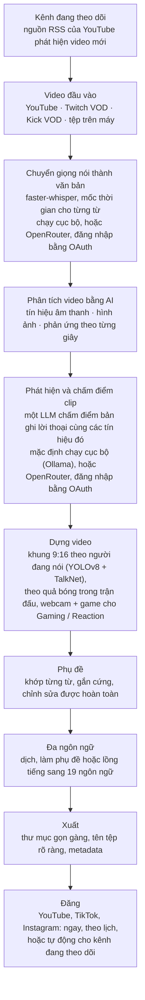

<div align="center">

[English](../../README.md) · [简体中文](README_zh.md) · [日本語](README_ja.md) · [한국어](README_ko.md) · [Türkçe](README_tr.md) · [Русский](README_ru.md) · **Tiếng Việt** · [ไทย](README_th.md) · [Deutsch](README_de.md) · [Español](README_es.md) · [Français](README_fr.md) · [Português (Brasil)](README_pt-BR.md) · [العربية](README_ar.md) · [Bahasa Indonesia](README_id.md) · [Italiano](README_it.md) · [हिन्दी](README_hi.md) · [বাংলা](README_bn.md) · [Filipino](README_tl.md) · [اردو](README_ur.md)

</div>

<a id="clips-kitty-the-free-open-source-opus-clip-alternative-for-chatting-gaming-and-sports-on-your-own-pc"></a>

# Clips Kitty: lựa chọn thay thế Opus Clip miễn phí, mã nguồn mở, dành cho trò chuyện, game và thể thao, chạy ngay trên PC của bạn

> README này được AI dịch từ [README tiếng Anh](../../README.md), là bản gốc và luôn được
> cập nhật trước. Rất hoan nghênh người bản ngữ góp ý chỉnh sửa.
>
> 🌐 [Trang web bằng tiếng Việt](https://colingpt9.github.io/clips-studio/vi.html)

<a href="https://apps.microsoft.com/detail/9NB6XT7DSQZZ">
  <picture>
    <source media="(prefers-color-scheme: dark)" srcset="https://get.microsoft.com/images/en-us%20dark.svg">
    
  </picture>
</a>

[](https://github.com/ColinGPT9/clips-studio/releases)
[](https://github.com/ColinGPT9/clips-studio/releases)
[](../../LICENSE)
[](https://github.com/ColinGPT9/clips-studio/stargazers)
[](https://github.com/ColinGPT9/clips-studio)
[](../../CONTRIBUTING.md)
[](../../docs/DOCKER.md)

<a href="https://youtu.be/g1dMqrq-YaI"></a>

<a id="star-and-share-clips-kitty--goal-150"></a>

### Gắn sao và chia sẻ Clips Kitty ⭐ Mục tiêu: 150

[](https://github.com/ColinGPT9/clips-studio/stargazers) **trên 150**

**Hãy gắn sao cho repo và chia sẻ nó.** Bạn không mất gì cả, và dự án này không có
ngân sách quảng cáo nào, nên truyền miệng là cách duy nhất để những YouTuber hay
streamer nhỏ tiếp theo biết rằng có một lựa chọn miễn phí.

**Tôi làm ra nó cho các YouTuber và streamer nhỏ**, những người không đủ tiền dùng các
công cụ khác hay thuê người dựng video. Đây là lựa chọn thay thế miễn phí cho Opus Clip,
Vizard và Klap, chạy **Google Gemma** ngay trên PC của bạn: không tốn tiền máy chủ, không
tính phí theo clip, không tính phí sử dụng AI.

> **Clips Kitty từng có tên Clips Studio cho đến phiên bản 1.1.3**, và được đổi tên để
> đáp ứng yêu cầu đặt tên của Microsoft Store. Vẫn là ứng dụng đó, repo đó, dữ liệu đó.


**Biến các buổi stream và video dài thành Shorts, Reels và TikTok sẵn sàng để đăng,
hoàn toàn trên máy của bạn.** Clips Kitty là công cụ tạo clip bằng AI kiêm trình chỉnh
sửa video miễn phí, mã nguồn mở dành cho nhà sáng tạo: dán đường link YouTube, Twitch
hoặc Kick, nó sẽ tìm những khoảnh khắc hay nhất, cắt khung 9:16 và giữ người nói ở chính
giữa, gắn cứng phụ đề khớp theo từng từ, rồi viết tiêu đề, mô tả và hashtag.

Mặc định không dùng AI trên đám mây. Không thuê bao. Không tính phí theo clip. Video của
bạn không bao giờ rời khỏi máy tính, trừ khi bạn yêu cầu nó đăng một clip lên kênh
YouTube của chính bạn.

Ưu tiên chạy cục bộ, dùng đám mây khi cần: nếu PC của bạn quá cũ để chạy AI, một nhà
cung cấp đám mây sẽ chạy thay, và tính phí vào tài khoản của chính bạn.
**OpenRouter là lựa chọn đám mây được khuyên dùng**: đăng nhập bằng tài khoản OpenRouter
(OAuth, không cần sao chép khóa) để dùng nhiều mô hình (Claude, GPT, Gemini, Muse Spark và
nhiều hơn nữa). Khi tôi thử, một video dài 2 giờ tốn khoảng 11 cent trên OpenRouter, với
Gemma (Gemma 4 26B-A4B) chọn clip và Whisper (large-v3-turbo) chuyển giọng nói thành văn
bản; số tiền bạn trả tùy vào mô hình bạn chọn và độ dài video.
OpenAI, Claude, Gemini, xAI, Meta, DeepSeek và Qwen cũng dùng trực tiếp được, bằng khóa
API của chính bạn.
Xem [docs/AI-BACKENDS.md](../../docs/AI-BACKENDS.md).

**Vì sao có dự án này:** hầu hết nhà sáng tạo đang phát triển kênh đều tự làm tất cả:
quay, stream, dựng, đăng. Clip là cách người xem tìm thấy bạn, và nó thường là việc đầu
tiên bị bỏ qua: thuê người dựng là khoản chi mà đa số kênh chưa thể kham nổi, các công cụ
cắt clip tính phí theo video hoặc theo tháng, còn tự cắt bằng tay thì mất cả một ngày mà
bạn cần cho việc khác. Ứng dụng này chạy trên phần cứng bạn đã có sẵn, nên dùng không tốn
gì và không giới hạn số clip bạn tạo.


<sub>38 clip từ một video trong 19 phút, trên một PC, không tải lên bất cứ thứ gì.</sub>

---

<a id="contents"></a>

## Mục lục

- [Nó làm được gì](#what-it-does)
- [So sánh với Opus Clip, Klap, Vizard và CapCut](#how-it-compares-to-opus-clip-klap-vizard-and-capcut)
- [Cách hoạt động](#how-it-works)
- [Tính năng](#features)
- [Nó được làm cho loại nội dung nào](#what-its-built-for)
- [Yêu cầu hệ thống](#requirements)
- [Cài đặt và chạy](#install-and-run)
- [Chọn mô hình AI](#pick-your-ai-model)
- [Phần cứng đã thử nghiệm và hiệu năng](#tested-hardware-and-performance)
- [Nền tảng được hỗ trợ](#supported-platforms)
- [Ngôn ngữ được hỗ trợ](#supported-languages)
- [Đăng lên YouTube](#publish-to-youtube)
- [Đăng lên mọi nền tảng cùng lúc](#publish-to-every-platform-at-once)
- [Tăng tốc bằng GPU](#gpu-acceleration)
- [Dùng qua dòng lệnh](#command-line-use)
- [Viết plugin](#write-a-plugin)
- [Xây dựng dựa trên nó](#build-on-it)
- [Kiến trúc](#architecture)
- [Đóng góp](#contributing)
- [Lộ trình](#roadmap-detail)
- [Giấy phép](#license)

---

<a id="what-it-does"></a>

## Nó làm được gì

Bạn đưa cho Clips Kitty một video dài. Nó trả lại cho bạn một thư mục các clip dọc hoàn
chỉnh để đăng, cùng một studio để xem lại và sửa chúng trước khi đăng.

Nó được làm cho loại nội dung mà hầu hết công cụ cắt clip xử lý kém nhất: **livestream,
IRL và video nói chuyện trước camera, podcast, nội dung gym/thể hình**: những video dài,
ít cấu trúc, nơi khoảnh khắc hay bị chôn vùi và chỉ dựa vào bản ghi lời thoại thì không
tìm ra được.

<a id="how-it-compares-to-opus-clip-klap-vizard-and-capcut"></a>

## So sánh với Opus Clip, Klap, Vizard và CapCut

Clips Kitty là lựa chọn mã nguồn mở thay cho các công cụ cắt clip trên đám mây. Khác biệt
quan trọng nằm ở chỗ công việc được thực hiện ở đâu: video của bạn không bao giờ được tải
lên, nên chẳng có gì để đo đếm và chẳng có gì để tính tiền.

| Công cụ | Giá, trả theo tháng | Gói miễn phí | Tự tìm clip cho bạn | Watermark | Tải video của bạn lên | Mã nguồn mở |
| ---- | --------------------- | --------- | ----------------------- | --------- | ------------------ | ----------- |
| **Clips Kitty** | Miễn phí, không có gói trả phí | Toàn bộ ứng dụng | Có | Không bao giờ | Không, chạy trên PC của bạn | Có, AGPL-3.0 |
| Opus Clip | $15 Starter, $29 Pro | 1080p, có watermark, hết hạn sau 3 ngày | Có | Ở gói miễn phí | Có | Không |
| Klap | $29 Pro, $14 Basic khi trả theo năm | Một video | Có | Không nêu rõ | Có | Không |
| Vizard | $29 Creator, $14.50 khi trả theo năm | 60 credit mỗi tháng, 720p | Có | Ở gói miễn phí | Có | Không |
| quso.ai | $29 đến $49 | 75 credit mỗi tháng, 720p | Có | Không nêu rõ | Có | Không |
| Ssemble | $15 đến $60, $6 đến $24 khi trả theo năm | Không có | Có | Không nêu rõ | Có | Không |
| Descript | $16, $24, $50 | 60 phút mỗi tháng, 720p | Một phần, đây là trình chỉnh sửa theo bản ghi lời thoại | Ở gói Free và Hobbyist | Có | Không |
| CapCut | Dùng miễn phí, gói trả phí tại capcut.com | Toàn bộ trình chỉnh sửa | **Không, bạn tự cắt bằng tay** | Tùy tính năng | Không, với ứng dụng máy tính | Không |

**CapCut là cái đáng để hiểu rõ**, vì đó là câu trả lời miễn phí mà ai cũng đưa ra. Đó là
một trình chỉnh sửa tốt và không tốn tiền, nhưng bạn phải tự tìm từng khoảnh khắc và tự cắt
từng clip. Clips Kitty cũng miễn phí, và lượt làm đầu tiên đó chính là phần nó làm thay bạn.

**Opus Clip, Klap hoặc Vizard là lựa chọn tốt hơn** nếu bạn không có PC Windows có card đồ
họa, bạn chỉ thỉnh thoảng mới cắt clip, hoặc bạn cần làm việc trên điện thoại. Clips Kitty
được làm để cắt clip số lượng lớn trên phần cứng bạn đã có sẵn.

**[So sánh đầy đủ cả bảy công cụ, kèm thế mạnh của từng cái](https://colingpt9.github.io/clips-studio/alternatives.html)**

<sub>Giá được kiểm tra trên trang bảng giá chính thức của từng công ty, ngày 17 tháng 9
năm 2026. CapCut không có trang bảng giá nào mà chúng tôi đọc được, nên không ghi giá cho
nó. Các gói có thể thay đổi; bảng này sẽ không tự cập nhật.</sub>

<a id="how-it-works"></a>

## Cách hoạt động



**Mọi giai đoạn đều chạy trên máy tính của bạn, trừ khi bạn chọn khác:** OpenRouter, đăng
nhập bằng tài khoản của bạn, cho phần AI hoặc chuyển giọng nói thành văn bản, và việc đăng
bài, vốn chỉ tải lên những clip bạn gửi đi. Ngoài ra, trong một lần chạy bình thường, thứ
duy nhất dùng đến mạng là việc tải video nguồn về.

<a id="the-stages-in-detail"></a>

### Chi tiết từng giai đoạn

**Chuyển giọng nói thành văn bản: faster-whisper.** Mốc thời gian cho từng từ, chạy trên
CUDA nếu có và chuyển sang CPU nếu không. Chính thời gian của từng từ giúp phụ đề rơi đúng
âm tiết và clip bắt đầu đúng ở ranh giới một câu thật sự.

**Chấm điểm clip bằng AI.** Bản ghi lời thoại chỉ là một trong năm tín hiệu. Âm thanh cho
biết các đỉnh âm lượng, mật độ tiếng bùng phát (tiếng cười và vỗ tay trông như thế nào), và
các kiểu cao trào im lặng→bùng nổ. Hình ảnh cho biết chuyển cảnh, chuyển động và thay đổi
diện tích khuôn mặt. Một tín hiệu phản ứng kết hợp tất cả những thứ đó. Mỗi tín hiệu được
chuẩn hóa *trong chính video đó*, nên cả một podcast yên tĩnh lẫn một buổi stream la hét đều
cho ra những đỉnh có ý nghĩa. Khi có dữ liệu khán giả thật (chat replay của Twitch, đo theo
số người chat khác nhau, và biểu đồ nhiệt "được xem lại nhiều nhất" của YouTube), nó cộng
thêm một điểm thưởng nhỏ có giới hạn.

LLM chạy cục bộ thấy bản ghi lời thoại **cùng một dòng thời gian các sự kiện đó**, nên nó
có thể đánh giá đúng tình huống "lời nói thì nhẹ nhàng nhưng cả khán phòng bùng nổ". Vì các
mô hình nhỏ thường chấm mọi thứ trong một khoảng hẹp, các clip lọt vào vòng cuối sẽ được so
sánh trực tiếp với nhau trong một lần gọi xếp hạng lại: với một mô hình 7B, đánh giá tương
đối dễ hơn nhiều so với chấm điểm tuyệt đối.

**Hồ sơ nhà sáng tạo.** Ứng dụng xây dựng một cơ sở kiến thức cho từng nhà sáng tạo qua các
video của họ: chủ đề lặp lại, series, người cộng tác, câu đùa quen thuộc và mạch chuyện đang
diễn ra. Bối cảnh đó giúp nó viết tiêu đề chính xác và nhận ra các chi tiết nhắc lại. Nó
được thiết kế thận trọng có chủ ý: một câu cửa miệng phải thực sự lặp lại mới được tính, kiến
thức không còn được nhắc đến sẽ chuyển sang trạng thái ngủ, và mọi phần điểm nó đóng góp đều
chỉ cộng thêm, có giới hạn và có thể tắt đi.

**Trình chỉnh sửa video.** Không phá hủy: cắt đầu đuôi, cắt giữa, tắt tiếng, tắt tiếng từng
từ, âm lượng, fade, tốc độ, chữ mở đầu (hook), nhạc và watermark được lưu dưới dạng thao tác
và áp dụng lúc render. Còn có cả khung chat chỉnh sửa bằng AI (*"làm dài thêm 5 giây"*,
*"phụ đề ghi gost, phải là ghost"*), trong đó mô hình đề xuất và mã đã được kiểm tra sẽ áp dụng.

**Xử lý video dài.** Một nhánh 16:9 tùy chọn dùng cùng phân tích đó: clip ngang, đoạn cắt độ
dài cho X/Twitter, video tổng hợp khoảnh khắc hay nhất, hoặc toàn bộ buổi stream đã bỏ các
khoảng lặng.

**Quy trình đa ngôn ngữ và lồng tiếng bằng AI.** Phụ đề được dịch và hiển thị để bạn xem lại
*trước khi* bất cứ thứ gì được ghi ra hay gắn cứng, nên một dòng dịch sai sẽ được sửa khi còn
sửa được. Một bảng thuật ngữ bảo vệ tên kênh, nhà tài trợ và các câu đùa nội bộ khỏi bị dịch.
Lồng tiếng dùng TTS cục bộ với các giọng có thể nghe thử.

**Tăng tốc GPU cục bộ.** CUDA cho phát hiện và chuyển giọng nói thành văn bản, mã hóa video
bằng phần cứng qua NVENC/AMF/QSV (tự phát hiện, có dự phòng CPU), và LLM chạy trên GPU qua Ollama.

<a id="features"></a>

## Tính năng

- **Phát hiện clip đa phương thức**: các khoảnh khắc được chấm điểm 0–100 bằng cách kết hợp
  lời nói, độ hào hứng trong âm thanh, hoạt động hình ảnh, phản ứng trên màn hình và sức mạnh
  của phần mở đầu/cao trào. Mọi clip vượt ngưỡng chất lượng đều được giữ lại, không có giới
  hạn tùy tiện.
- **Theo dõi khuôn mặt theo người nói**: nhận diện tư thế YOLOv8 giữ nhân vật ở chính giữa,
  và trong cảnh quay nhóm, khung hình đi theo **người thực sự đang nói**, do bộ nhận diện
  người nói TalkNet quyết định dựa trên cả khuôn mặt lẫn âm thanh chứ không dựa vào chuyển
  động. Khi người nói thay đổi, khung hình **cắt** sang họ thay vì lia ngang, đúng như một
  người dựng video sẽ làm. Chỉ cắt khung: không bao giờ kéo giãn, không bao giờ méo hình.
- **Chế độ podcast**: với cảnh quay nhiều camera, mỗi cảnh có khung cắt ổn định riêng trên
  một người, nên các lần chuyển cảnh rơi đúng vào khuôn mặt mà không cần lia. Trong một cảnh,
  nhân vật được chọn theo chuyển động miệng, nếu không được thì chọn khuôn mặt nổi bật nhất.
- **Vertical Live** (Live dọc): cho buổi livestream vốn đã ở dạng dọc khi phát (live dọc của
  YouTube, Twitch Dual Format, Streamlabs Dual Output, một buổi live Instagram hoặc TikTok đã
  tải về). Giữ nguyên bố cục 9:16 của buổi stream, bỏ qua theo dõi khuôn mặt, và vẫn chọn
  khoảnh khắc theo cách thông thường. Xem [docs/VERTICAL-LIVE.md](../../docs/VERTICAL-LIVE.md).
- **Sports: bóng đá và bóng rổ**: mỗi khoảnh khắc lớn của một trận đấu thành một clip riêng,
  kèm diễn biến dẫn đến và phản ứng sau đó.
  - **Bóng đá**: bàn thắng, pha cứu thua, thẻ phạt và cơ hội lớn. Bàn thắng được đọc từ bảng
    tỉ số và xác định thời điểm nhờ tiếng khán giả, còn khung 9:16 đi theo quả bóng. Chọn Tất
    cả bàn thắng, Pha cứu thua hay nhất, Thẻ phạt và hơn nữa, rồi ghép các khoảnh khắc thành
    video tóm tắt trận đấu và video về đội hoặc cầu thủ.
  - **Bóng rổ**: úp rổ, ném ba điểm, chắn bóng, cướp bóng và cú ném quyết định trận đấu. Bảng
    tỉ số trên màn hình xác nhận từng pha ghi điểm và số điểm của nó, còn hiệp đấu và đồng hồ
    khiến một cú ném quyết định được tính nặng hơn nhiều so với một pha ghi điểm ở hiệp một.
    Phản ứng của khán giả, băng ghế dự bị và bên đường biên cũng được tìm ra. Khung 9:16 của
    mỗi clip được lên kế hoạch quanh pha bóng: quả bóng và người đang giữ bóng, người nhận
    đường chuyền, và cú ném được theo đến tận rổ với vành rổ và bảng rổ trong khung hình. Khung
    lia theo pha bóng và không bao giờ phóng to. Quả bóng được tìm bằng mô hình nhận diện
    [E-BARD](https://github.com/GabrieleGiudic/E-BARD#readme) (ghi công trong phần [Giấy phép](#license)).

  Xem [docs/SPORTS.md](../../docs/SPORTS.md).
- **Phụ đề gắn cứng chỉnh sửa được**: khớp theo từng từ, và định dạng theo ý bạn (màu, cỡ,
  vị trí, số từ mỗi dòng, chữ hoa/thường, hoặc tắt). Sửa lỗi chuyển giọng nói thành văn bản
  từng dòng trước khi xuất. Khi có hai người nói, phụ đề của người thứ hai có thể dùng màu
  khác, và câu nào bị gán sai có thể đổi bằng tay.
- **Chat chỉnh sửa bằng AI**: mô tả chỗ chưa ổn bằng lời thường và nó sẽ dựng lại.
- **Ask Clips Kitty** (Hỏi Clips Kitty): ô văn bản ở cuối bảng điều khiển. Nói điều bạn muốn
  trong một câu, chẳng hạn *"cắt clip buổi stream này, nhớ có đoạn tôi chết dưới tay boss, phụ
  đề to màu vàng"*, và nó sẽ đưa video vào hàng đợi, chỉ cho bộ chọn clip biết cần tìm gì và
  đặt các tùy chọn bạn nêu. **Nó cần một mô hình Gemma 4**: xem
  [Ô văn bản ở cuối cần Gemma 4](#the-text-box-at-the-bottom-needs-gemma-4).
- **Tiêu đề, mô tả và hashtag bằng AI**, tất cả đều chỉnh sửa được trước khi xuất.
- **Hồ sơ nhà sáng tạo**: theo thời gian, ứng dụng học về từng nhà sáng tạo để chọn clip và
  đặt tiêu đề tốt hơn. Mọi thứ nằm trên máy tính của bạn, và bạn có thể xem, sửa hoặc xóa sạch.
- **Đăng đa ngôn ngữ**: 19 ngôn ngữ, có bước xem lại trước khi gắn cứng bất cứ thứ gì.
- **Lồng tiếng bằng AI**: chuyển văn bản thành giọng nói cục bộ, nghe thử giọng cho từng ngôn ngữ.
- **Xuất video dài**: clip 16:9, video tổng hợp khoảnh khắc hay, hoặc bản dựng stream đã bỏ
  đoạn trùng lặp. Mô tả của video tổng hợp có **mốc thời gian chương**, để người xem nhảy giữa
  các khoảnh khắc trên YouTube.
- **Hồ sơ watermark và thương hiệu**: thiết lập mặc định cho từng nhà sáng tạo được áp dụng
  tự động.
- **Trình quản lý mô hình**: đổi "bộ não" AI ngay trong ứng dụng; tải về, gỡ bỏ và chuyển đổi
  mô hình với thanh tiến trình, không cần terminal.
- **Đăng lên YouTube từ trình chỉnh sửa**: tiêu đề, mô tả, thẻ, ảnh thu nhỏ, danh sách phát,
  đối tượng người xem và chế độ hiển thị, rồi tải lên ngay hoặc lên lịch. Tùy chọn, mặc định
  tắt, và dùng khóa Google API của chính bạn.
- **Phản hồi trong ứng dụng**: báo lỗi kèm thông tin chẩn đoán tự thu thập, không cần tài khoản.
- **Giao diện dễ tiếp cận**: điều hướng bằng bàn phím, hỗ trợ giảm chuyển động, phông chữ và
  cỡ chữ tùy chỉnh.

<a id="what-its-built-for"></a>

## Nó được làm cho loại nội dung nào

Mọi thứ đều chạy với bất kỳ video nào bạn đưa vào. Dưới đây là những trường hợp nó "suy
nghĩ" nhiều hơn hoặc ít hơn so với danh sách tính năng gợi ý, để bạn không bị bất ngờ:

| Nội dung | Nó xử lý ra sao |
|---|---|
| **IRL, just chatting, podcast, vlog, phỏng vấn** | Đây là thứ nó được tinh chỉnh cho và được thử trên các buổi stream thật trước mỗi bản phát hành |
| **Game và video reaction** | Khi bật **Gaming / Reaction** (Game / Reaction): webcam ở một nửa, game hoặc video được reaction ở nửa kia, được kiểm tra trên chính khung hình của video trước khi xử lý ([docs/GAMING.md](../../docs/GAMING.md)). Streamer là người đang nói, không bao giờ là khuôn mặt to nhất. Nếu không bật, khung hình có thể đi theo một nhân vật trong game. Chỉ dành cho người thật trên camera, không hỗ trợ VTuber |
| **Trận đấu thể thao** | Khi bật **Sports** (Thể thao): làm cho các buổi phát sóng có bảng tỉ số và bình luận, nơi bàn thắng và các pha ghi điểm bóng rổ được xác định chắc chắn. Cảnh quay của câu lạc bộ hoặc bằng điện thoại thường không có cả hai: clip của chúng đi theo quả bóng, còn bàn thắng lấy từ các sự kiện trận đấu bạn dán vào, ví dụ thẻ bàn thắng từ ứng dụng của câu lạc bộ ([docs/SPORTS.md](../../docs/SPORTS.md)) |
| **Thứ mà video reaction đang phản ứng** | Clip vẫn được chọn dựa trên những gì được *nói ra*, nên một khoảnh khắc trong video được xem mà không ai bình luận thì nó không thấy được |

Việc chọn clip dựa trên bản ghi lời thoại và tín hiệu. Khi điều buồn cười *chỉ nằm ở hình
ảnh* và không ai bình luận về nó, bạn nên chuẩn bị tự tìm nó trong trình chỉnh sửa.

<a id="requirements"></a>

## Yêu cầu hệ thống

|             | Tối thiểu                                    | Khuyến nghị                     |
| ----------- | -------------------------------------------- | ------------------------------- |
| **GPU**     | NVIDIA RTX 2060 (6 GB)                       | RTX 3060 12 GB hoặc tốt hơn     |
| **CPU**     | Intel Core i3-9100 / AMD Ryzen 3 3200G (2019)| 6 nhân trở lên                  |
| **RAM**     | 16 GB                                        | 16 GB trở lên                   |
| **Ổ đĩa**   | ~20 GB, cộng thêm chỗ cho các video bạn cắt  |                                 |
| **Hệ điều hành** | Windows 10 hoặc 11                      |                                 |

**Dưới mức tối thiểu có thể vẫn chạy được, nhưng không được hỗ trợ và sẽ chậm.** Cắt clip
một buổi stream là hàng giờ giải mã video, chuyển giọng nói thành văn bản và mã hóa; phần
cứng từ trước khoảng năm 2019 sẽ mất lâu đến mức ứng dụng trông như bị hỏng dù nó đang chạy
đúng.

Có hai điểm đáng nói thêm:

- **16 GB RAM không phải là gợi ý.** Với 8 GB, nó sẽ phân tích toàn bộ video rồi không render
  ra gì cả, trông giống như bị treo hơn là hết bộ nhớ.
- **GPU là tùy chọn, không bắt buộc.** Không có GPU, mọi thứ chạy trên CPU, chậm hơn nhưng
  vẫn đầy đủ. RTX 2060 là mức mà nhánh GPU bắt đầu hoạt động; xem
  [Tăng tốc bằng GPU](#gpu-acceleration).

Ứng dụng **chỉ chạy trên Windows**. Engine Python lẽ ra chạy được trên Linux/macOS, nhưng
chưa có bản dựng cho Mac và người duy trì dự án không có máy Mac để thử. Xem
[#62](https://github.com/ColinGPT9/clips-studio/issues/62) nếu bạn có Mac và muốn giúp.

Chạy từ mã nguồn cần những thứ mà bộ cài đặt lẽ ra đã gói sẵn cho bạn:

- **Python 3.10+** và **Node.js 18+**
- **[FFmpeg](https://ffmpeg.org/download.html)** trong PATH
- **[Ollama](https://ollama.com)** đã tải một mô hình: `ollama pull gemma:7b`

<a id="install-and-run"></a>

## Cài đặt và chạy

**Cách dễ nhất là [Microsoft Store](https://apps.microsoft.com/detail/9NB6XT7DSQZZ).**
Một cú nhấp, tự cập nhật, và Windows không hiện cảnh báo bảo mật nào. Microsoft đã chứng
nhận và ký gói cài đặt, nên cảnh báo SmartScreen mô tả bên dưới hoàn toàn không xuất hiện.
Store cài phiên bản mới khi đến lượt; muốn có ngay, hãy mở trang Clips Kitty trong
Microsoft Store và nhấn **Update** (Cập nhật).

**Hoặc tải bộ cài đặt.** Tải **Web Setup** mới nhất từ
[Releases](https://github.com/ColinGPT9/clips-studio/releases) và chạy nó. Nó chứa ứng dụng,
engine Python, mọi thư viện, FFmpeg, môi trường chạy AI và toàn bộ trọng số cho phát hiện và
chuyển giọng nói thành văn bản: không cần Python, không cần PATH, không cần terminal, và không
phải cài chương trình thứ hai.

**Hoặc dùng winget.** `winget install ColinGPT9.ClipsKitty` cài cùng bản Web Setup đó từ
terminal.

Thứ duy nhất nó không mang theo là chính mô hình ngôn ngữ, vì các mô hình đó được phát hành
theo giấy phép mà người tải về phải tự chấp nhận, chứ không thể chấp nhận thay bạn. Trình
hướng dẫn cài đặt tự bắt đầu tải, chọn kích thước phù hợp với card đồ họa của bạn và hiện
thanh tiến trình. Vậy là: một lần tải, một cú nhấp đúp, một thanh tiến trình. Sau đó nó chạy
offline.

> Lần đầu chạy, Windows sẽ cảnh báo rằng ứng dụng chưa được ký. Nhấn
> *Thông tin thêm → Vẫn chạy*. Chứng chỉ ký số đã có trong kế hoạch.

<a id="from-source"></a>

### Từ mã nguồn

```bash
git clone https://github.com/ColinGPT9/clips-studio
cd clips-studio
pip install -r requirements.txt

cd ui
npm install
npm run dev        # opens the Clips Kitty desktop app
```

Ứng dụng tự khởi động engine Python của nó. Dán một đường link vào **Clip Editor** (Trình
chỉnh sửa clip), nhấn *Generate clips* (Tạo clip), và theo dõi tiến trình trực tiếp.

Tự build bộ cài đặt chỉ cần một lệnh. Xem
[CONTRIBUTING.md](../../CONTRIBUTING.md#building-the-windows-installer).

<a id="with-docker-nothing-else-to-install"></a>

### Với Docker: không cần cài gì khác

Dành cho người đóng góp. Bạn chỉ cần [Docker Desktop](https://docs.docker.com/get-started/get-docker/)
và không gì khác: không Python, không Node, không FFmpeg, không PyTorch.

```bash
git clone https://github.com/ColinGPT9/clips-studio
cd clips-studio
docker compose up
```

Ba dịch vụ cùng khởi động:

| | |
|---|---|
| **<http://localhost:5173>** | giao diện, trong trình duyệt của bạn |
| **<http://localhost:8765>** | engine và API của nó |
| Ollama | AI cục bộ, trên :11434 |

Sau đó tải một mô hình (`docker compose exec ollama ollama pull gemma3:4b`) là bạn đã có
một bản checkout chạy được.

Chạy các bài kiểm tra cũng theo cách tương tự:

```bash
docker compose run --rm engine pytest
docker compose run --rm ui npm run typecheck
```

> **Bỏ qua lần build đầu mất mười phút:** `docker compose pull` tải về image engine dựng sẵn
> thay vì biên dịch PyTorch và OpenCV trên máy.

Bản thân vỏ ứng dụng máy tính vẫn chạy trên máy chủ của bạn, vì Electron cần màn hình hiển
thị; mọi thứ khác đều nằm trong container. Chi tiết, và những gì cách này không cho bạn biết,
có trong [docs/DOCKER.md](../../docs/DOCKER.md).

<a id="pick-your-ai-model"></a>

## Chọn mô hình AI

Mở trang **Models** (Mô hình) để xem những gì đã cài và GPU của bạn chạy được gì:

Chỉ có một tiêu chí: bạn có bao nhiêu VRAM. Đây là đúng những dòng ứng dụng hiển thị, lấy từ
`RECOMMENDATIONS` trong [`llm/manager.py`](../../llm/manager.py). Trình hướng dẫn cài đặt và
trang Models đọc cùng một bảng đó, nên chúng không thể mâu thuẫn với nhau, hay với bảng này.

| Phần cứng của bạn | Mô hình khuyên dùng | |
|---|---|---|
| CPU / iGPU, không có card đồ họa | `gemma3:4b` | đã thử nghiệm |
| Dưới 6 GB VRAM, hoặc PC đời cũ | `gemma4:e2b` | |
| 6 GB VRAM | `gemma4:e4b` | |
| 8 GB VRAM | **`gemma:7b`** | đã thử nghiệm · mặc định khi phát hành |
| 10–12 GB VRAM | `gemma3:12b` | đã thử nghiệm |
| 16–24 GB VRAM | `gemma3:27b` | |

Và những mô hình đáng chọn vì lý do khác ngoài VRAM:

| Lý do | Mô hình |
|---|---|
| Dịch / đa ngôn ngữ | `qwen3:8b` hoặc `qwen3:14b` |
| Giấy phép thoáng | `mistral-nemo:12b` (Apache-2.0) · `phi4:14b` (MIT) |

**Chỉ ba mô hình được đánh dấu "đã thử nghiệm" mới được chạy trên các buổi stream thật**, và
`gemma:7b` là mô hình chạy nhiều giờ nhất; đó là mô hình đi kèm `config/settings.yaml`.
Những mô hình khác được liệt kê vì chúng có kích thước hợp lý và được dùng miễn phí cho mục
đích thương mại, chứ không phải vì chất lượng clip đã được đo với chúng. Tất cả đều chạy được,
vì ứng dụng giao tiếp với mọi mô hình giống hệt nhau qua Ollama, nhưng chưa ai kiểm tra xem
chúng có chọn khoảnh khắc tốt hơn không. Việc lấp khoảng trống đó là
[#38](https://github.com/ColinGPT9/clips-studio/issues/38).

Bất cứ thứ gì Ollama phục vụ đều dùng được, và chuyển đổi chỉ cần một cú nhấp. Phần dịch có
thể dùng mô hình *khác* với phần cắt clip. Đặt `llm.translation_model`.

<a id="the-text-box-at-the-bottom-needs-gemma-4"></a>

### Ô văn bản ở cuối cần Gemma 4

**Ask Clips Kitty**, ô văn bản ở cuối bảng điều khiển, chỉ hoạt động với mô hình biết dùng
các công cụ của ứng dụng. Gemma 4 làm được. `gemma:7b` và các mô hình Gemma 3 thì không, và
trình cài đặt sẽ cài một trong số đó trên PC không có card đồ họa hoặc có từ 8 GB VRAM trở
lên. Trên những máy đó, ô này sẽ không hoạt động cho đến khi bạn thêm một mô hình Gemma 4:
phiên bản 2.0 báo *"No installed model can use tools"* (Không có mô hình nào đã cài dùng được
công cụ), còn các phiên bản sau đề nghị tải về ngay trong ô.

Dù mô hình nào đang chọn clip cho bạn, hãy cài thêm một mô hình Gemma 4 bên cạnh trên trang
**Models**: `gemma4:e4b` với card đồ họa từ 6 GB trở lên, `gemma4:e2b` nếu ít hơn. Bạn không
cần chuyển sang nó. Ô văn bản tự tìm thấy nó, và clip của bạn vẫn do mô hình bạn đã chọn chọn
lựa. Nếu bạn chạy AI qua OpenRouter thì ô này dùng mô hình đó và không cần cài gì cả.

<a id="tested-hardware-and-performance"></a>

## Phần cứng đã thử nghiệm và hiệu năng

Clips Kitty được phát triển và thử nghiệm hằng ngày trên chiếc máy này, nên đây là mốc tham
chiếu hữu ích nếu bạn muốn so sánh kết quả của mình:

| | |
|---|---|
| **GPU** | NVIDIA GeForce RTX 3060, 12 GB VRAM |
| **CPU** | AMD Ryzen 5 5600X (6 nhân / 12 luồng) |
| **RAM** | 16 GB |
| **Hệ điều hành** | Windows 10 |
| **Mô hình cắt clip** | `gemma:7b` qua Ollama |
| **Chuyển giọng nói thành văn bản** | faster-whisper `large-v3-turbo` trên CUDA |

Mọi thứ trong repo này (thiết lập mặc định, `parallel_renders: 3`, kích thước đoạn phân
tích 5 phút) đều được tinh chỉnh cho máy cỡ khoảng này. Với GPU mạnh hơn, hãy tăng
`llm.num_ctx` và `analysis.chunk_seconds` cùng lúc và dùng mô hình lớn hơn một bậc; với GPU
yếu hơn, hãy hạ xuống `gemma3:4b`.

Nếu bạn đo hiệu năng Clips Kitty trên phần cứng khác, hãy đăng kết quả trong
[Discussions](https://github.com/ColinGPT9/clips-studio/discussions). Số liệu thật từ máy thật
giúp mọi người chọn cấu hình phù hợp.

<a id="supported-platforms"></a>

## Nền tảng được hỗ trợ

| Nguồn | Mức hỗ trợ |
|---|---|
| Video YouTube | Đầy đủ. H.264 được chọn có chủ ý (AV1 làm thời gian xử lý tăng khoảng gấp đôi) |
| Twitch VOD | Đầy đủ, bao gồm cả chat replay làm tín hiệu khán giả |
| Kick VOD | Đầy đủ (Kick xóa chat sau khi stream kết thúc, nên không có tín hiệu chat) |
| Tệp video trên máy | Đầy đủ. Cắt clip từ cảnh quay của chính bạn trước khi đăng |
| Livestream đang phát | Không hỗ trợ, theo thiết kế. Chỉ VOD |

<a id="supported-languages"></a>

## Ngôn ngữ được hỗ trợ

Clip có thể được dịch, làm phụ đề và lồng tiếng sang **19 ngôn ngữ**, và **bản thân giao diện
cũng đã được dịch sang cả 19 ngôn ngữ**, nên bạn dùng được ứng dụng bằng chính những ngôn ngữ
mà nó đăng bài:

Tiếng Anh · Tiếng Tây Ban Nha · Tiếng Bồ Đào Nha (Brazil) · Tiếng Pháp · Tiếng Đức ·
Tiếng Hindi · Tiếng Indonesia · Tiếng Nhật · Tiếng Nga · Tiếng Ả Rập · Tiếng Trung (Giản thể) ·
Tiếng Việt · Tiếng Filipino · Tiếng Thổ Nhĩ Kỳ · Tiếng Urdu · Tiếng Bengali · Tiếng Thái ·
Tiếng Hàn · Tiếng Ý

Thêm một ngôn ngữ chỉ là thêm một dòng trong `multilingual/languages.py` cùng một tệp locale
trong `ui/src/renderer/src/locales/`. Bộ dịch và bộ ghi phụ đề không phụ thuộc vào ngôn ngữ.

<a id="help-wanted-the-maintainer-only-speaks-english"></a>

### Cần giúp đỡ: người duy trì dự án chỉ nói tiếng Anh

18 trong số 19 bản dịch giao diện đó chưa từng được người nói ngôn ngữ ấy đọc qua. Một nửa
trong số đó chưa hoàn thành. Mỗi ngôn ngữ có một issue riêng, viết bằng tiếng Anh và bằng
chính ngôn ngữ đó, và **chỉ cần báo một từ dịch chưa ổn là đã đóng góp trọn vẹn**: không cần
pull request. [Cách thực hiện](../../docs/TRANSLATING.md).

**Cần hoàn thiện** (còn khoảng 68 chuỗi bằng tiếng Anh):
[বাংলা (Tiếng Bengali)](https://github.com/ColinGPT9/clips-studio/issues/43) ·
[Italiano (Tiếng Ý)](https://github.com/ColinGPT9/clips-studio/issues/44) ·
[한국어 (Tiếng Hàn)](https://github.com/ColinGPT9/clips-studio/issues/45) ·
[ไทย (Tiếng Thái)](https://github.com/ColinGPT9/clips-studio/issues/46) ·
[Tagalog (Tiếng Filipino)](https://github.com/ColinGPT9/clips-studio/issues/47) ·
[Türkçe (Tiếng Thổ Nhĩ Kỳ)](https://github.com/ColinGPT9/clips-studio/issues/48) ·
[اردو (Tiếng Urdu)](https://github.com/ColinGPT9/clips-studio/issues/49) ·
[Tiếng Việt](https://github.com/ColinGPT9/clips-studio/issues/50) ·
[中文 (Tiếng Trung)](https://github.com/ColinGPT9/clips-studio/issues/51)

**Cần kiểm tra** (đã đầy đủ, nhưng chưa ai xác nhận là đọc tự nhiên):
[العربية (Tiếng Ả Rập)](https://github.com/ColinGPT9/clips-studio/issues/52) ·
[Deutsch (Tiếng Đức)](https://github.com/ColinGPT9/clips-studio/issues/53) ·
[Español (Tiếng Tây Ban Nha)](https://github.com/ColinGPT9/clips-studio/issues/54) ·
[Français (Tiếng Pháp)](https://github.com/ColinGPT9/clips-studio/issues/55) ·
[हिन्दी (Tiếng Hindi)](https://github.com/ColinGPT9/clips-studio/issues/56) ·
[Bahasa Indonesia (Tiếng Indonesia)](https://github.com/ColinGPT9/clips-studio/issues/57) ·
[日本語 (Tiếng Nhật)](https://github.com/ColinGPT9/clips-studio/issues/58) ·
[Português (Tiếng Bồ Đào Nha)](https://github.com/ColinGPT9/clips-studio/issues/59) ·
[Русский (Tiếng Nga)](https://github.com/ColinGPT9/clips-studio/issues/60)

Muốn một ngôn ngữ chưa có ở đây? [#61](https://github.com/ColinGPT9/clips-studio/issues/61).

<a id="publish-to-youtube"></a>

## Đăng lên YouTube

Mặc định tắt. Bật nó trong **Settings → Publish to YouTube** (Cài đặt → Đăng lên YouTube) và
một tab **YouTube** sẽ xuất hiện trong trình chỉnh sửa: điền tiêu đề, mô tả, thẻ, ảnh thu nhỏ,
danh sách phát, đối tượng người xem và chế độ hiển thị, rồi nhấn **Upload now** (Tải lên ngay).
Clips Kitty sẽ render clip nếu bạn có chỉnh sửa chưa lưu và tải thẳng lên kênh của bạn. Không
có bước xuất, không có trang đăng bài riêng. Bạn không cần rời trình chỉnh sửa.

Nếu bạn để tắt, không có gì thay đổi ở bất cứ đâu trong ứng dụng.

<a id="scheduling"></a>

### Lên lịch

Chọn **Schedule on YouTube** (Lên lịch trên YouTube) sẽ tải video lên *ngay lập tức*, đặt ở
chế độ riêng tư và giao cho YouTube thời điểm đăng. YouTube sẽ đăng video vào đúng ngày đó.

**Bạn có thể đóng Clips Kitty và tắt máy tính.** Ứng dụng này không có hẹn giờ, không có dịch
vụ chạy nền, và không có gì cần để chạy. Khi YouTube đã nhận video, việc của Clips Kitty đã xong.

<a id="you-need-your-own-google-api-key"></a>

### Bạn cần khóa Google API của riêng mình

Clips Kitty không đi kèm khóa dùng chung, và đây không chỉ là vì thận trọng. Hạn mức tải lên
của Google tính **theo từng Cloud project**: một khóa dùng chung đồng nghĩa với việc mọi người
dùng trên thế giới chia nhau cùng 100 lượt tải lên mỗi ngày. Project của riêng bạn cho bạn hạn
mức riêng, và thông tin xác thực của bạn không bao giờ rời khỏi máy. Không có máy chủ Clips
Kitty nào nằm giữa.

Thiết lập miễn phí và mất khoảng mười phút; trình hướng dẫn trong Settings sẽ dẫn bạn từng bước:

1. Tạo một project trong [Google Cloud Console](https://console.cloud.google.com/projectcreate).
2. Bật **YouTube Data API v3** trong APIs & Services → Library.
3. Điền màn hình xin quyền OAuth (OAuth consent screen), rồi nhấn **Publish app**. Bước này
   quan trọng: nếu để ở chế độ *Testing*, Google sẽ hết hạn phiên đăng nhập của bạn sau mỗi
   7 ngày và bạn phải kết nối lại hằng tuần. "In production" không có nghĩa là đã được xác
   minh và không tốn tiền.
4. Credentials → Create credentials → OAuth client ID → loại **Desktop app**.
5. Dán client ID và secret vào Settings, rồi kết nối kênh của bạn.

Bạn sẽ thấy cảnh báo "Google hasn't verified this app" (Google chưa xác minh ứng dụng này) khi
kết nối. Đó là ứng dụng của chính bạn đang cảnh báo về chính bạn. **Advanced → Go to (unsafe)**
sẽ đưa bạn qua bước đó.

<a id="posting-publicly"></a>

### Đăng công khai

Có một điều cần biết trước khi dựa vào tính năng này, vì không phần mềm nào vượt qua được nó:

> **Cho đến khi Google Cloud project của bạn vượt qua đợt kiểm định API miễn phí của
> YouTube, YouTube sẽ khóa mọi video tải lên qua project đó ở chế độ riêng tư.** Khóa này là
> vĩnh viễn. Bạn không thể chuyển video sang công khai sau đó trong Studio, và không có cách
> khiếu nại. Cách duy nhất là tải lại video từ một project đã được kiểm định.

Clips Kitty kiểm tra sau mỗi lần tải lên và nói rõ cho bạn biết nếu điều đó xảy ra, thay vì
báo thành công cho một video không ai xem được. Nếu bạn định đăng công khai, hãy gửi
[biểu mẫu kiểm định YouTube API Services](https://support.google.com/youtube/contact/yt_api_form)
trước. Tải lên ở chế độ **không công khai** hoặc **riêng tư** thì không bị ảnh hưởng.

<a id="what-it-can-and-cannot-set"></a>

### Những gì nó đặt được và không đặt được

Mọi thứ API công khai cho phép: tiêu đề, mô tả (mốc thời gian trong đó sẽ thành chương), thẻ,
danh mục, ngôn ngữ, chế độ hiển thị, thời gian đăng theo lịch, nội dung dành cho trẻ em, công
bố nội dung bị chỉnh sửa/tổng hợp, giấy phép, cho phép nhúng, số liệu công khai, ảnh thu nhỏ
tùy chỉnh và thêm vào danh sách phát.

Một số tính năng của YouTube Studio hoàn toàn không có trong API công khai, nên ứng dụng cố ý
không có nút điều khiển cho chúng thay vì có một nút âm thầm không làm gì: kiếm tiền và điểm
chèn quảng cáo, công bố quảng cáo trả phí, màn hình kết thúc và thẻ, cài đặt bình luận, giới
hạn độ tuổi, Công chiếu (Premieres), và quyền remix Shorts. Bảng điều khiển sẽ dẫn bạn sang
Studio cho những mục đó.

Shorts không cần gì đặc biệt: không có chế độ riêng và không cần thẻ `#Shorts`. YouTube tự
phân loại video là Short dựa trên tỉ lệ khung hình và độ dài.

<a id="publish-to-every-platform-at-once"></a>

## Đăng lên mọi nền tảng cùng lúc

Cũng tắt theo mặc định. Bật nó trong **Settings → Publish through WoopSocial** (Cài đặt → Đăng
qua WoopSocial) và một tab **Publish** (Đăng) sẽ xuất hiện trong trình chỉnh sửa: chọn các nền
tảng — hoặc nhấn **Everywhere** (Mọi nơi) — viết tiêu đề và mô tả một lần, và một lần tải lên
sẽ đến YouTube, TikTok, Instagram, Facebook, X, Threads, LinkedIn, Pinterest và Bluesky cùng
lúc. **Publish all** (Đăng tất cả) trong Clip Editor xử lý cả một loạt, giãn cách ra để cả chục
clip không lên cùng một giây.

Tính năng này **không chạy cục bộ**. Clip và thông tin của nó được gửi tới một dịch vụ đăng
bài, dịch vụ này phân phối chúng và giữ kết nối tới các tài khoản mạng xã hội của bạn, nên
Clips Kitty không bao giờ hỏi mật khẩu mạng xã hội. Mọi thứ khác trong ứng dụng vẫn chạy trên
PC của bạn.

Hỗ trợ hai dịch vụ: **[WoopSocial](https://woopsocial.com/?via=clipskitty)**, với gói miễn
phí kết nối hai tài khoản và cho phép khoảng 5 bài đăng YouTube mỗi ngày, còn các gói trả phí
nâng cả hai giới hạn, và **[Upload-Post](https://www.upload-post.com/)**, hỗ trợ nhiều nơi
đăng hơn và có thêm ảnh thu nhỏ, bình luận đầu tiên và hàng đợi đăng bài. Bật một trong hai,
hoặc cả hai.

<sub>Link liên kết (affiliate) - Clips Kitty có thể nhận hoa hồng nếu bạn đăng ký qua link
này, và bạn không phải trả thêm gì.</sub>

**Dùng khóa của riêng bạn.** Bạn tự tạo tài khoản, tự kết nối mạng xã hội và dùng hạn mức của
chính mình. Clips Kitty không thu phí, không giữ khóa dùng chung và không trả tiền cho thứ gì —
giống hệt cách làm với tích hợp YouTube, và vì cùng một lý do.

Hướng dẫn đầy đủ, mức hỗ trợ và giới hạn theo từng nền tảng:
**[docs/UPLOAD-POST.md](../../docs/UPLOAD-POST.md)**.

<a id="gpu-acceleration"></a>

## Tăng tốc bằng GPU

**Mã hóa video** được tăng tốc phần cứng tự động trên cả ba hãng: NVIDIA (NVENC), AMD (AMF) và
Intel (QSV). Khi khởi động, engine thử mã hóa một khung hình với từng loại và dùng loại đầu
tiên thực sự hoạt động, nếu không thì dùng CPU. Buộc chọn một loại bằng `video.encoder` trong
`config/settings.yaml`.

**Phát hiện và chuyển giọng nói thành văn bản** nhanh nhất với CUDA. Mặc định, `pip install
torch` cài bản **chỉ dùng CPU**. Với NVIDIA:

```bash
pip uninstall torch torchvision -y
pip install torch torchvision --index-url https://download.pytorch.org/whl/cu130
```

**Card nào dùng được GPU:** dòng GTX 16, dòng RTX 20, và mọi dòng mới hơn, kể cả dòng RTX 50.

**Chuyển giọng nói thành văn bản trên GPU** còn cần cuBLAS 12 của NVIDIA: engine của Whisper
(CTranslate2) là bản dựng cho CUDA 12, còn PyTorch cho CUDA 13 ở trên chỉ có cuBLAS 13.
`pip install -r requirements.txt` sẽ cài nó (`nvidia-cublas-cu12`), và ứng dụng đã cài cũng
mang theo nó, nên không cần CUDA toolkit. Nếu thiếu, phần chuyển giọng nói thành văn bản sẽ
chạy trên CPU và nhật ký sẽ ghi lý do.

**Dòng GTX 10 và cũ hơn nằm dưới mức tối thiểu.** Đây không phải cấu hình được hỗ trợ. Ứng
dụng không từ chối khởi động trên chúng: phần phát hiện chuyển sang CPU và mọi thứ vẫn chạy,
nhưng sẽ chậm, và một chiếc máy cũ như vậy thường đi kèm CPU làm chậm cả quá trình chứ không
chỉ riêng bước phát hiện.

Hãy dùng index `cu130` ở trên, đừng dùng bản cũ hơn. Các bản CUDA cũ không có mã cho card đời
mới, và khi đó ứng dụng sẽ chạy bằng CPU trên phần cứng lẽ ra phải nhanh.

Người dùng GPU AMD: theo dõi khuôn mặt và chuyển giọng nói thành văn bản chạy trên CPU trên
Windows, vẫn hoạt động đầy đủ, chỉ chậm hơn. GPU của bạn vẫn được dùng để mã hóa video qua AMF
và cho LLM qua Ollama, vốn tự hỗ trợ AMD.

**Giải mã video** đi qua FFmpeg có tăng tốc phần cứng thay vì OpenCV, cho cả lượt theo dõi lẫn
lúc render. Đọc các khung hình mẫu theo cách này chỉ tốn khoảng một phần mười CPU so với giải
mã chúng bằng Python trước đây, điều quan trọng vì lượt theo dõi chạy qua mọi clip.

**Chia sẻ CPU.** Phát hiện và render đều muốn dùng hết mọi nhân, và nếu để mặc, chúng sẽ tranh
nhau và tranh với cả giao diện. Khi khởi động, engine chia các nhân cho các tiến trình render
và cố ý giữ lại hai nhân, để ứng dụng vẫn phản hồi nhanh trong khi xử lý một loạt. Tinh chỉnh
bằng `video.parallel_renders`.

<a id="command-line-use"></a>

## Dùng qua dòng lệnh

Mọi thứ đều chạy được mà không cần ứng dụng máy tính:

```bash
python main.py process "https://www.youtube.com/watch?v=VIDEO_ID"   # one video
python main.py models                                               # list/switch models
python main.py status                                               # processing state
python main.py serve                                                # just the API engine
```

Cài đặt nằm trong [config/settings.yaml](../../config/settings.yaml). Đầu tệp là một khối
thiết lập nhanh ngắn gọn, mọi thứ nâng cao nằm bên dưới. Mỗi prompt cho LLM là một tệp văn bản
thường trong [config/prompts/](../../config/prompts/), nên bạn có thể tinh chỉnh cách chấm điểm
clip mà không cần đụng đến Python.

<a id="write-a-plugin"></a>

## Viết plugin

Bạn hiểu một game, một môn thể thao hay một loại chương trình rõ hơn một bộ phát hiện đa
năng? Hãy viết một plugin Python nhỏ để tìm, hiểu hoặc chấm điểm các khoảnh khắc trong video,
và Clips Kitty sẽ lo phần còn lại. SDK dùng giấy phép MIT, nên plugin của bạn có thể dùng bất
kỳ giấy phép nào, và không cần fork gì cả.

```text
Clips Kitty SDK

Input                      a link or a video file
  ↓
Video                      Clips Kitty downloads it and writes down what is said
  ↓
Your plugin                every step is optional
  ├── find                 picks the moments                  built
  ├── understand           says what happens in each one      built
  ├── rate                 scores each moment                 built
  └── edit                 suggests edits for the creator     built
  ↓
Clips Kitty                does every step no plugin does, then cuts, frames and captions the clips
  ↓
Creator / Social Platform  posts when the creator clicks Publish, or on a schedule or automatic posting the creator switched on
```

- Một plugin có thể tìm khoảnh khắc cho một video; nó thay thế phần tìm kiếm của chính Clips Kitty.
- Tối đa 3 plugin có thể hiểu và tối đa 3 plugin có thể chấm điểm, sau bất kỳ plugin tìm kiếm nào.
- Vai trò của một plugin được xác định bởi `inputs` và `outputs` trong manifest của nó ([Các bước](../../docs/developers/steps.md)).
- Tối đa 3 plugin có thể đề xuất chỉnh sửa cho các clip sẽ được tạo.
- Plugin chỉnh sửa đề xuất các thay đổi chờ nhà sáng tạo duyệt trong trình chỉnh sửa ([Các bước](../../docs/developers/steps.md#suggest-edits-the-edit-step)).
- Đăng bài không phải là một bước của plugin: Clips Kitty tự đăng clip, và qua WoopSocial nó có thể đăng lên nhiều trang cùng lúc bằng tài khoản của chính nhà sáng tạo ([Đăng lên mọi nền tảng cùng lúc](#publish-to-every-platform-at-once)). `kind: publisher` sẽ bị từ chối: plugin không đăng bài.

Ba lệnh sau cài SDK, tạo một plugin từ mẫu `game-events` (cho Quarkbloom Arena, một game hư
cấu) và chạy nó trên một video thử do SDK tạo ra. Chúng cần Python 3.11, FFmpeg và Git.

PowerShell (Windows):

```powershell
py -m pip install "clipskitty-sdk[yaml,test] @ git+https://github.com/ColinGPT9/clips-studio#subdirectory=sdk/python"
py -m clipskitty_sdk new quarkbloom-bursts --template game-events --publisher your-github-name
py -m clipskitty_sdk run quarkbloom-bursts --sample
```

bash (macOS, Linux):

```bash
python -m pip install "clipskitty-sdk[yaml,test] @ git+https://github.com/ColinGPT9/clips-studio#subdirectory=sdk/python"
python -m clipskitty_sdk new quarkbloom-bursts --template game-events --publisher your-github-name
python -m clipskitty_sdk run quarkbloom-bursts --sample
```

Clips Kitty 2.1.0 là bản phát hành đầu tiên chạy được plugin, và đi kèm SDK 1.3.0.

**[Pipeline game đầu tiên của bạn](../../docs/developers/first-game-pipeline.md)** tiếp tục từ
đó, từng bước một, cho đến khi có một plugin được cài trong Clips Kitty và được liệt kê trong
Marketplace của nó. [Sổ tay tín hiệu](../../docs/developers/signals-cookbook.md) có các công
thức để đọc video của một game, [tài liệu tham khảo SDK](../../docs/developers/sdk.md) có mọi
lệnh và lời gọi, và [tài liệu cho nhà phát triển](../../docs/developers/README.md) có mọi thứ
còn lại. Trang [Clips Kitty SDK](https://colingpt9.github.io/clips-studio/developers.html) trên
website là bản rút gọn.

<a id="build-on-it"></a>

## Xây dựng dựa trên nó

Ứng dụng máy tính là một cửa sổ nhìn vào một **API HTTP cục bộ**, luôn chạy bất cứ khi nào
Clips Kitty đang mở. Một bot Discord, một trình chạy hàng loạt, một giao diện web hay một tích
hợp OBS đều có thể điều khiển cùng quy trình đó, và không cần thêm gì vào ứng dụng trước.

```bash
python main.py serve --port 8765          # the engine on its own, no window

curl -X POST http://127.0.0.1:8765/jobs \
  -H "Content-Type: application/json" \
  -d '{"url": "https://www.youtube.com/watch?v=VIDEO_ID"}'
# {"job_id": 149}
```

Clip được trả về dưới dạng JSON, kèm bảng phân tích điểm đã tạo ra chúng và một tệp MP4 bạn có
thể stream:

```bash
curl -s http://127.0.0.1:8765/videos/VIDEO_ID/clips \
  | python -c "import json,sys; [print(c['score'], c['title']) for c in json.load(sys.stdin)]"
```

**[docs/API.md](../../docs/API.md)** mô tả các endpoint đáng để xây dựng dựa trên, kèm ví dụ
chạy được và những cái bẫy từng khiến người khác mất cả buổi chiều. Dịch vụ này cũng cung cấp
tài liệu tương tác riêng tại `http://127.0.0.1:8765/docs`.

Nó **không có xác thực** và vì lý do đó chỉ lắng nghe trên localhost. Hãy đọc ghi chú bảo mật
trong tài liệu API trước khi trỏ bất cứ thứ gì vào nó.

<a id="or-bring-your-own-model"></a>

### Hoặc dùng mô hình của riêng bạn

Đó là xây dựng *xung quanh* ứng dụng. Bạn cũng có thể xây dựng *bên trong* nó, và nơi bắt đầu
là một plugin ([Viết plugin](#write-a-plugin)). Nếu loại video bạn quan tâm không phải thứ ứng
dụng được tinh chỉnh cho, dù là thể thao, game, reaction, bài giảng hay thứ gì đó chưa ai thử,
một plugin có thể tìm, hiểu hoặc chấm điểm các khoảnh khắc của nó mà không cần fork. Nó chạy
trên chính Python của Clips Kitty, với thư viện chuẩn (trừ một vài module mà ứng dụng không
kèm theo) và SDK: Clips Kitty hiện chưa cài được các gói Python khác cho plugin.

Còn nếu muốn thay đổi chính ứng dụng: quy trình chạy **YOLOv8 (ultralytics), OpenCV và
TalkNet-ASD** cục bộ, và thứ quyết định khoảnh khắc nào trở thành clip là một tập tín hiệu
theo từng giây, chứ không phải một định nghĩa cứng về thế nào là thú vị. Một bộ phát hiện xuất
ra độ tin cậy theo dòng thời gian có thể được thêm vào như một tín hiệu nữa, và các đỉnh của nó
sẽ trở thành clip ứng viên. Nếu bộ phát hiện của bạn cần các gói Python mà Clips Kitty chưa cài
được cho plugin, hãy fork nó và cắm bộ phát hiện của bạn vào.
**[docs/EXTENDING.md](../../docs/EXTENDING.md#bring-your-own-model)** có hợp đồng giao tiếp,
tệp cần sao chép, và cái bẫy hiệu năng đáng biết trước khi bắt đầu.

**Không cần hỏi liên tục.** Gửi một job kèm `webhook_url` và engine sẽ POST một lần khi xong,
được ký bằng secret của riêng bạn nếu bạn truyền vào, nên một dock hay một luồng n8n có thể nằm
yên suốt bốn mươi phút mà một buổi stream cần thay vì hỏi mỗi vài giây. Chi tiết trong
[docs/API.md](../../docs/API.md#webhooks-being-told-instead-of-asking).

<a id="ask-an-ai-agent-to-do-it"></a>

### Nhờ một AI agent làm việc đó

Clips Kitty đi kèm một **máy chủ MCP**, nên Claude, Cursor hay bất kỳ client MCP nào cũng có
thể điều khiển cùng quy trình đó bằng ngôn ngữ thường: đưa một buổi stream vào hàng đợi, theo
dõi job, đọc các clip nó đã chọn, xuất một clip.

```bash
claude mcp add clips-kitty -- python main.py mcp
```

Trong bản đã cài, tệp thực thi của engine là `api.exe` (trong thư mục `resources\backend` của
ứng dụng), nên lệnh ở đó là `api.exe mcp`.

Nó giao tiếp với engine đang chạy qua `127.0.0.1:8765`, nên Clips Kitty phải đang mở, và nó
không cần bất kỳ khóa API nào: mô hình làm việc cắt clip là mô hình trên chính máy của bạn
(hoặc, nếu bạn chọn trong Settings → AI, một mô hình đám mây dùng khóa của riêng bạn, mà client
MCP không bao giờ thấy). Một agent skill cho các client hỗ trợ nằm trong
[skills/clips-kitty/](../../skills/clips-kitty/).

<a id="built-with-clips-kitty"></a>

### Được làm bằng Clips Kitty

Các dự án chạy trên API này được liệt kê trong **[Awesome Clips Kitty](https://github.com/ColinGPT9/awesome-clips-kitty)**,
danh sách các pipeline, plugin, tích hợp, ứng dụng và công cụ được làm bằng Clips Kitty. Dự án
đầu tiên là [Clips Kitty OBS Plugin](https://github.com/ColinGPT9/clips-kitty-obs-plugin), một
dock của OBS Studio chuyển buổi stream của bạn cho Clips Kitty sau khi kết thúc. Bạn đã làm một
cái? Thêm nó bằng một pull request ([cách làm](https://github.com/ColinGPT9/awesome-clips-kitty/blob/main/CONTRIBUTING.md)),
và gắn topic `clips-kitty` cho repository của bạn.

<a id="architecture"></a>

## Kiến trúc

Xem **[ARCHITECTURE.md](../../ARCHITECTURE.md)** để biết thiết kế đầy đủ: quy trình, engine
chấm điểm, theo dõi, trí tuệ nhà sáng tạo, bề mặt API, và các nguyên tắc thiết kế giúp nó luôn
mô-đun.

<a id="contributing"></a>

## Đóng góp

Rất hoan nghênh đóng góp. Xem **[CONTRIBUTING.md](../../CONTRIBUTING.md)** để thiết lập môi
trường phát triển và biết yêu cầu cho pull request, và **[SECURITY.md](../../SECURITY.md)** để
báo cáo lỗ hổng bảo mật. Các issue được gắn nhãn [`good-first-issue`](https://github.com/ColinGPT9/clips-studio/labels/good-first-issue)
nhỏ và rõ phạm vi nếu bạn muốn có chỗ để bắt đầu.

Website nằm trong [site/](../../site/) và được xuất bản lên GitHub Pages và một Hugging Face
Space. Xem [docs/MIRRORS.md](../../docs/MIRRORS.md). **Công việc diễn ra trên GitHub**, và bản
sao của website được force-push một chiều, nên commit tạo trên đó sẽ bị ghi đè.

Tài liệu về đóng gói và phát hành:

- **[docs/RELEASING.md](../../docs/RELEASING.md)**: build và phát hành bộ cài đặt Windows, kênh
  phân phối chính
- **[docs/MSSTORE.md](../../docs/MSSTORE.md)**: gói Microsoft Store, từ việc tạo tài khoản nhà
  phát triển cho đến chứng nhận
- **[packaging/winget/](../../packaging/winget/)**: các manifest winget, trỏ tới bộ cài đặt ở trên
- **[whop-app/](../../whop-app/)**: ứng dụng Whop, giới thiệu Clips Kitty tới thành viên các
  cộng đồng cắt clip. Chỉ là các trang quảng bá: nó không xử lý video, không lưu trữ gì, và
  không giao tiếp với ứng dụng máy tính
- **[docs/DOCKER.md](../../docs/DOCKER.md)**: chạy engine mà không cần tự cài Python, FFmpeg và
  PyTorch
- **[PRIVACY](https://colingpt9.github.io/clips-studio/privacy.html)**: ứng dụng lưu gì và những
  gì có thể rời khỏi máy của bạn (nói ngắn gọn: không gì cả, trừ khi bạn gửi báo cáo lỗi)

<a id="changelog-known-issues-roadmap"></a>

## Nhật ký thay đổi, vấn đề đã biết, lộ trình

- **[CHANGELOG.md](../../CHANGELOG.md)**: những gì đã thay đổi trong mỗi bản phát hành, bằng lời
  dễ hiểu.
- **[KNOWN-ISSUES.md](../../KNOWN-ISSUES.md)**: những gì đang hỏng hoặc còn thiếu hiện giờ, và
  cách khắc phục tạm thời. Mọi thứ trong đó đều đã thực sự được quan sát thấy.
- **[ROADMAP.md](../../ROADMAP.md)**: những gì đã phát hành, những gì sắp tới, và định hướng dài hạn.

**Theo dõi để nhận cập nhật:**
[-%40ClipsKitty2-000000?logo=x&logoColor=white)](https://x.com/ClipsKitty2)
[](https://www.instagram.com/clipskitty2/)
[](https://www.youtube.com/@ClipsKitty2)

<a id="roadmap-detail"></a>

## Chi tiết lộ trình

Bản ngắn gọn có trong [ROADMAP.md](../../ROADMAP.md). Lý do đằng sau những quyết định khó hơn
được trình bày dưới đây, vì "tại sao chưa làm" thường hữu ích hơn là chỉ "chưa làm".

1. **Ứng dụng đồng hành trên Android, chỉ cho Vertical Live**, để nó luôn nhẹ: một buổi live
   dọc vốn đã được đóng khung cho màn hình điện thoại, nên ứng dụng giữ nguyên bố cục của buổi
   stream và chỉ cần tìm khoảnh khắc, không cần theo dõi khuôn mặt hay đóng khung lại. Chỉ hỗ
   trợ Twitch, Kick và tệp video trên máy, để tuân thủ chính sách của Play Store.
2. **Thêm môn thể thao**: bóng đá và bóng rổ đã có. Tiếp theo là cricket (menu Sport đã liệt
   kê nó là sắp ra mắt), là một module riêng giống như các môn khác (xem
   [docs/SPORTS.md](../../docs/SPORTS.md#adding-a-sport)).
3. **Tin nhắn thông báo khi xong việc**: một tin nhắn khi clip của một video đã sẵn sàng, khi
   chúng đã được đăng, và khi có gì đó thất bại, để một kênh chạy tự động có thể hoạt động mà
   không cần ai ngồi canh ứng dụng.
4. **Nhân bản giọng nói cho lồng tiếng** *(cố ý xếp cuối danh sách)*: lồng tiếng hiện nay dùng
   một giọng cục bộ có sẵn. Để đọc bản dịch bằng **chính** giọng của nhà sáng tạo cần một mô hình
   nhân bản giọng, và mọi mô hình cục bộ đáng tin cậy đều kéo theo bản PyTorch riêng: trên một
   máy đã thiết lập để cắt clip, điều đó hạ torch xuống bản chỉ dùng CPU và âm thầm tước mất tăng
   tốc GPU khỏi phần theo dõi và chuyển giọng nói thành văn bản. Làm hỏng việc cắt clip để thêm
   lồng tiếng là một sự đánh đổi tồi.

   Thực tế thì việc này phải chờ phần cứng phổ thông bắt kịp, hoặc được phát hành như một bản
   cài tùy chọn riêng với môi trường Python riêng để môi trường cắt clip không bao giờ bị đụng
   đến. Giấy phép mô hình cũng cần được kiểm tra: một vài mô hình có giọng hay nhất lại chỉ dùng
   phi thương mại, trong khi người dùng ứng dụng này kiếm tiền từ video của họ.

<a id="license"></a>

## Giấy phép

**GNU AGPL-3.0-or-later**. Xem [LICENSE](../../LICENSE), và [NOTICE](../../NOTICE) để biết điều
đó có ý nghĩa gì trong thực tế và bộ cài đặt đóng gói những gì.

Phần nhận diện bóng, rổ và cầu thủ của bóng rổ là mô hình nhận diện
[E-BARD](https://github.com/GabrieleGiudic/E-BARD) (YOLOv8n), được dùng
nguyên bản, không chỉnh sửa, theo CC BY 4.0. Cảm ơn
vì đã công bố mô hình một cách mở. Mọi thành phần đi kèm khác và giấy phép của chúng đều có
trong [NOTICE](../../NOTICE).

Ba phần được cấp phép riêng, để việc xây dựng dựa trên Clips Kitty luôn dễ dàng:

| Phần | Giấy phép |
|---|---|
| Clips Kitty (ứng dụng, engine của nó, repository này) | AGPL-3.0-or-later |
| SDK plugin, [`sdk/python/`](../../sdk/python/) | MIT ([sdk/python/LICENSE](../../sdk/python/LICENSE)) |
| Các plugin mẫu, [`examples/pipelines/scene-cut-highlights/`](../../examples/pipelines/scene-cut-highlights/) và [`examples/pipelines/keyword-rater/`](../../examples/pipelines/keyword-rater/) | MIT |
| Bản sao danh sách Awesome Clips Kitty đi kèm ứng dụng, `plugins/catalog_index.json` (danh sách này là [một repository riêng](https://github.com/ColinGPT9/awesome-clips-kitty)) | CC0-1.0 |

Plugin, pipeline và ứng dụng do người khác làm giữ nguyên giấy phép mà tác giả của chúng đã
chọn; Marketplace hiển thị giấy phép đó trên mọi mục. Dùng SDK không khiến plugin phải theo AGPL.

**Nếu bạn chỉ dùng ứng dụng, điều này không thay đổi gì với bạn.** Cài nó, cắt clip các buổi
stream, đăng clip, kiếm tiền từ chúng. AGPL ràng buộc những người *phân phối* phần mềm hoặc chạy
một bản *đã chỉnh sửa* như một dịch vụ mạng, chứ không phải người dùng nó. Video và clip của bạn
là của bạn.

**Nếu bạn chỉnh sửa và chia sẻ nó,** các thay đổi của bạn sẽ được phát hành theo cùng giấy phép.
Đó chính là mục đích: những cải tiến cho một công cụ làm ra cho nhà sáng tạo sẽ luôn đến được
với chính những nhà sáng tạo đó.

Và nó vẫn được làm ra để chỉnh sửa: đổi mô hình, tinh chỉnh prompt, thêm nền tảng.

<a id="star-history"></a>

## Lịch sử sao

Cảm ơn tất cả mọi người đã gắn sao, chia sẻ, báo lỗi và dịch Clips Kitty.

<a href="https://www.star-history.com/#ColinGPT9/clips-studio&amp;Date">
  <picture>
    <source media="(prefers-color-scheme: dark)" srcset="https://api.star-history.com/chart?repos=ColinGPT9/clips-studio&amp;type=date&amp;theme=dark&amp;legend=top-left" />
    <source media="(prefers-color-scheme: light)" srcset="https://api.star-history.com/chart?repos=ColinGPT9/clips-studio&amp;type=date&amp;legend=top-left" />
    
  </picture>
</a>
