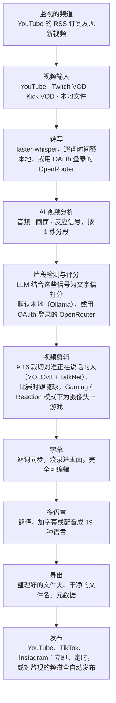

<div align="center">

[English](../../README.md) · **简体中文** · [日本語](README_ja.md) · [한국어](README_ko.md) · [Türkçe](README_tr.md) · [Русский](README_ru.md) · [Tiếng Việt](README_vi.md) · [ไทย](README_th.md) · [Deutsch](README_de.md) · [Español](README_es.md) · [Français](README_fr.md) · [Português (Brasil)](README_pt-BR.md) · [العربية](README_ar.md) · [Bahasa Indonesia](README_id.md) · [Italiano](README_it.md) · [हिन्दी](README_hi.md) · [বাংলা](README_bn.md) · [Filipino](README_tl.md) · [اردو](README_ur.md)

</div>

<a id="clips-kitty-the-free-open-source-opus-clip-alternative-for-chatting-gaming-and-sports-on-your-own-pc"></a>

# Clips Kitty：免费、开源、在你自己电脑上运行，适用于聊天、游戏和体育的 Opus Clip 替代品

> 本 README 由 AI 根据[英文 README](../../README.md) 翻译而成，英文版是基准，并且总是最先更新。非常欢迎母语使用者指正。
>
> 🌐 [网站中文页面](https://colingpt9.github.io/clips-studio/zh.html)

<a href="https://apps.microsoft.com/detail/9NB6XT7DSQZZ">
  <picture>
    <source media="(prefers-color-scheme: dark)" srcset="https://get.microsoft.com/images/en-us%20dark.svg">
    
  </picture>
</a>

[](https://github.com/ColinGPT9/clips-studio/releases)
[](https://github.com/ColinGPT9/clips-studio/releases)
[](../../LICENSE)
[](https://github.com/ColinGPT9/clips-studio/stargazers)
[](https://github.com/ColinGPT9/clips-studio)
[](../../CONTRIBUTING.md)
[](../../docs/DOCKER.md)

<a href="https://youtu.be/g1dMqrq-YaI"></a>

<a id="star-and-share-clips-kitty--goal-150"></a>

### 为 Clips Kitty 点星并分享 ⭐ 目标：150

[](https://github.com/ColinGPT9/clips-studio/stargazers) **/ 目标 150**

**请给仓库点个星，并分享出去。** 这不花你一分钱。这个项目背后没有任何营销预算，口口相传是让下一位小 YouTuber 或主播知道还有免费选择的唯一途径。

**我是为小 YouTuber 和主播做的**，他们负担不起其他工具，也请不起剪辑师。它是 Opus Clip、Vizard 和 Klap 的免费替代品，在你自己的电脑上运行 **Google Gemma**：没有服务器费用，没有按片段收费，也没有 AI 使用费。

> **Clips Kitty 在 1.1.3 版之前叫 Clips Studio**，为了符合 Microsoft Store 的命名要求而改名。同一个应用、同一个仓库、同样的数据。


**把长直播和长视频变成可以直接发布的 Shorts、Reels 和 TikTok，全程在你自己的电脑上完成。** Clips Kitty 是一款面向创作者的免费开源 AI 片段生成器和视频编辑器：粘贴一个 YouTube、Twitch 或 Kick 链接，它就会找出最精彩的时刻，裁成 9:16 并让说话的人保持居中，烧录逐词同步的字幕，还会写好标题、简介和话题标签。

默认不使用云端 AI。没有订阅。没有按片段收费。你的素材永远不会离开你的电脑，除非你让它把片段发布到你自己的 YouTube 频道。

本地优先，需要时再用云端：如果你的电脑太旧，跑不动 AI，可以改由云服务商来运行，费用记在你自己的账户上。**推荐的云端方案是 OpenRouter**：用你的 OpenRouter 账户登录（OAuth，不用复制密钥），即可使用众多模型（Claude、GPT、Gemini、Muse Spark 等）。在我的测试中，一段 2 小时的视频在 OpenRouter 上花了大约 11 美分，由 Gemma（Gemma 4 26B-A4B）挑选片段、Whisper（large-v3-turbo）负责转写；你实际要付多少，取决于你选的模型和视频的长度。OpenAI、Claude、Gemini、xAI、Meta、DeepSeek 和 Qwen 也可以直接使用，用的是你自己的 API 密钥。参见 [docs/AI-BACKENDS.md](../../docs/AI-BACKENDS.md)。

**为什么要做它：** 大多数正在成长的创作者都是一个人包揽一切：拍摄、直播、剪辑、发布。剪片段是别人发现你的途径，却往往是最先被放弃的事：剪辑师是大多数频道目前还负担不起的开销，剪辑工具按视频或按月收费，而手动剪又要花掉你本该用在别处的一整天。这个工具运行在你已有的硬件上，所以用起来不花钱，生成多少片段也没有上限。


<sub>一个视频、一台电脑、19 分钟，生成 38 个片段，什么都没有上传。</sub>

---

<a id="contents"></a>

## 目录

- [它能做什么](#what-it-does)
- [与 Opus Clip、Klap、Vizard 和 CapCut 的对比](#how-it-compares-to-opus-clip-klap-vizard-and-capcut)
- [工作原理](#how-it-works)
- [功能](#features)
- [适用场景](#what-its-built-for)
- [系统要求](#requirements)
- [安装与运行](#install-and-run)
- [选择 AI 模型](#pick-your-ai-model)
- [测试硬件与性能](#tested-hardware-and-performance)
- [支持的平台](#supported-platforms)
- [支持的语言](#supported-languages)
- [发布到 YouTube](#publish-to-youtube)
- [一次发布到所有平台](#publish-to-every-platform-at-once)
- [GPU 加速](#gpu-acceleration)
- [命令行使用](#command-line-use)
- [编写插件](#write-a-plugin)
- [在它之上构建](#build-on-it)
- [架构](#architecture)
- [参与贡献](#contributing)
- [路线图](#roadmap-detail)
- [许可证](#license)

---

<a id="what-it-does"></a>

## 它能做什么

你给 Clips Kitty 一段长视频，它还你一个文件夹，里面装满可以直接发布的竖屏成品片段；另外还有一个工作室，让你在发布前审阅和修改。

它专为大多数剪辑工具处理得最差的内容而打造：**直播、IRL 和对着镜头说话的素材、播客，以及健身/运动内容**：这些视频又长、结构又松散，精彩时刻埋在里面，光靠文字稿是找不到的。

<a id="how-it-compares-to-opus-clip-klap-vizard-and-capcut"></a>

## 与 Opus Clip、Klap、Vizard 和 CapCut 的对比

Clips Kitty 是云端剪辑工具的开源替代品。真正重要的区别在于工作在哪里完成：你的视频从不上传，所以没有什么需要计量，也没有什么可以收费。

| 工具 | 价格（按月计费） | 免费版 | 自动帮你找片段 | 水印 | 上传你的视频 | 开源 |
| ---- | --------------------- | --------- | ----------------------- | --------- | ------------------ | ----------- |
| **Clips Kitty** | 免费，没有付费版 | 整个应用 | 是 | 从不 | 否，在你的电脑上运行 | 是，AGPL-3.0 |
| Opus Clip | Starter $15，Pro $29 | 1080p，带水印，3 天后过期 | 是 | 免费版有 | 是 | 否 |
| Klap | Pro $29，Basic 按年计费 $14 | 一个视频 | 是 | 未说明 | 是 | 否 |
| Vizard | Creator $29，按年计费 $14.50 | 每月 60 点数，720p | 是 | 免费版有 | 是 | 否 |
| quso.ai | $29 至 $49 | 每月 75 点数，720p | 是 | 未说明 | 是 | 否 |
| Ssemble | $15 至 $60，按年计费 $6 至 $24 | 未列出 | 是 | 未说明 | 是 | 否 |
| Descript | $16、$24、$50 | 每月 60 分钟，720p | 部分，它是文字稿编辑器 | Free 和 Hobbyist 版有 | 是 | 否 |
| CapCut | 免费使用，capcut.com 上有付费版 | 整个编辑器 | **否，需要你手动剪** | 视功能而定 | 桌面版不上传 | 否 |

**最值得了解的是 CapCut**，因为大家给出的免费答案都是它。它是个好编辑器，也不花钱，但每个时刻都要你自己找，每个片段都要你自己裁。Clips Kitty 同样免费，而这第一轮粗剪，正是它替你完成的部分。

如果你没有带显卡的 Windows 电脑、只是偶尔剪一剪，或者需要在手机上工作，**那么 Opus Clip、Klap 或 Vizard 是更好的选择**。Clips Kitty 是为在你已有的硬件上大批量剪辑而打造的。

**[七款工具的完整对比，以及各自最擅长什么](https://colingpt9.github.io/clips-studio/alternatives.html)**

<sub>价格于 2026 年 9 月 17 日在各公司自己的定价页面上核对。CapCut 没有我们能读取的定价页面，因此未列出其价格。套餐会变，这张表不会自动更新。</sub>

<a id="how-it-works"></a>

## 工作原理



**除非你另作选择，每个阶段都在你的电脑上运行。** 例外是：用你的账户登录的 OpenRouter（用于 AI 或转写），以及发布（只上传你发送的片段）。除此之外，正常运行中唯一会访问网络的，就是下载源视频。

<a id="the-stages-in-detail"></a>

### 各阶段详解

**转写：faster-whisper。** 逐词时间戳，可用时在 CUDA 上运行，否则回退到 CPU。正是逐词计时，让字幕落在正确的音节上，也让片段从真正的句子边界开始。

**AI 片段评分。** 文字稿只是五种信号之一。音频提供响度峰值、爆发密度（笑声和掌声就是这个样子）以及"安静→爆发"式的高潮形态。画面提供镜头切换、运动和人脸面积变化。反应信号把这些融合在一起。每种信号都在*该视频内部*归一化，因此无论是安静的播客，还是尖叫不断的直播，都能产生有意义的峰值。如果有真实的观众数据（按独立发言人数统计的 Twitch 聊天回放、YouTube 的"最多重播"热图），还会额外加上一个有上限的小加分。

本地 LLM 看到的是文字稿**加上这些事件的时间线**，所以它能正确权衡"话说得平淡，但现场炸了"这种情况。由于小模型给所有内容打的分都挤在一个很窄的区间里，入围的片段随后会在一次重排调用中两两比较：对 7B 模型来说，相对判断比绝对打分容易得多。

**Creator Profiles（创作者档案）。** 应用会跨视频为每位创作者建立知识库：反复出现的话题、系列、合作者、常用梗，以及持续进行的故事线。这些上下文帮助它写出准确的标题，发现前后呼应的梗。它刻意保持保守：口头禅必须真的重复出现才算数，不再被提及的知识会进入休眠，而且它带来的每一点加分都是附加的、有上限的，并且可以关闭。

**视频编辑器。** 非破坏性编辑：修剪、内部剪切、静音、静音单词、音量、淡入淡出、速度、开头钩子文字、音乐和水印都以操作的形式保存，在渲染时才应用。还有一个 AI 编辑聊天（*"把它加长 5 秒"*、*"字幕写成了 gost，应该是 ghost"*），由模型提出修改，经过校验的代码负责执行。

**长视频处理。** 一条可选的 16:9 路径，使用同样的分析：横屏片段、适合 X/Twitter 时长的剪辑、精选集锦，或去掉冷场的完整直播。

**多语言流程与 AI 配音。** 字幕翻译后，会在写入或烧录*之前*先给你审阅，所以有问题的句子能在还来得及的时候改掉。术语表可以保护频道名、赞助商和圈内梗不被翻译。配音使用本地 TTS，声音可以先试听。

**本地 GPU 加速。** 检测和转写使用 CUDA，视频硬件编码通过 NVENC/AMF/QSV（自动检测，可回退到 CPU），LLM 则通过 Ollama 在 GPU 上运行。

<a id="features"></a>

## 功能

- **多模态片段检测**：融合说话内容、音频兴奋度、画面活跃度、画面中的反应，以及开头钩子/高潮的强度，为每个时刻打 0–100 分。每个达到质量线的片段都会保留，没有随意设定的数量上限。
- **识别说话人的人脸追踪**：YOLOv8 姿态检测让主体保持居中；在多人画面中，镜头会跟随**真正在说话的人**，由 TalkNet 主动说话人检测根据人脸和音频共同判断，而不是根据动作。说话人换了，画面会像剪辑师那样直接**切**过去，而不是平移扫过去。只裁切构图：从不拉伸，从不变形。
- **Podcast mode（播客模式）**：对于多机位素材，每个镜头都对准一个人，得到稳定的裁切，所以切换时直接落在人脸上，没有平移。在一个镜头内，根据嘴部动作选择主体，否则回退到最显眼的那张脸。
- **Vertical Live（竖屏直播）**：适用于直播时本来就是竖屏的直播（YouTube 竖屏直播、Twitch Dual Format、Streamlabs Dual Output、下载下来的 Instagram 或 TikTok 直播）。保留直播自身的 9:16 布局，跳过人脸追踪，仍按常规方式挑选时刻。参见 [docs/VERTICAL-LIVE.md](../../docs/VERTICAL-LIVE.md)。
- **Sports（体育）：足球和篮球**：一场比赛中的每个精彩时刻都各成一个片段，包含前面的铺垫和之后的反应。
  - **足球**：进球、扑救、红黄牌和绝佳机会。进球从比分框读取，再借助观众的反应确定时间点，9:16 裁切会跟随球。可以选择 All goals（全部进球）、Best saves（最佳扑救）、Cards（红黄牌）等，还能把这些时刻拼成比赛回顾，以及球队或球员集锦。
  - **篮球**：扣篮、三分球、盖帽、抢断和绝杀。屏幕上的比分条会确认每一次进球及其分值，节数和比赛时钟让一记绝杀的分量远远超过第一节的一次进球。观众、替补席和场边的反应也会被找出来。每个片段的 9:16 裁切都围绕这一回合来规划：球和持球的人、传球的接球人，以及一路跟到篮筐的投篮，篮筐和篮板都留在画面里。裁切跟着这一回合平移，从不缩放。球由 [E-BARD](https://github.com/GabrieleGiudic/E-BARD#readme) 检测模型找出（致谢见[许可证](#license)）。

  参见 [docs/SPORTS.md](../../docs/SPORTS.md)。
- **可编辑的烧录字幕**：逐词同步，样式随你设置（颜色、大小、位置、每行字数、大小写，或者关闭）。导出前可以逐行修正转写错误。有两个人说话时，第二位说话人的字幕可以换一种颜色，认错了的也可以手动改过来。
- **AI 编辑聊天**：用大白话说出哪里不对，它就会重新剪。
- **Ask Clips Kitty**：仪表盘底部的文本框。用一句话说出你想要什么，比如*"剪一下这场直播，一定要包括我被 boss 打死的那段，用大号黄色字幕"*，它就会把视频加入队列，告诉片段挑选器要找什么，并设置你提到的选项。**它需要 Gemma 4 模型**：参见[底部的文本框需要 Gemma 4](#the-text-box-at-the-bottom-needs-gemma-4)。
- **AI 生成标题、简介和话题标签**，导出前都可以编辑。
- **Creator Profiles（创作者档案）**：应用会随着时间了解每位创作者，从而更好地挑选片段、起标题。所有内容都留在你的电脑上，你可以查看、更正或清除。
- **多语言发布**：19 种语言，烧录之前可以先审阅。
- **AI 配音**：本地文字转语音，每种语言都能试听声音。
- **长视频导出**：16:9 片段、集锦，或去除重复内容的直播剪辑版。集锦的简介带有**章节时间戳**，观众可以在 YouTube 上在各个时刻之间跳转。
- **水印和品牌配置**：按创作者设置的默认值会自动应用。
- **模型管理器**：在应用内更换 AI 大脑；下载、删除和切换模型都有进度条，不需要终端。
- **在编辑器里直接发布到 YouTube**：标题、简介、标签、缩略图、播放列表、受众和可见性，然后立即上传或定时发布。可选功能，默认关闭，使用的是你自己的 Google API 密钥。
- **应用内反馈**：自动收集诊断信息的错误报告，不需要账户。
- **无障碍界面**：键盘焦点、减少动态效果、可调整的字体和字号。

<a id="what-its-built-for"></a>

## 适用场景

你给它的任何视频，它都能处理。下面这些情况下，它做的判断比功能列表看起来的更多或更少，提前说清楚，免得你意外：

| 内容 | 表现如何 |
|---|---|
| **IRL、闲聊、播客、vlog、访谈** | 这是它的调优重点，也是每次发布前都会在真实直播上测试的内容 |
| **游戏和反应视频** | 开启 **Gaming / Reaction**（游戏 / 反应）后：一半画面是摄像头，另一半是游戏或被反应的视频，处理前会在视频自身的画面帧上检查（[docs/GAMING.md](../../docs/GAMING.md)）。主播是正在说话的那个人，而不是脸最大的那个。不开启时，构图可能会去跟随游戏里的角色。只支持真人出镜，不支持 VTuber |
| **体育比赛** | 开启 **Sports**（体育）后：适用于带比分框和解说的转播，这种情况下能确定进球和篮球得分。俱乐部或手机拍摄的素材通常两者都没有：它的片段会跟随球，进球则来自你粘贴的比赛事件，比如俱乐部 App 里的进球标记（[docs/SPORTS.md](../../docs/SPORTS.md)） |
| **反应视频所反应的内容** | 片段仍然是根据*说出来的话*挑选的，所以被观看视频里没人评论的时刻，它是看不到的 |

片段挑选由文字稿和信号驱动。如果好笑的地方*只在画面上*，而且没人评论，那就得你自己在编辑器里找了。

<a id="requirements"></a>

## 系统要求

|             | 最低配置                                      | 推荐配置                     |
| ----------- | -------------------------------------------- | ------------------------------- |
| **GPU**     | NVIDIA RTX 2060（6 GB）                       | RTX 3060 12 GB 或更好        |
| **CPU**     | Intel Core i3-9100 / AMD Ryzen 3 3200G（2019 年）| 6 核或更多                 |
| **RAM**     | 16 GB                                        | 16 GB 或更多                   |
| **硬盘**    | 约 20 GB，另加你要剪的视频所需的空间    |                                 |
| **操作系统**      | Windows 10 或 11                             |                                 |

**低于最低配置也许还能运行，但不受支持，而且会很慢。** 剪一场直播意味着数小时的视频解码、转写和编码；大约 2019 年之前的硬件会慢到让你觉得应用坏了，哪怕它其实在正常工作。

其中有两点值得展开说说：

- **16 GB 内存不是建议，而是硬性要求。** 8 GB 会把整个视频分析完，然后什么都渲染不出来，看起来像是崩溃，而不像是内存不足。
- **GPU 是可选的，不是必需的。** 没有 GPU 时一切都在 CPU 上运行，慢一些，但功能完整。RTX 2060 这一档是 GPU 路径开始起作用的地方；参见 [GPU 加速](#gpu-acceleration)。

**应用仅支持 Windows。** Python 引擎应该能在 Linux/macOS 上运行，但目前没有 Mac 版本，维护者也没有 Mac 可以测试。如果你有 Mac 并且愿意帮忙，请看 [#62](https://github.com/ColinGPT9/clips-studio/issues/62)。

从源码运行，需要安装程序原本会帮你打包好的那些东西：

- **Python 3.10+** 和 **Node.js 18+**
- PATH 中可用的 **[FFmpeg](https://ffmpeg.org/download.html)**
- 已经拉取了模型的 **[Ollama](https://ollama.com)**：`ollama pull gemma:7b`

<a id="install-and-run"></a>

## 安装与运行

**最简单的方式是 [Microsoft Store](https://apps.microsoft.com/detail/9NB6XT7DSQZZ)。** 一键安装，自动更新，Windows 也不会弹出安全提示。Microsoft 已对安装包进行了认证和签名，所以下面提到的 SmartScreen 警告根本不会出现。Store 会在轮到时安装新版本；如果想马上更新，请在 Microsoft Store 中打开 Clips Kitty 的页面，点击 **Update**（更新）。

**或者下载安装程序。** 从 [Releases](https://github.com/ColinGPT9/clips-studio/releases) 下载最新的 **Web Setup** 并运行。它包含应用、Python 引擎、所有库、FFmpeg、AI 运行时，以及全部检测和转写权重：不需要 Python，不需要设置 PATH，不需要终端，也不需要再装第二个程序。

**或者使用 winget。** `winget install ColinGPT9.ClipsKitty` 会在终端里安装同一个 Web Setup。

它唯一不包含的是语言模型本身，因为这些模型附带的许可证必须由下载者本人接受，不能由别人代为接受。安装向导会自动开始下载，按你的显卡选择合适的大小，并显示进度条。所以就是：一次下载，一次双击，一个进度条。之后它就可以离线运行。

> 第一次运行时，Windows 会警告该应用未签名。点击*更多信息 → 仍要运行*即可。签名证书已经在计划之中。

<a id="from-source"></a>

### 从源码运行

```bash
git clone https://github.com/ColinGPT9/clips-studio
cd clips-studio
pip install -r requirements.txt

cd ui
npm install
npm run dev        # opens the Clips Kitty desktop app
```

应用会自动启动它自己的 Python 引擎。在 **Clip Editor**（片段编辑器）中粘贴链接，点击 *Generate clips*（生成片段），就能实时看到进度。

自己构建安装程序只需要一条命令。参见 [CONTRIBUTING.md](../../CONTRIBUTING.md#building-the-windows-installer)。

<a id="with-docker-nothing-else-to-install"></a>

### 使用 Docker：别的什么都不用装

面向贡献者。你只需要 [Docker Desktop](https://docs.docker.com/get-started/get-docker/)，别的都不用：不需要 Python、Node、FFmpeg，也不需要 PyTorch。

```bash
git clone https://github.com/ColinGPT9/clips-studio
cd clips-studio
docker compose up
```

三个服务会一起启动：

| | |
|---|---|
| **<http://localhost:5173>** | 界面，在你的浏览器中打开 |
| **<http://localhost:8765>** | 引擎及其 API |
| Ollama | 本地 AI，端口 :11434 |

然后拉取一个模型（`docker compose exec ollama ollama pull gemma3:4b`），你就有了一个能用的开发环境。

检查也用同样的方式运行：

```bash
docker compose run --rm engine pytest
docker compose run --rm ui npm run typecheck
```

> **跳过十分钟的首次构建：** `docker compose pull` 会拉取预构建好的引擎镜像，而不是在本地编译 PyTorch 和 OpenCV。

桌面外壳本身仍然在你的主机上运行，因为 Electron 需要显示器，其他一切都已容器化。详情，以及它无法告诉你的事，见 [docs/DOCKER.md](../../docs/DOCKER.md)。

<a id="pick-your-ai-model"></a>

## 选择 AI 模型

打开 **Models**（模型）页面，看看装了什么，以及你的 GPU 能跑什么：

只看一个维度：你有多少显存。这些行和应用里显示的一样，来自 [`llm/manager.py`](../../llm/manager.py) 中的 `RECOMMENDATIONS`。安装向导和 Models 页面读取的是同一张表，所以它们彼此之间，以及和这里，都不会出现不一致。

| 你的硬件 | 推荐模型 | |
|---|---|---|
| CPU / 核显，没有独立显卡 | `gemma3:4b` | 已测试 |
| 显存低于 6 GB，或较旧的电脑 | `gemma4:e2b` | |
| 6 GB 显存 | `gemma4:e4b` | |
| 8 GB 显存 | **`gemma:7b`** | 已测试 · 默认附带 |
| 10–12 GB 显存 | `gemma3:12b` | 已测试 |
| 16–24 GB 显存 | `gemma3:27b` | |

以及出于显存以外的原因值得选择的模型：

| 原因 | 模型 |
|---|---|
| 翻译 / 多语言 | `qwen3:8b` 或 `qwen3:14b` |
| 宽松的许可证 | `mistral-nemo:12b`（Apache-2.0）· `phi4:14b`（MIT） |

**只有标为"已测试"的这三个模型在真实直播上跑过**，其中 `gemma:7b` 积累的时长最多；`config/settings.yaml` 默认附带的就是它。其余模型之所以列出，是因为它们大小合适，而且可以免费商用，而不是因为已经用它们衡量过片段质量。它们都能用，因为应用通过 Ollama 以完全相同的方式和每个模型通信，但还没有人检验过它们能不能挑出更好的时刻。填补这个空白的是 [#38](https://github.com/ColinGPT9/clips-studio/issues/38)。

Ollama 能提供的任何模型都能用，切换只要点一下。翻译可以使用和剪辑*不同*的模型，设置 `llm.translation_model` 即可。

<a id="the-text-box-at-the-bottom-needs-gemma-4"></a>

### 底部的文本框需要 Gemma 4

**Ask Clips Kitty**，也就是仪表盘底部的文本框，只能配合能调用应用工具的模型使用。Gemma 4 可以。`gemma:7b` 和 Gemma 3 系列模型不行，而在没有显卡、或者显存 8 GB 及以上的电脑上，安装程序装的正是其中之一。在这些电脑上，除非你添加一个 Gemma 4 模型，否则这个文本框用不了：2.0 版会显示 *"No installed model can use tools"*（没有已安装的模型可以使用工具），之后的版本会直接在文本框里提供下载。

无论用哪个模型挑选片段，都请在 **Models** 页面上另外装一个 Gemma 4 模型：显卡显存 6 GB 或以上装 `gemma4:e4b`，更少的话装 `gemma4:e2b`。你不必切换到它。文本框会自己找到它，你的片段仍然由你选的模型来挑。如果你改用 OpenRouter 运行 AI，文本框会使用那个模型，什么都不用装。

<a id="tested-hardware-and-performance"></a>

## 测试硬件与性能

Clips Kitty 每天都在这台机器上开发和测试，所以如果你想对比自己的结果，它是个有用的参考：

| | |
|---|---|
| **GPU** | NVIDIA GeForce RTX 3060，12 GB 显存 |
| **CPU** | AMD Ryzen 5 5600X（6 核 / 12 线程） |
| **RAM** | 16 GB |
| **操作系统** | Windows 10 |
| **剪辑模型** | 通过 Ollama 运行的 `gemma:7b` |
| **转写** | 在 CUDA 上运行的 faster-whisper `large-v3-turbo` |

本仓库中的一切（默认设置、`parallel_renders: 3`、5 分钟的分析分块大小）都是针对大致这一档的机器调优的。在更强的 GPU 上，同时调高 `llm.num_ctx` 和 `analysis.chunk_seconds`，并换用大一号的模型；在更弱的 GPU 上，降到 `gemma3:4b`。

如果你在别的硬件上对 Clips Kitty 做了基准测试，请发到 [Discussions](https://github.com/ColinGPT9/clips-studio/discussions)。来自真实机器的真实数据，能帮每个人规划自己的配置。

<a id="supported-platforms"></a>

## 支持的平台

| 来源 | 支持情况 |
|---|---|
| YouTube 视频 | 完全支持。特意选择 H.264（AV1 会让处理时间大约翻倍） |
| Twitch VOD | 完全支持，包括把聊天回放作为观众信号 |
| Kick VOD | 完全支持（Kick 在直播结束后会丢弃聊天记录，所以没有聊天信号） |
| 本地视频文件 | 完全支持。在发布之前先剪你自己的素材 |
| 直播 | 设计上就不支持。仅支持 VOD |

<a id="supported-languages"></a>

## 支持的语言

片段可以翻译、加字幕和配音成 **19 种语言**，而且**界面本身也翻译成了全部 19 种语言**，所以你可以用它发布时所用的同样语言来使用这个应用：

英语 · 西班牙语 · 葡萄牙语（巴西） · 法语 · 德语 · 印地语 · 印度尼西亚语 · 日语 · 俄语 · 阿拉伯语 · 中文（简体） · 越南语 · 菲律宾语 · 土耳其语 · 乌尔都语 · 孟加拉语 · 泰语 · 韩语 · 意大利语

添加一种语言，只需在 `multilingual/languages.py` 中加一行，再在 `ui/src/renderer/src/locales/` 中加一个语言文件。翻译器和字幕写入器与具体语言无关。

<a id="help-wanted-the-maintainer-only-speaks-english"></a>

### 征求帮助：维护者只会说英语

这 19 种界面翻译中，有 18 种从来没有被会说该语言的人读过。其中一半还没有翻译完。每种语言都有自己的 issue，用英语和该语言写成，而且**报告一个用错的词，就是一次完整的贡献**：不需要提交 pull request。[参与方式](../../docs/TRANSLATING.md)。

**需要补完**（大约还有 68 条字符串是英文）：[বাংলা（孟加拉语）](https://github.com/ColinGPT9/clips-studio/issues/43) · [Italiano（意大利语）](https://github.com/ColinGPT9/clips-studio/issues/44) · [한국어（韩语）](https://github.com/ColinGPT9/clips-studio/issues/45) · [ไทย（泰语）](https://github.com/ColinGPT9/clips-studio/issues/46) · [Tagalog（菲律宾语）](https://github.com/ColinGPT9/clips-studio/issues/47) · [Türkçe（土耳其语）](https://github.com/ColinGPT9/clips-studio/issues/48) · [اردو（乌尔都语）](https://github.com/ColinGPT9/clips-studio/issues/49) · [Tiếng Việt（越南语）](https://github.com/ColinGPT9/clips-studio/issues/50) · [中文](https://github.com/ColinGPT9/clips-studio/issues/51)

**需要校对**（已经完成，但还没有人确认读起来是否自然）：[العربية（阿拉伯语）](https://github.com/ColinGPT9/clips-studio/issues/52) · [Deutsch（德语）](https://github.com/ColinGPT9/clips-studio/issues/53) · [Español（西班牙语）](https://github.com/ColinGPT9/clips-studio/issues/54) · [Français（法语）](https://github.com/ColinGPT9/clips-studio/issues/55) · [हिन्दी（印地语）](https://github.com/ColinGPT9/clips-studio/issues/56) · [Bahasa Indonesia（印度尼西亚语）](https://github.com/ColinGPT9/clips-studio/issues/57) · [日本語（日语）](https://github.com/ColinGPT9/clips-studio/issues/58) · [Português（葡萄牙语）](https://github.com/ColinGPT9/clips-studio/issues/59) · [Русский（俄语）](https://github.com/ColinGPT9/clips-studio/issues/60)

想要的语言不在这里？请看 [#61](https://github.com/ColinGPT9/clips-studio/issues/61)。

<a id="publish-to-youtube"></a>

## 发布到 YouTube

默认关闭。在 **Settings → Publish to YouTube**（设置 → 发布到 YouTube）中开启后，编辑器里会出现一个 **YouTube** 标签页：填写标题、简介、标签、缩略图、播放列表、受众和可见性，然后点击 **Upload now**（立即上传）。如果你有未保存的编辑，Clips Kitty 会先渲染片段，然后直接上传到你的频道。没有导出步骤，也没有单独的发布页面。你始终不用离开编辑器。

如果你保持关闭，应用里的任何地方都不会有变化。

<a id="scheduling"></a>

### 定时发布

选择 **Schedule on YouTube**（在 YouTube 上定时发布）会*立即*上传视频，把它设为私享，并把发布时间交给 YouTube。到了那天，由 YouTube 来发布。

**你可以关掉 Clips Kitty，也可以关掉电脑。** 这个应用里没有计时器，没有后台服务，也没有任何需要一直开着的东西。只要 YouTube 接收了视频，Clips Kitty 的工作就完成了。

<a id="you-need-your-own-google-api-key"></a>

### 你需要自己的 Google API 密钥

Clips Kitty 不附带共享密钥，这不只是出于谨慎。Google 的上传配额是**按 Cloud 项目计算**的：一个共享密钥，意味着全世界所有用户都在分用同样的每天 100 次上传。你自己的项目给你独立的额度，而且你的凭据永远不会离开你的机器。中间没有任何 Clips Kitty 服务器。

设置是免费的，大约需要十分钟；设置中的向导会一步步带你完成：

1. 在 [Google Cloud Console](https://console.cloud.google.com/projectcreate) 中创建一个项目。
2. 在 APIs & Services → Library 中启用 **YouTube Data API v3**。
3. 填写 OAuth 同意屏幕，然后点击 **Publish app**（发布应用）。这一步很重要：如果停留在 *Testing*（测试）状态，Google 每 7 天就会让你的登录过期，你就得每周重新连接一次。"In production"（正式发布）并不等于已通过验证，也不收费。
4. Credentials → Create credentials → OAuth client ID → 类型选 **Desktop app**。
5. 把客户端 ID 和密钥粘贴到设置中，然后连接你的频道。

连接时你会看到"Google hasn't verified this app"（Google 尚未验证此应用）的警告。那是你自己的应用在提醒你自己。点击 **Advanced → Go to (unsafe)** 就能继续。

<a id="posting-publicly"></a>

### 公开发布

在依赖这项功能之前，有一件事你需要知道，因为没有任何软件能绕过它：

> **在你的 Google Cloud 项目通过 YouTube 的免费 API 审核之前，YouTube 会把通过它上传的每个视频都锁定为私享。** 这种锁定是永久的。之后你无法在 Studio 中把视频改成公开，也无法申诉。唯一的解决办法，是从一个已通过审核的项目重新上传。

Clips Kitty 会在每次上传后检查，如果发生了这种情况，会明明白白地告诉你，而不是为一个谁都看不了的视频报告上传成功。如果你打算公开发布，请先提交 [YouTube API Services 审核表单](https://support.google.com/youtube/contact/yt_api_form)。以**不公开列出**或**私享**方式上传不受影响。

<a id="what-it-can-and-cannot-set"></a>

### 能设置什么、不能设置什么

公开 API 提供的一切：标题、简介（其中的时间戳会变成章节）、标签、类别、语言、可见性、定时发布时间、是否为面向儿童的内容、经过修改/合成的内容披露、许可、嵌入、公开统计数据、自定义缩略图，以及添加到播放列表。

有些 YouTube Studio 功能根本不在公开 API 里，所以我们刻意不为它们提供控件，而不是放一个悄悄什么都不做的控件：创收和广告插播、付费推广披露、片尾画面和卡片、评论设置、年龄限制、首映，以及 Shorts 二创（remix）权限。面板会为这些功能提供跳转到 Studio 的链接。

Shorts 不需要任何特殊处理：没有单独的模式，也不需要 `#Shorts` 标签。YouTube 会根据视频的形状和长度，自行把它归类为 Short。

<a id="publish-to-every-platform-at-once"></a>

## 一次发布到所有平台

同样默认关闭。在 **Settings → Publish through WoopSocial**（设置 → 通过 WoopSocial 发布）中开启后，编辑器里会出现一个 **Publish**（发布）标签页：选择你的平台——或者点击 **Everywhere**（全部平台）——标题和简介只写一次，一次上传就会同时发到 YouTube、TikTok、Instagram、Facebook、X、Threads、LinkedIn、Pinterest 和 Bluesky。Clip Editor 中的 **Publish all**（全部发布）可以处理一整批，并且会错开时间，免得十几个片段在同一秒发出去。

这项功能**不是本地的**。片段及其信息会发送到一个发布服务，由它负责投递，并保管与你社交账户的连接，所以 Clips Kitty 从不索要任何社交平台的密码。应用的其他部分仍然在你的电脑上运行。

支持两种服务：**[WoopSocial](https://woopsocial.com/?via=clipskitty)**，其免费套餐可以连接两个账户，每天大约可发 5 条 YouTube 帖子，付费套餐会把这两项都提高；以及 **[Upload-Post](https://www.upload-post.com/)**，它能发到更多目标平台，还增加了缩略图、首条评论和发布队列。你可以开启其中一个，或者两个都开。

<sub>推广链接 - 如果你通过它注册，Clips Kitty 可能会获得佣金，你不需要额外付费。</sub>

**自带密钥。** 账户由你创建，社交账号由你自己连接，用的是你自己的额度。Clips Kitty 不收任何费用，不持有共享密钥，也不为任何东西付费——和 YouTube 集成的安排一样，原因也一样。

完整教程、各平台支持情况与限制：**[docs/UPLOAD-POST.md](../../docs/UPLOAD-POST.md)**。

<a id="gpu-acceleration"></a>

## GPU 加速

**视频编码**在三家厂商的显卡上都会自动启用硬件加速：NVIDIA（NVENC）、AMD（AMF）和 Intel（QSV）。引擎在启动时会用每一种试编码一帧，采用第一个真正能用的，否则回退到 CPU。可以在 `config/settings.yaml` 中用 `video.encoder` 强制指定。

**检测和转写**在 CUDA 下最快。默认的 `pip install torch` 装的是**仅 CPU** 的版本。NVIDIA 用户请执行：

```bash
pip uninstall torch torchvision -y
pip install torch torchvision --index-url https://download.pytorch.org/whl/cu130
```

**哪些显卡会使用 GPU：** GTX 16 系列、RTX 20 系列，以及包括 RTX 50 系列在内的所有更新的显卡。

**在 GPU 上转写**还需要 NVIDIA 的 cuBLAS 12：Whisper 的引擎（CTranslate2）是 CUDA 12 构建，而上面那个 CUDA 13 版的 PyTorch 只带 cuBLAS 13。`pip install -r requirements.txt` 会安装它（`nvidia-cublas-cu12`），安装版的应用也自带它，所以不需要 CUDA 工具包。没有它的话，转写会在 CPU 上运行，日志里会说明原因。

**GTX 10 系列及更老的显卡低于最低配置。** 它们不是受支持的配置。应用不会拒绝在这些显卡上启动：检测会回退到 CPU，一切照样能用，但会很慢；而且这么老的机器，通常搭配的 CPU 会让整个任务都变慢，而不只是检测这一步。

请使用上面的 `cu130` 索引，不要用更旧的。更旧的 CUDA 构建没有针对新显卡的代码，这时应用会在本该很快的硬件上回退到 CPU。

AMD GPU 用户：在 Windows 上，追踪和转写在 CPU 上运行，功能依然完整，只是慢一些。你的 GPU 仍然会用于通过 AMF 进行视频编码，以及通过 Ollama 运行 LLM（Ollama 本身就支持 AMD）。

**视频解码**无论是在追踪阶段还是渲染时，都通过带硬件加速的 FFmpeg 完成，而不是 OpenCV。用这种方式读取采样帧，消耗的 CPU 大约只有以前在 Python 中解码的十分之一，这一点很重要，因为追踪阶段要过一遍每个片段。

**CPU 分配。** 检测和渲染都想占满所有核心，放着不管的话，它们会互相争抢，还会和界面抢。引擎在启动时把核心分配给各个渲染进程，并刻意留出两个，这样批量处理时应用依然能保持响应。可以用 `video.parallel_renders` 调整。

<a id="command-line-use"></a>

## 命令行使用

不用桌面应用，一切照样能用：

```bash
python main.py process "https://www.youtube.com/watch?v=VIDEO_ID"   # one video
python main.py models                                               # list/switch models
python main.py status                                               # processing state
python main.py serve                                                # just the API engine
```

设置保存在 [config/settings.yaml](../../config/settings.yaml) 中。文件顶部是一小段快速设置，所有高级选项都在它下面。每个 LLM 提示词都是 [config/prompts/](../../config/prompts/) 中的纯文本文件，所以你不用碰 Python，就能调整片段的评分方式。

<a id="write-a-plugin"></a>

## 编写插件

你对某款游戏、某项运动或某类节目的了解，比通用检测器更深？写一个小小的 Python 插件，来查找、理解或评价视频中的时刻，剩下的交给 Clips Kitty。SDK 采用 MIT 许可证，所以你的插件可以用任何许可证，也不需要 fork 任何东西。

```text
Clips Kitty SDK

Input                      a link or a video file
  ↓
Video                      Clips Kitty downloads it and writes down what is said
  ↓
Your plugin                every step is optional
  ├── find                 picks the moments                  built
  ├── understand           says what happens in each one      built
  ├── rate                 scores each moment                 built
  └── edit                 suggests edits for the creator     built
  ↓
Clips Kitty                does every step no plugin does, then cuts, frames and captions the clips
  ↓
Creator / Social Platform  posts when the creator clicks Publish, or on a schedule or automatic posting the creator switched on
```

- 一个插件可以为视频查找时刻；它会取代 Clips Kitty 自己的查找。
- 在任何查找插件之后，最多 3 个插件可以负责理解，最多 3 个可以负责评分。
- 插件的角色由其清单中的 `inputs` 和 `outputs` 决定（[步骤](../../docs/developers/steps.md)）。
- 最多 3 个插件可以为将要生成的片段建议编辑。
- 编辑插件提出的编辑建议，会在编辑器里等待创作者处理（[步骤](../../docs/developers/steps.md#suggest-edits-the-edit-step)）。
- 发布不是插件步骤：Clips Kitty 自己发布片段，并且可以通过 WoopSocial，用创作者自己的账户一次发布到多个网站（[一次发布到所有平台](#publish-to-every-platform-at-once)）。`kind: publisher` 会被拒绝：插件不负责发布。

三条命令就能安装 SDK、用 `game-events` 模板创建一个插件（针对 Quarkbloom Arena，一款虚构的游戏），并在 SDK 生成的测试视频上运行它。需要 Python 3.11、FFmpeg 和 Git。

PowerShell（Windows）：

```powershell
py -m pip install "clipskitty-sdk[yaml,test] @ git+https://github.com/ColinGPT9/clips-studio#subdirectory=sdk/python"
py -m clipskitty_sdk new quarkbloom-bursts --template game-events --publisher your-github-name
py -m clipskitty_sdk run quarkbloom-bursts --sample
```

bash（macOS、Linux）：

```bash
python -m pip install "clipskitty-sdk[yaml,test] @ git+https://github.com/ColinGPT9/clips-studio#subdirectory=sdk/python"
python -m clipskitty_sdk new quarkbloom-bursts --template game-events --publisher your-github-name
python -m clipskitty_sdk run quarkbloom-bursts --sample
```

Clips Kitty 2.1.0 是第一个能运行插件的正式版本，并附带 SDK 1.3.0。

**[你的第一条游戏管线](../../docs/developers/first-game-pipeline.md)** 从这里继续，一步步带你做出一个安装在 Clips Kitty 中、并在其 Marketplace 上架的插件。[信号食谱](../../docs/developers/signals-cookbook.md)提供读取游戏视频的各种做法，[SDK 参考](../../docs/developers/sdk.md)列出了每条命令和调用，[开发者文档](../../docs/developers/README.md)涵盖其余的一切。网站上的 [Clips Kitty SDK](https://colingpt9.github.io/clips-studio/developers.html) 页面是简短版本。

<a id="build-on-it"></a>

## 在它之上构建

桌面应用其实是一扇通往**本地 HTTP API** 的窗口，只要 Clips Kitty 开着，这个 API 就在运行。Discord 机器人、批处理程序、网页前端或 OBS 集成都可以驱动同一条管线，而且不需要先往应用里添加任何东西。

```bash
python main.py serve --port 8765          # the engine on its own, no window

curl -X POST http://127.0.0.1:8765/jobs \
  -H "Content-Type: application/json" \
  -d '{"url": "https://www.youtube.com/watch?v=VIDEO_ID"}'
# {"job_id": 149}
```

片段以 JSON 形式返回，附带产生它们的评分明细，以及一个可以串流播放的 MP4：

```bash
curl -s http://127.0.0.1:8765/videos/VIDEO_ID/clips \
  | python -c "import json,sys; [print(c['score'], c['title']) for c in json.load(sys.stdin)]"
```

**[docs/API.md](../../docs/API.md)** 记录了值得在其上构建的端点，附有可以运行的示例，以及那些曾让人白白耗掉一下午的陷阱。该服务还在 `http://127.0.0.1:8765/docs` 提供它自己的交互式文档。

它**没有身份验证**，正因如此它只绑定 localhost。在把任何东西对接上去之前，请先阅读 API 文档中的安全说明。

<a id="or-bring-your-own-model"></a>

### 或者带上你自己的模型

那是在应用*外围*构建。你也可以在它*内部*构建，起点就是插件（[编写插件](#write-a-plugin)）。如果你关心的素材不是这个应用调优的方向，无论是体育、游戏、反应视频、讲座，还是没人尝试过的东西，插件都可以在不 fork 的情况下查找、理解或评价其中的时刻。插件运行在 Clips Kitty 自带的 Python 上，可以使用标准库（应用省略的少数几个模块除外）和 SDK：Clips Kitty 目前还不能为插件安装其他 Python 包。

如果想改动应用本身：管线在本地运行 **YOLOv8（ultralytics）、OpenCV 和 TalkNet-ASD**，而决定哪些时刻成为片段的，是一组逐秒的信号，而不是写死的"什么才有趣"的观念。一个能在时间线上输出置信度的检测器，可以作为又一个信号加进来，它的峰值就会成为候选片段。如果你的检测需要 Clips Kitty 目前还不能为插件安装的 Python 包，那就 fork 它，接入你自己的检测。**[docs/EXTENDING.md](../../docs/EXTENDING.md#bring-your-own-model)** 写明了接口约定、要复制的文件，以及开始之前值得知道的性能陷阱。

**完全不需要轮询。** 提交任务时带上 `webhook_url`，引擎完成时就会 POST 一次（如果你传了密钥，还会用你自己的密钥签名），这样一个停靠面板或 n8n 流程就可以在一场直播所需的四十分钟里安静等待，而不用每隔几秒问一次。详情见 [docs/API.md](../../docs/API.md#webhooks-being-told-instead-of-asking)。

<a id="ask-an-ai-agent-to-do-it"></a>

### 让 AI 智能体来做

Clips Kitty 附带一个 **MCP 服务器**，因此 Claude、Cursor 或任何 MCP 客户端都能用自然语言驱动同一条管线：把直播加入队列、跟踪任务、读取它选中的片段、导出其中一个。

```bash
claude mcp add clips-kitty -- python main.py mcp
```

在安装版中，引擎的可执行文件是 `api.exe`（位于应用的 `resources\backend` 文件夹中），所以在那里命令是 `api.exe mcp`。

它通过 `127.0.0.1:8765` 与正在运行的引擎通信，所以 Clips Kitty 必须开着，而且它不需要任何形式的 API 密钥：负责剪辑的模型就是你自己机器上的那个（或者，如果你在 Settings → AI 中选择了云端模型，就是用你自己密钥的云端模型，MCP 客户端永远看不到这个密钥）。为支持 agent skill 的客户端准备的 skill 在 [skills/clips-kitty/](../../skills/clips-kitty/) 中。

<a id="built-with-clips-kitty"></a>

### 用 Clips Kitty 构建的项目

基于这个 API 运行的项目，都列在 **[Awesome Clips Kitty](https://github.com/ColinGPT9/awesome-clips-kitty)** 中，这是一份用 Clips Kitty 构建的管线、插件、集成、应用和工具的清单。第一个是 [Clips Kitty OBS Plugin](https://github.com/ColinGPT9/clips-kitty-obs-plugin)，一个 OBS Studio 停靠面板，会在你的直播结束后把它交给 Clips Kitty。你也做了一个？用 pull request 把它加进去（[方法](https://github.com/ColinGPT9/awesome-clips-kitty/blob/main/CONTRIBUTING.md)），并给你的仓库加上 `clips-kitty` 话题。

<a id="architecture"></a>

## 架构

完整设计请参见 **[ARCHITECTURE.md](../../ARCHITECTURE.md)**：管线、评分引擎、追踪、创作者智能、API 接口，以及让它保持模块化的设计规则。

<a id="contributing"></a>

## 参与贡献

欢迎贡献。开发环境设置和 pull request 的要求请参见 **[CONTRIBUTING.md](../../CONTRIBUTING.md)**，报告安全漏洞请参见 **[SECURITY.md](../../SECURITY.md)**。如果你想找个地方入手，标记为 [`good-first-issue`](https://github.com/ColinGPT9/clips-studio/labels/good-first-issue) 的 issue 都比较小，范围也很明确。

网站位于 [site/](../../site/)，发布到 GitHub Pages 和一个 Hugging Face Space。参见 [docs/MIRRORS.md](../../docs/MIRRORS.md)。**工作在 GitHub 上进行**，网站镜像是单向强制推送的，所以在镜像上做的提交会被覆盖。

打包和发布文档：

- **[docs/RELEASING.md](../../docs/RELEASING.md)**：构建和发布 Windows 安装程序，这是主要的发布渠道
- **[docs/MSSTORE.md](../../docs/MSSTORE.md)**：Microsoft Store 安装包，从创建开发者账户一直到认证
- **[packaging/winget/](../../packaging/winget/)**：winget 清单，指向上面的安装程序
- **[whop-app/](../../whop-app/)**：Whop 应用，把 Clips Kitty 展示给剪辑社区的成员。只有营销页面：它不处理视频，不存储任何东西，也不与桌面应用通信
- **[docs/DOCKER.md](../../docs/DOCKER.md)**：不用自己安装 Python、FFmpeg 和 PyTorch 就能运行引擎
- **[隐私](https://colingpt9.github.io/clips-studio/privacy.html)**：应用存储什么，以及什么可能离开你的机器（简短回答：什么都不会，除非你提交错误报告）

<a id="changelog-known-issues-roadmap"></a>

## 更新日志、已知问题、路线图

- **[CHANGELOG.md](../../CHANGELOG.md)**：每个版本改了什么，用通俗的话说明。
- **[KNOWN-ISSUES.md](../../KNOWN-ISSUES.md)**：目前有哪些问题或缺失，以及变通办法。上面的每一条都是实际观察到的。
- **[ROADMAP.md](../../ROADMAP.md)**：已经发布的、接下来要做的，以及长期方向。

**关注获取更新：**
[-%40ClipsKitty2-000000?logo=x&logoColor=white)](https://x.com/ClipsKitty2)
[](https://www.instagram.com/clipskitty2/)
[](https://www.youtube.com/@ClipsKitty2)

<a id="roadmap-detail"></a>

## 路线图详情

简短版本在 [ROADMAP.md](../../ROADMAP.md) 中。下面是那些较难决定的事项背后的理由，因为"为什么还没做"通常比"还没做"更有用。

1. **Android 配套应用，仅支持 Vertical Live**，以保持轻量：竖屏直播本来就是为手机屏幕构图的，所以应用保留直播自身的布局，只需要找出精彩时刻，不需要人脸追踪或重新构图。为了符合 Play Store 政策，仅支持 Twitch、Kick 和本地视频文件。
2. **更多体育项目**：足球和篮球已经上线。下一个是板球（Sport 菜单已经把它列为即将推出），和其他项目一样，作为独立的模块（参见 [docs/SPORTS.md](../../docs/SPORTS.md#adding-a-sport)）。
3. **完成时发短信通知**：视频的片段准备好时、发布时以及出错时发一条短信，这样无人值守的频道就能在没人盯着应用的情况下运行。
4. **为配音提供声音克隆** *（特意排在这个列表的最后）*：目前的配音使用预设的本地声音。要用创作者**自己**的声音说出翻译，需要一个克隆模型，而每一个靠谱的本地克隆模型都会带入它自己的 PyTorch 版本：在为剪辑配置好的机器上，这会把 torch 降级为仅 CPU 的版本，并悄悄去掉追踪和转写的 GPU 加速。为了加配音而搞坏剪辑，是笔不划算的交易。

   实际上，这要么得等消费级硬件跟上来，要么作为单独的可选安装发布，带有自己的 Python 环境，这样剪辑用的那个环境永远不会被动到。模型许可证也需要核查：好几个听起来最好的模型是禁止商用的，而这个应用的用户会靠视频变现。

<a id="license"></a>

## 许可证

**GNU AGPL-3.0-or-later**。参见 [LICENSE](../../LICENSE)，以及 [NOTICE](../../NOTICE)，后者说明了这在实践中意味着什么，以及安装程序打包了哪些东西。

篮球的球、篮筐和球员检测使用的是 [E-BARD](https://github.com/GabrieleGiudic/E-BARD) 检测模型（YOLOv8n），未经修改，按 CC BY 4.0 使用。感谢作者将它公开发布。其他所有打包的组件及其许可证都列在 [NOTICE](../../NOTICE) 中。

有三个部分单独授权，好让在 Clips Kitty 之上构建依然轻松：

| 部分 | 许可证 |
|---|---|
| Clips Kitty（应用、它的引擎、本仓库） | AGPL-3.0-or-later |
| 插件 SDK，[`sdk/python/`](../../sdk/python/) | MIT（[sdk/python/LICENSE](../../sdk/python/LICENSE)） |
| 示例插件，[`examples/pipelines/scene-cut-highlights/`](../../examples/pipelines/scene-cut-highlights/) 和 [`examples/pipelines/keyword-rater/`](../../examples/pipelines/keyword-rater/) | MIT |
| 随应用附带的 Awesome Clips Kitty 清单副本，`plugins/catalog_index.json`（该清单是[一个独立的仓库](https://github.com/ColinGPT9/awesome-clips-kitty)） | CC0-1.0 |

其他人制作的插件、管线和应用，保留其作者选择的许可证；Marketplace 会在每个条目上显示它。使用 SDK 并不会让插件受 AGPL 约束。

**如果你只是使用这个应用，这对你没有任何影响。** 安装它，剪你的直播，发布片段，靠它们赚钱。AGPL 约束的是*分发*这个软件、或者把*修改过的*副本作为网络服务运行的人，而不是使用它的人。你的素材和片段都归你所有。

**如果你修改并分享它，** 你的修改要以同样的许可证发布。这正是用意所在：对一款为创作者打造的工具所做的改进，会继续留给这些创作者使用。

它依然是为了被修改而打造的：更换模型、调整提示词、添加平台。

<a id="star-history"></a>

## Star 历史

感谢每一位为 Clips Kitty 点 Star、分享、报告问题和参与翻译的朋友。

<a href="https://www.star-history.com/#ColinGPT9/clips-studio&amp;Date">
  <picture>
    <source media="(prefers-color-scheme: dark)" srcset="https://api.star-history.com/chart?repos=ColinGPT9/clips-studio&amp;type=date&amp;theme=dark&amp;legend=top-left" />
    <source media="(prefers-color-scheme: light)" srcset="https://api.star-history.com/chart?repos=ColinGPT9/clips-studio&amp;type=date&amp;legend=top-left" />
    
  </picture>
</a>
